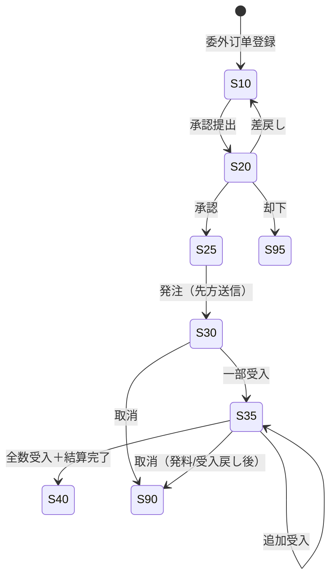

# 委外加工管理 详细设计书（外注加工管理 詳細設計書）

| 項目 | 内容 |
|---|---|
| 文書名 | 委外加工管理 详细设计书（外注加工管理 詳細設計書） |
| 文書番号 | DSN-PRD-004 |
| 版数 | v1.0 |
| 作成日 | 2026-10-20 |
| 作成者 | production-designer |
| 承認者 | 未承認（レビュー待ち） |
| 状態 | ドラフト（レビュー中） |
| 関連文書 | [业务域概要](00-overview.md) / [工单](02-work-order.md) / [領料・報工](03-material-issue-reporting.md) / [质量](06-quality-management.md) / [采购](../04-purchase/00-overview.md) / [财务](../07-finance/00-overview.md) / [DB 设计](90-db-design.md) / [跨域流程](../00-common/09-cross-domain-flow.md) 第 7 章 J17/J18 / [共通业务规则](../00-common/08-common-business-rules.md) |

---

## 1. 機能概要

| 項目 | 内容 |
|---|---|
| 機能 ID | F-PRD-009 |
| 機能名 | 委外加工管理（委外订单・委外発料・委外受入・加工費結算） |
| 目的 | 自社の設備・人員では対応しない工程（機座・端蓋の精密加工、特殊熱処理、専門組立等）を外部事業者へ委託する。支給材料の払出（OSI）→委外先での加工→受入検査（OSR）→加工費の確定（結算）を一貫管理し、**材料費（委託加工物資 1408）と加工費（買掛金）を分離して財務へ引き渡す** |
| 利用者・ロール | 計画員（委外要否判断）、採購員（委外発注・結算）、倉管員（発料/受入）、質検員（IQC）、成本会計（加工費確認） |
| 利用シーン | ①能力不足時の工程外注 ②非保有設備（大型機加工・熱処理）の外注 ③繁忙期の部品加工外注 ④委外先の月末加工費締め |
| 優先度 | P2（第一版。当面は手動発注＋発料/受入のみ先行可） |
| 画面 ID | SCR-PRD-017（委外訂单一覧）、SCR-PRD-018（委外訂单登録編集）、SCR-PRD-019（委外発料・受入登録）、SCR-PRD-020（加工費結算） |
| 関連 IF | IF-PRD-001（MES：外注先工程の進捗は手動）、なし（外部ベンダー連携は 第一版） |

### 1.1 委外の類型

| 類型 | `outsourcing_type` | 内容 | 発料 | 加工費の性質 | 例 |
|---|---|---|---|---|---|
| 工程委外（工程単位） | `10` | 自社工单の特定工序のみを外注。材料は自社から支給 | あり（OSI） | 加工賃 | 機座の精密切削、熱処理、特殊塗装 |
| 部品加工委外（部品単位） | `20` | 部品全体の加工を外注。材料を支給 | あり（OSI） | 加工賃 | 機座加工件、端蓋加工件 |
| 整体委外（完成品単位） | `30` | 製品全体の製造を外注（材料は外注先調達も可） | なし/一部 | 仕入価格（加工費＋材料費） | 第一版 の OEM 生産 |

> **伝票所有権**：OSI・OSR の伝票番号・在庫伝票は INV が単一所有・採番する（Lead 裁決 2026-10-20、08 §2.1 修正済）。PRD は発料/受入の**要求データ**を保持し、E25/E26 を発行、E18 受信で `stock_doc_id/stock_doc_no` を反映する。明細の `issue_no/receipt_no` は `request_no` に読み替える。\n\n> 本設計は `10`/`20`（支給材料あり）を主対象とする。`30` は 第一版 で採購の購買品と同様に扱う（未決 #4）。

## 2. 業務要件・業務ルール

### 2.1 前提条件

| # | 前提条件 | 成立しない場合の挙動 |
|---|---|---|
| 1 | 仕入先が有効（`mdm_supplier.status=1`）かつ委外先として承認済 | エラー `MSG-COM-049` |
| 2 | 委外品目に有効な BOM が存在（支給材料の展開元） | エラー `MSG-PRD-020` |
| 3 | 委外订单が承認済（25 以上）でなければ発料・受入できない | エラー `MSG-COM-034` |
| 4 | 加工費単価が購買価格（`mdm_purchase_price`）または契約単価に存在する | 単価 0 で警告（`MSG-PRD-080`） |
| 5 | 会計期間が締切済でない | `MSG-COM-071` |

### 2.2 業務ルール

| # | ルール | 根拠 | 関連項目 |
|---|---|---|---|
| BR-OS-01 | 委外订单は `OS{YYMMDD}{4桁}`（[08](../00-common/08-common-business-rules.md) 2.1）。承認は WF（金額 ≥ 50,000 元は採購経理→生産経理→財務経理、[00-overview](00-overview.md) 2.1） | 発注統制 | `os_status` |
| BR-OS-02 | 支給材料の数量は BOM 標準量 × 委外数量で計算し、`supply_material_flag=true` の明細のみ発料する。材料の所有権は自社に留保（委託加工物資） | 資産の帰属 | `prd_outsourcing_issue` |
| BR-OS-03 | 発料は委外订单単位・受入は明細単位で部分受入可能。受入累計 ≤ 注文数量 | 分納対応 | `received_qty` |
| BR-OS-04 | 受入品は IQC 検査（`inspection_type=10`）の対象。合格/特採のみ入庫可、不合格は返品（再加工）または NCR 起票 | [06](06-quality-management.md) | `quality_status` |
| BR-OS-05 | 加工費単価は税抜。加工費 = 受入数量 × 加工単価（部分受入は按分）。税額は税率 13%（加工費は課税役務） | [08](../00-common/08-common-business-rules.md) 4.2 | `processing_amount` |
| BR-OS-06 | 結算は月次一括（`period_code`）または受入単位。受入実績と結算対象が一致することを検証する | 買掛金の正確性 | `prd_outsourcing_settlement` |
| BR-OS-07 | 品質不良・納期遅延による扣款（減額）は結算時に明細単位で記録し、理由を必須とする | 品質コスト | `deduction_amount` |
| BR-OS-08 | 発料の余料は受入時に返却できる（`return_qty`）。返却分は材料費から控除する | 材料の保全 | `prd_outsourcing_issue_line.return_qty` |
| BR-OS-09 | 委外订单の取消は「発料・受入の実績がない」場合のみ。実績がある場合は発料戻入・受入返品後に取消 | [08](../00-common/08-common-business-rules.md) 3.3-4 | 6.6 |
| BR-OS-10 | 加工費の買掛計上は FIN が行う（J18）。本域は受入金額・加工費を E26 で通知し、結算で `ap_bill_id` を紐付ける | 更新責任の一元化 | E26 |
| BR-OS-11 | 委外先の在庫（支給材料）は自社在庫として把握しない（外注先保管）。ただし数量は発料−受入消費−返却で管理し、差異は棚卸調整の対象 | 在庫管理の境界 | 6.7 |

### 2.3 計算式・判定式

| # | 対象 | 算式 | 丸め | 例 |
|---|---|---|---|---|
| CALC-OS-01 | 支給材料数量 | `supply_qty = BOM.required_qty × order_qty ÷ base_qty` | 4 桁切上 | 7.5 × 200 = 1,500.0000 |
| CALC-OS-02 | 委外加工費 | `processing_amount = order_qty × processing_unit_price` | 2 桁 | 200 × 28.75 = 5,750.00 |
| CALC-OS-03 | 受入単位原価 | `unit_cost = (unit_material_cost + processing_unit_price)` | 6 桁 | 63.75 + 28.75 = 92.50 |
| CALC-OS-04 | 受入金額 | `amount = receipt_qty × unit_cost` | 2 桁 | 200 × 92.50 = 18,500.00 |
| CALC-OS-05 | 結算税額 | `tax_amount = net_amount × tax_rate` | 2 桁四捨五入 | 5,750.00 × 13% = 747.50 |
| CALC-OS-06 | 結算正味額 | `net_amount = processing_amount − deduction_amount` | 2 桁 | 5,750.00 − 0 = 5,750.00 |
| CALC-OS-07 | 扣款額 | `deduction = 不適合数量 × 加工単価 + 遅延ペナルティ（任意）` | 2 桁 | 2 × 28.75 = 57.50 |
| CALC-OS-08 | 委外残数量 | `remaining = order_qty − received_qty` | 4 桁 | 200 − 200 = 0 |

### 2.4 状態遷移



| 遷移 | トリガ | 権限 | 更新項目 | メッセージ |
|---|---|---|---|---|
| 10→20→25 | 提出→承認 | `production:outsourcing:create` / `approve` | `os_status`、`submitted_at`、`approved_*` | `MSG-COM-005` |
| 25→30 | 発注送信 | `production:outsourcing:create` | `os_status=30` | — |
| 30→35 | 部分受入 | `production:outsourcing:create` | `os_status=35`、`received_qty` | — |
| 35→40 | 全数受入＋結算完了 | `production:outsourcing:settle` | `os_status=40`、`settlement_status=20` | — |
| 任意→90 | 取消 | `production:outsourcing:create`（承認者） | `os_status=90`、`cancel_reason` | `MSG-PRD-082` |

## 3. 画面設計

### 3.1 画面一覧

| 画面 ID | 画面名 | 類型 | 概要 |
|---|---|---|---|
| SCR-PRD-017 | 委外订单一覧 | 一覧検索 | 委外订单の検索・進捗（発料/受入/結算）・印刷 |
| SCR-PRD-018 | 委外订单登録編集 | 登録編集 | 仕入先・品目・数量・加工単価・支給材料の登録、承認提出 |
| SCR-PRD-019 | 委外発料・受入登録 | 登録編集 | 発料（材料・数量・単価）／受入（数量・検査・材料費+加工費） |
| SCR-PRD-020 | 委外加工費結算 | 登録編集 | 期間/受入単位の結算、扣款、税額、FIN 連携 |

### 3.2 画面項目定義（SCR-PRD-018 委外订单登録編集）

| No | 項目 ID | 項目名 | 区分 | 種別 | 型/桁 | 必須 | 初期値 | 入力チェック | データソース | DB 項目 | 権限 | 備考 |
|---|---|---|---|---|---|---|---|---|---|---|---|---|
| 1 | outsourcing_no | 委外订单号 | ヘッダ | テキスト | VARCHAR(32) | ○ | 自動採番 | 一意 | `sys_sequence(PRD_OUTSOURCING)` | `outsourcing_no` | 参照のみ | — |
| 2 | supplier_code | 仕入先 | ヘッダ | コード選択 | VARCHAR(32) | ○ | 空 | 存在・有効・委外可 | `mdm_supplier` | `supplier_id`/`supplier_code`/`supplier_name` | 編集可 | — |
| 3 | factory_id | 工厂 | ヘッダ | 選択 | BIGINT | ○ | ログインユーザ既定 | 有効 | `mdm_factory` | `factory_id` | 編集可 | — |
| 4 | outsourcing_type | 委外類型 | ヘッダ | 選択 | SMALLINT | ○ | 20 部品加工 | 10/20/30 | 固定値 | `outsourcing_type` | 編集可 | — |
| 5 | order_date | 下单日 | ヘッダ | 日付 | DATE | ○ | 当日 | 締切期間外 | — | `order_date` | 編集可 | — |
| 6 | planned_delivery_date | 契約納期 | ヘッダ | 日付 | DATE | ○ | 工单納期 − 輸送日 | ≧ 下单日 | — | `planned_delivery_date` | 編集可 | — |
| 7 | currency_code | 通貨 | ヘッダ | 選択 | VARCHAR(3) | ○ | CNY | ISO 4217 | `mdm_currency` | `currency_code` | 編集可 | 当面は CNY のみ |
| 8 | tax_rate | 税率 | ヘッダ | 数値 | NUMERIC(7,4) | ○ | 13.0000 | 0〜100 | `mdm_tax_code` | `tax_rate` | 編集可 | — |
| 9 | contract_no | 加工契約番号 | ヘッダ | テキスト | VARCHAR(64) | — | 空 | 64 桁 | — | `contract_no` | 編集可 | — |
| 10 | source_type | 来源 | ヘッダ | 選択 | SMALLINT | — | 30 手工 | 10 工单/20 MRP/30 手工/40 請購 | 固定値 | `source_type` | 編集可 | — |
| 11 | work_order_no | 由来工单 | ヘッダ | コード選択 | VARCHAR(32) | △ | 空 | 存在・状態 25 以上 | `prd_work_order` | `source_id` | 編集可 | 工程委外時必須 |
| 12 | total_qty | 合計数量 | フッタ | 数値 | NUMERIC(18,4) | — | 自動 | — | — | `total_qty` | 参照のみ | — |
| 13 | processing_amount | 加工費合計 | フッタ | 数値 | NUMERIC(18,2) | — | 自動 | — | — | `processing_amount` | 参照のみ | — |
| 14 | tax_amount / total_amount | 税額/税込合計 | フッタ | 数値 | NUMERIC(18,2) | — | 自動 | — | — | `tax_amount`/`total_amount` | 参照のみ | — |
| L1 | material_code | 委外品目 | 明細 | コード選択 | VARCHAR(64) | ○ | 空 | 存在・半製品/委外加工品 | `mdm_material` | `material_id`/`material_code` | 編集可 | — |
| L2 | order_qty | 委外数量 | 明細 | 数値 | NUMERIC(18,4) | ○ | 0 | > 0 | — | `order_qty` | 編集可 | — |
| L3 | processing_unit_price | 加工単価 | 明細 | 数値 | NUMERIC(18,6) | ○ | 購買価格 | ≧ 0 | `mdm_purchase_price` | `processing_unit_price` | 編集可 | 単価 0 は警告 |
| L4 | processing_amount | 加工費 | 明細 | 数値 | NUMERIC(18,2) | — | 自動 | CALC-OS-02 | — | `processing_amount` | 参照のみ | — |
| L5 | planned_delivery_date | 明細納期 | 明細 | 日付 | DATE | ○ | ヘッダ納期 | ≧ 下单日 | — | `planned_delivery_date` | 編集可 | — |
| L6 | supply_material_flag | 支給材料有無 | 明細 | チェック | BOOLEAN | — | true | — | — | `supply_material_flag` | 編集可 | OFF は 第一版（非支給） |
| L7 | supply_materials | 支給材料 | 明細（子） | 一覧 | — | — | BOM 展開 | 材料存在 | `prd_bom` | `prd_outsourcing_issue`（発料時に確定） | 参照のみ | 展開結果を表示 |

### 3.3 画面項目定義（SCR-PRD-019 発料・受入登録）

| No | 項目 ID | 項目名 | 区分 | 種別 | 型/桁 | 必須 | 初期値 | 入力チェック | DB 項目 | 権限 |
|---|---|---|---|---|---|---|---|---|---|---|
| 1 | request_no / stock_doc_no | 要求番号 / INV 伝票番号 | ヘッダ | テキスト | VARCHAR(32) | — | 域内要求番号 | 一意 | `request_no`（PRD）/`stock_doc_no`（INV） | 参照のみ | OSI・OSR 伝票は INV が採番（PRD は採番しない） |
| 2 | outsourcing_no | 委外订单 | ヘッダ | コード選択 | VARCHAR(32) | ○ | 空 | 状態 30/35 | `outsourcing_order_id` | 編集可 |
| 3 | issue_date / receipt_date | 発料日/受入日 | ヘッダ | 日付 | DATE | ○ | 当日 | 締切期間外 | `issue_date`/`receipt_date` | 編集可 |
| 4 | warehouse_id | 倉庫 | ヘッダ | 選択 | BIGINT | ○ | 原料倉 WH01 | 有効 | `warehouse_id` | 編集可 |
| 5 | material_code | 材料/品目 | 明細 | テキスト | VARCHAR(64) | ○ | 自動 | — | `material_id`/`material_code` | 参照のみ |
| 6 | issue_qty / receipt_qty | 発料/受入数量 | 明細 | 数値 | NUMERIC(18,4) | ○ | 未発料/未受入 | > 0、上限チェック | `issue_qty`/`receipt_qty` | 編集可 |
| 7 | return_qty | 余料返却 | 明細（発料） | 数値 | NUMERIC(18,4) | — | 0 | ≧ 0、≤ 発料数量 | `return_qty` | 編集可 |
| 8 | batch_no | 批次 | 明細 | 選択 | VARCHAR(64) | △ | 空 | 批次管理品は必須 | `batch_no` | 編集可 |
| 9 | unit_cost | 単価 | 明細 | 数値 | NUMERIC(18,6) | — | 移動平均 | ≧ 0 | `unit_cost` | 参照のみ |
| 10 | processing_unit_price | 加工単価 | 明細（受入） | 数値 | NUMERIC(18,6) | ○ | 委外订单単価 | ≧ 0 | `processing_unit_price` | 参照のみ |
| 11 | defect_qty | 不合格数量 | 明細（受入） | 数値 | NUMERIC(18,4) | — | 0 | ≧ 0、≤ 受入数量 | `defect_qty` | 編集可 |
| 12 | batch_no（製品） | 製品批次 | 明細（受入） | 選択 | VARCHAR(64) | ○ | 自動 | 一意 | `batch_no` | 編集可 |
| 13 | quality_status | 品質状態 | 明細（受入） | 選択 | SMALLINT | — | 10 待検 | 10/20/30/40 | `quality_status` | 参照のみ |
| 14 | inspection_id | IQC 検査 | ヘッダ（受入） | テキスト | VARCHAR(32) | △ | 自動起票 | 合格/特採 | `inspection_id` | 参照のみ |

### 3.4 画面項目定義（SCR-PRD-020 加工費結算）

| No | 項目 ID | 項目名 | 区分 | 種別 | 型/桁 | 必須 | 初期値 | 入力チェック | DB 項目 | 権限 |
|---|---|---|---|---|---|---|---|---|---|---|
| 1 | settlement_no | 結算番号 | ヘッダ | テキスト | VARCHAR(32) | — | 自動採番 | 一意 | `settlement_no` | 参照のみ |
| 2 | supplier_code | 仕入先 | ヘッダ | コード選択 | VARCHAR(32) | ○ | 空 | 有効 | `supplier_id` | 編集可 |
| 3 | period_code | 結算期間 | ヘッダ | 選択 | VARCHAR(7) | ○ | 前月 | `YYYY-MM`、締切前 | `period_code` | 編集可 |
| 4 | settlement_type | 結算種別 | ヘッダ | 選択 | SMALLINT | ○ | 10 月度一括 | 10/20/30 | `settlement_type` | 編集可 |
| 5 | receipt_ids | 対象受入 | 明細選択 | 一覧 | — | ○ | 未結算受入 | 1 件以上、同一仕入先 | `outsourcing_receipt_id` | 編集可 |
| 6 | processing_amount | 加工費 | 明細 | 数値 | NUMERIC(18,2) | — | 自動 | CALC-OS-02 | `processing_amount` | 参照のみ |
| 7 | deduction_amount | 扣款 | 明細 | 数値 | NUMERIC(18,2) | — | 0 | ≧ 0、≤ 加工費 | `deduction_amount` | 編集可 |
| 8 | deduction_reason | 扣款理由 | 明細 | テキスト | VARCHAR(500) | △ | 空 | 扣款時必須 | `deduction_reason` | 編集可 |
| 9 | net_amount | 正味額 | フッタ | 数値 | NUMERIC(18,2) | — | 自動 | CALC-OS-06 | `net_amount` | 参照のみ |
| 10 | tax_rate / tax_amount / total_amount | 税率/税額/税込 | フッタ | 数値 | — | ○ | 13/自動/自動 | CALC-OS-05 | `tax_rate`/`tax_amount`/`total_amount` | 編集可（税率） |
| 11 | invoice_no / invoice_date | 発票番号/日 | ヘッダ | テキスト/日付 | VARCHAR(64)/DATE | — | 空 | — | `invoice_no`/`invoice_date` | 編集可 |
| 12 | ap_bill_no | 应付单号 | ヘッダ | テキスト | VARCHAR(32) | — | 空 | FIN 連携後設定 | `ap_bill_no`/`ap_bill_id` | 参照のみ |
| 13 | settlement_status | 状態 | ヘッダ | バッジ | SMALLINT | — | 10 | — | `settlement_status` | 参照のみ |

### 3.5 イベント処理

| No | 事件 | トリガ | 処理内容 | 呼出 API | 画面遷移 | 備考 |
|---|---|---|---|---|---|---|
| 1 | 委外訂单保存 | 保存 | 検証→採番→INSERT→支給材料を BOM 展開して表示 | `POST /api/production/outsourcing-orders` | 詳細 | 承認前は 10 |
| 2 | 承認提出 | ボタン | WF 提出、20 | `POST .../{id}/submit` | 一覧 | 金額 ≥ 50,000 元は上位承認 |
| 3 | 発注 | ボタン | 25→30、仕入先送信（当面は印刷/メール） | `POST .../{id}/order` | 一覧 | 帳票 PRT-PRD-006 |
| 4 | 発料確定 | ボタン | 材料明細を確認→発料番号採番→INSERT→E25 発行 | `POST /api/production/outsourcing-issues` | 一覧 | J17 |
| 5 | 受入確定 | ボタン | 数量・検査・単価確認→受入番号採番→INSERT→E26 発行 | `POST /api/production/outsourcing-receipts` | 一覧 | J18、IQC 起票 |
| 6 | IQC 判定反映 | イベント（E15） | 合格→入庫可、不合格→返品/NCR | —（E15 購読） | — | [06](06-quality-management.md) |
| 7 | 結算作成 | ボタン | 未結算受入を抽出→加工費/扣款/税額計算→WF 承認 | `POST /api/production/outsourcing-settlements` | 一覧 | FIN へ AP 連携 |
| 8 | 結算承認 | ボタン | 25→40、FIN へ買掛計上依頼（`ap_bill_id` 受領） | `POST .../{id}/approve` | 一覧 | 失敗時はロールバック |
| 9 | 取消 | ボタン | 6.6 の条件で取消 | `POST .../cancel` | 一覧 | — |

## 4. 処理詳細

### 4.1 処理一覧

| 処理 ID | 処理名 | 契機 | トランザクション | 排他 |
|---|---|---|---|---|
| PRC-PRD-004-01 | 委外訂单登録 | 保存 | 要 | なし（新規） |
| PRC-PRD-004-02 | 委外発料確定（E25 発行） | 発料確定 | 要 | 委外訂单行ロック |
| PRC-PRD-004-03 | 委外受入確定（E26 発行） | 受入確定 | 要 | 委外訂单行ロック |
| PRC-PRD-004-04 | IQC 判定反映（E15 購読） | イベント | 要（冪等） | 受入行ロック |
| PRC-PRD-004-05 | 加工費結算 | 結算作成/承認 | 要 | 結算行ロック＋受入行ロック |
| PRC-PRD-004-06 | 取消 | 取消 | 要 | 伝票行ロック |

### 4.2 委外発料確定（PRC-PRD-004-02）

1. 委外訂单が `os_status ∈ {30,35}`、明細の `supply_material_flag=true` を確認。
2. 支給材料を BOM から展開（CALC-OS-01）し、**未発料数量**を算出。発料数量 ≤ 未発料数量。
3. 在庫照会（INV）で利用可能在庫を確認。不足は `MSG-COM-070` 警告、マイナス在庫禁止（発料不可）。
4. `prd_outsourcing_issue`（`issue_status=30`）＋明細を INSERT。`prd_outsourcing_order_line.issued_qty` を UPDATE。
5. Outbox に E25 `production.outsourcing.issued` を記録：

```json
{
  "outsourcingOrderId": "1845678901234568800",
  "issueId": "1845678901234568901",
  "issueNo": "OSI2610210001",
  "lines": [
    { "materialId": "1845000000000001003", "qty": "1500.0000", "uom": "KGM", "batchNo": "261010P003", "warehouseId": "1845000000000000201", "unitCost": "8.500000" }
  ],
  "issuedAt": "2026-10-21T10:30:00+08:00"
}
```

6. INV が出庫（`OSI`）・E18 を発行。FIN が J17（借 委托加工物资 `1408` / 贷 原材料 `1403`）を計上する。本域は E18 受信で `unit_cost`・`amount` を確定値に補正する。
7. 監査ログ（CREATE/POST）。

### 4.3 委外受入確定（PRC-PRD-004-03）

1. 委外訂单 `os_status ∈ {30,35}`、受入数量 ≤ 未受入数量を確認（`MSG-PRD-080`）。
2. 材料費：発料原価（`prd_outsourcing_issue_line` の `unit_cost` × 消費数量）から按分。簡便法として `unit_material_cost = Σ発料金額 ÷ order_qty` を明細単位で計算（CALC-OS-03）。
3. 加工費：`processing_amount = receipt_qty × processing_unit_price`（CALC-OS-02）。
4. 受入単価 `unit_cost = unit_material_cost + processing_unit_price`、金額 `amount = receipt_qty × unit_cost`（CALC-OS-03/04）。
5. `prd_outsourcing_receipt`（`receipt_status=30`）＋明細を INSERT。`quality_status=10 待検`。IQC 検査単を自動起票（`prd_inspection`、`inspection_type=10`、`source_type=50`）。
6. `prd_outsourcing_order.received_qty`・`os_status` を UPDATE（全数なら 35/受入中）。
7. Outbox に E26 `production.outsourcing.received` を記録：

```json
{
  "outsourcingOrderId": "1845678901234568800",
  "receiptId": "1845678901234568920",
  "receiptNo": "OSR2611050001",
  "lines": [
    { "materialId": "1845000000000002001", "qty": "200.0000", "batchNo": "261105M001", "warehouseId": "1845000000000000202", "unitCost": "92.500000" }
  ],
  "processingFee": "5750.00",
  "receivedAt": "2026-11-05T14:00:00+08:00"
}
```

8. INV が入庫（`OSR`）・E18 を発行。FIN が J18（借 原材料/库存商品＋進項税 / 贷 委托加工物资＋应付账款）を計上する。
9. 監査ログ（CREATE/POST）。

### 4.4 IQC 判定反映（PRC-PRD-004-04 / E15 購読）

1. E15（`inspectionType=10`、`sourceType=50`）を受信し、`sourceId` で受入を特定。
2. 合格（20）：`quality_status=20`、入庫可。不合格（20 判定）：`quality_status=40`、返品（再加工）または NCR 起票（[06](06-quality-management.md) 6.4）。
3. 特采（30）：`quality_status=30`、入庫可（NCR 承認後）。`defect_qty` を記録。
4. 本域は在庫状態を直接更新しない（INV が E15 で変換）。

### 4.5 加工費結算（PRC-PRD-004-05）

1. 対象受入（`receipt_status=40`、`settlement_status=0`）を仕入先×期間で抽出する。
2. 明細ごとに `processing_amount = receipt_qty × processing_unit_price`。扣款（CALC-OS-07）を入力（理由必須）。
3. `net_amount = Σ processing_amount − Σ deduction_amount`、`tax_amount = net_amount × tax_rate`（2 桁四捨五入）、`total_amount = net_amount + tax_amount`。
4. 結算単を `settlement_status=10` で INSERT。WF 承認（20→25）。承認後 40。
5. FIN 連携：`POST /api/finance/payables/from-outsourcing`（同期 API）で買掛（AP）を作成し、`ap_bill_id`・`ap_bill_no` を受領する。失敗時は全体ロールバック（`MSG-PRD-084`）。
6. 対象受入の `settlement_status=20`（完了）、委外訂单の `settlement_status` を更新。`os_status=40`（全数受入＋結算完了）。
7. 監査ログ（APPROVE/POST）。

### 4.6 取消（PRC-PRD-004-06）

| 伝票 | 条件 | 処理 |
|---|---|---|
| 委外訂单 | 発料・受入・結算の実績なし | `os_status=90`。承認済の場合は取消理由必須 |
| 委外発料（OSI） | INV 出庫取消可能（当日 or 逆出庫可）、受入未使用 | 状態 90、`issued_qty` 戻し、E25 逆（E18 逆） |
| 委外受入（OSR） | 入庫取消可能、IQC 未判定 or 取消、結算未作成 | 状態 90、`received_qty` 戻し、E26 逆（E18 逆） |
| 結算（OSS） | FIN の AP 未確定（起票前） | 状態 90、`settlement_status` 戻し |

### 4.7 委外先保管材料の数量管理（BR-OS-11）

```
委外先在庫 = Σ発料数量 − Σ(受入数量 × BOM標準使用量) − Σ余料返却数量
差異 = 委外先在庫 − 実地確認数量
```

- 月次で委外先別の「支給材料残」を照会（SCR-PRD-017 の集計タブ）し、委外先と照合する。
- 差異が発生した場合は棚卸調整（INV の ADJ）ではなく、原因調査（ロス/未返却/誤消費）を行い、必要に応じ材料費の追加計上または返却処理を行う。
- 第一版 で委外先の在庫管理（預け在庫）を正式化する。

## 5. 入力チェック仕様

| No | チェック ID | 対象 | 種別 | 条件 | タイミング | メッセージ ID |
|---|---|---|---|---|---|---|
| 1 | CHK-PRD-004-01 | 仕入先 | 必須/業務 | 有効・委外可 | 保存時 | `MSG-COM-049` |
| 2 | CHK-PRD-004-02 | 委外数量 | 範囲 | > 0、部分受入合計 ≤ 注文数量 | 保存/受入時 | `MSG-PRD-080` |
| 3 | CHK-PRD-004-03 | 加工単価 | 範囲 | ≧ 0、0 は警告 | 保存時 | `MSG-PRD-081` |
| 4 | CHK-PRD-004-04 | 発料数量 | 範囲 | > 0、≤ 未発料数量、在庫内 | 発料時 | `MSG-COM-070` |
| 5 | CHK-PRD-004-05 | 受入数量 | 範囲 | > 0、≤ 未受入数量 | 受入時 | `MSG-PRD-080` |
| 6 | CHK-PRD-004-06 | 受入検査 | 業務 | IQC 合格/特採のみ入庫可 | 入庫時 | `MSG-PRD-083` |
| 7 | CHK-PRD-004-07 | 結算対象 | 業務 | 受入が確定済・未結算・同一仕入先 | 結算時 | `MSG-PRD-084` |
| 8 | CHK-PRD-004-08 | 扣款 | 相関 | `≤ 加工費`、理由必須 | 結算時 | `MSG-PRD-085` |
| 9 | CHK-PRD-004-09 | 税率 | 範囲 | 0〜100 | 保存時 | `MSG-COM-044` |
| 10 | CHK-PRD-004-10 | 会計期間 | 業務 | 締切済でない | 各確定時 | `MSG-COM-071` |
| 11 | CHK-PRD-004-11 | 楽観排他 | 排他 | `version` 一致 | 保存時 | `MSG-COM-033` |

## 6. API 設計

| No | メソッド | パス | 権限 | 概要 | リクエスト | レスポンス |
|---|---|---|---|---|---|---|
| 1 | GET | `/api/production/outsourcing-orders` | `production:outsourcing:view` | 一覧 | 検索条件 | `PageResult<OutsourcingOrderListDto>` |
| 2 | GET | `/api/production/outsourcing-orders/{id}` | `production:outsourcing:view` | 詳細 | — | `OutsourcingOrderDetailDto` |
| 3 | POST | `/api/production/outsourcing-orders` | `production:outsourcing:create` | 登録 | `OutsourcingOrderCreateRequest` | `OutsourcingOrderDetailDto`（201） |
| 4 | PUT | `/api/production/outsourcing-orders/{id}` | `production:outsourcing:create` | 変更 | `OutsourcingOrderUpdateRequest` | 同上 |
| 5 | POST | `/api/production/outsourcing-orders/{id}/submit` | `production:outsourcing:create` | 提出 | `version` | 同上 |
| 6 | POST | `/api/production/outsourcing-orders/{id}/order` | `production:outsourcing:create` | 発注 | `version` | 同上 |
| 7 | POST | `/api/production/outsourcing-orders/{id}/cancel` | `production:outsourcing:create` | 取消 | `version`, `reason` | 同上 |
| 8 | GET | `/api/production/outsourcing-orders/{id}/supply-materials` | `production:outsourcing:view` | 支給材料展開 | — | `List<SupplyMaterialDto>` |
| 9 | POST | `/api/production/outsourcing-issues` | `production:outsourcing:create` | 発料登録/確定 | `OutsourcingIssueRequest` | `OutsourcingIssueDto`（201） |
| 10 | POST | `/api/production/outsourcing-receipts` | `production:outsourcing:create` | 受入登録/確定 | `OutsourcingReceiptRequest` | `OutsourcingReceiptDto`（201） |
| 11 | POST | `/api/production/outsourcing-receipts/{id}/cancel` | `production:outsourcing:create` | 受入取消 | `version`, `reason` | `OutsourcingReceiptDto` |
| 12 | POST | `/api/production/outsourcing-settlements` | `production:outsourcing:settle` | 結算作成 | `OutsourcingSettlementRequest` | `OutsourcingSettlementDto`（201） |
| 13 | POST | `/api/production/outsourcing-settlements/{id}/approve` | `production:outsourcing:approve` | 結算承認 | `version` | 同上 |
| 14 | GET | `/api/production/outsourcing-orders/{id}/progress` | `production:outsourcing:view` | 進捗（発料/受入/残） | — | `OutsourcingProgressDto` |
| 15 | GET | `/api/production/outsourcing-orders/supplier-stock` | `production:outsourcing:view` | 委外先別支給材料残 | 仕入先・品目 | `List<SupplierStockDto>` |

**発料リクエスト例**

```json
{
  "outsourcingOrderId": "1845678901234568800",
  "issueDate": "2026-10-21",
  "warehouseId": "1845000000000000201",
  "lines": [
    { "materialId": "1845000000000001003", "issueQty": "1500.0000", "batchNo": "261010P003" }
  ],
  "remark": "機座加工用 支給材"
}
```

**受入レスポンス例（抜粋）**

```json
{
  "code": 0,
  "message": "ok",
  "data": {
    "id": "1845678901234568920",
    "receiptNo": "OSR2611050001",
    "outsourcingNo": "OS2610200001",
    "receiptStatus": 30,
    "totalQty": "200.0000",
    "totalMaterialCost": "12750.00",
    "totalProcessingAmount": "5750.00",
    "totalAmount": "18500.00",
    "lines": [
      { "materialCode": "2003000001", "materialName": "机座加工件", "receiptQty": "200.0000", "unitMaterialCost": "63.750000", "processingUnitPrice": "28.750000", "unitCost": "92.500000", "amount": "18500.00", "qualityStatus": 10 }
    ],
    "inspectionNo": "IQC2611050001"
  }
}
```

**結算レスポンス例（抜粋）**

```json
{
  "code": 0,
  "message": "ok",
  "data": {
    "settlementNo": "OSS2611300001",
    "supplierName": "常州精工机加工有限公司",
    "periodCode": "2026-11",
    "totalQty": "200.0000",
    "totalProcessingAmount": "5750.00",
    "deductionAmount": "0.00",
    "netAmount": "5750.00",
    "taxRate": "13.0000",
    "taxAmount": "747.50",
    "totalAmount": "6497.50",
    "settlementStatus": 40,
    "apBillNo": "AP2611300001"
  }
}
```

> 金額・単価・仕入先名は【示例値】。加工費 13% は加工修理修配役務の増値税率（[06 代码一览](../00-common/06-code-list.md) 第 7 章）。

## 7. データ更新仕様

| テーブル | 操作 | 更新項目 | 更新条件 | トリガ |
|---|---|---|---|---|
| `prd_outsourcing_order` | INSERT/UPDATE | 全項目、`os_status`、`received_qty`、`issued_qty` | 登録/発注/受入 | PRC-PRD-004-01/03 |
| `prd_outsourcing_order_line` | INSERT/UPDATE | 全項目、`issued_qty`、`received_qty`、`defect_qty` | 同上 | 同上 |
| `prd_outsourcing_issue` / `_line` | INSERT/UPDATE | 全項目、`issue_status`、`stock_txn_id` | 発料/取消/E18 | PRC-PRD-004-02/06 |
| `prd_outsourcing_receipt` / `_line` | INSERT/UPDATE | 全項目、`receipt_status`、`quality_status`、`stock_txn_id` | 受入/検査/取消 | PRC-PRD-004-03/04/06 |
| `prd_outsourcing_settlement` / `_line` | INSERT/UPDATE | 全項目、`settlement_status`、`ap_bill_id` | 結算/承認 | PRC-PRD-004-05 |
| `prd_inspection` | INSERT | IQC 検査単 | 受入確定 | PRC-PRD-004-03 |
| `prd_ncr` | INSERT | NCR | 不合格時 | [06](06-quality-management.md) |
| `sys_outbox_event` | INSERT | E25/E26 | 発料/受入 | 同上 |
| `sys_audit_log` | INSERT | 操作ログ | 各処理 | 全処理 |

## 8. エラー処理・メッセージ

| メッセージ ID | 種別 | 本文 | 発生条件 | 利用者への対処 | ログ |
|---|---|---|---|---|---|
| `MSG-PRD-080` | E | 受入数量が委外注文の残数量を超えています。 | 超過受入 | 数量確認 | WARN |
| `MSG-PRD-081` | W | 加工単価が 0 です。購買価格を確認してください。 | 単価未設定 | 単価登録 | WARN |
| `MSG-PRD-082` | E | 実績のある委外訂单は取消できません。先に発料・受入を取消してください。 | 実績あり | 実績取消 | WARN |
| `MSG-PRD-083` | E | 来料検査（IQC）が合格していないため入庫できません。 | IQC 未合格 | 検査完了/特採 | WARN |
| `MSG-PRD-084` | E | 加工費結算の対象受入が不正です。受入確定・未結算を確認してください。 | 結算対象不正/FIN 連携失敗 | 対象確認・再実行 | ERROR |
| `MSG-PRD-085` | E | 扣款額が加工費を超えているか、扣款理由が未入力です。 | 扣款不正 | 修正 | WARN |
| `MSG-PRD-086` | E | 支給材料の在庫が不足しています。発料できません。 | 在庫不足 | 補充手配 | WARN |
| `MSG-COM-070` | W | 在庫が不足しています。現在の利用可能数量：{0}。 | 在庫不足 | 補充手配 | — |
| `MSG-COM-071` | E | 会計期間が締切済のため登録・更新できません。 | 期間締切 | 翌期処理 | WARN |

## 9. 権限・セキュリティ

| 種別 | 内容 |
|---|---|
| 画面権限 | SCR-PRD-017 `production:outsourcing:view`、SCR-PRD-018 `production:outsourcing:create`、SCR-PRD-019 `production:outsourcing:create`、SCR-PRD-020 `production:outsourcing:settle` |
| 操作権限 | 登録/変更（create）、承認（approve）、発注（create）、発料/受入（create）、結算（settle）、取消（create） |
| 項目権限 | 加工単価・加工費・原価は `production:outsourcing:settle` または `production:work-order:cost-view` 保持者のみ |
| データ範囲 | 仕入先・工廠単位。採購員は担当仕入先のみ（設定による） |
| 監査ログ | 委外訂单の登録/承認/発注/取消、発料/受入/結算の確定を記録（金額・数量の前後値） |
| SoD | 発注（採購員）⇔ 受入（倉管員）⇔ 検収（質検員）をロール分離（[08](../00-common/08-common-business-rules.md) 9.2） |

## 10. 性能・非機能

| 項目 | 目標 | 前提 |
|---|---|---|
| 委外订单一覧（100 件） | 2 秒以内 | インデックス使用 |
| 発料/受入確定 | 2 秒以内 | 委外訂单行ロック 3 秒待ち |
| 結算作成（受入 500 件） | 5 秒以内 | 一括集計 |
| 月次結算件数 | 約 200 伝票/月 | [04](../00-common/04-common-db-spec.md) 13 章と整合 |

## 11. テスト観点

| No | 観点 ID | 分類 | 観点 | 期待結果 |
|---|---|---|---|---|
| 1 | TST-F-PRD-009-01 | 正常系 | 委外訂单登録→承認→発注 | 状態 10→25→30 |
| 2 | TST-F-PRD-009-02 | 正常系 | 発料確定で E25 発行・材料費振替（J17） | 発料 1,500 KGM、12,750.00 円 |
| 3 | TST-F-PRD-009-03 | 正常系 | 受入確定で E26 発行・材料費+加工費で入庫（J18） | 単価 92.50、18,500.00 円 |
| 4 | TST-F-PRD-009-04 | 正常系 | 部分受入→残数受入→完了 | `received_qty` 累計、35→40 |
| 5 | TST-F-PRD-009-05 | 異常系 | 受入数量が残数量超過 | エラー `MSG-PRD-080` |
| 6 | TST-F-PRD-009-06 | 異常系 | IQC 不合格で入庫 | エラー `MSG-PRD-083` |
| 7 | TST-F-PRD-009-07 | 正常系 | 結算で加工費・税額・扣款が計算される | CALC-OS-05/06/07 |
| 8 | TST-F-PRD-009-08 | 異常系 | 扣款が加工費超過 | エラー `MSG-PRD-085` |
| 9 | TST-F-PRD-009-09 | 異常系 | 発料在庫不足 | 警告 `MSG-PRD-086`・発料不可 |
| 10 | TST-F-PRD-009-10 | 正常系 | 結算承認で FIN 買掛が作成され `ap_bill_id` 設定 | J18 と一致 |
| 11 | TST-F-PRD-009-11 | 異常系 | 実績あり訂单の取消 | エラー `MSG-PRD-082` |
| 12 | TST-F-PRD-009-12 | 冪等 | E15/E18 の重複受信 | 二重更新されない |
| 13 | TST-F-PRD-009-13 | 権限 | 権限なしユーザの結算承認 | 403、`MSG-COM-030` |
| 14 | TST-F-PRD-009-14 | 境界値 | 全数受入＋結算完了で 40 | 状態遷移 |
| 15 | TST-F-PRD-009-15 | 正常系 | 委外先支給材料残の照会 | BR-OS-11 の式どおり |

## 12. 未決事項

| # | 事項 | 理由 | 暫定仕様 | 担当 | 期限 |
|---|---|---|---|---|---|
| 1 | 委外加工費の税区分（加工修理修配 13% vs その他） | 委外内容により税率が異なる可能性 | 既定 13%（加工修理修配役務）。免税・簡易課税は個別対応 | PRD + FIN | 2026-11-30 |
| 2 | 加工費の暫定単価と確定単価の差異処理 | 契約単価変更・歩留り精算 | 暫定単価で受入計上し、結算で差異調整（FIN の買掛調整） | PRD + FIN | 2026-12-10 |
| 3 | 支給材料の余料返却・廃棄の扱い | 現場運用が未確定 | 余料は受入時に返却（`return_qty`）。廃棄は委外先と協議のうえ材料費に計上 | PRD + 採購 | 2026-12-20 |
| 4 | 整体委外（`outsourcing_type=30`）の設計 | 第一版 範囲。購買品との区分が必要 | 第一版 で購買（PUR）と統合するか本域で扱うか決定 | PRD + PUR | 2027-03-31 |
| 5 | 委外先の在庫管理（預け在庫）の正式化 | 第一版 範囲 | 当面は数量管理のみ（BR-OS-11）。棚卸は年次で委外先と照合 | PRD + INV | 2027-03-31 |

## 13. 改訂履歴

| 版数 | 日付 | 変更内容 | 変更者 |
|---|---|---|---|
| v1.0 | 2026-10-20 | 初版：委外訂单/発料/受入/結算の全フロー、E25/E26 ペイロード、J17/J18 契約、YE3 機座加工の算例、画面 4 件の項目定義、入力チェック 11、メッセージ 8、テスト観点 15、未決 5 | production-designer |

| v1.1 | 2026-10-20 | 红队修复第2轮（REV-001/002/003/004/012 等）：INV 単一採番への整合（MII/MIR/FGI/OSI/OSR は INV 所有、PRD は request_no＋stock_doc_id/stock_doc_no 参照）、E15 resultCode/batchNo/warehouseId、E24 stockStatus=10 待検→E15 合格で 20 可用、原価サンプル 120 PCE／材料 79,187.55（標準 79,194.00・価格差異 −6.45）／人工 6,450.00／費用 7,740.00／93,377.55（778.15）、工单結案を 40＋closed_at に統一（45 廃止）、INV API 参照・工费率所有権 | production-designer |
| v1.2 | 2026-10-21 | 関連文書の「生产订单」を「工单」に統一（06/00 §11 の用語規則に追随、蓝色大肥鱼 2026-10-21 決定） | 业务分析 |
