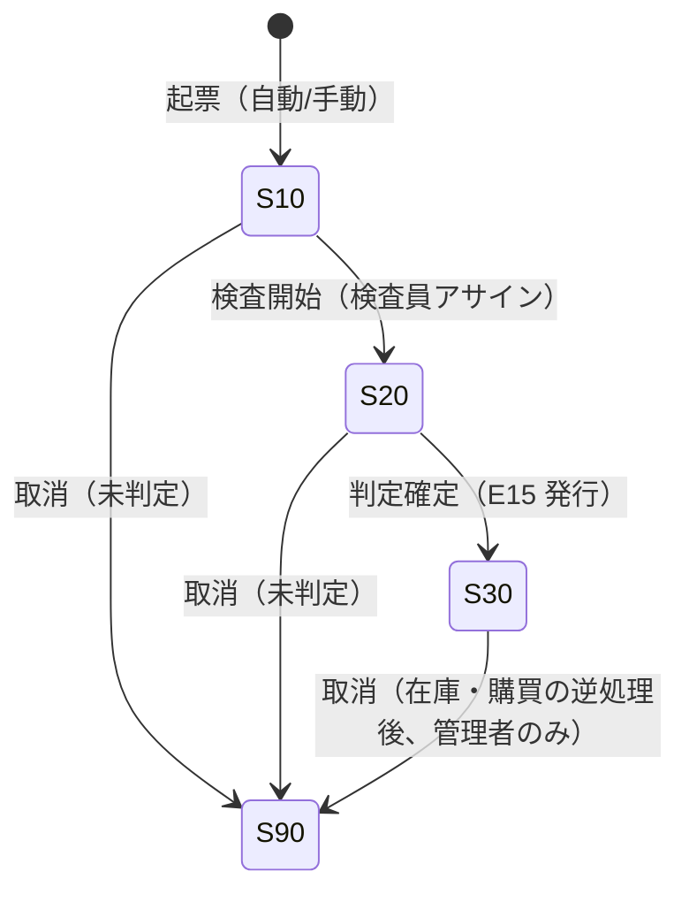
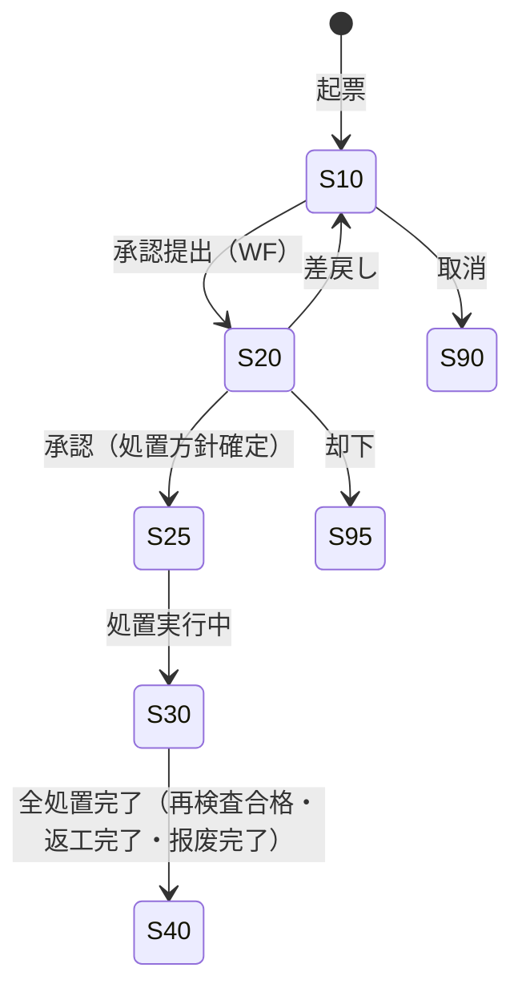

# 质量管理 详细设计书（品質管理 詳細設計書）

| 項目 | 内容 |
|---|---|
| 文書名 | 质量管理 详细设计书（品質管理 詳細設計書） |
| 文書番号 | DSN-PRD-006 |
| 版数 | v1.0 |
| 作成日 | 2026-10-20 |
| 作成者 | production-designer |
| 承認者 | 未承認（レビュー待ち） |
| 状態 | ドラフト（レビュー中） |
| 関連文書 | [业务域概要](00-overview.md) / [BOM・工艺](01-bom-routing-workcenter.md) / [領料・報工](03-material-issue-reporting.md) / [委外](04-outsourcing.md) / [DB 设计](90-db-design.md) / [API 设计](91-api-design.md) / [跨域流程](../00-common/09-cross-domain-flow.md) 第 8 章 / [YE3 工艺路线](../90-data/routing-demo.md) §4・§5 / [示例企业](../90-data/demo-company.md) |

---

## 1. 機能概要

| 項目 | 内容 |
|---|---|
| 機能 ID | F-PRD-012（检验标准管理）、F-PRD-013（检验実施 IQC/IPQC/FQC/OQC）、F-PRD-014（不合格品处置 NCR）、F-PRD-015（质量追溯） |
| 機能名 | 品質マスタ・検査実行・不適合品処置・トレーサビリティ |
| 目的 | 「何を・どこで・どのように検査し、合否をどう判定するか」を標準化し（品目×工程×顧客）、受入（IQC）・工程内（IPQC）・完成（FQC）・出荷（OQC）の各段階で検査を実施する。不合格品は NCR で処置（返工/特采/报废/返品/分选）を承認・実行し、批次を介して材料→製品→出荷の追跡を可能にする。判定結果は E15 で在庫・購買・製造へ通知する |
| 利用者・ロール | 質検員（検査登録・判定）、質量主管（標準承認・特采/报废承認）、製造・購買（処置実行）、計画員（追溯参照） |
| 利用シーン | ①入荷材料の IQC ②工程完了時の IPQC（YE3 は 20/30/40/50/60/70/80〜100 の各工程）③完成品の FQC／出荷試験 ④不合格品の NCR 起票と処置 ⑤クレーム発生時の批次逆追溯 |
| 優先度 | P1（Phase 1.5） |
| 画面 ID | SCR-PRD-025（検査標準）、SCR-PRD-026（検査登録）、SCR-PRD-027（検査一覧・判定）、SCR-PRD-028（NCR）、SCR-PRD-029（追溯查询） |
| 関連 IF | なし（外部検査機関との連携は Phase 2） |

### 1.1 検査種別と業務上の位置づけ

| 検査種別 | `inspection_type` | 実施タイミング | 開始契機 | 判定後の連携 | 関連機能 |
|---|---|---|---|---|---|
| IQC 来料检验 | `10` | 入荷後・入庫前（在庫は待検） | E14 `purchase.receipt.posted` 購読、委外受入確定 | E15 → INV 待検→可用/不合格、PUR 返品、NCR | F-PRD-013、[04](04-outsourcing.md) |
| IPQC 过程检验 | `20` | 指定工序完了時 | 報工確定（`is_inspection_point=true`） | E15 → 次工程投入可否、NCR | [03](03-material-issue-reporting.md) |
| FQC 成品检验 | `30` | 完成品入庫（E24）**後**・在庫 `stockStatus=10 待検` に対して実施 | 完工入庫確定（E24） | E15（合格）→INV で 20 可用、NCR | [03](03-material-issue-reporting.md) |
| OQC 出货检验 | `40` | 出荷前（任意・顧客要求時） | 出荷指示（SAL 連携） | E15 → 出荷保留/解放 | SAL（Phase 2 連携） |
| 型式試験 | `30`（FQC の一種） | 年 1 回・機種ごと | 品質計画（手動登録） | 標準適合の確認、能效確認 | [routing-demo.md](../90-data/routing-demo.md) §5 |

> 来料检验（IQC）の所管域は本域（PRD）である（[07 术语集](../00-common/07-glossary.md)「来料检验」所管域 PRD、[09](../00-common/09-cross-domain-flow.md) 第 8 章）。採購（PUR）は検査依頼と結果受領のみを行い、検査記録は本域が唯一の保持者となる。

## 2. 業務要件・業務ルール

### 2.1 前提条件

| # | 前提条件 | 成立しない場合の挙動 |
|---|---|---|
| 1 | 適用可能な検査標準が存在する（品目×検査種別×工程×顧客） | 検査単は起票できるが「標準未設定」警告（`MSG-PRD-061`）。判定は手動入力 |
| 2 | 検査対象の源泉伝票が確定済（受入確定・報工確定・完工入庫登録） | エラー `MSG-COM-034` |
| 3 | 質検員の権限を保有 | 403、`MSG-COM-030` |
| 4 | 検査標準が承認済（`standard_status=30`） | 下書き標準は使用不可（`MSG-PRD-063`） |
| 5 | 会計期間が締切済でない（判定確定時） | `MSG-COM-071` |

### 2.2 業務ルール

| # | ルール | 根拠 | 関連項目 |
|---|---|---|---|
| BR-QC-01 | 検査標準は「品目 × 工程（`operation_seq`）× 顧客（`customer_id`）」の 3 軸で定義する。適用優先順位は「品目+工程+顧客 > 品目+工程 > 品目+顧客 > 品目 > 共通（品目 NULL）」 | 顧客特殊要求（CSR）対応 | [00-overview](00-overview.md) 未決 #6 |
| BR-QC-02 | 抽検は [GB/T 2828.1-2012](https://openstd.samr.gov.cn/)【実データ】の AQL 検索方式を採用する。`sampling_type=10`（全数）／`20`（抽検）／`30`（免检）を標準で指定する | 統計的品質管理 | `prd_inspection_standard` |
| BR-QC-03 | 判定は「全項目合格」（`judge_rule=10`）または「关键项全合格＋一般项 Ac/Re」（`judge_rule=20`）で行う。关键项（`is_critical=true`）が 1 件でも不合格ならロット不合格 | 安全・機能に関わる特性の保護 | `prd_inspection_standard_item` |
| BR-QC-04 | 判定結果は **resultCode 10 未検査／20 合格／30 特採／40 不合格／50 廃棄**（[09](../00-common/09-cross-domain-flow.md) E15 と一致）。10（未検査）では E15 を発行しない。判定確定（`inspection_status=30`）で E15 を発行し、発行後の変更は取消→再検査のみ | [09](../00-common/09-cross-domain-flow.md) E15 | `result` |
| BR-QC-05 | 不合格品は必ず NCR を起票する（`MSG-PRD-042`）。NCR は処置（返工/特采/报废/返品/分选）ごとに `prd_ncr_action` を持ち、承認後に実行する | 不適合品の統制（ISO 9001 8.7） | `prd_ncr` |
| BR-QC-06 | 特采（让步接收）は質量主管→生産経理→技術部長（必要時は顧客同意）の WF 承認を要し、E15 の `result=CONCESSION` として通知する。特采品は識別（ラベル）と記録を残す | [00-overview](00-overview.md) 2.1 | `prd_ncr_action`（20 特采） |
| BR-QC-07 | 返工は「同一工单内返工（`report_type=20`）」または「返工工单（`work_order_type=30`、`source_type=60`）」で行う。返工工单の原価は独立帰集する（未決 #7） | 品質コストの可視化 | [02](02-work-order.md) 6.6 |
| BR-QC-08 | 报废は NCR 承認後、INV の「报废出庫」（`SC_OUT`／`AOO`）で在庫を減算する。本域は在庫を直接更新しない | 更新責任の一元化 | [09](../00-common/09-cross-domain-flow.md) 7.1 |
| BR-QC-09 | 返品（仕入先返品）は NCR 承認後、PUR の採購退货（PRT）を起票する。本域は `return_id` で紐付ける | [04 架構] 実装は PUR | `prd_ncr_action.return_id` |
| BR-QC-10 | 検査員と判定者は同一人物で可（小規模組織）。ただし特采・报废は質量主管の承認を要する（SoD） | [08](../00-common/08-common-business-rules.md) 9.2 | — |
| BR-QC-11 | ロットトレーサビリティ：**批次系譜の一次データは INV が所有**（受入ロット→出庫→入庫）。PRD は製造事実（工单・工序・設備・作業者・消費素材）を `prd_wo_lot` に記録し、表示時に INV の批次マスタと結合する。PRD は INV の批次残高を更新しない | [09](../00-common/09-cross-domain-flow.md) 第 8 章／Lead 裁決 | `prd_wo_lot` |
| BR-QC-12 | 検査記録の改ざん防止：`prd_inspection`／`prd_inspection_line` は判定確定後に更新不可（取消のみ）。監査ログに判定者・日時・前後値を記録 | ISO 9001 記録管理 | — |

### 2.3 計算式・判定式

| # | 対象 | 算式 | 丸め | 例 |
|---|---|---|---|---|
| CALC-QC-01 | 抜取数（AQL） | `sample_size = f(lot_size, inspection_level, aql_value)`（GB/T 2828.1-2012 表による） | 整数 | ロット 200、水準 II、AQL 1.0 → 標本 32、Ac=1／Re=2【示例值】 |
| CALC-QC-02 | 不良率 | `defect_rate = 不良数 ÷ 検査数` | 4 桁 | 2 ÷ 120 = 0.0167 |
| CALC-QC-03 | 工程能力（参考） | `Cp = (USL − LSL) ÷ (6σ)`（Phase 2） | 4 桁 | — |
| CALC-QC-04 | ロット判定（计数） | `合格 = (不良数 ≤ Ac) かつ (关键项不良数 = 0)` | — | Ac=1 で 2 件 → 不合格 |
| CALC-QC-05 | 品質コスト | `cost = 返工費 + 廃棄損失 + 返品費 + 選別費` | 2 桁 | NCR 単位で集計 |
| CALC-QC-06 | FPY（一次通過率） | `FPY = 初回合格数 ÷ 初回検査数` | 4 桁 | 117 ÷ 120 = 0.9750 |

### 2.4 状態遷移

**検査単（`prd_inspection`）**



**NCR（`prd_ncr`）**



| 遷移 | トリガ | 権限 | 更新項目 | メッセージ |
|---|---|---|---|---|
| 検査 10→20 | 検査開始 | `production:inspection:create` | `inspection_status=20`、`inspector_id` | — |
| 検査 20→30 | 判定確定 | `production:inspection:judge` | `inspection_status=30`、`result`、`judged_by/at`、E15 発行 | `MSG-PRD-064` |
| 検査 30→90 | 取消 | `production:inspection:judge`（管理者） | `inspection_status=90`、E15 逆 | `MSG-PRD-066` |
| NCR 10→20→25 | 提出→承認 | `production:ncr:create` / `approve` | `ncr_status`、`approved_*` | `MSG-COM-005` |
| NCR 25→30 | 処置開始 | `production:ncr:create` | `ncr_status=30` | — |
| NCR 30→40 | 全処置完了 | `production:ncr:create` | `ncr_status=40`、`closed_*`、`cost_amount` | `MSG-PRD-068` |
| NCR 10→90 | 取消 | `production:ncr:create` | `ncr_status=90` | — |

## 3. 検査標準管理（F-PRD-012 / SCR-PRD-025）

### 3.1 検査標準の構造

```
prd_inspection_standard（品目×工程×顧客×種別×版本×有効期間）
  ├─ sampling_type / aql_value / inspection_level（GB/T 2828.1-2012）
  ├─ judge_rule（全項目合格 / 关键项全合格+一般项 Ac/Re）
  └─ prd_inspection_standard_item（検査項目・規格・上下限・方法・关键项・根拠標準）
```

| 軸 | 項目 | 意味 | 例 |
|---|---|---|---|
| 品目 | `material_id` | 対象品目（NULL＝品目共通） | `1001000001` 50W470 |
| 工程 | `operation_seq` | 工程（NULL＝工程共通、IPQC 用） | `20` 冲片 |
| 顧客 | `customer_id` | 顧客特殊要求（NULL＝一般） | 特定顧客の検査成績書要求 |
| 種別 | `inspection_type` | IQC/IPQC/FQC/OQC | `10` |
| 版本 | `version_no`＋`valid_from/to` | 標準の版数管理 | `V01` |

### 3.2 YE3 関連の検査項目（実データ引用・[90-data/routing-demo.md](../90-data/routing-demo.md) §4・§5）

**IQC（来料検査）の主要項目**

| 対象材料 | 検査項目 | 規格・方法 | 根拠標準 | 抽検 |
|---|---|---|---|---|
| `1001000001` 50W470 电工钢 | 材質証明（ミルシート）、板厚、幅、鉄損、表面疵 | 板厚 0.50 mm、鉄損 P15/50 は 50W470 相当、目視・マイクロメータ | [GB/T 2521.1-2016](https://openstd.samr.gov.cn/)【実データ】 | 抽検 AQL 1.0 |
| `1004000001` QZY-2/180 φ1.00 | 線径、導体抵抗、絶縁厚、皮膜連続性 | φ1.000±0.010 mm、抵抗測定、ピンホール試験 | [GB/T 6109.5-2025](https://openstd.samr.gov.cn/)【実データ】 | 抽検 AQL 1.0 |
| `1003000001/0002/0003` HT200 铸件 | 材質証明（化学成分・機械性質）、寸法、外観（巣・砂疵） | 引張強さ等は HT200 相当、目視・寸法測定 | [GB/T 9439-2023](https://openstd.samr.gov.cn/)【実データ】 | 抽検 AQL 2.5 |
| `1002000001` 45# 丸鋼 | 材質証明、径、表面 | φ30±0.4 mm、目視 | [GB/T 699-2015](https://openstd.samr.gov.cn/)【実データ】 | 抽検 AQL 1.0 |
| `4001000001` 6205-2RS | 外径・内径・幅、回転音、遊隙、外観、包装 | 25×52×15 mm、回転試験 | [GB/T 276-2013](https://openstd.samr.gov.cn/)・GB/T 272-2017【実データ】 | 抽検 AQL 1.0 |
| `4002000001〜0011` 緊固件 | 外観、ねじ精度、強度区分表示（8.8） | 目視・ゲージ | GB/T 5782-2025、GB/T 3098.1-2010 等【実データ】 | 抽検 AQL 2.5 |
| `1005000001` NMN 6640 | 厚さ、絶縁耐力、引張強さ | t0.20±0.02 mm | JB/T 4061.1【要確認】 | 抽検 AQL 2.5 |
| `1005000002` 3240 板 | 厚さ、絶縁抵抗、曲げ強さ | t1.0±0.1 mm | [GB/T 1303.4-2009](https://openstd.samr.gov.cn/)【実データ】 | 抽検 AQL 2.5 |
| `1005000003` 1032 浸漬漆 | 粘度、固形分、乾燥時間 | ロットごと | JB/T 9558-1999【実データ】 | 抽検 |

**IPQC（工程内検査）の主要項目（YE3 の検査点工程）**

| 工序 | 検査項目 | 規格・方法 | 根拠 | 記録要否 |
|---|---|---|---|---|
| 20 冲片 | 冲片寸法（外径・内径・スロット）、バリ高さ、形状 | 図面、ノギス・投影機。バリ高さ ≤ 0.05 mm【示例值】 | 図面・工程標準 | ロットごと |
| 30 叠压・扣片 | 鉄心長、スロット平行度、層間短絡、垂直度 | 定盤・ダイヤルゲージ、短絡検査 | 図面 | ロットごと |
| 40 转子铸铝 | 外観（湯境・巣）、導体抵抗、バリ | 目視・抵抗測定 | 図面・工程標準 | ロットごと |
| 50 绕线 | 巻数、直流抵抗、巻線外観、寸法 | 抵抗測定器、目視 | 図面 | ロットごと |
| 60 嵌线・整形 | 絶縁抵抗、相間絶縁、端部寸法、スロット楔 | 絶縁抵抗計（500 V DC）、目視 | 図面・工程標準 | 全数（絶縁抵抗） |
| 70 浸漆・烘干 | 漆膜外観、硬化状態、絶縁抵抗、重量増加 | 目視、絶縁抵抗計、重量測定 | 工程標準 | ロットごと |
| 80 机座加工 | 寸法公差、同軸度、直角度、表面粗さ | 三次元測定機・ノギス | 図面 | ロットごと |
| 90 端盖加工 | 軸受嵌合寸法、同軸度、端面振れ、表面粗さ | 三次元測定機 | 図面 | ロットごと |
| 100 轴加工 | 軸径、軸伸長さ、振れ、キー溝寸法、表面粗さ | マイクロメータ・振れ測定 | 図面 | ロットごと |
| 110 总装 | エアギャップ、軸方向遊隙、回転円滑性、締付トルク、外観 | シックネスゲージ、トルクレンチ | 図面 | ロットごと |

**FQC／出荷試験（全数）の主要項目**

| # | 検査項目 | 規格・判定 | 根拠標準 | 備考 |
|---|---|---|---|---|
| 1 | 絶縁抵抗 | ≥ 100 MΩ（500 V DC、常温）【示例值。実規格は GB/T 28575-2020】 | GB/T 1032-2023【実データ】 | 全数 |
| 2 | 耐電圧 | 1,500 V AC・60 s 異常なし【示例值。定格电压に応じ標準で規定】 | GB/T 1032-2023【実データ】 | 全数 |
| 3 | 直流抵抗（相間不平衡） | 不平衡率 ≤ 2%【示例值】 | GB/T 1032-2023【実データ】 | 全数 |
| 4 | 無負荷電流・損失 | 標準値の ±10% 以内【示例值】 | GB/T 1032-2023【実データ】 | 全数 |
| 5 | 拘束電流 | 標準値の ±10% 以内【示例值】 | GB/T 1032-2023【実データ】 | 全数 |
| 6 | 振動 | 限界値以下 | [GB/T 10068-2020](https://openstd.samr.gov.cn/)【実データ】 | 全数 |
| 7 | 騒音 | 限界値以下 | [GB/T 10069.1-2006](https://openstd.samr.gov.cn/)【実データ】 | 全数 |
| 8 | 回転方向・外観・塗装膜厚 | 仕様どおり、膜厚 ≥ 60 μm【示例值】 | 工程標準 | 全数 |
| 9 | 銘牌内容 | 型式・出力・電圧・周波数・電流・回転数・能效等級・IP・IM・製造番号 | [GB/T 28575-2020](https://openstd.samr.gov.cn/)【実データ】 | 全数 |
| 10 | 能效確認 | GB 18613-2020 能效 3 級（IE3）以上 | [GB 18613-2020](https://openstd.samr.gov.cn/)【実データ】 | ロット／型式試験 |
| 11 | 付属品・包装 | 説明書・合格証、梱包状態、バーコード読取 | GB/T 9969-2008 等【実データ】 | 全数 |

> 規格値・判定基準のうち「【示例值】」は設計検証用の仮定値であり、実際の検査基準書（社内規格）で確定する。**標準番号はすべて実データ**で、出典は [90-data/sources.md](../90-data/sources.md) を正とする。

### 3.3 画面項目定義（SCR-PRD-025 検査標準登録編集）

| No | 項目 ID | 項目名 | 区分 | 種別 | 型/桁 | 必須 | 初期値 | 入力チェック | DB 項目 | 権限 |
|---|---|---|---|---|---|---|---|---|---|---|
| 1 | standard_no | 標準番号 | ヘッダ | テキスト | VARCHAR(40) | ○ | 自動採番 | 一意 | `standard_no` | 参照のみ |
| 2 | standard_name | 標準名 | ヘッダ | テキスト | VARCHAR(200) | ○ | 空 | 200 桁 | `standard_name` | 編集可 |
| 3 | inspection_type | 検査種別 | ヘッダ | 選択 | SMALLINT | ○ | 10 IQC | 10/20/30/40 | `inspection_type` | 編集可 |
| 4 | material_code | 品目 | ヘッダ | コード選択 | VARCHAR(64) | △ | 空（共通） | 存在・有効 | `material_id`/`code`/`name` | 編集可 |
| 5 | operation_seq | 工程 | ヘッダ | 選択 | INT | △ | 空（共通） | 有効工艺に存在 | `operation_seq` | 編集可 |
| 6 | customer_code | 顧客 | ヘッダ | コード選択 | VARCHAR(32) | △ | 空（一般） | 存在 | `customer_id` | 編集可 |
| 7 | version_no | 版本 | ヘッダ | 数値 | SMALLINT | ○ | 1 | 1〜99 | `version_no` | 編集可 |
| 8 | valid_from/valid_to | 有効期間 | ヘッダ | 日付 | DATE | ○/— | 当日/空 | `from ≦ to` | `valid_from`/`valid_to` | 編集可 |
| 9 | sampling_type | 抽検種別 | ヘッダ | 選択 | SMALLINT | ○ | 20 抽検 | 10 全数/20 抽検/30 免检 | `sampling_type` | 編集可 |
| 10 | inspection_level | 検査水準 | ヘッダ | 選択 | VARCHAR(16) | △ | II | I/II/III（GB/T 2828.1） | `inspection_level` | 編集可 |
| 11 | aql_value | AQL | ヘッダ | 数値 | NUMERIC(7,4) | △ | 1.0000 | 0.01〜100 | `aql_value` | 編集可 |
| 12 | sample_size | 標本数 | ヘッダ | 数値 | INT | △ | 空（自動計算） | > 0 | `sample_size` | 編集可 |
| 13 | judge_rule | 判定基準 | ヘッダ | 選択 | SMALLINT | ○ | 10 全項目 | 10/20/22 | `judge_rule` | 編集可 |
| 14 | standard_basis | 判定根拠 | ヘッダ | テキスト | VARCHAR(500) | — | 空 | 500 桁 | `standard_basis` | 編集可 |
| 15 | standard_status | 状態 | ヘッダ | バッジ | SMALLINT | — | 10 | — | `standard_status` | 参照のみ |
| I1 | item_seq | 項目 SEQ | 明細 | 数値 | INT | ○ | 10 刻み | 一意 | `item_seq` | 編集可 |
| I2 | inspection_item_code | 項目コード | 明細 | テキスト | VARCHAR(32) | ○ | 空 | 32 桁 | `inspection_item_code` | 編集可 |
| I3 | inspection_item_name | 項目名 | 明細 | テキスト | VARCHAR(200) | ○ | 空 | 200 桁 | `inspection_item_name` | 編集可 |
| I4 | item_type | 項目種別 | 明細 | 選択 | SMALLINT | ○ | 10 計量 | 10/20/30/40/50/60 | `item_type` | 編集可 |
| I5 | inspection_method | 検査方法 | 明細 | テキスト | VARCHAR(200) | ○ | 空 | 200 桁 | `inspection_method` | 編集可 |
| I6 | specification | 規格値 | 明細 | テキスト | VARCHAR(200) | — | 空 | 200 桁 | `specification` | 編集可 |
| I7 | lower_limit/upper_limit | 上下限 | 明細 | 数値 | NUMERIC(18,6) | △ | 空 | `lower ≦ upper` | `lower_limit`/`upper_limit` | 編集可 |
| I8 | unit_code | 単位 | 明細 | テキスト | VARCHAR(16) | — | 空 | 単位コード | `unit_code` | 編集可 |
| I9 | is_critical | 关键项 | 明細 | チェック | BOOLEAN | — | false | — | `is_critical` | 編集可 |
| I10 | judge_rule | 判定方法 | 明細 | 選択 | SMALLINT | ○ | 10 | 10/20/30/40/50 | `judge_rule` | 編集可 |
| I11 | instrument_code | 計測器 | 明細 | テキスト | VARCHAR(32) | — | 空 | `prd_equipment` に存在 | `instrument_code` | 編集可 |
| I12 | inspection_basis | 根拠標準 | 明細 | テキスト | VARCHAR(200) | — | 空 | 標準番号 | `inspection_basis` | 編集可 |

## 4. 検査実施（F-PRD-013）

### 4.1 検査起票のトリガ

| 種別 | トリガ | 起票内容 | 検査数・標本 | 実装 |
|---|---|---|---|---|
| IQC | E14 `purchase.receipt.posted` 購読（または委外受入 E26 確定） | `inspection_type=10`、`source_type=10/50`、対象ロット・受入数量 | `inspection_qty`＝受入数量、`sample_qty`＝標準の抽検数 | イベント購読（冪等：`receiptId`） |
| IPQC | 報工確定（`is_inspection_point=true`） | `inspection_type=20`、`source_type=20`、`source_id=workOrderOperationId` | `inspection_qty`＝報工良品数 | 同期（同一 TX で起票） |
| FQC | 完工入庫登録（`prd_completion_receipt` 作成） | `inspection_type=30`、`source_type=30`、`source_id=workOrderId` | `inspection_qty`＝入庫予定数、全数 | 同期（入庫確定前） |
| OQC | 出荷指示（SAL 連携、Phase 2） | `inspection_type=40`、`source_type=40` | 出荷数量 | イベント（E10 前） |
| 手動 | 画面起票 | 任意 | 任意 | `POST /api/production/inspections` |

### 4.2 判定処理（PRC-PRD-006-01）

1. 検査単の `inspection_status=20`（検査中）、適用標準を解決（BR-QC-01 の優先順位）。標準未設定なら `MSG-PRD-061`（警告のうえ手動項目で続行可）。
2. 標準の項目を `prd_inspection_line` に展開（スナップショット：項目コード・規格・上下限・关键项・根拠）。実測値を入力。
3. 項目判定：`judge_rule` に従い `judge=10`（合格）/`20`（不合格）を設定。計量値は `lower ≤ measured ≤ upper`、计数・外観は Ac/Re 比較、性能は合否入力。
4. ロット判定（CALC-QC-04）：关键项 1 件でも不合格 → 不合格。一般项は `不良数 ≤ Ac` で合格。判定結果を `result` に設定（10/20/30/40/50）。
5. 判定確定：`inspection_status=30`、`judged_by/at`、`e15_published_at` を設定。E15 を Outbox に記録（同一 TX）。
6. 不合格の場合は NCR を自動起票（`ncr_id` を紐付け、`ncr_status=10`）。报废数量 > 0 は NCR 必須（BR-QC-05）。
7. 監査ログ（JUDGE）を記録する。

**E15 ペイロード例（INV／PUR が購読、resultCode 10 では発行しない）**

```json
{
  "inspectionId": "1845678901234569600",
  "inspectionNo": "IQC2610250001",
  "inspectionType": 10,
  "sourceType": 10,
  "sourceNo": "GR2610250001",
  "materialId": "1845000000000001001",
  "batchNo": "261020P001",
  "warehouseId": "1845000000000000201",
  "resultCode": 20,
  "inspectionQty": "2000.0000",
  "sampleQty": "32.0000",
  "defectQty": "0.0000",
  "lines": [
    { "itemCode": "MT-CERT", "itemName": "材质证明", "judge": 20 },
    { "itemCode": "MT-THICK", "itemName": "板厚", "measuredValue": "0.502", "judge": 20 }
  ],
  "inspectedAt": "2026-10-25T10:30:00+08:00"
}
```

> `resultCode`：10 未検査（**E15 を発行しない**）／20 合格／30 特採／40 不合格／50 廃棄。`lotNo` は廃止し **`batchNo`** を使用する。`warehouseId`・`sourceType`・`sourceNo`・`inspectionId` を必須とする（[09 §3](../00-common/09-cross-domain-flow.md)）。

**購読側の処理**

| 購読者 | 処理 | 冪等キー |
|---|---|---|
| INV | `sourceType=10`（采购收货）→ 在庫ステータス「待検」→「可用」／「不合格」へ変換（`ST_IN`/`ST_OUT`、状態のみで数量不変）。`sourceType=30`（完工）→ 入庫可否 | `inspectionId` |
| PUR | `result ∈ {REJECT, CONCESSION}` → 返品起票・特采承認の追跡 | `inspectionId` |
| PRD（自域） | IPQC 合格 → 次工程投入可、不合格 → 次工程ブロック・NCR。FQC は E24 後の待検在庫に対して実施し、E15 で可用化 | `inspectionId` |

### 4.3 画面項目定義（SCR-PRD-026 検査登録）

| No | 項目 ID | 項目名 | 区分 | 種別 | 型/桁 | 必須 | 初期値 | 入力チェック | DB 項目 | 権限 |
|---|---|---|---|---|---|---|---|---|---|---|
| 1 | inspection_no | 検査番号 | ヘッダ | テキスト | VARCHAR(32) | — | 自動採番 | 一意 | `inspection_no` | 参照のみ |
| 2 | inspection_type | 検査種別 | ヘッダ | 選択 | SMALLINT | ○ | 源泉から | 10/20/30/40 | `inspection_type` | 参照のみ（起票時固定） |
| 3 | source_no | 源泉番号 | ヘッダ | テキスト | VARCHAR(64) | — | 源泉 | — | `source_no` | 参照のみ |
| 4 | material_code | 品目 | ヘッダ | テキスト | VARCHAR(64) | — | 源泉 | — | `material_id`/`code`/`name` | 参照のみ |
| 5 | lot_no | 批次 | ヘッダ | テキスト | VARCHAR(64) | ○ | 源泉 | 批次存在 | `lot_no` | 編集可 |
| 6 | inspection_qty | 検査数 | ヘッダ | 数値 | NUMERIC(18,4) | ○ | 源泉数量 | > 0 | `inspection_qty` | 編集可 |
| 7 | sample_qty | 標本数 | ヘッダ | 数値 | NUMERIC(18,4) | ○ | 標準の抽検数 | > 0、≤ 検査数 | `sample_qty` | 編集可 |
| 8 | standard_no | 適用標準 | ヘッダ | テキスト | VARCHAR(40) | △ | 自動解決 | — | `standard_id` | 参照のみ |
| 9 | inspector_id | 検査員 | ヘッダ | 選択 | BIGINT | ○ | ログインユーザ | 質検ロール | `inspector_id` | 編集可 |
| 10 | inspected_at | 検査日時 | ヘッダ | 日時 | TIMESTAMPTZ | ○ | 現在 | 未来日不可 | `inspected_at` | 編集可 |
| L1 | item_seq | 項目 SEQ | 明細 | 数値 | INT | — | 標準展開 | — | `item_seq` | 参照のみ |
| L2 | inspection_item_name | 項目名 | 明細 | テキスト | VARCHAR(200) | — | 標準 | — | `inspection_item_name` | 参照のみ |
| L3 | specification | 規格 | 明細 | テキスト | VARCHAR(200) | — | 標準 | — | `specification` | 参照のみ |
| L4 | measured_value | 実測値 | 明細 | 数値 | NUMERIC(18,6) | △ | 空 | 計量項目は必須 | `measured_value` | 編集可 |
| L5 | measured_text | 定性結果 | 明細 | テキスト | VARCHAR(500) | △ | 空 | 外観・性能は必須 | `measured_text` | 編集可 |
| L6 | sample_qty | 項目標本数 | 明細 | 数値 | NUMERIC(18,4) | — | ヘッダ値 | ≧ 0 | `sample_qty` | 編集可 |
| L7 | defect_qty | 不良数 | 明細 | 数値 | NUMERIC(18,4) | — | 0 | ≧ 0、≤ 標本数 | `defect_qty` | 編集可 |
| L8 | judge | 判定 | 明細 | 選択 | SMALLINT | ○ | 自動判定 | 10/20 | `judge` | 編集可（上書きは理由必須） |
| L9 | instrument_code | 計測器 | 明細 | テキスト | VARCHAR(32) | — | 標準 | — | `instrument_code` | 編集可 |
| B1 | judge_result | 総合判定 | フッタ | 選択 | SMALLINT | ○ | 自動 | 10/20/30/40/50 | `result` | 編集可（30 特采は承認要） |
| B2 | judged_comment | 判定コメント | フッタ | テキスト | VARCHAR(500) | △ | 空 | 不合格時必須 | `remark` | 編集可 |

### 4.4 検査一覧・判定（SCR-PRD-027）

| 項目 | 内容 |
|---|---|
| 検索条件 | 検査番号、種別、状態、品目、批次、源泉番号、検査日範囲、工場、判定結果、検査員 |
| 既定条件 | 未判定（10/20）＋当日〜過去 7 日 |
| 一覧列 | 検査番号、種別、源泉番号、品目、批次、検査数、標本数、不良数、判定、検査日、状態 |
| 一括操作 | 判定確定（選択行）、取消（権限者のみ）、帳票出力（PRT-PRD-010） |
| ソート | 検査日の降順 → 検査番号 |
| 行操作 | 登録/編集、判定、NCR 起票、印刷 |

## 5. 不合格品処置（NCR）（F-PRD-014）

### 5.1 NCR の起票と処置の種類

| 源泉 | 起票契機 | 初期処置（`disposition_type`） | 処置の実施 |
|---|---|---|---|
| IQC 不合格 | 判定確定（自動） | 40 返品（仕入先）／20 特采／30 报废 | PUR 返品（PRT）、INV 廃棄、特采承認 |
| IPQC 不合格 | 判定確定（自動）／報工の不良・报废登録 | 10 返工／30 报废／50 分选 | 同一工单返工（`report_type=20`）／返工工单／INV 廃棄 |
| FQC 不合格 | 判定確定（自動） | 10 返工／20 特采／30 报废 | 返工工单（`work_order_type=30`）／特采承認 |
| 顧客クレーム | 手動 | 40 返品（顧客から）／10 返工 | SAL 返品、返工 |
| 委外受入不合格 | IQC 判定確定 | 40 返品（委外先で再加工）／20 特采 | 委外再受入（[04](04-outsourcing.md)） |

### 5.2 NCR 処理手順（PRC-PRD-006-02）

1. NCR 起票：源泉情報・品目・批次・数量・缺陷コード・不良内容を記録。`ncr_no = NCR{YYMMDD}{4桁}`。`ncr_status=10`。
2. 処置方針の決定：`disposition_type` を選定し、`prd_ncr_action` に処置（返工/特采/报废/返品/分选/再検）を明細として登録。数量は `defect_qty` と一致させる（BR-QC-05、`MSG-PRD-065`）。
3. WF 承認提出（`ncr_status=20`）。特采・报废は質量主管の承認が必須（BR-QC-06）。
4. 承認後（`ncr_status=25`）に処置実行（`30`）：
   - **返工（10）**：同一工单内返工（`prd_work_report` に `report_type=20` を追加、`rework_qty` を更新）または返工工单（`prd_work_order` `work_order_type=30`、`source_type=60`、`source_id=ncr_id`）を起票。返工完了で再検査（`prd_inspection`、`inspection_type=20/30`）。
   - **特采（20）**：識別ラベル（`ext_data.special_accept=true`）を付与し、E15 の `result=CONCESSION` で在庫・販売へ通知。顧客同意が必要な場合は `ext_data.customer_consent_no` に記録。
   - **报废（30）**：INV の「报废出庫」（`SC_OUT`／`AOO`）を起票（本域は在庫を更新しない）。`scrap_stock_txn_id` に結果を紐付け。
   - **返品（40）**：PUR の採購退货（PRT）を起票。`return_id` を紐付け。
   - **分选（50）**：選別後の良品/不良品数を記録し、良品は次工程・出荷へ。
   - **再検査（60）**：再検査単を起票し、合格で `action_status=40`。
5. 全処置完了で `ncr_status=40`、`closed_at`、`cost_amount`（CALC-QC-05）を設定。処置履歴は `prd_ncr_action` に残す。
6. 監査ログ（CREATE/APPROVE/POST/CLOSE）を記録する。

### 5.3 画面項目定義（SCR-PRD-028 NCR 登録・処置）

| No | 項目 ID | 項目名 | 区分 | 種別 | 型/桁 | 必須 | 初期値 | 入力チェック | DB 項目 | 権限 |
|---|---|---|---|---|---|---|---|---|---|---|
| 1 | ncr_no | NCR 番号 | ヘッダ | テキスト | VARCHAR(32) | — | 自動採番 | 一意 | `ncr_no` | 参照のみ |
| 2 | ncr_date | 起票日 | ヘッダ | 日付 | DATE | ○ | 当日 | 締切外 | `ncr_date` | 編集可 |
| 3 | source_type | 源泉種別 | ヘッダ | 選択 | SMALLINT | ○ | 自動 | 10/20/30/40/50/60 | `source_type` | 参照のみ |
| 4 | inspection_no | 検査番号 | ヘッダ | テキスト | VARCHAR(32) | △ | 自動 | 存在 | `inspection_id` | 参照のみ |
| 5 | material_code | 品目 | ヘッダ | テキスト | VARCHAR(64) | ○ | 源泉 | — | `material_id`/`code`/`name` | 参照のみ |
| 6 | lot_no | 批次 | ヘッダ | テキスト | VARCHAR(64) | △ | 源泉 | 批次存在 | `lot_no` | 編集可 |
| 7 | defect_code | 缺陷コード | ヘッダ | コード選択 | VARCHAR(32) | ○ | 空 | 有効コード | `defect_code_id` | 編集可 |
| 8 | defect_qty | 不合格数 | ヘッダ | 数値 | NUMERIC(18,4) | ○ | 源泉 | > 0 | `defect_qty` | 編集可 |
| 9 | defect_desc | 不良内容 | ヘッダ | テキスト | VARCHAR(1000) | ○ | 空 | 1,000 桁 | `defect_desc` | 編集可 |
| 10 | disposition_type | 処置区分 | ヘッダ | 選択 | SMALLINT | ○ | 10 返工 | 10/20/30/40/50/60 | `disposition_type` | 編集可 |
| 11 | disposition_qty | 処置数量 | ヘッダ | 数値 | NUMERIC(18,4) | ○ | 不合格数 | > 0、≤ `defect_qty` | `disposition_qty` | 編集可 |
| 12 | responsibility_type | 責任区分 | ヘッダ | 選択 | SMALLINT | ○ | 空 | 10/20/30/40/50/60 | `responsibility_type` | 編集可 |
| 13 | cause_type | 原因分類 | ヘッダ | 選択 | SMALLINT | △ | 空 | 10/20/30/40/50/60 | `cause_type` | 編集可 |
| 14 | root_cause | 根本原因 | ヘッダ | テキスト | TEXT | △ | 空 | 2,000 桁 | `root_cause` | 編集可 |
| 15 | corrective_action | 是正処置 | ヘッダ | テキスト | TEXT | △ | 空 | 2,000 桁 | `corrective_action` | 編集可 |
| 16 | preventive_action | 再発防止 | ヘッダ | テキスト | TEXT | — | 空 | 2,000 桁 | `preventive_action` | 編集可 |
| 17 | ncr_status | 状態 | ヘッダ | バッジ | SMALLINT | — | 10 | — | `ncr_status` | 参照のみ |
| A1 | action_type | 処置種別 | 明細 | 選択 | SMALLINT | ○ | 10 | 10/20/30/40/50/60 | `action_type` | 編集可 |
| A2 | action_qty | 処置数量 | 明細 | 数値 | NUMERIC(18,4) | ○ | 0 | > 0、合計 = `defect_qty` | `action_qty` | 編集可 |
| A3 | planned_date | 予定日 | 明細 | 日付 | DATE | — | 空 | 未来日可 | `planned_date` | 編集可 |
| A4 | action_status | 実施状態 | 明細 | バッジ | SMALLINT | — | 10 | — | `action_status` | 参照のみ |
| A5 | executed_at | 実施日時 | 明細 | 日時 | TIMESTAMPTZ | — | 空 | 未来日不可 | `executed_at` | 編集可 |
| A6 | cost_amount | 処置コスト | 明細 | 数値 | NUMERIC(18,2) | — | 0 | ≧ 0 | `cost_amount` | 編集可 |
| B1 | approve | 承認 | フッタ | ボタン | — | — | — | WF 承認者 | `ncr_status=25` | `production:ncr:approve` |
| B2 | close | 完了 | フッタ | ボタン | — | — | — | 全処置 `40` | `ncr_status=40` | `production:ncr:create` |

## 6. 质量追溯（F-PRD-015 / SCR-PRD-029）

### 6.1 追溯リンクの構造

```
受入（PUR GR / 委外 OSR）── batch_no(P) ──┐
                                          ├── prd_wo_lot（投入）
製造工单（WO）── 投入批次（材料）────────────┘
      │
      ├── prd_work_report（報工・工程・設備・作業者）
      ├── prd_inspection（IPQC/FQC）
      └── 産出批次（製品）── prd_wo_lot（産出）── 完成品入庫（INV FGI）
                                                        │
                                                        └── 出荷（SAL 出荷明細）── 顧客
```

| 追溯方向 | 起点 | 手順 | 表示 |
|---|---|---|---|
| 逆追溯（製品→材料） | 完成品批次/シリアル、工单番号 | `prd_wo_lot` を `product_lot_no` → `input_lot_no` へ再帰（`trace_type=10`） | 投入材料・受入ロット・仕入先・検査結果 |
| 順追溯（材料→製品→出荷） | 受入批次（材料ロット） | `input_lot_no` → `product_lot_no` へ再帰（`trace_type=20`）→ 出荷明細 | 影響を受ける工单・製品批次・出荷先・顧客 |
| 工程追溯 | 工单 | 工序別の報工・検査・設備・作業者 | 工程経過と判定 |

**再帰 CTE の実装例（逆追溯：製品ロット→材料ロット）**

```sql
WITH RECURSIVE trace AS (
    SELECT l.id, l.work_order_id, l.product_lot_no, l.input_lot_no,
           l.input_material_id, l.input_qty, l.operation_seq, 1 AS depth
    FROM prd_wo_lot l
    WHERE l.product_lot_no = #{lotNo} AND l.trace_type = 10
    UNION ALL
    SELECT c.id, c.work_order_id, c.product_lot_no, c.input_lot_no,
           c.input_material_id, c.input_qty, c.operation_seq, t.depth + 1
    FROM prd_wo_lot c
    JOIN trace t ON c.product_lot_no = t.input_lot_no
    WHERE c.trace_type = 10 AND t.depth < 10          -- 深さ上限 10
)
SELECT * FROM trace ORDER BY depth, operation_seq;
```

- 深さ上限 10（無限ループ防止）。1 回の表示件数は 1,000 件まで（超過は CSV 出力）。
- シリアル管理品（YE3 成品）は `product_lot_no`＋シリアル番号で個体追跡する。`prd_wo_lot` は批次単位、シリアルは INV の `inv_serial` と `batch_no` で結合。
- 追溯結果は帳票 PRT-PRD-012（批次追溯报告）として出力可能。監査ログに検索条件・実行者を記録。

### 6.2 画面項目定義（SCR-PRD-029 追溯查询）

| No | 項目 ID | 項目名 | 種別 | 必須 | 入力チェック | 備考 |
|---|---|---|---|---|---|---|
| 1 | trace_mode | 追溯方向 | ラジオ | ○ | 10 逆追溯 / 20 順追溯 / 30 工单追溯 | — |
| 2 | trace_key | 追溯キー | テキスト | ○ | 批次/シリアル/工单番号のいずれか | 形式チェック |
| 3 | date_from/date_to | 期間 | 日付範囲 | — | `from ≦ to` | 出荷絞込用 |
| 4 | include_inspection | 検査を含む | チェック | — | — | 既定 ON |
| 5 | result_grid | 追溯結果 | ツリー | — | — | 深さ・工程・数量・判定を表示 |
| 6 | export | エクスポート | ボタン | — | — | Excel/PDF（PRT-PRD-012） |

## 7. API 設計

| No | メソッド | パス | 権限 | 概要 | リクエスト | レスポンス |
|---|---|---|---|---|---|---|
| 1 | GET | `/api/production/inspection-standards` | `production:inspection-standard:view` | 標準一覧 | 検索条件 | `PageResult<InspectionStandardDto>` |
| 2 | GET | `/api/production/inspection-standards/{id}` | 同上 | 標準詳細（項目含む） | — | `InspectionStandardDetailDto` |
| 3 | POST | `/api/production/inspection-standards` | `production:inspection-standard:update` | 標準登録 | `InspectionStandardCreateRequest` | 201 |
| 4 | PUT | `/api/production/inspection-standards/{id}` | 同上 | 標準変更 | `InspectionStandardUpdateRequest` | 200 |
| 5 | POST | `/api/production/inspection-standards/{id}/submit` | 同上 | 承認提出 | `version` | 200 |
| 6 | GET | `/api/production/inspection-standards/effective` | `production:inspection:view` | 適用標準の解決 | `materialId`・`inspectionType`・`operationSeq`・`customerId` | `InspectionStandardDetailDto` |
| 7 | GET | `/api/production/inspections` | `production:inspection:view` | 検査一覧 | 検索条件 | `PageResult<InspectionListDto>` |
| 8 | GET | `/api/production/inspections/{id}` | 同上 | 検査詳細 | — | `InspectionDetailDto` |
| 9 | POST | `/api/production/inspections` | `production:inspection:create` | 検査起票（手動） | `InspectionCreateRequest` | 201 |
| 10 | PUT | `/api/production/inspections/{id}` | `production:inspection:create` | 検査結果登録 | `InspectionUpdateRequest` | 200 |
| 11 | POST | `/api/production/inspections/{id}/judge` | `production:inspection:judge` | 判定確定（E15） | `version`・`result`・`comment` | 200 |
| 12 | POST | `/api/production/inspections/{id}/cancel` | `production:inspection:judge` | 検査取消 | `version`・`reason` | 200 |
| 13 | POST | `/api/production/inspections/batch-judge` | `production:inspection:judge` | 一括判定 | `ids[]` | `BatchResultDto` |
| 14 | GET | `/api/production/ncrs` | `production:ncr:view` | NCR 一覧 | 検索条件 | `PageResult<NcrListDto>` |
| 15 | GET | `/api/production/ncrs/{id}` | 同上 | NCR 詳細 | — | `NcrDetailDto` |
| 16 | POST | `/api/production/ncrs` | `production:ncr:create` | NCR 起票 | `NcrCreateRequest` | 201 |
| 17 | POST | `/api/production/ncrs/{id}/submit` | `production:ncr:create` | NCR 承認提出 | `version` | 200 |
| 18 | POST | `/api/production/ncrs/{id}/execute` | `production:ncr:create` | 処置実行（返工/特采/报废/返品） | `actionId`・`executedAt`・`cost` | 200 |
| 19 | POST | `/api/production/ncrs/{id}/close` | `production:ncr:create` | NCR 完了 | `version` | 200 |
| 20 | GET | `/api/production/traceability/reverse` | `production:trace:view` | 逆追溯 | `lotNo` または `serialNo` | `TraceResultDto` |
| 21 | GET | `/api/production/traceability/forward` | 同上 | 順追溯 | `lotNo` | `TraceResultDto` |
| 22 | GET | `/api/production/traceability/work-order/{id}` | 同上 | 工单追溯 | — | `TraceResultDto` |

**判定リクエスト例**

```json
{
  "version": 2,
  "result": 20,
  "comment": "耐電圧試験で絶縁破壊。NCR を起票します。",
  "lines": [
    { "itemSeq": 10, "measuredValue": "1520", "judge": 20 },
    { "itemSeq": 20, "measuredValue": null, "measuredText": "絶縁破壊（1,200V で発生）", "judge": 20 }
  ]
}
```

**判定レスポンス例（不合格）**

```json
{
  "code": 0,
  "message": "ok",
  "data": {
    "inspectionNo": "FQC2611150001",
    "inspectionType": 30,
    "inspectionStatus": 30,
    "result": 20,
    "inspectorName": "质检员（示例）",
    "judgedAt": "2026-11-15T16:40:00+08:00",
    "ncrNo": "NCR2611150001",
    "e15PublishedAt": "2026-11-15T16:40:01+08:00"
  }
}
```

> 数値・名称は【示例值】。

## 8. 入力チェック仕様

| No | チェック ID | 対象 | 種別 | 条件 | タイミング | メッセージ ID |
|---|---|---|---|---|---|---|
| 1 | CHK-PRD-006-01 | 検査標準の適用 | 業務 | 有効な標準が一意に解決される | 起票/判定 | `MSG-PRD-061` |
| 2 | CHK-PRD-006-02 | 標本数 | 範囲 | > 0、≤ 検査数 | 保存時 | `MSG-COM-044` |
| 3 | CHK-PRD-006-03 | 実測値 | 必須 | 計量項目は必須、数値形式 | 保存時 | `MSG-COM-040`、`MSG-COM-042` |
| 4 | CHK-PRD-006-04 | 不良数 | 範囲 | ≧ 0、≤ 標本数 | 保存時 | `MSG-PRD-067` |
| 5 | CHK-PRD-006-05 | 項目判定 | 業務 | 上下限との比較と `judge` が整合（上書きは理由必須） | 保存時 | `MSG-PRD-067` |
| 6 | CHK-PRD-006-06 | 判定確定 | 状態 | `inspection_status=20`（検査中） | 判定時 | `MSG-COM-034` |
| 7 | CHK-PRD-006-07 | NCR 数量 | 相関 | 処置明細合計 = `defect_qty` | NCR 完了時 | `MSG-PRD-065` |
| 8 | CHK-PRD-006-08 | 特采 | 権限 | 質量主管の承認がある | 判定時 | `MSG-PRD-064` |
| 9 | CHK-PRD-006-09 | 报废 | 業務 | NCR 承認済 | 処置実行時 | `MSG-PRD-042` |
| 10 | CHK-PRD-006-10 | 返品 | 業務 | PUR 返品が起票済（`return_id`） | NCR 完了時 | `MSG-PRD-069` |
| 11 | CHK-PRD-006-11 | 追溯キー | 必須 | 批次/シリアル/工单のいずれか | 検索時 | `MSG-COM-040` |
| 12 | CHK-PRD-006-12 | 検査標準期間 | 相関 | `valid_from ≦ 判定日 ≦ valid_to` | 起票時 | `MSG-PRD-063` |
| 13 | CHK-PRD-006-13 | 楽観排他 | 排他 | `version` 一致 | 保存時 | `MSG-COM-033` |

## 9. データ更新仕様

| テーブル | 操作 | 更新項目 | 更新条件 | トリガ |
|---|---|---|---|---|
| `prd_inspection_standard` / `_item` | INSERT/UPDATE | 全項目、`standard_status` | 登録/変更/承認 | F-PRD-012 |
| `prd_inspection` | INSERT | 全項目 | 起票（自動/手動） | E14 購読、報工確定、完工入庫登録 |
| `prd_inspection` | UPDATE | `inspection_status`、`result`、`judged_by/at`、`e15_published_at`、`ncr_id` | 判定確定 | PRC-PRD-006-01 |
| `prd_inspection_line` | INSERT/UPDATE | 実測値・判定 | 検査登録 | F-PRD-013 |
| `prd_ncr` | INSERT/UPDATE | 全項目、`ncr_status`、`approved_*`、`closed_*`、`cost_amount` | 起票/承認/完了 | PRC-PRD-006-02 |
| `prd_ncr_action` | INSERT/UPDATE | 全項目、`action_status`、`executed_*` | 処置 | PRC-PRD-006-02 |
| `prd_work_order` | INSERT/UPDATE | 返工工单（`work_order_type=30`）、`reported_*` | 返工起票/報工 | F-PRD-014、[02](02-work-order.md) |
| `prd_work_report` / `_defect` | INSERT/UPDATE | 不良・返工実績 | 返工報工 | F-PRD-007 |
| `prd_wo_lot` | INSERT | 投入/産出リンク | 領料/報工/入庫 | F-PRD-006/007/008 |
| `sys_outbox_event` | INSERT | E15 | 判定確定 | PRC-PRD-006-01 |
| `sys_audit_log` | INSERT | 操作ログ | 各処理 | 全処理 |

## 10. エラー処理・メッセージ

| メッセージ ID | 種別 | 本文 | 発生条件 | 利用者への対処 | ログ |
|---|---|---|---|---|---|
| `MSG-PRD-060` | E | 検査未合格の工序は次工程へ進めません。 | IPQC 未合格 | 検査完了・特采承認 | WARN |
| `MSG-PRD-061` | W | 適用可能な検査標準がありません。手動で検査項目を入力してください。 | 標準未設定 | 標準登録 | WARN |
| `MSG-PRD-062` | E | 完成品検査（FQC）が合格していないため入庫できません。 | FQC 未合格 | 検査完了/特采 | WARN |
| `MSG-PRD-063` | E | 指定した検査標準は有効期間外または未承認です。 | 標準期間外 | 標準確認 | WARN |
| `MSG-PRD-064` | E | この判定には質量主管の承認が必要です。 | 特采・报废の無承認 | 承認申請 | WARN |
| `MSG-PRD-065` | E | 処置数量の合計が不合格数量と一致しません。 | 処置数量不一致 | 数量修正 | WARN |
| `MSG-PRD-066` | E | 判定確定後の検査単は取消できません（管理者のみ取消可）。 | 権限なし取消 | 管理者へ依頼 | WARN |
| `MSG-PRD-067` | E | 実測値と判定が整合していません。再確認してください。 | 判定不整合 | 値・判定修正 | WARN |
| `MSG-PRD-068` | E | 未完了の処置があるため NCR を完了できません。 | 処置未完了 | 処置完了 | WARN |
| `MSG-PRD-069` | E | 返品が起票されていません。購買の返品処理を先に実行してください。 | 返品未起票 | PUR で返品起票 | WARN |
| `MSG-PRD-070` | W | 該当する追溯データがありません。 | 追溯 0 件 | キー確認 | — |
| `MSG-COM-034` | E | 該当データは現在の状態ではこの操作を実行できません。 | 状態不整合 | 状態確認 | WARN |
| `MSG-COM-071` | E | 会計期間が締切済のため登録・更新できません。 | 期間締切 | 翌期処理 | WARN |

## 11. 権限・セキュリティ

| 種別 | 内容 |
|---|---|
| 画面権限 | SCR-PRD-025 `production:inspection-standard:update`、SCR-PRD-026 `production:inspection:create`、SCR-PRD-027 `production:inspection:view`、SCR-PRD-028 `production:ncr:create`、SCR-PRD-029 `production:trace:view` |
| 操作権限 | 検査起票・登録（create）、判定（judge）、取消（judge）、NCR 起票（create）、承認（approve）、処置実行（create）、完了（create）、追溯（trace:view） |
| 項目権限 | 判定結果の上書きは質検員以上。特采・报废の判定は質量主管のみ |
| データ範囲 | 工場単位。質検員は担当工場・担当工程のみ（設定可） |
| 監査ログ | 検査起票・結果登録・判定確定・取消、NCR 起票・承認・処置・完了、追溯検索を記録（判定者・日時・結果を必須） |
| 改ざん防止 | 判定確定後の `prd_inspection`／`_line` は更新不可（取消のみ）。DB トリガまたはアプリ層で強制。監査ログは追記専用 |

## 12. 性能・非機能

| 項目 | 目標 | 前提 |
|---|---|---|
| 検査一覧（100 件） | 2 秒以内 | `idx_prd_inspection_status` |
| 検査登録（標準 20 項目） | 2 秒以内 | 標準のキャッシュ |
| 判定確定（E15 発行） | 2 秒以内 | Outbox 非同期配信 |
| 追溯（深さ 4・1,000 リンク） | 3 秒以内 | `idx_prd_wo_lot_product`／`input`、再帰 CTE |
| 日次検査件数 | 約 250 件/日（全社） | [00-overview](00-overview.md) 8 章（年 6 万件）と整合 |
| 保存期間 | 検査・NCR 10 年、追溯 5 年 | 社内規程・[08](../00-common/08-common-business-rules.md) 12 章 |

## 13. テスト観点

| No | 観点 ID | 分類 | 観点 | 期待結果 |
|---|---|---|---|---|
| 1 | TST-F-PRD-012-01 | 正常系 | 品目×工程×顧客の標準を登録し、適用優先順位で解決される | 最優先の標準が選択される |
| 2 | TST-F-PRD-012-02 | 異常系 | 有効期間外の標準で検査 | `MSG-PRD-063` |
| 3 | TST-F-PRD-013-01 | 正常系 | E14 受信で IQC が自動起票される | 検査単 10、源泉紐付け |
| 4 | TST-F-PRD-013-02 | 正常系 | IQC 合格で E15 発行・在庫が待検→可用 | `result=PASS`、E15 発行 |
| 5 | TST-F-PRD-013-03 | 正常系 | IPQC 合格で次工程投入可、不合格でブロック | `MSG-PRD-060` |
| 6 | TST-F-PRD-013-04 | 正常系 | FQC 合格で完工入庫可、不合格で入庫不可 | `MSG-PRD-062` |
| 7 | TST-F-PRD-013-05 | 異常系 | 計量項目の実測値未入力 | `MSG-COM-040` |
| 8 | TST-F-PRD-013-06 | 境界値 | 标本数 = 検査数（全数）／标本数 = 0 | 前者可、後者エラー |
| 9 | TST-F-PRD-013-07 | 正常系 | 关键项 1 件不合格でロット不合格 | `result=20` |
| 10 | TST-F-PRD-014-01 | 正常系 | NCR 起票→承認→返工→再検査合格→完了 | `ncr_status=40`、コスト集計 |
| 11 | TST-F-PRD-014-02 | 正常系 | 特采の承認と E15 `CONCESSION` | 特采ラベル・記録 |
| 12 | TST-F-PRD-014-03 | 異常系 | 処置数量合計 ≠ 不合格数 | `MSG-PRD-065` |
| 13 | TST-F-PRD-014-04 | 異常系 | 未完了処置で NCR 完了 | `MSG-PRD-068` |
| 14 | TST-F-PRD-014-05 | 正常系 | 报废で INV の SC_OUT が起票される | `scrap_stock_txn_id` 設定 |
| 15 | TST-F-PRD-014-06 | 権限 | 質検員が特采を単独承認 | 403、`MSG-PRD-064` |
| 16 | TST-F-PRD-015-01 | 正常系 | 製品ロットから材料ロットへ逆追溯 | 4 階層のリンク表示 |
| 17 | TST-F-PRD-015-02 | 正常系 | 材料ロットから出荷先へ順追溯 | 影響製品・顧客一覧 |
| 18 | TST-F-PRD-015-03 | 境界値 | 追溯深さ上限 10 超過 | 打切り＋警告 |
| 19 | TST-F-PRD-015-04 | 冪等 | E15 の重複受信（購読側） | 二重変換されない |
| 20 | TST-F-PRD-013-08 | 権限 | 権限なしユーザの判定 | 403、`MSG-COM-030` |

## 14. 未決事項

| # | 事項 | 理由 | 暫定仕様 | 担当 | 期限 |
|---|---|---|---|---|---|
| 1 | 検査水準（AQL）・抜取数の最終値 | 品質部の検査基準書が未確定 | 暫定：一般検査水準 II、AQL は材料 1.0／外観 2.5／機能 0.65（【示例值】） | PRD + 質量部 | 2026-11-30 |
| 2 | 絶縁抵抗・耐電圧・振動・騒音の規格値 | 実際の限界値は GB/T 28575-2020 の原文による | 暫定：本文の【示例值】。標準原文で確定 | PRD + 技術部 | 2026-11-20 |
| 3 | 顧客特殊要求（CSR）の管理方法 | 顧客ごとの検査成績書・立会検査の要求が多様 | 暫定：検査標準の `customer_id`＋`ext_data`。CSR 台帳は Phase 2 | PRD + 営業 | 2026-12-20 |
| 4 | 返工工单の原価独立核算 | 品質コストの帰属方法が未確定 | 暫定：独立工单で帰集。FIN で「品質成本」として別掲（[00-overview](00-overview.md) 未決 #7） | PRD + FIN | 2026-12-10 |
| 5 | 型式試験の運用（年 1 回・機種ごと） | 実施体制・外部試験機関の利用が未定 | 暫定：FQC の一種として手動登録。外部試験成績書は添付 | PRD + 質量部 | 2027-03-31 |
| 6 | 外部検査機関・顧客立会検査とのデータ連携 | Phase 2 | 暫定：検査成績書 PDF を添付。連携は INT 域で設計 | PRD + INT | 2027-03-31 |

## 15. 改訂履歴

| 版数 | 日付 | 変更内容 | 変更者 |
|---|---|---|---|
| v1.0 | 2026-10-20 | 初版：検査標準（品目×工程×顧客、GB/T 2828.1-2012 AQL）、IQC/IPQC/FQC/OQC の項目と判定（YE3 の実標準引用）、E15 契約、NCR 処置（返工/特采/报废/返品/分选/再检）、批次追溯（正逆・再帰 CTE）、画面 5 件の項目定義、入力チェック 13、メッセージ 13、テスト観点 20、未決 6 | production-designer |

| v1.1 | 2026-10-20 | 红队修复第2轮（REV-001/002/003/004/012 等）：INV 単一採番への整合（MII/MIR/FGI/OSI/OSR は INV 所有、PRD は request_no＋stock_doc_id/stock_doc_no 参照）、E15 resultCode/batchNo/warehouseId、E24 stockStatus=10 待検→E15 合格で 20 可用、原価サンプル 120 PCE／材料 79,187.55（標準 79,194.00・価格差異 −6.45）／人工 6,450.00／費用 7,740.00／93,377.55（778.15）、工单結案を 40＋closed_at に統一（45 廃止）、INV API 参照・工费率所有権 | production-designer |
