# 生产管理域 DB 设计书（生産管理 DB 設計書）

| 項目 | 内容 |
|---|---|
| 文書名 | 生产管理域 DB 设计书（生産管理 DB 設計書） |
| 文書番号 | DSN-PRD-090 |
| 版数 | v1.0 |
| 作成日 | 2026-10-20 |
| 作成者 | production-designer |
| 承認者 | 未承認（レビュー待ち） |
| 状態 | ドラフト（レビュー中） |
| 関連文書 | [业务域概要](00-overview.md) / [DB 共通规格](../00-common/04-common-db-spec.md) / [共通项目定义](../00-common/01-common-item-definitions.md) / [跨域流程](../00-common/09-cross-domain-flow.md) / [BOM・工艺](01-bom-routing-workcenter.md) / [生产订单](02-work-order.md) / [MRP](05-mrp-planning.md) / [质量](06-quality-management.md) |

---

## 1. 設計方針

### 1.1 本域データモデルの特徴

| # | 方針 | 内容 |
|---|---|---|
| 1 | 定義データと実績データの分離 | BOM・工艺路线・检验标准は「有効期間＋版数」で定義し（`prd_bom`/`prd_routing`/`prd_inspection_standard`）、工单・報工・検査は**発行時点のスナップショット**を保持する（`*_code`/`*_name`/`*_spec` を伝票に複写）。マスタ変更で過去実績が変わらない |
| 2 | 工单を中心とした集約 | 材料引当・領料・報工・完工入库・検査・コストはすべて `work_order_id` に紐づく。工单が生産実績の唯一の集約単位（Aggregate Root） |
| 3 | 数量の整合性 | 工单の各数量は「注文数量 ⊇ 引当数量 ⊇ 領料数量 ⊇ 投入数量 ⊇ 良品数量＋不良数量＋报废数量」「完工入库数量 ≤ 注文数量×(1+容许率)」を業務ルールで保証し、DB は CHECK で符号のみ保証する（[02](02-work-order.md) 5 章） |
| 4 | 計画データは履歴型 | MRP の需要・計画订单・动作消息は実行単位（`mrp_run_id`）で世代管理し、再実行で上書きせず新世代を追加する。保存期間 3 年 |
| 5 | イベント連携のための源泉項目 | 在庫・会計へ渡すすべての伝票に `source_type`/`source_id` を持ち、二重計上防止（[09](../00-common/09-cross-domain-flow.md) 10.2）とトレーサビリティを担保する |
| 6 | 原価は「実績」と「暫定/確定」を分離 | 工单に実績材料費・実績人工費・配賦製造費用・完工原価・差異を保持。FIN 月结で確定値を更新する（[09](../00-common/09-cross-domain-flow.md) 第 7 章 J11–J16） |
| 7 | 批次追溯は専用リンク表 | 投入批次→産出批次を `prd_wo_lot` に追記し、INV の批次マスタ（`inv_batch`）と `batch_no` で論理結合する。FK は張らない（INV 側の生成タイミングに依存） |

### 1.2 共通仕様の適用

- **共通カラム**：全業務テーブルに [01 共通项目定义](../00-common/01-common-item-definitions.md) 第 2 章の共通カラムを付与する。本設計書の DDL では紙幅のため業務列のみを記載し、共通カラムは次の 1 行で省略表記する。

```sql
-- 共通カラム（全テーブル必須・定義は 01 第 2 章）:
-- id BIGINT PK, tenant_id BIGINT NOT NULL DEFAULT current_setting('app.tenant_id')::bigint, company_id BIGINT NOT NULL,
-- created_at TIMESTAMPTZ, created_by BIGINT, updated_at TIMESTAMPTZ, updated_by BIGINT,
-- version INT DEFAULT 0, deleted BOOLEAN DEFAULT FALSE, remark VARCHAR(500), ext_data JSONB
```

| テーブル種別 | 共通カラムの扱い |
|---|---|
| マスタ（`prd_bom`〜`prd_material_planning`、`prd_defect_code`） | 全部付与（`deleted` 使用、部分一意インデックス `WHERE deleted = FALSE`） |
| 伝票（`prd_work_order`、`prd_material_issue`、`prd_work_report`、`prd_completion_receipt`、`prd_outsourcing_*`、`prd_mrp_plan_order`、`prd_inspection`、`prd_ncr`） | `id`〜`version`＋`remark`/`ext_data`。`deleted` は付けない（取消はステータス `90`） |
| 明細（`*_line`、`*_item`、`*_action`、`*_labor`、`*_defect`） | `id`、`company_id`（親と同値を冗長保持。全索引の先頭列とするため省略不可、[04](../00-common/04-common-db-spec.md) 第 14 章）、親 ID、`line_no` 必須 |
| 履歴・ログ（`prd_mrp_demand`、`prd_mrp_action`、`prd_work_order_change`、`prd_work_order_relation`、`prd_wo_lot`、`prd_capacity_load`） | `id`、`tenant_id`、`company_id`、`created_at`、`created_by` のみ。更新系カラム不要（追記専用、訂正は取消行＋再登録） |

- **索引**（G2-20 対応）：**一意索引（`uk_`）は `(tenant_id, company_id, …)` 先頭**（文書末尾の例外を除く。`uk_` を company_id 先頭としない）。非一意の照会・性能索引（`idx_`）は多公司フィルタのため `(company_id, …)` または `(tenant_id, company_id, …)` 先頭としてよい（[04](../00-common/04-common-db-spec.md) 第 6・7 章、G2-20）。マスタの業務キー一意索引は `WHERE deleted = FALSE` の部分一意索引とする。
- **型・精度**：金額 `NUMERIC(18,2)`、単価 `NUMERIC(18,6)`、数量 `NUMERIC(18,4)`、比率 `NUMERIC(7,4)`、工数 `NUMERIC(12,2)`、単件標準工時 `NUMERIC(12,4)`（01 第 6 章の工数を単件基準で細分化したもの。合計工数は `NUMERIC(12,2)`）、日付 `DATE`、日時 `TIMESTAMPTZ`。`FLOAT`/`DOUBLE` は使用禁止。
- **状態・区分**：`SMALLINT`＋`COMMENT ON COLUMN` で定義。名称は DB に保存しない（Java enum / message properties で解決）。
- **採番**：業務番号は `sys_sequence`（[08](../00-common/08-common-business-rules.md) 2.1）。本域の採番キーは §6.1。
- **楽観排他**：更新系 API は `version` 必須。引当・採番・結案の競合は行ロック（`SELECT ... FOR UPDATE`）を併用（[04](../00-common/04-common-db-spec.md) 11 章）。
- **論理削除**：マスタのみ。削除前参照チェック（BOM 使用中・工单参照中は削除不可、`MSG-PRD-006`）。

### 1.3 ER 図（主要テーブル）

```mermaid
erDiagram
    prd_bom ||--o{ prd_bom_line : "bom_id"
    prd_bom_line ||--o{ prd_bom_substitute : "bom_line_id"
    prd_routing ||--o{ prd_routing_operation : "routing_id"
    prd_routing_operation ||--o{ prd_routing_operation_alt : "routing_operation_id"
    prd_work_center ||--o{ prd_work_center_calendar : "work_center_id"
    prd_work_center ||--o{ prd_equipment : "work_center_id"
    prd_material_planning }o--|| mdm_material : "material_id"
    prd_mrp_run ||--o{ prd_mrp_demand : "mrp_run_id"
    prd_mrp_run ||--o{ prd_mrp_plan_order : "mrp_run_id"
    prd_mrp_run ||--o{ prd_mrp_action : "mrp_run_id"
    prd_mrp_plan_order ||--o{ prd_work_order : "計画転送"
    prd_work_order ||--o{ prd_work_order_material : "work_order_id"
    prd_work_order ||--o{ prd_work_order_operation : "work_order_id"
    prd_work_order ||--o{ prd_work_order_change : "work_order_id"
    prd_work_order ||--o{ prd_work_order_relation : "source/target"
    prd_work_order ||--o{ prd_material_issue : "work_order_id"
    prd_material_issue ||--o{ prd_material_issue_line : "issue_id"
    prd_work_order ||--o{ prd_work_report : "work_order_id"
    prd_work_report ||--o{ prd_work_report_labor : "report_id"
    prd_work_report ||--o{ prd_work_report_defect : "report_id"
    prd_work_order ||--o{ prd_completion_receipt : "work_order_id"
    prd_completion_receipt ||--o{ prd_completion_receipt_line : "receipt_id"
    prd_outsourcing_order ||--o{ prd_outsourcing_order_line : "outsourcing_order_id"
    prd_outsourcing_order ||--o{ prd_outsourcing_issue : "outsourcing_order_id"
    prd_outsourcing_issue ||--o{ prd_outsourcing_issue_line : "issue_id"
    prd_outsourcing_order ||--o{ prd_outsourcing_receipt : "outsourcing_order_id"
    prd_outsourcing_receipt ||--o{ prd_outsourcing_receipt_line : "receipt_id"
    prd_outsourcing_settlement ||--o{ prd_outsourcing_settlement_line : "settlement_id"
    prd_inspection_standard ||--o{ prd_inspection_standard_item : "standard_id"
    prd_inspection ||--o{ prd_inspection_line : "inspection_id"
    prd_inspection ||--o| prd_ncr : "inspection_id"
    prd_ncr ||--o{ prd_ncr_action : "ncr_id"
    prd_work_order ||--o{ prd_wo_lot : "work_order_id"
```



## 2. テーブル一覧

> 物理名は [04 DB 共通规格](../00-common/04-common-db-spec.md) 2.1 のプレフィックス `prd_` に従う。全 47 表。論理名・用途・更新元機能・データ量見積は [00-overview.md](00-overview.md) 第 8 章と一致させている。

| # | 物理名 | 論理名 | 種別 | 主キー業務番号 | 章 |
|---|---|---|---|---|---|
| 1 | `prd_bom` | BOM 头 | マスタ | `bom_no` | 3.1 |
| 2 | `prd_bom_line` | BOM 明细 | マスタ | — | 3.2 |
| 3 | `prd_bom_substitute` | BOM 替代料 | マスタ | — | 3.3 |
| 4 | `prd_routing` | 工艺路线头 | マスタ | `routing_no` | 3.4 |
| 5 | `prd_routing_operation` | 工艺工序 | マスタ | — | 3.5 |
| 6 | `prd_routing_operation_alt` | 替代工序 | マスタ | — | 3.6 |
| 7 | `prd_work_center` | 工作中心 | マスタ | `work_center_code` | 3.7 |
| 8 | `prd_work_center_calendar` | 工作日历 | マスタ | — | 3.8 |
| 9 | `prd_equipment` | 设备台账 | マスタ | `equipment_code` | 3.9 |
| 10 | `prd_equipment_maintenance` | 设备点检维修 | 伝票 | `maintenance_no` | 3.10 |
| 11 | `prd_material_planning` | 物料计划参数 | マスタ | — | 3.11 |
| 12 | `prd_demand_forecast` | 需求预测 | 伝票 | `forecast_no` | 3.12 |
| 13 | `prd_mps` | 主生产计划头 | 伝票 | `mps_no` | 3.13 |
| 14 | `prd_mps_line` | 主生产计划明细 | 伝票 | — | 3.14 |
| 15 | `prd_mrp_run` | MRP 运行 | 履歴 | `mrp_run_no` | 3.15 |
| 16 | `prd_mrp_demand` | MRP 需求 | 履歴 | — | 3.16 |
| 17 | `prd_mrp_plan_order` | MRP 计划订单 | 伝票 | `plan_order_no` | 3.17 |
| 18 | `prd_mrp_action` | MRP 动作消息 | 履歴 | — | 3.18 |
| 19 | `prd_work_order` | 生产订单 | 伝票 | `work_order_no` | 3.19 |
| 20 | `prd_work_order_material` | 工单用料 | 伝票明細 | — | 3.20 |
| 21 | `prd_work_order_operation` | 工单工序 | 伝票明細 | — | 3.21 |
| 22 | `prd_work_order_change` | 工单变更履历 | 履歴 | — | 3.22 |
| 23 | `prd_work_order_relation` | 工单拆分/合并关系 | 履歴 | — | 3.23 |
| 24 | `prd_material_issue` | 领料/退料要求（INV 伝票の要求データ） | 要求 | `request_no` | 3.24 |
| 25 | `prd_material_issue_line` | 领退料明细 | 伝票明細 | — | 3.25 |
| 26 | `prd_work_report` | 报工单 | 伝票 | `report_no` | 3.26 |
| 27 | `prd_work_report_labor` | 报工工数明细 | 伝票明細 | — | 3.27 |
| 28 | `prd_work_report_defect` | 报工不良明细 | 伝票明細 | — | 3.28 |
| 29 | `prd_completion_receipt` | 完工入库要求（INV FGI の要求データ） | 要求 | `request_no` | 3.29 |
| 30 | `prd_completion_receipt_line` | 完工入库明细 | 伝票明細 | — | 3.30 |
| 31 | `prd_outsourcing_order` | 委外订单头 | 伝票 | `outsourcing_no` | 3.31 |
| 32 | `prd_outsourcing_order_line` | 委外订单明细 | 伝票明細 | — | 3.32 |
| 33 | `prd_outsourcing_issue` | 委外发料要求（INV OSI の要求データ） | 要求 | `request_no` | 3.33 |
| 34 | `prd_outsourcing_issue_line` | 委外发料明细 | 伝票明細 | — | 3.34 |
| 35 | `prd_outsourcing_receipt` | 委外收货要求（INV OSR の要求データ） | 要求 | `request_no` | 3.35 |
| 36 | `prd_outsourcing_receipt_line` | 委外收货明细 | 伝票明細 | — | 3.36 |
| 37 | `prd_outsourcing_settlement` | 委外结算单头 | 伝票 | `settlement_no` | 3.37 |
| 38 | `prd_outsourcing_settlement_line` | 委外结算明细 | 伝票明細 | — | 3.38 |
| 39 | `prd_inspection_standard` | 检验标准头 | マスタ | `standard_no` | 3.39 |
| 40 | `prd_inspection_standard_item` | 检验标准项目 | マスタ | — | 3.40 |
| 41 | `prd_inspection` | 检验单头 | 伝票 | `inspection_no` | 3.41 |
| 42 | `prd_inspection_line` | 检验结果明细 | 伝票明細 | — | 3.42 |
| 43 | `prd_ncr` | 不合格品报告 | 伝票 | `ncr_no` | 3.43 |
| 44 | `prd_ncr_action` | NCR 处置措施 | 伝票明細 | — | 3.44 |
| 45 | `prd_defect_code` | 缺陷代码 | マスタ | `defect_code` | 3.45 |
| 46 | `prd_wo_lot` | 工单批次追溯 | 履歴 | — | 3.46 |
| 47 | `prd_capacity_load` | 产能负荷快照 | 集計 | — | 3.47 |

## 3. テーブル定義

> 各テーブルの DDL は Flyway `prd/V{yyyyMMdd}06{NN}__prd_create_{table}.sql` に対応する（[04](../00-common/04-common-db-spec.md) 10.2、ドメインコード `06`）。`--` の行内コメントは実装時に `COMMENT ON COLUMN` へ展開する。`COMMENT ON TABLE` も必須（本設計書の「論理名」をそのまま使用）。

### 3.1 prd_bom（BOM 头）

| 項目 | 内容 |
|---|---|
| テーブル物理名 | `prd_bom` |
| 論理名 | 物料清单头 |
| 種別 | マスタ（品目×工厂×版本×有効期間） |
| 更新元機能 | F-PRD-001（登録/変更/承認/廃止）、BAT-PRD-002（低层码再計算の対象） |
| データ量見積 | 初期 3,000 / 年 +500 / 5 年 5,500 |
| 保存期間 | 無期限（版数履歴として保持、廃止は `bom_status=90`） |

**概要**：1 行 = 1 つの BOM 版本。同一品目・同一工厂に複数版本が存在し、`valid_from`〜`valid_to` と `bom_status=30` で「有効」を判定する。`is_default=true` は新規展開時の既定版本。MRP・工单展開は**展開基準日**（受注明細納期または工单計画開始日）が `valid_from ≦ 基準日 ≦ valid_to` かつ `bom_status=30` の版本を選択する。

```sql
CREATE TABLE prd_bom (
    -- 共通カラム（§1.2）
    bom_no              VARCHAR(32)   NOT NULL,                  -- BOM 编码 BOM-{父物料编码}-V{2位版本}（08 2.2）
    material_id         BIGINT        NOT NULL,                  -- 父项（产品）物料 ID → mdm_material.id
    material_code       VARCHAR(64)   NOT NULL,                  -- 父项物料编码（スナップショット）
    material_name       VARCHAR(200)  NOT NULL,                  -- 父项物料名称（スナップショット）
    material_spec       VARCHAR(200),                            -- 父项规格（スナップショット）
    factory_id          BIGINT        NOT NULL,                  -- 工厂 ID → mdm_factory.id
    version_no          SMALLINT      NOT NULL,                  -- 版本号（01〜99、`sys_sequence` キー BOM_VERSION で採番）
    base_qty            NUMERIC(18,4) NOT NULL DEFAULT 1,        -- 基准数量（BOM 用量の基準。YE3 は 1 PCE）
    base_uom_code       VARCHAR(16)   NOT NULL,                  -- 基准单位（PCE）
    bom_status          SMALLINT      NOT NULL DEFAULT 10,       -- 10:草稿 25:承認済 30:有効 90:廃止
    valid_from          DATE          NOT NULL,                  -- 生效开始日
    valid_to            DATE,                                    -- 生效終了日（NULL=無期限）
    is_default          BOOLEAN       NOT NULL DEFAULT FALSE,    -- 既定版本フラグ
    eco_no              VARCHAR(32),                             -- 设计变更（ECN）编号
    low_level_code      SMALLINT      NOT NULL DEFAULT 1,        -- 父项低层码（BAT-PRD-002 で計算・保持）
    approved_by         BIGINT,                                  -- 承認者 → sys_user.id
    approved_at         TIMESTAMPTZ,                             -- 承認日時
    effective_status    SMALLINT      NOT NULL DEFAULT 0,        -- 有効判定キャッシュ 0:期間外 1:有効（バッチで更新）
    CONSTRAINT pk_prd_bom PRIMARY KEY (id),
    CONSTRAINT fk_prd_bom_material FOREIGN KEY (material_id) REFERENCES mdm_material (id),
    CONSTRAINT fk_prd_bom_factory FOREIGN KEY (factory_id) REFERENCES mdm_factory (id),
    CONSTRAINT ck_prd_bom_status CHECK (bom_status IN (10,25,30,90)),
    CONSTRAINT ck_prd_bom_valid CHECK (valid_to IS NULL OR valid_to >= valid_from),
    CONSTRAINT ck_prd_bom_base_qty CHECK (base_qty > 0)
);

CREATE UNIQUE INDEX uk_prd_bom_bom_no ON prd_bom (tenant_id, company_id, bom_no) WHERE deleted = FALSE;
CREATE UNIQUE INDEX uk_prd_bom_material_version ON prd_bom (tenant_id, company_id, material_id, factory_id, version_no) WHERE deleted = FALSE;
CREATE INDEX idx_prd_bom_material_status ON prd_bom (company_id, material_id, bom_status, valid_from DESC);
CREATE INDEX idx_prd_bom_effective ON prd_bom (company_id, effective_status, valid_from, valid_to);
-- 既定版本は 1 件のみ（部分一意）
CREATE UNIQUE INDEX uk_prd_bom_default ON prd_bom (tenant_id, company_id, material_id, factory_id) WHERE is_default = TRUE AND deleted = FALSE;
```

**更新仕様**

| 操作 | 契機 | 更新項目 | 備考 |
|---|---|---|---|
| INSERT | F-PRD-001 登録 | 全項目、`bom_status=10` | `bom_no` 採番、`low_level_code` は登録後に BAT-PRD-002 で再計算 |
| UPDATE | F-PRD-001 変更 | 業務列、`version+1` | `bom_status=25/30` の変更は WF 承認必須。旧版は `bom_status=90`＋`valid_to` 設定で廃止 |
| UPDATE | F-PRD-001 承認 | `bom_status=25/30`、`approved_by/at` | 承認時に有効期間の重複チェック（同一品目・同一期間で `30` は 1 版のみ） |
| UPDATE | BAT-PRD-002 | `low_level_code`、`effective_status` | バッチのみ更新可 |

### 3.2 prd_bom_line（BOM 明细）

| 項目 | 内容 |
|---|---|
| テーブル物理名 | `prd_bom_line` |
| 論理名 | 物料清单明细 |
| 種別 | マスタ（明細） |
| 更新元機能 | F-PRD-001 |
| データ量見積 | 初期 30,000 / 年 +6,000 / 5 年 60,000（1 BOM 平均 10 行） |
| 保存期間 | 無期限（親 BOM に従う） |

**概要**：1 行 = 1 つの構成子件。`component_qty` は `base_qty` あたりの構成数量（例：YE3 1 PCE あたり硅钢片 24.5000 KGM）。`loss_rate` は比率（0.0350 = 3.5%）。`required_qty` は `component_qty × (1 + loss_rate)` を 4 桁丸めで保持（展開高速化のための派生値）。`level_no` は本 BOM 内の相対階層（1=直接子件）。`operation_seq` は使用工序（投入タイミング、倒冲の対象工序）。

```sql
CREATE TABLE prd_bom_line (
    -- 共通カラム（§1.2）
    bom_id              BIGINT        NOT NULL,                  -- BOM ID → prd_bom.id
    line_no             INT           NOT NULL,                  -- 行番号（10 刻み）
    component_material_id BIGINT      NOT NULL,                  -- 子件物料 ID → mdm_material.id
    component_code      VARCHAR(64)   NOT NULL,                  -- 子件物料编码（スナップショット）
    component_name      VARCHAR(200)  NOT NULL,                  -- 子件物料名称（スナップショット）
    component_spec      VARCHAR(200),                            -- 子件规格（スナップショット）
    uom_code            VARCHAR(16)   NOT NULL,                  -- 使用単位（基本単位）
    component_qty       NUMERIC(18,4) NOT NULL,                  -- 純使用量（base_qty あたり。bom-demo §4 の qty_net）
    loss_rate           NUMERIC(7,4)  NOT NULL DEFAULT 0,        -- 工程损耗率（比率。0.3000 = 30%。gross = net ÷ (1 − loss_rate)）
    required_qty        NUMERIC(18,4) NOT NULL,                  -- 展開用所要量（gross）= component_qty ÷ (1 − loss_rate)（4 桁四捨五入）
    component_type      SMALLINT      NOT NULL DEFAULT 10,       -- 10:标准件 20:替代候補 30:虚拟件（展开用） 40:委外件
    level_no            SMALLINT      NOT NULL DEFAULT 1,        -- 本 BOM 内の相対階層
    operation_seq       INT,                                     -- 投入工序 SEQ（NULL=最初の工序）
    feeding_type        SMALLINT      NOT NULL DEFAULT 10,       -- 10:先行払出 20:倒冲（後方払出）
    is_key_part         BOOLEAN       NOT NULL DEFAULT FALSE,    -- 关键件（品質追跡対象）
    substitute_group    VARCHAR(32),                             -- 替代组（同一组内で代替可能）
    position_no         VARCHAR(32),                             -- 装配位置（定子/转子/机座等）
    effective_status    SMALLINT      NOT NULL DEFAULT 1,        -- 0:期間外 1:有効（親に同期）
    CONSTRAINT pk_prd_bom_line PRIMARY KEY (id),
    CONSTRAINT fk_prd_bom_line_bom FOREIGN KEY (bom_id) REFERENCES prd_bom (id) ON DELETE RESTRICT,
    CONSTRAINT fk_prd_bom_line_component FOREIGN KEY (component_material_id) REFERENCES mdm_material (id),
    CONSTRAINT ck_prd_bom_line_qty CHECK (component_qty > 0 AND required_qty > 0),
    CONSTRAINT ck_prd_bom_line_loss CHECK (loss_rate >= 0 AND loss_rate < 1),
    CONSTRAINT ck_prd_bom_line_level CHECK (level_no >= 1)
);

CREATE UNIQUE INDEX uk_prd_bom_line_bom_line ON prd_bom_line (company_id, bom_id, line_no);
CREATE INDEX idx_prd_bom_line_component ON prd_bom_line (company_id, component_material_id);
CREATE INDEX idx_prd_bom_line_substitute ON prd_bom_line (company_id, substitute_group) WHERE substitute_group IS NOT NULL;
```

**更新仕様**：INSERT/UPDATE は親 BOM が `10`（草稿）または `25`（承認済・未発効）の時のみ。`30`（有効）以降は新版登録で対応する（旧版廃止）。行削除は物理削除（マスタ明細のため）、ただし工单で参照済みの BOM は廃止のみで行削除不可（`MSG-PRD-007`）。

### 3.3 prd_bom_substitute（BOM 替代料）

| 項目 | 内容 |
|---|---|
| テーブル物理名 | `prd_bom_substitute` |
| 論理名 | 物料清单替代料 |
| 種別 | マスタ（明細） |
| 更新元機能 | F-PRD-001 |
| データ量見積 | 初期 3,000 / 年 +600 / 5 年 6,000 |
| 保存期間 | 無期限 |

**概要**：主料（`prd_bom_line`）に対する替代料。`priority_no` 昇順に採用候補とし、`ratio`（構成比率）で主料と按分使用する場合を表現（例：主料 70%＋替代料 30%）。`valid_from`/`valid_to` で期間限定替代（材料切替期）を管理。MRP は替代料を**自動置換しない**（未決事項 #9、工单领料時に手動選択）。

```sql
CREATE TABLE prd_bom_substitute (
    -- 共通カラム（§1.2）
    bom_line_id         BIGINT        NOT NULL,                  -- 主料行 ID → prd_bom_line.id
    line_no             INT           NOT NULL,                  -- 行番号
    substitute_material_id BIGINT     NOT NULL,                  -- 替代料 ID → mdm_material.id
    substitute_code     VARCHAR(64)   NOT NULL,                  -- 替代料编码（スナップショット）
    substitute_name     VARCHAR(200)  NOT NULL,                  -- 替代料名称（スナップショット）
    substitute_qty      NUMERIC(18,4) NOT NULL,                  -- 替代投入量（主料 1 単位に対する必要量）
    substitute_uom_code VARCHAR(16)   NOT NULL,                  -- 替代料单位
    priority_no         SMALLINT      NOT NULL DEFAULT 1,        -- 优先順（1 が最優先）
    ratio               NUMERIC(7,4)  NOT NULL DEFAULT 1,        -- 替代比率（1.0000 = 全量替代可、0.3000 = 30% まで）
    loss_rate           NUMERIC(7,4)  NOT NULL DEFAULT 0,        -- 替代料损耗率
    unit_cost_diff      NUMERIC(18,6),                           -- 标准成本差异（替代料単価 − 主料単価）
    valid_from          DATE,                                    -- 替代有効開始日
    valid_to            DATE,                                    -- 替代有効終了日
    substitute_reason   VARCHAR(200),                            -- 替代理由（缺料/成本/工艺）
    approval_status     SMALLINT      NOT NULL DEFAULT 10,       -- 10:未承認 25:承認済
    CONSTRAINT pk_prd_bom_substitute PRIMARY KEY (id),
    CONSTRAINT fk_prd_bom_substitute_line FOREIGN KEY (bom_line_id) REFERENCES prd_bom_line (id) ON DELETE RESTRICT,
    CONSTRAINT fk_prd_bom_substitute_material FOREIGN KEY (substitute_material_id) REFERENCES mdm_material (id),
    CONSTRAINT ck_prd_bom_substitute_qty CHECK (substitute_qty > 0 AND ratio > 0 AND ratio <= 1)
);

CREATE UNIQUE INDEX uk_prd_bom_substitute_line_pri ON prd_bom_substitute (company_id, bom_line_id, priority_no) WHERE deleted = FALSE;
CREATE INDEX idx_prd_bom_substitute_material ON prd_bom_substitute (company_id, substitute_material_id, valid_from, valid_to);
```

### 3.4 prd_routing（工艺路线头）

| 項目 | 内容 |
|---|---|
| テーブル物理名 | `prd_routing` |
| 論理名 | 工艺路线头 |
| 種別 | マスタ（品目×工厂×版本×有効期間） |
| 更新元機能 | F-PRD-003 |
| データ量見積 | 初期 2,500 / 年 +400 / 5 年 4,500 |
| 保存期間 | 無期限 |

**概要**：1 行 = 1 つの工艺路线版本。`routing_no` は `RT-{物料编码}-V{2位版本}`（[08](../00-common/08-common-business-rules.md) 2.2）。BOM と同じ有効期間・版本・既定フラグの考え方。工单下达時に「展開基準日で有効な版本」の工序を `prd_work_order_operation` へスナップショット展開する。

```sql
CREATE TABLE prd_routing (
    -- 共通カラム（§1.2）
    routing_no          VARCHAR(40)   NOT NULL,                  -- 工艺路线编码 RT-{物料编码}-V{2位版本}
    material_id         BIGINT        NOT NULL,                  -- 对象物料 ID → mdm_material.id
    material_code       VARCHAR(64)   NOT NULL,                  -- 物料编码（スナップショット）
    material_name       VARCHAR(200)  NOT NULL,                  -- 物料名称（スナップショット）
    factory_id          BIGINT        NOT NULL,                  -- 工厂 ID → mdm_factory.id
    version_no          SMALLINT      NOT NULL,                  -- 版本号
    routing_status      SMALLINT      NOT NULL DEFAULT 10,       -- 10:草稿 25:承認済 30:有効 90:廃止
    valid_from          DATE          NOT NULL,                  -- 生效开始日
    valid_to            DATE,                                    -- 生效終了日
    is_default          BOOLEAN       NOT NULL DEFAULT FALSE,    -- 既定版本
    total_setup_hours   NUMERIC(12,2) NOT NULL DEFAULT 0,        -- 全工序准备工数合計（h）
    total_run_hours     NUMERIC(12,2) NOT NULL DEFAULT 0,        -- 全工序单件工数合計（h/件）
    eco_no              VARCHAR(32),                             -- 设计变更编号
    approved_by         BIGINT,                                  -- 承認者
    approved_at         TIMESTAMPTZ,                             -- 承認日時
    effective_status    SMALLINT      NOT NULL DEFAULT 0,        -- 0:期間外 1:有効
    CONSTRAINT pk_prd_routing PRIMARY KEY (id),
    CONSTRAINT fk_prd_routing_material FOREIGN KEY (material_id) REFERENCES mdm_material (id),
    CONSTRAINT fk_prd_routing_factory FOREIGN KEY (factory_id) REFERENCES mdm_factory (id),
    CONSTRAINT ck_prd_routing_status CHECK (routing_status IN (10,25,30,90)),
    CONSTRAINT ck_prd_routing_valid CHECK (valid_to IS NULL OR valid_to >= valid_from)
);

CREATE UNIQUE INDEX uk_prd_routing_no ON prd_routing (tenant_id, company_id, routing_no) WHERE deleted = FALSE;
CREATE UNIQUE INDEX uk_prd_routing_material_version ON prd_routing (tenant_id, company_id, material_id, factory_id, version_no) WHERE deleted = FALSE;
CREATE INDEX idx_prd_routing_material_status ON prd_routing (company_id, material_id, routing_status, valid_from DESC);
CREATE UNIQUE INDEX uk_prd_routing_default ON prd_routing (tenant_id, company_id, material_id, factory_id) WHERE is_default = TRUE AND deleted = FALSE;
```

### 3.5 prd_routing_operation（工艺工序）

| 項目 | 内容 |
|---|---|
| テーブル物理名 | `prd_routing_operation` |
| 論理名 | 工艺工序 |
| 種別 | マスタ（明細） |
| 更新元機能 | F-PRD-003 |
| データ量見積 | 初期 25,000 / 年 +4,000 / 5 年 45,000（1 路线平均 10 工序） |
| 保存期間 | 無期限 |

**概要**：1 行 = 1 工序。`operation_seq` は 10 刻み。`setup_time`（准备工数 h/批次）と `run_time_per_unit`（单件工数 h/件）を分離し、`standard_workers`（标准同时作业人数）で人工工数を算出する。`is_inspection_point=true` の工序完了時に IPQC を起票する。`inspection_standard_id` は工序に紐づく检验标准（NULL なら品目共通标准を検索）。

```sql
CREATE TABLE prd_routing_operation (
    -- 共通カラム（§1.2）
    routing_id          BIGINT        NOT NULL,                  -- 工艺路线 ID → prd_routing.id
    operation_seq       INT           NOT NULL,                  -- 工序序号（10,20,30…）
    operation_code      VARCHAR(32)   NOT NULL,                  -- 工序编码（OP10 等、社内标准）
    operation_name      VARCHAR(100)  NOT NULL,                  -- 工序名称（下料/冲片、绕线 等）
    operation_desc      VARCHAR(500),                            -- 作业内容
    work_center_id      BIGINT        NOT NULL,                  -- 工作中心 ID → prd_work_center.id
    work_center_code    VARCHAR(32)   NOT NULL,                  -- 工作中心编码（スナップショット）
    equipment_id        BIGINT,                                  -- 既定设备 ID → prd_equipment.id
    setup_time          NUMERIC(12,2) NOT NULL DEFAULT 0,        -- 准备工数（h/批次）
    run_time_per_unit   NUMERIC(12,4) NOT NULL DEFAULT 0,        -- 单件工数（h/件）
    labor_time_per_unit NUMERIC(12,4) NOT NULL DEFAULT 0,        -- 单件人工工数（h/件、standard_workers 含む）
    machine_time_per_unit NUMERIC(12,4) NOT NULL DEFAULT 0,      -- 单件设备工数（h/件）
    standard_workers    SMALLINT      NOT NULL DEFAULT 1,        -- 标准作业人数
    queue_time          NUMERIC(12,2) NOT NULL DEFAULT 0,        -- 待ち時間（h）
    move_time           NUMERIC(12,2) NOT NULL DEFAULT 0,        -- 移動時間（h）
    is_inspection_point BOOLEAN       NOT NULL DEFAULT FALSE,    -- 检验点フラグ（IPQC 起票）
    inspection_standard_id BIGINT,                               -- 检验标准 ID → prd_inspection_standard.id（NULL=品目共通）
    is_backflush        BOOLEAN       NOT NULL DEFAULT FALSE,    -- 当工序完了で材料倒冲
    work_instruction    TEXT,                                    -- 作业指导书（要点）
    CONSTRAINT pk_prd_routing_operation PRIMARY KEY (id),
    CONSTRAINT fk_prd_routing_operation_routing FOREIGN KEY (routing_id) REFERENCES prd_routing (id) ON DELETE RESTRICT,
    CONSTRAINT fk_prd_routing_operation_wc FOREIGN KEY (work_center_id) REFERENCES prd_work_center (id),
    CONSTRAINT ck_prd_routing_operation_seq CHECK (operation_seq > 0),
    CONSTRAINT ck_prd_routing_operation_time CHECK (setup_time >= 0 AND run_time_per_unit >= 0)
);

CREATE UNIQUE INDEX uk_prd_routing_operation_routing_seq ON prd_routing_operation (company_id, routing_id, operation_seq) WHERE deleted = FALSE;
CREATE INDEX idx_prd_routing_operation_wc ON prd_routing_operation (company_id, work_center_id);
CREATE INDEX idx_prd_routing_operation_inspection ON prd_routing_operation (company_id, is_inspection_point) WHERE is_inspection_point = TRUE;
```

### 3.6 prd_routing_operation_alt（替代工序）

| 項目 | 内容 |
|---|---|
| テーブル物理名 | `prd_routing_operation_alt` |
| 論理名 | 替代工序 |
| 種別 | マスタ（明細） |
| 更新元機能 | F-PRD-003 |
| データ量見積 | 初期 2,000 / 年 +300 / 5 年 3,500 |
| 保存期間 | 無期限 |

**概要**：工程能力不足・设备故障时的替代工作中心/设备。`efficiency_rate` は替代時の能率係数（1.2000 = 主工作中心より 20% 余計に時間がかかる）。工单工序で手動選択する（自動振替は 第一版）。

```sql
CREATE TABLE prd_routing_operation_alt (
    -- 共通カラム（§1.2）
    routing_operation_id BIGINT       NOT NULL,                  -- 工序 ID → prd_routing_operation.id
    alt_work_center_id  BIGINT        NOT NULL,                  -- 替代工作中心 ID → prd_work_center.id
    alt_equipment_id    BIGINT,                                  -- 替代设备 ID → prd_equipment.id
    priority_no         SMALLINT      NOT NULL DEFAULT 1,        -- 优先順
    efficiency_rate     NUMERIC(7,4)  NOT NULL DEFAULT 1,        -- 能率係数（1.2000 = 1.2 倍工時）
    alt_reason          VARCHAR(200),                            -- 替代理由（能力不足/故障/外注）
    CONSTRAINT pk_prd_routing_operation_alt PRIMARY KEY (id),
    CONSTRAINT fk_prd_routing_operation_alt_op FOREIGN KEY (routing_operation_id) REFERENCES prd_routing_operation (id) ON DELETE RESTRICT,
    CONSTRAINT fk_prd_routing_operation_alt_wc FOREIGN KEY (alt_work_center_id) REFERENCES prd_work_center (id),
    CONSTRAINT ck_prd_routing_operation_alt_eff CHECK (efficiency_rate >= 0.5)
);

CREATE UNIQUE INDEX uk_prd_routing_operation_alt_pri ON prd_routing_operation_alt (company_id, routing_operation_id, priority_no) WHERE deleted = FALSE;
```

### 3.7 prd_work_center（工作中心）

| 項目 | 内容 |
|---|---|
| テーブル物理名 | `prd_work_center` |
| 論理名 | 工作中心 |
| 種別 | マスタ |
| 更新元機能 | F-PRD-004 |
| データ量見積 | 初期 80 / 年 +5 / 5 年 105 |
| 保存期間 | 無期限（廃止は `status=0`） |

**概要**：1 行 = 1 つの工作中心（工程を実施する設備・職場の管理単位）。`work_center_code` は `WC` + 3 桁（[08](../00-common/08-common-business-rules.md) 2.2）。`capacity_per_day` は 1 日の標準能力（工時 h または台数）、`calendar_id` は `prd_work_center_calendar` の暦グループ。`labor_rate_per_hour` と `overhead_rate_per_hour` は原価計算（J13/J14/J15）の基礎。`is_bottleneck` は粗能力計画の重点対象。

```sql
CREATE TABLE prd_work_center (
    -- 共通カラム（§1.2）
    work_center_code    VARCHAR(32)   NOT NULL,                  -- 工作中心编码 WC001（08 2.2）
    work_center_name    VARCHAR(100)  NOT NULL,                  -- 工作中心名称（冲片中心 等）
    factory_id          BIGINT        NOT NULL,                  -- 工厂 ID → mdm_factory.id
    department_id       BIGINT,                                  -- 所属部门 ID → sys_department.id
    work_center_type    SMALLINT      NOT NULL DEFAULT 10,       -- 10:設備 20:班組 30:手工作業 40:外注
    capacity_per_day    NUMERIC(18,4) NOT NULL DEFAULT 8,        -- 日能力（capacity_uom 単位）
    capacity_uom        VARCHAR(16)   NOT NULL DEFAULT 'H',      -- 能力単位 H:工時 PCE:台
    shift_pattern       VARCHAR(32)   NOT NULL DEFAULT 'TWO',    -- 班次模式 TWO:二班 THREE:三班 ONE:一班
    calendar_id         BIGINT,                                  -- 工作日历 ID → prd_work_center_calendar の暦グループ
    equipment_count     SMALLINT      NOT NULL DEFAULT 1,        -- 设备台数
    standard_worker_count SMALLINT    NOT NULL DEFAULT 0,        -- 标准人员数
    labor_rate_per_hour NUMERIC(18,6) NOT NULL DEFAULT 0,        -- 人工费率（元/h、J13 用）
    overhead_rate_per_hour NUMERIC(18,6) NOT NULL DEFAULT 0,     -- 制造费用分配率（元/h、J14/J15 用）
    machine_rate_per_hour  NUMERIC(18,6) NOT NULL DEFAULT 0,     -- 设备费率（元/h、参考）
    cost_center_code    VARCHAR(32),                             -- 成本中心编码（FIN 連携）
    is_bottleneck       BOOLEAN       NOT NULL DEFAULT FALSE,    -- 瓶颈工序フラグ
    status              SMALLINT      NOT NULL DEFAULT 1,        -- 1:有効 0:使用停止
    valid_from          DATE,                                    -- 有効開始日
    valid_to            DATE,                                    -- 有効終了日
    CONSTRAINT pk_prd_work_center PRIMARY KEY (id),
    CONSTRAINT fk_prd_work_center_factory FOREIGN KEY (factory_id) REFERENCES mdm_factory (id),
    CONSTRAINT ck_prd_work_center_type CHECK (work_center_type IN (10,20,30,40)),
    CONSTRAINT ck_prd_work_center_capacity CHECK (capacity_per_day >= 0),
    CONSTRAINT ck_prd_work_center_rate CHECK (labor_rate_per_hour >= 0 AND overhead_rate_per_hour >= 0)
);

CREATE UNIQUE INDEX uk_prd_work_center_code ON prd_work_center (tenant_id, company_id, work_center_code) WHERE deleted = FALSE;
CREATE INDEX idx_prd_work_center_factory ON prd_work_center (company_id, factory_id, status);
```

### 3.8 prd_work_center_calendar（工作日历）

| 項目 | 内容 |
|---|---|
| テーブル物理名 | `prd_work_center_calendar` |
| 論理名 | 工作日历 |
| 種別 | マスタ |
| 更新元機能 | F-PRD-004、BAT-PRD-008（负荷计算の基礎） |
| データ量見積 | 初期 2,000 / 年 +800 / 5 年 6,000（工作中心 80 × 年 250 日 を暦グループで共有） |
| 保存期間 | 無期限（過去 3 年＋将来 2 年を保持） |

**概要**：工作中心×日付の稼動カレンダー。MRP のリードタイム逆算（BAT-PRD-001）と粗能力（F-PRD-011）が参照する。`day_type` は 10:工作日 / 20:休息日 / 30:法定节假日 / 40:临时调整（振替出勤）。`working_hours` はシフト合計、`available_capacity` は能力計算後の実効能力。

```sql
CREATE TABLE prd_work_center_calendar (
    -- 共通カラム（§1.2）
    work_center_id      BIGINT        NOT NULL,                  -- 工作中心 ID → prd_work_center.id
    calendar_date       DATE          NOT NULL,                  -- 日付
    day_type            SMALLINT      NOT NULL DEFAULT 10,       -- 10:工作日 20:休息日 30:法定节假日 40:临时调整
    shift_code          VARCHAR(32)   NOT NULL DEFAULT 'ALL',    -- 班次 A/B/C/ALL
    working_hours       NUMERIC(12,2) NOT NULL DEFAULT 8,        -- 稼働時間（h）
    overtime_hours      NUMERIC(12,2) NOT NULL DEFAULT 0,        -- 残業時間（h）
    available_capacity  NUMERIC(18,4) NOT NULL DEFAULT 0,        -- 実効能力（capacity_uom 単位）
    calendar_reason     VARCHAR(200),                            -- 休日/調整理由（春节 等）
    CONSTRAINT pk_prd_work_center_calendar PRIMARY KEY (id),
    CONSTRAINT fk_prd_work_center_calendar_wc FOREIGN KEY (work_center_id) REFERENCES prd_work_center (id) ON DELETE RESTRICT,
    CONSTRAINT ck_prd_work_center_calendar_day CHECK (day_type IN (10,20,30,40)),
    CONSTRAINT ck_prd_work_center_calendar_hours CHECK (working_hours >= 0 AND overtime_hours >= 0)
);

CREATE UNIQUE INDEX uk_prd_work_center_calendar_date ON prd_work_center_calendar (company_id, work_center_id, calendar_date, shift_code) WHERE deleted = FALSE;
CREATE INDEX idx_prd_work_center_calendar_date ON prd_work_center_calendar (company_id, calendar_date, day_type);
```

### 3.9 prd_equipment（设备台账）

| 項目 | 内容 |
|---|---|
| テーブル物理名 | `prd_equipment` |
| 論理名 | 设备台账 |
| 種別 | マスタ |
| 更新元機能 | F-PRD-018（第一版 で詳細化） |
| データ量見積 | 初期 150 / 年 +10 / 5 年 200 |
| 保存期間 | 無期限（廃棄後 10 年） |

**概要**：1 行 = 1 台の設備。工作中心に所属し、点検・维修の対象。当面は設備台帳と工作中心の紐付けのみ使用し、点検・维修は 第一版。

```sql
CREATE TABLE prd_equipment (
    -- 共通カラム（§1.2）
    equipment_code      VARCHAR(32)   NOT NULL,                  -- 设备编号（EQ-001 等）
    equipment_name      VARCHAR(100)  NOT NULL,                  -- 设备名称
    work_center_id      BIGINT,                                  -- 所属工作中心 ID → prd_work_center.id
    equipment_type      SMALLINT      NOT NULL DEFAULT 10,       -- 10:加工設備 20:検査設備 30:搬送 40:その他
    model_spec          VARCHAR(200),                            -- 型号/规格
    manufacturer        VARCHAR(200),                            -- 制造厂家
    serial_no           VARCHAR(64),                             -- 出厂编号
    purchase_date       DATE,                                    -- 购入日
    acquisition_cost    NUMERIC(18,2),                           -- 取得原价（元）
    rated_capacity      NUMERIC(18,4),                           -- 额定能力（capacity_uom 単位/日）
    capacity_uom        VARCHAR(16),                             -- 能力単位
    equipment_status    SMALLINT      NOT NULL DEFAULT 10,       -- 10:待機 20:稼動 30:故障 40:修理中 90:廃棄
    location            VARCHAR(100),                            -- 设置场所
    responsible_user_id BIGINT,                                  -- 设备责任人 → sys_user.id
    maintenance_cycle_days INT,                                  -- 点检周期（日）
    last_maintenance_date DATE,                                  -- 前回点検日
    next_maintenance_date DATE,                                  -- 次回点検予定日
    CONSTRAINT pk_prd_equipment PRIMARY KEY (id),
    CONSTRAINT fk_prd_equipment_wc FOREIGN KEY (work_center_id) REFERENCES prd_work_center (id),
    CONSTRAINT ck_prd_equipment_status CHECK (equipment_status IN (10,20,30,40,90))
);

CREATE UNIQUE INDEX uk_prd_equipment_code ON prd_equipment (tenant_id, company_id, equipment_code) WHERE deleted = FALSE;
CREATE INDEX idx_prd_equipment_wc ON prd_equipment (company_id, work_center_id, equipment_status);
CREATE INDEX idx_prd_equipment_next_maintenance ON prd_equipment (company_id, next_maintenance_date) WHERE equipment_status <> 90;
```

### 3.10 prd_equipment_maintenance（设备点检维修）

| 項目 | 内容 |
|---|---|
| テーブル物理名 | `prd_equipment_maintenance` |
| 論理名 | 设备点检维修 |
| 種別 | 伝票 |
| 更新元機能 | F-PRD-018 |
| データ量見積 | 初期 0 / 年 +3,000 / 5 年 15,000 |
| 保存期間 | 10 年 |

**概要**：点检（日常/定期）、保养、故障维修的记录。第一版 で詳細設計。ダウンタイムは粗能力計画の実効能力補正に使用する。

```sql
CREATE TABLE prd_equipment_maintenance (
    -- 共通カラム（§1.2）
    maintenance_no      VARCHAR(32)   NOT NULL,                  -- 点检/维修单号（MT-{YYMMDD}-{4桁}）
    equipment_id        BIGINT        NOT NULL,                  -- 设备 ID → prd_equipment.id
    maintenance_type    SMALLINT      NOT NULL DEFAULT 10,       -- 10:点検 20:保养 30:维修 40:故障対応
    maintenance_date    DATE          NOT NULL,                  -- 実施日
    maintenance_status  SMALLINT      NOT NULL DEFAULT 10,       -- 10:予定 20:実施中 40:完了 90:取消
    fault_desc          VARCHAR(1000),                           -- 故障現象
    cause_desc          VARCHAR(1000),                           -- 原因
    measure_desc        VARCHAR(1000),                           -- 処置内容
    downtime_hours      NUMERIC(12,2) NOT NULL DEFAULT 0,        -- 停止時間（h）
    maintenance_cost    NUMERIC(18,2) NOT NULL DEFAULT 0,        -- 维修费用（元）
    operator_user_id    BIGINT,                                  -- 実施者 → sys_user.id
    next_maintenance_date DATE,                                  -- 次回予定日
    CONSTRAINT pk_prd_equipment_maintenance PRIMARY KEY (id),
    CONSTRAINT fk_prd_equipment_maintenance_eq FOREIGN KEY (equipment_id) REFERENCES prd_equipment (id),
    CONSTRAINT ck_prd_equipment_maintenance_type CHECK (maintenance_type IN (10,20,30,40))
);

CREATE UNIQUE INDEX uk_prd_equipment_maintenance_no ON prd_equipment_maintenance (tenant_id, company_id, maintenance_no) WHERE deleted = FALSE;
CREATE INDEX idx_prd_equipment_maintenance_eq_date ON prd_equipment_maintenance (company_id, equipment_id, maintenance_date DESC);
```

### 3.11 prd_material_planning（物料计划参数）

| 項目 | 内容 |
|---|---|
| テーブル物理名 | `prd_material_planning` |
| 論理名 | 物料计划参数 |
| 種別 | マスタ |
| 更新元機能 | F-PRD-010（计划参数维护）、BAT-PRD-002（低层码再計算） |
| データ量見積 | 初期 8,000 / 年 +1,000 / 5 年 13,000 |
| 保存期間 | 無期限 |

**概要**：MRP が必要とする品目別計画パラメータ。**低层码（`low_level_code`）の唯一の保持場所**であり、BAT-PRD-002 が全 BOM を走査して再計算する（[01](01-bom-routing-workcenter.md) 5.2）。`material_type` により MRP の展開方法（製造品=工单、采购品=请购、委外品=委外订单、虚拟件=透过展开）を決定する。安全库存は在庫域の `inv_stock_balance` ではなく**計画パラメータとして本表が正**（実在庫と分離）。

```sql
CREATE TABLE prd_material_planning (
    -- 共通カラム（§1.2）
    material_id         BIGINT        NOT NULL,                  -- 物料 ID → mdm_material.id
    material_code       VARCHAR(64)   NOT NULL,                  -- 物料编码（スナップショット）
    material_name       VARCHAR(200)  NOT NULL,                  -- 物料名称（スナップショット）
    factory_id          BIGINT        NOT NULL,                  -- 工厂 ID → mdm_factory.id
    material_type       SMALLINT      NOT NULL,                  -- 10:采购品 20:制造品 30:委外品 40:虚拟件 50:外注部品
    low_level_code      SMALLINT      NOT NULL DEFAULT 0,        -- 低层码（0=最終製品。BAT-PRD-002 で計算）
    lead_time_days      SMALLINT      NOT NULL DEFAULT 0,        -- 采购提前期（日、material_type=10）
    production_lead_time_days SMALLINT NOT NULL DEFAULT 0,       -- 制造提前期（日、20/30）。工艺工时から算出可
    setup_days          SMALLINT      NOT NULL DEFAULT 0,        -- 准备日数（段取り・検査待ち）
    safety_stock_qty    NUMERIC(18,4) NOT NULL DEFAULT 0,        -- 安全库存量
    safety_stock_days   SMALLINT      NOT NULL DEFAULT 0,        -- 安全库存日数（需要日数換算）
    reorder_point_qty   NUMERIC(18,4) NOT NULL DEFAULT 0,        -- 再订货点（発注点）
    lot_sizing_rule     SMALLINT      NOT NULL DEFAULT 10,       -- 10:L4L 20:FOQ 30:最小-最大 40:周期発注 50:倍数切上
    lot_size            NUMERIC(18,4) NOT NULL DEFAULT 0,        -- 固定批量（FOQ 用）
    min_order_qty       NUMERIC(18,4) NOT NULL DEFAULT 0,        -- 最小起订量
    max_order_qty       NUMERIC(18,4),                           -- 最大订单量
    order_multiple      NUMERIC(18,4) NOT NULL DEFAULT 0,        -- 発注倍数（0=倍数制約なし）
    fixed_lead_time_days SMALLINT     NOT NULL DEFAULT 0,        -- 固定提前期（日）
    yield_rate          NUMERIC(7,4)  NOT NULL DEFAULT 1,        -- 良品率（0.9500 = 95%。必要投入量 = 净需求 ÷ 良品率）
    scrap_rate          NUMERIC(7,4)  NOT NULL DEFAULT 0,        -- 预定报废率（参考、BOM 损耗率と別管理）
    default_warehouse_id BIGINT,                                 -- 默认入库仓库 → mdm_warehouse.id
    default_work_center_id BIGINT,                               -- 默认工作中心 → prd_work_center.id
    mrp_planner_user_id BIGINT,                                  -- MRP 计划员 → sys_user.id
    is_mrp_planned      BOOLEAN       NOT NULL DEFAULT TRUE,     -- MRP 対象フラグ
    is_forecast_planned BOOLEAN       NOT NULL DEFAULT FALSE,    -- 预测展开対象（MTS 成品）
    planning_horizon_days SMALLINT    NOT NULL DEFAULT 90,       -- 品目別计划展望期（日）
    valid_from          DATE,                                    -- 参数有効開始日
    valid_to            DATE,                                    -- 参数有効終了日
    last_calculated_at  TIMESTAMPTZ,                             -- 低层码最終計算日時
    CONSTRAINT pk_prd_material_planning PRIMARY KEY (id),
    CONSTRAINT fk_prd_material_planning_material FOREIGN KEY (material_id) REFERENCES mdm_material (id),
    CONSTRAINT fk_prd_material_planning_factory FOREIGN KEY (factory_id) REFERENCES mdm_factory (id),
    CONSTRAINT ck_prd_material_planning_type CHECK (material_type IN (10,20,30,40,50)),
    CONSTRAINT ck_prd_material_planning_lot CHECK (lot_sizing_rule IN (10,20,30,40,50)),
    CONSTRAINT ck_prd_material_planning_llc CHECK (low_level_code >= 0),
    CONSTRAINT ck_prd_material_planning_yield CHECK (yield_rate > 0 AND yield_rate <= 1)
);

CREATE UNIQUE INDEX uk_prd_material_planning_mat_factory ON prd_material_planning (tenant_id, company_id, material_id, factory_id) WHERE deleted = FALSE;
CREATE INDEX idx_prd_material_planning_llc ON prd_material_planning (company_id, low_level_code, material_type);
CREATE INDEX idx_prd_material_planning_planner ON prd_material_planning (company_id, mrp_planner_user_id);
```

### 3.12 prd_demand_forecast（需求预测）

| 項目 | 内容 |
|---|---|
| テーブル物理名 | `prd_demand_forecast` |
| 論理名 | 需求预测 |
| 種別 | 伝票 |
| 更新元機能 | F-PRD-011（预测登録/取込）、BAT-PRD-001（需要源） |
| データ量見積 | 初期 5,000 / 年 +12,000 / 5 年 65,000 |
| 保存期間 | 3 年（月次アーカイブ） |

**概要**：品目×バケット（日/週/月）×版本の需要予測。MTS 製品の独立需要源。`forecast_no` は `FC` + `YYMMDD` + 4 桁（域内拡張採番）。上書きは版数を増やして行い、MRP は `status=30`（確定）の最新版のみ参照する。

```sql
CREATE TABLE prd_demand_forecast (
    -- 共通カラム（§1.2）
    forecast_no         VARCHAR(32)   NOT NULL,                  -- 预测编号 FC{YYMMDD}{4桁}
    version_no          SMALLINT      NOT NULL DEFAULT 1,        -- 版本号
    material_id         BIGINT        NOT NULL,                  -- 品目 ID → mdm_material.id
    material_code       VARCHAR(64)   NOT NULL,                  -- 品目编码
    factory_id          BIGINT        NOT NULL,                  -- 工厂 ID
    bucket_date         DATE          NOT NULL,                  -- 需求日（バケット開始日）
    bucket_type         SMALLINT      NOT NULL DEFAULT 10,       -- 10:日 20:週 30:月
    forecast_qty        NUMERIC(18,4) NOT NULL,                  -- 预测数量
    forecast_type       SMALLINT      NOT NULL DEFAULT 10,       -- 10:销售预测 20:生产计划 30:安全库存补充
    confidence_rate     NUMERIC(7,4)  NOT NULL DEFAULT 1,        -- 置信度（MRP 重み付け用、第一版）
    source_type         SMALLINT      NOT NULL DEFAULT 10,       -- 10:手工 20:销售预测取込 30:Excel 取込
    forecast_status     SMALLINT      NOT NULL DEFAULT 10,       -- 10:草稿 20:承認待ち 30:確定 90:取消
    approved_by         BIGINT,                                  -- 承認者
    approved_at         TIMESTAMPTZ,                             -- 承認日時
    CONSTRAINT pk_prd_demand_forecast PRIMARY KEY (id),
    CONSTRAINT fk_prd_demand_forecast_material FOREIGN KEY (material_id) REFERENCES mdm_material (id),
    CONSTRAINT ck_prd_demand_forecast_qty CHECK (forecast_qty >= 0)
);

CREATE UNIQUE INDEX uk_prd_demand_forecast_no ON prd_demand_forecast (tenant_id, company_id, forecast_no);
CREATE INDEX idx_prd_demand_forecast_mat_date ON prd_demand_forecast (company_id, material_id, bucket_date, forecast_status);
CREATE INDEX idx_prd_demand_forecast_run ON prd_demand_forecast (company_id, forecast_status, bucket_type);
```

### 3.13 prd_mps（主生产计划头）

| 項目 | 内容 |
|---|---|
| テーブル物理名 | `prd_mps` |
| 論理名 | 主生产计划头 |
| 種別 | 伝票 |
| 更新元機能 | F-PRD-011 |
| データ量見積 | 初期 100 / 年 +120 / 5 年 700 |
| 保存期間 | 5 年 |

**概要**：工厂×期间（月/周）の主生产计划。MPS は MRP の上位計画として、最終製品の計画生産量を確定する。`mps_status=30`（確定）で MRP の需要源となる。品目明細は `prd_mps_line`。

```sql
CREATE TABLE prd_mps (
    -- 共通カラム（§1.2）
    mps_no              VARCHAR(32)   NOT NULL,                  -- MPS 编号 MPS{YYMM}{3桁}
    factory_id          BIGINT        NOT NULL,                  -- 工厂 ID
    period_code         VARCHAR(7)    NOT NULL,                  -- 期间 YYYY-MM
    mps_type            SMALLINT      NOT NULL DEFAULT 10,       -- 10:月度 20:周次
    version_no          SMALLINT      NOT NULL DEFAULT 1,        -- 版本号
    mps_status          SMALLINT      NOT NULL DEFAULT 10,       -- 10:草稿 20:承認待ち 30:確定 40:完了 90:取消
    approved_by         BIGINT,                                  -- 承認者
    approved_at         TIMESTAMPTZ,                             -- 承認日時
    published_at        TIMESTAMPTZ,                             -- 確定日時（MRP 参照可）
    CONSTRAINT pk_prd_mps PRIMARY KEY (id),
    CONSTRAINT fk_prd_mps_factory FOREIGN KEY (factory_id) REFERENCES mdm_factory (id),
    CONSTRAINT ck_prd_mps_status CHECK (mps_status IN (10,20,30,40,90))
);

CREATE UNIQUE INDEX uk_prd_mps_no ON prd_mps (tenant_id, company_id, mps_no);
CREATE UNIQUE INDEX uk_prd_mps_factory_period_ver ON prd_mps (tenant_id, company_id, factory_id, period_code, version_no);
```

### 3.14 prd_mps_line（主生产计划明细）

| 項目 | 内容 |
|---|---|
| テーブル物理名 | `prd_mps_line` |
| 論理名 | 主生产计划明细 |
| 種別 | 伝票明細 |
| 更新元機能 | F-PRD-011 |
| データ量見積 | 初期 5,000 / 年 +12,000 / 5 年 65,000 |
| 保存期間 | 5 年 |

```sql
CREATE TABLE prd_mps_line (
    -- 共通カラム（§1.2、company_id は親で保持）
    mps_id              BIGINT        NOT NULL,                  -- MPS ID → prd_mps.id
    line_no             INT           NOT NULL,                  -- 行番号
    material_id         BIGINT        NOT NULL,                  -- 品目 ID → mdm_material.id
    material_code       VARCHAR(64)   NOT NULL,                  -- 品目编码
    material_name       VARCHAR(200)  NOT NULL,                  -- 品目名称
    plan_date           DATE          NOT NULL,                  -- 计划日（週次的には週開始日）
    planned_qty         NUMERIC(18,4) NOT NULL DEFAULT 0,        -- 计划生产数量
    forecast_qty        NUMERIC(18,4) NOT NULL DEFAULT 0,        -- 其中：预测数量
    sales_order_qty     NUMERIC(18,4) NOT NULL DEFAULT 0,        -- 其中：受注数量（MTO）
    confirmed_qty       NUMERIC(18,4) NOT NULL DEFAULT 0,        -- 已确认数量（下达済工单集計）
    CONSTRAINT pk_prd_mps_line PRIMARY KEY (id),
    CONSTRAINT fk_prd_mps_line_mps FOREIGN KEY (mps_id) REFERENCES prd_mps (id) ON DELETE RESTRICT,
    CONSTRAINT fk_prd_mps_line_material FOREIGN KEY (material_id) REFERENCES mdm_material (id),
    CONSTRAINT ck_prd_mps_line_qty CHECK (planned_qty >= 0)
);

CREATE UNIQUE INDEX uk_prd_mps_line_mps_line ON prd_mps_line (company_id, mps_id, line_no);
CREATE INDEX idx_prd_mps_line_material_date ON prd_mps_line (company_id, material_id, plan_date);
```

### 3.15 prd_mrp_run（MRP 运行）

| 項目 | 内容 |
|---|---|
| テーブル物理名 | `prd_mrp_run` |
| 論理名 | MRP 运行履历 |
| 種別 | 履歴 |
| 更新元機能 | F-PRD-010、BAT-PRD-001 |
| データ量見積 | 初期 0 / 年 +300 / 5 年 1,500 |
| 保存期間 | 3 年 |

**概要**：1 行 = 1 回の MRP 実行。実行条件（展望期、バケット、需要源フラグ、对象工厂）と結果件数を保持する。計画データ（`prd_mrp_demand`/`plan_order`/`action`）は `mrp_run_id` で世代を分離し、最新実行の結果のみ画面表示する（過去実行は照会可能）。再実行は新規 `mrp_run_no` を採番する（同一実行日での再実行も可）。

```sql
CREATE TABLE prd_mrp_run (
    -- 共通カラム（§1.2、履歴のため更新系カラムは不要）
    mrp_run_no          VARCHAR(32)   NOT NULL,                  -- 运行编号 MRP{YYMMDD}{3桁}
    factory_id          BIGINT        NOT NULL,                  -- 对象工厂 ID
    run_type            SMALLINT      NOT NULL DEFAULT 10,       -- 10:全量 20:净变更 30:单品目 40:模拟
    run_date            DATE          NOT NULL,                  -- 运行基准日
    planning_horizon_days SMALLINT    NOT NULL DEFAULT 90,       -- 计划展望期（日）
    bucket_type         SMALLINT      NOT NULL DEFAULT 10,       -- 10:日 20:週
    include_forecast    BOOLEAN       NOT NULL DEFAULT TRUE,     -- 预测を需要源に含める
    include_safety_stock BOOLEAN      NOT NULL DEFAULT TRUE,     -- 安全库存を考慮
    include_sales_order BOOLEAN       NOT NULL DEFAULT TRUE,     -- 受注を需要源に含める
    run_status          SMALLINT      NOT NULL DEFAULT 10,       -- 10:実行中 40:完了 90:失敗 95:取消
    started_at          TIMESTAMPTZ,                             -- 開始日時
    finished_at         TIMESTAMPTZ,                             -- 終了日時
    run_by              BIGINT,                                  -- 実行者 → sys_user.id
    total_item_count    INT           NOT NULL DEFAULT 0,        -- 处理品目数
    demand_count        INT           NOT NULL DEFAULT 0,        -- 需求数
    plan_order_count    INT           NOT NULL DEFAULT 0,        -- 计划订单数
    action_count        INT           NOT NULL DEFAULT 0,        -- 动作消息数
    error_count         INT           NOT NULL DEFAULT 0,        -- エラー件数
    param_snapshot      JSONB,                                   -- 実行時パラメータ（再現用）
    log_message         TEXT,                                    -- 実行ログ（异常时）
    CONSTRAINT pk_prd_mrp_run PRIMARY KEY (id),
    CONSTRAINT fk_prd_mrp_run_factory FOREIGN KEY (factory_id) REFERENCES mdm_factory (id),
    CONSTRAINT ck_prd_mrp_run_status CHECK (run_status IN (10,40,90,95))
);

CREATE UNIQUE INDEX uk_prd_mrp_run_no ON prd_mrp_run (tenant_id, company_id, mrp_run_no);
CREATE INDEX idx_prd_mrp_run_date ON prd_mrp_run (company_id, factory_id, run_date DESC, run_status);
```

### 3.16 prd_mrp_demand（MRP 需求）

| 項目 | 内容 |
|---|---|
| テーブル物理名 | `prd_mrp_demand` |
| 論理名 | MRP 需求（毛需求・净需求） |
| 種別 | 履歴 |
| 更新元機能 | F-PRD-010、BAT-PRD-001 |
| データ量見積 | 年間 +150,000 / 5 年 750,000（3 年保存） |
| 保存期間 | 3 年 |

**概要**：1 行 = 1 品目×1 バケットの需要計算結果。`demand_type` ごとに需要源を区別し、`gross_qty`（毛需求）、`on_hand_qty`（现有库存）、`scheduled_receipt_qty`（入荷预定＝PO 残+工单残+委外残）、`reserved_qty`（引当済）、`net_qty`（净需求）を保持する。計算式は [05-mrp-planning.md](05-mrp-planning.md) 第 3 章。本表は**計算結果のスナップショット**であり、再計算は新 `mrp_run_id` で行う。

```sql
CREATE TABLE prd_mrp_demand (
    -- 共通カラム（§1.2、履歴のため更新系カラムは不要）
    mrp_run_id          BIGINT        NOT NULL,                  -- 运行 ID → prd_mrp_run.id
    material_id         BIGINT        NOT NULL,                  -- 品目 ID → mdm_material.id
    material_code       VARCHAR(64)   NOT NULL,                  -- 品目编码
    material_name       VARCHAR(200)  NOT NULL,                  -- 品目名称
    factory_id          BIGINT        NOT NULL,                  -- 工厂 ID
    bucket_date         DATE          NOT NULL,                  -- バケット日
    demand_type         SMALLINT      NOT NULL,                  -- 10:受注 20:预测 30:安全库存 40:工单子件 50:计划订单子件 60:委外子件 70:服务部品
    source_type         SMALLINT,                                -- 10:销售订单 20:预测 30:工单 40:计划订单 50:委外订单
    source_id           BIGINT,                                  -- 来源 ID
    source_no           VARCHAR(64),                             -- 来源单号
    low_level_code      SMALLINT      NOT NULL DEFAULT 0,        -- 低层码（展开順）
    bom_level           SMALLINT      NOT NULL DEFAULT 0,        -- BOM 展开层级
    gross_qty           NUMERIC(18,4) NOT NULL DEFAULT 0,        -- 毛需求
    on_hand_qty         NUMERIC(18,4) NOT NULL DEFAULT 0,        -- 现有库存（バケット開始時点）
    scheduled_receipt_qty NUMERIC(18,4) NOT NULL DEFAULT 0,      -- 入荷预定（PO/工单/委外）
    reserved_qty        NUMERIC(18,4) NOT NULL DEFAULT 0,        -- 引当済数量
    safety_stock_qty    NUMERIC(18,4) NOT NULL DEFAULT 0,        -- 安全库存
    net_qty             NUMERIC(18,4) NOT NULL DEFAULT 0,        -- 净需求（0 以上）
    projected_on_hand_qty NUMERIC(18,4) NOT NULL DEFAULT 0,      -- 预计库存（期末）
    shortage_flag       BOOLEAN       NOT NULL DEFAULT FALSE,    -- 欠品フラグ（预计库存 < 0）
    CONSTRAINT pk_prd_mrp_demand PRIMARY KEY (id),
    CONSTRAINT fk_prd_mrp_demand_run FOREIGN KEY (mrp_run_id) REFERENCES prd_mrp_run (id) ON DELETE RESTRICT,
    CONSTRAINT ck_prd_mrp_demand_type CHECK (demand_type IN (10,20,30,40,50,60,70))
);

CREATE INDEX idx_prd_mrp_demand_run_mat ON prd_mrp_demand (company_id, mrp_run_id, material_id, bucket_date);
CREATE INDEX idx_prd_mrp_demand_run_type ON prd_mrp_demand (company_id, mrp_run_id, demand_type);
CREATE INDEX idx_prd_mrp_demand_run_shortage ON prd_mrp_demand (company_id, mrp_run_id, shortage_flag) WHERE shortage_flag = TRUE;
```

### 3.17 prd_mrp_plan_order（MRP 计划订单）

| 項目 | 内容 |
|---|---|
| テーブル物理名 | `prd_mrp_plan_order` |
| 論理名 | MRP 计划订单 |
| 種別 | 伝票（計画） |
| 更新元機能 | F-PRD-010、SCR-PRD-023（確認・転送） |
| データ量見積 | 年間 +60,000 / 5 年 300,000（3 年保存） |
| 保存期間 | 3 年 |

**概要**：净需求に対して批量规则を適用した计划订单。`order_type` で製造（20）/采购（10）/委外（30）を区別し、`due_date`（需求日）から提前期を逆算した `start_date`（着手/発注日）を保持する。確認後、製造は工单、采购は请购、委外は委外订单へ転送する（`converted_doc_type`/`converted_doc_id`）。親子関係（`parent_plan_order_id`）で多阶展开の系譜を保持する。

```sql
CREATE TABLE prd_mrp_plan_order (
    -- 共通カラム（§1.2）
    mrp_run_id          BIGINT        NOT NULL,                  -- 运行 ID → prd_mrp_run.id
    plan_order_no       VARCHAR(40)   NOT NULL,                  -- 计划订单号 PO{YYMMDD}{6桁}（MRP 内仮番）
    material_id         BIGINT        NOT NULL,                  -- 品目 ID → mdm_material.id
    material_code       VARCHAR(64)   NOT NULL,                  -- 品目编码
    material_name       VARCHAR(200)  NOT NULL,                  -- 品目名称
    factory_id          BIGINT        NOT NULL,                  -- 工厂 ID
    order_type          SMALLINT      NOT NULL,                  -- 10:采购 20:制造 30:委外
    bom_level           SMALLINT      NOT NULL DEFAULT 0,        -- BOM 层级
    bucket_date         DATE          NOT NULL,                  -- 需求バケット日
    due_date            DATE          NOT NULL,                  -- 需求日（現品必要日）
    start_date          DATE          NOT NULL,                  -- 着手日/発注日（提前期逆算）
    order_qty           NUMERIC(18,4) NOT NULL,                  -- 订单数量（批量规则適用後）
    net_qty             NUMERIC(18,4) NOT NULL,                  -- 元の净需求
    lot_sizing_rule     SMALLINT      NOT NULL DEFAULT 10,       -- 适用批量规则（実行時スナップショット）
    safety_stock_qty    NUMERIC(18,4) NOT NULL DEFAULT 0,        -- 考虑安全库存
    lead_time_days      SMALLINT      NOT NULL DEFAULT 0,        -- 适用提前期（日）
    plan_status         SMALLINT      NOT NULL DEFAULT 10,       -- 10:提案 20:確認済 25:承認済 30:展開済 40:完了 90:取消
    parent_plan_order_id BIGINT,                                 -- 親计划订单 ID（多阶展开系譜）
    source_demand_id    BIGINT,                                  -- 源泉需求 ID → prd_mrp_demand.id
    confirmed_by        BIGINT,                                  -- 確認者 → sys_user.id
    confirmed_at        TIMESTAMPTZ,                             -- 確認日時
    converted_doc_type  SMALLINT,                                -- 10:工单 20:请购 30:委外订单
    converted_doc_id    BIGINT,                                  -- 転送先 ID
    converted_doc_no    VARCHAR(64),                             -- 転送先单号
    CONSTRAINT pk_prd_mrp_plan_order PRIMARY KEY (id),
    CONSTRAINT fk_prd_mrp_plan_order_run FOREIGN KEY (mrp_run_id) REFERENCES prd_mrp_run (id) ON DELETE RESTRICT,
    CONSTRAINT ck_prd_mrp_plan_order_type CHECK (order_type IN (10,20,30)),
    CONSTRAINT ck_prd_mrp_plan_order_qty CHECK (order_qty > 0),
    CONSTRAINT ck_prd_mrp_plan_order_date CHECK (start_date <= due_date)
);

CREATE UNIQUE INDEX uk_prd_mrp_plan_order_no ON prd_mrp_plan_order (tenant_id, company_id, plan_order_no);
CREATE INDEX idx_prd_mrp_plan_order_run_mat ON prd_mrp_plan_order (company_id, mrp_run_id, material_id, due_date);
CREATE INDEX idx_prd_mrp_plan_order_status ON prd_mrp_plan_order (company_id, plan_status, start_date);
CREATE INDEX idx_prd_mrp_plan_order_converted ON prd_mrp_plan_order (company_id, converted_doc_type, converted_doc_id);
```

### 3.18 prd_mrp_action（MRP 动作消息）

| 項目 | 内容 |
|---|---|
| テーブル物理名 | `prd_mrp_action` |
| 論理名 | MRP 动作消息 |
| 種別 | 履歴 |
| 更新元機能 | F-PRD-010、SCR-PRD-022（確認/無視） |
| データ量見積 | 年間 +100,000 / 5 年 500,000（3 年保存） |
| 保存期間 | 3 年 |

**概要**：MRP が出力する「人間が判断すべき行動」の通知。発注（10）/製造（20）/取消（30）/延期（40）/提前（50）/增量（60）/减量（70）/安全库存不足（80）。既存の PO/工单に対する日付・数量の変更提案は `ref_doc_type`/`ref_doc_id` で参照し、`current_date`/`suggested_date` の対比で示す。処理状態を `action_status` で管理し、確認・無視を記録する（実行自体は PUR/PRD の画面で行う）。

```sql
CREATE TABLE prd_mrp_action (
    -- 共通カラム（§1.2、履歴のため更新系カラムは不要）
    mrp_run_id          BIGINT        NOT NULL,                  -- 运行 ID → prd_mrp_run.id
    action_type         SMALLINT      NOT NULL,                  -- 10:発注 20:製造 30:取消 40:延期 50:提前 60:增量 70:减量 80:安全库存不足
    material_id         BIGINT        NOT NULL,                  -- 品目 ID → mdm_material.id
    material_code       VARCHAR(64)   NOT NULL,                  -- 品目编码
    material_name       VARCHAR(200)  NOT NULL,                  -- 品目名称
    factory_id          BIGINT        NOT NULL,                  -- 工厂 ID
    plan_order_id       BIGINT,                                  -- 由来计划订单 ID → prd_mrp_plan_order.id
    ref_doc_type        SMALLINT,                                -- 参照先種別 10:采购订单 20:工单 30:委外订单 40:请购 50:计划订单
    ref_doc_id          BIGINT,                                  -- 参照先 ID
    ref_doc_no          VARCHAR(64),                             -- 参照先单号
    current_date        DATE,                                    -- 现日期（延期/提前の対象）
    suggested_date      DATE,                                    -- 建议日期
    current_qty         NUMERIC(18,4),                           -- 现数量
    suggested_qty       NUMERIC(18,4),                           -- 建议数量
    action_message      VARCHAR(500)  NOT NULL,                  -- 表示用メッセージ（例：発注日を 2026-11-05 に前倒し）
    action_status       SMALLINT      NOT NULL DEFAULT 10,       -- 10:未処理 20:確認済 30:無視 40:実施済
    processed_by        BIGINT,                                  -- 処理者 → sys_user.id
    processed_at        TIMESTAMPTZ,                             -- 処理日時
    CONSTRAINT pk_prd_mrp_action PRIMARY KEY (id),
    CONSTRAINT fk_prd_mrp_action_run FOREIGN KEY (mrp_run_id) REFERENCES prd_mrp_run (id) ON DELETE RESTRICT,
    CONSTRAINT ck_prd_mrp_action_type CHECK (action_type IN (10,20,30,40,50,60,70,80))
);

CREATE INDEX idx_prd_mrp_action_run_type ON prd_mrp_action (company_id, mrp_run_id, action_type, action_status);
CREATE INDEX idx_prd_mrp_action_ref ON prd_mrp_action (company_id, ref_doc_type, ref_doc_id);
CREATE INDEX idx_prd_mrp_action_material ON prd_mrp_action (company_id, material_id, action_status);

### 3.19 prd_work_order（生产订单）

| 項目 | 内容 |
|---|---|
| テーブル物理名 | `prd_work_order` |
| 論理名 | 生产订单（工单） |
| 種別 | 伝票（ヘッダ） |
| 更新元機能 | F-PRD-005（登録/承認/下达/変更/取消/結案）、F-PRD-010（計画订单転送） |
| データ量見積 | 初期 30,000 / 年 +18,000 / 5 年 120,000（[04](../00-common/04-common-db-spec.md) 13 章と一致） |
| 保存期間 | 10 年（会計関連は 30 年に準拠） |

**概要**：1 行 = 1 製造指示。生産実績の集約単位であり、材料引当・領料・報工・完工入库・検査・原価がすべて本 ID に紐づく。`order_status` の状態遷移は [02-work-order.md](02-work-order.md) 第 4 章。数量項目の意味は次のとおりで、DB では**累計値**を保持する（都度加算、取消時は減算して整合を維持）。

| 数量項目 | 意味 | 整合制約（業務ルール） |
|---|---|---|
| `order_qty` | 注文数量（＝製造すべき良品数量、**物料基本単位**） | > 0 |
| `reported_good_qty` | 報工良品累計（全工序最終の良品、基本単位） | ≤ order_qty × (1 + `over_report_rate`) |
| `reported_defect_qty` | 報工不良累計（返工可能） | ≥ 0 |
| `scrapped_qty` | 報工报废累計 | ≥ 0 |
| `completed_qty` | 完工入库良品累計（**基本単位**） | ≤ `allowed_qty`（MTO）。MTS：≤ order_qty × (1 + over_receipt_rate) |
| `allowed_qty` | 許容完工上限（**基本単位**） | MTO：受注行 `allowed_qty` スナップショット。超産承認／受注変更承認後に再計算 |
| `progress_rate` | 進捗率 = reported_good_qty ÷ order_qty | 0〜1.2（表示用に保持、報工時に更新） |

```sql
CREATE TABLE prd_work_order (
    -- 共通カラム（§1.2）
    work_order_no       VARCHAR(32)   NOT NULL,                  -- 工单号 WO{YYMMDD}{4桁}（08 2.1）
    work_order_type     SMALLINT      NOT NULL DEFAULT 10,       -- 10:量产 20:试制 30:返工 40:拆分/合并生成
    material_id         BIGINT        NOT NULL,                  -- 制造品物料 ID → mdm_material.id
    material_code       VARCHAR(64)   NOT NULL,                  -- 制造品物料编码（スナップショット）
    material_name       VARCHAR(200)  NOT NULL,                  -- 制造品物料名称（スナップショット）
    material_spec       VARCHAR(200),                            -- 制造品规格（スナップショット）
    uom_code            VARCHAR(16)   NOT NULL,                  -- 单位（PCE）
    factory_id          BIGINT        NOT NULL,                  -- 工厂 ID → mdm_factory.id
    department_id       BIGINT,                                  -- 制造部门 ID → sys_department.id
    warehouse_id        BIGINT,                                  -- 完工入库仓库 ID → mdm_warehouse.id
    order_qty           NUMERIC(18,4) NOT NULL,                  -- 注文数量（物料基本単位）
    completed_qty       NUMERIC(18,4) NOT NULL DEFAULT 0,        -- 完工入库良品累計（物料基本単位）
    allowed_qty         NUMERIC(18,4),                           -- 許容完工上限（基本単位。MTO は受注行からスナップショット）
    reported_good_qty   NUMERIC(18,4) NOT NULL DEFAULT 0,        -- 報工良品累計
    reported_defect_qty NUMERIC(18,4) NOT NULL DEFAULT 0,        -- 報工不良累計
    scrapped_qty        NUMERIC(18,4) NOT NULL DEFAULT 0,        -- 報工报废累計
    progress_rate       NUMERIC(7,4)  NOT NULL DEFAULT 0,        -- 進捗率（表示用）
    planned_start_date  DATE          NOT NULL,                  -- 计划着手日
    planned_end_date    DATE          NOT NULL,                  -- 计划完成日（納期）
    actual_start_date   DATE,                                    -- 実績着手日（初回報工日）
    actual_end_date     DATE,                                    -- 実績完成日（最終完工入库日）
    order_status        SMALLINT      NOT NULL DEFAULT 10,       -- 10:草稿 20:承認待ち 25:承認済 30:下达済 35:製造中 40:完工（closed_at で結案・終端） 90:取消 95:却下
    material_issue_status SMALLINT    NOT NULL DEFAULT 0,        -- 材料引当/領料状態 0:未 10:一部 20:完了
    report_status       SMALLINT      NOT NULL DEFAULT 0,        -- 報工状態 0:未 10:一部 20:完了
    completion_status   SMALLINT      NOT NULL DEFAULT 0,        -- 入庫状態 0:未 10:一部 20:完了
    inspection_status   SMALLINT      NOT NULL DEFAULT 10,       -- 10:起票 20:検査中 30:判定確定 90:取消
    priority_no         SMALLINT      NOT NULL DEFAULT 5,        -- 优先度 1(最高)〜9(最低)
    sales_order_id      BIGINT,                                  -- 受注 ID → sal_sales_order.id（MTO）
    sales_order_line_id BIGINT,                                  -- 受注明細 ID → sal_sales_order_line.id（MTO。G2-18 / backend #47）
    sales_order_no      VARCHAR(32),                             -- 受注番号（スナップショット）
    customer_id         BIGINT,                                  -- 顧客 ID → mdm_customer.id
    bom_id              BIGINT,                                  -- 適用 BOM ID → prd_bom.id（展開時スナップショット）
    bom_no              VARCHAR(32),                             -- 適用 BOM 编号
    routing_id          BIGINT,                                  -- 適用工艺路线 ID → prd_routing.id
    routing_no          VARCHAR(40),                             -- 適用工艺路线编号
    source_type         SMALLINT      NOT NULL DEFAULT 20,       -- 10:MRP计划订单 20:手工 30:受注 40:拆分 50:合并 60:返工NCR 70:MPS
    source_id           BIGINT,                                  -- 来源 ID
    source_no           VARCHAR(64),                             -- 来源单号
    parent_work_order_id BIGINT,                                 -- 親工单 ID（多阶製造）
    root_work_order_id  BIGINT,                                  -- 最上位工单 ID（追溯用）
    is_backflush        BOOLEAN       NOT NULL DEFAULT FALSE,    -- 倒冲工单フラグ
    over_receipt_rate   NUMERIC(5,4)  NOT NULL DEFAULT 0.05,     -- 完工超収容差スナップショット（比率 NUMERIC(5,4)。チェーン：受注行>物料>分類>会社 sys_param key prd.completion_over_rate）
    over_report_rate    NUMERIC(5,4)  NOT NULL DEFAULT 0.05,     -- 超報工容差（比率 NUMERIC(5,4)）
    is_hold             BOOLEAN       NOT NULL DEFAULT FALSE,    -- 保留フラグ（工程異常・品質問題）
    hold_reason         VARCHAR(500),                            -- 保留理由
    standard_cost       NUMERIC(18,6) NOT NULL DEFAULT 0,        -- 標準単位原価（成本卷算値）
    actual_material_cost NUMERIC(18,2) NOT NULL DEFAULT 0,       -- 実績材料費（E22/E36 と E18 の累計）
    actual_labor_cost   NUMERIC(18,2) NOT NULL DEFAULT 0,        -- 実績人工費（E23 累計）
    actual_overhead_cost NUMERIC(18,2) NOT NULL DEFAULT 0,       -- 配賦製造費用（月結で確定）
    actual_total_cost   NUMERIC(18,2) NOT NULL DEFAULT 0,        -- 実績完工原価合計
    cost_variance       NUMERIC(18,2) NOT NULL DEFAULT 0,        -- 原価差異（実際 − 標準×数量）
    cost_status         SMALLINT      NOT NULL DEFAULT 0,        -- 原価状態 0:未帰集 10:暫定 20:確定（FIN 月結）
    submitted_at        TIMESTAMPTZ,                             -- 承認提出日時
    approved_by         BIGINT,                                  -- 承認者 → sys_user.id
    approved_at         TIMESTAMPTZ,                             -- 承認日時
    released_by         BIGINT,                                  -- 下达者
    released_at         TIMESTAMPTZ,                             -- 下达日時（E21 発行）
    closed_by           BIGINT,                                  -- 結案者
    closed_at           TIMESTAMPTZ,                             -- 結案日時
    close_reason        VARCHAR(500),                            -- 結案理由
    cancel_reason       VARCHAR(500),                            -- 取消理由
    wip_cost            NUMERIC(18,2) NOT NULL DEFAULT 0,        -- 在制品残高（月末結転用）
    CONSTRAINT pk_prd_work_order PRIMARY KEY (id),
    CONSTRAINT fk_prd_work_order_material FOREIGN KEY (material_id) REFERENCES mdm_material (id),
    CONSTRAINT fk_prd_work_order_factory FOREIGN KEY (factory_id) REFERENCES mdm_factory (id),
    CONSTRAINT fk_prd_work_order_bom FOREIGN KEY (bom_id) REFERENCES prd_bom (id),
    CONSTRAINT fk_prd_work_order_routing FOREIGN KEY (routing_id) REFERENCES prd_routing (id),
    CONSTRAINT ck_prd_work_order_status CHECK (order_status IN (10,20,25,30,35,40,90,95)),
    CONSTRAINT ck_prd_work_order_qty CHECK (order_qty > 0 AND completed_qty >= 0 AND scrapped_qty >= 0),
    CONSTRAINT ck_prd_work_order_date CHECK (planned_end_date >= planned_start_date),
    CONSTRAINT ck_prd_work_order_rate CHECK (over_receipt_rate >= 0 AND over_report_rate >= 0)
);

CREATE UNIQUE INDEX uk_prd_work_order_no ON prd_work_order (tenant_id, company_id, work_order_no);
CREATE INDEX idx_prd_work_order_status_date ON prd_work_order (tenant_id, company_id, factory_id, order_status, planned_end_date);
CREATE INDEX idx_prd_work_order_material ON prd_work_order (tenant_id, company_id, material_id, order_status);
CREATE INDEX idx_prd_work_order_sales ON prd_work_order (tenant_id, company_id, sales_order_id) WHERE sales_order_id IS NOT NULL;
CREATE INDEX idx_prd_work_order_so_line ON prd_work_order (tenant_id, company_id, sales_order_line_id) WHERE sales_order_line_id IS NOT NULL;
CREATE INDEX idx_prd_work_order_parent ON prd_work_order (tenant_id, company_id, parent_work_order_id) WHERE parent_work_order_id IS NOT NULL;
CREATE INDEX idx_prd_work_order_source ON prd_work_order (tenant_id, company_id, source_type, source_id);
```

**G2-18 / 受注連係（2026-10-20 決定、backend #47）**：

1. **品目一致**：工单 `material_id` ＝ 紐づく受注行（`sales_order_line_id`）の `material_id`。不一致は業務拒否 **HTTP 422・業務コード `60056`・`MSG-PRD-056`**（共通 4002 は状態競合 409 専用。業務拒否に 4002 を使わない）。
2. **単位**：工单・報工・完工の数量はすべて**物料基本単位**（販売単位ではない）。
3. **容差チェーン**（`completion_over_rate` / `over_receipt_rate` は **NUMERIC(5,4) 比率**。NULL＝次段継承、0＝明示 0%）：受注行 → 物料 → 物料分類 → 会社 `sys_param` key `prd.completion_over_rate`（既定 0.05、`sys_init_tenant` シード）。会社パラメータ欠落やテナント未設定は **5000**（設定不備）。
4. **`allowed_qty`**：`floor(base_qty × (1 + rate))` を `mdm_uom.decimal_places` で切捨て。MTO は受注確定時に受注行へスナップショットし、工单はそれを参照／コピー。再計算は承認済受注変更または超産承認後のみ。受注変更時はスナップショット率で `allowed_qty` を再算出し、承認済（30）超産増分 `request_qty` の合計を加算し戻す（承認済超産は消去しない。基準数量が減っても既存承認は有効）。
5. **ロック**：跨表は先に受注行 `FOR UPDATE`、次に工单。同一表は id 昇順（[04 §11.1](../00-common/04-common-db-spec.md)）。適用：完工、冲销、返工入庫、受注変更、超産承認。過帳は行ロックのみ（楽観 `version` は画面編集）。
6. **超産承認**：専用表 `prd_overproduction_approval` ＋ Flowable。増分方式 `allowed_qty = allowed_qty + delta`（delta＝`request_qty`）。工单級（`work_order_id` 有値）は受注行と当該工单をそれぞれ +delta、同一受注行の他工单は自身の `allowed_qty` に拘束される。受注行級（NULL）は受注行のみ +delta、工单は変更しない（§3.19.1）。`request_qty` ≤ 0 または NULL は `MSG-PRD-103`/`60103`。共通カラムは伝票類（`deleted` なし、取消は 90）。

### 3.19.1 prd_overproduction_approval（超産承認）

| 項目 | 内容 |
|---|---|
| テーブル物理名 | `prd_overproduction_approval` |
| 論理名 | 超産承認（完工許容の一時的引き上げ） |
| 種別 | 伝票（承認ヘッダ） |
| 更新元機能 | F-PRD-008（申請）／Flowable（承認・却下） |
| 備考 | 画面マッピング用スタブ。WF 定義は Flowable。承認完了時のみ `allowed_qty` 再計算 |

```sql
CREATE TABLE prd_overproduction_approval (
    -- 共通カラム（§1.2）
    approval_no         VARCHAR(32)   NOT NULL,                  -- 超産承認番号 OPA{YYMMDD}{4桁}
    sales_order_id      BIGINT        NOT NULL,                  -- 受注 ID → sal_sales_order.id
    sales_order_line_id BIGINT        NOT NULL,                  -- 受注明細 ID → sal_sales_order_line.id
    work_order_id       BIGINT,                                  -- 対象工单（任意。NULL＝受注行全体）
    material_id         BIGINT        NOT NULL,                  -- 品目（受注行と一致必須）
    request_qty         NUMERIC(18,4) NOT NULL,                  -- 申請超産増分 delta（基本単位、> 0）。総量ではない
    current_allowed_qty NUMERIC(18,4) NOT NULL,                  -- 申請時点の受注行 allowed_qty（基本単位、スナップショット）
    approved_allowed_qty NUMERIC(18,4),                          -- 承認後の受注行新上限（= 承認時点の受注行 allowed_qty + request_qty。スナップショット、参照のみ）
    approval_status     SMALLINT      NOT NULL DEFAULT 10,       -- 10:草稿 20:承認待ち 30:承認済 40:却下 90:取消
    process_instance_id VARCHAR(64),                             -- Flowable process instance id
    requested_by        BIGINT        NOT NULL,                  -- 申請者 → sys_user.id
    requested_at        TIMESTAMPTZ   NOT NULL,                  -- 申請日時
    approved_by         BIGINT,                                  -- 承認者
    approved_at         TIMESTAMPTZ,                             -- 承認／却下日時
    reject_reason       VARCHAR(500),                            -- 却下理由
    CONSTRAINT pk_prd_overproduction_approval PRIMARY KEY (id),
    CONSTRAINT ck_prd_opa_status CHECK (approval_status IN (10,20,30,40,90)),
    CONSTRAINT ck_prd_opa_qty CHECK (request_qty > 0 AND current_allowed_qty >= 0)
);

CREATE UNIQUE INDEX uk_prd_overproduction_approval_no
    ON prd_overproduction_approval (tenant_id, company_id, approval_no);
CREATE INDEX idx_prd_opa_so_line
    ON prd_overproduction_approval (tenant_id, company_id, sales_order_line_id, approval_status);
CREATE INDEX idx_prd_opa_wo
    ON prd_overproduction_approval (tenant_id, company_id, work_order_id)
    WHERE work_order_id IS NOT NULL;
```

**更新**：申請保存→`approval_status=20` で Flowable 起動。`request_qty` は申請超産増分 delta（総量ではない）。承認（30）時は増分方式 `allowed_qty = allowed_qty + delta` で更新する（ロック順：受注行→工单）。①工单級（`work_order_id` 有値）：受注行と当該工单の `allowed_qty` をそれぞれ +delta。同一受注行の他工单は自身の `allowed_qty` に拘束され、工单級承認で引き上げた受注行枠を占用できない。②受注行級（`work_order_id` IS NULL）：受注行の `allowed_qty` のみ +delta、配下工单は変更しない（按分しない）。工单でさらに必要な場合は当該工单の工单級承認を別途申請する。承認時に `approved_allowed_qty`（承認後の受注行新上限）をスナップショットとして記録する（参照のみ）。`request_qty` ≤ 0 または NULL は `MSG-PRD-103`/`60103`（ERROR）で拒否（`30022`/`MSG-SAL-056` は流用しない）。受注変更時の再計算はスナップショット率で再算出後、承認済（30）delta 合計を加算し戻す（承認済超産は消去しない。基準数量が減っても既存承認は有効）。却下（40）／取消（90）では `allowed_qty` を変更しない（再入庫は `MSG-PRD-101`）。


**更新仕様**

| 操作 | 契機 | 更新項目 | 備考 |
|---|---|---|---|
| INSERT | F-PRD-005 登録 / F-PRD-010 計画订单転送 | 全項目、`order_status=10` | `work_order_no` 採番。BOM/工艺を展開して明細を作成（[02](02-work-order.md) 5 章） |
| UPDATE | F-PRD-005 承認 | `order_status` 10→20→25、`submitted_at`/`approved_*` | WF 連携（E31/E32） |
| UPDATE | F-PRD-005 下达 | `order_status` 25→30、`released_*` | E21 発行、材料行の引当結果は E09 で受信更新 |
| UPDATE | F-PRD-007 報工確定 | `reported_*_qty`、`progress_rate`、`actual_labor_cost`、`actual_start_date`、`report_status`、`order_status` 30→35 | E23 発行。行ロックで累計更新 |
| UPDATE | F-PRD-006 領料確定 | `material_issue_status`、`actual_material_cost` | E22 発行。E18 で実原価確定後に再更新 |
| UPDATE | F-PRD-008 完工入库確定 | `completed_qty`、`actual_end_date`、`completion_status`、`actual_material_cost` | E24 発行、`order_status` 35→40 |
| UPDATE | F-PRD-020 / BAT-PRD-005 結案 | `closed_by/at`、`close_reason`、`wip_cost=0`、`version` | 結案条件（BR-WO-09）成立時に **`order_status=40` のまま** closed を設定（45 は廃止・08 §3 の終端 40 に整合） | 結案処理 |
| UPDATE | BAT-PRD-006 月結 | `actual_overhead_cost`、`actual_total_cost`、`cost_variance`、`wip_cost`、`cost_status` | FIN からの配賦結果を反映 |
| UPDATE | F-PRD-005 取消 | `order_status→90` | 引当解除・領料戻し・関連在庫戻しが完了していること |

### 3.20 prd_work_order_material（工单用料）

| 項目 | 内容 |
|---|---|
| テーブル物理名 | `prd_work_order_material` |
| 論理名 | 工单用料（材料需求・引当・領料実績） |
| 種別 | 伝票明細 |
| 更新元機能 | F-PRD-005（展开/变更）、F-PRD-006（領料）、E09/E18（引当・原価受信） |
| データ量見積 | 初期 300,000 / 年 +180,000 / 5 年 1,200,000（1 工单平均 10 行） |
| 保存期間 | 10 年 |

**概要**：工单下达時に BOM を展開して生成する材料需求行。**BOM スナップショット行**であり、以後の BOM 変更の影響を受けない。数量関係：

```
required_qty   = BOM.required_qty × order_qty ÷ BOM.base_qty        （理論必要量、4 桁四捨五入）
loss_qty       = required_qty × BOM.loss_rate                       （损耗量）
total_required_qty = required_qty + loss_qty                        （総必要量）
remaining_qty  = total_required_qty − issued_qty + returned_qty     （未領数量）
consumed_qty   = issued_qty − returned_qty                          （実投入量）
```

```sql
CREATE TABLE prd_work_order_material (
    -- 共通カラム（§1.2、company_id は親で保持）
    work_order_id       BIGINT        NOT NULL,                  -- 工单 ID → prd_work_order.id
    line_no             INT           NOT NULL,                  -- 行番号（10 刻み）
    bom_line_id         BIGINT,                                  -- 由来 BOM 行 ID → prd_bom_line.id（变更追跡用）
    operation_seq       INT,                                     -- 投入工序 SEQ（倒冲の対象工序）
    feeding_type        SMALLINT      NOT NULL DEFAULT 10,       -- 10:先行払出 20:倒冲
    material_id         BIGINT        NOT NULL,                  -- 材料物料 ID → mdm_material.id
    material_code       VARCHAR(64)   NOT NULL,                  -- 材料编码（スナップショット）
    material_name       VARCHAR(200)  NOT NULL,                  -- 材料名称（スナップショット）
    material_spec       VARCHAR(200),                            -- 材料规格（スナップショット）
    uom_code            VARCHAR(16)   NOT NULL,                  -- 单位
    required_qty        NUMERIC(18,4) NOT NULL,                  -- 純必要量（BOM.component_qty × order_qty ÷ base_qty）
    loss_rate           NUMERIC(7,4)  NOT NULL DEFAULT 0,        -- 適用损耗率（BOM スナップショット）
    loss_qty            NUMERIC(18,4) NOT NULL DEFAULT 0,        -- 损耗量 = required_qty ÷ (1 − loss_rate) − required_qty
    total_required_qty  NUMERIC(18,4) NOT NULL,                  -- 総必要量（gross）= required_qty + loss_qty
    reserved_qty        NUMERIC(18,4) NOT NULL DEFAULT 0,        -- 引当済数量（E09 受信）
    shortage_qty        NUMERIC(18,4) NOT NULL DEFAULT 0,        -- 引当不足数量
    issued_qty          NUMERIC(18,4) NOT NULL DEFAULT 0,        -- 領料済累計
    returned_qty        NUMERIC(18,4) NOT NULL DEFAULT 0,        -- 退料済累計
    consumed_qty        NUMERIC(18,4) NOT NULL DEFAULT 0,        -- 実投入量（issued − returned）
    remaining_qty       NUMERIC(18,4) NOT NULL DEFAULT 0,        -- 未領数量
    warehouse_id        BIGINT,                                  -- 出庫倉庫 → mdm_warehouse.id
    issue_status        SMALLINT      NOT NULL DEFAULT 0,        -- 0:未 10:一部 20:完了
    is_key_part         BOOLEAN       NOT NULL DEFAULT FALSE,    -- 关键件（追溯対象）
    substitute_group    VARCHAR(32),                             -- 替代组
    used_substitute_material_id BIGINT,                          -- 実際使用した替代料 ID
    standard_unit_cost  NUMERIC(18,6) NOT NULL DEFAULT 0,        -- 標準単価（展開時点）
    actual_unit_cost    NUMERIC(18,6) NOT NULL DEFAULT 0,        -- 実績平均単価（E18 受信）
    actual_amount       NUMERIC(18,2) NOT NULL DEFAULT 0,        -- 実績材料費（領料原価累計）
    CONSTRAINT pk_prd_work_order_material PRIMARY KEY (id),
    CONSTRAINT fk_prd_work_order_material_wo FOREIGN KEY (work_order_id) REFERENCES prd_work_order (id) ON DELETE RESTRICT,
    CONSTRAINT fk_prd_work_order_material_material FOREIGN KEY (material_id) REFERENCES mdm_material (id),
    CONSTRAINT ck_prd_work_order_material_qty CHECK (required_qty > 0 AND total_required_qty >= required_qty AND remaining_qty >= 0),
    CONSTRAINT ck_prd_work_order_material_status CHECK (issue_status IN (0,10,20))
);

CREATE UNIQUE INDEX uk_prd_work_order_material_wo_line ON prd_work_order_material (company_id, work_order_id, line_no);
CREATE INDEX idx_prd_work_order_material_material ON prd_work_order_material (company_id, material_id, issue_status);
CREATE INDEX idx_prd_work_order_material_unissued ON prd_work_order_material (company_id, work_order_id, remaining_qty) WHERE remaining_qty > 0;
```

### 3.21 prd_work_order_operation（工单工序）

| 項目 | 内容 |
|---|---|
| テーブル物理名 | `prd_work_order_operation` |
| 論理名 | 工单工序 |
| 種別 | 伝票明細 |
| 更新元機能 | F-PRD-005（展开/下达/日程变更）、F-PRD-007（報工実績）、BAT-PRD-008（負荷） |
| データ量見積 | 初期 250,000 / 年 +150,000 / 5 年 1,000,000（1 工单平均 10 工序） |
| 保存期間 | 10 年 |

**概要**：工单下达時に工艺路线をスナップショット展開した工序明細。`input_qty`（投入数量）→ `reported_good_qty`（良品）+ `reported_defect_qty`（不良）+ `scrapped_qty`（报废）の関係を保つ。`operation_status` は工序単位の進捗。QC 检验点（`is_inspection_point=true`）では良品確定前後に IPQC を起票する。

```sql
CREATE TABLE prd_work_order_operation (
    -- 共通カラム（§1.2、company_id は親で保持）
    work_order_id       BIGINT        NOT NULL,                  -- 工单 ID → prd_work_order.id
    operation_seq       INT           NOT NULL,                  -- 工序序号（10,20,…）
    operation_code      VARCHAR(32)   NOT NULL,                  -- 工序编码
    operation_name      VARCHAR(100)  NOT NULL,                  -- 工序名称
    work_center_id      BIGINT        NOT NULL,                  -- 工作中心 ID → prd_work_center.id
    work_center_code    VARCHAR(32)   NOT NULL,                  -- 工作中心编码（スナップショット）
    work_center_name    VARCHAR(100)  NOT NULL,                  -- 工作中心名称（スナップショット）
    equipment_id        BIGINT,                                  -- 使用设备 ID → prd_equipment.id
    setup_time          NUMERIC(12,2) NOT NULL DEFAULT 0,        -- 準備工数（h/批次、スナップショット）
    run_time_per_unit   NUMERIC(12,4) NOT NULL DEFAULT 0,        -- 单件工数（h/件）
    standard_workers    SMALLINT      NOT NULL DEFAULT 1,        -- 标准作业人数
    planned_qty         NUMERIC(18,4) NOT NULL,                  -- 计划良品数量（= order_qty）
    input_qty           NUMERIC(18,4) NOT NULL DEFAULT 0,        -- 投入数量累計
    reported_good_qty   NUMERIC(18,4) NOT NULL DEFAULT 0,        -- 良品累計
    reported_defect_qty NUMERIC(18,4) NOT NULL DEFAULT 0,        -- 不良累計（返工可能）
    scrapped_qty        NUMERIC(18,4) NOT NULL DEFAULT 0,        -- 报废累計
    rework_qty          NUMERIC(18,4) NOT NULL DEFAULT 0,        -- 返工受入累計
    planned_start_date  DATE          NOT NULL,                  -- 计划着手日
    planned_end_date    DATE          NOT NULL,                  -- 计划完了日
    actual_start_date   DATE,                                    -- 実績着手日
    actual_end_date     DATE,                                    -- 実績完了日
    planned_setup_hours NUMERIC(12,2) NOT NULL DEFAULT 0,        -- 予定準備工数
    planned_run_hours   NUMERIC(12,2) NOT NULL DEFAULT 0,        -- 予定加工工数（run_time × planned_qty）
    actual_setup_hours  NUMERIC(12,2) NOT NULL DEFAULT 0,        -- 実績準備工数
    actual_labor_hours  NUMERIC(12,2) NOT NULL DEFAULT 0,        -- 実績人工工数
    actual_machine_hours NUMERIC(12,2) NOT NULL DEFAULT 0,       -- 実績設備工数
    operation_status    SMALLINT      NOT NULL DEFAULT 0,        -- 0:未着手 10:着手中 20:完了 30:保留
    is_inspection_point BOOLEAN       NOT NULL DEFAULT FALSE,    -- 检验点フラグ
    inspection_status   SMALLINT      NOT NULL DEFAULT 10,       -- 10:起票 20:検査中 30:判定確定 90:取消
    inspection_id       BIGINT,                                  -- 検査单 ID → prd_inspection.id
    is_backflush        BOOLEAN       NOT NULL DEFAULT FALSE,    -- 当工序完了で材料倒冲
    CONSTRAINT pk_prd_work_order_operation PRIMARY KEY (id),
    CONSTRAINT fk_prd_work_order_operation_wo FOREIGN KEY (work_order_id) REFERENCES prd_work_order (id) ON DELETE RESTRICT,
    CONSTRAINT fk_prd_work_order_operation_wc FOREIGN KEY (work_center_id) REFERENCES prd_work_center (id),
    CONSTRAINT ck_prd_work_order_operation_qty CHECK (planned_qty > 0 AND reported_good_qty >= 0 AND scrapped_qty >= 0),
    CONSTRAINT ck_prd_work_order_operation_status CHECK (operation_status IN (0,10,20,30))
);

CREATE UNIQUE INDEX uk_prd_work_order_operation_wo_seq ON prd_work_order_operation (company_id, work_order_id, operation_seq);
CREATE INDEX idx_prd_work_order_operation_wc_date ON prd_work_order_operation (company_id, work_center_id, planned_start_date, operation_status);
CREATE INDEX idx_prd_work_order_operation_inspection ON prd_work_order_operation (company_id, inspection_status) WHERE inspection_status IN (10,30);
```

### 3.22 prd_work_order_change（工单变更履历）

| 項目 | 内容 |
|---|---|
| テーブル物理名 | `prd_work_order_change` |
| 論理名 | 工单变更履历 |
| 種別 | 履歴（追記専用） |
| 更新元機能 | F-PRD-005（変更申請/承認） |
| データ量見積 | 年間 +30,000 / 5 年 150,000 |
| 保存期間 | 10 年 |

**概要**：承認済以降の工单变更（数量・日程・BOM・工艺・保留・取消）を記録する。`before_data`/`after_data` は変更対象項目のみを JSONB で保持（全項目コピーはしない）。変更は版数管理ではなく履歴＋現行値の更新で表現する。

```sql
CREATE TABLE prd_work_order_change (
    -- 共通カラム（§1.2、履歴のため更新系カラムは不要）
    work_order_id       BIGINT        NOT NULL,                  -- 工单 ID → prd_work_order.id
    change_no           INT           NOT NULL,                  -- 变更序号（工单内連番）
    change_type         SMALLINT      NOT NULL,                  -- 10:数量 20:日程 30:BOM 40:工艺 50:保留 60:取消 70:拆分合并
    change_reason       VARCHAR(1000) NOT NULL,                  -- 变更理由（必須）
    before_data         JSONB         NOT NULL,                  -- 変更前
    after_data          JSONB         NOT NULL,                  -- 変更後
    change_status       SMALLINT      NOT NULL DEFAULT 10,       -- 10:申請中 25:承認済 95:却下
    applicant_id        BIGINT,                                  -- 申請者 → sys_user.id
    approved_by         BIGINT,                                  -- 承認者
    approved_at         TIMESTAMPTZ,                             -- 承認日時
    CONSTRAINT pk_prd_work_order_change PRIMARY KEY (id),
    CONSTRAINT fk_prd_work_order_change_wo FOREIGN KEY (work_order_id) REFERENCES prd_work_order (id) ON DELETE RESTRICT,
    CONSTRAINT ck_prd_work_order_change_type CHECK (change_type IN (10,20,30,40,50,60,70))
);

CREATE UNIQUE INDEX uk_prd_work_order_change_wo_no ON prd_work_order_change (company_id, work_order_id, change_no);
CREATE INDEX idx_prd_work_order_change_date ON prd_work_order_change (company_id, created_at DESC);
```

### 3.23 prd_work_order_relation（工单拆分/合并关系）

| 項目 | 内容 |
|---|---|
| テーブル物理名 | `prd_work_order_relation` |
| 論理名 | 工单拆分/合并关系 |
| 種別 | 履歴（追記専用） |
| 更新元機能 | F-PRD-005（拆分/合并） |
| データ量見積 | 年間 +8,000 / 5 年 40,000 |
| 保存期間 | 10 年 |

**概要**：拆分（1 元工单 → N 新工单）と合并（N 元工单 → 1 新工单）の関係を保持する。拆分後の子工单は `parent_work_order_id` に元工单を設定し、`relation_qty` で数量の内訳を記録する。元工单は `order_status=90`（取消）または数量減算して継続する（[02](02-work-order.md) 6.5）。

```sql
CREATE TABLE prd_work_order_relation (
    -- 共通カラム（§1.2、履歴のため更新系カラムは不要）
    relation_type       SMALLINT      NOT NULL,                  -- 10:拆分 20:合并 30:返工起票
    source_work_order_id BIGINT       NOT NULL,                  -- 元工单 ID → prd_work_order.id
    target_work_order_id BIGINT       NOT NULL,                  -- 新工单 ID → prd_work_order.id
    relation_qty        NUMERIC(18,4) NOT NULL,                  -- 移管数量
    relation_reason     VARCHAR(500),                            -- 理由
    relation_status     SMALLINT      NOT NULL DEFAULT 10,       -- 10:申請中 25:承認済 90:取消
    approved_by         BIGINT,                                  -- 承認者
    approved_at         TIMESTAMPTZ,                             -- 承認日時
    CONSTRAINT pk_prd_work_order_relation PRIMARY KEY (id),
    CONSTRAINT fk_prd_work_order_relation_src FOREIGN KEY (source_work_order_id) REFERENCES prd_work_order (id) ON DELETE RESTRICT,
    CONSTRAINT fk_prd_work_order_relation_tgt FOREIGN KEY (target_work_order_id) REFERENCES prd_work_order (id) ON DELETE RESTRICT,
    CONSTRAINT ck_prd_work_order_relation_type CHECK (relation_type IN (10,20,30)),
    CONSTRAINT ck_prd_work_order_relation_qty CHECK (relation_qty > 0)
);

CREATE INDEX idx_prd_work_order_relation_src ON prd_work_order_relation (company_id, source_work_order_id);
CREATE INDEX idx_prd_work_order_relation_tgt ON prd_work_order_relation (company_id, target_work_order_id);
```

### 3.24 prd_material_issue（领料/退料单头）

| 項目 | 内容 |
|---|---|
| テーブル物理名 | `prd_material_issue` |
| 論理名 | 生产领料/退料单头 |
| 種別 | 伝票（ヘッダ） |
| 更新元機能 | F-PRD-006（登録/確定/取消）、BAT-PRD-005（未領チェック） |
| データ量見積 | 初期 60,000 / 年 +50,000 / 5 年 310,000 |
| 保存期間 | 10 年 |

**概要**：領料・補料・退料・倒冲の**要求データ**。`issue_type` で区別し、要求確定時に E22（領料/倒冲）または E36（退料）を発行する。**MII/MIR の伝票番号・在庫伝票は INV が単一所有・採番**し、PRD は E18 受信で `stock_doc_id/stock_doc_no` を反映する（PRD は採番しない）。明細は `prd_material_issue_line`。

```sql
CREATE TABLE prd_material_issue (
    -- 共通カラム（§1.2）
    request_no          VARCHAR(32)   NOT NULL,                  -- PRD 要求番号（域内番号）REQ{YYMMDD}{4桁}。伝票番号ではない
    issue_type          SMALLINT      NOT NULL DEFAULT 10,       -- 10:领料要求 20:补料要求 30:退料要求 40:倒冲 50:报废补料
    work_order_id       BIGINT        NOT NULL,                  -- 工单 ID → prd_work_order.id
    work_order_no       VARCHAR(32)   NOT NULL,                  -- 工单号（スナップショット）
    issue_date          DATE          NOT NULL,                  -- 領料/退料要求日
    warehouse_id        BIGINT        NOT NULL,                  -- 出庫/入庫倉庫 ID → mdm_warehouse.id
    issue_status        SMALLINT      NOT NULL DEFAULT 10,       -- 10:起票 30:要求確定（E22/E36 発行済） 40:INV 処理完了 90:取消
    source_type         SMALLINT      NOT NULL DEFAULT 10,       -- 10:手工 20:倒冲自動 30:PDA 40:MES
    total_qty           NUMERIC(18,4) NOT NULL DEFAULT 0,        -- 合計数量
    total_amount        NUMERIC(18,2) NOT NULL DEFAULT 0,        -- 合計金額（原価参考）
    stock_doc_id        BIGINT,                                  -- INV 採番の在庫伝票 ID → inv_stock_txn.id（E18 受信で設定）
    stock_doc_no        VARCHAR(32),                             -- INV 採番の伝票番号（MII/MIR）。**PRD は採番しない**
    stock_doc_status    SMALLINT      NOT NULL DEFAULT 0,        -- INV 側状態 0:未採番 10:起票 30:確定 40:完了 90:取消
    issued_by           BIGINT,                                  -- 要求者 → sys_user.id
    issued_at           TIMESTAMPTZ,                             -- 要求確定日時（E22/E36 発行）
    approval_required   BOOLEAN       NOT NULL DEFAULT FALSE,    -- 超領等の承認要否
    approved_by         BIGINT,                                  -- 承認者
    approved_at         TIMESTAMPTZ,                             -- 承認日時
    cancel_reason       VARCHAR(500),                            -- 取消理由
    CONSTRAINT pk_prd_material_issue PRIMARY KEY (id),
    CONSTRAINT fk_prd_material_issue_wo FOREIGN KEY (work_order_id) REFERENCES prd_work_order (id),
    CONSTRAINT fk_prd_material_issue_wh FOREIGN KEY (warehouse_id) REFERENCES mdm_warehouse (id),
    CONSTRAINT ck_prd_material_issue_type CHECK (issue_type IN (10,20,30,40,50)),
    CONSTRAINT ck_prd_material_issue_status CHECK (issue_status IN (10,30,40,90)),
    CONSTRAINT ck_prd_material_issue_qty CHECK (total_qty >= 0)
);

CREATE UNIQUE INDEX uk_prd_material_issue_req ON prd_material_issue (tenant_id, company_id, request_no);
CREATE INDEX idx_prd_material_issue_doc ON prd_material_issue (company_id, stock_doc_no);
CREATE INDEX idx_prd_material_issue_wo ON prd_material_issue (company_id, work_order_id, issue_type, issue_status);
CREATE INDEX idx_prd_material_issue_date ON prd_material_issue (company_id, issue_date, issue_status);

CREATE UNIQUE INDEX uk_prd_material_issue_no ON prd_material_issue (tenant_id, company_id, issue_no);
```

### 3.25 prd_material_issue_line（领退料明细）

| 項目 | 内容 |
|---|---|
| テーブル物理名 | `prd_material_issue_line` |
| 論理名 | 领退料明细 |
| 種別 | 伝票明細 |
| 更新元機能 | F-PRD-006 |
| データ量見積 | 初期 240,000 / 年 +200,000 / 5 年 1,240,000 |
| 保存期間 | 10 年 |

```sql
CREATE TABLE prd_material_issue_line (
    -- 共通カラム（§1.2、company_id は親で保持）
    issue_id            BIGINT        NOT NULL,                  -- 领料单 ID → prd_material_issue.id
    line_no             INT           NOT NULL,                  -- 行番号
    work_order_material_id BIGINT     NOT NULL,                  -- 工单用料行 ID → prd_work_order_material.id
    material_id         BIGINT        NOT NULL,                  -- 物料 ID → mdm_material.id
    material_code       VARCHAR(64)   NOT NULL,                  -- 物料编码（スナップショット）
    material_name       VARCHAR(200)  NOT NULL,                  -- 物料名称（スナップショット）
    material_spec       VARCHAR(200),                            -- 规格（スナップショット）
    uom_code            VARCHAR(16)   NOT NULL,                  -- 单位
    issue_qty           NUMERIC(18,4) NOT NULL DEFAULT 0,        -- 領料数量（退料時は 0）
    return_qty          NUMERIC(18,4) NOT NULL DEFAULT 0,        -- 退料数量（領料時は 0）
    applied_qty         NUMERIC(18,4) NOT NULL DEFAULT 0,        -- 適用数量（領料=+、退料=−として工单用料へ反映）
    batch_no            VARCHAR(64),                             -- 批次号（INV 批次管理対象）
    warehouse_id        BIGINT        NOT NULL,                  -- 倉庫 ID → mdm_warehouse.id
    location_id         BIGINT,                                  -- 庫位 ID → mdm_warehouse_bin.id
    unit_cost           NUMERIC(18,6) NOT NULL DEFAULT 0,        -- 単価（参照原価、INV が権威）
    amount              NUMERIC(18,2) NOT NULL DEFAULT 0,        -- 金額（issue_qty × unit_cost、2 桁）
    is_substitute       BOOLEAN       NOT NULL DEFAULT FALSE,    -- 替代料使用フラグ
    substitute_for_material_id BIGINT,                           -- 替代対象の主料 ID
    issue_reason        SMALLINT      NOT NULL DEFAULT 10,       -- 10:標準 20:補料 30:不良追加 40:试验 50:その他
    stock_doc_line_id   BIGINT,                                  -- INV 採番の在庫伝票行 ID（E18 受信で設定）
    CONSTRAINT pk_prd_material_issue_line PRIMARY KEY (id),
    CONSTRAINT fk_prd_material_issue_line_issue FOREIGN KEY (issue_id) REFERENCES prd_material_issue (id) ON DELETE RESTRICT,
    CONSTRAINT fk_prd_material_issue_line_wom FOREIGN KEY (work_order_material_id) REFERENCES prd_work_order_material (id),
    CONSTRAINT ck_prd_material_issue_line_qty CHECK (issue_qty >= 0 AND return_qty >= 0 AND NOT (issue_qty > 0 AND return_qty > 0)),
    CONSTRAINT ck_prd_material_issue_line_amount CHECK (amount >= 0)
);

CREATE UNIQUE INDEX uk_prd_material_issue_line_issue_line ON prd_material_issue_line (company_id, issue_id, line_no);
CREATE INDEX idx_prd_material_issue_line_wom ON prd_material_issue_line (company_id, work_order_material_id);
CREATE INDEX idx_prd_material_issue_line_material ON prd_material_issue_line (company_id, material_id, batch_no);
```

### 3.26 prd_work_report（报工单）

| 項目 | 内容 |
|---|---|
| テーブル物理名 | `prd_work_report` |
| 論理名 | 工序报工单 |
| 種別 | 伝票（ヘッダ） |
| 更新元機能 | F-PRD-007（登録/審核/確定/取消）、SCR-PRD-014（现场） |
| データ量見積 | 初期 200,000 / 年 +150,000 / 5 年 950,000（[04](../00-common/04-common-db-spec.md) 13 章と一致） |
| 保存期間 | 10 年 |

**概要**：1 行 = 1 工序の 1 回の作業実績報告。`report_status=40`（確定）で E23 を発行し、工单の良品・工数・人工費を更新する。倒冲工单では確定時に材料を自動払出（`prd_material_issue` を自動生成）。不良・报废は `prd_work_report_defect`、人員別工数は `prd_work_report_labor` に保持。

```sql
CREATE TABLE prd_work_report (
    -- 共通カラム（§1.2）
    report_no           VARCHAR(32)   NOT NULL,                  -- 报工单号 WR{YYMMDD}{4桁}（域内拡張採番）
    work_order_id       BIGINT        NOT NULL,                  -- 工单 ID → prd_work_order.id
    work_order_no       VARCHAR(32)   NOT NULL,                  -- 工单号（スナップショット）
    work_order_operation_id BIGINT    NOT NULL,                  -- 工单工序 ID → prd_work_order_operation.id
    operation_seq       INT           NOT NULL,                  -- 工序序号（スナップショット）
    operation_name      VARCHAR(100)  NOT NULL,                  -- 工序名称（スナップショット）
    report_type         SMALLINT      NOT NULL DEFAULT 10,       -- 10:正常 20:返工 30:返修 40:试制 50:再作業
    report_date         DATE          NOT NULL,                  -- 報工日
    shift_code          VARCHAR(16),                             -- 班次 A/B/C
    input_qty           NUMERIC(18,4) NOT NULL DEFAULT 0,        -- 投入数量
    reported_good_qty   NUMERIC(18,4) NOT NULL DEFAULT 0,        -- 良品数量
    defect_qty          NUMERIC(18,4) NOT NULL DEFAULT 0,        -- 不良数量（返工可能）
    scrap_qty           NUMERIC(18,4) NOT NULL DEFAULT 0,        -- 报废数量
    rework_qty          NUMERIC(18,4) NOT NULL DEFAULT 0,        -- 返工受入数量
    setup_hours         NUMERIC(12,2) NOT NULL DEFAULT 0,        -- 準備工数（h）
    labor_hours         NUMERIC(12,2) NOT NULL DEFAULT 0,        -- 人工工数（h）
    machine_hours       NUMERIC(12,2) NOT NULL DEFAULT 0,        -- 設備工数（h）
    total_work_hours    NUMERIC(12,2) NOT NULL DEFAULT 0,        -- 合計工数（h）
    labor_amount        NUMERIC(18,2) NOT NULL DEFAULT 0,        -- 人工費（labor_hours × 賃率）
    overhead_amount     NUMERIC(18,2) NOT NULL DEFAULT 0,        -- 製造費用配賦額（machine/labor × 配賦率）
    report_status       SMALLINT      NOT NULL DEFAULT 10,       -- 10:草稿 20:承認待ち 40:確定済（E23 発行） 90:取消
    report_user_id      BIGINT,                                  -- 報工者 → sys_user.id
    department_id       BIGINT,                                  -- 部門 ID → sys_department.id
    approved_by         BIGINT,                                  -- 承認者
    approved_at         TIMESTAMPTZ,                             -- 承認日時
    confirmed_at        TIMESTAMPTZ,                             -- 確定日時（E23 発行）
    backflush_flag      BOOLEAN       NOT NULL DEFAULT FALSE,    -- 倒冲実施フラグ
    linked_issue_id     BIGINT,                                  -- 倒冲で生成した领料单 ID → prd_material_issue.id
    cancel_reason       VARCHAR(500),                            -- 取消理由
    CONSTRAINT pk_prd_work_report PRIMARY KEY (id),
    CONSTRAINT fk_prd_work_report_wo FOREIGN KEY (work_order_id) REFERENCES prd_work_order (id),
    CONSTRAINT fk_prd_work_report_op FOREIGN KEY (work_order_operation_id) REFERENCES prd_work_order_operation (id),
    CONSTRAINT ck_prd_work_report_status CHECK (report_status IN (10,20,40,90)),
    CONSTRAINT ck_prd_work_report_qty CHECK (reported_good_qty >= 0 AND defect_qty >= 0 AND scrap_qty >= 0 AND total_work_hours >= 0),
    CONSTRAINT ck_prd_work_report_input CHECK (input_qty >= reported_good_qty + defect_qty + scrap_qty - 0.0001)
);

CREATE UNIQUE INDEX uk_prd_work_report_no ON prd_work_report (tenant_id, company_id, report_no);
CREATE INDEX idx_prd_work_report_wo ON prd_work_report (company_id, work_order_id, operation_seq, report_status);
CREATE INDEX idx_prd_work_report_date ON prd_work_report (company_id, report_date, report_status);
CREATE INDEX idx_prd_work_report_op ON prd_work_report (company_id, work_order_operation_id);
```

### 3.27 prd_work_report_labor（报工工数明细）

| 項目 | 内容 |
|---|---|
| テーブル物理名 | `prd_work_report_labor` |
| 論理名 | 报工工数明细 |
| 種別 | 伝票明細 |
| 更新元機能 | F-PRD-007 |
| データ量見積 | 初期 400,000 / 年 +300,000 / 5 年 1,900,000 |
| 保存期間 | 10 年 |

**概要**：人員別・設備別の工数明細。`labor_type=10`（直接人工）は J13 の直接人工費、`20`（間接人工）は製造費用、`30`（設備工数）は設備費配賦の根拠。`hourly_rate` は記録時点の賃率スナップショット（マスタ変更の影響を受けない）。

```sql
CREATE TABLE prd_work_report_labor (
    -- 共通カラム（§1.2、company_id は親で保持）
    report_id           BIGINT        NOT NULL,                  -- 报工单 ID → prd_work_report.id
    line_no             INT           NOT NULL,                  -- 行番号
    labor_type          SMALLINT      NOT NULL DEFAULT 10,       -- 10:直接人工 20:間接人工 30:設備工数
    employee_id         BIGINT,                                  -- 作業者 → sys_user.id（labor_type=10/20）
    employee_name       VARCHAR(100),                            -- 作業者名（スナップショット）
    equipment_id        BIGINT,                                  -- 設備 ID → prd_equipment.id（labor_type=30）
    work_center_id      BIGINT,                                  -- 工作中心 ID（スナップショット）
    labor_hours         NUMERIC(12,2) NOT NULL,                  -- 工数（h）
    hourly_rate         NUMERIC(18,6) NOT NULL DEFAULT 0,        -- 賃率（元/h、記録時点）
    labor_amount        NUMERIC(18,2) NOT NULL DEFAULT 0,        -- 金額（元）
    is_overtime         BOOLEAN       NOT NULL DEFAULT FALSE,    -- 残業フラグ
    shift_code          VARCHAR(16),                             -- 班次
    start_at            TIMESTAMPTZ,                             -- 作業開始
    end_at              TIMESTAMPTZ,                             -- 作業終了
    CONSTRAINT pk_prd_work_report_labor PRIMARY KEY (id),
    CONSTRAINT fk_prd_work_report_labor_report FOREIGN KEY (report_id) REFERENCES prd_work_report (id) ON DELETE RESTRICT,
    CONSTRAINT ck_prd_work_report_labor_type CHECK (labor_type IN (10,20,30)),
    CONSTRAINT ck_prd_work_report_labor_hours CHECK (labor_hours > 0 AND labor_amount >= 0)
);

CREATE UNIQUE INDEX uk_prd_work_report_labor_report_line ON prd_work_report_labor (company_id, report_id, line_no);
CREATE INDEX idx_prd_work_report_labor_employee ON prd_work_report_labor (company_id, employee_id, start_at DESC);
```

### 3.28 prd_work_report_defect（报工不良明细）

| 項目 | 内容 |
|---|---|
| テーブル物理名 | `prd_work_report_defect` |
| 論理名 | 报工不良明细 |
| 種別 | 伝票明細 |
| 更新元機能 | F-PRD-007（不良登録）、F-PRD-014（NCR/返工連携） |
| データ量見積 | 初期 80,000 / 年 +60,000 / 5 年 380,000 |
| 保存期間 | 10 年 |

**概要**：不良原因別の内訳。`defect_code` は [90-data](../90-data/README.md) の品質不良コード（PRD-045）を参照。`disposition` で返工/特采/报废/返品の初期処置を記録し、NCR 起票時は `ncr_id` で紐付ける。返工する場合は `rework_work_order_id` に返工工单を設定する（[06](06-quality-management.md) 6 章）。

```sql
CREATE TABLE prd_work_report_defect (
    -- 共通カラム（§1.2、company_id は親で保持）
    report_id           BIGINT        NOT NULL,                  -- 报工单 ID → prd_work_report.id
    line_no             INT           NOT NULL,                  -- 行番号
    defect_code_id      BIGINT        NOT NULL,                  -- 缺陷代码 ID → prd_defect_code.id
    defect_code         VARCHAR(32)   NOT NULL,                  -- 缺陷代码（スナップショット）
    defect_name         VARCHAR(200)  NOT NULL,                  -- 缺陷名称（スナップショット）
    defect_qty          NUMERIC(18,4) NOT NULL,                  -- 数量
    defect_type         SMALLINT      NOT NULL DEFAULT 10,       -- 10:不良（返工可能） 20:报废
    disposition         SMALLINT      NOT NULL DEFAULT 10,       -- 10:返工 20:特采 30:报废 40:返品 50:分选 60:待定
    responsible_operation_seq INT,                               -- 责任工序 SEQ（原因工程）
    cause_type          SMALLINT,                                -- 10:人 20:机 30:料 40:法 50:环 60:测
    ncr_id              BIGINT,                                  -- NCR ID → prd_ncr.id
    rework_work_order_id BIGINT,                                 -- 返工工单 ID → prd_work_order.id
    CONSTRAINT pk_prd_work_report_defect PRIMARY KEY (id),
    CONSTRAINT fk_prd_work_report_defect_report FOREIGN KEY (report_id) REFERENCES prd_work_report (id) ON DELETE RESTRICT,
    CONSTRAINT fk_prd_work_report_defect_code FOREIGN KEY (defect_code_id) REFERENCES prd_defect_code (id),
    CONSTRAINT ck_prd_work_report_defect_qty CHECK (defect_qty > 0),
    CONSTRAINT ck_prd_work_report_defect_type CHECK (defect_type IN (10,20)),
    CONSTRAINT ck_prd_work_report_defect_disp CHECK (disposition IN (10,20,30,40,50,60))
);

CREATE UNIQUE INDEX uk_prd_work_report_defect_report_line ON prd_work_report_defect (company_id, report_id, line_no);
CREATE INDEX idx_prd_work_report_defect_code ON prd_work_report_defect (company_id, defect_code_id, created_at DESC);
```

### 3.29 prd_completion_receipt（完工入库单头）

| 項目 | 内容 |
|---|---|
| テーブル物理名 | `prd_completion_receipt` |
| 論理名 | 完工入库单头 |
| 種別 | 伝票（ヘッダ） |
| 更新元機能 | F-PRD-008（登録/確定/取消）、F-PRD-013（FQC 合格連携） |
| データ量見積 | 初期 40,000 / 年 +24,000 / 5 年 160,000 |
| 保存期間 | 10 年 |

**概要**：製品/半製品の完工入库**要求データ**。要求確定時に E24 を発行し、INV が FGI 伝票を採番・入庫（`stockStatus=10 待検`）する。FQC 合格の E15 で在庫を 20 可用へ変換する。`is_last_receipt=true` で工单の全数入库完了を判定する。

```sql
CREATE TABLE prd_completion_receipt (
    -- 共通カラム（§1.2）
    request_no          VARCHAR(32)   NOT NULL,                  -- PRD 要求番号 REQ{YYMMDD}{4桁}。FGI 伝票番号は INV が採番
    work_order_id       BIGINT        NOT NULL,                  -- 工单 ID → prd_work_order.id
    work_order_no       VARCHAR(32)   NOT NULL,                  -- 工单号（スナップショット）
    receipt_type        SMALLINT      NOT NULL DEFAULT 10,       -- 10:成品 20:半成品 30:返工品
    receipt_date        DATE          NOT NULL,                  -- 入庫要求日
    warehouse_id        BIGINT        NOT NULL,                  -- 入庫倉庫 ID → mdm_warehouse.id
    receipt_status      SMALLINT      NOT NULL DEFAULT 10,       -- 10:起票 30:要求確定（E24 発行済） 40:INV 処理完了 90:取消
    total_qty           NUMERIC(18,4) NOT NULL DEFAULT 0,        -- 合計入庫数量
    total_amount        NUMERIC(18,2) NOT NULL DEFAULT 0,        -- 合計金額（暫定完工原価）
    batch_no            VARCHAR(64),                             -- 製品批次号（INV 採番）
    stock_doc_id        BIGINT,                                  -- INV 採番の在庫伝票 ID（FGI）
    stock_doc_no        VARCHAR(32),                             -- INV 伝票番号（FGI）。**PRD は採番しない**
    stock_doc_status    SMALLINT      NOT NULL DEFAULT 0,        -- INV 側状態
    inspection_id       BIGINT,                                  -- FQC 検査単 ID → prd_inspection.id（入庫後・E15 で状態変換）
    is_last_receipt     BOOLEAN       NOT NULL DEFAULT FALSE,    -- 最終入庫フラグ（工单 40 判定）
    cost_status         SMALLINT      NOT NULL DEFAULT 0,        -- 原価状態 0:暫定 20:確定
    confirmed_at        TIMESTAMPTZ,                             -- 要求確定日時（E24 発行）
    cancel_reason       VARCHAR(500),                            -- 取消理由
    CONSTRAINT pk_prd_completion_receipt PRIMARY KEY (id),
    CONSTRAINT fk_prd_completion_receipt_wo FOREIGN KEY (work_order_id) REFERENCES prd_work_order (id),
    CONSTRAINT fk_prd_completion_receipt_wh FOREIGN KEY (warehouse_id) REFERENCES mdm_warehouse (id),
    CONSTRAINT ck_prd_completion_receipt_status CHECK (receipt_status IN (10,30,40,90)),
    CONSTRAINT ck_prd_completion_receipt_qty CHECK (total_qty >= 0)
);

CREATE UNIQUE INDEX uk_prd_completion_receipt_req ON prd_completion_receipt (tenant_id, company_id, request_no);
CREATE INDEX idx_prd_completion_receipt_doc ON prd_completion_receipt (company_id, stock_doc_no);
CREATE INDEX idx_prd_completion_receipt_wo ON prd_completion_receipt (company_id, work_order_id, receipt_status);
CREATE INDEX idx_prd_completion_receipt_date ON prd_completion_receipt (company_id, receipt_date, receipt_status);

CREATE UNIQUE INDEX uk_prd_completion_receipt_no ON prd_completion_receipt (tenant_id, company_id, receipt_no);
```

### 3.30 prd_completion_receipt_line（完工入库明细）

| 項目 | 内容 |
|---|---|
| テーブル物理名 | `prd_completion_receipt_line` |
| 論理名 | 完工入库明细 |
| 種別 | 伝票明細 |
| 更新元機能 | F-PRD-008 |
| データ量見積 | 初期 60,000 / 年 +40,000 / 5 年 260,000 |
| 保存期間 | 10 年 |

```sql
CREATE TABLE prd_completion_receipt_line (
    -- 共通カラム（§1.2、company_id は親で保持）
    receipt_id          BIGINT        NOT NULL,                  -- 入库单 ID → prd_completion_receipt.id
    line_no             INT           NOT NULL,                  -- 行番号
    material_id         BIGINT        NOT NULL,                  -- 入庫品目 ID → mdm_material.id
    material_code       VARCHAR(64)   NOT NULL,                  -- 品目编码（スナップショット）
    material_name       VARCHAR(200)  NOT NULL,                  -- 品目名称（スナップショット）
    material_spec       VARCHAR(200),                            -- 规格（スナップショット）
    uom_code            VARCHAR(16)   NOT NULL,                  -- 单位
    receipt_qty         NUMERIC(18,4) NOT NULL,                  -- 入庫数量
    batch_no            VARCHAR(64),                             -- 批次号
    warehouse_id        BIGINT        NOT NULL,                  -- 倉庫 ID
    location_id         BIGINT,                                  -- 庫位 ID
    unit_cost           NUMERIC(18,6) NOT NULL DEFAULT 0,        -- 暫定単位原価（材料費+人工費+製造費用）
    amount              NUMERIC(18,2) NOT NULL DEFAULT 0,        -- 金額（receipt_qty × unit_cost）
    quality_status      SMALLINT      NOT NULL DEFAULT 10,       -- 10:待検 20:合格 30:特采 40:不合格
    production_date     DATE,                                    -- 製造日
    expiry_date         DATE,                                    -- 有効期限（該当品のみ）
    wip_cost            NUMERIC(18,2) NOT NULL DEFAULT 0,        -- 当該数量に配賦した在制品原価
    stock_doc_line_id   BIGINT,                                  -- INV 採番の在庫伝票行 ID（E18 受信で設定）
    CONSTRAINT pk_prd_completion_receipt_line PRIMARY KEY (id),
    CONSTRAINT fk_prd_completion_receipt_line_rcpt FOREIGN KEY (receipt_id) REFERENCES prd_completion_receipt (id) ON DELETE RESTRICT,
    CONSTRAINT fk_prd_completion_receipt_line_material FOREIGN KEY (material_id) REFERENCES mdm_material (id),
    CONSTRAINT ck_prd_completion_receipt_line_qty CHECK (receipt_qty > 0),
    CONSTRAINT ck_prd_completion_receipt_line_quality CHECK (quality_status IN (10,20,30,40))
);

CREATE UNIQUE INDEX uk_prd_completion_receipt_line_rcpt_line ON prd_completion_receipt_line (company_id, receipt_id, line_no);
CREATE INDEX idx_prd_completion_receipt_line_material ON prd_completion_receipt_line (company_id, material_id, batch_no);
```

### 3.31 prd_outsourcing_order（委外订单头）

| 項目 | 内容 |
|---|---|
| テーブル物理名 | `prd_outsourcing_order` |
| 論理名 | 委外订单头 |
| 種別 | 伝票（ヘッダ） |
| 更新元機能 | F-PRD-009（登録/承認/変更/取消） |
| データ量見積 | 初期 5,000 / 年 +4,000 / 5 年 25,000 |
| 保存期間 | 10 年 |

**概要**：外部への加工委託（工序委外/部品加工/整体委外）。`outsourcing_no` は `OS{YYMMDD}{4桁}`（[08](../00-common/08-common-business-rules.md) 2.1）。材料は支給（委外发料 OSI）が原則で、加工費のみを仕入債務として計上する。`processing_amount` は税抜加工費、`total_amount` は税込（税率は `tax_rate`）。状態は共通体系（10→20→25→30→35→40/90）。

```sql
CREATE TABLE prd_outsourcing_order (
    -- 共通カラム（§1.2）
    outsourcing_no      VARCHAR(32)   NOT NULL,                  -- 委外订单号 OS{YYMMDD}{4桁}
    supplier_id         BIGINT        NOT NULL,                  -- 仕入先 ID → mdm_supplier.id
    supplier_code       VARCHAR(32)   NOT NULL,                  -- 仕入先编码（スナップショット）
    supplier_name       VARCHAR(200)  NOT NULL,                  -- 仕入先名称（スナップショット）
    factory_id          BIGINT        NOT NULL,                  -- 工厂 ID → mdm_factory.id
    outsourcing_type    SMALLINT      NOT NULL DEFAULT 10,       -- 10:工序委外 20:部品加工 30:整体委外
    order_date          DATE          NOT NULL,                  -- 下单日
    planned_delivery_date DATE        NOT NULL,                  -- 契約納期
    actual_delivery_date DATE,                                   -- 実際入荷日（最終）
    currency_code       VARCHAR(3)    NOT NULL DEFAULT 'CNY',    -- 通貨
    tax_rate            NUMERIC(7,4)  NOT NULL DEFAULT 13,       -- 税率（%）13.0000
    total_qty           NUMERIC(18,4) NOT NULL DEFAULT 0,        -- 合計委外数量
    issued_qty          NUMERIC(18,4) NOT NULL DEFAULT 0,        -- 発料済数量（累計）
    received_qty        NUMERIC(18,4) NOT NULL DEFAULT 0,        -- 受入済数量（累計）
    processing_amount   NUMERIC(18,2) NOT NULL DEFAULT 0,        -- 加工費（税抜）合計
    tax_amount          NUMERIC(18,2) NOT NULL DEFAULT 0,        -- 税額
    total_amount        NUMERIC(18,2) NOT NULL DEFAULT 0,        -- 税込合計
    os_status           SMALLINT      NOT NULL DEFAULT 10,       -- 10:草稿 20:承認待ち 25:承認済 30:発注済 35:一部受入 40:完了 90:取消 95:却下
    source_type         SMALLINT,                                -- 10:工单 20:MRP计划订单 30:手工 40:采购申请
    source_id           BIGINT,                                  -- 来源 ID
    source_no           VARCHAR(64),                             -- 来源单号
    contract_no         VARCHAR(64),                             -- 加工合同号
    buyer_user_id       BIGINT,                                  -- 采购担当 → sys_user.id
    department_id       BIGINT,                                  -- 部門 ID
    settlement_status   SMALLINT      NOT NULL DEFAULT 0,        -- 结算状態 0:未 10:一部 20:完了
    submitted_at        TIMESTAMPTZ,                             -- 提出日時
    approved_by         BIGINT,                                  -- 承認者
    approved_at         TIMESTAMPTZ,                             -- 承認日時
    cancel_reason       VARCHAR(500),                            -- 取消理由
    CONSTRAINT pk_prd_outsourcing_order PRIMARY KEY (id),
    CONSTRAINT fk_prd_outsourcing_order_supplier FOREIGN KEY (supplier_id) REFERENCES mdm_supplier (id),
    CONSTRAINT fk_prd_outsourcing_order_factory FOREIGN KEY (factory_id) REFERENCES mdm_factory (id),
    CONSTRAINT ck_prd_outsourcing_order_status CHECK (os_status IN (10,20,25,30,35,40,90,95)),
    CONSTRAINT ck_prd_outsourcing_order_qty CHECK (total_qty > 0 AND received_qty >= 0),
    CONSTRAINT ck_prd_outsourcing_order_amount CHECK (processing_amount >= 0 AND tax_amount >= 0)
);

CREATE UNIQUE INDEX uk_prd_outsourcing_order_no ON prd_outsourcing_order (tenant_id, company_id, outsourcing_no);
CREATE INDEX idx_prd_outsourcing_order_supplier ON prd_outsourcing_order (company_id, supplier_id, os_status, planned_delivery_date);
CREATE INDEX idx_prd_outsourcing_order_status ON prd_outsourcing_order (company_id, os_status, planned_delivery_date);
```

### 3.32 prd_outsourcing_order_line（委外订单明细）

| 項目 | 内容 |
|---|---|
| テーブル物理名 | `prd_outsourcing_order_line` |
| 論理名 | 委外订单明细 |
| 種別 | 伝票明細 |
| 更新元機能 | F-PRD-009 |
| データ量見積 | 初期 15,000 / 年 +12,000 / 5 年 75,000 |
| 保存期間 | 10 年 |

```sql
CREATE TABLE prd_outsourcing_order_line (
    -- 共通カラム（§1.2、company_id は親で保持）
    outsourcing_order_id BIGINT       NOT NULL,                  -- 委外订单 ID → prd_outsourcing_order.id
    line_no             INT           NOT NULL,                  -- 行番号
    material_id         BIGINT        NOT NULL,                  -- 委外品目（被加工品）ID → mdm_material.id
    material_code       VARCHAR(64)   NOT NULL,                  -- 品目编码（スナップショット）
    material_name       VARCHAR(200)  NOT NULL,                  -- 品目名称（スナップショット）
    material_spec       VARCHAR(200),                            -- 规格（スナップショット）
    uom_code            VARCHAR(16)   NOT NULL,                  -- 单位
    order_qty           NUMERIC(18,4) NOT NULL,                  -- 委外数量
    issued_qty          NUMERIC(18,4) NOT NULL DEFAULT 0,        -- 発料済数量
    received_qty        NUMERIC(18,4) NOT NULL DEFAULT 0,        -- 受入済数量
    defect_qty          NUMERIC(18,4) NOT NULL DEFAULT 0,        -- 不合格返品数量
    processing_unit_price NUMERIC(18,6) NOT NULL DEFAULT 0,      -- 加工単価（税抜、元/単位）
    processing_amount   NUMERIC(18,2) NOT NULL DEFAULT 0,        -- 加工費（税抜）= order_qty × price
    planned_delivery_date DATE        NOT NULL,                  -- 明細納期
    supply_material_flag BOOLEAN      NOT NULL DEFAULT TRUE,     -- 支給材料有無（TRUE=支給）
    source_work_order_id BIGINT,                                 -- 由来工单 ID → prd_work_order.id
    CONSTRAINT pk_prd_outsourcing_order_line PRIMARY KEY (id),
    CONSTRAINT fk_prd_outsourcing_order_line_order FOREIGN KEY (outsourcing_order_id) REFERENCES prd_outsourcing_order (id) ON DELETE RESTRICT,
    CONSTRAINT fk_prd_outsourcing_order_line_material FOREIGN KEY (material_id) REFERENCES mdm_material (id),
    CONSTRAINT ck_prd_outsourcing_order_line_qty CHECK (order_qty > 0 AND received_qty >= 0),
    CONSTRAINT ck_prd_outsourcing_order_line_price CHECK (processing_unit_price >= 0)
);

CREATE UNIQUE INDEX uk_prd_outsourcing_order_line_order_line ON prd_outsourcing_order_line (company_id, outsourcing_order_id, line_no);
CREATE INDEX idx_prd_outsourcing_order_line_material ON prd_outsourcing_order_line (company_id, material_id);
```

### 3.33 prd_outsourcing_issue（委外发料单头）

| 項目 | 内容 |
|---|---|
| テーブル物理名 | `prd_outsourcing_issue` |
| 論理名 | 委外发料单头 |
| 種別 | 伝票（ヘッダ） |
| 更新元機能 | F-PRD-009（発料登録/確定） |
| データ量見積 | 初期 5,000 / 年 +4,000 / 5 年 25,000 |
| 保存期間 | 10 年 |

**概要**：支給材料を委外先へ引き渡す指示。`issue_no` は `OSI{YYMMDD}{4桁}`（[08](../00-common/08-common-business-rules.md) 2.1）。確定で E25 を発行し、INV が出庫（`OSI`）・FIN が J17（借 委托加工物资 1408 / 贷 原材料 1403）を計上する。

```sql
CREATE TABLE prd_outsourcing_issue (
    -- 共通カラム（§1.2）
    request_no          VARCHAR(32)   NOT NULL,                  -- PRD 要求番号 REQ{YYMMDD}{4桁}。OSI 伝票番号は INV が採番
    outsourcing_order_id BIGINT       NOT NULL,                  -- 委外订单 ID → prd_outsourcing_order.id
    outsourcing_no      VARCHAR(32)   NOT NULL,                  -- 委外订单号（スナップショット）
    supplier_id         BIGINT        NOT NULL,                  -- 仕入先 ID
    issue_date          DATE          NOT NULL,                  -- 発料要求日
    warehouse_id        BIGINT        NOT NULL,                  -- 出庫倉庫 ID
    issue_status        SMALLINT      NOT NULL DEFAULT 10,       -- 10:起票 30:要求確定（E25 発行済） 40:INV 処理完了 90:取消
    total_qty           NUMERIC(18,4) NOT NULL DEFAULT 0,        -- 合計発料数量
    total_amount        NUMERIC(18,2) NOT NULL DEFAULT 0,        -- 合計金額（材料原価参考）
    stock_doc_id        BIGINT,                                  -- INV 採番の在庫伝票 ID（OSI）
    stock_doc_no        VARCHAR(32),                             -- INV 伝票番号（OSI）。**PRD は採番しない**
    stock_doc_status    SMALLINT      NOT NULL DEFAULT 0,        -- INV 側状態
    issued_by           BIGINT,                                  -- 要求者 → sys_user.id
    issued_at           TIMESTAMPTZ,                             -- 要求確定日時（E25 発行）
    cancel_reason       VARCHAR(500),                            -- 取消理由
    CONSTRAINT pk_prd_outsourcing_issue PRIMARY KEY (id),
    CONSTRAINT fk_prd_outsourcing_issue_order FOREIGN KEY (outsourcing_order_id) REFERENCES prd_outsourcing_order (id),
    CONSTRAINT fk_prd_outsourcing_issue_wh FOREIGN KEY (warehouse_id) REFERENCES mdm_warehouse (id),
    CONSTRAINT ck_prd_outsourcing_issue_status CHECK (issue_status IN (10,30,40,90)),
    CONSTRAINT ck_prd_outsourcing_issue_qty CHECK (total_qty >= 0)
);

CREATE UNIQUE INDEX uk_prd_outsourcing_issue_req ON prd_outsourcing_issue (tenant_id, company_id, request_no);
CREATE INDEX idx_prd_outsourcing_issue_doc ON prd_outsourcing_issue (company_id, stock_doc_no);
CREATE INDEX idx_prd_outsourcing_issue_order ON prd_outsourcing_issue (company_id, outsourcing_order_id, issue_status);

CREATE UNIQUE INDEX uk_prd_outsourcing_issue_no ON prd_outsourcing_issue (tenant_id, company_id, issue_no);
```

### 3.34 prd_outsourcing_issue_line（委外发料明细）

| 項目 | 内容 |
|---|---|
| テーブル物理名 | `prd_outsourcing_issue_line` |
| 論理名 | 委外发料明细 |
| 種別 | 伝票明細 |
| 更新元機能 | F-PRD-009 |
| データ量見積 | 初期 20,000 / 年 +16,000 / 5 年 100,000 |
| 保存期間 | 10 年 |

```sql
CREATE TABLE prd_outsourcing_issue_line (
    -- 共通カラム（§1.2、company_id は親で保持）
    issue_id            BIGINT        NOT NULL,                  -- 发料单 ID → prd_outsourcing_issue.id
    line_no             INT           NOT NULL,                  -- 行番号
    outsourcing_order_line_id BIGINT,                            -- 委外订单明细 ID → prd_outsourcing_order_line.id
    material_id         BIGINT        NOT NULL,                  -- 支給材料 ID → mdm_material.id
    material_code       VARCHAR(64)   NOT NULL,                  -- 物料编码（スナップショット）
    material_name       VARCHAR(200)  NOT NULL,                  -- 物料名称（スナップショット）
    uom_code            VARCHAR(16)   NOT NULL,                  -- 单位
    issue_qty           NUMERIC(18,4) NOT NULL,                  -- 発料数量
    return_qty          NUMERIC(18,4) NOT NULL DEFAULT 0,        -- 受入時の余料返却数量（後日）
    batch_no            VARCHAR(64),                             -- 批次号
    warehouse_id        BIGINT        NOT NULL,                  -- 倉庫 ID
    location_id         BIGINT,                                  -- 庫位 ID
    unit_cost           NUMERIC(18,6) NOT NULL DEFAULT 0,        -- 平均単価（発料時点）
    amount              NUMERIC(18,2) NOT NULL DEFAULT 0,        -- 金額
    stock_doc_line_id   BIGINT,                                  -- INV 採番の在庫伝票行 ID（E18 受信で設定）
    CONSTRAINT pk_prd_outsourcing_issue_line PRIMARY KEY (id),
    CONSTRAINT fk_prd_outsourcing_issue_line_issue FOREIGN KEY (issue_id) REFERENCES prd_outsourcing_issue (id) ON DELETE RESTRICT,
    CONSTRAINT fk_prd_outsourcing_issue_line_material FOREIGN KEY (material_id) REFERENCES mdm_material (id),
    CONSTRAINT ck_prd_outsourcing_issue_line_qty CHECK (issue_qty > 0),
    CONSTRAINT ck_prd_outsourcing_issue_line_amt CHECK (amount >= 0)
);

CREATE UNIQUE INDEX uk_prd_outsourcing_issue_line_issue_line ON prd_outsourcing_issue_line (company_id, issue_id, line_no);
CREATE INDEX idx_prd_outsourcing_issue_line_material ON prd_outsourcing_issue_line (company_id, material_id, batch_no);
```

### 3.35 prd_outsourcing_receipt（委外收货单头）

| 項目 | 内容 |
|---|---|
| テーブル物理名 | `prd_outsourcing_receipt` |
| 論理名 | 委外收货单头 |
| 種別 | 伝票（ヘッダ） |
| 更新元機能 | F-PRD-009（受入登録/確定）、F-PRD-013（IQC 連携） |
| データ量見積 | 初期 5,000 / 年 +4,000 / 5 年 25,000 |
| 保存期間 | 10 年 |

**概要**：委外先から加工品を受入れる伝票。`receipt_no` は `OSR{YYMMDD}{4桁}`。確定で E26 を発行し、INV が入庫、FIN が J18（借 库存商品/原材料＋進項税 / 贷 委托加工物资＋应付账款）を計上する。受入品は IQC の対象（`inspection_id`）。材料費（`total_material_cost`）は発料時の原価、加工費（`total_processing_amount`）は契约単価から算出する。

```sql
CREATE TABLE prd_outsourcing_receipt (
    -- 共通カラム（§1.2）
    request_no          VARCHAR(32)   NOT NULL,                  -- PRD 要求番号 REQ{YYMMDD}{4桁}。OSR 伝票番号は INV が採番
    outsourcing_order_id BIGINT       NOT NULL,                  -- 委外订单 ID → prd_outsourcing_order.id
    outsourcing_no      VARCHAR(32)   NOT NULL,                  -- 委外订单号（スナップショット）
    supplier_id         BIGINT        NOT NULL,                  -- 仕入先 ID
    receipt_date        DATE          NOT NULL,                  -- 受入要求日
    warehouse_id        BIGINT        NOT NULL,                  -- 入庫倉庫 ID
    receipt_status      SMALLINT      NOT NULL DEFAULT 10,       -- 10:起票 30:要求確定（E26 発行済） 40:INV 処理完了 90:取消
    total_qty           NUMERIC(18,4) NOT NULL DEFAULT 0,        -- 合計受入数量
    total_material_cost NUMERIC(18,2) NOT NULL DEFAULT 0,        -- 材料費合計（発料原価）
    total_processing_amount NUMERIC(18,2) NOT NULL DEFAULT 0,    -- 加工費合計（税抜）
    total_amount        NUMERIC(18,2) NOT NULL DEFAULT 0,        -- 合計金額（材料費＋加工費）
    stock_doc_id        BIGINT,                                  -- INV 採番の在庫伝票 ID（OSR）
    stock_doc_no        VARCHAR(32),                             -- INV 伝票番号（OSR）。**PRD は採番しない**
    stock_doc_status    SMALLINT      NOT NULL DEFAULT 0,        -- INV 側状態
    inspection_id       BIGINT,                                  -- IQC 検査単 ID → prd_inspection.id
    received_by         BIGINT,                                  -- 要求者 → sys_user.id
    confirmed_at        TIMESTAMPTZ,                             -- 要求確定日時（E26 発行）
    cancel_reason       VARCHAR(500),                            -- 取消理由
    CONSTRAINT pk_prd_outsourcing_receipt PRIMARY KEY (id),
    CONSTRAINT fk_prd_outsourcing_receipt_order FOREIGN KEY (outsourcing_order_id) REFERENCES prd_outsourcing_order (id),
    CONSTRAINT fk_prd_outsourcing_receipt_wh FOREIGN KEY (warehouse_id) REFERENCES mdm_warehouse (id),
    CONSTRAINT ck_prd_outsourcing_receipt_status CHECK (receipt_status IN (10,30,40,90)),
    CONSTRAINT ck_prd_outsourcing_receipt_qty CHECK (total_qty >= 0)
);

CREATE UNIQUE INDEX uk_prd_outsourcing_receipt_req ON prd_outsourcing_receipt (tenant_id, company_id, request_no);
CREATE INDEX idx_prd_outsourcing_receipt_doc ON prd_outsourcing_receipt (company_id, stock_doc_no);
CREATE INDEX idx_prd_outsourcing_receipt_order ON prd_outsourcing_receipt (company_id, outsourcing_order_id, receipt_status);

CREATE UNIQUE INDEX uk_prd_outsourcing_receipt_no ON prd_outsourcing_receipt (tenant_id, company_id, receipt_no);
```

### 3.36 prd_outsourcing_receipt_line（委外收货明细）

| 項目 | 内容 |
|---|---|
| テーブル物理名 | `prd_outsourcing_receipt_line` |
| 論理名 | 委外收货明细 |
| 種別 | 伝票明細 |
| 更新元機能 | F-PRD-009 |
| データ量見積 | 初期 15,000 / 年 +12,000 / 5 年 75,000 |
| 保存期間 | 10 年 |

```sql
CREATE TABLE prd_outsourcing_receipt_line (
    -- 共通カラム（§1.2、company_id は親で保持）
    receipt_id          BIGINT        NOT NULL,                  -- 收货单 ID → prd_outsourcing_receipt.id
    line_no             INT           NOT NULL,                  -- 行番号
    outsourcing_order_line_id BIGINT,                            -- 委外订单明细 ID → prd_outsourcing_order_line.id
    material_id         BIGINT        NOT NULL,                  -- 受入品目 ID → mdm_material.id
    material_code       VARCHAR(64)   NOT NULL,                  -- 品目编码（スナップショット）
    material_name       VARCHAR(200)  NOT NULL,                  -- 品目名称（スナップショット）
    uom_code            VARCHAR(16)   NOT NULL,                  -- 单位
    receipt_qty         NUMERIC(18,4) NOT NULL,                  -- 受入数量
    defect_qty          NUMERIC(18,4) NOT NULL DEFAULT 0,        -- 不合格数量（返品/再加工）
    batch_no            VARCHAR(64),                             -- 批次号
    warehouse_id        BIGINT        NOT NULL,                  -- 倉庫 ID
    location_id         BIGINT,                                  -- 庫位 ID
    unit_material_cost  NUMERIC(18,6) NOT NULL DEFAULT 0,        -- 単位材料費（発料原価ベース）
    processing_unit_price NUMERIC(18,6) NOT NULL DEFAULT 0,      -- 加工単価
    unit_cost           NUMERIC(18,6) NOT NULL DEFAULT 0,        -- 単位原価（材料費＋加工費）
    amount              NUMERIC(18,2) NOT NULL DEFAULT 0,        -- 金額（receipt_qty × unit_cost）
    quality_status      SMALLINT      NOT NULL DEFAULT 10,       -- 10:待検 20:合格 30:特采 40:不合格
    CONSTRAINT pk_prd_outsourcing_receipt_line PRIMARY KEY (id),
    CONSTRAINT fk_prd_outsourcing_receipt_line_rcpt FOREIGN KEY (receipt_id) REFERENCES prd_outsourcing_receipt (id) ON DELETE RESTRICT,
    CONSTRAINT fk_prd_outsourcing_receipt_line_material FOREIGN KEY (material_id) REFERENCES mdm_material (id),
    CONSTRAINT ck_prd_outsourcing_receipt_line_qty CHECK (receipt_qty > 0),
    CONSTRAINT ck_prd_outsourcing_receipt_line_cost CHECK (unit_material_cost >= 0 AND processing_unit_price >= 0)
);

CREATE UNIQUE INDEX uk_prd_outsourcing_receipt_line_rcpt_line ON prd_outsourcing_receipt_line (company_id, receipt_id, line_no);
CREATE INDEX idx_prd_outsourcing_receipt_line_material ON prd_outsourcing_receipt_line (company_id, material_id, batch_no);
```

### 3.37 prd_outsourcing_settlement（委外结算单头）

| 項目 | 内容 |
|---|---|
| テーブル物理名 | `prd_outsourcing_settlement` |
| 論理名 | 委外加工费结算单头 |
| 種別 | 伝票（ヘッダ） |
| 更新元機能 | F-PRD-009（结算登録/承認）、FIN 应付连携 |
| データ量見積 | 初期 500 / 年 +600 / 5 年 3,500 |
| 保存期間 | 10 年 |

**概要**：期間（月次）または受入単位で委外先の加工費を確定し、FIN の应付账款（J18 の買掛）と照合するための伝票。`settlement_no` は `OSS{YYMMDD}{4桁}`（域内拡張採番）。加工費 − 扣款（品質不良・遅延）＝ `net_amount`（税抜）、税額を加えて `total_amount`（税込）。完成後、FIN で应付单（AP）と紐付ける（`ap_bill_id`）。

```sql
CREATE TABLE prd_outsourcing_settlement (
    -- 共通カラム（§1.2）
    settlement_no       VARCHAR(32)   NOT NULL,                  -- 结算单号 OSS{YYMMDD}{4桁}
    supplier_id         BIGINT        NOT NULL,                  -- 仕入先 ID → mdm_supplier.id
    supplier_code       VARCHAR(32)   NOT NULL,                  -- 仕入先编码（スナップショット）
    supplier_name       VARCHAR(200)  NOT NULL,                  -- 仕入先名称（スナップショット）
    factory_id          BIGINT        NOT NULL,                  -- 工厂 ID
    period_code         VARCHAR(7)    NOT NULL,                  -- 结算期间 YYYY-MM
    settlement_type     SMALLINT      NOT NULL DEFAULT 10,       -- 10:月度一括 20:受入単位 30:単発
    settlement_date     DATE          NOT NULL,                  -- 结算日
    total_qty           NUMERIC(18,4) NOT NULL DEFAULT 0,        -- 合計受入数量
    total_processing_amount NUMERIC(18,2) NOT NULL DEFAULT 0,    -- 加工費合計（税抜）
    deduction_amount    NUMERIC(18,2) NOT NULL DEFAULT 0,        -- 扣款合計（品質・遅延）
    net_amount          NUMERIC(18,2) NOT NULL DEFAULT 0,        -- 正味加工費（税抜）
    tax_rate            NUMERIC(7,4)  NOT NULL DEFAULT 13,       -- 税率（%）
    tax_amount          NUMERIC(18,2) NOT NULL DEFAULT 0,        -- 税額
    total_amount        NUMERIC(18,2) NOT NULL DEFAULT 0,        -- 税込合計
    settlement_status   SMALLINT      NOT NULL DEFAULT 10,       -- 10:草稿 20:確認待ち 25:承認済 40:完了 90:取消
    ap_bill_id          BIGINT,                                  -- FIN 应付单 ID → fin_ap_bill.id
    ap_bill_no          VARCHAR(32),                             -- 应付单号（スナップショット）
    invoice_no          VARCHAR(64),                             -- 加工費発票番号
    invoice_date        DATE,                                    -- 発票日
    submitted_at        TIMESTAMPTZ,                             -- 提出日時
    approved_by         BIGINT,                                  -- 承認者
    approved_at         TIMESTAMPTZ,                             -- 承認日時
    cancel_reason       VARCHAR(500),                            -- 取消理由
    CONSTRAINT pk_prd_outsourcing_settlement PRIMARY KEY (id),
    CONSTRAINT fk_prd_outsourcing_settlement_supplier FOREIGN KEY (supplier_id) REFERENCES mdm_supplier (id),
    CONSTRAINT ck_prd_outsourcing_settlement_status CHECK (settlement_status IN (10,20,25,40,90)),
    CONSTRAINT ck_prd_outsourcing_settlement_amt CHECK (total_processing_amount >= 0 AND net_amount >= 0 AND deduction_amount >= 0)
);

CREATE UNIQUE INDEX uk_prd_outsourcing_settlement_no ON prd_outsourcing_settlement (tenant_id, company_id, settlement_no);
CREATE INDEX idx_prd_outsourcing_settlement_supplier ON prd_outsourcing_settlement (company_id, supplier_id, period_code, settlement_status);
```

### 3.38 prd_outsourcing_settlement_line（委外结算明细）

| 項目 | 内容 |
|---|---|
| テーブル物理名 | `prd_outsourcing_settlement_line` |
| 論理名 | 委外加工费结算明细 |
| 種別 | 伝票明細 |
| 更新元機能 | F-PRD-009 |
| データ量見積 | 初期 2,000 / 年 +2,400 / 5 年 14,000 |
| 保存期間 | 10 年 |

```sql
CREATE TABLE prd_outsourcing_settlement_line (
    -- 共通カラム（§1.2、company_id は親で保持）
    settlement_id       BIGINT        NOT NULL,                  -- 结算单 ID → prd_outsourcing_settlement.id
    line_no             INT           NOT NULL,                  -- 行番号
    outsourcing_receipt_id BIGINT,                               -- 委外收货单 ID → prd_outsourcing_receipt.id
    outsourcing_receipt_no VARCHAR(32),                          -- 收货单号（スナップショット）
    outsourcing_order_id BIGINT,                                 -- 委外订单 ID
    outsourcing_no      VARCHAR(32),                             -- 委外订单号（スナップショット）
    material_id         BIGINT        NOT NULL,                  -- 品目 ID
    material_code       VARCHAR(64)   NOT NULL,                  -- 品目编码（スナップショット）
    material_name       VARCHAR(200)  NOT NULL,                  -- 品目名称（スナップショット）
    receipt_qty         NUMERIC(18,4) NOT NULL,                  -- 结算対象受入数量
    processing_unit_price NUMERIC(18,6) NOT NULL DEFAULT 0,      -- 加工単価
    processing_amount   NUMERIC(18,2) NOT NULL DEFAULT 0,        -- 加工費（税抜）
    deduction_amount    NUMERIC(18,2) NOT NULL DEFAULT 0,        -- 扣款額
    deduction_reason    VARCHAR(500),                            -- 扣款理由（不良/遅延/返品）
    net_amount          NUMERIC(18,2) NOT NULL DEFAULT 0,        -- 正味金額（税抜）
    CONSTRAINT pk_prd_outsourcing_settlement_line PRIMARY KEY (id),
    CONSTRAINT fk_prd_outsourcing_settlement_line_settle FOREIGN KEY (settlement_id) REFERENCES prd_outsourcing_settlement (id) ON DELETE RESTRICT,
    CONSTRAINT fk_prd_outsourcing_settlement_line_material FOREIGN KEY (material_id) REFERENCES mdm_material (id),
    CONSTRAINT ck_prd_outsourcing_settlement_line_qty CHECK (receipt_qty > 0),
    CONSTRAINT ck_prd_outsourcing_settlement_line_amt CHECK (processing_amount >= 0 AND deduction_amount >= 0 AND net_amount >= 0)
);

CREATE UNIQUE INDEX uk_prd_outsourcing_settlement_line_settle_line ON prd_outsourcing_settlement_line (tenant_id, company_id, settlement_id, line_no);
CREATE INDEX idx_prd_outsourcing_settlement_line_rcpt ON prd_outsourcing_settlement_line (company_id, outsourcing_receipt_id);
```

### 3.39 prd_inspection_standard（检验标准头）

| 項目 | 内容 |
|---|---|
| テーブル物理名 | `prd_inspection_standard` |
| 論理名 | 检验标准头 |
| 種別 | マスタ（品目×工程×顾客×版本×有効期間） |
| 更新元機能 | F-PRD-012（登録/変更/承認） |
| データ量見積 | 初期 2,000 / 年 +300 / 5 年 3,500 |
| 保存期間 | 無期限（版数履歴、廃止は `standard_status=90`） |

**概要**：検査の判定基準を「品目 × 工程（`operation_seq`）× 顧客（`customer_id`）」の 3 軸で定義する。`material_id` が NULL の場合は品目共通、`operation_seq` が NULL の場合は工程共通、`customer_id` が NULL の場合は一般顾客向け。適用優先順位は「品目+工程+顾客 > 品目+工程 > 品目+顾客 > 品目 > 共通」で、`BAT-PRD-010` と検査起票時に解決する。`standard_no` は `QS{inspection_type 2 桁}{4 桁}`（例 `QS100001`）。抽样は [GB/T 2828.1-2012](https://openstd.samr.gov.cn/)【実データ】の AQL 检索方式を採用し、`sampling_type=20`（抽样）時に `inspection_level`・`aql_value`・`sample_size` を使用する。

```sql
CREATE TABLE prd_inspection_standard (
    -- 共通カラム（§1.2）
    standard_no         VARCHAR(40)   NOT NULL,                  -- 检验标准编号 QS{種別2桁}{4桁}
    standard_name       VARCHAR(200)  NOT NULL,                  -- 标准名称（例：来料检验标准-硅钢片）
    inspection_type     SMALLINT      NOT NULL,                  -- 10:IQC 20:IPQC 30:FQC 40:OQC
    material_id         BIGINT,                                  -- 适用品目 ID → mdm_material.id（NULL=品目共通）
    material_code       VARCHAR(64),                             -- 品目编码（スナップショット、NULL 可）
    material_name       VARCHAR(200),                            -- 品目名称（NULL 可）
    operation_seq       INT,                                     -- 适用工序 SEQ（IPQC 用、NULL=工程共通）
    customer_id         BIGINT,                                  -- 适用顾客 ID → mdm_customer.id（NULL=一般）
    customer_name       VARCHAR(200),                            -- 顾客名称（スナップショット）
    version_no          SMALLINT      NOT NULL DEFAULT 1,        -- 版本号
    standard_status     SMALLINT      NOT NULL DEFAULT 10,       -- 10:草稿 25:承認済 30:有効 90:廃止
    valid_from          DATE          NOT NULL,                  -- 生效开始日
    valid_to            DATE,                                    -- 生效終了日
    sampling_type       SMALLINT      NOT NULL DEFAULT 20,       -- 10:全数検査 20:抽样検査 30:免检
    sampling_plan_code  VARCHAR(32),                             -- 抽样方案代码（GB/T 2828.1-2012 の検査水準/方案番号）
    inspection_level    VARCHAR(16)   NOT NULL DEFAULT 'II',     -- 一般检验水平（GB/T 2828.1 一般検査水準 II）
    aql_value           NUMERIC(7,4)  NOT NULL DEFAULT 2.5,      -- 接收质量限 AQL（%）
    sample_size         INT,                                     -- 样本数（sampling_plan_code 未使用時の固定値）
    judge_rule          SMALLINT      NOT NULL DEFAULT 10,       -- 10:全項目合格 20:关键项全合格+一般项 Ac/Re 22:关键项全合格
    standard_basis      VARCHAR(500),                            -- 判定依据（GB/T 1032-2023 等の標準・社内規格）
    approved_by         BIGINT,                                  -- 承認者 → sys_user.id
    approved_at         TIMESTAMPTZ,                             -- 承認日時
    CONSTRAINT pk_prd_inspection_standard PRIMARY KEY (id),
    CONSTRAINT ck_prd_inspection_standard_type CHECK (inspection_type IN (10,20,30,40)),
    CONSTRAINT ck_prd_inspection_standard_status CHECK (standard_status IN (10,25,30,90)),
    CONSTRAINT ck_prd_inspection_standard_sampling CHECK (sampling_type IN (10,20,30)),
    CONSTRAINT ck_prd_inspection_standard_valid CHECK (valid_to IS NULL OR valid_to >= valid_from)
);

CREATE UNIQUE INDEX uk_prd_inspection_standard_no ON prd_inspection_standard (tenant_id, company_id, standard_no) WHERE deleted = FALSE;
CREATE INDEX idx_prd_inspection_standard_apply ON prd_inspection_standard (company_id, inspection_type, material_id, operation_seq, customer_id, standard_status);
CREATE INDEX idx_prd_inspection_standard_valid ON prd_inspection_standard (company_id, inspection_type, valid_from, valid_to);
```

### 3.40 prd_inspection_standard_item（检验标准项目）

| 項目 | 内容 |
|---|---|
| テーブル物理名 | `prd_inspection_standard_item` |
| 論理名 | 检验标准项目 |
| 種別 | マスタ（明細） |
| 更新元機能 | F-PRD-012 |
| データ量見積 | 初期 20,000 / 年 +3,000 / 5 年 35,000 |
| 保存期間 | 無期限（親に従う） |

**概要**：検査項目の定義。1 標準あたり平均 10 項目。`item_type` により判定方法が変わる（計量値は上下限比較、計数/外観は不良数と Ac/Re 比較、性能は試験結果の合否）。`inspection_basis` に試験方法の根拠標準を明記する（例：絶縁抵抗 GB/T 1032-2023）【実データ】。

```sql
CREATE TABLE prd_inspection_standard_item (
    -- 共通カラム（§1.2、company_id は親で保持）
    standard_id         BIGINT        NOT NULL,                  -- 检验标准 ID → prd_inspection_standard.id
    item_seq            INT           NOT NULL,                  -- 项目序号（10 刻み）
    inspection_item_code VARCHAR(32)  NOT NULL,                  -- 检验项目代码（IR/RS/HV/NO/OC 等の社内コード）
    inspection_item_name VARCHAR(200) NOT NULL,                  -- 检验项目名称（绝缘电阻/耐电压/空载电流 等）
    item_type           SMALLINT      NOT NULL DEFAULT 10,       -- 10:计量 20:计数 30:外观 40:性能 50:材料 60:标识
    inspection_method   VARCHAR(200)  NOT NULL,                  -- 检验方法（測定器・目視・試験台）
    specification       VARCHAR(200),                            -- 规格值（表示用、例：≥100 MΩ）
    lower_limit         NUMERIC(18,6),                           -- 下限值
    upper_limit         NUMERIC(18,6),                           -- 上限值
    target_value        NUMERIC(18,6),                           -- 目标值/中心值
    unit_code           VARCHAR(16),                             -- 单位（MΩ/V/A/mm/—）
    is_critical         BOOLEAN       NOT NULL DEFAULT FALSE,    -- 关键项（不合格即拒收）
    sample_size         INT,                                     -- 项目別样本数（NULL=标准ヘッダに従う）
    judge_rule          SMALLINT      NOT NULL DEFAULT 10,       -- 10:上下限内 20:下限以上 30:上限以下 40:合否 50:記録のみ
    instrument_code     VARCHAR(32),                             -- 使用計測器/設備コード → prd_equipment.equipment_code
    inspection_basis    VARCHAR(200),                            -- 试验方法依据（標準番号）
    CONSTRAINT pk_prd_inspection_standard_item PRIMARY KEY (id),
    CONSTRAINT fk_prd_inspection_standard_item_std FOREIGN KEY (standard_id) REFERENCES prd_inspection_standard (id) ON DELETE RESTRICT,
    CONSTRAINT ck_prd_inspection_standard_item_type CHECK (item_type IN (10,20,30,40,50,60)),
    CONSTRAINT ck_prd_inspection_standard_item_limit CHECK (upper_limit IS NULL OR lower_limit IS NULL OR upper_limit >= lower_limit)
);

CREATE UNIQUE INDEX uk_prd_inspection_standard_item_std_seq ON prd_inspection_standard_item (tenant_id, company_id, standard_id, item_seq);
CREATE INDEX idx_prd_inspection_standard_item_code ON prd_inspection_standard_item (company_id, inspection_item_code);
```

### 3.41 prd_inspection（检验单头）

| 項目 | 内容 |
|---|---|
| テーブル物理名 | `prd_inspection` |
| 論理名 | 检验单头 |
| 種別 | 伝票（ヘッダ） |
| 更新元機能 | F-PRD-013（起票/登録/判定）、E14 購読（IQC 自動起票）、F-PRD-007（IPQC 起票） |
| データ量見積 | 初期 80,000 / 年 +60,000 / 5 年 380,000 |
| 保存期間 | 10 年（品質記録） |

**概要**：IQC/IPQC/FQC/OQC を 1 テーブルで管理し `inspection_type`＋`source_type` で区別する。`inspection_no` は種別プレフィックス（`IQC`/`PQC`/`FQC`/`OQC`）＋`YYMMDD`＋4 桁（[08](../00-common/08-common-business-rules.md) 2.1 の IQC を拡張）。判定確定（`inspection_status=30`）時に E15 を発行し、INV の在庫状態変換（待検→可用/不合格）、PUR の返品起動、IPQC なら次工程解放、FQC なら完工入库許可を行う。

| `inspection_type` | 起票契機 | `source_type` | 判定後の連携 |
|---|---|---|---|
| 10 IQC | E14 `purchase.receipt.posted` 購読 | 10 采购收货 | E15 → INV 待検→可用/不合格、PUR 返品 |
| 20 IPQC | 工单工序完了（`is_inspection_point=true`） | 20 工单工序 | E15 → 次工程投入可否、NCR |
| 30 FQC | 完工入库前（`prd_completion_receipt` 登録時） | 30 工单完工 | E15 → 入庫可否、NCR |
| 40 OQC | 出荷前（任意、SAL 連携） | 40 出荷指示 | 出荷保留/解放 |

```sql
CREATE TABLE prd_inspection (
    -- 共通カラム（§1.2）
    inspection_no       VARCHAR(32)   NOT NULL,                  -- 检验单号 IQC/PQC/FQC/OQC{YYMMDD}{4桁}
    inspection_type     SMALLINT      NOT NULL,                  -- 10:IQC 20:IPQC 30:FQC 40:OQC
    inspection_status   SMALLINT      NOT NULL DEFAULT 10,       -- 10:起票 20:検査中 30:判定確定 90:取消
    source_type         SMALLINT      NOT NULL,                  -- 10:采购收货 20:工单工序 30:工单完工 40:出荷指示 50:委外收货 60:手工
    source_id           BIGINT,                                  -- 来源 ID（receipt_id / work_order_operation_id 等）
    source_no           VARCHAR(64),                             -- 来源单号（スナップショット）
    material_id         BIGINT        NOT NULL,                  -- 検査対象品目 ID → mdm_material.id
    material_code       VARCHAR(64)   NOT NULL,                  -- 品目编码（スナップショット）
    material_name       VARCHAR(200)  NOT NULL,                  -- 品目名称（スナップショット）
    material_spec       VARCHAR(200),                            -- 规格（スナップショット）
    uom_code            VARCHAR(16)   NOT NULL,                  -- 单位
    lot_no              VARCHAR(64),                             -- 批次/ロット番号
    work_order_id       BIGINT,                                  -- 工单 ID → prd_work_order.id（IPQC/FQC）
    work_order_operation_id BIGINT,                              -- 工单工序 ID → prd_work_order_operation.id（IPQC）
    purchase_receipt_id BIGINT,                                  -- 采购收货单 ID → pur_receipt.id（IQC）
    outsourcing_receipt_id BIGINT,                               -- 委外收货单 ID → prd_outsourcing_receipt.id
    supplier_id         BIGINT,                                  -- 仕入先 ID → mdm_supplier.id（IQC/委外）
    customer_id         BIGINT,                                  -- 顧客 ID → mdm_customer.id（OQC/顾客指定標準）
    standard_id         BIGINT,                                  -- 適用检验标准 ID → prd_inspection_standard.id
    inspection_qty      NUMERIC(18,4) NOT NULL DEFAULT 0,        -- 検査対象数量（ロット数量）
    sample_qty          NUMERIC(18,4) NOT NULL DEFAULT 0,        -- 抜取数量（全数時は inspection_qty と同値）
    defect_qty          NUMERIC(18,4) NOT NULL DEFAULT 0,        -- 不良数量
    critical_defect_qty NUMERIC(18,4) NOT NULL DEFAULT 0,        -- 关键项不良数量
    result              SMALLINT      NOT NULL DEFAULT 10,       -- resultCode: 10:未検査 20:合格 30:特採 40:不合格 50:廃棄（09 E15 と一致）
    inspector_id        BIGINT,                                  -- 検査員 → sys_user.id
    inspected_at        TIMESTAMPTZ,                             -- 検査実施日時
    judged_by           BIGINT,                                  -- 判定者 → sys_user.id
    judged_at           TIMESTAMPTZ,                             -- 判定日時（E15 発行）
    ncr_id              BIGINT,                                  -- NCR ID → prd_ncr.id（不合格時）
    factory_id          BIGINT        NOT NULL,                  -- 工厂 ID
    e15_published_at    TIMESTAMPTZ,                             -- E15 発行日時（再送制御用）
    cancel_reason       VARCHAR(500),                            -- 取消理由
    CONSTRAINT pk_prd_inspection PRIMARY KEY (id),
    CONSTRAINT fk_prd_inspection_material FOREIGN KEY (material_id) REFERENCES mdm_material (id),
    CONSTRAINT fk_prd_inspection_standard FOREIGN KEY (standard_id) REFERENCES prd_inspection_standard (id),
    CONSTRAINT fk_prd_inspection_wo FOREIGN KEY (work_order_id) REFERENCES prd_work_order (id),
    CONSTRAINT ck_prd_inspection_type CHECK (inspection_type IN (10,20,30,40)),
    CONSTRAINT ck_prd_inspection_status CHECK (inspection_status IN (10,20,30,90)),
    CONSTRAINT ck_prd_inspection_result CHECK (result IN (0,10,20,30,40,50)),
    CONSTRAINT ck_prd_inspection_qty CHECK (inspection_qty >= 0 AND sample_qty >= 0 AND defect_qty >= 0)
);

CREATE UNIQUE INDEX uk_prd_inspection_no ON prd_inspection (tenant_id, company_id, inspection_no);
CREATE INDEX idx_prd_inspection_source ON prd_inspection (company_id, source_type, source_id);
CREATE INDEX idx_prd_inspection_status ON prd_inspection (company_id, inspection_type, inspection_status, judged_at);
CREATE INDEX idx_prd_inspection_wo ON prd_inspection (company_id, work_order_id) WHERE work_order_id IS NOT NULL;
CREATE INDEX idx_prd_inspection_lot ON prd_inspection (company_id, material_id, lot_no);
```

### 3.42 prd_inspection_line（检验结果明细）

| 項目 | 内容 |
|---|---|
| テーブル物理名 | `prd_inspection_line` |
| 論理名 | 检验结果明细 |
| 種別 | 伝票明細 |
| 更新元機能 | F-PRD-013 |
| データ量見積 | 初期 600,000 / 年 +450,000 / 5 年 2,850,000（1 検査平均 7.5 項目） |
| 保存期間 | 10 年 |

**概要**：検査項目ごとの実測値と判定。計量値は `measured_value`、外観・性能の定性結果は `measured_text` に記録。`judge=20`（不合格）が 1 件でもあれば原則ロット不合格（`judge_rule` により关键项のみ／一般项 Ac/Re 判定）。

```sql
CREATE TABLE prd_inspection_line (
    -- 共通カラム（§1.2、company_id は親で保持）
    inspection_id       BIGINT        NOT NULL,                  -- 检验单 ID → prd_inspection.id
    item_seq            INT           NOT NULL,                  -- 项目序号（标准項目からスナップショット）
    inspection_item_code VARCHAR(32)  NOT NULL,                  -- 检验项目代码
    inspection_item_name VARCHAR(200) NOT NULL,                  -- 检验项目名称
    item_type           SMALLINT      NOT NULL DEFAULT 10,       -- 10:计量 20:计数 30:外观 40:性能 50:材料 60:标识
    inspection_method   VARCHAR(200),                            -- 检验方法（スナップショット）
    specification       VARCHAR(200),                            -- 规格值（スナップショット）
    lower_limit         NUMERIC(18,6),                           -- 下限（スナップショット）
    upper_limit         NUMERIC(18,6),                           -- 上限（スナップショット）
    measured_value      NUMERIC(18,6),                           -- 実測値
    measured_text       VARCHAR(500),                            -- 定性結果（良/不良、試験結果等）
    unit_code           VARCHAR(16),                             -- 单位
    sample_qty          NUMERIC(18,4) NOT NULL DEFAULT 0,        -- 項目別抜取数
    defect_qty          NUMERIC(18,4) NOT NULL DEFAULT 0,        -- 項目別不良数
    judge               SMALLINT      NOT NULL DEFAULT 0,        -- 0:未判定 10:合格 20:不合格
    is_critical         BOOLEAN       NOT NULL DEFAULT FALSE,    -- 关键项（スナップショット）
    instrument_code     VARCHAR(32),                             -- 使用計測器コード
    inspection_basis    VARCHAR(200),                            -- 试验方法依据（標準番号）
    inspected_by        BIGINT,                                  -- 検査員 → sys_user.id
    inspected_at        TIMESTAMPTZ,                             -- 検査日時
    CONSTRAINT pk_prd_inspection_line PRIMARY KEY (id),
    CONSTRAINT fk_prd_inspection_line_inspection FOREIGN KEY (inspection_id) REFERENCES prd_inspection (id) ON DELETE RESTRICT,
    CONSTRAINT ck_prd_inspection_line_judge CHECK (judge IN (0,10,20)),
    CONSTRAINT ck_prd_inspection_line_qty CHECK (sample_qty >= 0 AND defect_qty >= 0)
);

CREATE UNIQUE INDEX uk_prd_inspection_line_inspection_seq ON prd_inspection_line (tenant_id, company_id, inspection_id, item_seq);
CREATE INDEX idx_prd_inspection_line_item ON prd_inspection_line (company_id, inspection_item_code, judge);
```

### 3.43 prd_ncr（不合格品报告）

| 項目 | 内容 |
|---|---|
| テーブル物理名 | `prd_ncr` |
| 論理名 | 不合格品报告（NCR） |
| 種別 | 伝票（ヘッダ） |
| 更新元機能 | F-PRD-014（起票/承認/処置/完了） |
| データ量見積 | 初期 8,000 / 年 +6,000 / 5 年 38,000 |
| 保存期間 | 10 年 |

**概要**：不合格品の発生から処置（返工/特采/报废/返品/分选）完了までを管理する。処置は `prd_ncr_action` に複数行で保持し、承認後に実行する。特采は WF 承認（質量主管→生産経理→技術部長、[00-overview](00-overview.md) 2.1）を経て E15（`result=CONCESSION`）に反映する。`ncr_no` は `NCR{YYMMDD}{4桁}`。品質コスト（`cost_amount`）は FIN の品質成本に連携する（未決 #7）。

```sql
CREATE TABLE prd_ncr (
    -- 共通カラム（§1.2）
    ncr_no              VARCHAR(32)   NOT NULL,                  -- NCR 编号 NCR{YYMMDD}{4桁}
    ncr_date            DATE          NOT NULL,                  -- 起票日
    source_type         SMALLINT      NOT NULL,                  -- 10:IQC 20:IPQC 30:FQC 40:OQC 50:客诉 60:委外受入
    source_id           BIGINT,                                  -- 来源 ID（检验单 ID 等）
    source_no           VARCHAR(64),                             -- 来源单号
    inspection_id       BIGINT,                                  -- 检验单 ID → prd_inspection.id
    work_order_id       BIGINT,                                  -- 工单 ID → prd_work_order.id
    work_order_operation_id BIGINT,                              -- 工单工序 ID
    operation_seq       INT,                                     -- 発生工序 SEQ
    material_id         BIGINT        NOT NULL,                  -- 対象品目 ID → mdm_material.id
    material_code       VARCHAR(64)   NOT NULL,                  -- 品目编码（スナップショット）
    material_name       VARCHAR(200)  NOT NULL,                  -- 品目名称（スナップショット）
    material_spec       VARCHAR(200),                            -- 规格（スナップショット）
    uom_code            VARCHAR(16)   NOT NULL,                  -- 单位
    lot_no              VARCHAR(64),                             -- 批次号
    supplier_id         BIGINT,                                  -- 仕入先 ID（IQC/委外）
    customer_id         BIGINT,                                  -- 顧客 ID（客诉/OQC）
    defect_code_id      BIGINT        NOT NULL,                  -- 主缺陷代码 ID → prd_defect_code.id
    defect_qty          NUMERIC(18,4) NOT NULL,                  -- 不合格数量
    defect_desc         VARCHAR(1000),                           -- 不良内容（現象・測定値）
    disposition_type    SMALLINT      NOT NULL,                  -- 10:返工 20:特采 30:报废 40:返品 50:分选 60:让步接收
    disposition_qty     NUMERIC(18,4) NOT NULL,                  -- 処置対象数量
    responsibility_type SMALLINT,                                -- 10:供方 20:自工序 30:前工序 40:设计 50:设备 60:材料
    cause_type          SMALLINT,                                -- 10:人 20:机 30:料 40:法 50:环 60:测
    root_cause          TEXT,                                    -- 根本原因
    corrective_action   TEXT,                                    -- 纠正措施
    preventive_action   TEXT,                                    -- 预防措施
    ncr_status          SMALLINT      NOT NULL DEFAULT 10,       -- 10:起票 20:承認待ち 25:承認済 30:処置中 40:完了 90:取消 95:却下
    approved_by         BIGINT,                                  -- 承認者 → sys_user.id
    approved_at         TIMESTAMPTZ,                             -- 承認日時
    closed_by           BIGINT,                                  -- 完了者
    closed_at           TIMESTAMPTZ,                             -- 完了日時
    cost_amount         NUMERIC(18,2) NOT NULL DEFAULT 0,        -- 品質コスト（返工費+廃棄損失+返品費）
    factory_id          BIGINT        NOT NULL,                  -- 工厂 ID
    CONSTRAINT pk_prd_ncr PRIMARY KEY (id),
    CONSTRAINT fk_prd_ncr_inspection FOREIGN KEY (inspection_id) REFERENCES prd_inspection (id),
    CONSTRAINT fk_prd_ncr_work_order FOREIGN KEY (work_order_id) REFERENCES prd_work_order (id),
    CONSTRAINT fk_prd_ncr_defect_code FOREIGN KEY (defect_code_id) REFERENCES prd_defect_code (id),
    CONSTRAINT ck_prd_ncr_status CHECK (ncr_status IN (10,20,25,30,40,90,95)),
    CONSTRAINT ck_prd_ncr_disposition CHECK (disposition_type IN (10,20,30,40,50,60)),
    CONSTRAINT ck_prd_ncr_qty CHECK (defect_qty > 0 AND disposition_qty > 0 AND disposition_qty <= defect_qty)
);

CREATE UNIQUE INDEX uk_prd_ncr_no ON prd_ncr (tenant_id, company_id, ncr_no);
CREATE INDEX idx_prd_ncr_status ON prd_ncr (company_id, ncr_status, ncr_date);
CREATE INDEX idx_prd_ncr_material ON prd_ncr (company_id, material_id, lot_no);
CREATE INDEX idx_prd_ncr_wo ON prd_ncr (company_id, work_order_id) WHERE work_order_id IS NOT NULL;
```

### 3.44 prd_ncr_action（NCR 处置措施）

| 項目 | 内容 |
|---|---|
| テーブル物理名 | `prd_ncr_action` |
| 論理名 | NCR 处置措施 |
| 種別 | 伝票明細 |
| 更新元機能 | F-PRD-014 |
| データ量見積 | 初期 12,000 / 年 +9,000 / 5 年 57,000 |
| 保存期間 | 10 年 |

**概要**：NCR に対する具体的な処置（返工工单起票、再検査、报废出庫、返品、分选）を 1 行 1 処置で保持する。`rework_work_order_id` は返工工单（`work_order_type=30`）、`re_inspection_id` は再検査の检验单、`return_id` は PUR の採購退货、`scrap_stock_txn_id` は INV の AOO（其他出庫：其他出库）を参照する。処置完了で NCR を完了（40）にできる。

```sql
CREATE TABLE prd_ncr_action (
    -- 共通カラム（§1.2、company_id は親で保持）
    ncr_id              BIGINT        NOT NULL,                  -- NCR ID → prd_ncr.id
    action_seq          INT           NOT NULL,                  -- 処置序号
    action_type         SMALLINT      NOT NULL,                  -- 10:返工 20:特采 30:报废 40:返品 50:再検査 60:分选
    action_qty          NUMERIC(18,4) NOT NULL,                  -- 処置数量
    rework_work_order_id BIGINT,                                 -- 返工工单 ID → prd_work_order.id
    re_inspection_id    BIGINT,                                  -- 再検査单 ID → prd_inspection.id
    return_id           BIGINT,                                  -- 採購退货单 ID → pur_return.id
    scrap_stock_txn_id  BIGINT,                                  -- 报废出庫の在庫取引 ID → inv_stock_txn.id
    action_status       SMALLINT      NOT NULL DEFAULT 10,       -- 10:未実施 20:実施中 40:完了 90:取消
    planned_date        DATE,                                    -- 予定日
    executed_at         TIMESTAMPTZ,                             -- 実施日時
    executed_by         BIGINT,                                  -- 実施者 → sys_user.id
    result_desc         VARCHAR(500),                            -- 実施結果
    cost_amount         NUMERIC(18,2) NOT NULL DEFAULT 0,        -- 処置コスト（返工費/廃棄損失/返品送料）
    CONSTRAINT pk_prd_ncr_action PRIMARY KEY (id),
    CONSTRAINT fk_prd_ncr_action_ncr FOREIGN KEY (ncr_id) REFERENCES prd_ncr (id) ON DELETE RESTRICT,
    CONSTRAINT ck_prd_ncr_action_type CHECK (action_type IN (10,20,30,40,50,60)),
    CONSTRAINT ck_prd_ncr_action_qty CHECK (action_qty > 0)
);

CREATE UNIQUE INDEX uk_prd_ncr_action_ncr_seq ON prd_ncr_action (tenant_id, company_id, ncr_id, action_seq);
CREATE INDEX idx_prd_ncr_action_status ON prd_ncr_action (company_id, action_status, planned_date);
```

### 3.45 prd_defect_code（缺陷代码）

| 項目 | 内容 |
|---|---|
| テーブル物理名 | `prd_defect_code` |
| 論理名 | 缺陷代码（不良現象マスタ） |
| 種別 | マスタ |
| 更新元機能 | F-PRD-012（质量主数据维护） |
| データ量見積 | 初期 200 / 年 +20 / 5 年 300 |
| 保存期間 | 無期限 |

**概要**：不良現象の標準コード。`defect_code` は 3 桁コード（例：`101` 鉄心片間短路、`201` 巻線断線）。`defect_group` で大分類、`default_disposition` で標準処置、`responsibility_type` で既定責任区分を持つ。報工・検査・NCR の全不良記録が本表を参照する（集計軸として使用）。

```sql
CREATE TABLE prd_defect_code (
    -- 共通カラム（§1.2）
    defect_code         VARCHAR(32)   NOT NULL,                  -- 缺陷代码（3 桁、例 101）
    defect_name         VARCHAR(200)  NOT NULL,                  -- 缺陷名称（例：定子铁心片间短路）
    defect_group        SMALLINT      NOT NULL DEFAULT 10,       -- 10:材料 20:加工 30:組立 40:電気性能 50:外観 60:包装
    defect_type         SMALLINT      NOT NULL DEFAULT 10,       -- 10:不良（返工可能） 20:报废（返工不可）
    default_disposition SMALLINT      NOT NULL DEFAULT 10,       -- 既定処置 10:返工 20:特采 30:报废 40:返品 50:分选
    responsibility_type SMALLINT,                                -- 既定責任区分 10:供方 20:自工序 30:前工序 40:设计 50:设备 60:材料
    description         VARCHAR(500),                            -- 現象説明・判定基準
    is_active           BOOLEAN       NOT NULL DEFAULT TRUE,     -- 有効フラグ
    CONSTRAINT pk_prd_defect_code PRIMARY KEY (id),
    CONSTRAINT ck_prd_defect_code_group CHECK (defect_group IN (10,20,30,40,50,60)),
    CONSTRAINT ck_prd_defect_code_type CHECK (defect_type IN (10,20))
);

CREATE UNIQUE INDEX uk_prd_defect_code ON prd_defect_code (tenant_id, company_id, defect_code) WHERE deleted = FALSE;
CREATE INDEX idx_prd_defect_code_group ON prd_defect_code (company_id, defect_group, is_active);
```

### 3.46 prd_wo_lot（工单批次追溯）

| 項目 | 内容 |
|---|---|
| テーブル物理名 | `prd_wo_lot` |
| 論理名 | 工单批次追溯（投入→産出リンク） |
| 種別 | 履歴（追記専用） |
| 更新元機能 | F-PRD-015（追溯照会）、F-PRD-006/007/008（記録作成） |
| データ量見積 | 年間 +200,000 / 5 年 1,000,000（5 年保存） |
| 保存期間 | 5 年（製品寿命＋1 年を下限とする社内規程） |

**概要**：批次追溯の**リンク表**。1 行 = 「ある産出批次（`product_lot_no`）が、ある投入批次（`input_lot_no`）を、どの工单・工序・設備で、いつ消費したか」。`trace_type=10`（投入）は材料側、`20`（産出）は製品側のレコードで、双方向追溯（製品→材料、材料→製品→出荷）を本表の再帰クエリで実現する。INV の `inv_stock_txn`（入出庫実績）と `batch_no` で論理結合し、FK は張らない（INV 側の採番タイミングに依存）。保存期間経過後は月次パーティション単位でアーカイブする。

```sql
CREATE TABLE prd_wo_lot (
    -- 共通カラム（§1.2、履歴のため更新系カラムは不要）
    work_order_id       BIGINT        NOT NULL,                  -- 工单 ID → prd_work_order.id
    work_order_no       VARCHAR(32)   NOT NULL,                  -- 工单号（スナップショット）
    trace_type          SMALLINT      NOT NULL,                  -- 10:投入（材料消費） 20:産出（製品完成）
    product_lot_no      VARCHAR(64),                             -- 産出批次号（trace_type=20 または製品側）
    input_material_id   BIGINT,                                  -- 投入材料 ID → mdm_material.id
    input_material_code VARCHAR(64),                             -- 投入材料编码（スナップショット）
    input_lot_no        VARCHAR(64),                             -- 投入批次号
    input_qty           NUMERIC(18,4) NOT NULL DEFAULT 0,        -- 投入数量
    uom_code            VARCHAR(16),                             -- 单位
    operation_seq       INT,                                     -- 消費工序 SEQ
    work_center_id      BIGINT,                                  -- 工作中心 ID
    equipment_id        BIGINT,                                  -- 設備 ID
    report_id           BIGINT,                                  -- 報工单 ID → prd_work_report.id（産出時）
    inspection_id       BIGINT,                                  -- 検査单 ID → prd_inspection.id
    consumed_at         TIMESTAMPTZ,                             -- 消費/産出日時
    operator_id         BIGINT,                                  -- 作業者 → sys_user.id
    parent_wo_lot_id    BIGINT,                                  -- 親リンク ID（多階追溯）
    lot_status          SMALLINT      NOT NULL DEFAULT 10,       -- 10:有効 20:引当済 30:出荷済 90:取消
    source_type         SMALLINT,                                -- 10:采购受入 20:生産 30:委外受入 40:返品
    source_id           BIGINT,                                  -- 来源 ID
    CONSTRAINT pk_prd_wo_lot PRIMARY KEY (id),
    CONSTRAINT ck_prd_wo_lot_type CHECK (trace_type IN (10,20)),
    CONSTRAINT ck_prd_wo_lot_qty CHECK (input_qty >= 0)
);

CREATE INDEX idx_prd_wo_lot_wo ON prd_wo_lot (company_id, work_order_id, operation_seq);
CREATE INDEX idx_prd_wo_lot_product ON prd_wo_lot (company_id, product_lot_no, trace_type);
CREATE INDEX idx_prd_wo_lot_input ON prd_wo_lot (company_id, input_material_id, input_lot_no);
CREATE INDEX idx_prd_wo_lot_consumed ON prd_wo_lot (company_id, consumed_at);
```

> パーティション方針：`prd_wo_lot` は `consumed_at` の月次レンジパーティション、`prd_mrp_demand`/`prd_mrp_action` は `created_at` の月次レンジパーティションへ移行可能な設計とする（[04](../00-common/04-common-db-spec.md) 8 章）。

### 3.47 prd_capacity_load（产能负荷快照）

| 項目 | 内容 |
|---|---|
| テーブル物理名 | `prd_capacity_load` |
| 論理名 | 产能负荷快照 |
| 種別 | 集計（スナップショット） |
| 更新元機能 | BAT-PRD-008（日次）、F-PRD-011（粗能力表示） |
| データ量見積 | 年間 +60,000 / 5 年 300,000（1 年保存） |
| 保存期間 | 1 年（月次でアーカイブ） |

**概要**：工作中心×日付の負荷と能力のスナップショット。`required_hours` は未完工工单工序の残工数（`planned_run_hours − actual_labor_hours` の合計）、`available_hours` は `prd_work_center_calendar` の `available_capacity` を工時に換算した値。`load_rate = required_hours ÷ available_hours`（1.0 超が能力超過）。BAT-PRD-008 が毎日 03:00 に再計算し、当日分を置換する（`snapshot_date` で世代管理）。

```sql
CREATE TABLE prd_capacity_load (
    -- 共通カラム（§1.2、集計のため version/deleted 不要）
    work_center_id      BIGINT        NOT NULL,                  -- 工作中心 ID → prd_work_center.id
    load_date           DATE          NOT NULL,                  -- 負荷日
    load_type           SMALLINT      NOT NULL DEFAULT 10,       -- 10:計画負荷 20:実績負荷
    factory_id          BIGINT        NOT NULL,                  -- 工厂 ID
    required_hours      NUMERIC(12,2) NOT NULL DEFAULT 0,        -- 必要工数（h）
    available_hours     NUMERIC(12,2) NOT NULL DEFAULT 0,        -- 能力工数（h）
    load_rate           NUMERIC(7,4)  NOT NULL DEFAULT 0,        -- 負荷率（required ÷ available）
    work_order_count    INT           NOT NULL DEFAULT 0,        -- 対象工单数
    operation_count     INT           NOT NULL DEFAULT 0,        -- 対象工序数
    snapshot_date       DATE          NOT NULL,                  -- スナップショット日（BAT 実行日）
    CONSTRAINT pk_prd_capacity_load PRIMARY KEY (id),
    CONSTRAINT fk_prd_capacity_load_wc FOREIGN KEY (work_center_id) REFERENCES prd_work_center (id),
    CONSTRAINT ck_prd_capacity_load_type CHECK (load_type IN (10,20)),
    CONSTRAINT ck_prd_capacity_load_rate CHECK (load_rate >= 0)
);

CREATE UNIQUE INDEX uk_prd_capacity_load_wc_date_snap ON prd_capacity_load (tenant_id, company_id, work_center_id, load_date, load_type, snapshot_date);
CREATE INDEX idx_prd_capacity_load_date ON prd_capacity_load (company_id, load_date, load_type, load_rate DESC);
```

## 4. 索引一覧（主要索引と想定 SQL）

| # | テーブル | 索引名 | 種別 | 対象列 | 目的・想定 SQL |
|---|---|---|---|---|---|
| 1 | `prd_bom` | `uk_prd_bom_material_version` | UNIQUE | (material_id, factory_id, version_no) WHERE deleted=FALSE | 版本一意。BOM 一覧・版本採番 |
| 2 | `prd_bom` | `idx_prd_bom_effective` | B-Tree | (effective_status, valid_from, valid_to) | 展開基準日での有效 BOM 検索（MRP・工单展開） |
| 3 | `prd_bom_line` | `idx_prd_bom_line_component` | B-Tree | (component_material_id) | 逆展開（使用点照会）、BOM 変更影響調査 |
| 4 | `prd_routing_operation` | `idx_prd_routing_operation_wc` | B-Tree | (work_center_id) | 工作中心別の工序一覧・能力計算 |
| 5 | `prd_material_planning` | `idx_prd_material_planning_llc` | B-Tree | (low_level_code, material_type) | MRP の低层码順走査（最重要） |
| 6 | `prd_work_order` | `idx_prd_work_order_status_date` | B-Tree | (factory_id, order_status, planned_end_date) | 工单一覧・遅延アラート・看板 |
| 7 | `prd_work_order` | `idx_prd_work_order_material` | B-Tree | (material_id, order_status) | 品目別の未完工工单照会 |
| 8 | `prd_work_order_material` | `idx_prd_work_order_material_unissued` | 部分 | (work_order_id, remaining_qty) WHERE remaining_qty>0 | 未領料抽出（領料画面・MRP 子件需要） |
| 9 | `prd_work_order_operation` | `idx_prd_work_order_operation_wc_date` | B-Tree | (work_center_id, planned_start_date, operation_status) | 工序负荷・日计划 |
| 10 | `prd_material_issue` | `idx_prd_material_issue_wo` | B-Tree | (work_order_id, issue_type, issue_status) | 工单別領料一覧 |
| 11 | `prd_work_report` | `idx_prd_work_report_date` | B-Tree | (report_date, report_status) | 日次報工集計・承認待ち |
| 12 | `prd_completion_receipt` | `idx_prd_completion_receipt_wo` | B-Tree | (work_order_id, receipt_status) | 工单別入庫実績 |
| 13 | `prd_outsourcing_order` | `idx_prd_outsourcing_order_supplier` | B-Tree | (supplier_id, os_status, planned_delivery_date) | 仕入先別委外残・納期管理 |
| 14 | `prd_mrp_demand` | `idx_prd_mrp_demand_run_mat` | B-Tree | (mrp_run_id, material_id, bucket_date) | MRP 結果照会（品目×バケット） |
| 15 | `prd_mrp_plan_order` | `idx_prd_mrp_plan_order_status` | B-Tree | (plan_status, start_date) | 未確認計画订单の抽出 |
| 16 | `prd_inspection` | `idx_prd_inspection_status` | B-Tree | (inspection_type, inspection_status, judged_at) | 未判定検査一覧（BAT-PRD-010） |
| 17 | `prd_inspection` | `idx_prd_inspection_lot` | B-Tree | (material_id, lot_no) | 批次別検査履歴（追溯） |
| 18 | `prd_ncr` | `idx_prd_ncr_status` | B-Tree | (ncr_status, ncr_date) | 未完了 NCR・品質会議資料 |
| 19 | `prd_wo_lot` | `idx_prd_wo_lot_product` | B-Tree | (product_lot_no, trace_type) | 製品→材料の逆追溯 |
| 20 | `prd_wo_lot` | `idx_prd_wo_lot_input` | B-Tree | (input_material_id, input_lot_no) | 材料→製品の順追溯 |
| 21 | `prd_capacity_load` | `idx_prd_capacity_load_date` | B-Tree | (load_date, load_type, load_rate DESC) | 能力超過日の抽出・粗能力画面 |

> 索引は 1 テーブル 5 本以内を目安とする（[04](../00-common/04-common-db-spec.md) 7 章）。更新系テーブル（`prd_work_order`、`prd_work_order_material`、`prd_work_order_operation`）は上記 2〜3 本に留め、追加時は設計書へ目的・想定 SQL を追記する。

## 5. 制約・整合性

### 5.1 業務制約（アプリ層で保証）

| 制約 ID | 内容 | 実現方法 | 違反時メッセージ |
|---|---|---|---|
| BC-PRD-01 | BOM に循環参照がない（自己参照・間接循環を含む） | 登録/承認時に再帰展開で検査。展開深さ上限 15 階層 | `MSG-PRD-010` |
| BC-PRD-02 | 同一品目・同一有効期間に有効 BOM（`bom_status=30`）は 1 版のみ | 承認時に期間重複チェック＋部分一意索引 | `MSG-PRD-011` |
| BC-PRD-03 | 工单の材料必要量 = BOM 必要量 × 注文数量 ÷ BOM 基準数量（4 桁四捨五入） | 展開処理（[02](02-work-order.md) 5.2） | — |
| BC-PRD-04 | 工单の引当数量 ≤ 総必要量、領料数量 ≤ 総必要量 × (1+超領容许率) | 引当/領料時にロックして検証 | `MSG-PRD-030` |
| BC-PRD-05 | 良品 + 不良 + 报废 ≤ 投入数量（工序別累計） | 報工確定時に検証（CHECK は符号のみ） | `MSG-PRD-032` |
| BC-PRD-06 | 完工入库累計（基本単位）≤ `allowed_qty`（MTO：受注行スナップショット／超産承認後値。MTS：order_qty 基準で算出した allowed_qty） | 入庫確定時に検証。MTO 未承認超産は `MSG-PRD-100`/`60100` 優先、ハード超過は `MSG-PRD-040`/`60040` | `MSG-PRD-040` / `MSG-PRD-100` |
| BC-PRD-07 | 工单结案は「全数入库・全数報工・検査完了・原価確定」が前提 | 結案処理（[02](02-work-order.md) 6.7） | `MSG-PRD-075` |
| BC-PRD-08 | 検査標準の適用優先順位（品目+工程+顾客 > 品目+工程 > 品目+顾客 > 品目 > 共通） | 起票時に単一標準を解決 | `MSG-PRD-061` |
| BC-PRD-09 | 不合格数量 = 各 NCR 処置数量の合計（返工+特采+报废+返品+分选） | NCR 完了時に検証 | `MSG-PRD-065` |
| BC-PRD-10 | 委外受入数量累計 ≤ 委外注文数量、発料数量 ≤ 支給材料標準量 | 受入/発料時に検証 | `MSG-PRD-080`、`MSG-PRD-082` |
| BC-PRD-11 | 計画订单の転送は 1 回のみ（二重転送禁止） | `converted_doc_type` の NULL チェック＋悲観ロック | `MSG-PRD-027` |
| BC-PRD-12 | 在庫引当・出庫の最終数量は INV が権威。本域は依頼数量のみ保持 | イベント連携（E09/E18）で結果を反映 | `MSG-COM-070` |

### 5.2 排他制御

| 処理 | ロック対象 | 方式 | 待ち時間 | 理由 |
|---|---|---|---|---|
| 工单累計数量更新（報工/領料/入庫） | `prd_work_order` の対象行 | `SELECT ... FOR UPDATE` | 3 秒 | 累計の同時更新による欠落防止 |
| 材料引当（下达） | `prd_work_order_material` の対象工单行 | `SELECT ... FOR UPDATE`（工单 ID 昇順） | 3 秒 | 二重引当防止 |
| BOM 版本採番・承認 | `sys_sequence`＋`prd_bom` の対象行 | 行ロック | 3 秒 | 版本重複防止 |
| MRP 実行 | `prd_mrp_run` の新規行 | Advisory Lock（`pg_advisory_lock(mrp:{factory_id})`） | 0（即時失敗） | 同一工厂の同時実行防止 |
| 計画订单転送 | `prd_mrp_plan_order` の対象行 | `FOR UPDATE NOWAIT` | 0（即時失敗） | 二重転送防止 |
| 工单结案 | `prd_work_order`＋明細 | `FOR UPDATE` | 3 秒 | 結案中の報工・入庫を防止 |
| 採番（全伝票） | `sys_sequence` の行 | `UPDATE ... RETURNING` | 3 秒 | 番号重複防止（[04](../00-common/04-common-db-spec.md) 5 章） |

### 5.3 クロスドメイン整合性

| 対象 | 整合条件 | 検査方法 | 頻度 |
|---|---|---|---|
| 在庫引当 | 工单材料の `reserved_qty` = INV の引当量（`source_type=WORK_ORDER`） | 日次照合バッチ | 日次 |
| 領料原価 | `prd_material_issue_line.amount` = `inv_stock_txn_line.amount`（E18 相関） | 月結前照合 | 月次 |
| 完工入库 | `prd_completion_receipt_line.receipt_qty` = INV 入庫数量（E24/E18 相関） | 日次照合 | 日次 |
| 工单完工原価 | `prd_work_order.actual_total_cost` = FIN 成本归集結果（J11–J16） | 月結照合 | 月次 |
| 检验判定 | E15 発行済（`inspection_status=30`）の検査と INV 在庫状態が一致 | 日次照合 | 日次 |
| 委外结算 | `prd_outsourcing_settlement.total_amount` = FIN 应付单（`ap_bill_id`）金額 | 月結照合 | 月次 |
| 月結チェック | 「工单完了・未入庫」「在庫取引・未仕訳」「未処理イベント」が 0 件 | [09](../00-common/09-cross-domain-flow.md) 10.3 のチェック 1〜10 | 月次 |

## 6. 採番キー一覧（`sys_sequence`）

| 採番キー | プレフィックス | 桁数 | 例 | リセット単位 | 対象テーブル |
|---|---|---|---|---|---|
| `PRD_WORK_ORDER` | WO | 12 | WO2610200001 | 日次 | `prd_work_order.work_order_no` |
| `PRD_MATERIAL_REQUEST` | REQ | 13 | REQ2610200001 | 日次 | `prd_material_issue.request_no`（**域内要求番号。MII/MIR の伝票採番は INV が実施**） |
| —（INV 採番） | MII/MIR | 13 | MII2610200001 | 日次 | 在庫域 `inv_stock_txn.txn_no`。PRD は `stock_doc_no` で参照のみ |
| `PRD_COMPLETION_REQUEST` | REQ | 13 | REQ2610200002 | 日次 | `prd_completion_receipt.request_no`（**FGI の伝票採番は INV**） |
| `PRD_WORK_REPORT` | WR | 12 | WR2610200001 | 日次 | `prd_work_report.report_no`（域内拡張） |
| `PRD_OUTSOURCING` | OS | 12 | OS2610200001 | 日次 | `prd_outsourcing_order.outsourcing_no` |
| `PRD_OS_REQUEST` | REQ | 13 | REQ2610200003 | 日次 | `prd_outsourcing_issue.request_no`（**OSI の伝票採番は INV**） |
| —（INV 採番） | OSI/OSR | 13 | OSI2610200001 | 日次 | 在庫域が採番。PRD は `stock_doc_no` で参照のみ |
| `PRD_OS_SETTLEMENT` | OSS | 13 | OSS2610200001 | 日次 | `prd_outsourcing_settlement.settlement_no`（域内拡張） |
| `PRD_INSPECTION_IQC` | IQC | 13 | IQC2610200001 | 日次 | `prd_inspection.inspection_no`（`inspection_type=10`） |
| `PRD_INSPECTION_IPQC` | PQC | 13 | PQC2610200001 | 日次 | 同上（`20`、域内拡張） |
| `PRD_INSPECTION_FQC` | FQC | 13 | FQC2610200001 | 日次 | 同上（`30`、域内拡張） |
| `PRD_INSPECTION_OQC` | OQC | 13 | OQC2610200001 | 日次 | 同上（`40`、域内拡張） |
| `PRD_NCR` | NCR | 13 | NCR2610200001 | 日次 | `prd_ncr.ncr_no`（域内拡張） |
| `PRD_BOM_VERSION` | — | 2 | V01 | 品目×工厂単位 | `prd_bom.version_no`（`BOM-{物料编码}-V{2桁}`） |
| `PRD_ROUTING_VERSION` | — | 2 | V01 | 品目×工厂単位 | `prd_routing.version_no`（`RT-{物料编码}-V{2桁}`） |
| `PRD_MRP_RUN` | MRP | 12 | MRP261020001 | 日次 | `prd_mrp_run.mrp_run_no`（域内拡張） |
| `PRD_MRP_PLAN_ORDER` | PLO | 14 | PLO261020000001 | 日次 | `prd_mrp_plan_order.plan_order_no`（域内拡張） |
| `PRD_MPS` | MPS | 11 | MPS2610001 | 月次 | `prd_mps.mps_no`（域内拡張） |
| `PRD_FORECAST` | FC | 12 | FC2610200001 | 日次 | `prd_demand_forecast.forecast_no`（域内拡張） |
| `PRD_INSPECTION_STD` | QS | 8 | QS100001 | 連番 | `prd_inspection_standard.standard_no`（域内拡張） |
| `PRD_EQUIPMENT_MAINT` | MT | 13 | MT2610200001 | 日次 | `prd_equipment_maintenance.maintenance_no`（域内拡張、第一版） |

> [08](../00-common/08-common-business-rules.md) 2.1 に定義のないプレフィックスは「域内拡張」と明記し、形式は `{PREFIX}{YYMMDD}{4桁日序}` の共通則に従う（[00-overview](00-overview.md) 7 章のバッチ・帳票 ID と混同しないこと）。

## 7. データ量見積・保存期間

### 7.1 容量見積（5 年後）

| テーブル | 初期 | 年間増加 | 5 年後 | 保存期間 | アーカイブ方針 |
|---|---|---|---|---|---|
| `prd_bom` / `prd_bom_line` / `prd_bom_substitute` | 3,000 / 30,000 / 3,000 | +500 / +6,000 / +600 | 5,500 / 60,000 / 6,000 | 無期限 | 廃止版はアーカイブスキーマへ |
| `prd_routing` / `prd_routing_operation` | 2,500 / 25,000 | +400 / +4,000 | 4,500 / 45,000 | 無期限 | 同上 |
| `prd_work_center` / `prd_work_center_calendar` | 80 / 2,000 | +5 / +800 | 105 / 6,000 | 無期限 | — |
| `prd_equipment` / `prd_equipment_maintenance` | 150 / 0 | +10 / +3,000 | 200 / 15,000 | 無期限 / 10 年 | 点検記録は 10 年で削除可 |
| `prd_material_planning` | 8,000 | +1,000 | 13,000 | 無期限 | — |
| `prd_demand_forecast` | 5,000 | +12,000 | 65,000 | 3 年 | 月次アーカイブ |
| `prd_mps` / `prd_mps_line` | 100 / 5,000 | +120 / +12,000 | 700 / 65,000 | 5 年 | — |
| `prd_mrp_run` | 0 | +300 | 1,500 | 3 年 | 月次アーカイブ |
| `prd_mrp_demand` | 0 | +150,000 | 750,000 | 3 年 | 月次パーティション |
| `prd_mrp_plan_order` | 0 | +60,000 | 300,000 | 3 年 | 同上 |
| `prd_mrp_action` | 0 | +100,000 | 500,000 | 3 年 | 同上 |
| `prd_work_order` | 30,000 | +18,000 | 120,000 | 10 年 | 会計関連は 30 年 |
| `prd_work_order_material` | 300,000 | +180,000 | 1,200,000 | 10 年 | — |
| `prd_work_order_operation` | 250,000 | +150,000 | 1,000,000 | 10 年 | — |
| `prd_work_order_change` | 0 | +30,000 | 150,000 | 10 年 | — |
| `prd_work_order_relation` | 0 | +8,000 | 40,000 | 10 年 | — |
| `prd_material_issue` / `prd_material_issue_line` | 60,000 / 240,000 | +50,000 / +200,000 | 310,000 / 1,240,000 | 10 年 | — |
| `prd_work_report` / `_labor` / `_defect` | 200,000 / 400,000 / 80,000 | +150,000 / +300,000 / +60,000 | 950,000 / 1,900,000 / 380,000 | 10 年 | — |
| `prd_completion_receipt` / `_line` | 40,000 / 60,000 | +24,000 / +40,000 | 160,000 / 260,000 | 10 年 | — |
| `prd_outsourcing_*`（8 表） | 15,500 | +12,500 | 78,000 | 10 年 | — |
| `prd_inspection_standard` / `_item` | 2,000 / 20,000 | +300 / +3,000 | 3,500 / 35,000 | 無期限 | 廃止版は保持 |
| `prd_inspection` / `_line` | 80,000 / 600,000 | +60,000 / +450,000 | 380,000 / 2,850,000 | 10 年 | — |
| `prd_ncr` / `prd_ncr_action` | 8,000 / 12,000 | +6,000 / +9,000 | 38,000 / 57,000 | 10 年 | — |
| `prd_defect_code` | 200 | +20 | 300 | 無期限 | — |
| `prd_wo_lot` | 0 | +200,000 | 1,000,000 | 5 年 | 月次パーティション |
| `prd_capacity_load` | 0 | +60,000 | 300,000 | 1 年 | 月次アーカイブ |

> 概算容量：5 年後で約 8.5 GB（平均行長 0.5 KB 換算、索引込み）。PostgreSQL 単一インスタンスで問題ない規模（[04](../00-common/04-common-db-spec.md) 13 章の性能目標を満たす）。

### 7.2 性能目標（本域）

| 処理 | 目標 | 前提 |
|---|---|---|
| 工单一覧（100 件） | 2 秒以内 | `idx_prd_work_order_status_date` 使用、対象 12 万行 |
| 工单展開（BOM 3 階・10 行） | 1 秒以内 | BOM 有效版キャッシュ（TTL 5 分） |
| 報工確定 | 1 秒以内 | 工单行ロック＋累計更新 |
| MRP 全量実行（品目 8,000・需要 15 万行） | 10 分以内 | 非同期ジョブ、低层码順・バケット処理 |
| 検査単登録 | 1 秒以内 | — |
| 批次追溯（4 階・1,000 リンク） | 3 秒以内 | `idx_prd_wo_lot_product`/`input`、再帰 CTE 深さ上限 10 |
| 看板初期表示 | 3 秒以内 | `prd_capacity_load` と集計ビュー使用 |

## 8. 更新タイミング一覧

| テーブル | INSERT | UPDATE | 削除/取消 | 主な契機 |
|---|---|---|---|---|
| `prd_bom` / `_line` / `_substitute` | F-PRD-001 | F-PRD-001 承認・廃止 | 論理削除（`deleted`、未使用版のみ） | BOM 登録・変更 |
| `prd_routing` / `_operation` / `_alt` | F-PRD-003 | F-PRD-003 | 論理削除 | 工艺路线登録・変更 |
| `prd_work_center` / `_calendar` | F-PRD-004 | F-PRD-004 | `status=0` | 工作中心・日历维护 |
| `prd_equipment` / `_maintenance` | F-PRD-018 | F-PRD-018 | `status=90` | 设备台账（P2） |
| `prd_material_planning` | F-PRD-010（初期登録/取込） | F-PRD-010、BAT-PRD-002（低层码） | — | 物料计划参数 |
| `prd_demand_forecast` / `prd_mps` / `_line` | F-PRD-011 | F-PRD-011 承認 | `status=90` | 予測・MPS |
| `prd_mrp_run` / `_demand` / `_plan_order` / `_action` | BAT-PRD-001、F-PRD-010 | F-PRD-010（確認）、SCR-PRD-023（転送） | `status=90`（計画取消） | MRP 実行 |
| `prd_work_order` | F-PRD-005、F-PRD-010 転送 | F-PRD-005/006/007/008、BAT-PRD-005/006 | `order_status=90` | 工单全工程 |
| `prd_work_order_material` | F-PRD-005 展開 | F-PRD-005/006、E09/E18 受信 | 明細削除は変更時のみ | 引当・領料 |
| `prd_work_order_operation` | F-PRD-005 展開 | F-PRD-005/007、BAT-PRD-008 | — | 着手・報工 | 
| `prd_work_order_change` / `_relation` | F-PRD-005 | — | —（追記専用） | 変更・拆分/合并 |
| `prd_material_issue` / `_line` | F-PRD-006、F-PRD-007（倒冲） | F-PRD-006 確定、E18 受信 | `issue_status=90` | 領料・退料 |
| `prd_work_report` / `_labor` / `_defect` | F-PRD-007 | F-PRD-007 確定 | `report_status=90` | 報工 |
| `prd_completion_receipt` / `_line` | F-PRD-008 | F-PRD-008 確定、E18 受信 | `receipt_status=90` | 完工入库 |
| `prd_outsourcing_*` | F-PRD-009 | F-PRD-009、E25/E26 受信 | `os_status=90` | 委外全工程 |
| `prd_inspection_standard` / `_item` | F-PRD-012 | F-PRD-012 承認・廃止 | 論理削除（未使用版） | 检验标准 |
| `prd_inspection` / `_line` | F-PRD-013、E14 購読（IQC 自動） | F-PRD-013 判定 | `inspection_status=90` | 検査 |
| `prd_ncr` / `_action` | F-PRD-014 | F-PRD-014 承認・完了 | `ncr_status=90` | NCR |
| `prd_defect_code` | F-PRD-012 | F-PRD-012 | `is_active=false` | 缺陷代码 |
| `prd_wo_lot` | F-PRD-006/007/008 | `lot_status` のみ（出荷時） | —（追記専用） | 批次追溯 |
| `prd_capacity_load` | BAT-PRD-008 | — | 当日スナップショットを置換（DELETE→INSERT） | 能力負荷 |

### 一意索引の先頭列ルールと例外（2026-10-20 決定）

- 業務一意索引は `(tenant_id, company_id, 業務キー)` で始める（#43/#49/#54 と同一）。
- `ON CONFLICT` は同じ列を含め、採番は `sys_sequence.step` で増分（`EXCLUDED.step` 禁止）。
- `company_id` は既定値なし・必須。`tenant_id` は `DEFAULT current_setting('app.tenant_id')::bigint`（禁止写死的默认租户。字面量 `0` を DEFAULT にしない）。
- **例外（親 ID 先頭）**：`uk_prd_bom_line_bom_line`, `uk_prd_bom_substitute_line_pri`, `uk_prd_routing_operation_routing_seq`, `uk_prd_routing_operation_alt_pri`, `uk_prd_work_center_calendar_date`, `uk_prd_mps_line_mps_line`, `uk_prd_work_order_material_wo_line`, `uk_prd_work_order_operation_wo_seq`, `uk_prd_work_order_change_wo_no`, `uk_prd_material_issue_line_issue_line`, `uk_prd_work_report_labor_report_line`, `uk_prd_work_report_defect_report_line`, `uk_prd_completion_receipt_line_rcpt_line`, `uk_prd_outsourcing_order_line_order_line`, `uk_prd_outsourcing_issue_line_issue_line`, `uk_prd_outsourcing_receipt_line_rcpt_line`。


## 9. 改訂履歴

| 版数 | 日付 | 変更内容 | 変更者 |
|---|---|---|---|
| v1.0 | 2026-10-20 | 初版：47 テーブルの DDL・索引・更新仕様、共通カラム適用方針、ER 図、索引一覧、業務制約 12、排他 7、クロスドメイン整合 7、採番キー 22、容量見積、更新タイミング一覧 | production-designer |


| v1.1 | 2026-10-20 | 红队修复第2轮（REV-001/002/003/004/012 等）：INV 単一採番への整合（MII/MIR/FGI/OSI/OSR は INV 所有、PRD は request_no＋stock_doc_id/stock_doc_no 参照）、E15 resultCode/batchNo/warehouseId、E24 stockStatus=10 待検→E15 合格で 20 可用、原価サンプル 120 PCE／材料 79,187.55（標準 79,194.00・価格差異 −6.45）／人工 6,450.00／費用 7,740.00／93,377.55（778.15）、工单結案を 40＋closed_at に統一（45 廃止）、INV API 参照・工费率所有権 | production-designer |
| v1.2 | 2026-10-20 | 同名索引の重複定義 6 件を削除（`prd_material_issue`、`prd_completion_receipt`、`prd_outsourcing_issue`、`prd_outsourcing_receipt`。定義は完全一致のため後方側を削除） | db-ops |
