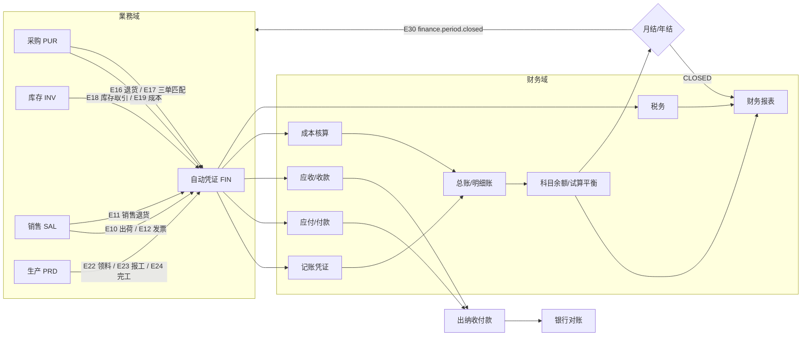
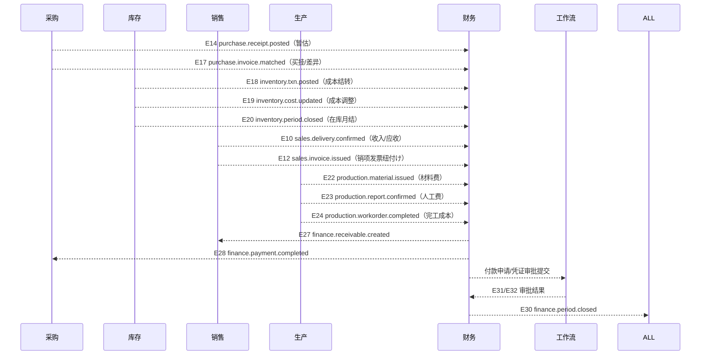

# 财务管理业务域概要书（財務管理 業務概要書）

| 項目 | 内容 |
|---|---|
| 文書名 | 财务管理业务域概要书（財務管理 業務概要書） |
| 文書番号 | DSN-FIN-000 |
| 版数 | v1.0 |
| 作成日 | 2026-10-20 |
| 作成者 | finance-designer（财务域担当） |
| 承認者 | 未承認（レビュー待ち） |
| 状態 | ドラフト（レビュー中） |
| 関連文書 | [体系总览](../README.md) / [共通项目定义](../00-common/01-common-item-definitions.md) / [共通业务规则](../00-common/08-common-business-rules.md) / [跨域流程](../00-common/09-cross-domain-flow.md) / [代码一览](../00-common/06-code-list.md) / [真实资料](../90-data/sources.md) |

> 本域是全部业务域的**会计最终责任者**：业务域只产生事实（入库、出库、领料、报工、完工、开票），本域负责把这些事实转换为符合《企业会计准则》（CAS）的凭证、账簿、报表与纳税申报辅助资料。本域正文用中文；仅文档信息与章节标题保留日本「詳細設計書」表记。

---

## 1. 業務概要

### 1.1 目的

财务管理域（FIN）面向執行《企业会计准则》的国内离散制造业，完成「会计科目体系 → 记账凭证 → 总账/明细账 → 期末结账 → 财务报表 → 纳税辅助」的完整会计循环，并向采购、销售、库存、生产域提供应收应付、成本核算、期间控制、银企支付等会计服务。示例企业为华东精密电机股份有限公司（YE3 系列三相异步电动机，增值税一般纳税人，记账本位币 CNY，移动加权平均法计价）。

### 1.2 適用範囲

| 項目 | 内容 |
|---|---|
| 対象会社・拠点 | 华东精密电机股份有限公司（公司 1）/ 常州总装厂（CZ01）、无锡零部件厂（WX01）/ 仓库 WH01 原料仓、WH02 半成品仓、WH03 成品仓 / 财务部（D050） |
| 対象機能範囲 | 会计科目与辅助核算、期初余额、记账凭证（手工/模板/自动）、审核/记账/反记账/红字冲销、总账与明细账、试算平衡、应收管理、应付管理、三单匹配、暂估与冲回、收付款与核销、账龄、出纳（现金/银行日记账、银行对账、余额调节表、资金日报）、发票台账、增值税申报辅助、附加税与所得税计提、自动凭证规则、成本核算（品种法/分批法）、制造费用分配、在制品与完工成本、成本差异、期间管理与月结/年结、损益结转、财务报表（资产负债表/利润表/现金流量表/科目余额表） |
| 対象外 | 物料/客户/供应商/税码/币种/银行等主数据定义（MDM）；审批引擎与审批画面（WF）；销售开票业务单据（SAL）；采购发票业务登记与三单匹配的**业务单据**（PUR 设计，本域为会计处理责任者）；库存计价与在库月结（INV）；生产报工与完工数量（PRD）；数电票/银企直连/电子税务局接口实现（INT，本域定义 IF 契约）；经营分析与看板（RPT） |
| 前提 | ① MDM 已维护税码、币种、客户/供应商、银行账户；② SYS 已配置用户/角色/数据权限；③ WF 已配置审批流程；④ 采购/销售/库存/生产域已按 09 章发出约定事件；⑤ 会计期间已由财务初始化 |

### 1.3 業務上の狙い（KPI）

| KPI | 定義・算式 | 目標値 | 実現する機能 ID |
|---|---|---|---|
| 月结完成日 | 会计期间 CLOSED 的执行日（次月第 5 个营业日以内） | ≤ T+5 营业日 | F-FIN-035/036 |
| 自动凭证覆盖率 | 自动生成凭证张数 ÷ 当期凭证总张数 | ≥ 80% | F-FIN-029/030 |
| 银行对账自动匹配率 | 自动匹配成功的对账单行数 ÷ 对账单总行数 | ≥ 90% | F-FIN-024 |
| 报表出具时效 | 月结完成后 4 小时内出具三大报表 | ≤ 4 小时 | F-FIN-038 |
| 应收账款周转天数（DSO） | **平均残高口径**：{(期初应收+期末应收)÷2} ÷ 营业收入 × 期间天数（月次=30 日） | ≤ 68 天 | F-FIN-019/022 |
| 应付账款周转天数（DPO） | **平均残高口径**：{(期初应付+期末应付)÷2} ÷ 营业成本 × 期间天数（月次=30 日） | ≤ 45 天 | F-FIN-012/018 |
| 增值税申报差错 | 申报辅助表与申报表差异笔数 | 0 笔 | F-FIN-027 |
| 凭证一次审核通过率 | 一次审核通过凭证张数 ÷ 提交审核张数 | ≥ 95% | F-FIN-005 |

---

## 2. 会計政策（示例企业）

> 下表为设计前提的会计政策，全部为【示例値】的**企业内部政策**（除标注【実データ】的法定事项外）。政策变更须经财务总监批准并记录于 `fin_period` 备注与 `sys_audit_log`；政策变更采用未来适用法（除非准则要求追溯）。

### 2.1 基本政策

| # | 項目 | 政策 | 根拠・出典 |
|---|---|---|---|
| 1 | 会计准则 | 企业会计准则（CAS）及其应用指南 | 【実データ】财政部《企业会计准则——应用指南》（财会〔2006〕18号）及其后修订 |
| 2 | 会计年度 | 公历 1 月 1 日～12 月 31 日 | 【実データ】《中华人民共和国会计法》《企业财务会计报告条例》（国务院令第 287 号） |
| 3 | 会计期间 | 月次（`YYYY-MM`），国家法定节假日不顺延；月结完成后进入下一期 | 【示例値】社内規程 |
| 4 | 记账本位币 | CNY（人民币），金额精度 2 位小数 | 【示例値】示例企业政策；外币业务 実装順 P2（F-FIN-045） |
| 5 | 会计基础 | 权责发生制 | 【実データ】《企业会计准则——基本准则》 |
| 6 | 计量属性 | 以历史成本为主；盘盈盘亏按重置成本/可变现净值调整 | 【実データ】基本准则第 43 条（历史成本） |
| 7 | 存货计价 | **移动加权平均法**，永续盘存制 | 【示例値】社内方法；与 [08 共通业务规则](../00-common/08-common-business-rules.md) 第 6 章一致 |
| 8 | 收入确认 | 出荷基準（E10 出荷确定时确认收入与应收）；特殊契约的検収基準 実装順 P2 个别对应 | 【示例値】与 09 章 7.3 一致；确认模型按 CAS 14（2017 修订）五步法，P0 実装時点 采用「控制权转移=出库」简化判断 |
| 9 | 成本核算 | 品种法为主（标准机 MTS），分批法为辅（订单机 MTO）；制造费用按直接人工工时分摊 | 【示例値】与 09 章 6 章、本域 [06](06-auto-voucher-costing.md) 一致 |
| 10 | 固定资产折旧 | 年限平均法；残值率 5%；房屋建筑物 20 年、机器设备 10 年、与生产经营活动有关的器具/工具/家具等 5 年、运输工具 4 年、电子设备 3 年；当月增加次月计提，当月减少当月照提 | 【実データ】最低年限依《中华人民共和国企业所得税法实施条例》（国务院令第 512 号）第 60 条；残值率与折旧惯例为【示例値】 |
| 11 | 坏账准备 | 実装順 P2：按 CAS 22（2017 修订）预期信用损失简化方法，按账龄组合计提；P0 実装時点 不计提 | 【実データ】准则框架；计提比例为【示例値】 |
| 12 | 存货跌价准备 | 実装順 P2：按成本与可变现净值孰低；P0 実装時点 不计提 | 【実データ】CAS 1（存货）；方法细节【示例値】 |
| 13 | 所得税会计 | 资产负债表债务法；税率 25%；月度计提、季度预缴、年度汇算清缴 | 【実データ】《中华人民共和国企业所得税法》第 4 条税率 25%；CAS 18 |
| 14 | 增值税 | 一般纳税人，一般计税方法；货物销售/进口 13%、交通运输/不动产租赁等 9%、现代服务等 6%；月度申报 | 【実データ】《中华人民共和国增值税法》（2024-12-25 公布、2026-01-01 施行）；税率依《财政部 税务总局 海关总署关于深化增值税改革有关政策的公告》（2019 年第 39 号） |
| 15 | 附加税费 | 城市维护建设税 7%（市区）、教育费附加 3%、地方教育附加 2%，以当期实际应纳增值税为计税依据 | 【実データ】《中华人民共和国城市维护建设税法》（2021-09-01 施行）；《征收教育费附加的暂行规定》（国务院令第 588 号修订）；地方教育附加依《财政部关于统一地方教育附加政策有关问题的通知》（财综〔2010〕98 号） |
| 16 | 印花税 | 买卖合同 0.3‰；计提计入「税金及附加」 | 【実データ】《中华人民共和国印花税法》（2022-07-01 施行）所附税目税率表 |
| 17 | 财务报表格式 | 一般企业财务报表格式（资产负债表、利润表、现金流量表、所有者权益变动表） | 【実データ】财政部《关于修订印发 2019 年度一般企业财务报表格式的通知》（财会〔2019〕6 号） |
| 18 | 会计档案 | 会计凭证/账簿 30 年、年度财务会计报告永久、月度/季度报告 10 年、银行余额调节表/对账单 10 年 | 【実データ】《会计档案管理办法》（财政部 国家档案局令第 79 号），与 08 章第 12 章一致 |
| 19 | 凭证字号 | 凭证字「记/收/付/转」+ 4 位号，按**会计期间 × 凭证字**连续编号 | 【示例値】社内規程，与 08 章 2.1 一致 |
| 20 | 期末结账日 | 次月第 5 个营业日（`fin_period.close_date`） | 【示例値】社内規程 |
| 21 | 关税 | 进口货物按《关税法》及当年进出口税则计征（実装順 P2 进口业务） | 【実データ】《中华人民共和国关税法》（2024-04-26 公布、2024-12-01 施行） |

### 2.2 会計処理の統制（SoD・統制点）

| # | 統制 | 内容 | 実現方法 |
|---|---|---|---|
| C-01 | 制单 ⇔ 审核 分离 | 凭证制单人与审核人必须是不同用户 | `fin_voucher.created_by <> reviewed_by`，否则拒否（MSG-FIN-011） |
| C-02 | 审核 ⇔ 记账 分离 | 凭证审核人与记账人必须是不同用户（可配置为「记账人可为审核人以外任何人」） | 参数 `finance.sod.post_separate`（既定 true） |
| C-03 | 付款申请 ⇔ 付款执行 分离 | 付款申请人与付款执行人角色分离 | 权限码分离 + 用户角色互斥检查（SYS 警告） |
| C-04 | 出纳 ⇔ 凭证制单 分离 | 出纳可登记收付款，但不得制单/审核/记账 | 权限码分离（出纳仅 `finance:payment:execute` 等） |
| C-05 | 银行账户变更 ⇔ 承认 | 账户主数据变更须财务总监审批并留审计日志 | MDM 审批 + `sys_audit_log` |
| C-06 | 期间控制 | CLOSED/YEAR_CLOSED 期间禁止新增、修改、记账、反记账 | `fin_period.status` 检查（MSG-COM-071） |
| C-07 | 记账后修改禁止 | 已记账凭证不得直接修改；订正走赤伝或反记账 | 状态机 + 权限 |
| C-08 | 反记账限制 | 仅当前 OPEN 期间、未结账、且仅财务经理以上可反记账；必须记录理由 | 权限 `finance:voucher:unpost` + 审计日志 |
| C-09 | 自动凭证幂等 | 同一业务事件（source_type+source_id）只生成一张凭证 | `uk_fin_voucher_source` 部分唯一索引 |
| C-10 | 银行对账复核 | 余额调节表须由非制表人复核 | `fin_bank_reconciliation.reviewed_by` |

### 2.3 承認経路（本域関連）

| 対象 | 条件 | 承認経路 | 出典 |
|---|---|---|---|
| 付款申请 PA | 50,000 元未満 | 财务经理（或签） | [08 章 8.1](../00-common/08-common-business-rules.md) |
| 付款申请 PA | 50,000～500,000 元 | 财务经理 → 财务总监（顺送） | 同上 |
| 付款申请 PA | 500,000 元以上 | 财务总监 → 总经理（顺送） | 同上 |
| 费用报销（P2） | 5,000 元未満 / 以上 | 部门经理 → 财务复核 / 部门经理 → 财务经理 → 总经理 | 同上 |
| 盘盈盘亏 | 10,000 元未満 / 以上 | 仓库主管 → 财务经理 / 上述 + 总经理 | 同上 |
| 采购退货/销售退货（会计影响） | 全额 | 采购/销售经理 → 财务经理 | 同上 |
| 凭证审核 | 全部 | 财务经理指定的审核人（不得为制单人） | 【示例値】社内規程 |
| 月结/年结 | 全部 | 财务经理执行、财务总监批准 | 【示例値】社内規程 |

---

## 3. 組織とロール

| ロール | 所属 | 主な操作 | 関連機能 ID | 主な権限コード |
|---|---|---|---|---|
| 财务总监 | 财务部 | 付款/报销高额审批、会计政策批准、月结/年结批准、财务报表审阅 | F-FIN-015/035/037/038 | `finance:payment-request:approve`, `finance:period:close`, `finance:statement:view` |
| 财务经理 | 财务部 | 凭证审核、记账/反记账、付款审核、月结执行、税务计提及申报辅助 | F-FIN-005/006/007/028/035 | `finance:voucher:approve/post/unpost`, `finance:period:close` |
| 会计（总账） | 财务部 | 凭证录入、自动凭证监控、总账/明细账、报表编制、往来对账 | F-FIN-003/009/010/012/019/038 | `finance:voucher:create`, `finance:ledger:view`, `finance:statement:view` |
| 应付会计 | 财务部 | 应付单、发票三单匹配、暂估、付款申请、应付核销与账龄 | F-FIN-012/013/014/015/017/018 | `finance:payable:*`, `finance:invoice:*`, `finance:write-off:create` |
| 应收会计 | 财务部 | 应收单、收款登记、核销、账龄、客户对账 | F-FIN-019/020/021/022 | `finance:receivable:*`, `finance:receipt:*` |
| 成本会计 | 财务部 | 成本归集、制造费用分配、成本计算、差异分析 | F-FIN-031/032/033/034 | `finance:cost:*` |
| 税务会计 | 财务部 | 进项/销项发票台账、增值税申报辅助、附加税/所得税计提 | F-FIN-026/027/028 | `finance:invoice:view`, `finance:vat-return:*`, `finance:tax-accrual:*` |
| 出纳 | 财务部 | 现金/银行日记账、收付款执行、银行对账、资金日报 | F-FIN-016/023/024/025 | `finance:payment:execute`, `finance:bank-*` |
| 采购员/采购经理 | 采购部 | 付款申请发起、三单匹配差异确认（业务侧） | F-FIN-013/015 | `finance:payment-request:create`（数据范围：本部门） |
| 销售员/销售经理 | 销售部 | 收款登记申请（业务侧通知）、客户对账确认 | F-FIN-020 | `finance:receivable:view`（数据范围：本部门） |
| 系统管理员 | 信息部 | 权限配置、参数维护、审计日志查询；**不得**制单/审核/记账/付款 | — | `system:*` |

> 会计、出纳、财务经理、财务总监为**互斥岗位**：同一用户默认不得兼任「会计 + 出纳」「会计 + 财务经理（审核）」；如确需兼任，由 SYS 角色分配时警告并记录理由（08 章 9.2）。

---

## 4. 業務フロー

### 4.1 全体像（会计循环 + 业务事件驱动）

### 4.2 処理手順（月次会計サイクル）

| # | 手順 | 実施者 | システム処理 | 入力 | 出力 | 異常時 |
|---|---|---|---|---|---|---|
| 1 | 日常凭证处理 | 会计 | 手工/自动凭证生成 → 审核 → 记账；凭证字号按期间×凭证字采番 | 业务单据、发票、银行回单 | 记账凭证 | 借贷不平衡拒否（MSG-FIN-001） |
| 2 | 应收应付确认 | 应付/应收会计 | E14/E17/E10/E12 触发生成 AP/AR；三单匹配差异判定 | 收货单、发票、出入库 | AP/AR 单 | 差异超容差进入待处理 |
| 3 | 收付款与核销 | 出纳/会计 | 付款申请审批 → 付款执行 → 核销；收款登记 → 核销 | 银行回单、付款申请 | 付款/收款单、核销记录 | 银行账户余额不足、账户不符 |
| 4 | 成本核算 | 成本会计 | 材料/人工/制造费用归集 → 分配 → 在制品/完工成本计算 | E18/E22/E23/E24 | 成本计算单 | 负库存/无工单报工 |
| 5 | 期间费用与税计提 | 税务会计 | 附加税/所得税/折旧计提，生成计提凭证 | 应纳税额、利润总额 | 计提凭证 | 税率/申报数据不一致 |
| 6 | 银行对账 | 出纳 | 导入对账单 → 自动匹配 → 未达账项 → 余额调节表 | 银行对账单文件 | 余额调节表 | 匹配率低、余额不符 |
| 7 | 月结检查 | 财务经理 | 执行 09 章 10.3 的 10 项检查（全部 0 件为通过） | — | 检查结果 | 未通过项列出并阻断 |
| 8 | 损益结转 | 财务经理 | 收入/费用科目结转至本年利润，生成结转凭证并记账 | 期间余额 | 结转凭证 | 期间未 OPEN/有未记账凭证 |
| 9 | 期末结账 | 财务经理/财务总监 | 期间 CLOSED，发 E30；锁定业务域 | — | 期间状态 CLOSED | 失败回滚（Advisory Lock） |
| 10 | 报表出具 | 会计/财务经理 | 生成资产负债表、利润表、现金流量表、科目余额表快照 | 余额/发生额 | 报表 PDF/Excel | 试算不平衡阻断 |
| 11 | 年度结转 | 财务经理/财务总监 | 12 月结账后，本年利润→利润分配，次年期间 OPEN | — | 年结凭证、次年期间 | 未完成年结检查 |

### 4.3 関連業務域との連携

| 相手域 | 連携内容 | 方式 | 契約 |
|---|---|---|---|
| PUR | 收货暂估（E14）、三单匹配/买挂（E17）、采购退货（E16） | イベント購読 | [09 章 3、4](../00-common/09-cross-domain-flow.md) |
| INV | 库存取引（E18）、成本更新（E19）、在库月结（E20）、**在庫期間再開（E37 購読）** | イベント購読 | [09 章 3](../00-common/09-cross-domain-flow.md) |
| SAL | 出荷（E10）、销售退货（E11）、销项发票（E12） | イベント購読 | 同上 |
| PRD | 领料（E22）、报工（E23）、完工入库（E24）、委外（E25/E26）、**生産退材料戻し（E36 購読）** | イベント購読 | [09 章 3](../00-common/09-cross-domain-flow.md) |
| ALL | 会计期间状态（E30）发布；各域在登録・更新时同步参照期间状态 | イベント発行 + 同期参照 | [09 章 11](../00-common/09-cross-domain-flow.md) |
| WF | 付款申请、费用报销、月结审批 | 同期提交 + E31/E32 回调 | [09 章 9](../00-common/09-cross-domain-flow.md) |
| MDM | 客户/供应商/税码/币种/银行账户/付款条件参照、**倉庫（E39）・税码（E40）・為替レート（E41）の変更購読** | 同期参照 + イベント購読 | [09 章 3](../00-common/09-cross-domain-flow.md) |
| INT | 银企直连、数电票、电子税务局申报 | IF（REST/文件） | 本域 [92](92-report-batch-design.md) IF-FIN-001～006 |
| RPT | 财务报表、账龄、成本数据只读 | 同期参照/视图 | 本域为数据责任者 |

> 09 章 §3 追補（2026-10-20）：**E36** `production.material.returned`（PRD→INV/FIN）は J12（材料費戻し）の根拠イベントとして購読、**E37** `inventory.period.reopened`（INV→FIN）は FIN の期間再開承認後に INV が発行し、FIN が購読して期間状態・月結チェックを同期する。あわせて **E39** `mdm.warehouse.changed`（倉庫参照キャッシュ）、**E40** `mdm.tax-code.changed`（取税キャッシュ）、**E41** `mdm.exchange-rate.changed`（換算レートキャッシュ・為替評価再計算）を購読する。

---

## 5. 機能一覧

| 機能 ID | 機能名 | 概要 | 画面 ID | 種別 | 優先度 | 状態 | 詳細設計書 |
|---|---|---|---|---|---|---|---|
| F-FIN-001 | 会计科目维护 | CAS 科目层级、余额方向、辅助核算维度、启用/停用 | SCR-FIN-001,002 | マスタ | P0 | 設計済 | [01](01-accounting-subjects.md) |
| F-FIN-002 | 辅助核算与期初余额 | 科目辅助核算设置、期初余额导入与试算校验 | SCR-FIN-003,004 | マスタ | P0 | 設計済 | [01](01-accounting-subjects.md) |
| F-FIN-003 | 记账凭证录入 | 手工凭证（记/收/付/转）、借贷平衡、辅助核算、附件 | SCR-FIN-005,006 | 登録 | P0 | 設計済 | [02](02-voucher-ledger.md) |
| F-FIN-004 | 凭证模板管理 | 常用凭证模板（业务事件/手工）与取数规则 | SCR-FIN-007 | マスタ | P0 | 設計済 | [02](02-voucher-ledger.md) |
| F-FIN-005 | 凭证审核 | 审核/取消审核、批量审核、SoD 校验 | SCR-FIN-008,009 | 状態操作 | P0 | 設計済 | [02](02-voucher-ledger.md) |
| F-FIN-006 | 凭证记账（过账） | 记账/批量记账，更新科目余额与辅助余额 | SCR-FIN-010 | 状態操作 | P0 | 設計済 | [02](02-voucher-ledger.md) |
| F-FIN-007 | 凭证反记账 | 反记账（限 OPEN 期间）、理由与审计 | SCR-FIN-011 | 状態操作 | P0 | 設計済 | [02](02-voucher-ledger.md) |
| F-FIN-008 | 红字冲销 | 生成红字冲销凭证、原凭证关联 | SCR-FIN-012 | 登録 | P0 | 設計済 | [02](02-voucher-ledger.md) |
| F-FIN-009 | 凭证查询与附件 | 凭证检索、凭证汇总、附件管理 | SCR-FIN-013 | 照会 | P0 | 設計済 | [02](02-voucher-ledger.md) |
| F-FIN-010 | 总账/明细账查询 | 总账、明细账、序时账、辅助核算明细账 | SCR-FIN-014,015,016 | 照会 | P0 | 設計済 | [02](02-voucher-ledger.md) |
| F-FIN-011 | 试算平衡 | 期初/本期/期末的借贷平衡校验与科目余额表 | SCR-FIN-017 | 照会 | P0 | 設計済 | [02](02-voucher-ledger.md) |
| F-FIN-012 | 应付单管理 | 应付单确认/取消、余额维护、来源追溯 | SCR-FIN-018,019 | 登録 | P0 | 設計済 | [03](03-ap-payment.md) |
| F-FIN-013 | 采购发票与三单匹配 | 进项发票登记、PO/GR/发票三单匹配、差异处理 | SCR-FIN-020 | 登録 | P0 | 設計済 | [03](03-ap-payment.md) |
| F-FIN-014 | 暂估入账与冲回 | 收货暂估、暂估冲回、暂估余额追溯 | SCR-FIN-021 | バッチ連携 | P0 | 設計済 | [03](03-ap-payment.md) |
| F-FIN-015 | 付款申请 | 付款申请、审批、付款排程 | SCR-FIN-022 | 登録 | P0 | 設計済 | [03](03-ap-payment.md) |
| F-FIN-016 | 付款执行 | 付款单、银行送金/现金支付、付款凭证 | SCR-FIN-023 | 登録 | P0 | 設計済 | [03](03-ap-payment.md) |
| F-FIN-017 | 应付核销 | 付款与应付/预付的核销、部分核销、反核销 | SCR-FIN-024 | 登録 | P0 | 設計済 | [03](03-ap-payment.md) |
| F-FIN-018 | 应付账龄 | 应付账款账龄分析（按到期日/业务日期） | SCR-FIN-025 | 照会 | P0 | 設計済 | [03](03-ap-payment.md) |
| F-FIN-019 | 应收单管理 | 应收单确认/取消、发票纽付け状态、余额维护 | SCR-FIN-026 | 登録 | P0 | 設計済 | [04](04-ar-receipt.md) |
| F-FIN-020 | 收款登记 | 收款单（银行/现金/票据）、预收、到账确认 | SCR-FIN-027 | 登録 | P0 | 設計済 | [04](04-ar-receipt.md) |
| F-FIN-021 | 应收核销 | 收款与应收/预收的核销、部分核销、反核销 | SCR-FIN-028 | 登録 | P0 | 設計済 | [04](04-ar-receipt.md) |
| F-FIN-022 | 应收账龄与坏账准备 | 应收账龄分析；坏账准备计提（第一版・実装順 P2） | SCR-FIN-029,030 | 照会 | P0/P2 | 設計済 | [04](04-ar-receipt.md) |
| F-FIN-023 | 现金日记账 | 现金收付登记、日结、现金盘点 | SCR-FIN-031 | 登録 | P0 | 設計済 | [05](05-cashier-tax.md) |
| F-FIN-024 | 银行日记账与银行对账 | 银行日记账、对账单导入、自动/手工匹配、余额调节表 | SCR-FIN-032～035 | 登録 | P0 | 設計済 | [05](05-cashier-tax.md) |
| F-FIN-025 | 资金日报 | 现金/银行账户余额、当日收支、资金头寸 | SCR-FIN-036 | 照会 | P0 | 設計済 | [05](05-cashier-tax.md) |
| F-FIN-026 | 发票台账 | 进项/销项发票台账、发票查验状态、勾选认证 | SCR-FIN-037,038 | 登録 | P0 | 設計済 | [05](05-cashier-tax.md) |
| F-FIN-027 | 增值税申报辅助 | 销项-进项-留抵计算、申报辅助表、导出 | SCR-FIN-039 | バッチ/照会 | P0 | 設計済 | [05](05-cashier-tax.md) |
| F-FIN-028 | 附加税/所得税计提 | 城建税/教育费附加/地方教育附加/所得税计提凭证 | SCR-FIN-040 | バッチ | P0 | 設計済 | [05](05-cashier-tax.md) |
| F-FIN-029 | 自动凭证规则管理 | 业务事件→凭证模板的规则维护、模拟测试 | SCR-FIN-041 | マスタ | P0 | 設計済 | [06](06-auto-voucher-costing.md) |
| F-FIN-030 | 自动凭证生成与监控 | 事件消费、凭证生成、失败重试、补偿 | SCR-FIN-042 | バッチ | P0 | 設計済 | [06](06-auto-voucher-costing.md) |
| F-FIN-031 | 成本核算 | 品种法/分批法成本计算、成本对象与结果 | SCR-FIN-043,044 | バッチ | P1 | 設計済 | [06](06-auto-voucher-costing.md) |
| F-FIN-032 | 制造费用归集与分配 | 费用归集、分配标准、分配计算与凭证 | SCR-FIN-045 | バッチ | P1 | 設計済 | [06](06-auto-voucher-costing.md) |
| F-FIN-033 | 在制品与完工成本 | 在制品成本、完工入库成本、单位成本 | SCR-FIN-046 | バッチ | P1 | 設計済 | [06](06-auto-voucher-costing.md) |
| F-FIN-034 | 成本差异分析 | 标准/实际、材料/人工/制造费用差异分析 | SCR-FIN-047 | 照会 | P1 | 設計済 | [06](06-auto-voucher-costing.md) |
| F-FIN-035 | 期间管理与月结 | 期间状态机、月结检查、期间关闭/重开 | SCR-FIN-048,049 | バッチ | P0 | 設計済 | [07](07-period-reporting.md) |
| F-FIN-036 | 损益结转 | 收入/费用→本年利润结转凭证与记账 | SCR-FIN-050 | バッチ | P0 | 設計済 | [07](07-period-reporting.md) |
| F-FIN-037 | 年度结转 | 本年利润→利润分配、次年期间开启 | SCR-FIN-051 | バッチ | P0 | 設計済 | [07](07-period-reporting.md) |
| F-FIN-038 | 财务报表 | 资产负债表、利润表、现金流量表（简表）取数与快照 | SCR-FIN-052 | 帳票 | P0 | 設計済 | [07](07-period-reporting.md) |
| F-FIN-039 | 科目余额表 | 科目余额表/试算平衡表输出 | SCR-FIN-053 | 帳票 | P0 | 設計済 | [07](07-period-reporting.md) |
| F-FIN-040 | 费用报销与借款 | 报销单、借款/还款、差旅费（第一版・実装順 P2、概要設計） | SCR-FIN-054,055 | 登録 | P2 | 設計中 | [07](07-period-reporting.md) |
| F-FIN-041 | 固定资产卡片与折旧 | 资产卡片、折旧计提、资产台账（第一版・実装順 P2、概要設計） | SCR-FIN-056 | マスタ | P2 | 設計中 | [07](07-period-reporting.md) |
| F-FIN-042 | 固定资产处置 | 出售/报废/盘亏处置与凭证（第一版・実装順 P2、概要設計） | SCR-FIN-057 | 登録 | P2 | 設計中 | [07](07-period-reporting.md) |
| F-FIN-043 | 预算管理 | 预算编制、控制、执行分析（第一版・実装順 P2、概要設計） | SCR-FIN-058 | マスタ | P2 | 設計中 | [07](07-period-reporting.md) |
| F-FIN-044 | 多币种与汇兑损益 | 外币凭证、期末汇兑调整（第一版・実装順 P2、概要設計） | SCR-FIN-059 | バッチ | P2 | 設計中 | [07](07-period-reporting.md) |
| F-FIN-045 | 资金计划与付款排程 | 资金计划编制、付款排程、资金缺口预警（第一版・実装順 P2、概要設計） | SCR-FIN-060 | 照会 | P2 | 設計中 | [07](07-period-reporting.md) |
| F-FIN-046 | 财务报表分析 | 同比/环比、结构分析、指标计算（第一版・実装順 P2、概要設計） | SCR-FIN-061 | 照会 | P2 | 設計中 | [07](07-period-reporting.md) |

> 優先度：P0 / P1 / P2。**P0/P1/P2 は全て第一版（全量）で、実装順のみを表す**（標準原価・RLS・P2 機能を含む）。状態：未設計/設計中/設計済/レビュー済/承認済。P2 機能は本域 [07](07-period-reporting.md) 第 8 章に概要設計を置き、実装順 P2 の着手時に詳細化して本書を改訂する。

---

## 6. 画面一覧

| 画面 ID | 画面名 | 類型 | 機能 ID | 権限コード | 遷移元 | 遷移先 |
|---|---|---|---|---|---|---|
| SCR-FIN-001 | 会计科目一覧 | LIST | F-FIN-001 | finance:account:view | 财务 > 基础设置 | SCR-FIN-002 |
| SCR-FIN-002 | 会计科目登録編集 | EDIT | F-FIN-001 | finance:account:create/update | SCR-FIN-001 | SCR-FIN-001 |
| SCR-FIN-003 | 期初余额录入 | EDIT | F-FIN-002 | finance:opening-balance:import | 财务 > 基础设置 | SCR-FIN-017 |
| SCR-FIN-004 | 科目辅助核算设置 | EDIT | F-FIN-002 | finance:account:update | SCR-FIN-002 | SCR-FIN-001 |
| SCR-FIN-005 | 记账凭证录入 | EDIT | F-FIN-003 | finance:voucher:create | 凭证一覧 | SCR-FIN-006 |
| SCR-FIN-006 | 凭证一覧 | LIST | F-FIN-003/009 | finance:voucher:view | 菜单 | SCR-FIN-005/009 |
| SCR-FIN-007 | 凭证模板管理 | LIST/EDIT | F-FIN-004 | finance:voucher-template:view/update | 财务 > 基础设置 | — |
| SCR-FIN-008 | 凭证待审核一覧 | LIST | F-FIN-005 | finance:voucher:approve | 菜单 | SCR-FIN-009 |
| SCR-FIN-009 | 凭证审核详细 | VIEW | F-FIN-005 | finance:voucher:approve | SCR-FIN-008/006 | SCR-FIN-008 |
| SCR-FIN-010 | 凭证记账处理 | LIST | F-FIN-006 | finance:voucher:post | 菜单 | SCR-FIN-006 |
| SCR-FIN-011 | 凭证反记账 | LIST/EDIT | F-FIN-007 | finance:voucher:unpost | 菜单 | SCR-FIN-006 |
| SCR-FIN-012 | 红字冲销凭证 | EDIT | F-FIN-008 | finance:voucher:reverse | SCR-FIN-013 | SCR-FIN-005 |
| SCR-FIN-013 | 凭证查询与附件 | VIEW | F-FIN-009 | finance:voucher:view | 菜单 | SCR-FIN-012 |
| SCR-FIN-014 | 总账查询 | LIST | F-FIN-010 | finance:ledger:view | 菜单 | SCR-FIN-015 |
| SCR-FIN-015 | 明细账查询 | LIST | F-FIN-010 | finance:ledger:view | SCR-FIN-014 | SCR-FIN-013 |
| SCR-FIN-016 | 序时账（日记账） | LIST | F-FIN-010 | finance:ledger:view | 菜单 | SCR-FIN-013 |
| SCR-FIN-017 | 试算平衡表 | LIST | F-FIN-011/039 | finance:trial-balance:view | 菜单 | SCR-FIN-014 |
| SCR-FIN-018 | 应付单一覧 | LIST | F-FIN-012 | finance:payable:view | 菜单 | SCR-FIN-019 |
| SCR-FIN-019 | 应付单确认/详细 | EDIT/VIEW | F-FIN-012 | finance:payable:update | SCR-FIN-018 | SCR-FIN-018 |
| SCR-FIN-020 | 采购发票三单匹配 | EDIT | F-FIN-013 | finance:invoice:match | 菜单 | SCR-FIN-019 |
| SCR-FIN-021 | 暂估余额与冲回 | LIST | F-FIN-014 | finance:payable:view | 菜单 | SCR-FIN-020 |
| SCR-FIN-022 | 付款申请 | EDIT | F-FIN-015 | finance:payment-request:create | 菜单 | SCR-FIN-023 |
| SCR-FIN-023 | 付款执行 | EDIT | F-FIN-016 | finance:payment:execute | SCR-FIN-022 | SCR-FIN-032 |
| SCR-FIN-024 | 应付核销 | EDIT | F-FIN-017 | finance:write-off:create | 菜单 | SCR-FIN-018 |
| SCR-FIN-025 | 应付账龄分析 | 照会 | F-FIN-018 | finance:aging:view | 菜单 | SCR-FIN-018 |
| SCR-FIN-026 | 应收单一覧 | LIST | F-FIN-019 | finance:receivable:view | 菜单 | SCR-FIN-028 |
| SCR-FIN-027 | 收款登记 | EDIT | F-FIN-020 | finance:receipt:create | 菜单 | SCR-FIN-028 |
| SCR-FIN-028 | 应收核销 | EDIT | F-FIN-021 | finance:write-off:create | SCR-FIN-026/027 | SCR-FIN-026 |
| SCR-FIN-029 | 应收账龄分析 | 照会 | F-FIN-022 | finance:aging:view | 菜单 | SCR-FIN-026 |
| SCR-FIN-030 | 坏账准备计提（P2） | LIST | F-FIN-022 | finance:receivable:update | SCR-FIN-029 | — |
| SCR-FIN-031 | 现金日记账 | LIST | F-FIN-023 | finance:cash-journal:view | 菜单 | SCR-FIN-038 |
| SCR-FIN-032 | 银行日记账 | LIST | F-FIN-024 | finance:bank-journal:view | 菜单 | SCR-FIN-034 |
| SCR-FIN-033 | 银行对账单导入 | EDIT | F-FIN-024 | finance:bank-statement:import | SCR-FIN-032 | SCR-FIN-034 |
| SCR-FIN-034 | 银行对账 | EDIT | F-FIN-024 | finance:bank-recon:execute | SCR-FIN-032 | SCR-FIN-035 |
| SCR-FIN-035 | 余额调节表 | 帳票 | F-FIN-024 | finance:bank-recon:view | SCR-FIN-034 | — |
| SCR-FIN-036 | 资金日报 | DASH | F-FIN-025 | finance:fund-report:view | 菜单 | — |
| SCR-FIN-037 | 进项发票台账 | LIST | F-FIN-026 | finance:invoice:view | 菜单 | SCR-FIN-020 |
| SCR-FIN-038 | 销项发票台账 | LIST | F-FIN-026 | finance:invoice:view | 菜单 | SCR-FIN-026 |
| SCR-FIN-039 | 增值税申报辅助表 | 照会/帳票 | F-FIN-027 | finance:vat-return:view | 菜单 | — |
| SCR-FIN-040 | 附加税/所得税计提 | EDIT | F-FIN-028 | finance:tax-accrual:generate | 菜单 | SCR-FIN-005 |
| SCR-FIN-041 | 自动凭证规则管理 | LIST/EDIT | F-FIN-029 | finance:auto-voucher:view/update | 财务 > 基础设置 | SCR-FIN-042 |
| SCR-FIN-042 | 自动凭证监控 | LIST | F-FIN-030 | finance:auto-voucher:view | 菜单 | SCR-FIN-006 |
| SCR-FIN-043 | 成本计算 | WIZ | F-FIN-031 | finance:cost:calculate | 菜单 | SCR-FIN-044 |
| SCR-FIN-044 | 成本计算结果 | VIEW | F-FIN-031 | finance:cost:view | SCR-FIN-043 | SCR-FIN-046 |
| SCR-FIN-045 | 制造费用归集与分配 | EDIT | F-FIN-032 | finance:cost:calculate | 菜单 | SCR-FIN-043 |
| SCR-FIN-046 | 在制品与完工成本 | LIST | F-FIN-033 | finance:cost:view | 菜单 | SCR-FIN-044 |
| SCR-FIN-047 | 成本差异分析 | 照会 | F-FIN-034 | finance:cost:view | 菜单 | — |
| SCR-FIN-048 | 会计期间管理 | LIST | F-FIN-035 | finance:period:view/close | 财务 > 期末处理 | SCR-FIN-049 |
| SCR-FIN-049 | 月结向导 | WIZ | F-FIN-035/036 | finance:period:close | SCR-FIN-048 | SCR-FIN-052 |
| SCR-FIN-050 | 损益结转 | EDIT | F-FIN-036 | finance:period:close | SCR-FIN-049 | SCR-FIN-049 |
| SCR-FIN-051 | 年度结转 | WIZ | F-FIN-037 | finance:year-close:execute | SCR-FIN-048 | SCR-FIN-048 |
| SCR-FIN-052 | 财务报表（三表） | 照会/帳票 | F-FIN-038 | finance:statement:view | 菜单 | — |
| SCR-FIN-053 | 科目余额表 | 照会/帳票 | F-FIN-039 | finance:report:view | 菜单 | SCR-FIN-014 |
| SCR-FIN-054 | 费用报销（P2） | EDIT | F-FIN-040 | finance:expense:create | 菜单 | SCR-FIN-055 |
| SCR-FIN-055 | 借款/还款（P2） | EDIT | F-FIN-040 | finance:expense:create | 菜单 | SCR-FIN-054 |
| SCR-FIN-056 | 固定资产卡片（P2） | LIST/EDIT | F-FIN-041 | finance:asset:view/update | 菜单 | SCR-FIN-057 |
| SCR-FIN-057 | 固定资产处置（P2） | EDIT | F-FIN-042 | finance:asset:dispose | SCR-FIN-056 | SCR-FIN-056 |
| SCR-FIN-058 | 预算管理（P2） | EDIT | F-FIN-043 | finance:budget:update | 菜单 | — |
| SCR-FIN-059 | 汇兑损益调整（P2） | EDIT | F-FIN-044 | finance:voucher:create | 菜单 | — |
| SCR-FIN-060 | 资金计划与付款排程（P2） | LIST | F-FIN-045 | finance:fund-report:view | 菜单 | SCR-FIN-036 |
| SCR-FIN-061 | 财务报表分析（P2） | DASH | F-FIN-046 | finance:statement:view | SCR-FIN-052 | — |

> 画面類型コード：LIST/EDIT/VIEW/DIALOG/WF/DASH/WIZ/PRINT（[02 画面共通规格](../00-common/02-common-screen-spec.md) 第 2 章）。画面項目定義・イベント・表示制御は各機能文書の第 4 章に記載する。

---

## 7. 帳票一覧

| 帳票 ID | 帳票名 | 出力タイミング | 帳票種別 | 機能 ID | 詳細 |
|---|---|---|---|---|---|
| PRT-FIN-001 | 记账凭证 | 手動（审核后/记账后） | 伝票 | F-FIN-003/005 | [92](92-report-batch-design.md) |
| PRT-FIN-002 | 凭证汇总表（科目汇总表） | 手動（月次） | 集計表 | F-FIN-009 | [92](92-report-batch-design.md) |
| PRT-FIN-003 | 总账 | 手動（月次） | 帳簿 | F-FIN-010 | [92](92-report-batch-design.md) |
| PRT-FIN-004 | 明细账 | 手動（月次） | 帳簿 | F-FIN-010 | [92](92-report-batch-design.md) |
| PRT-FIN-005 | 序时账 | 手動（月次） | 帳簿 | F-FIN-010 | [92](92-report-batch-design.md) |
| PRT-FIN-006 | 科目余额表 | 手動（日次/月次） | 帳簿 | F-FIN-011/039 | [92](92-report-batch-design.md) |
| PRT-FIN-007 | 应付账款明细表 | 手動（月次） | 集計表 | F-FIN-012/018 | [92](92-report-batch-design.md) |
| PRT-FIN-008 | 应付账龄分析表 | 手動（月次） | 集計表 | F-FIN-018 | [92](92-report-batch-design.md) |
| PRT-FIN-009 | 付款申请单 | 承認時/手動 | 伝票 | F-FIN-015 | [92](92-report-batch-design.md) |
| PRT-FIN-010 | 付款单/付款凭证 | 付款执行后 | 伝票 | F-FIN-016 | [92](92-report-batch-design.md) |
| PRT-FIN-011 | 供应商对账单 | 手動（月次） | 集計表 | F-FIN-017 | [92](92-report-batch-design.md) |
| PRT-FIN-012 | 预付款明细表 | 手動（月次） | 集計表 | F-FIN-012/017 | [92](92-report-batch-design.md) |
| PRT-FIN-013 | 应收账款明细表 | 手動（月次） | 集計表 | F-FIN-019/022 | [92](92-report-batch-design.md) |
| PRT-FIN-014 | 应收账龄分析表 | 手動（月次） | 集計表 | F-FIN-022 | [92](92-report-batch-design.md) |
| PRT-FIN-015 | 收款单/收据 | 入金确认后 | 伝票 | F-FIN-020 | [92](92-report-batch-design.md) |
| PRT-FIN-016 | 客户对账单（应收对账） | 手動（月次） | 集計表 | F-FIN-021 | [92](92-report-batch-design.md) |
| PRT-FIN-017 | 预收款明细表 | 手動（月次） | 集計表 | F-FIN-020 | [92](92-report-batch-design.md) |
| PRT-FIN-018 | 现金日记账 | 日次/月次 | 帳簿 | F-FIN-023 | [92](92-report-batch-design.md) |
| PRT-FIN-019 | 银行存款日记账 | 日次/月次 | 帳簿 | F-FIN-024 | [92](92-report-batch-design.md) |
| PRT-FIN-020 | 银行余额调节表 | 月次 | 帳簿 | F-FIN-024 | [92](92-report-batch-design.md) |
| PRT-FIN-021 | 资金日报 | 日次 | 集計表 | F-FIN-025 | [92](92-report-batch-design.md) |
| PRT-FIN-022 | 进项发票台账 | 手動（月次） | 一覧表 | F-FIN-026 | [92](92-report-batch-design.md) |
| PRT-FIN-023 | 销项发票台账 | 手動（月次） | 一覧表 | F-FIN-026 | [92](92-report-batch-design.md) |
| PRT-FIN-024 | 增值税申报辅助表 | 月次（生成后） | 集計表 | F-FIN-027 | [92](92-report-batch-design.md) |
| PRT-FIN-025 | 附加税/所得税计提表 | 月次 | 集計表 | F-FIN-028 | [92](92-report-batch-design.md) |
| PRT-FIN-026 | 产品成本计算单（品种法） | 月次 | 集計表 | F-FIN-031 | [92](92-report-batch-design.md) |
| PRT-FIN-027 | 产品成本计算单（分批法） | 月次 | 集計表 | F-FIN-031 | [92](92-report-batch-design.md) |
| PRT-FIN-028 | 制造费用分配表 | 月次 | 集計表 | F-FIN-032 | [92](92-report-batch-design.md) |
| PRT-FIN-029 | 在产品成本表 | 月次 | 集計表 | F-FIN-033 | [92](92-report-batch-design.md) |
| PRT-FIN-030 | 完工产品成本表 | 月次 | 集計表 | F-FIN-033 | [92](92-report-batch-design.md) |
| PRT-FIN-031 | 成本差异分析表 | 月次 | 集計表 | F-FIN-034 | [92](92-report-batch-design.md) |
| PRT-FIN-032 | 资产负债表 | 月次/季次/年次 | 集計表 | F-FIN-038 | [92](92-report-batch-design.md) |
| PRT-FIN-033 | 利润表 | 月次/季次/年次 | 集計表 | F-FIN-038 | [92](92-report-batch-design.md) |
| PRT-FIN-034 | 现金流量表（简表） | 月次/年次 | 集計表 | F-FIN-038 | [92](92-report-batch-design.md) |
| PRT-FIN-035 | 会计期间月结检查表 | 月次 | 一覧表 | F-FIN-035 | [92](92-report-batch-design.md) |
| PRT-FIN-036 | 凭证附件清单 | 手動 | 一覧表 | F-FIN-009 | [92](92-report-batch-design.md) |
| PRT-FIN-037 | 费用报销单（P2） | 承認時 | 伝票 | F-FIN-040 | [92](92-report-batch-design.md) |
| PRT-FIN-038 | 固定资产折旧明细表（P2） | 月次 | 集計表 | F-FIN-041 | [92](92-report-batch-design.md) |
| PRT-FIN-039 | 所有者权益变动表（简表） | 月次/年次 | 集計表（法定） | F-FIN-038 | [92](92-report-batch-design.md) |

---

## 8. バッチ一覧

| バッチ ID | バッチ名 | 起動方式 | 実行時間帯 | 処理概要 | 冪等性 |
|---|---|---|---|---|---|
| BAT-FIN-001 | 会计期间自动开启 | 日次 | 00:05 | 次日到达时把次日所属期间从 FUTURE 置为 OPEN | 再実行可 |
| BAT-FIN-002 | 期末暂估入账 | 月次（手动/月结前） | 月结日 18:00 | 未请求收货生成暂估 AP 与 J01 凭证 | 再実行可（source 唯一） |
| BAT-FIN-003 | 暂估冲回 | 月次/发票到达 | 月结后首日 01:00 | 发票到达或月初冲回暂估 | 再実行可（按期间+来源） |
| BAT-FIN-004 | 自动凭证事件消费 | 分次（10 秒） | 常时 | 消费 Outbox 业务事件，按模板生成凭证 | 再実行可（event_id 幂等） |
| BAT-FIN-005 | 自动凭证失败重试 | 分次（5 分钟） | 常时 | 重试 FAILED 自动凭证，指数退避 | 再実行可 |
| BAT-FIN-006 | 应付账龄计算 | 日次 | 02:00 | 按基准日计算 AP 账龄分档 | 再実行可（覆盖当日快照） |
| BAT-FIN-007 | 应收账龄计算 | 日次 | 02:10 | 按基准日计算 AR 账龄分档 | 再実行可 |
| BAT-FIN-008 | 银行对账单自动匹配 | 手动/日次 | 导入后即时 | 按金额+日期+对方户名自动匹配日记账 | 再実行可 |
| BAT-FIN-009 | 月结检查 | 手动（月结向导） | 月结时 | 执行 09 章 10.3 的 10 项检查 | 再実行可 |
| BAT-FIN-010 | 制造费用分配 | 月次 | 月结日 19:00 | 按直接人工工时分摊制造费用并生成 J15 | 再実行可（期间+费用中心） |
| BAT-FIN-011 | 成本计算 | 月次 | 月结日 20:00 | 品种法/分批法计算完工成本、在制品，生成 J16 | 再実行可（期间+成本对象） |
| BAT-FIN-012 | 损益结转 | 手动（月结向导） | 月结时 | 收入费用→本年利润，生成 J28/J29 并记账 | 条件付き（当期一次） |
| BAT-FIN-013 | 年度结转 | 手动（年结） | 年结时 | 本年利润→利润分配（J30），开启次年 | 条件付き（年度一次） |
| BAT-FIN-014 | 财务报表快照生成 | 月次（月结后） | 月结完成后 | 生成 BS/IS/CF 快照 | 再実行可 |
| BAT-FIN-015 | 增值税申报辅助表生成 | 月次 | 月结前 | 计算销项/进项/留抵/应纳税额 | 再実行可 |
| BAT-FIN-016 | 附加税/所得税计提 | 月次 | 月结前 | 生成 J26/J27 计提凭证 | 再実行可（期间+税种唯一） |
| BAT-FIN-017 | 折旧计提（P2） | 月次 | 月结前 | 固定资产折旧计算与 J25 | 条件付き（期间一次） |
| BAT-FIN-018 | 坏账准备计提（P2） | 月次 | 月结前 | 按账龄组合计提坏账准备 | 条件付き |
| BAT-FIN-019 | 试算平衡校验 | 日次 | 23:00 | 校验科目余额借贷平衡，异常告警 | 再実行可 |
| BAT-FIN-020 | 资金日报预生成 | 日次 | 06:00 | 生成前日资金头寸快照 | 再実行可 |

---

## 9. テーブル一覧

| 物理名 | 論理名 | 種別 | 主な用途 | 更新元機能 ID | データ量見積 |
|---|---|---|---|---|---|
| `fin_account` | 会计科目 | マスタ | CAS 科目层级、余额方向、辅助核算 | F-FIN-001 | 初期 800 / 年 +50 |
| `fin_account_aux` | 科目辅助核算设置 | マスタ | 科目×辅助核算维度、必填/可选 | F-FIN-002 | 初期 300 |
| `fin_period` | 会计期间 | マスタ | 期间状态机、结账日 | F-FIN-035 | 年 12 |
| `fin_account_balance` | 科目余额（期间） | 残高 | 期初/发生/期末余额（末级科目） | F-FIN-006/011 | 年 36 万 |
| `fin_aux_balance` | 辅助核算余额 | 残高 | 客户/供应商/部门等辅助余额 | F-FIN-006/024 | 年 60 万 |
| `fin_voucher` | 记账凭证（头） | 伝票 | 凭证字号、状态、金额合计、来源 | F-FIN-003/030 | 年 8 万 |
| `fin_voucher_line` | 记账凭证（分录） | 伝票明細 | 借贷分录、辅助核算、现金流量项目 | F-FIN-003 | 年 80 万 |
| `fin_voucher_template` | 凭证模板（头） | マスタ | 业务事件/手工模板 | F-FIN-004/029 | 初期 80 |
| `fin_voucher_template_line` | 凭证模板（行） | マスタ | 借贷方向、科目、金额来源、摘要模板 | F-FIN-004/029 | 初期 500 |
| `fin_auto_voucher_log` | 自动凭证生成日志 | ログ | 事件消费、幂等、失败重试 | F-FIN-030 | 年 80 万 |
| `fin_cash_flow_item` | 现金流量项目 | マスタ | CAS 现金流量表项目映射 | F-FIN-038 | 初期 100 |
| `fin_aging_config` | 账龄区间配置 | 設定 | 账龄分档、基准类型 | F-FIN-018/022 | 初期 10 |
| `fin_statement_template` | 报表项目模板 | マスタ | 报表项目、行次、左右列 | F-FIN-038 | 初期 200 |
| `fin_statement_formula` | 报表取数公式 | マスタ | 报表项目→科目/计算式 | F-FIN-038 | 初期 500 |
| `fin_statement_snapshot` | 财务报表快照 | 履歴 | 期末报表行值（含版本） | F-FIN-038 | 年 4 万 |
| `fin_bank_account` | 银行账户（自有） | マスタ | 开户行、账号（加密）、对应科目、对账参数 | F-FIN-024 | 初期 10 |
| `fin_close_checklist` | 月结检查清单 | ログ | 月结检查项结果与证据 | F-FIN-035 | 年 120 |
| `fin_receivable` | 应收单 | 伝票 | 出荷/发票来源应收，余额、到期日、开票状态 | F-FIN-019 | 年 12 万 |
| `fin_receivable_line` | 应收单明细 | 伝票明細 | 物料/数量/金额/税额 | F-FIN-019 | 年 60 万 |
| `fin_payable` | 应付单 | 伝票 | 收货暂估/发票来源应付，余额、到期日 | F-FIN-012 | 年 8 万 |
| `fin_invoice` | 发票（进项/销项） | 伝票 | 发票台账、税额、匹配状态 | F-FIN-013/026 | 年 10 万 |
| `fin_invoice_line` | 发票明细 | 伝票明細 | 物料、数量、金额、税率 | F-FIN-013/026 | 年 40 万 |
| `fin_invoice_match` | 三单匹配记录 | 履歴 | PO/GR/发票差异、处理结果 | F-FIN-013 | 年 10 万 |
| `fin_payment_request` | 付款申请（头） | 伝票 | 供应商、金额、审批状态 | F-FIN-015 | 年 2 万 |
| `fin_payment_request_line` | 付款申请明细 | 伝票明細 | 对应 AP/预付、金额 | F-FIN-015 | 年 6 万 |
| `fin_payment` | 付款单 | 伝票 | 付款执行、银行账户、方式、状态 | F-FIN-016 | 年 2 万 |
| `fin_receipt` | 收款单 | 伝票 | 收款登记、到账、预收、状态 | F-FIN-020 | 年 3 万 |
| `fin_write_off` | 核销单（头） | 伝票 | AR/AP 核销批次 | F-FIN-017/021 | 年 4 万 |
| `fin_write_off_line` | 核销明细 | 伝票明細 | 源单/目标单/核销金额 | F-FIN-017/021 | 年 10 万 |
| `fin_cash_journal` | 现金日记账 | 取引 | 现金收付流水、日结、盘点 | F-FIN-023 | 年 1 万 |
| `fin_bank_journal` | 银行日记账 | 取引 | 银行收付流水、对账状态 | F-FIN-016/024 | 年 6 万 |
| `fin_bank_statement` | 银行对账单（批次） | 取引 | 导入批次、账户、期间、余额 | F-FIN-024 | 年 120 |
| `fin_bank_statement_line` | 银行对账单明细 | 取引 | 对账单行、匹配状态 | F-FIN-024 | 年 6 万 |
| `fin_bank_reconciliation` | 银行余额调节表 | 履歴 | 期间余额、调节项合计 | F-FIN-024 | 年 120 |
| `fin_bank_recon_item` | 银行对账未达账项 | 履歴 | 企业未达/银行未达明细 | F-FIN-024 | 年 2,000 |
| `fin_vat_return` | 增值税申报辅助（头） | 集計 | 期间销项/进项/留抵/应纳税额 | F-FIN-027 | 年 12 |
| `fin_vat_return_line` | 增值税申报辅助（行） | 集計 | 申报项目行值 | F-FIN-027 | 年 600 |
| `fin_tax_accrual` | 税金计提 | 伝票 | 附加税/所得税计提及凭证 | F-FIN-028 | 年 300 |
| `fin_cost_collection` | 成本归集 | 集計 | 成本对象×成本要素归集额 | F-FIN-031 | 年 3 万 |
| `fin_cost_allocation` | 制造费用分配 | 集計 | 费用中心、分配标准、分配额 | F-FIN-032 | 年 6,000 |
| `fin_wip_balance` | 在制品余额 | 残高 | 工单在制品成本 | F-FIN-033 | 年 3 万 |
| `fin_product_cost` | 完工产品成本 | 集計 | 产品/工单完工数量、单位成本 | F-FIN-033 | 年 2 万 |
| `fin_cost_variance` | 成本差异 | 集計 | 标准/实际差异分析 | F-FIN-034 | 年 6 万 |
| `fin_standard_cost` | 标准成本（版管理） | マスタ | 物料×版本×适用期间的标准单位成本（材料/人工/制造费用/委外） | F-FIN-034 | 年 300 |
| `fin_expense_claim` | 费用报销（P2） | 伝票 | 报销单头 | F-FIN-040 | 年 2 万 |
| `fin_expense_claim_line` | 费用报销明细（P2） | 伝票明細 | 费用项目、发票、金额 | F-FIN-040 | 年 8 万 |
| `fin_asset` | 固定资产卡片（P2） | マスタ | 资产信息、折旧参数 | F-FIN-041 | 初期 2,000 |
| `fin_asset_depreciation` | 固定资产折旧（P2） | 履歴 | 月度折旧明细 | F-FIN-041 | 年 2.4 万 |
| `fin_budget` | 预算（P2） | マスタ | 预算版本、期间、组织 | F-FIN-043 | 初期 500 |
| `fin_budget_line` | 预算明细（P2） | マスタ | 科目/项目预算额 | F-FIN-043 | 初期 2 万 |
| `fin_exchange_reval` | 汇兑损益调整（P2） | 履歴 | 外币科目期末调整 | F-FIN-044 | 年 1,200 |
| `fin_cash_plan` | 资金计划（P2） | 伝票 | 资金收支计划、排程 | F-FIN-045 | 年 1,000 |
| `fin_cash_plan_line` | 资金计划明细（P2） | 伝票明細 | 计划收付款明细 | F-FIN-045 | 年 1.2 万 |

> 全 53 表。物理設計（DDL・項目定義・索引・制約・更新仕様）は [90-db-design.md](90-db-design.md) を正とする。全表を第一版で作成する（P2 表は実装順 P2 のマイグレーションで追加）。全 `fin_*` は RLS（ENABLE + FORCE、`tenant_id` 判定）対象。

---

## 10. 外部 IF 一覧

| IF ID | 名称 | 相手先 | 方向 | 方式 | 頻度 | 契機 |
|---|---|---|---|---|---|---|
| IF-FIN-001 | 银行对账单导入 | 开户银行/银企直连（INT） | 受信 | ファイル（CSV/Excel） | 日次 | 出纳导入/银企推送 |
| IF-FIN-002 | 银企直连付款指令 | 开户银行（INT） | 送信 | REST | リアルタイム | 付款执行 |
| IF-FIN-003 | 银企直连回单/余额 | 开户银行（INT） | 受信 | REST | 日次/リアルタイム | 付款后、日终 |
| IF-FIN-004 | 数电票开票（销项） | 电子发票服务平台（INT） | 送信 | REST | リアルタイム | 销售发票开具 |
| IF-FIN-005 | 进项发票查验/勾选 | 增值税发票综合服务平台（INT） | 双方向 | REST/ファイル | 日次 | 发票台账查验、勾选认证 |
| IF-FIN-006 | 增值税申报数据导出 | 电子税务局（INT） | 送信 | ファイル（XML/Excel） | 月次 | 申报辅助表确认后 |

> 域間連携（E10/E12/E14/E16/E17/E18/E19/E20/E22/E23/E24/E25/E26/E27/E28/E29/E30/E31/E32）は内部イベントであり IF ID を付与しない（[00 設計方針 6.4](../00-common/00-design-principles.md)）。イベント契約は [09 章 3](../00-common/09-cross-domain-flow.md) を正とする。

---

## 11. 権限一覧

| 権限コード | 対象機能 | 対象データ範囲 | 付与ロール |
|---|---|---|---|
| `finance:account:view` | F-FIN-001/002 | 全社 | 财务全般、系统管理员 |
| `finance:account:create` / `update` | F-FIN-001/002 | 全社 | 财务经理（科目追加）；财务总监（会计政策） |
| `finance:opening-balance:import` | F-FIN-002 | 全社 | 财务经理 |
| `finance:voucher:view` | F-FIN-003/009 | 全社（数据权限：部门/本人可配置） | 会计、财务经理、财务总监、审计 |
| `finance:voucher:create` | F-FIN-003 | 本部门 | 会计、应付/应收/成本会计 |
| `finance:voucher:update` / `delete` | F-FIN-003 | 本人制单且 status=10 | 会计 |
| `finance:voucher:submit` | F-FIN-003 | 本人制单 | 会计 |
| `finance:voucher:approve` | F-FIN-005 | 全社 | 财务经理（不得为制单人） |
| `finance:voucher:post` | F-FIN-006 | 全社 | 财务经理（不得为制单人；默认不得为审核人） |
| `finance:voucher:unpost` | F-FIN-007 | 全社 | 财务经理以上（理由必须） |
| `finance:voucher:reverse` | F-FIN-008 | 全社 | 财务经理以上 |
| `finance:voucher:print` / `export` | F-FIN-009 | 全社 | 会计、财务经理、审计 |
| `finance:voucher-template:view` / `update` | F-FIN-004/029 | 全社 | 财务经理、成本会计 |
| `finance:ledger:view` | F-FIN-010 | 全社 | 会计、财务经理、财务总监、审计 |
| `finance:trial-balance:view` | F-FIN-011 | 全社 | 会计、财务经理、审计 |
| `finance:payable:view` / `create` / `update` / `confirm` / `cancel` | F-FIN-012/014 | 全社（采购员只看本部门） | 应付会计、财务经理；采购员仅 view（本部门） |
| `finance:invoice:view` / `create` / `update` / `match` / `void` | F-FIN-013/026 | 全社 | 应付/税务会计、财务经理 |
| `finance:payment-request:view` / `create` / `submit` / `approve` | F-FIN-015 | 全社（create 限本部门） | 采购员（create）、财务经理/财务总监（approve） |
| `finance:payment:view` / `create` / `execute` / `confirm` / `reverse` | F-FIN-016 | 全社 | 出纳（execute/confirm）、财务经理（reverse） |
| `finance:write-off:create` / `reverse` | F-FIN-017/021 | 全社 | 应付/应收会计、财务经理 |
| `finance:receivable:view` / `create` / `update` / `confirm` / `cancel` | F-FIN-019 | 全社（销售员只看本部门） | 应收会计、财务经理；销售员仅 view |
| `finance:receipt:view` / `create` / `confirm` / `reverse` | F-FIN-020 | 全社 | 出纳、应收会计、财务经理 |
| `finance:aging:view` / `export` | F-FIN-018/022 | 全社（销售员 limit 本部门） | 应收/应付会计、财务经理、销售经理 |
| `finance:cash-journal:view` / `create` | F-FIN-023 | 全社 | 出纳、财务经理 |
| `finance:bank-journal:view` | F-FIN-024 | 全社 | 出纳、会计、财务经理 |
| `finance:bank-statement:import` | F-FIN-024 | 全社 | 出纳 |
| `finance:bank-recon:execute` / `view` / `adjust` | F-FIN-024 | 全社 | 出纳（execute）、财务经理（adjust/view） |
| `finance:fund-report:view` / `export` | F-FIN-025 | 全社 | 出纳、财务经理、财务总监 |
| `finance:vat-return:view` / `generate` / `export` | F-FIN-027 | 全社 | 税务会计、财务经理、财务总监 |
| `finance:tax-accrual:view` / `generate` | F-FIN-028 | 全社 | 税务会计、财务经理 |
| `finance:auto-voucher:view` / `update` / `retry` | F-FIN-029/030 | 全社 | 财务经理、会计（retry） |
| `finance:cost:view` / `calculate` / `confirm` | F-FIN-031～034 | 全社 | 成本会计、财务经理（confirm） |
| `finance:period:view` / `close` / `reopen` | F-FIN-035 | 全社 | 财务经理（close）、财务总监（reopen，须审计） |
| `finance:year-close:execute` | F-FIN-037 | 全社 | 财务总监 |
| `finance:statement:view` / `print` / `export` | F-FIN-038/039/046 | 全社 | 会计、财务经理、财务总监、审计 |
| `finance:report:view` / `print` / `export` | F-FIN-039 | 全社 | 会计、财务经理、审计 |
| `finance:expense:view` / `create` / `approve`（P2） | F-FIN-040 | 本人/本部门 | 员工、部门经理、财务 |
| `finance:asset:view` / `update` / `dispose`（P2） | F-FIN-041/042 | 全社 | 资产会计、财务经理 |
| `finance:budget:view` / `update`（P2） | F-FIN-043 | 全社/部门 | 财务经理、部门经理 |

> 権限コード規則は [00 設計方針 6.6](../00-common/00-design-principles.md)。データ範囲（全社/部門/本人）は SYS のデータ権限で行レベル強制する。会計・出納・財務責任者の兼任禁止は SYS ロール割当時に警告する（SoD）。

---

## 12. 他域との依存関係・責任分界

| 事項 | 責任域 | 内容 |
|---|---|---|
| 物料/客户/供应商/税码/币种/银行主数据 | MDM | FIN 只参照，不复制定义；税码变更不影响已记账凭证（凭证保存税率快照） |
| 会计期间状态 | FIN | FIN 发布 E30；各业务域在登録・更新时同步参照期间状态（缓存 1 分钟） |
| 凭证/总账/报表/账龄/成本 | FIN | 唯一更新责任者；RPT 只读 |
| 应收应付业务单据 | FIN | FIN 为 AP/AR 单据的唯一更新责任者；PUR/SAL 只读或订阅 E27/E28/E29 |
| 三单匹配的**业务单据** | PUR | PUR 维护采购发票业务登记与匹配结果，发 E17；FIN 负责会计处理（AP 计上、暂估冲回、差异凭证） |
| 销售发票开具 | SAL/INT | SAL 登记销售发票并发 E12；FIN 订阅 E12 并在 `fin_invoice` 建销项台账（税务口径） |
| 银行对账单/银企直连 | INT | INT 提供文件/接口，FIN 负责导入、匹配、调节表 |
| 税收政策/申报 | FIN | FIN 维护税码适用口径与申报辅助；申报提交由 INT 对接电子税务局（第一版・実装順 P2） |
| 审批引擎 | WF | FIN 提交付款申请/月结审批，接收 E31/E32 |
| 成本基础数据（BOM/工时/费率） | PRD/HR | PRD 提供工时（E23），费率由 FIN 维护（`fin_cost_collection` / 参数） |
| 经营分析报表 | RPT | RPT 使用 FIN 提供的视图/快照，不直接重算法定报表 |

---

## 13. 本域用語

| 用語 | 説明 | 対応英語 |
|---|---|---|
| 记账凭证 | 借贷分录的会计凭证，凭证字为记/收/付/转 | Journal Voucher |
| 凭证字 | 凭证分类：记（通用转账）、收（现金/银行收款）、付（现金/银行付款）、转（转账） | Voucher Type |
| 审核 | 对制单凭证的复核确认（status 10→20） | Review |
| 记账（过账） | 将已审核凭证登记到总账/明细账（status 20→40） | Posting |
| 反记账 | 取消记账（40→20），限 OPEN 期间 | Unposting |
| 红字冲销 | 用负数金额凭证冲销错误凭证 | Red-letter Reversal |
| 试算平衡 | 校验全部科目借方合计=贷方合计 | Trial Balance |
| 辅助核算 | 在科目下按客户/供应商/部门/员工/项目/物料维度核算 | Auxiliary Accounting |
| 暂估 | 发票未到时的暂定应付计上 | Accrual / Provision |
| 三单匹配 | 采购订单（PO）、收货单（GR）、发票（Invoice）三者数量/金额/税额匹配 | 3-way Match |
| 核销 | 收付款与应收应付的消込；支持部分核销/反核销 | Write-off / Matching |
| 账龄 | 应收应付按到期日/业务日期分段统计 | Aging |
| 余额调节表 | 银行对账单余额与企业账面余额的未达账项调节 | Bank Reconciliation Statement |
| 资金日报 | 每日现金/银行账户余额与收支头寸 | Daily Fund Report |
| 本期/上期 | 当前会计期间/上一会计期间 | Current/Previous Period |
| 在制品 | 已投入材料、人工、制造费用但未完工的生产成本 | Work in Process (WIP) |
| 品种法/分批法 | 按产品品种/生产批次归集成本的两种方法 | Process/Job Order Costing |
| 留抵税额 | 当期进项税额大于销项税额的差额，结转下期抵扣 | Input VAT Credit Carryforward |
| 本年利润/利润分配 | 损益结转与利润分配的权益科目 | Current Year Profit / Profit Distribution |
| 结转 | 期末将损益类科目余额转入权益类科目 | Closing Entry |

---

## 14. 未決事項

| # | 事項 | 理由 | 暫定仕様 | 担当 | 期限 |
|---|---|---|---|---|---|
| 1 | 税会差异（R&D 加计扣除等）与年度汇算清缴 | 月次所得税计提は P0 実装時点 で「会计利润×25%」的简便可否、加计扣除・业务招待费・亏损弥补等纳税调整项目未细化 | P0 実装時点 月次は会計利潤×25% で計上し、年次汇算清缴で調整（差異は 6901 以前年度损益调整）；詳細は 実装順 P2 | 财务总监 | P2 実装着手前 |
| 2 | 增值税留抵退税（增量留抵） | 申請・受領・仕訳（2221.01 留抵→銀行）・申報表反映の設計が未整備（第一版・実装順 P2） | P0 実装時点 は留抵を 2221.01 借方残として繰越のみ。留抵退税は未実装 | 税務会計 | 実装順 P2 |
| 3 | 所有者权益变动表の完全様式 | P0 実装時点 は簡表（期首・純利益・利益処分・期末）。その他包括收益の内訳・株主別変動は 実装順 P2 | 簡表を [07](07-period-reporting.md) §7.5 / PRT-FIN-039 で実装 | 财务总监 | 実装順 P2 |
| 4 | 合同负债/合同资产科目启用 | 新收入准则（CAS 14，2017 修订）报表项目需拆分，但科目编号未在应用指南中统一 | P0 実装時点 用 2203 预收账款；合同负债作为报表重分类（未启用独立科目） | 财务总监 | 実装順 P2 |
| 5 | 数电票字段规范 | 发票代码/号码/数电票 20 位号码规则随国家税务总局公告调整 | `fin_invoice` 按 VARCHAR(32) 保存发票号码，代码可空；由 INT 适配 | FIN / INT | 2026-10-30 |
| 6 | 坏账准备/存货跌价准备政策 | 実装順 P2 才计提，比例与组合口径未定 | P0 実装時点 不计提；実装順 P2 按账龄组合（示例：1 年以内 5%、1-2 年 10%、2-3 年 30%、3 年以上 50%【示例値】） | 财务总监 | P2 実装着手前 |
| 7 | 与信使用额口径 | FIN 应收余额与 SAL 受注占用合并口径需双方确认 | 使用额=SAL 受注残 + FIN 应收未收；FIN 提供只读查询。已与 sales-designer 对齐 | Lead / SAL | 2026-10-24 |
| 8 | 自有银行账户主数据归属 | MDM 有「银行」主数据，FIN 需账户-科目-对账参数 | FIN 建 `fin_bank_account`（自有账户）；供应商银行账户仍由 MDM 管理，不重复 | Lead / MDM | 2026-10-24 |
| 9 | 外币折算与汇兑损益（P2） | 汇率类型（即期/月初/期末）与差额处理未定 | P0 実装時点 仅 CNY；実装順 P2 采用「业务发生日即期汇率、期末即期汇率调整」 | 财务总监 | P2 実装着手前 |
| 10 | 费用报销/固定资产与外部系统边界 | 与 HR（工资）、资产管理系统（如 OA/资产台账）可能重叠 | 実装順 P2 在本域内实现，预留 `fin_asset.source_system` 等扩展 | Lead | P2 実装着手前 |
| 11 | 法定报表生产域 | RPT 也计划财务报表分析 | FIN 生产法定三表（唯一数据源），RPT 只做分析与钻取 | Lead / RPT | 2026-10-24 |
| 12 | 电子会计档案归档 | 30 年保存的电子档案存储与签章方案未定 | P0 実装時点 DB + 文件存储；実装順 P2 对接电子档案系统（预留 `archive_status` 扩展字段） | Lead / INT | 実装順 P2 |
| 13 | 反记账严格 SoD | 小规模财务团队可能无法做到制单/审核/记账三人分离 | 参数 `finance.sod.post_separate`（既定 true），关闭须财务总监审批并记审计日志 | 财务总监 | 2026-10-24 |
| 14 | 增值税申报接口 | 电子税务局接口规范与授权方式（数电票/乐企）未定 | P0 実装時点 导出 Excel/XML 人工申报；実装順 P2 由 INT 直连 | Lead / INT | 実装順 P2 |
| 15 | 现金流量表编制方法 | 直接法 vs 间接法；本域设计为简表（直接法主表 + 附表 実装順 P2） | 主表按现金流量项目（`fin_cash_flow_item`）标记生成；附表 実装順 P2 | 财务经理 | 実装順 P2 |

> 上記はすべて実装順 P0 の設計を進めるための暫定仕様であり（いずれも第一版の範囲内）、本文中の `【未決】` は本表に集約済み（本文に未処理マーカーを残さない）。

---

## 15. 改訂履歴

| 版数 | 日付 | 変更内容 | 変更者 |
|---|---|---|---|
| v1.0 | 2026-10-20 | 初版：業務概要、会計政策、SoD、業務フロー、機能 46 件、画面 61 件、帳票 38 件、バッチ 20 件、テーブル 52 件、IF 6 件、権限、未決事項 | finance-designer |
| v1.1 | 2026-10-20 | 09 章 §3 追補に伴う契約表更新：E36 `production.material.returned`（J12 材料費戻し）購読、E37 `inventory.period.reopened` 購読（FIN が期間再開承認者）を追記 | finance-designer |
| v1.2 | 2026-10-20 | 红队评审第 2 轮修复：唯一シナリオ（売上 66,666,666.67／原価 50,000,000／粗利 25%／在庫 98,000,000／売掛 149,000,000／買掛 68,000,000／所得税 1,300,000）へ全帳票・KPI を統一。DSO 68 日・DPO 45 日（平均残高口径）を KPI に追加、《增值税法》《关税法》引用、基本准则第 43 条、固定資産 5 年区分、所有者权益变动表（PRT-FIN-039、帳票 39 件）を追加 | finance-designer |
