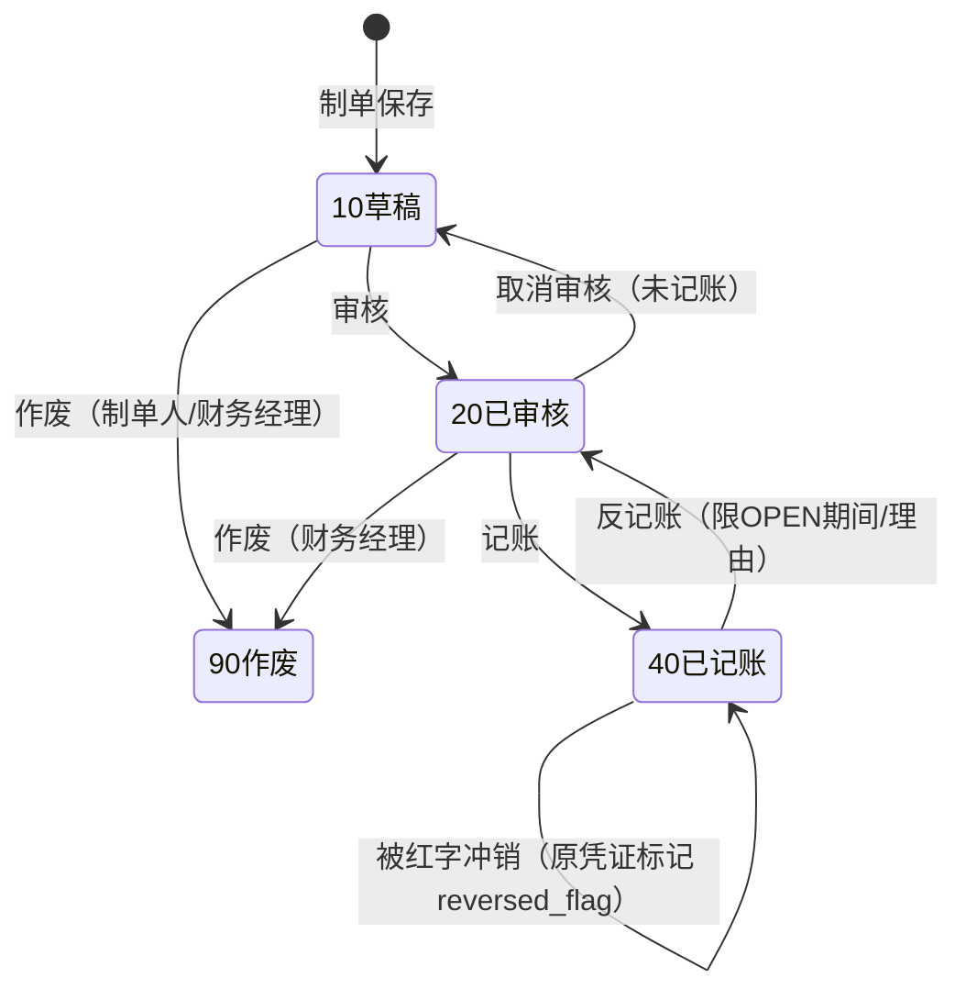

# 记账凭证与总账 详细设计书（記帳憑証・総勘定元帳 詳細設計書）

| 項目 | 内容 |
|---|---|
| 文書名 | 记账凭证与总账 详细设计书（記帳憑証・総勘定元帳 詳細設計書） |
| 文書番号 | DSN-FIN-002 |
| 版数 | v1.0 |
| 作成日 | 2026-10-20 |
| 作成者 | finance-designer |
| 承認者 | 未承認（レビュー待ち） |
| 状態 | ドラフト（レビュー中） |
| 関連文書 | [業務域概要](00-overview.md) / [会計科目](01-accounting-subjects.md) / [自動憑証・成本](06-auto-voucher-costing.md) / [共通業務規則](../00-common/08-common-business-rules.md) / [跨域流程](../00-common/09-cross-domain-flow.md) / [API 共通規格](../00-common/03-common-api-spec.md) |

---

## 1. 機能概要

| 項目 | 内容 |
|---|---|
| 機能 ID | F-FIN-003（凭证录入）、F-FIN-004（凭证模板）、F-FIN-005（审核）、F-FIN-006（记账）、F-FIN-007（反记账）、F-FIN-008（红字冲销）、F-FIN-009（查询/附件）、F-FIN-010（总账/明细账）、F-FIN-011（试算平衡） |
| 機能名 | 记账凭证与总账（凭证全生命周期 + 账簿） |
| 目的 | 以借贷记账法记录全部经济业务，经制单→审核→记账的相互牵制流程形成总账、明细账与试算平衡表，为报表与税务提供可靠账簿数据 |
| 利用者・ロール | 会计（制单）、财务经理（审核/记账/反记账）、财务总监（反记账审批）、审计（閲覧） |
| 利用シーン | 日常手工凭证；自动凭证异常补录；月末计提/结转；账簿查询与审计；凭证打印与归档 |
| 優先度 | P0 |
| 画面 ID | SCR-FIN-005～017 |
| 関連 IF | なし（自動憑証は 06 章のイベント契約） |

---

## 2. 業務要件・業務ルール

### 2.1 前提条件

| # | 前提条件 | 成立しない場合の挙動 |
|---|---|---|
| 1 | 会計期間が `OPEN` である | MSG-COM-071 で拒否 |
| 2 | 使用科目が末级・有効である | MSG-FIN-014/010 で拒否 |
| 3 | 補助核算設定に従い维度が入力されている | MSG-FIN-025 で拒否 |
| 4 | 制单/审核/记账ユーザが権限と SoD を満たす | MSG-FIN-011/012 で拒否 |
| 5 | 凭证字に応じ现金/银行科目が正しく含まれる | MSG-FIN-034 で拒否 |

### 2.2 業務ルール

| # | ルール | 根拠 | 関連項目 |
|---|---|---|---|
| BR-01 | 凭证必须借贷平衡：Σ借方金额＝Σ贷方金额（2 位小数、绝对误差 0） | 【実データ】《会计法》第九条、借贷记账法；08 章 4 章 | `debit_amount`、`credit_amount` |
| BR-02 | 每张凭证至少 2 行分录；同一行不得同时有借方和贷方金额；单行金额不得为 0 | 会计基础规范 | `fin_voucher_line` |
| BR-03 | 凭证字号＝凭证字 + 4 位序号，按「会计期间 × 凭证字」连续编号；禁止跨期间连号 | 08 章 2.1【示例值】 | `voucher_no`、`voucher_type` |
| BR-04 | 凭证字：记（通用）、收（现金/银行收款）、付（现金/银行付款）、转（转账）。收/付凭证须含对应现金/银行科目方向行；转字凭证一般不含现金/银行科目（含有时警告） | 【示例值】社内規程 | `voucher_type` |
| BR-05 | 现金与银行存款之间的划转，只编制**付款凭证**（避免重复记账），收款方不另制收款凭证 | 会计惯例【示例值】 | `voucher_type` |
| BR-06 | 凭证日期必须在所属会计期间内（`voucher_date` 的 YYYY-MM＝`period_code`）；例外经财务经理审批并留痕 | 期间控制 | `voucher_date`、`period_code` |
| BR-07 | 摘要每行必填，1～200 文字；禁止仅输入「-」「/」等无意义字符；同一凭证摘要可不同 | 会计基础规范 | `summary` |
| BR-08 | 制单人与审核人必须不同（SoD）；审核人与记账人默认必须不同（参数 `finance.sod.post_separate=true`） | 08 章 9.2 | `created_by`、`reviewed_by`、`posted_by` |
| BR-09 | 已审核凭证不可直接修改；需先取消审核（仅审核人本人或财务经理、且未记账） | 状态机 | `status` |
| BR-10 | 已记账凭证不可修改/删除；订正只能「红字冲销」或「反记账后修改」 | 08 章 13.1 | `status`、`reversal_of_voucher_id` |
| BR-11 | 反记账仅限当前 `OPEN` 期间且未结账；必须填写理由并记录审计日志；损益结转/年结凭证不可反记账 | 期间控制 + 社内規程 | `posted_at`、`unpost_reason` |
| BR-12 | 红字冲销仅对已记账（40）凭证执行；一张原凭证只能被冲销一次；冲销凭证金额为原凭证的负数（同方向） | 08 章 13.1 | `is_red`、`reversal_of_voucher_id` |
| BR-13 | 凭证附件张数 `attachment_count` 必须与实际附件数一致（可为 0）；审核时提示不一致 | 会计档案要求 | `attachment_count` |
| BR-14 | 现金/银行科目分录必须选择现金流量项目（`cash_flow_item_code`），用于现金流量表直接法取数 | CAS 31 现金流量表 | `cash_flow_item_code` |
| BR-15 | 数量核算科目（`is_qty_managed=true`）分录必须录入数量与单价，且 数量×单价＝金额（允许 2 位内差异） | 存货核算要求 | `quantity`、`unit_price` |
| BR-16 | 外币分录保存币种、原币金额、汇率与折算后本位币金额（第一版・実装順 P2）；P0 実装時点 仅 CNY | 08 章 4.2 | `currency_code` 等 |
| BR-17 | 自动生成凭证必须带 `source_type` + `source_id`，同一来源只允许一张有效凭证（索引唯一） | 09 章 10.2 双计上防止 | `source_type`、`source_id` |
| BR-18 | 凭证模板分为「手工模板」与「自动凭证模板」；手工模板在录入时可调出并修改金额；自动模板由 06 章定义，不可在凭证画面修改 | 本域設計 | `fin_voucher_template` |
| BR-19 | 凭证查询/打印/导出必须记录审计日志；跨年度查询只允许财务经理以上 | 会计档案 + 権限 | `sys_audit_log` |
| BR-20 | 已结账期间的凭证只能只读；更正通过「以前年度损益调整」或当期调整凭证 | 08 章 10 章 | `fin_period.status` |

### 2.3 計算式・判定式

| # | 対象 | 算式 | 丸め | 例 |
|---|---|---|---|---|
| CALC-01 | 凭证借贷差 | Σ`debit_amount` − Σ`credit_amount` | 绝对值 ≤0.00 | 102,780.00 − 102,780.00 = 0 |
| CALC-02 | 科目余额（期间） | 期末＝期初 + Σ借 − Σ贷（借方科目） | 2 位 | 1002：期初 5,000,000.00 + 86,000,000.00 − 79,000,000.00 = 12,000,000.00 |
| CALC-03 | 试算平衡 | Σ全部科目期末借方余额 ＝ Σ全部科目期末贷方余额 | 2 位 | 差 0.00 |
| CALC-04 | 记账后余额 | `fin_account_balance.debit_amount` += 分录借方；`credit_amount` += 分录贷方 | 2 位 | — |
| CALC-05 | 红字金额 | 冲销凭证每行金额＝原凭证对应行金额 × (−1) | 2 位 | 借方 −13,361.40 |
| CALC-06 | 总账本期发生额 | Σ末级科目本期借方/贷方发生额（含红字负数） | 2 位 | — |

### 2.4 状態遷移



| 遷移 | トリガ | 権限 | 更新項目 | メッセージ |
|---|---|---|---|---|
| 10→20 | 审核按钮 | finance:voucher:approve（非制单人） | status=20、reviewed_by/at | MSG-FIN-037（成功） |
| 20→10 | 取消审核 | finance:voucher:approve | status=10、reviewed_by=NULL | MSG-FIN-013 |
| 20→40 | 记账/批量记账 | finance:voucher:post（非制单；默认非审核） | status=40、posted_by/at；余额表更新 | MSG-FIN-038 |
| 40→20 | 反记账 | finance:voucher:unpost（限 OPEN 期间、理由） | status=20、posted_at=NULL；余额表冲减 | MSG-FIN-020/021 |
| 10/20→90 | 作废 | finance:voucher:update（草稿）/ 财务经理 | status=90 | MSG-FIN-013 |
| 40→40 | 红字冲销 | finance:voucher:reverse | 生成新凭证；原凭证 `reversed_flag=true` | MSG-FIN-019 |

> `reversed_flag` 不改变原凭证状态（仍为 40），仅在账簿中以正负两笔反映，防止重复冲销由 `uk_fin_voucher_reversal` 保证。

---

## 3. 関連機能

| 関係 | 機能 ID | 機能名 | 関係内容 |
|---|---|---|---|
| 上流 | F-FIN-030 | 自动凭证生成 | 业务事件生成凭证（10 草稿），进入本流程 |
| 上流 | F-FIN-004 | 凭证模板 | 手工凭证的模板调出 |
| 下流 | F-FIN-010/011 | 总账/试算平衡 | 记账结果 |
| 下流 | F-FIN-038/039 | 财务报表/科目余额表 | 账簿数据取数 |
| 参照 | F-FIN-001 | 会计科目 | 科目、辅助核算 |
| 参照 | F-FIN-035 | 期间管理 | OPEN/CLOSED 判定 |

---

## 4. 画面設計

### 4.1 画面一覧

| 画面 ID | 画面名 | 類型 | 概要 |
|---|---|---|---|
| SCR-FIN-005 | 记账凭证录入 | EDIT | 凭证字/日期/分录/辅助核算/现金流量项目/附件 |
| SCR-FIN-006 | 凭证一覧 | LIST | 条件检索、批量审核/记账/打印 |
| SCR-FIN-007 | 凭证模板管理 | LIST/EDIT | 手工模板维护 |
| SCR-FIN-008 | 凭证待审核一覧 | LIST | 审核对象一覧（制单人除外） |
| SCR-FIN-009 | 凭证审核详细 | VIEW | 凭证内容 + 审核/取消审核 |
| SCR-FIN-010 | 凭证记账处理 | LIST | 待记账/批量记账/结果 |
| SCR-FIN-011 | 凭证反记账 | LIST/EDIT | 反记账对象、理由入力 |
| SCR-FIN-012 | 红字冲销凭证 | EDIT | 原凭证选择、冲销预览/生成 |
| SCR-FIN-013 | 凭证查询与附件 | VIEW | 凭证详细、附件、打印、关联单据 |
| SCR-FIN-014 | 总账查询 | LIST | 科目期初/发生/期末 |
| SCR-FIN-015 | 明细账查询 | LIST | 分录明细、辅助核算明细 |
| SCR-FIN-016 | 序时账 | LIST | 按日期顺序的全部凭证分录 |
| SCR-FIN-017 | 试算平衡表 | LIST | 期初/发生/期末的借贷平衡与余额表 |

### 4.2 画面項目定義（SCR-FIN-005 记账凭证录入）

**ヘッダ**

| No | 項目 ID | 項目名 | 区分 | 種別 | 型/桁 | 必須 | 初期値 | 入力チェック | データソース | DB 項目 | 権限 | 備考 |
|---|---|---|---|---|---|---|---|---|---|---|---|---|
| 1 | voucher_type | 凭证字 | ヘッダ | 選択 | SMALLINT | ○ | 记 | 1 记/2 收/3 付/4 转 | 固定値 | `fin_voucher.voucher_type` | 編集可 | 保存後変更不可 |
| 2 | period_code | 会计期间 | ヘッダ | 選択 | VARCHAR(7) | ○ | 当期 | 期间 OPEN | `fin_period` | `fin_voucher.period_code` | 編集可 | 保存後変更不可 |
| 3 | voucher_no | 凭证字号 | ヘッダ | テキスト | VARCHAR(8) | ○ | 自動採番 | 形式 `[记收付转]-\d{4}`、一意 | `sys_sequence` | `fin_voucher.voucher_no` | 参照のみ | 例 `记-0042` |
| 4 | voucher_date | 凭证日期 | ヘッダ | 日付 | DATE | ○ | 当日 | YYYY-MM が period_code と一致 | 手入力 | `fin_voucher.voucher_date` | 編集可 | BR-06 |
| 5 | attachment_count | 附件张数 | ヘッダ | 数値 | INT | ○ | 0 | 0～999 | 手入力 | `fin_voucher.attachment_count` | 編集可 | BR-13 |
| 6 | source_type | 来源类型 | ヘッダ | テキスト | VARCHAR(32) | △ | 空 | 自動凭证のみ設定 | システム | `fin_voucher.source_type` | 参照のみ | 手動凭证は空 |
| 7 | source_no | 来源单号 | ヘッダ | テキスト | VARCHAR(64) | △ | 空 | 自動凭证のみ設定 | システム | `fin_voucher.source_no` | 参照のみ | — |
| 8 | total_debit | 借方合计 | フッタ | 数値 | NUMERIC(18,2) | ○ | 0.00 | 自動計算 | 明細合計 | `fin_voucher.total_debit` | 参照のみ | — |
| 9 | total_credit | 贷方合计 | フッタ | 数値 | NUMERIC(18,2) | ○ | 0.00 | 自動計算、借方＝貸方 | 明細合計 | `fin_voucher.total_credit` | 参照のみ | 差額があれば保存不可 |
| 10 | status | 状態 | ヘッダ | ラベル | SMALLINT | ○ | 10 | 10/20/40/90 | 遷移 | `fin_voucher.status` | 参照のみ | — |
| 11 | remark | 備考 | ヘッダ | テキスト | VARCHAR(500) | — | 空 | ≤500 | 手入力 | `fin_voucher.remark` | 編集可 | — |

**明細（`fin_voucher_line`）**

| No | 項目 ID | 項目名 | 種別 | 型/桁 | 必須 | 初期値 | 入力チェック | データソース | DB 項目 | 備考 |
|---|---|---|---|---|---|---|---|---|---|---|
| 12 | line_no | 行番号 | 数値 | INT | ○ | 10 刻み | 一意 | 自動 | `line_no` | 保存時に 10,20,… |
| 13 | summary | 摘要 | テキスト | VARCHAR(200) | ○ | 空 | 1～200、記号のみ不可 | 手入力/テンプレート | `summary` | BR-07 |
| 14 | account_code | 科目コード | 選択 | VARCHAR(32) | ○ | 空 | 末级・有効・補助核算一致 | `fin_account` | `account_code` | 名称自動表示 |
| 15 | account_name | 科目名称 | テキスト | VARCHAR(200) | ○ | 空 | 自動 | `fin_account` | `account_name` | スナップショット |
| 16 | debit_amount | 借方金额 | 数値 | NUMERIC(18,2) | △ | 0.00 | ≥0（赤伝は負可）、借方/贷方同時不可 | 手入力 | `debit_amount` | 赤伝のみ負数 |
| 17 | credit_amount | 贷方金额 | 数値 | NUMERIC(18,2) | △ | 0.00 | ≥0（赤伝は負可） | 手入力 | `credit_amount` | 同上 |
| 18 | customer_id / supplier_id / department_id / employee_id / project_id / material_id | 辅助核算 | 選択 | BIGINT | △ | 空 | 科目の绑定维度に従い必須 | 各マスタ | 同名カラム | 名称もスナップショット保存 |
| 19 | quantity / unit_price | 数量/単価 | 数値 | NUMERIC(18,4)/(18,6) | △ | 空 | 数量核算科目は必須 | 手入力 | `quantity`、`unit_price` | BR-15 |
| 20 | currency_code | 幣種 | 選択 | VARCHAR(3) | ○ | CNY | ISO 4217 | `mdm_currency` | `currency_code` | P0 実装時点 は CNY 固定 |
| 21 | cash_flow_item_code | 现金流量项目 | 選択 | VARCHAR(32) | △ | 空 | 现金/银行科目は必須 | `fin_cash_flow_item` | `cash_flow_item_code` | BR-14 |
| 22 | remark | 備考 | テキスト | VARCHAR(200) | — | 空 | ≤200 | 手入力 | `remark` | — |

**画面レイアウト**

```
┌──────────────────────────────────────────────────────────────────────┐
│ 记账凭证   [记▼] [2026-10] [记-0042]  日期[2026-10-20] 附件[3] 状态:草稿 │
├──────────────────────────────────────────────────────────────────────┤
│ 行│摘要             │科目            │借方金额   │贷方金额   │辅助核算/CF│
│ 10│销售 YE3 电机…   │1122 应收账款│116,141.40│           │客户 C000001│
│ 20│销售 YE3 电机…   │6001 主营业务收入│        │102,780.00 │物料 3001000001│
│ 30│销售 YE3 电机…   │2221.01 应交增值税（销项）│  │ 13,361.40 │税区分 VAT13-OUT│
│ + 追加行                                                              │
├──────────────────────────────────────────────────────────────────────┤
│ 合计：借方 116,141.40 / 贷方 116,141.40   差 0.00        [借贷平衡✔]   │
│ [保存草稿][审核后提交][凭证模板][打印][取消]                            │
└──────────────────────────────────────────────────────────────────────┘
```

### 4.3 イベント処理（SCR-FIN-005）

| No | イベント | トリガ | 処理内容 | 呼出 API | 画面遷移 | 備考 |
|---|---|---|---|---|---|---|
| 1 | 凭证字変更 | 選択変更 | 採番プレビュー更新、收/付/转の科目制約チェック | GET /api/finance/vouchers/next-no | 同一画面 | — |
| 2 | 明細追加/削除 | ボタン | 行追加（10 刻み）、削除時合計再計算 | — | 同一画面 | 最低 2 行 |
| 3 | 金額入力 | 変更 | 借方/貸方排他、合計と差額を再計算 | — | 同一画面 | — |
| 4 | 科目選択 | 選択 | 補助核算項目の表示制御、数量/CF 項目の必須化 | GET /api/finance/accounts/{id} | 同一画面 | — |
| 5 | 保存 | 保存ボタン | 入力チェック→採番→保存（10） | POST /api/finance/vouchers | 一覧 or 継続 | 二重送信防止 |
| 6 | 凭证模板呼出 | テンプレートボタン | テンプレート行を明細へ展開（金額は空） | GET /api/finance/voucher-templates | ダイアログ | — |
| 7 | 打印 | 印刷ボタン | PRT-FIN-001 PDF 出力 | POST /api/finance/vouchers/{id}/print | プレビュー | 保存済のみ |
| 8 | 添付 | 添付ボタン | SYS 添付アップロード、`attachment_count` 連動 | POST /api/system/attachments | 同一画面 | 最大 20 件 |

### 4.4 一覧画面仕様（SCR-FIN-006 凭证一覧）

| 項目 | 内容 |
|---|---|
| 検索条件 | 期间（単一/範囲）、凭证字、凭证号、日付範囲、科目コード、金額範囲、摘要キーワード、状态、制单人、来源类型 |
| 既定検索条件 | 当期、状態=全部、登録日時降順 |
| ソート | 凭证日期、凭证号、金额 |
| ページング | 20/50/100/200 |
| 一括操作 | 批量审核（财务经理）、批量记账、批量打印、导出 |
| エクスポート | Excel 最大 10,000 件、超過は非同期 |
| 行操作 | 詳細、审核、记账、赤伝、反记账（権限ありのみ） |

### 4.5 表示制御

| 条件 | 対象 | 制御 |
|---|---|---|
| status ≠ 10 | 編集/削除ボタン | 非表示（取消审核後のみ編集可） |
| status ≠ 40 | 反记账/赤伝ボタン | 非表示 |
| 期间 CLOSED | 新規/編集/审核/记账 | ボタン非表示、API は MSG-COM-071 |
| 制单人＝ログインユーザ | 审核ボタン | 非表示（API 403 + MSG-FIN-011） |
| 権限なし | 金額項目 | 非表示（API も返さない） |

---

## 5. 入力チェック仕様

| No | チェック ID | 対象項目 | 種別 | 条件 | タイミング | メッセージ ID |
|---|---|---|---|---|---|---|
| 1 | CHK-FIN-003-01 | voucher_type/voucher_date | 相関 | 日付の YYYY-MM＝period_code | 保存 | MSG-FIN-034 |
| 2 | CHK-FIN-003-02 | 明細行数 | 業務 | ≥2 行 | 保存 | MSG-FIN-018 |
| 3 | CHK-FIN-003-03 | 借方/贷方 | 成功 | 各行 借方・贷方の一方のみ非 0 | 保存 | MSG-FIN-017 |
| 4 | CHK-FIN-003-04 | 合計 | 業務 | Σ借＝Σ贷 | 保存 | MSG-FIN-001 |
| 5 | CHK-FIN-003-05 | 摘要 | 必須 | 1～200 文字 | 保存 | MSG-FIN-016 |
| 6 | CHK-FIN-003-06 | 科目 | 業務 | 末级・有効 | 保存 | MSG-FIN-014/010 |
| 7 | CHK-FIN-003-07 | 輔助核算 | 業務 | 绑定维度必填、未绑定不可入 | 保存 | MSG-FIN-025 |
| 8 | CHK-FIN-003-08 | 现金流量項目 | 業務 | 现金/银行科目必須 | 保存 | MSG-FIN-027 |
| 9 | CHK-FIN-003-09 | 数量核算 | 業務 | 数量>0、数量×単価≒金額 | 保存 | MSG-FIN-026 |
| 10 | CHK-FIN-003-10 | 收/付/转制約 | 業務 | 收=现金/银行借方、付=贷方、转≠现金银行 | 保存 | MSG-FIN-034 |
| 11 | CHK-FIN-005-01 | SoD | 権限 | 审核人≠制单人 | 审核 | MSG-FIN-011 |
| 12 | CHK-FIN-006-01 | SoD | 権限 | 记账人≠制单人；默认≠审核人 | 记账 | MSG-FIN-011/012 |
| 13 | CHK-FIN-007-01 | 期间 | 業務 | 反记账限 OPEN | 反记账 | MSG-FIN-020 |
| 14 | CHK-FIN-008-01 | 冲销 | 業務 | 原凭证 status=40 且未冲销 | 冲销 | MSG-FIN-019/032/033 |

---

## 6. 処理詳細

### 6.1 処理一覧

| 処理 ID | 処理名 | 契機 | トランザクション | 排他 |
|---|---|---|---|---|
| PRC-FIN-003-01 | 凭证保存（草稿） | 保存 | 要 | 採番行ロック |
| PRC-FIN-003-02 | 凭证更新 | 保存 | 要 | 楽観排他（version） |
| PRC-FIN-005-01 | 凭证审核 | 审核 | 要 | 楽観排他 + 状態チェック |
| PRC-FIN-005-02 | 取消审核 | 取消审核 | 要 | 同上 |
| PRC-FIN-006-01 | 凭证记账 | 记账 | 要（凭证+余额同时更新） | 行ロック（余额行）、楽観排他 |
| PRC-FIN-006-02 | 批量记账 | 一括 | 要（全件 or 全件失敗） | 同上 |
| PRC-FIN-007-01 | 反记账 | 反记账 | 要 | 同上 |
| PRC-FIN-008-01 | 红字冲销生成 | 冲销 | 要 | 原凭证行ロック |

### 6.2 処理手順（正常系）

**PRC-FIN-006-01 凭证记账**

1. 凭证存在・status=20・期间 OPEN を確認する。
2. SoD：记账人≠制单人、既定で记账人≠审核人を検証する（MSG-FIN-011/012）。
3. 借方＝贷方、行数、科目有効性を再検証する。
4. 採番済みの凭证号を保持し、`fin_voucher.status=40`、`posted_by/at` を更新する（楽観排他）。
5. 各分录について、`fin_account_balance`（期間×末级科目）を UPSERT し、借/贷方発生額を加算する。行ロック順は `account_id` 昇順。
6. 補助核算ありの場合、`fin_aux_balance`（期間×科目×维度×対象）を UPSERT する。
7. 数量核算ありの場合、数量を加算する。
8. 監査ログ（POST、凭证号・金額）を記録する。
9. 結果を返す（批量時は成功/失敗件数）。

**PRC-FIN-008-01 红字冲销生成**

1. 原凭证を取得し、status=40 かつ `reversed_flag=false` を確認する（MSG-FIN-032/033）。
2. 権限 `finance:voucher:reverse` と期間 OPEN を確認する。
3. 冲销理由（1～500 文字）を必須入力する。
4. 新規凭证を採番（同じ凭证字・当期、`is_red=true`）し、原凭证の全分录をコピーして金額を符号反転する（借→借の負数、贷→贷の負数）。
5. 摘要は「红字冲销：{原凭证号} {原摘要}」形式で生成する。
6. `reversal_of_voucher_id`、`reversal_reason` を記録し、原凭证 `reversed_flag=true`。
7. 新凭证は 10 草稿で登録され、通常の审核→记账を行う（自動记账設定がある場合は設定に従う）。
8. 監査ログ（REVERSE）を記録する。

### 6.3 例外処理

| No | 異常条件 | 検知箇所 | 処理 | ロールバック | メッセージ ID |
|---|---|---|---|---|---|
| 1 | 借贷不平衡 | 保存/记账 | エラー終了 | 全体 | MSG-FIN-001 |
| 2 | 状態不整合（已记账の編集等） | 各操作 | エラー終了 | 全体 | MSG-FIN-013 |
| 3 | SoD 違反 | 审核/记账 | エラー終了 | 全体 | MSG-FIN-011/012 |
| 4 | 期间 CLOSED | 保存/记账/反记账 | エラー終了 | 全体 | MSG-COM-071 |
| 5 | 反记账理由なし | 反记账 | エラー終了 | 全体 | MSG-FIN-021 |
| 6 | 余额更新失敗（同時実行） | 记账 | エラー終了、ロック再試行 3 回 | 全体 | MSG-COM-035 |
| 7 | 凭证号採番枯渇（>9999） | 保存 | エラー終了（期間追加設定を案内） | 全体 | MSG-FIN-029 |

### 6.4 冪等性・再実行

- 凭证登録/状態操作は `Idempotency-Key` 必須。同一キー再送は初回結果を返す。
- 批量记账は 1,000 件上限、全件成功 or 全件失敗。部分成功を許す設定時は失敗一覧を返す。
- 自动凭证重试（BAT-FIN-005）は `fin_auto_voucher_log.status` と `source_type+source_id` で二重生成を防ぐ。

---

## 7. API 設計

| No | メソッド | パス | 権限 | 概要 | リクエスト | レスポンス |
|---|---|---|---|---|---|---|
| 1 | GET | /api/finance/vouchers | finance:voucher:view | 凭证検索 | `periodCode,type,status,dateFrom,dateTo,keyword,pageNum,pageSize` | `PageResult<VoucherListDto>` |
| 2 | GET | /api/finance/vouchers/{id} | finance:voucher:view | 凭证詳細 | — | `VoucherDetailDto` |
| 3 | POST | /api/finance/vouchers | finance:voucher:create | 凭证登録 | `VoucherCreateRequest` | `VoucherDetailDto`（201） |
| 4 | PUT | /api/finance/vouchers/{id} | finance:voucher:update | 凭证更新（status=10） | `VoucherUpdateRequest` | `VoucherDetailDto` |
| 5 | DELETE | /api/finance/vouchers/{id} | finance:voucher:update | 草稿削除（論理取消） | — | `Result<Void>` |
| 6 | POST | /api/finance/vouchers/{id}/review | finance:voucher:approve | 审核 | `{version,comment?}` | `VoucherDetailDto` |
| 7 | POST | /api/finance/vouchers/{id}/unreview | finance:voucher:approve | 取消审核 | `{version,reason}` | `VoucherDetailDto` |
| 8 | POST | /api/finance/vouchers/{id}/post | finance:voucher:post | 记账 | `{version}` | `VoucherDetailDto` |
| 9 | POST | /api/finance/vouchers/{id}/unpost | finance:voucher:unpost | 反记账 | `{version,reason}` | `VoucherDetailDto` |
| 10 | POST | /api/finance/vouchers/{id}/reverse | finance:voucher:reverse | 红字冲销生成 | `{reason}` | `{reversalVoucherId,voucherNo}` |
| 11 | POST | /api/finance/vouchers/batch-review | finance:voucher:approve | 一括审核 | `{ids[],comment?}` | `{successCount,failureCount,failures[]}` |
| 12 | POST | /api/finance/vouchers/batch-post | finance:voucher:post | 一括记账 | `{ids[]}` | 同上 |
| 13 | POST | /api/finance/vouchers/{id}/print | finance:voucher:print | 凭证 PDF | `{templateCode?}` | PDF（200） |
| 14 | GET | /api/finance/vouchers/next-no | finance:voucher:create | 次の凭证号プレビュー | `voucherType,periodCode` | `{voucherNo}` |
| 15 | GET | /api/finance/voucher-templates | finance:voucher-template:view | テンプレート一覧 | `templateType,keyword` | `TemplateDto[]` |
| 16 | POST | /api/finance/voucher-templates | finance:voucher-template:update | テンプレート登録 | `TemplateCreateRequest` | `TemplateDto` |
| 17 | PUT | /api/finance/voucher-templates/{id} | finance:voucher-template:update | テンプレート更新 | `TemplateUpdateRequest` | `TemplateDto` |
| 18 | GET | /api/finance/ledgers/general | finance:ledger:view | 総勘定元帳 | `periodFrom,periodTo,accountCodeFrom,accountCodeTo,level` | `LedgerGeneralDto[]` |
| 19 | GET | /api/finance/ledgers/detail | finance:ledger:view | 明細帳 | `accountCode,periodFrom,periodTo,customerId?,supplierId?,departmentId?` | `PageResult<LedgerDetailDto>` |
| 20 | GET | /api/finance/ledgers/journal | finance:ledger:view | 序時帳 | `periodCode,dateFrom,dateTo,voucherType` | `PageResult<JournalDto>` |
| 21 | GET | /api/finance/trial-balance | finance:trial-balance:view | 試算平衡表 | `periodCode,level,showZero` | `TrialBalanceDto` |

### 7.1 リクエスト/レスポンス詳細

**POST /api/finance/vouchers（J07 销售应收の例、2026-10、税率 13%）**

```json
{
  "voucherType": 1,
  "periodCode": "2026-10",
  "voucherDate": "2026-10-20",
  "attachmentCount": 3,
  "remark": "YE3-100L1-4 销售，出荷 SDO2610200001",
  "lines": [
    { "lineNo": 10, "summary": "销售 YE3-100L1-4 三相异步电动机", "accountCode": "1122",
      "debitAmount": "116141.40", "creditAmount": "0.00",
      "customerId": "1845000000000000001", "customerCode": "C000001", "customerName": "江苏恒立液压股份有限公司" },
    { "lineNo": 20, "summary": "销售 YE3-100L1-4 三相异步电动机", "accountCode": "6001",
      "debitAmount": "0.00", "creditAmount": "102780.00",
      "materialId": "1845000000000000101", "materialCode": "3001000001", "materialName": "YE3-100L1-4 三相异步电动机 2.2kW",
      "customerId": "1845000000000000001", "customerCode": "C000001", "customerName": "江苏恒立液压股份有限公司" },
    { "lineNo": 30, "summary": "销售 YE3-100L1-4 三相异步电动机", "accountCode": "2221.01",
      "debitAmount": "0.00", "creditAmount": "13361.40", "taxCode": "VAT13-OUT" }
  ]
}
```

```json
{
  "code": 0,
  "message": "ok",
  "data": {
    "id": "1845678901234567001",
    "voucherNo": "记-0042",
    "voucherType": 1,
    "periodCode": "2026-10",
    "voucherDate": "2026-10-20",
    "status": 10,
    "statusName": "草稿",
    "totalDebit": "116141.40",
    "totalCredit": "116141.40",
    "attachmentCount": 3,
    "version": 0
  }
}
```

**エラー例（SoD）**

```json
{
  "code": 70011,
  "message": "制单人与审核人不能为同一人，请由其他人员审核。",
  "data": { "voucherNo": "记-0042", "createdBy": "E000123" }
}
```

---

## 8. データ更新仕様

| テーブル | 操作 | 更新項目 | 更新条件 | トリガ |
|---|---|---|---|---|
| `fin_voucher` | INSERT | 全項目 | 凭证保存 | PRC-FIN-003-01 |
| `fin_voucher` | UPDATE | status/reviewed_by/at/posted_by/at/reversed_flag/version | 审核/记账/反记账/冲销 | PRC-FIN-005/006/007/008 |
| `fin_voucher_line` | INSERT | 全項目 | 凭证保存 | PRC-FIN-003-01 |
| `fin_voucher_line` | UPDATE/DELETE | 全項目 | 草稿編集 | PRC-FIN-003-02 |
| `fin_account_balance` | UPSERT | debit_amount/credit_amount/opening_*/closing_*/version | 记账/反记账 | PRC-FIN-006/007 |
| `fin_aux_balance` | UPSERT | debit_amount/credit_amount/quantity/closing_* | 记账/反记账 | 同上 |
| `sys_sequence` | UPDATE | current_value | 採番 | PRC-FIN-003-01 |
| `sys_audit_log` | INSERT | CREATE/UPDATE/POST/REVERSE/PRINT/EXPORT | 全操作 | 共通 |

> 记账/反记账时 `fin_account_balance` 的 closing 值由「期初＋本期发生」计算并写回，避免报表时实时汇总；同时保留 `fin_aux_balance` 供辅助明细账。

---

## 9. エラー処理・メッセージ

| メッセージ ID | 種別 | 本文 | 発生条件 | 利用者への対処 |
|---|---|---|---|---|
| MSG-FIN-001 | E | 借方合计与贷方合计不一致（差额 {0}），无法保存。 | 借贷不平衡 | 差額行を修正 |
| MSG-FIN-014 | E | 科目「{0}」不是末级科目或已停用，不能使用。 | 科目不正 | 末级有効科目を選択 |
| MSG-FIN-015 | E | 科目「{0}」不存在或已停用。 | 科目不存在 | 科目を選択し直す |
| MSG-FIN-011 | E | 制单人与审核人不能为同一人（职务分离要求）。 | SoD 違反（审核） | 別の审核人を指定 |
| MSG-FIN-012 | E | 记账人与制单人/审核人不能为同一人（参数：记账分离=有效）。 | SoD 違反（记账） | 別の记账人を指定 / 参数確認 |
| MSG-FIN-013 | E | 当前凭证状态不允许该操作。 | 状態不整合 | 状態を確認し取消审核等を行う |
| MSG-FIN-016 | E | 摘要不能为空，且不能仅包含符号。 | 摘要不正 | 摘要を入力 |
| MSG-FIN-017 | E | 同一行不能同时录入借方和贷方金额，且金额不能为 0。 | 行金額不正 | 借/贷いずれかに入力 |
| MSG-FIN-018 | E | 凭证至少需要 2 行分录。 | 行数不足 | 行を追加 |
| MSG-FIN-019 | E | 红字冲销只能针对已记账且未冲销的凭证。 | 冲销条件不成立 | 原凭证を確認 |
| MSG-FIN-020 | E | 反记账只能在当前开放期间执行。 | 期間条件不成立 | 期間状態を確認 |
| MSG-FIN-021 | E | 反记账必须填写理由（1～500 字）。 | 理由なし | 理由を入力 |
| MSG-FIN-026 | E | 数量核算科目必须录入数量与单价，且数量×单价应等于金额。 | 数量核算不正 | 数量・単価を修正 |
| MSG-FIN-027 | E | 现金/银行存款科目必须选择现金流量项目。 | CF 項目なし | CF 項目を選択 |
| MSG-FIN-029 | E | 凭证字号已超过 9999 号，请调整期间或联系管理员。 | 採番枯渇 | 管理者へ連絡 |
| MSG-FIN-032 | E | 该凭证尚未记账，不能冲销。 | 冲销条件不成立 | 记账後に冲销 |
| MSG-FIN-033 | E | 该凭证已被冲销，不能重复冲销。 | 重複冲销 | 既存冲销凭证を確認 |
| MSG-FIN-034 | E | 凭证字与科目/日期不一致（收/付/转规则或期间不一致）。 | 凭证字制約/期間不一致 | 凭证字または科目を修正 |
| MSG-FIN-037 | I | 凭证已审核。 | 审核成功 | — |
| MSG-FIN-038 | I | 凭证已记账。 | 记账成功 | — |

---

## 10. 権限・セキュリティ

| 種別 | 内容 |
|---|---|
| 画面権限 | `finance:voucher:view/create/update/approve/post/unpost/reverse/print/export`、`finance:ledger:view`、`finance:trial-balance:view` |
| 操作権限 | 审核＝财务经理（非制单人）、记账＝财务经理（非制单/默认非审核）、反记账＝财务经理以上（理由必須）、赤伝＝财务经理以上 |
| 項目権限 | 金額・補助核算は財務系ロールのみ。監査ロールは閲覧のみ |
| データ範囲 | 全社（会計主体）。部門データ範囲は費用系画面で任意適用 |
| 監査ログ | 登録/更新/削除/审核/记账/反记账/冲销/印刷/出力を記録（before/after は金額・状態必須） |
| 账簿改ざん防止 | 记账済凭证は UPDATE 禁止（DB トリガまたはアプリ層で防御）。訂正は赤伝のみ |

---

## 11. 性能・非機能

| 項目 | 目標値 | 前提 |
|---|---|---|
| 凭证一覧（100 件） | 2 秒以内 | 期間+状態索引 |
| 凭证詳細 | 1 秒以内 | 明細 1,000 行以下 |
| 単件记账 | 3 秒以内 | 余额行ロック待ち含む |
| 批量记账 500 件 | 60 秒以内 | 全件トランザクション（分割可） |
| 試算平衡（1 期間） | 3 秒以内 | 科目余额表 3,000 行 |
| 明細帳（1 科目・1 年） | 5 秒以内 | 100 万行以下、索引あり |

---

## 12. テスト観点

| No | 観点 ID | 分類 | 観点 | 期待結果 |
|---|---|---|---|---|
| 1 | TST-F-FIN-003-01 | 正常系 | 3 行の借贷平衡凭证を保存 | 記-0042 採番、草稿 |
| 2 | TST-F-FIN-003-02 | 異常系 | 借貸差 0.01 | MSG-FIN-001、保存されない |
| 3 | TST-F-FIN-003-03 | 境界値 | 1 行のみ | MSG-FIN-018 |
| 4 | TST-F-FIN-003-04 | 異常系 | 摘要「-」のみ | MSG-FIN-016 |
| 5 | TST-F-FIN-003-05 | 業務 | 现金科目で CF 項目未選択 | MSG-FIN-027 |
| 6 | TST-F-FIN-003-06 | 業務 | 数量核算科目の数量×単価不一致 | MSG-FIN-026 |
| 7 | TST-F-FIN-003-07 | 境界値 | 借方/贷方同時入力 | MSG-FIN-017 |
| 8 | TST-F-FIN-005-01 | 正常系 | 別ユーザで审核 | status=20 |
| 9 | TST-F-FIN-005-02 | 権限 | 制单人自身で审核 | MSG-FIN-011 |
| 10 | TST-F-FIN-006-01 | 正常系 | 记账で科目余额更新 | 借方/贷方発生額が加算 |
| 11 | TST-F-FIN-006-02 | 排他 | 同一凭证の同時记账 | 一方成功、他方 MSG-COM-033 |
| 12 | TST-F-FIN-007-01 | 正常系 | OPEN 期間で反记账 | 余额が戻り status=20 |
| 13 | TST-F-FIN-007-02 | 異常系 | CLOSED 期間で反记账 | MSG-FIN-020 |
| 14 | TST-F-FIN-008-01 | 正常系 | 记账済凭证の赤伝生成 | 負数金額の新凭证、`reversed_flag=true` |
| 15 | TST-F-FIN-008-02 | 異常系 | 同一凭证を再度冲销 | MSG-FIN-033 |
| 16 | TST-F-FIN-011-01 | 正常系 | 試算平衡で借方＝貸方 | 差 0.00 |
| 17 | TST-F-FIN-011-02 | 異常系 | 意図的に余额不整合 | 差額を表示、MSG-FIN-031 |

---

## 13. 未決事項

| # | 事項 | 理由 | 暫定仕様 | 担当 | 期限 |
|---|---|---|---|---|---|
| 1 | 记账人と审核人の分離要否 | 小規模財務チームでは兼任が必要な場合がある | パラメータ `finance.sod.post_separate`（既定 true）。無効化は財務総監承認 + 監査ログ | 財務総監 | 2026-10-24 |
| 2 | 凭证字の自動判定 | 自動凭证テンプレートで收/付/转をどう決めるか | 現金/銀行科目の方向から自動判定（借方=收、贷方=付、なし=转） | 財務経理 | 2026-10-24 |
| 3 | 反记账の承認フロー | 財務経理の単独実行可否 | P0 実装時点 は権限+理由+監査ログで統制、実装順 P2 で WF 承認追加 | 財務総監 | 実装順 P2 |
| 4 | 凭证帳票の様式 | 社内様式（A4 縦・3 段）未確定 | PRT-FIN-001 は [92](92-report-batch-design.md) のレイアウトで暫定 | 財務経理 | 2026-10-30 |

---

## 14. 改訂履歴

| 版数 | 日付 | 変更内容 | 変更者 |
|---|---|---|---|
| v1.0 | 2026-10-20 | 初版：凭证全生命周期（采番・录入・审核・记账・反记账・赤伝）、SoD、账簿、试算平衡、画面/API/メッセージ/テスト | finance-designer |
| v1.1 | 2026-10-20 | 红队修复：科目を 2 階層（4 桁+2 桁補助）に統一（J07 例は 1122/6001/2221.01）、VAT は 2221.01＋税区分 `tax_code`（VAT13-OUT）で識別。J07 の発生元は E10 を明記 | finance-designer |
