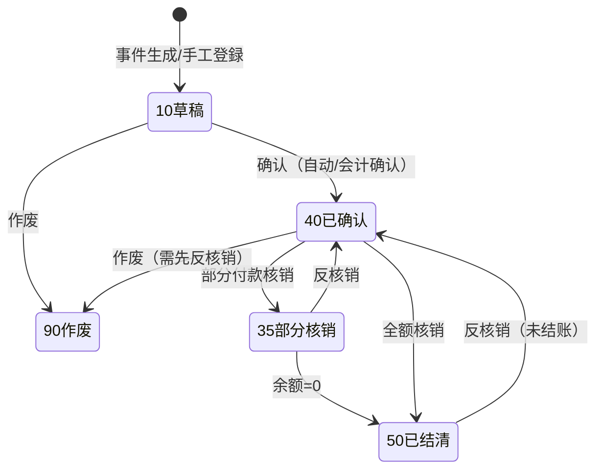

# 应付管理・三单匹配・付款 详细设计书（買掛管理・三者照合・支払 詳細設計書）

| 項目 | 内容 |
|---|---|
| 文書名 | 应付管理・三单匹配・付款 详细设计书（買掛管理・三者照合・支払 詳細設計書） |
| 文書番号 | DSN-FIN-003 |
| 版数 | v1.0 |
| 作成日 | 2026-10-20 |
| 作成者 | finance-designer |
| 承認者 | 未承認（レビュー待ち） |
| 状態 | ドラフト（レビュー中） |
| 関連文書 | [業務域概要](00-overview.md) / [会計科目](01-accounting-subjects.md) / [自動憑証](06-auto-voucher-costing.md) / [跨域流程](../00-common/09-cross-domain-flow.md) / [コード一覧](../00-common/06-code-list.md) |

---

## 1. 機能概要

| 項目 | 内容 |
|---|---|
| 機能 ID | F-FIN-012（应付单）、F-FIN-013（采购发票三单匹配）、F-FIN-014（暂估入账与冲回）、F-FIN-015（付款申请）、F-FIN-016（付款执行）、F-FIN-017（应付核销）、F-FIN-018（应付账龄） |
| 機能名 | 应付管理（Procure to Pay の会計側） |
| 目的 | 收货暂估→发票三单匹配→应付确认→付款申请→付款执行→核销→账龄的闭环管理，保证买挂金、暂估、预付、进项税额真实准确，并与采购/库存域事件一致 |
| 利用者・ロール | 应付会计（AP/发票/核销）、财务经理（审核/审批）、财务总监（高额审批）、采购员（付款申请发起/差异确认）、出纳（付款执行） |
| 利用シーン | 每日收货暂估、月度发票处理、付款排程与执行、供应商对账、月结暂估清理 |
| 優先度 | P0 |
| 画面 ID | SCR-FIN-018～025 |
| 関連 IF | IF-FIN-002/003（銀企直連） |

---

## 2. 業務要件・業務ルール

### 2.1 前提条件

| # | 前提条件 | 成立しない場合の挙動 |
|---|---|---|
| 1 | 采购域已发 E14（收货）或 E17（三单匹配确定） | 无来源不能手工新增暂估（特殊费用除外） |
| 2 | 供应商、付款条件、税码已在 MDM 有効 | 選択不可（MSG-COM-049） |
| 3 | 会计期间 OPEN | 登録拒否（MSG-COM-071） |
| 4 | 银行账户（自有）已在 `fin_bank_account` 有効 | 付款执行不可 |

### 2.2 業務ルール

| # | ルール | 根拠 | 関連項目 |
|---|---|---|---|
| BR-01 | 收货（E14）即按收货税抜金额做**暂估**：借 原材料/库存商品、贷 应付账款—暂估应付（2202）；税率以采购订单/物料税码快照为准，暂估**不含进项税额** | 09 章 7.2 J01；CAS 权责发生制 | `fin_payable.source_type=RECEIPT` |
| BR-02 | 暂估在**发票到达（E17）时冲回**；月末未到票的暂估继续保留，次月发票到达时冲回并确认 | 09 章 4.3；08 章 6.4 | `fin_payable.accrual_flag` |
| BR-03 | 三单匹配（采购订单 PO / 收货单 GR / 发票）比较：数量、税抜单价、税率、税额、价税合计 | CAS 存货成本、发票管理 | `fin_invoice_match` |
| BR-04 | 价差容差：±1% 或 ±10.00 元（以绝对值大者为准）内自动通过；超容差须录入差异理由并经财务经理审批后通过 | 08 章 4.4【示例值】 | `diff_amount`、`match_status` |
| BR-05 | 数量差异：以**收货数量**为应付确认上限；发票数量超额部分不得确认应付（保留待处理），少于收货数量部分按实际发票确认 | 增值税发票与实物流一致原则 | `matched_qty` |
| BR-06 | 发票税额必须与发票票面一致；税率与 PO 不一致时，以发票税率确认进项税，差额按「价税合计—税抜额—税额」校验 | 增值税专用发票认证要求 | `tax_amount` |
| BR-07 | 应付单确认后生成 J03（借 原材料/成本差异、应交税费—进项税额、贷 应付账款）；暂估冲回生成 J02（红字/反向） | 09 章 7.2 J02/J03 | `fin_voucher.source_type=AP` |
| BR-08 | 进项税额科目由 MDM 业务税码 `mdm_tax_code.tax_type=11（进项）` 决定，程序不写死方向；科目映射表维护于 `fin_voucher_template_line` | Lead 税码口径 + 财会〔2016〕22号 | `tax_code` |
| BR-09 | 付款申请（PA）必须关联应付单/预付单，金额不得超过未付余额（预付冲抵除外）；申请金额＝本次付款额，可部分付款 | 社内規程【示例值】 | `fin_payment_request_line` |
| BR-10 | 付款申请按 08 章 8.1 审批（5 万未満/5 万～50 万/50 万以上三档）；申请人≠审批人 | 08 章 8.1/9.2 | `approval_status` |
| BR-11 | 付款执行由出纳操作，付款单必须关联已审批的 PA；付款方式为银行转账/承兑汇票/现金/冲抵，银行转账须填自有银行账户 | SoD（支払申請⇔支払実行） | `fin_payment.method` |
| BR-12 | 付款完成后自动核销对应应付/预付（全额或部分），生成 J10；未核销部分保留余额 | 08 章 13.1 | `fin_write_off` |
| BR-13 | 核销支持**部分核销**与**反核销**：反核销仅限未结账期间，且付款未作废；反核销后余额恢复 | 本域設計 | `fin_write_off.status` |
| BR-14 | 应付账龄以到期日（`due_date`）为基准：未到期单列，逾期区间 1-30/31-60/61-90/91-180/181-360/>360 天；可按供应商配置按业务日期 | 本域設計（与 AR 同口径） | `fin_aging_config` |
| BR-15 | 预付款（1123）在收货/发票到达后核销至应付；预付长期未核销（>180 天）纳入账龄与预警 | 08 章 6.4 | `fin_payable.source_type=PREPAY` |
| BR-16 | 供应商对账单（PRT-FIN-011）金额＝AP 余额＋预付余额；与供应商对账差异须在月结前处理 | 社内規程 | — |
| BR-17 | 付款失败（银行退回）须做付款作废/反核销，并记录原因；不得直接修改金额 | 銀企連携要求 | `fin_payment.status=90` |
| BR-18 | 同一发票号码+发票代码不得重复登记（防重复报销/重复抵扣） | 发票管理 | `uk_fin_invoice_no` |
| BR-19 | 已确认应付单/已付款单不可删除，只能作废并反核销；作废留审计日志 | 会计档案 | `status=90` |
| BR-20 | 应付单、发票、付款、核销的**来源单据唯一性**：`(source_type, source_id)` 唯一，防事件重复消费 | 09 章 10.2 | 唯一索引 |

### 2.3 計算式・判定式

| # | 対象 | 算式 | 丸め | 例（【示例值】） |
|---|---|---|---|---|
| CALC-01 | 收货暂估额 | Σ(收货数量 × 采购税抜单价) | 2 位 | 5,000 KGM × 5.20 = 26,000.00 |
| CALC-02 | 发票税抜额 | Σ(数量 × 税抜单价) | 2 位 | 5,000 × 5.25 = 26,250.00 |
| CALC-03 | 进项税额 | 税抜額 × 税率（明細単位） | 2 位 | 26,250.00 × 13% = 3,412.50 |
| CALC-04 | 价税合计 | 税抜額 + 税額 | 2 位 | 29,662.50 |
| CALC-05 | 三单差异额 | 发票税抜額 − 收货暂估额 | 2 位 | 26,250.00 − 26,000.00 = 250.00 |
| CALC-06 | 容差判定 | \|差异额\| ≤ max(收货额×1%, 10.00) なら自動通過 | 2 位 | |250.00| ≤ max(26,000×1% = 260.00, 10.00) → 容差内 → 自動通過 |
| CALC-07 | 未付余额 | 应付金额 − 已付核销金额 − 预付核销金额 | 2 位 | 29,662.50 − 0 = 29,662.50 |
| CALC-08 | 账龄天数 | 基准日 − 到期日（未到期为负） | 整数 | 2026-10-31 − 2026-11-30 = −30（未到期） |
| CALC-09 | 付款申请可付上限 | Σ未付余额（减去本次其他申请占用） | 2 位 | 29,662.50 |
| CALC-10 | 应付账款周转天数（DPO） | **平均残高口径**：{(期初应付+期末应付)÷2} ÷ 营业成本 × 期间天数（月次=30 日） | 2 位 | {(82,000,000.00+68,000,000.00)÷2}=75,000,000.00 ÷ 50,000,000.00 × 30 = 45.0 日 |

> DSO/DPO は**平均残高口径**（期首・期末の平均）で算定し、時点残高口径は採用しない。2026-10 唯一シナリオの DPO は 45.0 日（期初 82,000,000.00／期末 68,000,000.00、月次原価 50,000,000.00）。目標 ≤45 日（[00-overview](00-overview.md) KPI）。

### 2.4 状態遷移

**应付单 `fin_payable.status`**



| 遷移 | トリガ | 権限 | 更新項目 | メッセージ |
|---|---|---|---|---|
| 10→40 | セルフチェック/確認 | finance:payable:confirm | status=40、confirmed_at/by | MSG-FIN-050 |
| 40→35→50 | 核销 | finance:write-off:create | paid_amount、balance、status | MSG-FIN-052 |
| 35/50→40 | 反核销 | finance:write-off:reverse | paid_amount、balance、status | MSG-FIN-053 |
| 40→90 | 作废 | finance:payable:cancel | status=90、voucher 取消/赤伝 | MSG-FIN-051 |

**付款申请 `fin_payment_request.status`**（08 章 3）

`10 草稿 → 20 审批中 → 25 已审批 → 40 已付款 / 95 已驳回 / 90 取消`

**付款单 `fin_payment.status`**：`10 草稿 → 25 已审批（由 PA 继承）→ 40 已付款 → 90 作废（银行退回）`

---

## 3. 関連機能

| 関係 | 機能 ID | 機能名 | 関係内容 |
|---|---|---|---|
| 上流 | PUR E14 | 收货过账 | 暂估应付来源 |
| 上流 | PUR E17 | 三单匹配确定 | 应付/发票来源 |
| 上流 | PUR E16 | 采购退货 | 应付红字/进项转出 |
| 下流 | F-FIN-016 | 付款执行 | 付款、J10 |
| 下流 | F-FIN-030 | 自动凭证 | J01/J02/J03/J04/J10 |
| 参照 | F-FIN-001 | 科目 | 2202/1123/2221 |
| 参照 | F-FIN-035 | 期间 | OPEN/CLOSED |

---

## 4. 画面設計

### 4.1 画面一覧

| 画面 ID | 画面名 | 類型 | 概要 |
|---|---|---|---|
| SCR-FIN-018 | 应付单一覧 | LIST | 来源/供应商/到期日/余额/状态検索 |
| SCR-FIN-019 | 应付单确认/詳細 | EDIT/VIEW | 应付内容、来源追溯、核销履历 |
| SCR-FIN-020 | 采购发票三单匹配 | EDIT | PO/GR/发票对比、差异判定、确认 |
| SCR-FIN-021 | 暂估余额与冲回 | LIST | 暂估余额、冲回実行/一括 |
| SCR-FIN-022 | 付款申请 | EDIT | 供应商、应付選択、金额、审批 |
| SCR-FIN-023 | 付款执行 | EDIT | 付款方式、银行账户、実行、凭证 |
| SCR-FIN-024 | 应付核销 | EDIT | 付款/预付→应付核销、部分核销、反核销 |
| SCR-FIN-025 | 应付账龄分析 | 照会 | 供应商×区间×余额 |

### 4.2 画面項目定義（SCR-FIN-020 采购发票三单匹配）

| No | 項目 ID | 項目名 | 区分 | 種別 | 型/桁 | 必須 | 初期値 | 入力チェック | データソース | DB 項目 | 備考 |
|---|---|---|---|---|---|---|---|---|---|---|---|
| 1 | source_type | 匹配来源 | ヘッダ | 選択 | VARCHAR(20) | ○ | E17 | EVENT/MANUAL | 固定値 | `fin_invoice_match.source_type` | 原則 E17 |
| 2 | supplier_id | 供应商 | ヘッダ | 選択 | BIGINT | ○ | 空 | 有効・PO と一致 | `mdm_supplier` | `fin_invoice.supplier_id` | — |
| 3 | invoice_no | 发票号码 | ヘッダ | テキスト | VARCHAR(32) | ○ | 空 | 一意（+invoice_code） | 手入力/E17 | `fin_invoice.invoice_no` | 数电票 20 位 |
| 4 | invoice_code | 发票代码 | ヘッダ | テキスト | VARCHAR(16) | △ | 空 | 形式 | 手入力/E17 | `fin_invoice.invoice_code` | 数电票可空 |
| 5 | invoice_kind | 发票种类 | ヘッダ | 選択 | SMALLINT | ○ | 空 | 1 专票/2 普票/3 数电票 | `mdm_tax_code`/固定 | `fin_invoice.invoice_kind` | — |
| 6 | invoice_date | 开票日期 | ヘッダ | 日付 | DATE | ○ | 空 | 有効期間内 | 手入力 | `fin_invoice.invoice_date` | — |
| 7 | tax_code | 业务税码 | ヘッダ | 選択 | VARCHAR(20) | ○ | VAT13-IN | `mdm_tax_code.tax_type=11` | `mdm_tax_code` | `fin_invoice.tax_code` | 進項 |
| 8 | total_amount / tax_amount / grand_total | 税抜/税额/价税合计 | ヘッダ | 数値 | NUMERIC(18,2) | ○ | 0 | 税抜+税額=价税合计 | 明細合計 | `fin_invoice.*` | — |
| 9 | po_no / gr_no | 采购订单/收货单 | ヘッダ | テキスト | VARCHAR(32) | ○ | 空 | 存在・供应商一致 | E17/PUR | `fin_invoice_match.po_no/gr_no` | — |
| 10 | match_status | 匹配结果 | ヘッダ | ラベル | SMALLINT | ○ | 0 | 0 未匹配/1 一致/2 容差内/3 差異/4 拒否 | 判定 | `fin_invoice_match.match_status` | — |
| 11 | diff_amount | 差异额 | ヘッダ | 数値 | NUMERIC(18,2) | △ | 0 | 自動計算 | CALC-05 | `fin_invoice_match.diff_amount` | — |
| 12 | diff_reason | 差异理由 | ヘッダ | テキスト | VARCHAR(500) | △ | 空 | 差異時必須 | 手入力 | `fin_invoice_match.diff_reason` | — |
| 13 | match_lines | 匹配明细 | 明細 | テーブル | — | ○ | — | PO/GR/发票の数量・単価・金額 | E17 | `fin_invoice_match` | 1 行=1 物料 |
| 14 | approve_action | 処理区分 | フッタ | ラジオ | SMALLINT | ○ | 1 | 1 承認/2 保留/3 拒否 | 固定値 | — | — |

**イベント処理**

| No | イベント | トリガ | 処理内容 | 呼出 API | 画面遷移 | 備考 |
|---|---|---|---|---|---|---|
| 1 | E17 受信 | イベント | 发票/匹配データをプレロード | — | 同一画面 | 購読は 06 章 |
| 2 | 照合実行 | 照合ボタン | 数量/単価/税額を比較し判定 | POST /api/finance/invoices/{id}/match | 同一画面 | 容差判定 |
| 3 | 承認 | 承認ボタン | 差異承認→AP 確認→J02/J03 生成 | POST /api/finance/invoices/{id}/approve | SCR-FIN-019 | 財務経理権限 |
| 4 | 保留 | 保留ボタン | 保留理由必須、AP 未確認 | PUT /api/finance/invoices/{id} | 一覧 | — |
| 5 | 拒否 | 拒否ボタン | 差戻し理由必須、PUR へ通知 | POST /api/finance/invoices/{id}/reject | 一覧 | 09 例外 |

### 4.3 画面項目定義（SCR-FIN-022 付款申请）

| No | 項目 ID | 項目名 | 区分 | 種別 | 型/桁 | 必須 | 初期値 | 入力チェック | データソース | DB 項目 | 備考 |
|---|---|---|---|---|---|---|---|---|---|---|---|
| 1 | request_no | 申请单号 | ヘッダ | テキスト | VARCHAR(12) | ○ | 自動採番 | `PA{YYMMDD}{4}` | `sys_sequence` | `fin_payment_request.request_no` | — |
| 2 | supplier_id | 供应商 | ヘッダ | 選択 | BIGINT | ○ | 空 | 有効 | `mdm_supplier` | `supplier_id` | — |
| 3 | request_date | 申请日 | ヘッダ | 日付 | DATE | ○ | 当日 | 期間OPEN | 手入力 | `request_date` | — |
| 4 | planned_pay_date | 计划付款日 | ヘッダ | 日付 | DATE | ○ | 到期日 | ≥当日 | 手入力 | `planned_pay_date` | — |
| 5 | total_amount | 申请金额 | フッタ | 数値 | NUMERIC(18,2) | ○ | 0 | >0、≤可付上限 | 明細合計 | `total_amount` | CALC-09 |
| 6 | lines | 明細 | 明細 | テーブル | — | ○ | — | 应付/预付選択、金額>0 | `fin_payable` | `fin_payment_request_line` | 部分付款可 |
| 7 | reason | 付款事由 | ヘッダ | テキスト | VARCHAR(500) | ○ | 空 | ≤500 | 手入力 | `reason` | — |
| 8 | attachment_count | 附件张数 | ヘッダ | 数値 | INT | — | 0 | ≥0 | 手入力 | `attachment_count` | 契約書等 |

**イベント処理（SCR-FIN-022）**

| No | イベント | トリガ | 処理内容 | 呼出 API | 画面遷移 | 備考 |
|---|---|---|---|---|---|---|
| 1 | 供应商選択 | 変更 | 未払 AP/预付一覧を取得 | GET /api/finance/payables | 同一画面 | 残高表示 |
| 2 | 明細選択 | チェック | 申請額の合計再計算、可付上限チェック | — | 同一画面 | 超過は警告 |
| 3 | 保存 | 保存 | 10 草稿で保存 | POST /api/finance/payment-requests | 一覧 | — |
| 4 | 提出 | 提出 | WF へ提交、status=20 | POST /api/finance/payment-requests/{id}/submit | 一覧 | 承認マトリクス |
| 5 | 承認/却下 | WF コールバック | status=25/95、付款可能化 | — | — | E31/E32 |

### 4.4 一覧画面仕様（SCR-FIN-018 应付一覧）

| 項目 | 内容 |
|---|---|
| 検索条件 | 供应商、来源类型（暂估/发票/预付）、期间、到期日範囲、余额>0、状态、发票号、采购单号 |
| 既定条件 | 未结清（余额≠0）、到期日昇順 |
| ソート | 到期日、余额、供应商 |
| ページング | 20/50/100/200 |
| 一括操作 | 批量确认（AP）、导出、对账单出力 |
| エクスポート | Excel 10,000 件まで |

### 4.5 表示制御

| 条件 | 対象 | 制御 |
|---|---|---|
| status=90 作废 | 編集/核销/付款ボタン | 非表示 |
| 余额=0 | 付款申請ボタン | 非表示 |
| 期間 CLOSED | 新規/確認/核销 | ボタン非表示 |
| 権限なし（采购员） | 金額・税率項目 | 非表示（API 返却しない） |

---

## 5. 入力チェック仕様

| No | チェック ID | 対象項目 | 種別 | 条件 | タイミング | メッセージ ID |
|---|---|---|---|---|---|---|
| 1 | CHK-FIN-013-01 | invoice_no+invoice_code | 一意 | 重複なし | 保存 | MSG-FIN-042 |
| 2 | CHK-FIN-013-02 | total/tax/grand | 相関 | 税抜+税額=价税合计 | 保存 | MSG-FIN-045 |
| 3 | CHK-FIN-013-03 | diff_amount | 業務 | 容差超は差異理由必須 | 承認 | MSG-FIN-043 |
| 4 | CHK-FIN-013-04 | matched_qty | 業務 | 請求数量 ≤ 收货数量 | 照合 | MSG-FIN-044 |
| 5 | CHK-FIN-013-05 | tax_code | 業務 | `tax_type=11`（進項） | 保存 | MSG-FIN-046 |
| 6 | CHK-FIN-015-01 | 申請金額 | 業務 | ≤ 未付余额合计 | 保存 | MSG-FIN-054 |
| 7 | CHK-FIN-015-02 | 申請金額 | 必須 | >0 | 保存 | MSG-COM-044 |
| 8 | CHK-FIN-016-01 | 付款金額 | 業務 | ≤ PA 剩余可付額 | 付款 | MSG-FIN-055 |
| 9 | CHK-FIN-016-02 | 银行账户 | 必須 | 银行转账時必須 | 付款 | MSG-COM-040 |
| 10 | CHK-FIN-017-01 | 核销金額 | 業務 | ≤ 源单未核销余额 | 核销 | MSG-FIN-056 |
| 11 | CHK-FIN-017-02 | 反核销 | 業務 | 期間 OPEN・未結算 | 反核销 | MSG-FIN-057 |
| 12 | CHK-FIN-018-01 | 账龄基准日 | 必須 | 有効日付 | 照会 | MSG-COM-043 |

---

## 6. 処理詳細

### 6.1 処理一覧

| 処理 ID | 処理名 | 契機 | トランザクション | 排他 |
|---|---|---|---|---|
| PRC-FIN-012-01 | 暂估应付生成（E14） | イベント | 要 | `(source_type,source_id)` 一意 |
| PRC-FIN-013-01 | 发票三单匹配確定（E17） | イベント/手動 | 要 | 发票行ロック |
| PRC-FIN-013-02 | 发票承認→AP確認+凭证 | 承認 | 要 | 楽観排他 |
| PRC-FIN-014-01 | 暂估冲回 | BAT/手動 | 要 | 暂估 AP 行ロック |
| PRC-FIN-015-01 | 付款申請 | 保存/提出 | 要 | 楽観排他 |
| PRC-FIN-016-01 | 付款実行 | 実行 | 要 | 銀行口座行ロック + 冪等キー |
| PRC-FIN-017-01 | 核销 | 核销 | 要 | AP/付款行ロック |
| PRC-FIN-017-02 | 反核销 | 反核销 | 要 | 同上 |

### 6.2 処理手順（正常系）

**PRC-FIN-012-01 暂估应付生成（E14 購読）**

1. Outbox から E14 を受信し、`eventId` で重複排除する（`fin_auto_voucher_log`）。
2. 收货明細ごとに税抜金額を計算する（数量 × 采购税抜単価、2 位丸め）。
3. `fin_payable`（source_type=RECEIPT、source_id=receiptId、accrual_flag=true、balance=amount）を INSERT する。
4. 自動凭证 J01 を生成する：借 1403/1405、贷 2202（テンプレートは 06 章）。
5. 監査ログ + 自動凭证ログを記録する。

**PRC-FIN-013-02 发票承認→AP 確認**

1. 照合結果が「一致/容差内/差異承認済」であることを確認する。
2. 暂估 AP を特定し、J02 暂估冲回を生成する（同一 GR・未冲回のみ）。
3. `fin_payable`（source_type=INVOICE、source_id=invoiceId、accrual_flag=false）を INSERT/UPSERT する。
4. J03 を生成する：借 1403/1405（差额含む）、借 2221.01 进项税额、贷 2202 应付货款。
5. 差異額がある場合、08 章 6.4 に従い「在庫金額調整」または「当期製造/販売原価」に振り分ける（差異处理方式は `fin_invoice_match.diff_handle_type`：1 库存调整/2 成本差异/3 期间费用）。
6. 发票 `match_status=1/2`、`fin_invoice.status=40`、AP を確認する。
7. 監査ログを記録する。

**PRC-FIN-016-01 付款実行**

1. PA が status=25（已审批）であることを確認する。
2. 出納権限・SoD（申請者≠実行者）を確認する。
3. 银行转账の場合、`fin_bank_account` 有効・残高確認（警告のみ、残高不足はエラー可）。
4. 冪等キーで二重送信を排除する。
5. `fin_payment` を INSERT（status=40、paid_at、voucher_id）。
6. J10 を生成する：借 2202（または 1123）、贷 1002.01。
7. `fin_bank_journal`（支払）を登録する。
8. 核销：PA 明細に従い `fin_write_off` + `fin_write_off_line` を登録し、AP の paid_amount/balance/status を更新する。
9. 銀行送金が必要な場合、INT へ送信（IF-FIN-002）。送信結果は IF-FIN-003 で受信する。
10. E28 `finance.payment.completed` を発行する（Outbox 同一トランザクション）。

### 6.3 例外処理

| No | 異常条件 | 検知箇所 | 処理 | ロールバック | メッセージ ID |
|---|---|---|---|---|---|
| 1 | 发票重複登録 | 保存 | エラー終了 | 全体 | MSG-FIN-042 |
| 2 | 三单差異が容差超・理由なし | 承認 | エラー終了 | 全体 | MSG-FIN-043 |
| 3 | 請求数量>収貨数量 | 照合 | エラー終了（保留可） | 全体 | MSG-FIN-044 |
| 4 | 進項以外の税码 | 保存 | エラー終了 | 全体 | MSG-FIN-046 |
| 5 | 付款金額>未付余额 | 申請/付款 | エラー終了 | 全体 | MSG-FIN-054/055 |
| 6 | 銀行送金失敗 | IF | 付款 status=90、アラート、手動再実行 | 全体 | MSG-FIN-058 |
| 7 | 核销超過 | 核销 | エラー終了 | 全体 | MSG-FIN-056 |
| 8 | 反核销時期間 CLOSED | 反核销 | エラー終了 | 全体 | MSG-COM-071 |

### 6.4 冪等性・再実行

- E14/E17 購読処理は `eventId` + `(source_type, source_id)` 一意制約で二重計上を防止。
- 付款は `Idempotency-Key` 必須。銀行送金 IF は `payment_no` を IF 側冪等キーとする。
- 暂估冲回バッチは「未冲回の暂估 AP」のみ対象とし、再実行しても二重冲回しない。

---

## 7. API 設計

| No | メソッド | パス | 権限 | 概要 | リクエスト | レスポンス |
|---|---|---|---|---|---|---|
| 1 | GET | /api/finance/payables | finance:payable:view | 应付一覧 | `supplierId,status,sourceType,dueDateFrom,dueDateTo,pageNum,pageSize` | `PageResult<PayableDto>` |
| 2 | GET | /api/finance/payables/{id} | finance:payable:view | 应付詳細（核销履歴含む） | — | `PayableDetailDto` |
| 3 | POST | /api/finance/payables/{id}/confirm | finance:payable:confirm | 应付確認 | `{version}` | `PayableDto` |
| 4 | POST | /api/finance/payables/{id}/cancel | finance:payable:cancel | 应付作废 | `{reason,version}` | `Result<Void>` |
| 5 | GET | /api/finance/payables/accruals | finance:payable:view | 暂估残高一覧 | `supplierId,asOfDate` | `AccrualDto[]` |
| 6 | POST | /api/finance/payables/accruals/reverse | finance:payable:update | 暂估冲回（一括） | `{ids[],reason}` | `{successCount,failureCount}` |
| 7 | GET | /api/finance/invoices | finance:invoice:view | 发票一覧（進項/销项） | `invoiceType,status,supplierId,invoiceNo,dateFrom,dateTo` | `PageResult<InvoiceDto>` |
| 8 | POST | /api/finance/invoices | finance:invoice:create | 進項发票登记 | `InvoiceCreateRequest` | `InvoiceDto`（201） |
| 9 | POST | /api/finance/invoices/{id}/match | finance:invoice:match | 三单匹配実行 | `{poNo,grNo,lines[]}` | `MatchResultDto` |
| 10 | POST | /api/finance/invoices/{id}/approve | finance:invoice:match | 照合承認/AP 確認 | `{version,diffHandleType?,comment?}` | `{payableId,voucherIds[]}` |
| 11 | POST | /api/finance/invoices/{id}/reject | finance:invoice:match | 照合拒否 | `{reason}` | `Result<Void>` |
| 12 | GET | /api/finance/invoices/{id}/match-detail | finance:invoice:view | 三单差異明細 | — | `MatchDetailDto` |
| 13 | GET | /api/finance/payment-requests | finance:payment-request:view | 付款申請一覧 | `supplierId,status,dateFrom,dateTo` | `PageResult<PaymentRequestDto>` |
| 14 | POST | /api/finance/payment-requests | finance:payment-request:create | 付款申請登録 | `PaymentRequestCreate` | `PaymentRequestDto`（201） |
| 15 | POST | /api/finance/payment-requests/{id}/submit | finance:payment-request:submit | 申請提出（WF） | `{version}` | `PaymentRequestDto` |
| 16 | GET | /api/finance/payments | finance:payment:view | 付款一覧 | `supplierId,status,paidAtFrom,paidAtTo` | `PageResult<PaymentDto>` |
| 17 | POST | /api/finance/payments | finance:payment:create | 付款登録（未実行） | `PaymentCreateRequest` | `PaymentDto`（201） |
| 18 | POST | /api/finance/payments/{id}/execute | finance:payment:execute | 付款実行 | `{version,bankAccountId,method,idempotencyKey}` | `{paymentId,paymentNo,voucherId,bankJournalId}` |
| 19 | POST | /api/finance/payments/{id}/cancel | finance:payment:reverse | 付款作废（銀行退回） | `{reason,version}` | `Result<Void>` |
| 20 | POST | /api/finance/write-offs | finance:write-off:create | 核销登録 | `WriteOffCreateRequest` | `WriteOffDto`（201） |
| 21 | POST | /api/finance/write-offs/{id}/reverse | finance:write-off:reverse | 反核销 | `{reason}` | `WriteOffDto` |
| 22 | GET | /api/finance/ap-aging | finance:aging:view | 应付账龄 | `asOfDate,supplierId,currencyCode` | `AgingDto` |
| 23 | GET | /api/finance/payables/supplier-statement | finance:payable:view | 供应商对账单データ | `supplierId,periodFrom,periodTo` | `StatementDto` |

### 7.1 リクエスト/レスポンス詳細

**POST /api/finance/invoices/{id}/match**

```json
{
  "poNo": "PO2610150001",
  "grNo": "GR2610200001",
  "lines": [
    { "lineNo": 10, "materialCode": "3001000001", "poQty": "5000.0000", "grQty": "5000.0000",
      "invoiceQty": "5000.0000", "poUnitPrice": "5.200000", "invoiceUnitPrice": "5.250000",
      "amount": "26250.00", "taxRate": "13.0000", "taxAmount": "349.50" }
  ]
}
```

```json
{
  "code": 0,
  "message": "ok",
  "data": {
    "matchStatus": 2,
    "matchStatusName": "容差内匹配",
    "diffAmount": "250.00",
    "tolerance": "260.00",
    "lines": [
      { "lineNo": 10, "qtyDiff": "0.0000", "priceDiff": "0.050000", "amountDiff": "250.00", "result": "PASS" }
    ]
  }
}
```

**POST /api/finance/payments/{id}/execute**

```json
{
  "version": 1,
  "bankAccountId": "1845000000000000201",
  "method": "BANK_TRANSFER",
  "idempotencyKey": "7f1c2f0e-6a3d-4b7e-9a1c-2d4e6f8a0b1c",
  "bankRemark": "支付 10 月硅钢片货款"
}
```

```json
{
  "code": 0,
  "message": "ok",
  "data": {
    "paymentId": "1845678901234570011",
    "paymentNo": "PMT2610200001",
    "voucherId": "1845678901234567101",
    "voucherNo": "付-0018",
    "bankJournalId": "1845678901234570101",
    "status": 40,
    "statusName": "已付款"
  }
}
```

**エラー例（容差超・理由なし）**

```json
{
  "code": 70043,
  "message": "三单差异超过容差（差异 12,500.00 / 容差 1,200.00），必须填写差异理由并审批。",
  "data": { "invoiceNo": "25320000000012345678", "diffAmount": "12500.00", "tolerance": "1200.00" }
}
```

---

## 8. データ更新仕様

| テーブル | 操作 | 更新項目 | 更新条件 | トリガ |
|---|---|---|---|---|
| `fin_payable` | INSERT | 全項目（source_type/source_id/amount/balance/due_date/accrual_flag） | E14/E17/手動 | PRC-FIN-012/013 |
| `fin_payable` | UPDATE | paid_amount/balance/status/version | 核销/反核销/確認/作废 | PRC-FIN-016/017 |
| `fin_invoice` | INSERT/UPDATE | 发票信息/match_status/status | 登録/照合/承認 | PRC-FIN-013 |
| `fin_invoice_line` | INSERT | 明細 | 登録 | PRC-FIN-013 |
| `fin_invoice_match` | INSERT/UPDATE | 差異/判定/処理区分 | 照合 | PRC-FIN-013 |
| `fin_payment_request` | INSERT/UPDATE | 全項目、status | 申請/提出/審批 | PRC-FIN-015 |
| `fin_payment_request_line` | INSERT | 明細 | 申請 | PRC-FIN-015 |
| `fin_payment` | INSERT/UPDATE | 全項目、status | 付款/作废 | PRC-FIN-016 |
| `fin_write_off` / `fin_write_off_line` | INSERT/UPDATE | 核销額、status | 核销/反核销 | PRC-FIN-017 |
| `fin_bank_journal` | INSERT | 支出流水 | 付款 | PRC-FIN-016 |
| `fin_voucher` / `fin_voucher_line` | INSERT | J01/J02/J03/J10 | 自動凭证 | PRC-FIN-012/013/016 |
| `sys_outbox_event` | INSERT | E27/E28 発行 | 確認/付款 | 共通路徑 |

---

## 9. エラー処理・メッセージ

| メッセージ ID | 種別 | 本文 | 発生条件 | 利用者への対処 |
|---|---|---|---|---|
| MSG-FIN-040 | E | 该应付单已存在有效凭证，不能重复确认。 | 二重確認 | 既存凭证を確認 |
| MSG-FIN-041 | E | 暂估应付单尚未冲回，不能直接结转。 | 冲回漏れ | 冲回後に処理 |
| MSG-FIN-042 | E | 发票号码「{0}」已登记，不能重复登记。 | 发票重複 | 既存发票を照会 |
| MSG-FIN-043 | E | 三单差异超过容差（差异 {0} / 容差 {1}），必须填写差异理由并审批。 | 容差超 | 理由入力・承認依頼 |
| MSG-FIN-044 | E | 发票数量超过收货数量（收货 {0} / 发票 {1}），超额部分不能确认应付。 | 数量差異 | 数量修正または保留 |
| MSG-FIN-045 | E | 发票金额校验失败：税抜额 {0} + 税额 {1} ≠ 价税合计 {2}。 | 金額不整合 | 票面を確認 |
| MSG-FIN-046 | E | 所选税码不是进项税码（tax_type=11），不能用于采购发票。 | 税码不正 | 進項税码を選択 |
| MSG-FIN-050 | I | 应付单已确认。 | 確認成功 | — |
| MSG-FIN-051 | E | 该应付单已有核销记录，不能直接作废。请先反核销。 | 作废条件不成立 | 反核销後に作废 |
| MSG-FIN-052 | I | 核销完成（核销金额 {0}，剩余 {1}）。 | 核销成功 | — |
| MSG-FIN-053 | E | 反核销失败：该期间已结账或付款已作废。 | 反核销条件不成立 | 期間・付款状態を確認 |
| MSG-FIN-054 | E | 申请金额超过可付上限（可付 {0} / 申请 {1}）。 | 申請超過 | 金額修正 |
| MSG-FIN-055 | E | 付款金额超过申请剩余可付金额（可付 {0} / 付款 {1}）。 | 付款超過 | 金額修正 |
| MSG-FIN-056 | E | 核销金额超过未核销余额（余额 {0} / 核销 {1}）。 | 核销超過 | 金額修正 |
| MSG-FIN-057 | E | 反核销只能在开放期间执行，且需付款/应付未结账。 | 条件不成立 | 期間確認 |
| MSG-FIN-058 | E | 银行付款指令发送失败：{0}。请稍后重试或联系银行。 | 銀企連携失敗 | 再実行/銀行確認 |
| MSG-FIN-059 | W | 付款后银行账户预计余额为负（余额 {0}），请确认。 | 残高不足 | 口座・金額確認 |

---

## 10. 権限・セキュリティ

| 種別 | 内容 |
|---|---|
| 画面権限 | `finance:payable:*`、`finance:invoice:*`、`finance:payment-request:*`、`finance:payment:*`、`finance:write-off:*`、`finance:aging:view` |
| 操作権限 | AP 確認＝应付会计/財務経理、差異承認＝財務経理、PA 提出＝采购员/应付会计、PA 承認＝財務経理/財務総監（金額別）、付款実行＝出納、反核销＝財務経理 |
| SoD | 支払申請 ⇔ 支払実行 のロール分離（08 章 9.2）。PA 申請者と付款実行者が同一の場合は拒否 |
| 項目権限 | 銀行口座番号は下 4 桁マスク（出納・財務経理のみ全桁） |
| データ範囲 | 采购员は自部門の PA のみ。財務は全社 |
| 監査ログ | AP 確認/作废、发票登録/照合/承認、PA 提出/承認、付款実行/作废、核销/反核销を記録 |

---

## 11. 性能・非機能

| 項目 | 目標値 | 前提 |
|---|---|---|
| AP 一覧（100 件） | 2 秒以内 | supplier_id+status 索引 |
| 三单匹配（1 发票 50 行） | 2 秒以内 | PO/GR 参照は主キー |
| 付款実行 | 3 秒以内 | 銀行 IF は非同期（送信受付まで） |
| 账龄（5,000 供应商） | 10 秒以内 | バッチで事前計算（BAT-FIN-006） |
| 対账单出力 | 5 秒/供应商 | 期間内 AP/付款 |

---

## 12. テスト観点

| No | 観点 ID | 分類 | 観点 | 期待結果 |
|---|---|---|---|---|
| 1 | TST-F-FIN-012-01 | 正常系 | E14 受信で暂估 AP 生成 | 借 1403 26,000.00 / 贷 2202 26,000.00 |
| 2 | TST-F-FIN-012-02 | 冪等 | 同一 E14 を 2 回受信 | AP 1 件のみ |
| 3 | TST-F-FIN-013-01 | 正常系 | 三单一致で AP 確認 | J02 冲回 + J03 確認 |
| 4 | TST-F-FIN-013-02 | 境界値 | 价差 260.00（容差内） | 自動通過 |
| 5 | TST-F-FIN-013-03 | 異常系 | 价差 400.00・理由なし | MSG-FIN-043 |
| 6 | TST-F-FIN-013-04 | 異常系 | 发票数量>收货数量 | MSG-FIN-044 |
| 7 | TST-F-FIN-013-05 | 税 | 税码 VAT13-IN で进项税計上 | 2221.01 借方 3,412.50 |
| 8 | TST-F-FIN-014-01 | 正常系 | 月末暂估一括冲回 | 2202 残高 0 |
| 9 | TST-F-FIN-015-01 | 正常系 | PA 承認→WF | status=25 |
| 10 | TST-F-FIN-015-02 | 異常系 | 申請額>可付上限 | MSG-FIN-054 |
| 11 | TST-F-FIN-016-01 | 正常系 | 付款実行→J10＋核销 | AP status=50、銀行日記帳 |
| 12 | TST-F-FIN-016-02 | SoD | 申請者本人が付款実行 | 403/MSG-FIN-011 相当 |
| 13 | TST-F-FIN-017-01 | 正常系 | 部分核销 20,000 | balance=18,985、status=35 |
| 14 | TST-F-FIN-017-02 | 正常系 | 反核销 | balance 復元、status=40 |
| 15 | TST-F-FIN-018-01 | 正常系 | 账龄区間集計 | 未到期/逾期区間が正しい |
| 16 | TST-F-FIN-018-02 | 境界値 | 到期日＝基準日 | 逾期 0 日（1-30 区間） |

---

## 13. 未決事項

| # | 事項 | 理由 | 暫定仕様 | 担当 | 期限 |
|---|---|---|---|---|---|
| 1 | 三单容差の最終値 | 品目・取引先別の設定要否 | 全体既定 ±1%/±10 元、`sys_param` で変更可；品目別は Phase 2 | 財務経理 | 2026-10-30 |
| 2 | 发票到達前の月末暂估の取扱い | 月結時に未到票のまま確定するか | 09 章に従い暂估のまま月結し、翌月冲回 | 財務総監 | 2026-10-24 |
| 3 | 数电票の重複チェックキー | 数电票は 20 位番号でコードなし | `invoice_no` 単独で一意（`invoice_code` 空可） | INT / FIN | 2026-10-30 |
| 4 | 付款排程（資金計画）との連携 | Phase 2 の資金計画と PA の紐付け | Phase 1 は PA の `planned_pay_date` のみ | 財務経理 | Phase 2 |

---

## 14. 改訂履歴

| 版数 | 日付 | 変更内容 | 変更者 |
|---|---|---|---|
| v1.0 | 2026-10-20 | 初版：AP 単、三单匹配（容差/差異処理）、暂估 J01/J02/J03、付款申請/実行、核销/反核销、账龄、画面/API/メッセージ/テスト | finance-designer |
| v1.1 | 2026-10-20 | 红队修复：DPO を平均残高口径で定義（CALC-10、目標 ≤45 日）、唯一シナリオ（買掛 68,000,000）を反映。科目 2 階層化 | finance-designer |
