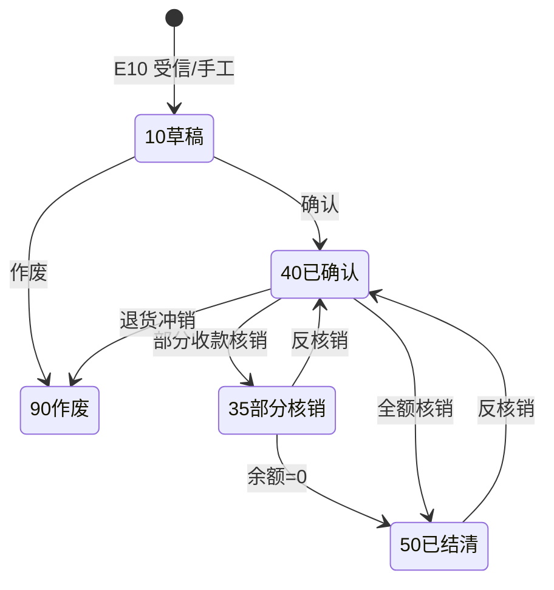

# 应收管理・收款・核销 详细设计书（売掛管理・入金・消込 詳細設計書）

| 項目 | 内容 |
|---|---|
| 文書名 | 应收管理・收款・核销 详细设计书（売掛管理・入金・消込 詳細設計書） |
| 文書番号 | DSN-FIN-004 |
| 版数 | v1.0 |
| 作成日 | 2026-10-20 |
| 作成者 | finance-designer |
| 承認者 | 未承認（レビュー待ち） |
| 状態 | ドラフト（レビュー中） |
| 関連文書 | [業務域概要](00-overview.md) / [会計科目](01-accounting-subjects.md) / [AP/付款](03-ap-payment.md) / [跨域流程](../00-common/09-cross-domain-flow.md) / [コード一覧](../00-common/06-code-list.md) |

---

## 1. 機能概要

| 項目 | 内容 |
|---|---|
| 機能 ID | F-FIN-019（应收单）、F-FIN-020（收款登记）、F-FIN-021（应收核销）、F-FIN-022（应收账龄与坏账准备） |
| 機能名 | 应收管理（Order to Cash の会計側） |
| 目的 | 出荷基準で売上・売掛を計上し、入金登録・核销・账龄・与信残高・坏账准备までの売掛回収サイクルを管理する。销项发票は E12 で紐付け、金額は出荷時点のまま変更しない |
| 利用者・ロール | 应收会计（AR/收款/核销）、出纳（到账确认）、财务经理（审核/反核销）、销售经理（閲覧・与信確認） |
| 利用シーン | 每日出荷→应收计上、入金到账→核销、月末账龄与坏账、客户对账、与信残高查询 |
| 優先度 | P0（F-FIN-022 の坏账准备は 実装順 P2） |
| 画面 ID | SCR-FIN-026～030 |
| 関連 IF | IF-FIN-001/003（銀行対账单/銀企回单） |

---

## 2. 業務要件・業務ルール

### 2.1 前提条件

| # | 前提条件 | 成立しない場合の挙動 |
|---|---|---|
| 1 | 销售域已发 E10（出荷确定） | 应收单不能手工新增（特殊调整除外） |
| 2 | 客户、付款条件、税码有効 | 選択不可 |
| 3 | 会计期间 OPEN | 登録拒否（MSG-COM-071） |
| 4 | 与信チェックは SAL が実施、FIN は残高を提供 | FIN は与信承認を行わない |

### 2.2 業務ルール

| # | ルール | 根拠 | 関連項目 |
|---|---|---|---|
| BR-01 | 出荷基準（09 章 7.3）：E10 受信時に売上・売掛を計上する。借 1122 应收账款、贷 6001 主营业务收入、贷 2221.01 销项税额 | 09 章 7.2 J07 | `fin_receivable.source_type=DELIVERY` |
| BR-02 | 应收金额＝Σ(出荷数量×税抜単価)（2 位丸め）、税額は明細単位で計算（08 章 4.2）。E10 の header `amount`/`taxAmount` を検証に使用し、明細合計と一致しない場合はエラー | 08 章 4 章 | `tax_amount` |
| BR-03 | 应收单到期日＝出荷日 + 付款条件（`mdm_payment_term`）。例 NET30＝月末締め翌月末 | 06 章 8.2 | `due_date` |
| BR-04 | 销项发票（E12）は**金額を変更せず**、`fin_receivable.invoice_status` / `invoiced_amount` / `invoice_id` を紐付けるのみ | 09 章 7.3 | `invoice_status` |
| BR-05 | 一张应收单可对应複数发票（部分开票）；开票合计不得超过应收金额。`invoice_status`：0 未开票/1 部分开票/2 已开票 | 税务実務 | `invoiced_amount` |
| BR-06 | 收款单到账确认后生成 J08：借 1002 银行存款、贷 1122 应收账款；未核销部分作为**预收账款（2203）**，生成 J09 或 J08 同凭证（贷 2203） | 09 章 7.2 J08/J09 | `fin_receipt` |
| BR-07 | 收款必须登记结算方式（银行转账/承兑/现金）、银行账户、对方户名、到账日；银行转账须与銀行日記帳一致 | 06 章 8.1 | `method` |
| BR-08 | 核销：收款→应收（全额/部分）、预收→应收。核销金额合计≤收款金额，且≤应收未收余额 | 本域設計 | `fin_write_off_line` |
| BR-09 | 部分核销：应收状态 40→35（部分核销）；余额为 0 时→50（已结清） | 08 章 3 | `balance_amount` |
| BR-10 | 反核销：限期间 OPEN、收款未作废；反核销后应收余额恢复、收款未核销额恢复，状态回 40 | 本域設計 | `fin_write_off.status` |
| BR-11 | 过入金（收款>应收合计）：差额作为预收（2203），不得强行核销；预收后续自动/手工核销新应收 | 09 章 5.3 | `unapplied_amount` |
| BR-12 | 销售退货（E11）：红字应收/收入（J22）与库存戻し（J23）；退货对应的收款核销由会计手工反核销 | 09 章 7.2 J22/J23 | `source_type=RETURN` |
| BR-13 | 应收账龄基准日＝报表日，默认按到期日：未到期单列、逾期 1-30/31-60/61-90/91-180/181-360/>360 天；可按客户配置按业务日期（`fin_aging_config.basis_type`） | 本域設計（与 AP 同口径） | `fin_aging_config` |
| BR-14 | 与信使用额：FIN 提供「应收未收余额（含逾期）+ 预收未核销额」查询；SAL 另行维护受注残承诺占用。FIN 不批准与信，只提供口径 | Lead 裁定（2026-10-20） | `GET /api/finance/customers/{id}/credit-usage` |
| BR-15 | 坏账准备（第一版・実装順 P2）：按 CAS 22 预期信用损失简化方法，按账龄组合计提（示例：1 年以内 5%、1-2 年 10%、2-3 年 30%、3 年以上 50%【示例値】）；借 6701 信用减值损失、贷 1231 坏账准备 | CAS 22；比例【示例値】 | `fin_asset` 対象外、`fin_receivable` |
| BR-16 | 已核销应收的收款作废（銀行退回）时，必须先反核销再作废收款，禁止直接修改金额 | 本域設計 | `fin_receipt.status=90` |
| BR-17 | 客户对账单（PRT-FIN-016）金额＝AR 余额 − 预收余额；与客户对账差异在月结前处理 | 社内規程 | — |
| BR-18 | E27 `finance.receivable.created` 発行：应收单确认（status=40）后发，payload 按 09 章 + `taxAmount`/`totalAmount`/`currencyCode`/`receivableDate`/`sourceNo`/`invoiceStatus` | Lead 裁定 | `sys_outbox_event` |
| BR-19 | E29 `finance.receipt.completed` 発行：收款确认且核销完成后发，含 `matched[{receivableId,invoiceId,matchedAmount}]`、`unappliedAmount` | Lead 裁定 | `sys_outbox_event` |
| BR-20 | 应收单/收款单/核销的来源唯一性：`(source_type, source_id)` 唯一，防事件重复消费 | 09 章 10.2 | 唯一索引 |

### 2.3 計算式・判定式

| # | 対象 | 算式 | 丸め | 例（【示例值】） |
|---|---|---|---|---|
| CALC-01 | 应收税抜額 | Σ(数量 × 税抜単価) | 2 位 | 120 PCE × 856.50 = 102,780.00 |
| CALC-02 | 销项税额 | 税抜額 × 税率（明細単位） | 2 位 | 102,780.00 × 13% = 13,361.40 |
| CALC-03 | 价税合计 | 税抜額 + 税額 | 2 位 | 116,141.40 |
| CALC-04 | 收款未核销額 | 收款金額 − Σ核销金額 | 2 位 | 116,141.40 − 116,141.40 = 0.00 |
| CALC-05 | 应收未收余额 | 应收金額 − Σ核销金額（含预收核销） | 2 位 | 116,141.40 − 60,000.00 = 56,141.40 |
| CALC-06 | 与信使用额（FIN 提供部分） | Σ未收余额 + Σ逾期余额（逾期含于未收） + Σ预收未核销額 | 2 位 | 56,141.40 + 0 + 0 = 56,141.40 |
| CALC-07 | 账龄天数 | 基準日 − 到期日 | 整数 | 2026-10-31 − 2026-11-30 = −30（未到期） |
| CALC-08 | 坏账计提额（P2） | Σ(各账龄区間余额 × 计提比例) − 已计提余额 | 2 位 | 1,000,000×5% + 200,000×10% = 70,000.00 |
| CALC-09 | 应收账款周转天数（DSO） | **平均残高口径**：{(期初应收+期末应收)÷2} ÷ 营业收入 × 期间天数（月次=30 日） | 2 位 | {(153,222,222.22+149,000,000.00)÷2}=151,111,111.11 ÷ 66,666,666.67 × 30 = 68.0 日 |

> DSO は**平均残高口径**（期首・期末の平均）で算定し、時点残高口径は採用しない。2026-10 唯一シナリオの DSO は 68.0 日（期初 153,222,222.22／期末 149,000,000.00、月次売上 66,666,666.67）。目標 ≤68 日（[00-overview](00-overview.md) KPI）。

### 2.4 状態遷移

**应收单 `fin_receivable.status`**



**收款单 `fin_receipt.status`**：`10 草稿 → 40 已确认（到账） → 90 已作废`

---

## 3. 関連機能

| 関係 | 機能 ID | 機能名 | 関係内容 |
|---|---|---|---|
| 上流 | SAL E10 | 出荷确定 | 売上/売掛の計上 |
| 上流 | SAL E12 | 销售发票 | 发票紐付け（金額不変） |
| 上流 | SAL E11 | 销售退货 | 赤伝売上/売掛 |
| 下流 | F-FIN-030 | 自动凭证 | J07/J08/J09/J22/J23 |
| 下流 | F-FIN-025 | 资金日报 | 入金の資金反映 |
| 参照 | F-FIN-001 | 科目 | 1122/2203/6001 |
| 参照 | F-FIN-035 | 期間 | OPEN/CLOSED |

---

## 4. 画面設計

### 4.1 画面一覧

| 画面 ID | 画面名 | 類型 | 概要 |
|---|---|---|---|
| SCR-FIN-026 | 应收单一覧 | LIST | 客户/到期日/余额/开票状态/状态検索 |
| SCR-FIN-027 | 收款登记 | EDIT | 收款内容、银行账户、预收、到账确认 |
| SCR-FIN-028 | 应收核销 | EDIT | 收款→应收/预收、部分核销、反核销 |
| SCR-FIN-029 | 应收账龄分析 | 照会 | 客户×区间×余额、与信占用表示 |
| SCR-FIN-030 | 坏账准备计提（P2） | LIST | 账龄组合计提、凭证生成 |

### 4.2 画面項目定義（SCR-FIN-027 收款登记）

| No | 項目 ID | 項目名 | 区分 | 種別 | 型/桁 | 必須 | 初期値 | 入力チェック | データソース | DB 項目 | 備考 |
|---|---|---|---|---|---|---|---|---|---|---|---|
| 1 | receipt_no | 收款单号 | ヘッダ | テキスト | VARCHAR(13) | ○ | 自動採番 | `RCP{YYMMDD}{4}` | `sys_sequence` | `fin_receipt.receipt_no` | — |
| 2 | customer_id | 客户 | ヘッダ | 選択 | BIGINT | ○ | 空 | 有効 | `mdm_customer` | `customer_id` | 名称スナップショット |
| 3 | receipt_date | 收款日 | ヘッダ | 日付 | DATE | ○ | 当日 | 期間 OPEN | 手入力 | `receipt_date` | — |
| 4 | method | 结算方式 | ヘッダ | 選択 | VARCHAR(20) | ○ | BANK_TRANSFER | 06 章 8.1 | `mdm_settlement_method` | `method` | — |
| 5 | bank_account_id | 收款银行账户 | ヘッダ | 選択 | BIGINT | △ | 空 | 银行转账時必須、有効 | `fin_bank_account` | `bank_account_id` | 口座マスク表示 |
| 6 | receipt_amount | 收款金额 | ヘッダ | 数値 | NUMERIC(18,2) | ○ | 0 | >0 | 手入力 | `amount` | — |
| 7 | payer_name | 付款方户名 | ヘッダ | テキスト | VARCHAR(200) | ○ | 客户名称 | ≤200 | 手入力/銀行 | `payer_name` | 銀行入金の相手名 |
| 8 | bank_ref_no | 银行流水号 | ヘッダ | テキスト | VARCHAR(64) | △ | 空 | ≤64、一意推奨 | 銀行/手入力 | `bank_ref_no` | 対账紐付け |
| 9 | unapplied_amount | 未核销金额 | フッタ | 数値 | NUMERIC(18,2) | ○ | 0 | =收款金額−核销合計、≥0 | 自動計算 | `unapplied_amount` | 预收化 |
| 10 | receivable_ids | 核销对象 | 明細 | 複数選択 | BIGINT | △ | 空 | 同一客户、未收余额>0 | `fin_receivable` | `fin_write_off_line` | 保存时可空 |
| 11 | matched_amounts | 核销金额 | 明細 | 数値 | NUMERIC(18,2) | △ | 0 | ≤应收未收・≤收款金額 | 手入力 | `fin_write_off_line.matched_amount` | 部分核销可 |
| 12 | attachment_count | 附件张数 | ヘッダ | 数値 | INT | — | 0 | ≥0 | 手入力 | `attachment_count` | 回单等 |
| 13 | status | 状态 | ヘッダ | ラベル | SMALLINT | ○ | 10 | 10/40/90 | 遷移 | `status` | — |

**イベント処理**

| No | イベント | トリガ | 処理内容 | 呼出 API | 画面遷移 | 備考 |
|---|---|---|---|---|---|---|
| 1 | 客户選択 | 変更 | 未収 AR 一覧を取得（到期日順） | GET /api/finance/receivables | 同一画面 | — |
| 2 | 金額入力 | 変更 | 未核销額を再計算 | — | 同一画面 | — |
| 3 | 保存 | 保存 | 10 草稿で保存（核销は別操作も可） | POST /api/finance/receipts | 一覧 | — |
| 4 | 到账确认 | 確認ボタン | status=40、J08/J09 生成、核销実行、E29 発行 | POST /api/finance/receipts/{id}/confirm | SCR-FIN-028 | 承認不要（出纳） |
| 5 | 作废 | 作废ボタン | 反核销→status=90→逆凭证/赤伝 | POST /api/finance/receipts/{id}/cancel | 一覧 | 財務経理権限 |
| 6 | 银行流水選択 | 参照ボタン | 銀行日記帳の入金行を選択し金額・日付を反映 | GET /api/finance/bank-journals | ダイアログ | M5 対账連携 |

### 4.3 画面項目定義（SCR-FIN-028 应收核销）

| No | 項目 ID | 項目名 | 区分 | 種別 | 型/桁 | 必須 | 初期値 | 入力チェック | データソース | DB 項目 |
|---|---|---|---|---|---|---|---|---|---|---|
| 1 | write_off_no | 核销单号 | ヘッダ | テキスト | VARCHAR(16) | ○ | 自動 | 一意 | `sys_sequence` | `fin_write_off.write_off_no` |
| 2 | write_off_type | 核销类型 | ヘッダ | 選択 | SMALLINT | ○ | AR | 10 AR/11 AP/12 预收→AR/13 预付→AP | 固定値 | `write_off_type` |
| 3 | source_id | 收款/付款单 | ヘッダ | 選択 | BIGINT | ○ | 空 | 同一取引先・未核销額>0 | `fin_receipt`/`fin_payment` | `source_id` |
| 4 | target_lines | 核销対象 | 明細 | テーブル | — | ○ | — | 同一取引先、未收余额>0、金額合計≤源単未核销額 | 自動/手動 | `fin_write_off_line` |
| 5 | total_amount | 核销合計 | フッタ | 数値 | NUMERIC(18,2) | ○ | 0 | >0 | 自動 | `total_amount` |
| 6 | write_off_date | 核销日 | ヘッダ | 日付 | DATE | ○ | 当日 | 期間 OPEN | 手入力 | `write_off_date` |

**イベント処理（SCR-FIN-028）**

| No | イベント | トリガ | 処理内容 | 呼出 API | 画面遷移 |
|---|---|---|---|---|---|
| 1 | 收款選択 | 変更 | 対象 AR/预收一覧を取得 | GET /api/finance/receivables | 同一画面 |
| 2 | 自動核销 | ボタン | 金額一致・期限順で自動割当（FIFO） | POST /api/finance/write-offs/auto | 同一画面 |
| 3 | 保存 | 保存 | 核销登録→AR/收款残高更新→J08 補正 | POST /api/finance/write-offs | 一覧 |
| 4 | 反核销 | 反核销 | 確認→残高復元→status=90 | POST /api/finance/write-offs/{id}/reverse | 一覧 |

### 4.4 一覧画面仕様（SCR-FIN-026 应收一覧）

| 項目 | 内容 |
|---|---|
| 検索条件 | 客户、期間、到期日範囲、状态（未收/部分/結清）、开票状态、发票号、出荷单号、金额範囲 |
| 既定条件 | 未结清（余额≠0）、到期日昇順、全客户 |
| ソート | 到期日、余额、客户、出荷日 |
| ページング | 20/50/100/200 |
| 一括操作 | 批量核销（同一客户）、账龄出力、客户对账单出力 |
| エクスポート | Excel 10,000 件まで。与信関連項目は権限者のみ |

### 4.5 表示制御

| 条件 | 対象 | 制御 |
|---|---|---|
| status=90/50 | 核销/作废ボタン | 非表示 |
| 与信超過（FIN 提供残高より） | 与信使用額表示 | 赤色 + 警告アイコン（SAL と同口径） |
| 権限なし（销售员） | 收款/核销ボタン・銀行情報 | 非表示、API 403 |
| 期間 CLOSED | 登録/核销/確認 | ボタン非表示 |

---

## 5. 入力チェック仕様

| No | チェック ID | 対象項目 | 種別 | 条件 | タイミング | メッセージ ID |
|---|---|---|---|---|---|---|
| 1 | CHK-FIN-019-01 | E10 金額 | 業務 | header amount/tax と明細合計一致 | イベント | MSG-FIN-062 |
| 2 | CHK-FIN-019-02 | 税率 | 業務 | 01～100%（税率マスタ存在） | 保存 | MSG-FIN-063 |
| 3 | CHK-FIN-019-03 | 到期日 | 業務 | 出荷日 ≤ 到期日 | 保存 | MSG-COM-045 |
| 4 | CHK-FIN-020-01 | 收款金額 | 必須 | >0 | 保存 | MSG-COM-047 |
| 5 | CHK-FIN-020-02 | 銀行口座 | 条件必須 | method=BANK_TRANSFER 時必須 | 保存 | MSG-COM-040 |
| 6 | CHK-FIN-020-03 | 銀行流水号 | 一意 | 重複なし（同一口座） | 保存 | MSG-FIN-064 |
| 7 | CHK-FIN-021-01 | 核销金額 | 業務 | ≤ 应收未收余额 | 保存 | MSG-FIN-065 |
| 8 | CHK-FIN-021-02 | 核销合計 | 業務 | ≤ 收款未核销額 | 保存 | MSG-FIN-066 |
| 9 | CHK-FIN-021-03 | 反核销 | 期間 | 期間 OPEN・收款未作废 | 反核销 | MSG-FIN-067 |
| 10 | CHK-FIN-022-01 | 账龄基準日 | 必須 | 有効日付 | 照会 | MSG-COM-043 |

---

## 6. 処理詳細

### 6.1 処理一覧

| 処理 ID | 処理名 | 契機 | トランザクション | 排他 |
|---|---|---|---|---|
| PRC-FIN-019-01 | 应收计上（E10 購読） | イベント | 要 | `(source_type,source_id)` 一意 |
| PRC-FIN-019-02 | 发票紐付け（E12 購読） | イベント | 要 | 应收行ロック |
| PRC-FIN-020-01 | 收款登録 | 保存 | 要 | 楽観排他 |
| PRC-FIN-020-02 | 收款確認→凭证→核销 | 確認 | 要 | 收款/AR 行ロック |
| PRC-FIN-021-01 | 核销 | 保存 | 要 | AR 行ロック |
| PRC-FIN-021-02 | 反核销 | 反核销 | 要 | 同上 |
| PRC-FIN-022-01 | 坏账计提（P2） | バッチ | 要 | 期間ロック |

### 6.2 処理手順（正常系）

**PRC-FIN-019-01 应收计上（E10 購読）**

1. Outbox から E10 を受信し、`eventId` で重複排除する。
2. 明細ごとに税抜額・税額を計算し、header `amount`/`taxAmount` と一致を検証する（不一致はエラー + 保留）。
3. 付款条件から `due_date` を算出する。
4. `fin_receivable`（status=40、balance=total_amount、invoice_status=0）と `fin_receivable_line` を INSERT する。
5. J07 を生成する：借 1122、贷 6001.xx、贷 2221.01。
6. E27 `finance.receivable.created` を Outbox に登録する（同一トランザクション）。
7. 監査ログ + 自動凭证ログを記録する。

**PRC-FIN-019-02 发票紐付け（E12 購読）**

1. E12 を受信し、`deliveryIds[]` から該当应收单を特定する。
2. 发票金額（税抜・税額・价税合计）を検証し、`invoiced_amount` を加算する（≤应收金額）。
3. `invoice_status` を 1（部分）/2（全部）に更新し、`fin_invoice`（OUTPUT）を登録する。
4. 金額は変更しない（09 章 7.3）。
5. 監査ログを記録する。

**PRC-FIN-020-02 收款確認→核销**

1. 收款単が status=10 であることを確認する。
2. 出納権限を確認し、銀行口座・到账日を検証する。
3. `fin_receipt.status=40`、J08（借 1002、贷 1122）または未核销分を J09（贷 2203）で生成する。
4. `fin_bank_journal`（入金）を登録する。
5. 核销明細がある場合、`fin_write_off` + line を登録し、AR の `received_amount/balance/status` を更新する。
6. 未核销額（`unapplied_amount`）は预收（2203）として繰越す。
7. E29 `finance.receipt.completed`（`matched[]`、`unappliedAmount`）を Outbox に登録する。
8. 監査ログを記録する。

**PRC-FIN-022-01 坏账计提（P2）**

1. 基準日の AR 残高を账龄区間別に集計する。
2. 区間別计提率（`fin_aging_config.bad_debt_rate`）を乗じて计提額を計算する。
3. 既计提 `1231` 残高との差額を J（借 6701、贷 1231）で计提する。
4. 计提結果を `fin_voucher` に記録し、監査ログを記録する。

### 6.3 例外処理

| No | 異常条件 | 検知箇所 | 処理 | ロールバック | メッセージ ID |
|---|---|---|---|---|---|
| 1 | E10 金額不一致 | イベント | エラー終了 + 保留（再処理可能） | 全体 | MSG-FIN-062 |
| 2 | 開票額 > 应收額 | E12 | エラー終了 + アラート | 全体 | MSG-FIN-068 |
| 3 | 收款金額 0 以下 | 保存 | エラー終了 | 全体 | MSG-COM-047 |
| 4 | 銀行流水重複 | 保存 | エラー終了 | 全体 | MSG-FIN-064 |
| 5 | 核销超過 | 保存 | エラー終了 | 全体 | MSG-FIN-065/066 |
| 6 | 反核销時期間 CLOSED | 反核销 | エラー終了 | 全体 | MSG-COM-071 |
| 7 | 收款作废時核销あり | 作废 | エラー終了（先に反核销） | 全体 | MSG-FIN-069 |

### 6.4 冪等性・再実行

- E10/E12 購読は `eventId` + `(source_type, source_id)` 一意制約で二重計上を防止。
- 收款確認・核销は `Idempotency-Key` 必須。
- 核销の自動割当は FIFO（到期日昇順）で決定的に実行し、再実行しても同一結果。

---

## 7. API 設計

| No | メソッド | パス | 権限 | 概要 | リクエスト | レスポンス |
|---|---|---|---|---|---|---|
| 1 | GET | /api/finance/receivables | finance:receivable:view | 应收一覧 | `customerId,status,invoiceStatus,dueDateFrom,dueDateTo,pageNum,pageSize` | `PageResult<ReceivableDto>` |
| 2 | GET | /api/finance/receivables/{id} | finance:receivable:view | 应收詳細 | — | `ReceivableDetailDto` |
| 3 | POST | /api/finance/receivables/{id}/confirm | finance:receivable:confirm | 应收確認 | `{version}` | `ReceivableDto` |
| 4 | POST | /api/finance/receivables/{id}/cancel | finance:receivable:cancel | 应收作废（退货等） | `{reason,version}` | `Result<Void>` |
| 5 | GET | /api/finance/receipts | finance:receipt:view | 收款一覧 | `customerId,status,receiptDateFrom,receiptDateTo` | `PageResult<ReceiptDto>` |
| 6 | POST | /api/finance/receipts | finance:receipt:create | 收款登録 | `ReceiptCreateRequest` | `ReceiptDto`（201） |
| 7 | PUT | /api/finance/receipts/{id} | finance:receipt:create | 收款更新（status=10） | `ReceiptUpdateRequest` | `ReceiptDto` |
| 8 | POST | /api/finance/receipts/{id}/confirm | finance:receipt:confirm | 到账確認（J08/J09/E29） | `{version,writeOff?}` | `{receiptId,voucherIds[],writeOffId}` |
| 9 | POST | /api/finance/receipts/{id}/cancel | finance:receipt:reverse | 收款作废 | `{reason,version}` | `Result<Void>` |
| 10 | POST | /api/finance/write-offs | finance:write-off:create | 核销登録 | `WriteOffCreateRequest` | `WriteOffDto`（201） |
| 11 | POST | /api/finance/write-offs/auto | finance:write-off:create | 自動核销（FIFO） | `{receiptId,customerId,amount}` | `WriteOffDto` |
| 12 | POST | /api/finance/write-offs/{id}/reverse | finance:write-off:reverse | 反核销 | `{reason}` | `WriteOffDto` |
| 13 | GET | /api/finance/ar-aging | finance:aging:view | 应收账龄 | `asOfDate,customerId,basisType?` | `AgingDto` |
| 14 | GET | /api/finance/customers/{customerId}/credit-usage | finance:receivable:view | 与信使用額（SAL 連携） | — | `{receivableBalance,overdueAmount,advanceUnapplied,aging[]}` |
| 15 | GET | /api/finance/receivables/customer-statement | finance:receivable:view | 客户对账单データ | `customerId,periodFrom,periodTo` | `StatementDto` |
| 16 | POST | /api/finance/receivables/batch-confirm | finance:receivable:confirm | 一括確認 | `{ids[]}` | `{successCount,failureCount}` |
| 17 | POST | /api/finance/bad-debts/accrue（P2） | finance:receivable:update | 坏账计提 | `{periodCode,asOfDate}` | `{accrualAmount,voucherId}` |

### 7.1 リクエスト/レスポンス詳細

**POST /api/finance/receipts**

```json
{
  "customerId": "1845000000000000001",
  "receiptDate": "2026-10-28",
  "method": "BANK_TRANSFER",
  "bankAccountId": "1845000000000000201",
  "amount": "116141.40",
  "payerName": "江苏恒立液压股份有限公司",
  "bankRefNo": "1026102800012345",
  "attachmentCount": 1
}
```

```json
{
  "code": 0,
  "message": "ok",
  "data": {
    "id": "1845678901234580001",
    "receiptNo": "RCP2610280001",
    "status": 10,
    "amount": "116141.40",
    "unappliedAmount": "116141.40",
    "version": 0
  }
}
```

**E29 payload（発行例）**

```json
{
  "eventType": "finance.receipt.completed",
  "eventVersion": 1,
  "aggregateType": "fin_receipt",
  "aggregateId": "1845678901234580001",
  "aggregateNo": "RCP2610280001",
  "payload": {
    "receiptId": "1845678901234580001",
    "receiptNo": "RCP2610280001",
    "customerId": "1845000000000000001",
    "amount": "116141.40",
    "receiptDate": "2026-10-28",
    "method": "BANK_TRANSFER",
    "unappliedAmount": "0.00",
    "matched": [
      { "receivableId": "1845678901234578001", "invoiceId": "1845678901234579001", "matchedAmount": "116141.40" }
    ],
    "matchedInvoiceIds": ["1845678901234579001"]
  }
}
```

**GET /api/finance/customers/{customerId}/credit-usage（SAL 向け）**

```json
{
  "code": 0,
  "message": "ok",
  "data": {
    "customerId": "1845000000000000001",
    "asOfDate": "2026-10-31",
    "receivableBalance": "568,141.40",
    "overdueAmount": "152,000.00",
    "advanceUnapplied": "30,000.00",
    "aging": [
      { "bucket": "未到期", "amount": "416,141.40" },
      { "bucket": "1-30", "amount": "102,000.00" },
      { "bucket": "31-60", "amount": "50,000.00" },
      { "bucket": "61-90", "amount": "0.00" },
      { "bucket": "91-180", "amount": "0.00" },
      { "bucket": "181-360", "amount": "0.00" },
      { "bucket": ">360", "amount": "0.00" }
    ]
  }
}
```

**エラー例（核销超過）**

```json
{
  "code": 70065,
  "message": "核销金额超过应收未收余额（可核销 56,141.40 / 本次 60,000.00）。",
  "data": { "receivableId": "1845678901234578001", "balance": "56141.40", "requested": "60000.00" }
}
```

---

## 8. データ更新仕様

| テーブル | 操作 | 更新項目 | 更新条件 | トリガ |
|---|---|---|---|---|
| `fin_receivable` | INSERT | 全項目（amount/tax/balance/due_date/invoice_status） | E10/手動 | PRC-FIN-019-01 |
| `fin_receivable` | UPDATE | received_amount/balance/status/invoiced_amount/invoice_status/version | 核销/反核销/開票紐付け | PRC-FIN-019-02/021 |
| `fin_receivable_line` | INSERT | 明細 | イベント/登録 | PRC-FIN-019-01 |
| `fin_receipt` | INSERT/UPDATE | 全項目、status、unapplied_amount | 登録/確認/作废 | PRC-FIN-020 |
| `fin_write_off` / `fin_write_off_line` | INSERT/UPDATE | 核销額、status | 核销/反核销 | PRC-FIN-021 |
| `fin_invoice`（OUTPUT） | INSERT/UPDATE | 销项台账、紐付け | E12 | PRC-FIN-019-02 |
| `fin_bank_journal` | INSERT | 入金流水 | 收款確認 | PRC-FIN-020-02 |
| `fin_voucher` / `fin_voucher_line` | INSERT | J07/J08/J09/J22/J23 | 自動凭证 | 各処理 |
| `sys_outbox_event` | INSERT | E27/E29 | 確認/核销 | 共通路徑 |

---

## 9. エラー処理・メッセージ

| メッセージ ID | 種別 | 本文 | 発生条件 | 利用者への対処 |
|---|---|---|---|---|
| MSG-FIN-060 | E | 该应收单已存在有效凭证，不能重复确认。 | 二重確認 | 既存凭证を確認 |
| MSG-FIN-061 | E | 应收金额与出荷明細合计不一致（出荷 {0} / 明细 {1}）。 | E10 不整合 | SAL へ確認、保留 |
| MSG-FIN-062 | E | 出荷事件的金额与明细合计不一致，已转入待处理。 | E10 不整合 | 出荷データを修正し再処理 |
| MSG-FIN-063 | E | 税率不正确（应为 0～100 的有效税率）。 | 税率不正 | 税码を確認 |
| MSG-FIN-064 | E | 银行流水号「{0}」已存在，不能重复登记。 | 流水重複 | 既存收款を照会 |
| MSG-FIN-065 | E | 核销金额超过应收未收余额（可核销 {0} / 本次 {1}）。 | 核销超過 | 金額修正 |
| MSG-FIN-066 | E | 核销合计超过收款未核销金额（可核销 {0} / 本次 {1}）。 | 核销超過 | 金額修正 |
| MSG-FIN-067 | E | 反核销失败：期间已结账或收款已作废。 | 条件不成立 | 期間・状態確認 |
| MSG-FIN-068 | E | 开票金额超过应收金额（应收 {0} / 累计开票 {1} / 本次 {2}）。 | 開票超過 | SAL へ確認 |
| MSG-FIN-069 | E | 该收款单已有核销记录，不能直接作废，请先反核销。 | 作废条件不成立 | 反核销後作废 |
| MSG-FIN-070 | I | 收款已确认，核销完成（未核销 {0} 转为预收）。 | 確認成功 | — |
| MSG-FIN-071 | W | 该客户应收余额已超过信用额度（额度 {0} / 使用 {1}），请销售确认。 | 与信超過 | SAL へ連絡 |

---

## 10. 権限・セキュリティ

| 種別 | 内容 |
|---|---|
| 画面権限 | `finance:receivable:view/create/update/confirm/cancel`、`finance:receipt:view/create/confirm/reverse`、`finance:write-off:create/reverse`、`finance:aging:view` |
| 操作権限 | 应收確認＝应收会计、收款登録/確認＝出纳/应收会计、核销＝应收会计、反核销＝財務経理、坏账计提＝財務経理以上 |
| SoD | 收款登録者と应收確認者は原则上別人（設定可）；出纳は凭证制单不可 |
| 項目権限 | 银行口座・与信額は権限者のみ全桁表示。销售员は自部門客户のみ |
| データ範囲 | 销售员：自部門客户。财务：全社 |
| 監査ログ | 应收確認/作废、收款登録/確認/作废、核销/反核销、与信查询（大量取得時）を記録 |

---

## 11. 性能・非機能

| 項目 | 目標値 | 前提 |
|---|---|---|
| AR 一覧（100 件） | 2 秒以内 | customer_id+status+due_date 索引 |
| 收款確認→凭证→核销 | 3 秒以内 | 明細 100 行以下 |
| 账龄（10,000 件 AR） | 5 秒以内 | バッチ事前計算 + 索引 |
| 客户对账单 | 5 秒以内 | 期間内 AR/收款 |
| 与信查询 | 1 秒以内 | 顧客別集計インデックス |

---

## 12. テスト観点

| No | 観点 ID | 分類 | 観点 | 期待結果 |
|---|---|---|---|---|
| 1 | TST-F-FIN-019-01 | 正常系 | E10 受信で AR 計上 | 1122 借方 116,141.40、状態 40 |
| 2 | TST-F-FIN-019-02 | 冪等 | 同一 E10 を 2 回受信 | AR 1 件のみ |
| 3 | TST-F-FIN-019-03 | 異常系 | E10 header 金額と明細不一致 | MSG-FIN-062、保留 |
| 4 | TST-F-FIN-019-04 | 正常系 | E12 で部分開票 | invoice_status=1、invoiced_amount 更新 |
| 5 | TST-F-FIN-019-05 | 異常系 | E12 開票額>应收額 | MSG-FIN-068 |
| 6 | TST-F-FIN-020-01 | 正常系 | 收款確認（全額核销） | 状態 50、J08、E29 |
| 7 | TST-F-FIN-020-02 | 正常系 | 過入金 | 未核销額が预收 2203 へ |
| 8 | TST-F-FIN-020-03 | 異常系 | 銀行流水重複 | MSG-FIN-064 |
| 9 | TST-F-FIN-021-01 | 正常系 | 部分核销 60,000 | balance=56,141.40、状態 35 |
| 10 | TST-F-FIN-021-02 | 異常系 | 核销>未収 | MSG-FIN-065 |
| 11 | TST-F-FIN-021-03 | 正常系 | 反核销 | 残高復元、状態 40 |
| 12 | TST-F-FIN-021-04 | 正常系 | 预收→应收核销 | 2203 借方、状態 50 |
| 13 | TST-F-FIN-022-01 | 正常系 | 账龄集計（基準日） | 未到期/逾期区間が正しい |
| 14 | TST-F-FIN-022-02 | 権限 | 销售员が与信使用額を取得 | 自部門のみ、金額マスクなし |
| 15 | TST-F-FIN-022-03 | P2 | 坏账计提 | 差額计提、1231 貸方増加 |

---

## 13. 未決事項

| # | 事項 | 理由 | 暫定仕様 | 担当 | 期限 |
|---|---|---|---|---|---|
| 1 | 与信使用額の最終口径 | SAL 受注残と FIN 応収残の重複排除（受注済未出荷と売掛の二重計上防止） | SAL 受注残 = 受注額 − 出荷済額；FIN 応収残 = 出荷済未収。合算で二重なし | Lead / SAL | 2026-10-24 |
| 2 | 收款確認と核销の分離要否 | 出纳が核销まで行うか、会計が核销するか | P0 実装時点 は「確認時に自動核销、未核销は预收」；会計が後から振替可 | 財務経理 | 2026-10-30 |
| 3 | 票据（承兑汇票）收款 | 1121 应收票据の管理が 実装順 P2 | P0 実装時点 は銀行/現金のみ。承兑は 実装順 P2（票拠台帳） | 財務総監 | 実装順 P2 |
| 4 | 坏账计提の組合せ | CAS 22 の組合せ区分（顧客業種・地域）未定 | 账龄组合のみで暫定 | 財務総監 | 実装順 P2 |

---

## 14. 改訂履歴

| 版数 | 日付 | 変更内容 | 変更者 |
|---|---|---|---|
| v1.0 | 2026-10-20 | 初版：AR 計上（E10）、发票紐付け（E12）、收款 J08/J09、核销/部分核销/反核销、账龄、与信查询 API、坏账准备（P2） | finance-designer |
| v1.1 | 2026-10-20 | 红队修复：DSO を平均残高口径で定義（CALC-09、目標 ≤68 日）、唯一シナリオ（売掛 149,000,000）を反映。J07 発生元 E10 を明記 | finance-designer |
