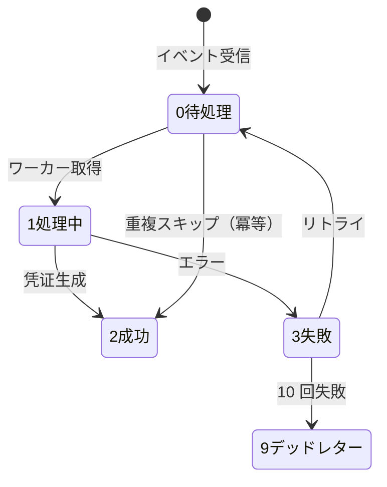
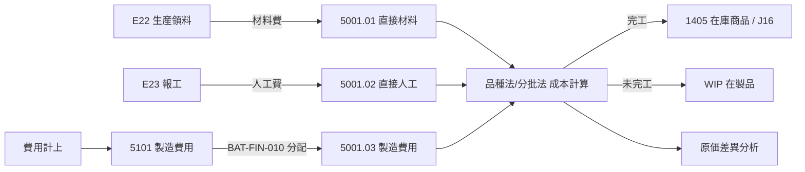

# 自动凭证与成本核算 详细设计书（自動仕訳・原価計算 詳細設計書）

| 項目 | 内容 |
|---|---|
| 文書名 | 自动凭证与成本核算 详细设计书（自動仕訳・原価計算 詳細設計書） |
| 文書番号 | DSN-FIN-006 |
| 版数 | v1.0 |
| 作成日 | 2026-10-20 |
| 作成者 | finance-designer |
| 承認者 | 未承認（レビュー待ち） |
| 状態 | ドラフト（レビュー中） |
| 関連文書 | [業務域概要](00-overview.md) / [会計科目](01-accounting-subjects.md) / [憑証/総帳](02-voucher-ledger.md) / [跨域流程](../00-common/09-cross-domain-flow.md) 第 7 章 J01–J30 / [共通業務規則](../00-common/08-common-business-rules.md) 第 6 章 |

---

## 1. 機能概要

| 項目 | 内容 |
|---|---|
| 機能 ID | F-FIN-029（自动凭证规则管理）、F-FIN-030（自动凭证生成与监控）、F-FIN-031（成本核算）、F-FIN-032（制造费用归集与分配）、F-FIN-033（在制品与完工成本）、F-FIN-034（成本差异分析） |
| 機能名 | 自动凭证引擎 + 成本核算 |
| 目的 | ① 把采购/库存/销售/生产的业务事件按 09 章 J01–J30 的规则自动转换为记账凭证，实现「业务即会计」；② 以品种法/分批法归集材料、人工、制造费用，计算在制品与完工成本，输出成本差异分析 |
| 利用者・ロール | 会计（自动凭证监控/重试）、财务经理（模板管理/成本确认）、成本会计（成本计算/分配/差异） |
| 利用シーン | 每笔收货/出库/领料/报工/完工/发票/收付款自动生成凭证；月末制造费用分配与成本计算；成本差异分析会议 |
| 優先度 | P0（F-FIN-029/030）、P1（F-FIN-031～034） |
| 画面 ID | SCR-FIN-041～047 |
| 関連 IF | 内部イベント E10/E11/E12/E14/E16/E17/E18/E19/E20/E22/E23/E24/E25/E26/E27/E28/E29/E30；IF なし |

---

## 2. 業務要件・業務ルール

### 2.1 前提条件

| # | 前提条件 | 成立しない場合の挙動 |
|---|---|---|
| 1 | イベントが [09 章 3](../00-common/09-cross-domain-flow.md) の契約に存在し、ペイロードが一致する | 消費失敗（DEAD_LETTER）+ アラート |
| 2 | 対象期間が OPEN、または月結前の処理である | MSG-COM-071 / 保留 |
| 3 | テンプレートが有効（`status=1`、有効期間内）である | 消費失敗（テンプレート無し） |
| 4 | 科目・税码・補助核算が有効 | 消費失敗（科目不存在） |

### 2.2 業務ルール（自動凭证）

| # | ルール | 根拠 | 関連項目 |
|---|---|---|---|
| BR-01 | 自动凭证由「イベント購読 → テンプレート選択 → 金額計算 → 凭证生成（10 草稿）→ 自動审核/记账（設定による）」の順で生成する | 本域設計；09 章 2.2 | `fin_auto_voucher_log` |
| BR-02 | テンプレート選択キー＝`event_type` × `source_domain` × 条件（`condition_expr`）。優先度の高い 1 件のみ使用し、複数適用は禁止 | 本域設計 | `priority` |
| BR-03 | **幂等**：同一イベント（`eventId`）と同一来源（`source_type + source_id`）で凭证は 1 張のみ。`uk_fin_voucher_source` と `fin_auto_voucher_log` で保証 | 09 章 10.2 | 一意索引 |
| BR-04 | 金額の丸めは 08 章 4.2 に従う（明細単位 2 位、税額明細単位）。テンプレートで再丸めしない | 08 章 4 章 | `amount_source_expr` |
| BR-05 | 税額科目は MDM 業務税码の `tax_type` で決定する：10 销项→2221.01、11 进项→2221.01、进项转出→2221.01。テンプレートは `account_selector_type=TAX_TYPE_MAP` を使用する | Lead 税码口径（2026-10-20） | `account_selector_type` |
| BR-06 | 補助核算はイベント payload の取引先/部門/物料をコピーする。payload に無い場合のみマスタ参照で補完する（スナップショット） | 09 章 2.3 | `aux_source_type` |
| BR-07 | 摘要はテンプレートの `summary_template` にプレースホルダ（`{supplierName}` 等）を埋めて生成する。1～200 文字、空不可 | 02 章 BR-07 | `summary_template` |
| BR-08 | 生成された凭证は「自動」フラグ（`is_auto=true`）を持ち、手動編集は不可（訂正は赤伝/手動凭证） | 02 章 BR-18 | `is_auto` |
| BR-09 | 自動审核/記帳設定（`auto_post=true`）の場合、生成後に自動で审核+記帳する。SoD はシステムユーザ（`system`）を制作者とし、財務経理を审核者とする設定は不可（システムが代行）→ 自動計上であることを監査ログに明記 | 本域設計 | `auto_post` |
| BR-10 | 消費失敗（テンプレート無/金額不整合/期間 CLOSED）は `FAILED` としてリトライし、10 回失敗で `DEAD_LETTER` + アラート。運用画面で手動再処理 | 09 章 10.1 | `fin_auto_voucher_log.status` |
| BR-11 | 月結前に `fin_auto_voucher_log` の未処理（NEW/FAILED）が 0 件であることを確認する（月結チェック項目 1） | 09 章 10.3 | `fin_close_checklist` |
| BR-12 | テンプレート変更は有効期間で管理し、変更後の凭证から適用する（既存凭证は不変）。変更は財務経理承認 + 監査ログ | 本域設計 | `valid_from/to` |
| BR-13 | テンプレートは「プレビュー（ドライラン）」機能を持ち、サンプル payload から生成結果を確認できる。本番データへの反映は行わない | 本域設計 | `POST /api/finance/voucher-templates/{id}/preview` |
| BR-14 | 金額 0 の自動凭证は生成しない（ただし税額のみ発生する等の例外はテンプレートで許可設定可） | 本域設計 | `allow_zero_amount` |
| BR-15 | イベントの再送・順序逆転：`aggregateVersion` が古いイベントは無視し、`occurredAt` 順に処理する。順序逆転は補償バッチで検出 | 09 章 2.3/10.2 | `event_version` |

### 2.3 業務ルール（成本核算）

| # | ルール | 根拠 | 関連項目 |
|---|---|---|---|
| BC-01 | 成本核算方法：標準機（MTS）は**品种法**、受注機（MTO）は**分批法**。製品ごとに `cost_method` を設定（`mdm_material.cost_method`：1 品种法/2 分批法） | 09 章 6 章；本域設計 | `fin_cost_collection.cost_method` |
| BC-02 | 成本对象：品种法＝产品+期间；分批法＝生产工单（`work_order_id`、批次）。材料按 BOM 标准用量与实际领料归集 | 09 章 6 章 | `cost_object_type`、`cost_object_id` |
| BC-03 | 材料费归集：E22（生产领料）按工单归集，金额＝领料数量 × 移动平均单价（E18/E19 提供）；E23 报工归集人工；制造费用按分配标准分配 | 09 章 7.2 J11–J15 | `material_cost`、`labor_cost`、`overhead_cost` |
| BC-04 | 直接人工费＝Σ(报工工时 × 工序费率)。工序费率维护于工作中心（実装順 P2 与 PRD/HR 连携）；P0 実装時点 采用「直接人工总额 ÷ 总工时」的统一费率 | 本域設計【示例値】 | `work_hours`、`labor_rate` |
| BC-05 | 制造费用分配标准：默认**直接人工工时**。可选「机器工时/产量/直接材料成本」（`fin_cost_allocation.basis_type`）。分配率＝待分配费用 ÷ 分配标准合计（6 位） | 08 章 6 章；本域設計 | `allocation_rate` |
| BC-06 | 品种法在制品：按**约当产量法**（材料一次投入 100%、人工/制造费用按完工率）。完工产品成本＝总成本 × 完工数量 ÷ (完工数量 + 在制品约当产量) | CAS 成本核算惯例【示例値】 | `fin_wip_balance` |
| BC-07 | 分批法在制品：工单未完工前全部成本留在该工单；完工时按实际归集成本转出（无在制品约当产量概念，部分完工按完工数量比例分摊） | 09 章 6 章 | `fin_product_cost` |
| BC-08 | 完工入库凭证 J16：借 1405 库存商品、贷 5001 生产成本（材料+人工+制造费用）。单位成本＝完工总成本 ÷ 完工数量（6 位，2 位表示） | 09 章 7.2 J16 | `unit_cost` |
| BC-09 | 期末 5001 余额＝在制品金额，必须与 `fin_wip_balance` 合计一致（月结检查项）；5101 期末无余额 | 09 章 10.3 | 月结检查 |
| BC-10 | 成本差异分析：标准成本（BOM 标准用量 × 标准单价 + 标准工时 × 标准费率）与实际成本比较，分解为「材料价差/材料量差/人工效率差异/人工工资率差异/制造费用差异」 | 本域設計；标准成本第一版启用（2026-10-20 Yuri 确认第一版全量，R3 G1-02）。唯一来源为 `fin_standard_cost`（物料×版本×适用期间，[90 §6.12](90-db-design.md)，R3 G2-21） | `fin_cost_variance` |
| BC-11 | 成本计算顺序：① 归集材料（E22/E18）→ ② 归集人工（E23）→ ③ 归集制造费用（5101）→ ④ 分配制造费用（J15）→ ⑤ 计算完工/在制品（J16）→ ⑥ 成本差异分析 | 09 章 6.2 | `BAT-FIN-010/011` |
| BC-12 | 成本计算在库存月结（E20）之后、损益结转之前执行；期间 CLOSED 后不可重算（如需重算须财务总监批准 + 期间重开） | 08 章 10 章 | `fin_period` |
| BC-13 | 负库存/无领料报工/无 BOM 的成本对象不参与计算，列入异常清单；成本计算不自动补数 | 本域設計 | 异常清单 |
| BC-14 | 委外加工（第一版・実装順 P2）：材料成本经 1408 委托加工物资归集，加工费计入成本；J17/J18 | 09 章 7.2 J17/J18 | `fin_cost_collection` |
| BC-15 | 成本数据与库存域字段契约：`material_id`、`work_order_id`、`qty`、`unit_cost`、`amount`、`txn_id`、`eventId` 必须一致；FIN 不修改 INV 数量 | 09 章 11 章 | `fin_cost_collection.source_id` |

### 2.4 計算式・判定式

| # | 対象 | 算式 | 丸め | 例（【示例値】、WO2610200001・120 PCE） |
|---|---|---|---|---|
| CALC-A1 | 直接材料费 | Σ(领料数量 × 移动平均单价)（E22 `lines[].amount` 合計） | 2 位 | 79,187.55（標準材料 79,194.00 に対し材料価格差異 −6.45） |
| CALC-A2 | 直接人工费 | Σ(报工工时 × 人工费率)（E23 `laborAmount`） | 2 位 | 258.0 h × 25.00 = 6,450.00 |
| CALC-A3 | 制造费用分配率 | 待分配制造费用 ÷ 分配标准合计 | 6 位 | 186,000.00 ÷ 6,200.0 h = 30.000000 |
| CALC-A4 | 分配制造费用 | 分配率 × 对象工时 | 2 位 | 30.000000 × 258.0 = 7,740.00 |
| CALC-A5 | 完工总成本 | 直接材料 + 直接人工 + 分配制造费用 − 期末在制品（期初 0） | 2 位 | 79,187.55 + 6,450.00 + 7,740.00 = 93,377.55 |
| CALC-A6 | 单位成本 | 完工总成本 ÷ 完工数量 | 6 位保持、表示 2 位 | 93,377.55 ÷ 120 = 778.146250（表示 778.15） |
| CALC-A7 | 标准成本 | 標準単価 × 完工数量 | 2 位 | 778.20 × 120 = 93,384.00 |
| CALC-A8 | 材料価格差異 | 実際材料費 − 標準材料費 | 2 位 | 79,187.55 − 79,194.00 = −6.45（有利） |
| CALC-A9 | 材料数量差異 | (実際使用量 − BOM 標準使用量) × 標準単価 | 2 位 | 0.00（BOM 標準使用量どおり） |
| CALC-A10 | 原価差異合計 | CALC-A8 + CALC-A9 + 人工差異 + 製造費用差異 | 2 位 | −6.45 + 0 + 0 + 0 = −6.45（有利） |
### 2.5 状態遷移（自動凭证ログ）



| 遷移 | トリガ | 更新項目 | メッセージ |
|---|---|---|---|
| 0→1 | BAT-FIN-004 取得 | status=1、locked_at | — |
| 1→2 | 生成成功 | status=2、voucher_id | MSG-FIN-101 |
| 1→3 | 生成失敗 | status=3、error_message、retry_count+1 | MSG-FIN-102 |
| 3→0 | リトライ | status=0、next_retry_at | — |
| 3→9 | 10 回失敗 | status=9、alert | MSG-FIN-103 |

---

## 3. 関連機能

| 関係 | 機能 ID | 機能名 | 関係内容 |
|---|---|---|---|
| 上流 | PUR/INV/SAL/PRD | 各業務域 | E10/E11/E12/E14/E16/E17/E18/E19/E20/E22/E23/E24/E25/E26/**E36** |
| 上流 | F-FIN-016/020 | 付款/收款 | J08/J09/J10 のトリガ |
| 下流 | F-FIN-005/006 | 凭证审核/记账 | 生成凭证の後工程 |
| 下流 | F-FIN-038/039 | 报表/成本报表 | 成本・帳簿データ |
| 参照 | F-FIN-001 | 科目/辅助核算 | テンプレートの科目 |
| 参照 | MDM | 税码/取引先/物料/工作中心 | テンプレートの選択・金額 |

---

## 4. 自動凭证テンプレート（J01–J31 対応表）

> 下表は [09 章 7.2](../00-common/09-cross-domain-flow.md) の仕訳ルール J01–J30 との**完全対応表**である。イベント・借貸科目・金額根拠・摘要・補助核算を一致させる。テンプレートコード `TPL-FIN-xxx` は `fin_voucher_template.template_code` に保存する。

### 4.1 テンプレート一覧

| TPL | 対応 J# | 業務イベント | 借方科目 | 貸方科目 | 金額根拠（`amount_source_expr`） | 摘要テンプレート | 補助核算 | 起動 |
|---|---|---|---|---|---|---|---|---|
| TPL-FIN-J01 | J01 | E14 purchase.receipt.posted（暂估） | 1403/1405（物料分類で選択） | 2202 暂估应付 | `payload.amount`（税抜、=Σ`lines[].amount`） | 采购暂估 {supplierName} {receiptNo} | 供应商 | イベント |
| TPL-FIN-J02 | J02 | 暂估冲回（発票到着/月結 BAT-FIN-003） | 2202 暂估应付 | 1403/1405（赤伝・負数） | `source.accrualAmount`（負数） | 暂估冲回 {sourceNo} | 供应商 | バッチ/イベント |
| TPL-FIN-J03 | J03 | E17 purchase.invoice.matched | 1403/1405（差額調整）、2221.01（TAX_TYPE_MAP:11） | 2202 应付货款 | `payload.amount`（税抜）、`payload.taxAmount` | 采购发票 {invoiceNo} {supplierName} | 供应商 | イベント |
| TPL-FIN-J04 | J04 | E16 purchase.return.confirmed | 2202 应付货款 | 1403/1405、2221.01（TAX_TYPE_MAP:12） | `payload.amount`、`payload.taxAmount` | 采购退货 {returnNo} | 供应商 | イベント |
| TPL-FIN-J05 | J05 | 采购运费发票（AP 経由） | 1403（運費分摊）、2221.01 | 2202/1002.xx | `payload.amount`、`payload.taxAmount` | 运费 {invoiceNo} | 供应商 | イベント/手動 |
| TPL-FIN-J06 | J06 | E18 inventory.txn.posted（txn_type=SI） | 6401 主营业务成本 | 1405 库存商品 | `sum(payload.lines[].amount)`（出庫原価） | 销售成本 {txnNo} | 物料 | イベント |
| TPL-FIN-J07 | J07 | **E10 sales.delivery.confirmed**（出荷基準） | 1122 应收账款 | 6001 主营业务收入、2221.01（TAX_TYPE_MAP:10） | `payload.amount`（税抜）、`payload.taxAmount` | 销售 {deliveryNo} {customerName} | 客户/物料 | イベント |
| TPL-FIN-J08 | J08 | 收款确认（`fin_receipt`） | 1002.xx 银行存款 | 1122 应收账款 | `source.amount`（核销額） | 收款 {receiptNo} {customerName} | 客户 | 業務処理 |
| TPL-FIN-J09 | J09 | 收款确认（未核销=预收） | 1002.xx 银行存款 | 2203 预收账款 | `source.unappliedAmount` | 预收 {customerName} {receiptNo} | 客户 | 業務処理 |
| TPL-FIN-J10 | J10 | 付款执行（`fin_payment`） | 2202 应付货款 / 1123 预付货款 | 1002.xx 银行存款 | `source.amount` | 付款 {paymentNo} {supplierName} | 供应商 | 業務処理 |
| TPL-FIN-J11 | J11 | E22 production.material.issued | 5001.01 直接材料 | 1403 原材料 | `payload.amount`（=Σ`lines[].amount`、領料原価） | 生产领料 {workOrderNo} | 工单/部門/物料 | イベント |
| TPL-FIN-J12 | J12 | **E36 production.material.returned**（生产退料） | 1403 原材料 | 5001.01 直接材料 | `payload.amount`（=Σ`lines[].amount`） | 生产退料 {workOrderNo} | 工单/部門/物料 | イベント |
| TPL-FIN-J13 | J13 | E23 production.report.confirmed | 5001.02 直接人工 | 2211 应付职工薪酬 | `payload.laborAmount`（= `payload.workHours × payload.laborRate`） | 直接人工 {workOrderNo} {operationId} | 工单/部門 | イベント |
| TPL-FIN-J14 | J14 | 制造费用発生（費用計上/手動） | 5101 制造费用 | 1002/1602/2202/2241 等 | `source.amount` | 制造费用 {expenseItem} {periodCode} | 部門/費用中心 | 手動/費用連携 |
| TPL-FIN-J15 | J15 | BAT-FIN-010 制造费用分配 | 5001.03 制造费用 | 5101 制造费用 | `fin_cost_allocation.allocated_amount`（E23 `overheadAmount` と整合） | 制造费用结转 {periodCode} | 部門/工单 | バッチ |
| TPL-FIN-J16 | J16 | E24 production.workorder.completed | 1405 库存商品 | 5001.01/02/03 生产成本 | `payload.costAmount`（完工原価）／`payload.unitCost` | 完工入库 {workOrderNo} {materialName} | 物料/部門 | イベント |
| TPL-FIN-J17 | J17 | E25 production.outsourcing.issued | 1408 委托加工物资 | 1403 原材料 | `payload.amount`（=Σ`lines[].amount`） | 委外发料 {outsourcingOrderId} | 供应商/物料 | イベント |
| TPL-FIN-J18 | J18 | E26 production.outsourcing.received | 1405/1403、2221.01（TAX_TYPE_MAP:11） | 1408 委托加工物资、2202 | 材料：`sum(payload.lines[].amount)`；加工費：`payload.processingFee`；税額：`payload.taxAmount` | 委外收货 {outsourcingOrderId} | 供应商/物料 | イベント |
| TPL-FIN-J19 | J19 | E18（txn_type=ADJ_IN 盘盈） | 1403/1405 | 1901 待处理财产损溢 | `sum(payload.lines[].amount)` | 盘盈 {countNo} | 倉庫/物料 | イベント |
| TPL-FIN-J20 | J20 | E18（txn_type=ADJ_OUT 盘亏） | 1901 待处理财产损溢 | 1403/1405 | `sum(payload.lines[].amount)` | 盘亏 {countNo} | 倉庫/物料 | イベント |
| TPL-FIN-J21A | J21 | 盘盈批准（承認時） | 1901 待处理财产损溢 | 6301 营业外收入 | `source.approvedGainAmount` | 盘盈处理 {countNo} | 部門 | 手動（承認連携） |
| TPL-FIN-J21B | J21 | 盘亏批准（承認時） | 6602 管理费用（管理不善）/ 6711 营业外支出 | 1901 待处理财产损溢 | `source.approvedLossAmount` | 盘亏处理 {countNo} | 部門 | 手動（承認連携） |
| TPL-FIN-J22 | J22 | E11 sales.return.confirmed（赤伝売上） | 6001 主营业务收入、2221.01（TAX_TYPE_MAP:10） | 1122 应收账款 | `−payload.amount`、`−payload.taxAmount`（E11 正数値を符号反転） | 销售退货 {returnNo} | 客户/物料 | イベント |
| TPL-FIN-J23 | J23 | E11 sales.return.confirmed（在庫戻し） | 1405 库存商品 | 6401 主营业务成本 | `sum(payload.lines[].costAmount)`（戻入原価） | 退货成本戻し {returnNo} | 物料 | イベント |
| TPL-FIN-J24 | J24 | 月结工资计提 | 5001.02/5101/6602/6601 | 2211 应付职工薪酬 | `source.amount`（工资计算額） | 计提工资 {periodCode} | 部門 | バッチ/手動 |
| TPL-FIN-J25 | J25 | 折旧计提（BAT-FIN-017、P2） | 5101/6602/6601 | 1602 累计折旧 | `fin_asset_depreciation.amount` | 计提折旧 {periodCode} | 部門 | バッチ |
| TPL-FIN-J26 | J26 | 附加税计提（BAT-FIN-016） | 6403 税金及附加 | 2221.03 城建税 / 2221.04 教育费附加 / 2221.05 地方教育附加 | `fin_tax_accrual.amount`（税種別） | 计提附加税 {periodCode} | なし | バッチ |
| TPL-FIN-J27 | J27 | 所得税计提（BAT-FIN-016） | 6801 所得税费用 | 2221.06 应交企业所得税 | `fin_tax_accrual.amount` | 计提所得税 {periodCode} | なし | バッチ |
| TPL-FIN-J28 | J28 | 损益结转（収益、BAT-FIN-012） | 6001/6051/6301/6111 等 | 4103 本年利润 | `source.creditBalance`（当期発生） | 期末结转 {periodCode} | なし | バッチ |
| TPL-FIN-J29 | J29 | 损益结转（費用、BAT-FIN-012）**所得税含む** | 4103 本年利润 | 6401/6402/6403/6601/6602/6603/6701/6711/**6801 所得税費用** | `source.debitBalance`（当期発生） | 期末结转 {periodCode} | なし | バッチ |
| TPL-FIN-J30 | J30 | 年结（BAT-FIN-013） | 4103 本年利润 | 4104 利润分配（未分配利润） | `source.netProfit`（当期純利益） | 年度结转 {fiscalYear} | なし | バッチ |
| TPL-FIN-J31 | J31 | **E19 inventory.cost.updated**（原価調整確定、`inv_cost_adjustment` 過账） | 在庫分 1403/1405（物料分類で選択）、既出庫分 6401 主营业务成本（SI 由来）／5001.01 直接材料（MII 由来） | 調整来源の相手科目（`PURCHASE_INVOICE`：2202 应付货款、`PURCHASE_RECEIPT`：2202 暂估应付、`FINISHED_COST`：5001 生产成本）。減額は赤伝 | 在庫分 `payload.adjustmentAmount`、既出庫分 `payload.issuedAdjustmentAmount` | 成本调整 {adjustmentNo} | 物料/倉庫 | イベント |

> 金額式は **09 章 §3 修正後 payload** に一致：E11 `amount/taxAmount/lines[].costAmount`、E14 `amount`、E16 `amount/taxAmount`、E22 `amount/lines[].amount`、E23 `laborAmount/workHours/laborRate/overheadAmount`、E24 `costAmount/unitCost`、E25 `amount`、E26 `processingFee/taxAmount/lines[].amount`、E36 `amount`。J07 の発生元は **E10**（出荷基準）であり、E12 は発票紐付け・台帳のみ（金額不変）。### 4.2 テンプレート行の構造

`fin_voucher_template`（ヘッダ）と `fin_voucher_template_line`（行）で管理する。

| 項目 | 説明 | 例 |
|---|---|---|
| `template_code` | 一意コード | `TPL-FIN-J07` |
| `event_type` | 対象イベント | `sales.delivery.confirmed` |
| `source_domain` | 発行ドメイン | `SAL` |
| `condition_expr` | 適用条件（SpEL 風の限定式） | `payload.txnType == 'SI'` |
| `auto_post` | 生成後自動記帳 | `false`（既定は审核待ち） |
| `priority` | 適用優先度（小さいほど優先） | `100` |
| `allow_zero_amount` | 金額 0 生成可否 | `false` |
| 行：`direction` | D=借方 / C=贷方 | `D` |
| 行：`account_selector_type` | FIXED / TAX_TYPE_MAP / MATERIAL_CATEGORY / AUX_MASTER | `TAX_TYPE_MAP` |
| 行：`account_code` | 固定科目コード（FIXED 時） | `1122` |
| 行：`tax_type` | TAX_TYPE_MAP 時の税種 | `10`（销项） |
| 行：`amount_source_type` | EVENT_FIELD / SUM_LINE_FIELD / CALC / SOURCE_FIELD / FIXED | `EVENT_FIELD` |
| 行：`amount_source_expr` | 金額式 | `payload.amount` |
| 行：`summary_template` | 摘要テンプレート | `销售 {deliveryNo} {customerName}` |
| 行：`aux_source` | 補助核算の取得元（JSON） | `{"CUSTOMER":"payload.customerId","MATERIAL":"payload.lines[0].materialId"}` |

> `condition_expr` / `amount_source_expr` は限定 DSL（フィールド参照・四則演算・合計関数のみ）。任意コード実行は禁止（セキュリティ）。DSL 仕様は実装時に `VoucherExprEvaluator` として実装し、許可関数を `sum/abs/min/max/round` に限定する。

### 4.3 テンプレート例（TPL-FIN-J07、YE3 销售 120 PCE・税率 13%【示例値】）

**イベント**：E10 `sales.delivery.confirmed`（deliveryId=DN2610200001、customerId=C000001、amount=102,780.00、taxAmount=13,361.40、taxRate=13）

| 行 | 方向 | 科目 | 金額 | 摘要 | 補助核算 |
|---|---|---|---|---|---|
| 10 | 借 | 1122 应收账款 | 116,141.40（`payload.amount + payload.taxAmount`） | 销售 {deliveryNo} {customerName} | 客户 C000001 |
| 20 | 贷 | 6001 主营业务收入 | 102,780.00（`payload.amount`） | 同上 | 客户 C000001、物料 3001000001 |
| 30 | 贷 | 2221.01 销项税额（TAX_TYPE_MAP:10） | 13,361.40（`payload.taxAmount`） | 同上 | なし |

**生成される凭证**：`记-0042` 2026-10-20 借 112,2 116,141.40 / 贷 6001 102,780.00 + 贷 2221.01 13,361.40（貸借平衡）。

### 4.4 暫估→发票→差異の連続仕訳例（シリコン鋼板 5,000 KGM【示例値】）

| 順 | 凭证 | 借方 | 貸方 | 金額（CNY） | 摘要 |
|---|---|---|---|---|---|
| 1 | 记-0101（J01） | 1403 原材料 | 2202 暂估应付 | 26,000.00 | 采购暂估 S000001 GR2610200001 |
| 2 | 记-0150（J02） | 2202 暂估应付 | 1403 原材料 | 26,000.00（負数/赤伝） | 暂估冲回 GR2610200001 |
| 3 | 记-0151（J03） | 1403 原材料 26,250.00、2221.01 进项税额 3,412.50 | 2202 应付货款 29,662.50 | 29,662.50 | 采购发票 25320000000012345678 S000001 |
| 4 | 付-0018（J10） | 2202 应付货款 29,662.50 | 1002.01 银行存款 29,662.50 | 29,662.50 | 付款 PMT2610200001 S000001 |

> 淨差異 +250.00（原材料価格上昇）は、材料が未消費なら在庫金額、消費済なら当期製造/販売原価へ振替（08 章 6.4）。本示例は未消費のため 1403 に残す（J03 の 26,250 と J02 の戻し 26,000 の差 250）。

### 4.5 生産・完工の連続仕訳例（WO2610200001、YE3-100L1-4 120 PCE【示例値】）

| 順 | 凭证 | 借方 | 貸方 | 金額（CNY） | 摘要 |
|---|---|---|---|---|---|
| 1 | 记-0201（J11 領料） | 5001.01 直接材料 | 1403 原材料 | 79,187.55 | 生产领料 WO2610200001（E22 `amount`） |
| 2 | 记-0202（J13 人工） | 5001.02 直接人工 | 2211 应付职工薪酬 | 6,450.00 | 直接人工 258.0 h × 25.00（E23 `laborAmount`） |
| 3 | 记-0203（J15 製造費用） | 5001.03 制造费用 | 5101 制造费用 | 7,740.00 | 製造費用配賦 258.0 h × 30.00 |
| 4 | 记-0204（J16 完工入库） | 1405 库存商品 | 5001.01/02/03 | 93,377.55（120 PCE × 778.146250） | 完工入库（E24 `costAmount`） |
| 5 | 记-0205（J06 销售成本） | 6401 主营业务成本 | 1405 库存商品 | 93,377.55（120 PCE） | 销售成本（E18 txn_type=SI） |

> 標準原価 778.20 元/台 × 120 PCE = 93,384.00 に対し、実際 93,377.55（材料価格差異 −6.45、有利）。材料費 79,187.55 は標準材料 79,194.00（659.95/台×120）に価格差異 −6.45 を加えた実績額。期初在製品は 0（当工单は月初着手・全数完工）。

---
## 5. 成本核算設計

### 5.1 コストフロー



### 5.2 工数・配賦の例（2026-10【示例値】）

| 項目 | 内容 |
|---|---|
| 工单 | WO2610200001（YE3-100L1-4、120 PCE、標準機 MTS） |
| 直接材料（実際） | 79,187.55（標準 79,194.00、材料価格差異 −6.45） |
| 直接人工 | 6,450.00（258.0 h × 25.00 元/h） |
| 製造費用配賦 | 7,740.00（258.0 h × 30.00 元/h） |
| 標準原価 | 93,384.00（778.20 元/台 × 120） |
| 実際原価 | 93,377.55（778.146250 元/台、表示 778.15） |
| 原価差異 | −6.45（有利、材料価格差異） |

> 製造費用配賦レート 30.00 元/h、直接人工レート 25.00 元/h は [routing-demo.md](../90-data/routing-demo.md)・[bom-demo.md](../90-data/bom-demo.md) §6 の標準原価前提と一致。総製造費用 186,000.00 ÷ 総工時 6,200.0 h = 30.00 元/h。

### 5.3 品種法の計算（YE3-100L1-4、WO2610200001・120 PCE）

| 項目 | 金額/数量 | 算式 |
|---|---|---|
| 期初在製品 | 0.00 | 当工单は月初着手（前月繰越なし） |
| 本期投入（実際） | 93,377.55 | 材料 79,187.55 + 人工 6,450.00 + 製造費用 7,740.00 |
| 完工数量 | 120 PCE | 全数完工 |
| 期末在製品 | 0.00 | 完工数量＝投入数量 |
| 単位成本 | 778.146250（表示 778.15） | 93,377.55 ÷ 120 |
| 標準単位成本 | 778.20 | [bom-demo.md](../90-data/bom-demo.md) §6 |
| 原価差異 | −6.45（有利） | 実際 93,377.55 − 標準 93,384.00 |

> 簡便法（実装順 P0）：材料は BOM 標準使用量どおり領料し、材料価格差異のみを認識する。期中の仕掛・約当产量按分は 実装順 P2（複数工单並行時）で拡張する。

### 5.4 分批法の計算（YVF 受注機、WO2610200003）

| 項目 | 内容 |
|---|---|
| 批次/工单 | WO2610200003（受注番号 SO2610050007、MTO） |
| 完工数量 | 30 PCE（全数完工） |
| 直接材料 | 54,000.00（受注別 BOM に基づく実績領料） |
| 直接人工 | 29,400.00（800.0 h × 36.75 元/h、工程別レート） |
| 製造費用 | 24,000.00（800.0 h × 30.00 元/h） |
| 完工成本 | 107,400.00 |
| 単位成本 | 3,580.00（107,400.00 ÷ 30） |

### 5.5 コスト差異分析例（YE3-100L1-4、120 PCE【示例値】）

| 差異分類 | 算式 | 差異額 | 有利/不利 |
|---|---|---|---|
| 材料価格差異 | 実際材料費 79,187.55 − 標準材料費 79,194.00 | −6.45 | 有利 |
| 材料数量差異 | (実際使用量 − BOM 標準使用量) × 標準単価 = 0 | 0.00 | — |
| 人工賃率差異 | (実際賃率 25.00 − 標準 25.00) × 258.0 h | 0.00 | — |
| 人工効率差異 | (実際工時 258.0 − 標準 258.0) × 25.00 | 0.00 | — |
| 製造費用差異 | 実際 7,740.00 − 標準（258.0 h × 30.00） | 0.00 | — |
| 合計 | — | **−6.45** | 有利 |

> 標準原価は BOM・routing の標準（778.20 元/台）を基準とし、実際原価との差異 −6.45 を `fin_cost_variance` に記録する。差異原因は材料価格（相場変動）であり、数量・効率・配賦の差異は発生していない。
## 6. 画面設計

### 6.1 画面一覧

| 画面 ID | 画面名 | 類型 | 概要 |
|---|---|---|---|
| SCR-FIN-041 | 自动凭证规则管理 | LIST/EDIT | テンプレート一覧・行編集・条件・有効期間 |
| SCR-FIN-042 | 自动凭证监控 | LIST | ログ一覧、FAILED リトライ、DEAD_LETTER 再処理 |
| SCR-FIN-043 | 成本计算 | WIZ | 期間・方法選択→実行→結果確認 |
| SCR-FIN-044 | 成本计算结果 | VIEW | 製品別/工单別コスト明細 |
| SCR-FIN-045 | 制造费用归集与分配 | EDIT | 費用集計、分配標準、配賦実行 |
| SCR-FIN-046 | 在制品与完工成本 | LIST | WIP 一覧、完工成本一覧 |
| SCR-FIN-047 | 成本差异分析 | 照会 | 標準/実際差異、要因分解 |
| SCR-FIN-062 | 標準原価メンテナンス | LIST/EDIT | 版登録（草稿・成本会計）・発行（財務総監）、旧版自動打切り（F-FIN-047） |

### 6.2 画面項目定義（SCR-FIN-041 自动凭证规则管理）

| No | 項目 ID | 項目名 | 区分 | 種別 | 型/桁 | 必須 | 初期値 | 入力チェック | データソース | DB 項目 |
|---|---|---|---|---|---|---|---|---|---|---|
| 1 | template_code | 模板代码 | ヘッダ | テキスト | VARCHAR(32) | ○ | 空 | `TPL-FIN-` 始まり、一意 | `fin_voucher_template.template_code` |
| 2 | template_name | 模板名称 | ヘッダ | テキスト | VARCHAR(200) | ○ | 空 | ≤200 | `template_name` |
| 3 | event_type | 业务事件 | ヘッダ | 選択 | VARCHAR(100) | ○ | 空 | 09 章イベント一覧に存在 | `event_type` |
| 4 | source_domain | 発行域 | ヘッダ | 選択 | VARCHAR(10) | ○ | 空 | PUR/INV/SAL/PRD/FIN | `source_domain` |
| 5 | condition_expr | 適用条件 | ヘッダ | テキスト | VARCHAR(500) | △ | 空 | DSL 構文チェック | `condition_expr` |
| 6 | auto_post | 自動記帳 | ヘッダ | チェック | BOOLEAN | ○ | false | — | `auto_post` |
| 7 | priority | 優先度 | ヘッダ | 数値 | INT | ○ | 100 | 1～999 | `priority` |
| 8 | valid_from / valid_to | 有効期間 | ヘッダ | 日付 | DATE | ○ | 2026-01-01 | from ≤ to | `valid_from/to` |
| 9 | lines | 仕訳行 | 明細 | テーブル | — | ○ | — | 貸借バランス（テンプレート検証） | `fin_voucher_template_line` |
| 10 | line.direction | 貸借 | 明細 | ラジオ | CHAR(1) | ○ | — | D/C | `direction` |
| 11 | line.account_selector_type | 科目選択方式 | 明細 | 選択 | SMALLINT | ○ | FIXED | FIXED/TAX_TYPE_MAP/MATERIAL_CATEGORY | `account_selector_type` |
| 12 | line.account_code | 科目 | 明細 | 選択 | VARCHAR(32) | △ | 空 | FIXED 時必須・末级 | `account_code` |
| 13 | line.tax_type | 税種 | 明細 | 選択 | SMALLINT | △ | 空 | TAX_TYPE_MAP 時必須（10/11/12 转出） | `tax_type` |
| 14 | line.amount_source_type | 金額ソース | 明細 | 選択 | SMALLINT | ○ | 空 | EVENT_FIELD/SUM_LINE_FIELD/CALC/SOURCE_FIELD/FIXED | `amount_source_type` |
| 15 | line.amount_source_expr | 金額式 | 明細 | テキスト | VARCHAR(500) | ○ | 空 | DSL 構文 | `amount_source_expr` |
| 16 | line.summary_template | 摘要 | 明細 | テキスト | VARCHAR(200) | ○ | 空 | 1～200、プレースホルダ有効 | `summary_template` |
| 17 | line.aux_source | 補助核算ソース | 明細 | テキスト | JSONB | △ | 空 | 维度コード→式 | `aux_source` |

**イベント処理**

| No | イベント | トリガ | 処理内容 | 呼出 API |
|---|---|---|---|---|
| 1 | 検索 | 検索 | イベント/コードで一覧 | GET /api/finance/voucher-templates |
| 2 | 保存 | 保存 | DSL 検証、貸借バランス検証、保存 | POST/PUT /api/finance/voucher-templates |
| 3 | プレビュー | ボタン | サンプル payload から凭证プレビュー | POST /api/finance/voucher-templates/{id}/preview |
| 4 | 有効化/無効化 | ボタン | status 更新（有効期間チェック） | PUT /api/finance/voucher-templates/{id} |
| 5 | ログ参照 | ボタン | SCR-FIN-042 へ | — |

### 6.2a 画面項目定義（SCR-FIN-062 標準原価メンテナンス）

マスタ型（一覧＋編集）。草稿登録・更新は成本会計（`finance:standard-cost:register`）、発行は財務総監（`finance:standard-cost:publish`）のみ。DB は [90 §6.12](90-db-design.md) `fin_standard_cost`。

| No | 項目 ID | 項目名 | 区分 | 種別 | 型/桁 | 必須 | 初期値 | 入力チェック | データソース | DB 項目 | 権限 | 備考 |
|---|---|---|---|---|---|---|---|---|---|---|---|---|
| 1 | material_id | 物料 | ヘッダ | 選択 | BIGINT | ○ | 空 | 存在・製品/半製品 | `mdm_material` | `material_id` / `material_code` | 編集可（草稿のみ） | コードはスナップショット |
| 2 | cost_version | 版本 | ヘッダ | テキスト | VARCHAR(16) | ○ | 空 | 1～16 文字、物料内一意（MSG-FIN-136） | 手入力 | `cost_version` | 編集可（草稿のみ） | 例 2026A |
| 3 | period_from | 適用開始期間 | ヘッダ | 年月 | DATE（月初） | ○ | 翌月 | `YYYY-MM`、有効版より後・未結帳期間（発行時 MSG-FIN-134） | 手入力 | `period_from` | 編集可（草稿のみ） | 表示 `YYYY-MM`、保存は月初日 |
| 4 | period_to | 適用終了期間 | ヘッダ | 年月 | DATE（月初） | — | 空（無期限） | ≥ 開始 | 発行時に自動設定 | `period_to` | 参照のみ | 後続版発行で自動打切り |
| 5 | cost_method | 成本核算方法 | ヘッダ | 選択 | SMALLINT | ○ | 物料の `cost_method` | 1/2 | `mdm_material.cost_method` | `cost_method` | 参照のみ | 1 品种法（MTS）/2 分批法（MTO）（BC-01） |
| 6 | bom_id | 卷算 BOM | ヘッダ | 選択 | BIGINT | — | 有効 BOM | 存在 | `prd_bom` | `bom_id` | 編集可（草稿のみ） | — |
| 7 | routing_id | 卷算工艺路线 | ヘッダ | 選択 | BIGINT | — | 有効工艺 | 存在 | `prd_routing` | `routing_id` | 編集可（草稿のみ） | — |
| 8 | base_qty | 原価単位数量 | 明細 | 数値 | NUMERIC(18,4) | ○ | 1.0000 | > 0 | 手入力 | `base_qty` | 編集可（草稿のみ） | — |
| 9 | std_labor_hours | 標準工時 | 明細 | 数値 | NUMERIC(18,4) | ○ | 0 | ≥ 0 | 工艺卷算/手入力 | `std_labor_hours` | 編集可（草稿のみ） | 例 2.1500 |
| 10 | std_labor_rate | 標準賃率 | 明細 | 数値 | NUMERIC(18,6) | ○ | 0 | ≥ 0 | 手入力 | `std_labor_rate` | 編集可（草稿のみ） | 例 25.00 元/h |
| 11 | std_overhead_rate | 標準配賦率 | 明細 | 数値 | NUMERIC(18,6) | ○ | 0 | ≥ 0 | 手入力 | `std_overhead_rate` | 編集可（草稿のみ） | 例 30.00 元/h |
| 12 | material_unit_cost | 材料 | 明細 | 数値 | NUMERIC(18,6) | ○ | 卷算値 | ≥ 0 | BOM 卷算 | `material_unit_cost` | 編集可（草稿のみ） | 例 659.950000 |
| 13 | labor_unit_cost | 人工 | 明細 | 数値 | NUMERIC(18,6) | ○ | 工時×賃率 | ≥ 0 | 計算 | `labor_unit_cost` | 編集可（草稿のみ） | 例 53.750000 |
| 14 | overhead_unit_cost | 製造費用 | 明細 | 数値 | NUMERIC(18,6) | ○ | 工時×配賦率 | ≥ 0 | 計算 | `overhead_unit_cost` | 編集可（草稿のみ） | 例 64.500000 |
| 15 | outsourcing_unit_cost | 委外 | 明細 | 数値 | NUMERIC(18,6) | ○ | 0 | ≥ 0 | 手入力 | `outsourcing_unit_cost` | 編集可（草稿のみ） | BC-14 |
| 16 | total_unit_cost | 標準単位原価 | 明細 | 数値 | NUMERIC(18,6) | ○ | 自動 | = 12+13+14+15 | サーバ計算 | `total_unit_cost` | 参照のみ | 例 778.200000 |
| 17 | status | 状態 | ヘッダ | ラベル | SMALLINT | ○ | 10 | 10/40/90 | システム | `status` | 参照のみ | 10 草稿/40 已发布/90 失效。40/90 は全項目参照のみ（MSG-FIN-135） |
| 18 | published_at | 発行日時 | ヘッダ | 日時 | TIMESTAMPTZ | — | 空 | — | システム | `published_at` | 参照のみ | 発行時に設定 |
| 19 | published_by | 発行者 | ヘッダ | 表示 | BIGINT | — | 空 | — | `sys_user` | `published_by` | 参照のみ | 財務総監 |
| 20 | remark | 備考 | ヘッダ | テキスト | VARCHAR(500) | — | 空 | ≤ 500 | 手入力 | `remark` | 編集可（草稿のみ） | — |
| 21 | btn_save | 保存（草稿） | ボタン | — | — | — | — | — | `POST/PUT /api/finance/standard-costs` | — | register | 成本会計 |
| 22 | btn_publish | 発行 | ボタン | — | — | — | — | 確認ダイアログ（旧版の打切り月を表示） | `POST /api/finance/standard-costs/{id}/publish` | — | publish | 財務総監のみ表示 |

### 6.3 画面項目定義（SCR-FIN-043 成本计算ウィザード）

| ステップ | 項目 | 内容 | 必須 |
|---|---|---|---|
| 1 条件 | 期間 | `periodCode`（在庫月結済みの期間のみ） | ○ |
| 1 条件 | 製品範囲 | 全部/製品選択/工单選択 | ○ |
| 1 条件 | 核算方法 | 品种法/分批法/自动判定（`cost_method`） | ○ |
| 2 プレビュー | 帰集サマリー | 材料/人工/製造費用/在制品/対象件数 | — |
| 2 プレビュー | 異常一覧 | 負在庫・無報工・無 BOM・原価 0 | — |
| 3 実行 | 実行 | BAT-FIN-010→011 の順で実行 | — |
| 4 結果 | 完工成本・WIP・差異・凭证 | 一覧表示、确认で凭证记账 | — |

**イベント処理（SCR-FIN-043）**

| No | イベント | 処理内容 | 呼出 API |
|---|---|---|---|
| 1 | 次へ | 期間・在庫月結・前期差異チェック | GET /api/finance/costs/precheck |
| 2 | 実行 | 製造費用分配→成本計算→結果保存（202 ジョブ） | POST /api/finance/costs/calculate |
| 3 | 確認 | J16 凭证を確認・记账、期間原価確定 | POST /api/finance/costs/{jobId}/confirm |

---

## 7. 処理詳細

### 7.1 処理一覧

| 処理 ID | 処理名 | 契機 | トランザクション | 排他 |
|---|---|---|---|---|
| PRC-FIN-030-01 | イベント消費→自動凭证生成 | BAT-FIN-004 | 要（凭证+ログ+outbox 消費） | event_id 冪等 |
| PRC-FIN-030-02 | 自動凭证リトライ | BAT-FIN-005 | 要 | 行ロック |
| PRC-FIN-029-01 | テンプレート検証/プレビュー | 保存/プレビュー | 不要 | — |
| PRC-FIN-032-01 | 製造費用帰集 | BAT-FIN-010 前 | 要 | 期間ロック |
| PRC-FIN-032-02 | 製造費用分配 | BAT-FIN-010 | 要（全件 or 全件失敗） | 期間アドバイザリロック |
| PRC-FIN-031-01 | 成本計算（品種法/分批法） | BAT-FIN-011 | 要 | 同上 |
| PRC-FIN-033-01 | 完工成本確定・J16 生成 | 確認 | 要 | 工单行ロック |

### 7.2 処理手順（正常系）

**PRC-FIN-030-01 イベント消費→自動凭证生成**

1. Outbox（`sys_outbox_event` status=NEW/FAILED）からイベントを取得する。
2. `fin_auto_voucher_log` に `event_id` を登録し、既存ならスキップ（冪等）。
3. `event_type` + `source_domain` + `condition_expr` でテンプレートを選択する（優先度順、1 件）。
4. テンプレート行ごとに `amount_source_expr` を評価し、借方/貸方金額を計算する。
5. 貸借差を検証し、不一致なら FAILED（MSG-FIN-102）。
6. 科目（FIXED/TAX_TYPE_MAP/MATERIAL_CATEGORY）を解決する。税額行は `tax_type` に基づき科目マップ（10→2221.01、11→2221.01、12→2221.01）。
7. 摘要・補助核算を生成する。
8. `fin_voucher`（10 草稿、is_auto=true、source_type/source_id）+ `fin_voucher_line` を INSERT する。
9. `auto_post=true` の場合、システムが审核（`reviewed_by=0` システム）→记账を実行する。監査ログに「自動計上」を明記。
10. `fin_auto_voucher_log.status=2`、`voucher_id` を記録する。
11. 失敗時は status=3、retry_count+1、指数バックオフ（1/5/30/120/360 分）。10 回で DEAD_LETTER。

**PRC-FIN-032-02 製造費用分配**

1. 対象期間が在庫月結済み（E20）であることを確認する。
2. `5101` の明細科目別発生額を集計する（期間×費用中心）。
3. 分配標準（既定：直接人工工时、E23 報工から集計）を対象工单別に集計する。
4. 分配率＝待分配額 ÷ 標準合計（6 位）。端数は最終工单に寄せる（`rounding_target_line_no` と同様に記録）。
5. `fin_cost_allocation` に保存し、J15 を一括生成する（テンプレート TPL-FIN-J15、1 凭证に複数行）。
6. 5101 残高が 0 になることを検証する。

**PRC-FIN-031-01 成本計算**

1. 前期間の CLOSED、在庫月結（E20）済み、E22/E23/E24 のイベント処理済みを確認する。
2. 工单別に材料費（E22）、人工費（E23）、製造費用（`fin_cost_allocation`）を集計し `fin_cost_collection` に保存する。
3. 品種法：約当产量を計算し、完工総成本・単位成本を算出する。
4. 分批法：工单完了なら全額完工、部分完了なら完工数量比で按分する。
5. `fin_wip_balance`（期末在制品）、`fin_product_cost`（完工成本）を保存する。
6. 差異分析（`fin_cost_variance`）を計算する（標準原価が設定されている場合）。
7. 確認操作で J16 を生成・记账する（TPL-FIN-J16、`payload.costAmount`）。
8. 5001 残高＝WIP 合計、5101 残高＝0 を検証する（不一致は MSG-FIN-113）。

### 7.3 例外処理

| No | 異常条件 | 検知箇所 | 処理 | ロールバック | メッセージ ID |
|---|---|---|---|---|---|
| 1 | テンプレート不存在 | 選択 | FAILED（リトライ） | — | MSG-FIN-104 |
| 2 | 貸借不一致（テンプレート/金額） | 生成 | FAILED、アラート | 全体 | MSG-FIN-102/105 |
| 3 | 税種マップに該当なし | 科目解決 | FAILED | 全体 | MSG-FIN-106 |
| 4 | 期間 CLOSED | 生成 | 保留（BLOCKED） | — | MSG-COM-071 |
| 5 | 負在庫/無報工の工单 | 成本計算 | 異常一覧に出力、計算対象外 | — | MSG-FIN-112 |
| 6 | 5001 残高と WIP 不一致 | 月末検証 | エラー、確定不可 | 全体 | MSG-FIN-113 |
| 7 | 5101 残高 ≠0（分配漏れ） | 月末検証 | エラー、確定不可 | — | MSG-FIN-114 |
| 8 | 原価再計算（確定済） | 計算実行 | エラー（取消→再計算） | — | MSG-FIN-115 |

### 7.4 冪等性・再実行

- 自動凭证：`event_id` + `(source_type, source_id)` で二重生成を防止。再実行時は既存成功ログをスキップ。
- 製造費用分配・成本計算：期間×分配基準で一意。再実行は「金額が前回と同一なら成功扱い（冪等）、異なる場合は再計算確認」。
- デッドレターは運用画面から手動再処理（理由必須）。再処理も同一冪等キーで実行。

---

## 8. API 設計

| No | メソッド | パス | 権限 | 概要 | リクエスト | レスポンス |
|---|---|---|---|---|---|---|
| 1 | GET | /api/finance/voucher-templates | finance:auto-voucher:view | テンプレート一覧 | `eventType,templateType,status` | `PageResult<TemplateDto>` |
| 2 | GET | /api/finance/voucher-templates/{id} | finance:auto-voucher:view | テンプレート詳細（行含む） | — | `TemplateDetailDto` |
| 3 | POST | /api/finance/voucher-templates | finance:auto-voucher:update | テンプレート登録 | `TemplateCreateRequest` | `TemplateDto`（201） |
| 4 | PUT | /api/finance/voucher-templates/{id} | finance:auto-voucher:update | テンプレート更新 | `TemplateUpdateRequest` | `TemplateDto` |
| 5 | POST | /api/finance/voucher-templates/{id}/preview | finance:auto-voucher:view | ドライラン（サンプル payload） | `{samplePayload}` | `{lines[],balanced}` |
| 6 | GET | /api/finance/auto-vouchers | finance:auto-voucher:view | 自動凭证ログ | `status,eventType,dateFrom,dateTo` | `PageResult<AutoVoucherLogDto>` |
| 7 | POST | /api/finance/auto-vouchers/{id}/retry | finance:auto-voucher:retry | 手動リトライ | `{reason}` | `AutoVoucherLogDto` |
| 8 | POST | /api/finance/auto-vouchers/replay | finance:auto-voucher:retry | イベント再処理（指定 eventId） | `{eventIds[]}` | `{successCount,failureCount}` |
| 9 | GET | /api/finance/costs/precheck | finance:cost:view | 成本計算前チェック | `periodCode,costMethod` | `{ready,issues[]}` |
| 10 | POST | /api/finance/costs/calculate | finance:cost:calculate | 成本計算起動 | `{periodCode,costMethod,productIds?}` | `{jobId}`（202） |
| 11 | GET | /api/finance/costs/results | finance:cost:view | 成本計算結果 | `periodCode,workOrderId,productId` | `PageResult<CostResultDto>` |
| 12 | POST | /api/finance/costs/{jobId}/confirm | finance:cost:confirm | 成本確定（J16 生成） | `{version}` | `{voucherIds[]}` |
| 13 | GET | /api/finance/costs/allocations | finance:cost:view | 製造費用分配一覧 | `periodCode,costCenterId` | `AllocationDto[]` |
| 14 | POST | /api/finance/costs/allocations | finance:cost:calculate | 製造費用分配実行 | `{periodCode,basisType,overrides?}` | `{allocations[],voucherId}` |
| 15 | GET | /api/finance/costs/wip | finance:cost:view | 在制品一覧 | `periodCode,workOrderId` | `WipDto[]` |
| 16 | GET | /api/finance/costs/variance | finance:cost:view | 成本差異分析 | `periodCode,productId,workOrderId` | `VarianceDto` |
| 17 | GET | /api/finance/standard-costs | finance:standard-cost:view | 標準原価版一覧 | `materialId,status,period(YYYY-MM)` | `PageResult<StandardCostDto>` |
| 18 | GET | /api/finance/standard-costs/{id} | finance:standard-cost:view | 標準原価版詳細 | — | `StandardCostDto` |
| 19 | POST/PUT | /api/finance/standard-costs[/{id}] | finance:standard-cost:register | 草稿登録・更新 | `StandardCostRequest` | `StandardCostDto` |
| 20 | POST | /api/finance/standard-costs/{id}/publish | finance:standard-cost:publish | 発行（旧版自動打切り） | `{version}` | `{published, truncated?}` |

### 8.1 リクエスト/レスポンス詳細

**POST /api/finance/voucher-templates（TPL-FIN-J07 例・抜粋）**

```json
{
  "templateCode": "TPL-FIN-J07",
  "templateName": "销售出库→应收/收入/销项",
  "eventType": "sales.delivery.confirmed",
  "sourceDomain": "SAL",
  "conditionExpr": "",
  "autoPost": false,
  "priority": 100,
  "validFrom": "2026-01-01",
  "validTo": null,
  "lines": [
    { "lineNo": 10, "direction": "D", "accountSelectorType": "FIXED", "accountCode": "1122",
      "amountSourceType": "CALC", "amountSourceExpr": "payload.amount + payload.taxAmount",
      "summaryTemplate": "销售 {deliveryNo} {customerName}",
      "auxSource": { "CUSTOMER": "payload.customerId" } },
    { "lineNo": 20, "direction": "C", "accountSelectorType": "FIXED", "accountCode": "6001",
      "amountSourceType": "EVENT_FIELD", "amountSourceExpr": "payload.amount",
      "summaryTemplate": "销售 {deliveryNo} {customerName}",
      "auxSource": { "CUSTOMER": "payload.customerId", "MATERIAL": "payload.lines[0].materialId" } },
    { "lineNo": 30, "direction": "C", "accountSelectorType": "TAX_TYPE_MAP", "taxType": 10,
      "amountSourceType": "EVENT_FIELD", "amountSourceExpr": "payload.taxAmount",
      "summaryTemplate": "销售 {deliveryNo} {customerName}" }
  ]
}
```

**POST /api/finance/costs/calculate**

```json
{ "periodCode": "2026-10", "costMethod": "AUTO", "productIds": [] }
```

```json
{ "code": 0, "message": "ok", "data": { "jobId": "job-20261031-0001", "status": "QUEUED" } }
```

**GET /api/finance/costs/results?periodCode=2026-10&workOrderId=WO2610200001**

```json
{
  "code": 0,
  "message": "ok",
  "data": {
    "list": [
      { "workOrderId": "1845678901234600001", "workOrderNo": "WO2610200001",
        "productCode": "3001000001", "productName": "YE3-100L1-4 三相异步电动机 2.2kW",
        "costMethod": 1, "completedQty": "120.0000", "unitCost": "778.146250",
        "materialCost": "79187.55", "laborCost": "6450.00", "overheadCost": "7740.00",
        "totalCost": "93377.55", "standardCost": "93384.00", "varianceAmount": "-6.45", "wipQty": "0.0000", "wipCost": "0.00" }
    ],
    "total": 1, "pageNum": 1, "pageSize": 20, "pages": 1
  }
}
```

**エラー例（テンプレート未検出）**

```json
{
  "code": 70104,
  "message": "未找到适用于事件 purchase.receipt.posted 的自动凭证模板，请检查模板配置。",
  "data": { "eventType": "purchase.receipt.posted", "sourceDomain": "PUR" }
}
```

---

## 9. データ更新仕様

| テーブル | 操作 | 更新項目 | 更新条件 | トリガ |
|---|---|---|---|---|
| `fin_voucher_template` / `_line` | INSERT/UPDATE | テンプレート定義、有効期間 | 保存 | PRC-FIN-029-01 |
| `fin_auto_voucher_log` | INSERT/UPDATE | event_id/status/retry/voucher_id/error | イベント消費 | PRC-FIN-030 |
| `fin_voucher` / `_line` | INSERT | 自動凭证（is_auto=true、source 情報） | 生成 | PRC-FIN-030 |
| `fin_cost_collection` | INSERT/UPDATE | 材料/人工/製造費用帰集額 | 成本計算 | PRC-FIN-031 |
| `fin_cost_allocation` | INSERT/UPDATE | 分配標準・分配率・配賦額 | 製造費用分配 | PRC-FIN-032 |
| `fin_wip_balance` | INSERT/UPDATE | 期首/投入/完工/期末 WIP | 成本計算 | PRC-FIN-031 |
| `fin_product_cost` | INSERT/UPDATE | 完工数量・総成本・単位成本 | 成本計算 | PRC-FIN-031 |
| `fin_cost_variance` | INSERT | 差異分類・差異額 | 差異分析 | PRC-FIN-031 |
| `sys_outbox_event` | UPDATE | status=PUBLISHED/CONSUMED、エラー | 消費 | PRC-FIN-030 |

---

## 10. エラー処理・メッセージ

| メッセージ ID | 種別 | 本文 | 発生条件 | 利用者への対処 |
|---|---|---|---|---|
| MSG-FIN-100 | E | 自动凭证模板代码「{0}」已存在。 | 重複 | 別コード |
| MSG-FIN-101 | I | 自动凭证已生成（{0} 张）。 | 生成成功 | — |
| MSG-FIN-102 | E | 自动凭证生成失败：借贷不平衡或金额计算异常（事件 {0}）。 | 計算失敗 | テンプレート・payload を確認 |
| MSG-FIN-103 | E | 自动凭证处理连续失败 10 次，已转入死信队列。 | DEAD_LETTER | ログ確認、手動再処理 |
| MSG-FIN-104 | E | 未找到适用于事件「{0}」的自动凭证模板，请检查模板配置。 | テンプレート無 | テンプレートを登録 |
| MSG-FIN-105 | E | 模板「{0}」的借贷合计不一致（借 {1} / 贷 {2}）。 | テンプレート検証 | 行を修正 |
| MSG-FIN-106 | E | 税种「{0}」没有对应的科目映射，请检查科目表。 | 税種マップ無 | 科目マッピング設定 |
| MSG-FIN-108 | E | 事件「{0}」的目标期间已结账，已暂停处理。 | 期間 CLOSED | 期間確認、翌期処理 |
| MSG-FIN-110 | I | 制造费用分配完成：分配率 {0}，生成凭证 {1}。 | 分配成功 | — |
| MSG-FIN-111 | I | 成本计算完成：完工产品 {0} 件，在制品 {1} 件。 | 計算成功 | — |
| MSG-FIN-112 | W | 以下成本对象存在异常（负库存/无报工/无BOM）：{0}，未参与计算。 | 異常対象 | マスタ・実績を修正し再実行 |
| MSG-FIN-113 | E | 生产成本科目余额与在制品合计不一致（科目 {0} / WIP {1}），不能确认成本。 | 照合差 | 原因調査 |
| MSG-FIN-114 | E | 制造费用科目期末仍有余额 {0}，分配未完成。 | 分配漏れ | 分配を再実行 |
| MSG-FIN-115 | E | 该期间成本已确认，如需重算请先由财务总监取消确认。 | 再計算 | 取消→再計算 |
| MSG-FIN-116 | E | 在库月结（E20）未完成，不能执行成本计算。 | 前提未成立 | 在庫月結を先に実行 |

---

## 11. 権限・セキュリティ

| 種別 | 内容 |
|---|---|
| 画面権限 | `finance:auto-voucher:view/update/retry`、`finance:cost:view/calculate/confirm`、`finance:standard-cost:view/register/publish` |
| 操作権限 | テンプレート変更＝財務経理、リトライ＝会計/財務経理、成本計算＝成本会計、成本確定＝財務経理、標準原価の草稿登録＝成本会計、発行＝財務総監のみ |
| SoD | 自動记账はシステムユーザ（created_by=0）が実行し、人間の审核者を要しない（自動計上ポリシー）。手動凭证の SoD は 02 章に従う |
| DSL セキュリティ | 金額式 DSL は許可関数（sum/abs/min/max/round）とフィールド参照のみ。`eval`・任意メソッド呼出・ファイル/DB アクセスは禁止 |
| 監査ログ | テンプレート変更、自動凭证生成（event/payload hash/voucher）、リトライ、成本計算/確定を記録 |
| 原価機密 | 標準原価・実際原価は成本会計/財務経理のみ。営業・購買には非公開（項目権限） |

---

## 12. 性能・非機能

| 項目 | 目標値 | 前提 |
|---|---|---|
| 自動凭证生成（1 件） | 1 秒以内 | テンプレートキャッシュ |
| イベント処理（1,000 件/回） | 60 秒以内 | バッチ 100 件/トランザクション |
| テンプレプレビュー | 1 秒以内 | サンプル評価のみ |
| 製造費用分配（10,000 工单） | 5 分以内 | バッチ、索引 |
| 成本計算（1,000 製品） | 10 分以内 | 非同期ジョブ |
| 差異分析（1 製品・1 年） | 3 秒以内 | 集計テーブル |

---

## 13. テスト観点

| No | 観点 ID | 分類 | 観点 | 期待結果 |
|---|---|---|---|---|
| 1 | TST-F-FIN-029-01 | 正常系 | TPL-FIN-J07 で E10 から凭证生成 | 借 1122 / 贷 6001+2221 で平衡 |
| 2 | TST-F-FIN-029-02 | 正常系 | TAX_TYPE_MAP で税種 10 が 2221.01 に解決 | 科目が正しい |
| 3 | TST-F-FIN-029-03 | 異常系 | テンプレート貸借不平衡 | MSG-FIN-105、保存不可 |
| 4 | TST-F-FIN-029-04 | セキュリティ | DSL に `eval` を記述 | 構文エラーで保存不可 |
| 5 | TST-F-FIN-030-01 | 正常系 | E14 消費→J01 生成 | 借 1403 / 贷 2202 |
| 6 | TST-F-FIN-030-02 | 冪等 | 同一 eventId を 2 回処理 | 凭证 1 張のみ |
| 7 | TST-F-FIN-030-03 | 異常系 | テンプレート未設定 | FAILED、MSG-FIN-104 |
| 8 | TST-F-FIN-030-04 | 再実行 | FAILED をリトライ | 成功で status=2 |
| 9 | TST-F-FIN-030-05 | 月結 | 未処理イベントありで月結 | 月結チェックで NG |
| 10 | TST-F-FIN-031-01 | 正常系 | 品種法で 120 PCE の成本計算 | 実際 93,377.55／単位 778.146250（表示 778.15）／標準 93,384.00（778.20） |
| 11 | TST-F-FIN-031-02 | 正常系 | 分批法で受注機の成本計算 | 完工成本 107,400.00（材料 54,000＋人工 29,400＋製造費用 24,000、単位 3,580.00） |
| 12 | TST-F-FIN-032-01 | 正常系 | 製造費用分配（40 元/h） | 20,800.00 配賦、5101=0 |
| 13 | TST-F-FIN-032-02 | 端数 | 分配端数が最終工单に寄る | 合計一致 |
| 14 | TST-F-FIN-033-01 | 正常系 | 完工入库 J16 | 借 1405 / 贷 5001、単位成本一致 |
| 15 | TST-F-FIN-033-02 | 異常系 | 5001 残高≠WIP | MSG-FIN-113 |
| 16 | TST-F-FIN-034-01 | 正常系 | 材料価格/数量差異 | 価格差異 −6.45（有利）／数量差異 0.00／合計 −6.45 |
| 17 | TST-F-FIN-031-03 | 前提 | 在庫月結未了で計算 | MSG-FIN-116 |

---

## 14. 未決事項

| # | 事項 | 理由 | 暫定仕様 | 担当 | 期限 |
|---|---|---|---|---|---|
| 1 | 標準原価の設定主体・改定承認 | **決定済（2026-10-21 蓝色大肥鱼）** | 成本会計が卷算・登録、財務総監が発行（[95](95-acceptance-criteria.md) 未決 #1） | 財務総監 | — |
| 2 | 工序別賃率の連携 | HR/PRD の作業者賃率マスタが未設計 | P0 実装時点 は全部門統一レート（42.00 元/h 等）を `sys_param` で管理 | HR / PRD | 実装順 P2 |
| 3 | 製造費用分配基準の最終決定 | 直接人工工时を既定とするが、設備集約工程では機械工時にすべき | P0 実装時点 は直接人工工時、実装順 P2 で費用中心別基準を設定可 | 成本会計 | 2026-10-30 |
| 4 | 約当产量法の厳密化 | P0 実装時点 は材料一次投入の簡便法 | 実装順 P2 で材料も加工進捗に応じ配賦 | 成本会計 | 実装順 P2 |
| 5 | 自動記帳（auto_post）の可否 | 内部統制上、自動計上の範囲を限定すべき | P0 実装時点 は J01/J06/J07/J08/J09/J10/J11/J13/J16 を auto_post=true、月結系（J26/J27/J28/J29/J30）は手動確認 | 財務総監 | 2026-10-24 |

---

## 15. 改訂履歴

| 版数 | 日付 | 変更内容 | 変更者 |
|---|---|---|---|
| v1.0 | 2026-10-20 | 初版：J01–J30 完全対応の自動凭证テンプレート 30 件、DSL/幂等/リトライ、品種法/分批法コスト計算、製造費用分配、WIP、差異分析、画面/API/メッセージ/テスト | finance-designer |
| v1.1 | 2026-10-20 | 09 章 §3 追補：J12 のトリガを E36 `production.material.returned` として明記（payload・対処理 INV 在庫戻入）し、上流イベント一覧に E36 を追加 | finance-designer |
| v1.2 | 2026-10-20 | 红队修复：完工例を唯一シナリオ（WO2610200001、120 PCE、標準 93,384.00／実際 93,377.55、材料価格差異 −6.45）へ統一。テンプレート金額式を 09 修正後 payload へ更新。J21 を盤盈/盤亏の 2 行に分割、J29 に所得税を含める。期初 WIP 0・分批法 800h に修正 | finance-designer |
| v1.3 | 2026-10-21 | SCR-FIN-062 標準原価メンテナンス（画面一覧・項目定義 §6.2a・API・権限） | 业务分析 |
| v1.4 | 2026-10-21 | TPL-FIN-J31 追加：E19 `inventory.cost.updated` → 在庫分 1403/1405・既出庫分 6401/5001.01（05-inventory 90 未決 #10）（蓝色大肥鱼 2026-10-21 決定） | 业务分析 |
