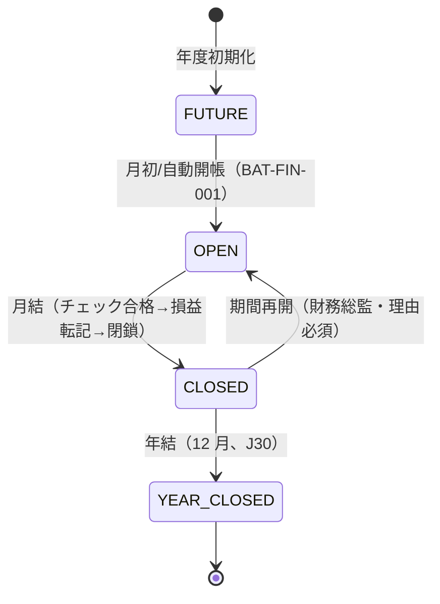

# 期末结账・财务报表 详细设计书（期末締め・財務諸表 詳細設計書）

| 項目 | 内容 |
|---|---|
| 文書名 | 期末结账・财务报表 详细设计书（期末締め・財務諸表 詳細設計書） |
| 文書番号 | DSN-FIN-007 |
| 版数 | v1.0 |
| 作成日 | 2026-10-20 |
| 作成者 | finance-designer |
| 承認者 | 未承認（レビュー待ち） |
| 状態 | ドラフト（レビュー中） |
| 関連文書 | [業務域概要](00-overview.md) / [会計科目](01-accounting-subjects.md) / [自動凭证・成本](06-auto-voucher-costing.md) / [共通業務規則](../00-common/08-common-business-rules.md) 第 10 章 / [跨域流程](../00-common/09-cross-domain-flow.md) 第 7・10 章 |

---

## 1. 機能概要

| 項目 | 内容 |
|---|---|
| 機能 ID | F-FIN-035（期间管理与月结）、F-FIN-036（损益结转）、F-FIN-037（年度结转）、F-FIN-038（财务报表）、F-FIN-039（科目余额表）、F-FIN-040（费用报销・P2）、F-FIN-041/042（固定资产・P2）、F-FIN-043（预算・P2）、F-FIN-044（多币种・P2）、F-FIN-045（资金计划・P2）、F-FIN-046（报表分析・P2） |
| 機能名 | 期末处理与法定财务报表 |
| 目的 | 通过月结检查→损益结转→期间关闭的流程锁定会计期间；生成符合《企业会计准则》及财政部 2019 年报表格式的资产负债表、利润表、现金流量表（简表）与科目余额表，完成年结与次年开账 |
| 利用者・ロール | 财务经理（月结执行/检查）、财务总监（年结/期间重开批准）、会计（报表编制/科目余额表）、审计（閲覧） |
| 利用シーン | 月末结账（次月第 5 营业日以内）、季报/年报、年度决算、审计资料准备 |
| 優先度 | P0（F-FIN-035～039）、P2（F-FIN-040～046） |
| 画面 ID | SCR-FIN-048～061 |
| 関連 IF | IF-FIN-006（申報データ） |

---

## 2. 業務要件・業務ルール

### 2.1 前提条件

| # | 前提条件 | 成立しない場合の挙動 |
|---|---|---|
| 1 | 当期の全凭证が审核・記帳済み（未記帳 0 件） | 月結不可（MSG-FIN-120） |
| 2 | 在庫月結（E20）完了 | 成本計算不可（MSG-FIN-116） |
| 3 | 銀行対账・调节表が复核済み | 月結チェック NG |
| 4 | 自動凭证の未処理イベント 0 件 | 月結チェック NG |
| 5 | 権限（`finance:period:close` 等）を保有 | 403 |

### 2.2 業務ルール

| # | ルール | 根拠 | 関連項目 |
|---|---|---|---|
| BR-01 | 会計期間の状態：`FUTURE`（未開始）→ `OPEN`（進行中）→ `CLOSED`（締切済）→ `YEAR_CLOSED`（年結済）。状態遷移は不可逆（再開は財務総監の明示操作 + 監査ログ） | 08 章 10 章 | `fin_period.status` |
| BR-02 | 月結は「月结向导」で ① チェック実行 → ② 全項目合格 → ③ 損益転記 → ④ 記帳確認 → ⑤ 期間 CLOSED → ⑥ E30 発行 の順で実行する | 09 章 4.3/10.3 | `fin_close_checklist` |
| BR-03 | 月結チェックは 09 章 10.3 の 10 項目 + 本域追加 5 項目（2.3 節）の全 15 項目。1 項目でも NG なら期間を閉じない（例外は財務総監承認 + 理由記録でスキップ可、監査ログ必須） | 09 章 10.3 | `fin_close_checklist.result` |
| BR-04 | 損益転記（J28/J29）：収益類科目の当期貸方発生額を借方へ、費用類科目の当期借方発生額を貸方へ振替え、本年利润（4103）へ集約する。転記後、損益類科目の当期残高は 0 になる | 09 章 7.2 J28/J29；CAS | `fin_voucher`（CLOSING） |
| BR-05 | 損益転記凭证は 1 期間 1 回のみ。再実行は期間重開後のみ。凭证は `is_closing=true` で自動記帳する | 本域設計 | `is_closing` |
| BR-06 | 年結（J30）：12 月を CLOSED 後、4103 本年利润残高を 4104 未分配利润へ振替える。続いて剰余金の処分（法定盈余公积 10%）を別凭证で行う | 《公司法》法定盈余公积 10%【実データ】；CAS | `fin_period`、4104/4101 |
| BR-07 | 年結時に翌年度の 12 期間を作成し、1 月を OPEN、他を FUTURE にする。期初残高（資産/負債/権益）を前期末から繰越し、損益科目は 0 から開始する | 本域設計 | `fin_account_balance` |
| BR-08 | 期間 CLOSED 後は、当該期間の凭证登録・修正・記帳・反記帳を禁止する。修正は翌期の調整仕訳（または財務総監による期間重開） | 08 章 10 章 | MSG-COM-071 |
| BR-09 | 財務報表は科目残高・発生額から自動計算し、各行の算式を `fin_statement_formula` に保持する（ハードコード禁止）。报表項目と科目の対応は 01 章の `report_item_code` で管理 | CAS 2019 报表格式【実データ】 | `fin_statement_formula` |
| BR-10 | 貸借対照表の資産合計＝負債合計＋所有者権益合計（差 0.00）を検証し、不一致なら报表生成を中断する | 会計恒等式 | MSG-FIN-128 |
| BR-11 | 資産負債表は各科目の**残高方向で重分類**する（例：2203 预收账款の借方残高は「应收账款」に、1123 预付账款の貸方残高は「应付账款」に、2221 の借方残高は「其他流动资产」に） | CAS 报表列報要求 | 取数公式 |
| BR-12 | 利潤表は当期の**発生額**（貸借差）で計算し、紅字は控除する。前年同期比・前月比はオプション列 | CAS 报表列報要求 | 取数公式 |
| BR-13 | 現金流量表（簡表）は直接法。現金/銀行科目を含む凭证の相手科目に付与した `cash_flow_item_code` で集計する。内部振替（現金↔銀行）は CF に含めない | CAS 31 现金流量表 | `fin_cash_flow_item` |
| BR-14 | 報表は「快照」として保存し、後から科目残高が変わっても出力時点の数値が再現できる。再生成は版数を上げて保存する | 監査要件 | `fin_statement_snapshot` |
| BR-15 | 科目余額表は「期初残高・借方発生・貸方発生・期末残高」を表示し、貸借合計一致を検証する。補助核算明細も出力可能 | 試算表要求 | `fin_account_balance` |
| BR-16 | 年結後の翌期首：資産/負債/権益は前年末残高、損益は 0。固定資産・無形資産等の明細は 実装順 P2 で引継ぎ | 本域設計 | 期初処理 |
| BR-17 | 為替換算（P2）：外貨科目は期末レートで調整し、差額を 6603.04 汇兑损益へ計上する | CAS 19 外币折算 | `fin_exchange_reval` |
| BR-18 | 報表出力権限：法定三表は財務経理以上、科目余額表は会計以上、監査ロールは閲覧のみ。出力は監査ログに記録する | 情報管理 | `finance:statement:*` |

### 2.3 月結チェック一覧（09 章 10.3 + 追加）

| # | チェック | 対象/判定 | NG 時の対処 | 種別 |
|---|---|---|---|---|
| 1 | 未発行イベント（Outbox NEW/FAILED） | `sys_outbox_event` の未処理 0 件 | 再送/手動処理（BAT-FIN-004/005） | 09 章 |
| 2 | 承認待ち伝票（期間内） | 各伝票 status=20 が 0 件 | 承認/差戻し | 09 章 |
| 3 | 入荷済・未請求（暫估残高） | 暫估 AP 残高一覧を確認、未処理 0 件 | 暫估のまま月結可（要確認記録） | 09 章 |
| 4 | 出荷済・未売上 | 出荷 vs AR の照合差 0 件 | 再計上（E10 再送） | 09 章 |
| 5 | 工単完了・未入庫 | 工単完了 vs 完成品入庫の差 0 件 | 入庫処理 | 09 章 |
| 6 | 在庫取引・未仕訳 | E18 消費漏れ 0 件 | 自動凭证再処理 | 09 章 |
| 7 | 試算表の貸借不一致 | Σ借余＝Σ貸余（差 0.00） | 原因調査・修正 | 09 章 |
| 8 | 銀行残高・帳簿残高の未達 | 调节表が复核済み | 対账完了 | 09 章 |
| 9 | 在庫金額（INV）と在庫科目残高（FIN）の一致 | 1403/1405 vs `inv_stock_balance` 合計 | 差異調整 | 09 章 |
| 10 | 売掛残高（FIN）と AR 内訳の一致 | 1122 残高 vs `fin_receivable` 未収合計 | 差異調査 | 09 章 |
| 11 | 買掛残高（FIN）と AP 内訳の一致 | 2202 vs `fin_payable` 残高（暫估含む） | 差異調査 | 追加 |
| 12 | 应交税费と申報辅助表の一致 | 2221 vs `fin_vat_return` | 差異調査 | 追加 |
| 13 | 生产成本 vs 在制品の一致 | 5001 残高 vs `fin_wip_balance` 合計 | 差異調査 | 追加 |
| 14 | 製造費用の期末残高 0 | 5101 残高＝0 | 分配再実行 | 追加 |
| 15 | 未記帳凭证 0 件 | `fin_voucher` status ∈(10,20) の期間内件数 0 | 审核/記帳 | 追加 |

### 2.4 計算式・判定式

| # | 対象 | 算式 | 丸め | 例（【示例値】、2026-10 唯一シナリオ） |
|---|---|---|---|---|
| CALC-01 | 本年利润（税後） | Σ収益類科目貸方発生 − Σ費用類科目借方発生（**所得税費用含む**） | 2 位 | 66,666,666.67 − 62,766,666.67 = 3,900,000.00 |
| CALC-02 | 未分配利润（期末） | 4104 残高 + 4103 残高 | 2 位 | 1,877,097.80 + 3,900,000.00 = 5,777,097.80 |
| CALC-03 | 法定盈余公积（年結） | 当期純利益 × 10%（累計が注冊資本 50% 到達まで） | 2 位 | 3,900,000.00 × 10% = 390,000.00（年結時に計上） |
| CALC-04 | 資産合計 | 流動資産合計 + 非流動資産合計 | 2 位 | 273,228,297.80 + 24,100,000.00 = 297,328,297.80 |
| CALC-05 | 負債・権益合計 | 負債合計 + 所有者権益合計 | 2 位 | 170,551,200.00 + 126,777,097.80 = 297,328,297.80 |
| CALC-06 | 営業利益 | 営業収入 − 営業成本 − 税金及附加 − 販管費等 + その他収益・投資収益 | 2 位 | 66,666,666.67 − 50,000,000.00 − 241,200.00 − 4,500,000.00 − 4,800,000.00 − 1,500,000.00 − 420,000.00 = 5,205,466.67 |
| CALC-07 | 利潤総額 | 営業利益 + 営業外収入 − 営業外支出 | 2 位 | 5,205,466.67 + 0 − 5,466.67 = 5,200,000.00 |
| CALC-08 | 純利益 | 利潤総額 − 所得税費用 | 2 位 | 5,200,000.00 − 1,300,000.00 = 3,900,000.00 |
| CALC-09 | 現金及び現金同等物増加額 | 営業 CF + 投資 CF + 財務 CF + 為替影響 | 2 位 | 4,000,000.00 − 3,000,000.00 + 1,200,000.00 = 2,200,000.00 |
| CALC-10 | 所有者権益合計（期末） | 実收資本 + 資本公積 + 盈余公積 + 未分配利润 | 2 位 | 100,000,000.00 + 15,000,000.00 + 6,000,000.00 + 5,777,097.80 = 126,777,097.80 |
### 2.5 状態遷移（期間）



| 遷移 | トリガ | 権限 | 更新項目 | メッセージ |
|---|---|---|---|---|
| FUTURE→OPEN | 月初バッチ/手動 | finance:period:close | status、opened_at。同一トランザクションで当該期間に有効な `fin_standard_cost`（`status=40`、`period_from` ≤ 当期 ≤ `period_to` または NULL）の `total_unit_cost` を `mdm_material.standard_cost` に刷新（`erp_cost_publisher` 経由、[90 §6.12](90-db-design.md)）。当期に有効版がない物料は**旧値を保持**（NULL にしない。`period_to` は後続版の発行による自動打切りでのみ設定されるため通常は発生しない）。`fin_period` 作成前は発行日の属する月を「当月」とみなす | MSG-FIN-121 |
| OPEN→CLOSED | 月結実行 | finance:period:close | status、closed_at/by | MSG-FIN-123 |
| CLOSED→OPEN | 期間再開 | finance:period:reopen（財務総監） | status、reopen_reason；E37 待ちフラグ | MSG-FIN-124 |

### 2.6 期間再開と E37 購読（inventory.period.reopened）

| 項目 | 内容 |
|---|---|
| 権限・承認 | FIN が期間再開の**承認・実行責任者**（`finance:period:reopen`、財務総監）。在庫側の期間再開は FIN の承認（`fin_period` CLOSED→OPEN）後にのみ可能で、INV はその承認結果を受けて在庫期間を再開し E37 を発行する。FIN は E37 の発行元にならない（FIN は購読側） |
| 購読イベント | **E37 `inventory.period.reopened`**（[09 章 §3](../00-common/09-cross-domain-flow.md) 追補）：payload は `periodCode`、`reason`、`approvedBy`、`reopenedAt`。購読側処理は「在庫期間ロック解除の通知・再開後取引の受付」 |
| 処理手順 | ① 財務総監が `POST /api/finance/periods/{code}/reopen` で期間再開（`fin_period` CLOSED→OPEN、`reopen_reason` 記録、監査ログ）→ ② FIN が E30（期間状態変更）を Outbox 再送 → ③ INV が在庫期間を再開し **E37** を発行 → ④ FIN が E37 を購読（`eventId` で幂等）し、`fin_close_checklist` の在庫・原価関連項目（CLOSE_03/06/09/13/14）を「未実行」に戻し、原価再計算待ちフラグを立て、監査ログに「在庫期間再開受信（E37）」を記録 → ⑤ FIN は BAT-FIN-009→010→011→012 を再実行して再月結する |
| 契約違反時 | FIN 期間が CLOSED のまま E37 を受信した場合（INV が FIN 承認前に再開した場合）は、期間状態を変更せず `FAILED` ログ + アラートを記録し財務総監へ報告する（再開は FIN 承認が先行する契約） |
| テスト | TST-F-FIN-035-05：FIN 承認→E37 受信→チェック項目リセット→再月結で CLOSED に戻る。TST-F-FIN-035-06：FIN 未承認の E37 を拒否 |
| CLOSED→YEAR_CLOSED | 年結 | finance:year-close:execute | status、year_closed_at | MSG-FIN-125 |

---

## 3. 関連機能

| 関係 | 機能 ID | 機能名 | 関係内容 |
|---|---|---|---|
| 上流 | F-FIN-006/031/038 | 記帳/成本/税計提 | 月結対象データ |
| 上流 | INV E20 | 在庫月結 | 月結前提 |
| 上流 | WF | 月結/年結審批 | 承認 |
| 下流 | E30 | 期間締めイベント | 全業務域の期間ロック |
| 下流 | RPT | 分析 | 报表快照参照 |

---

## 4. 画面設計

### 4.1 画面一覧

| 画面 ID | 画面名 | 類型 | 概要 |
|---|---|---|---|
| SCR-FIN-048 | 会计期间管理 | LIST | 期間一覧・状態・開閉操作 |
| SCR-FIN-049 | 月结向导 | WIZ | チェック→損益転記→記帳→閉鎖 |
| SCR-FIN-050 | 损益结转 | EDIT | 転記プレビュー・凭证生成 |
| SCR-FIN-051 | 年度结转 | WIZ | 年結チェック→J30→翌年開帳 |
| SCR-FIN-052 | 财务报表（三表） | 照会/帳票 | BS/IS/CF 切替、比較列、出力 |
| SCR-FIN-053 | 科目余额表 | 照会/帳票 | 期初/発生/期末、補助明細 |
| SCR-FIN-054/055 | 费用报销・借款（P2） | EDIT | 申請・承認・凭证 |
| SCR-FIN-056/057 | 固定资产卡片・处置（P2） | LIST/EDIT | カード・折旧・処分 |
| SCR-FIN-058 | 预算管理（P2） | EDIT | 予算編成・執行 |
| SCR-FIN-059 | 汇兑损益调整（P2） | EDIT | 外貨期末調整 |
| SCR-FIN-060 | 资金计划（P2） | LIST | 資金収支計画 |
| SCR-FIN-061 | 财务报表分析（P2） | DASH | 同比/環比/結構 |

### 4.2 画面項目定義（SCR-FIN-049 月结向导）

| No | ステップ | 項目 ID | 項目名 | 種別 | 型/桁 | 必須 | 内容 |
|---|---|---|---|---|---|---|---|
| 1 | 1 選択 | period_code | 対象期間 | 選択 | VARCHAR(7) | ○ | OPEN の期間のみ選択可 |
| 2 | 1 選択 | close_date | 結帳予定日 | 日付 | DATE | ○ | 既定=当月最終営業日+5 |
| 3 | 2 チェック | check_items | チェック結果一覧 | テーブル | — | ○ | 15 項目、OK/NG/WAIVED |
| 4 | 2 チェック | waive_reason | 免除理由 | テキスト | VARCHAR(500) | △ | NG 項目をスキップする場合必須 |
| 5 | 3 転記 | transfer_preview | 損益転記プレビュー | テーブル | — | ○ | 収益/費用合計、4103 への振替額 |
| 6 | 3 転記 | transfer_voucher_no | 転記凭证号 | テキスト | VARCHAR(8) | ○ | 自動採番（記-xxxx） |
| 7 | 4 記帳 | post_status | 記帳結果 | ラベル | — | ○ | 転記凭证の記帳状態 |
| 8 | 5 閉鎖 | close_confirm | 期間閉鎖確認 | チェック | BOOLEAN | ○ | チェックで「閉鎖実行」有効化 |

**イベント処理**

| No | イベント | トリガ | 処理内容 | 呼出 API |
|---|---|---|---|---|
| 1 | チェック実行 | ボタン | BAT-FIN-009 を実行し結果表示 | POST /api/finance/periods/{code}/close-checks |
| 2 | 免除 | NG 行選択 | 理由必須、財務総監権限、記録 | POST /api/finance/periods/{code}/close-checks/waive |
| 3 | 損益転記プレビュー | 次へ | 損益科目残高から転記仕訳を計算 | GET /api/finance/periods/{code}/profit-transfer/preview |
| 4 | 損益転記実行 | 実行 | J28/J29 生成、自動記帳 | POST /api/finance/periods/{code}/profit-transfer |
| 5 | 期間閉鎖 | 閉鎖実行 | status=CLOSED、E30 発行、翌期 OPEN | POST /api/finance/periods/{code}/close |

### 4.3 画面項目定義（SCR-FIN-052 财务报表）

| No | 項目 ID | 項目名 | 種別 | 内容 |
|---|---|---|---|---|
| 1 | statement_type | 报表种类 | 選択 | BS/IS/CF |
| 2 | period_code | 期间 | 選択 | YYYY-MM（月次/四半期/年次） |
| 3 | compare_type | 比較区分 | 選択 | 前月比/前年同期比/年初来 |
| 4 | show_level | 表示レベル | 選択 | 一级/二级 |
| 5 | rows | 报表行 | テーブル | 行次/項目/期末/期初/前年同期 |
| 6 | total_check | 合計検証 | ラベル | 資産＝負債＋権益、貸借差 0.00 |
| 7 | export_format | 出力形式 | 選択 | PDF（法定様式）/Excel |

**イベント処理**

| No | イベント | トリガ | 処理内容 | 呼出 API |
|---|---|---|---|---|
| 1 | 表示 | 条件変更 | 快照がなければ計算し表示（プレビュー） | GET /api/finance/statements/{type} |
| 2 | 快照保存 | 保存ボタン | `fin_statement_snapshot` へ保存、版数+1 | POST /api/finance/statements/{type}/snapshots |
| 3 | 出力 | 出力ボタン | PRT-FIN-032/033/034 を PDF/Excel で出力 | POST /api/finance/statements/{type}/export |
| 4 | 科目明細 | 行ダブルクリック | 該当科目の残高・明細へドリルダウン | SCR-FIN-015 |

### 4.4 一覧画面仕様（SCR-FIN-053 科目余额表）

| 項目 | 内容 |
|---|---|
| 検索条件 | 期间、科目範囲、級数、表示（期末残高のみ/発生額含む）、補助核算有無、ゼロ残高表示 |
| 既定条件 | 当期末、1～3 級、ゼロ非表示 |
| ソート | 科目コード昇順 |
| ページング | 50/100/200（帳票は全件） |
| フッタ | 借方合計、貸方合計、差額 |
| エクスポート | Excel/PDF（PRT-FIN-006） |

### 4.5 表示制御

| 条件 | 対象 | 制御 |
|---|---|---|
| 期間 CLOSED/YEAR_CLOSED | 月結/転記/編集 | ボタン非表示（閲覧のみ） |
| 権限なし（会計） | 月結実行/期間再開 | ボタン非表示、API 403 |
| 貸借不一致 | 报表出力 | MSG-FIN-128 で出力不可 |
| 快照未保存 | 报表 | 「プレビュー」表示、出力時に保存を促す |

---

## 5. 入力チェック仕様

| No | チェック ID | 対象 | 種別 | 条件 | タイミング | メッセージ ID |
|---|---|---|---|---|---|---|
| 1 | CHK-FIN-035-01 | 月結対象期間 | 状態 | OPEN のみ | 月結開始 | MSG-FIN-120 |
| 2 | CHK-FIN-035-02 | 全 15 チェック | 業務 | すべて OK または WAIVED | 月結 | MSG-FIN-122 |
| 3 | CHK-FIN-035-03 | 免除理由 | 必須 | 1～500 文字 | 免除 | MSG-COM-040 |
| 4 | CHK-FIN-036-01 | 損益科目 | 業務 | 当期残高が正しく集計できる | 転記 | MSG-FIN-126 |
| 5 | CHK-FIN-037-01 | 年結 | 状態 | 12 月 CLOSED、未処理チェック 0 | 年結 | MSG-FIN-125 |
| 6 | CHK-FIN-038-01 | BS 恒等式 | 業務 | 資産＝負債＋権益 | 报表生成 | MSG-FIN-128 |
| 7 | CHK-FIN-038-02 | 期間 | 状態 | CLOSED（またはプレビュー） | 报表出力 | MSG-FIN-129 |
| 8 | CHK-FIN-039-01 | 科目余額 | 業務 | 借方合計＝貸方合計 | 出力 | MSG-FIN-130 |

---

## 6. 処理詳細

### 6.1 処理一覧

| 処理 ID | 処理名 | 契機 | トランザクション | 排他 |
|---|---|---|---|---|
| PRC-FIN-035-01 | 月結チェック | 向导 | 読取のみ | 期間アドバイザリロック |
| PRC-FIN-036-01 | 損益転記 | 向导 | 要（凭证生成+記帳+余额更新） | 期間ロック |
| PRC-FIN-035-02 | 期間閉鎖 | 向导 | 要 | 期間ロック、E30 Outbox |
| PRC-FIN-035-03 | 期間再開・E37 購読 | 手動/イベント | 要 | 期間ロック、E37 消費 |
| PRC-FIN-037-01 | 年度结转 | 向导 | 要 | 年度ロック（Advisory Lock） |
| PRC-FIN-038-01 | 报表生成/快照 | 照会/保存 | 要（快照保存） | 期間ロック |
| PRC-FIN-039-01 | 科目余額表生成 | 照会 | 読取のみ | — |

### 6.2 処理手順（正常系）

**PRC-FIN-035-01/036-01/035-02 月結（向导）**

1. 対象期間が OPEN であることを確認する。
2. 15 項目のチェックを実行し、`fin_close_checklist` に記録する（各項目の件数・金額・判定）。
3. NG があり、財務総監の免除承認がない場合は中断する（MSG-FIN-122）。
4. 損益転記プレビューを作成する：収益類（6001/6051/6111/6301 等）の貸方発生額、費用類（6401/6402/6403/6601/6602/6603/6701/6711/6801 等）の借方発生額を集計する。
5. J28（収益→4103、2026-10 例：66,666,666.67）と J29（4103→費用、同 62,766,666.67。**所得税 1,300,000.00 を含む**）を生成し、自動記帳する。転記後の 4103 残高＝純利益 3,900,000.00、損益類科目の当期残高 0 を検証する。
6. 転記凭证を記帳し、科目余額・補助余額を更新する。
7. 期間を CLOSED にし、`fin_period.closed_at/by` を記録する。
8. E30 `finance.period.closed` を Outbox に登録する。
9. 翌期間を OPEN にし（BAT-FIN-001 と重複しないよう冪等）、`fin_close_checklist` を完了にする。
10. 監査ログを記録する。

**PRC-FIN-037-01 年度结转**

1. 12 月が CLOSED で、年結チェック（未処理 0、全凭证記帳済、报表平衡、損益転記済）が合格することを確認する。
2. `4103 本年利润` の残高を確定する。
3. J30 を生成する：借 4103、贷 4104（純利益の場合）。損失の場合は逆仕訳。
4. 法定盈余公积の処分：借 4104、贷 4101（当期純利益 × 10%、累計が注冊資本 50% 未満の場合）。
5. 次年 12 期間を作成し、1 月を OPEN、他を FUTURE にする。
6. 期首残高を繰越す：資産/負債/権益は前年末残高、損益類は 0。科目余額表（balance_type=OPENING）を作成する。
7. 前年度を YEAR_CLOSED にする（12 月）。
8. 監査ログ + 年結レポート（PRT なし、画面で確認）を記録する。

**PRC-FIN-038-01 财务报表生成**

1. 対象期間の状態（CLOSED/OPEN）と快照有無を確認する。
2. `fin_statement_template` + `fin_statement_formula` を読み込み、行ごとに算式を評価する（科目余額 or 発生額）。
3. 資産負債表：残高方向で重分類（BR-11）し、資産合計と負債・権益合計を検証する。
4. 利潤表：当期発生額を集計し、営業利益→利潤総額→純利益を計算する。
5. 現金流量表：`fin_voucher_line.cash_flow_item_code` で CF 項目別に集計する（現金/銀行科目を含む凭证のみ）。
6. 金額 2 位丸め、行次順に表示する。
7. 快照保存時：`fin_statement_snapshot` に版数付きで保存する。
8. 監査ログ（出力/保存）を記録する。

**PRC-FIN-039-01 科目余額表**

1. 対象期間の `fin_account_balance` を末级科目で取得する。
2. 期初残高・借方発生・貸方発生・期末残高を計算する（借方科目は借−貸、貸方科目は貸−借）。
3. 借方合計＝貸方合計を検証する。
4. 補助核算明細が必要な場合 `fin_aux_balance` を結合する。
5. 帳票（PRT-FIN-006）として出力する。

**PRC-FIN-035-03 期間再開と E37 購読**

1. `finance:period:reopen` 権限（財務総監）と再開理由を確認する。
2. 対象期間が CLOSED（YEAR_CLOSED は不可）であることを確認する。
3. `fin_period.status` を OPEN に戻し、`reopen_reason`・監査ログを記録する（E30 を Outbox 再送）。
4. INV が在庫期間を再開すると E37 `inventory.period.reopened` を受信する。`eventId` で重複排除し、payload の `approvedBy` が FIN の再開承認者と一致することを検証する。
5. `fin_close_checklist` の在庫・原価関連項目を未実行に戻し、`BAT-FIN-009` の再実行を促す（原価再計算フラグ）。
6. 再月結（BAT-FIN-009→010→011→012）で問題なく CLOSED に戻ることを確認する。
7. 監査ログ（REOPEN / E37 受信）を記録する。

### 6.3 例外処理

| No | 異常条件 | 検知箇所 | 処理 | ロールバック | メッセージ ID |
|---|---|---|---|---|---|
| 1 | 未記帳凭证あり | 月結チェック | 月結中断 | — | MSG-FIN-120 |
| 2 | チェック NG（免除なし） | 月結 | 中断、NG 一覧表示 | — | MSG-FIN-122 |
| 3 | 損益転記後の残高 ≠0 | 転記検証 | 転記取消（赤伝）・エラー | 全体 | MSG-FIN-126 |
| 4 | BS 不一致 | 报表生成 | 生成中断、差額表示 | — | MSG-FIN-128 |
| 5 | 年結時に未処理 | 年結チェック | 中断 | — | MSG-FIN-125 |
| 6 | 期間重開中の同時処理 | 期間ロック | 待機/エラー | — | MSG-COM-035 |

### 6.4 冪等性・再実行

- 月結チェックは読取のみで冪等。同一期間の再実行は結果を上書き（履歴は監査ログ）。
- 損益転記は期間×1 回。既存転記凭证がある場合は再生成せずスキップ（エラー表示）。
- 期間閉鎖は楽観排他（version）で二重実行を防止。
- 年結は年度×1 回。Advisory Lock（`pg_advisory_lock('FIN_YEAR_CLOSE_2026')`）で多重起動防止。

---

## 7. 財務報表の取数公式

> 报表行次・項目名は【実データ】财政部《关于修订印发 2019 年度一般企业财务报表格式的通知》（财会〔2019〕6 号）に準拠。取数は「末级科目残高（借/貸方向）」または「当期発生額」で定義し、`fin_statement_formula` に保存する。以下 `残(借)`＝借方残高、`残(貸)`＝貸方残高、`発(借)`＝借方発生額、`発(貸)`＝貸方発生額。

### 7.1 资产负债表（2026-10-31 例、CNY【示例值】）

| 行次 | 报表項目 | 取数公式（科目コード） | 期末金額 |
|---|---|---|---|
| 1 | 货币资金 | 残(借) 1001 + 1002 + 1012 | 24,528,297.80 |
| 4 | 应收票据 | 残(借) 1121 | 0.00 |
| 5 | 应收账款 | 残(借) 1122 + 2203 明細借方 − 残(貸) 1231 | 149,000,000.00 |
| 6 | 预付款项 | 残(借) 1123 + 2202 明細借方 | 1,200,000.00 |
| 8 | 其他应收款 | 残(借) 1221 − 残(貸) 1231（其他应收部分） | 500,000.00 |
| 9 | 存货 | 1401+1402+1403+1404+1405+1406+1407+1408+1411+5001+5101 − 残(貸) 1471 | 98,000,000.00 |
| 12 | 其他流动资产 | 残(借) 2221 明細（待認証/留抵等）＋ 1901 | 0.00 |
| 15 | 流动资产合计 | 1+2+3+4+5+6+7+8+9+10+11+12+13+14 | 273,228,297.80 |
| 20 | 固定资产 | 残(借) 1601 − 残(貸) 1602 − 残(貸) 1603 | 20,000,000.00 |
| 21 | 在建工程 | 残(借) 1604 + 1605 | 2,000,000.00 |
| 26 | 无形资产 | 残(借) 1701 − 残(貸) 1702 − 残(貸) 1703 | 1,500,000.00 |
| 28 | 长期待摊费用 | 残(借) 1801 | 500,000.00 |
| 30 | 递延所得税资产 | 残(借) 1811 | 100,000.00 |
| 34 | 非流动资产合计 | 15〜33（非流動項目の合計） | 24,100,000.00 |
| 35 | 资产总计 | 15+34 | 297,328,297.80 |
| 36 | 短期借款 | 残(貸) 2001 | 50,000,000.00 |
| 37 | 应付票据 | 残(貸) 2201 | 8,000,000.00 |
| 38 | 应付账款 | 残(貸) 2202 + 1123 明細貸方 | 68,000,000.00 |
| 39 | 预收款项 | 残(貸) 2203（合同負債を含む） | 300,000.00 |
| 41 | 应付职工薪酬 | 残(貸) 2211 | 4,500,000.00 |
| 42 | 应交税费 | 残(貸) 2221（增值税 2,010,000＋附加 241,200＋所得税 1,300,000＝3,551,200） | 3,551,200.00 |
| 43 | 其他应付款 | 残(貸) 2231+2232+2241 | 1,200,000.00 |
| 45 | 流动负债合计 | 36+37+38+39+40+41+42+43+44 | 135,551,200.00 |
| 47 | 长期借款 | 残(貸) 2501 | 35,000,000.00 |
| 52 | 预计负债 | 残(貸) 2801 | 0.00 |
| 53 | 递延收益 | 残(貸) 2401 | 0.00 |
| 55 | 递延所得税负债 | 残(貸) 2901 | 0.00 |
| 58 | 非流动负债合计 | 46〜57 | 35,000,000.00 |
| 59 | 负债合计 | 45+58 | 170,551,200.00 |
| 60 | 实收资本（或股本） | 残(貸) 4001 | 100,000,000.00 |
| 61 | 资本公积 | 残(貸) 4002 | 15,000,000.00 |
| 63 | 减：库存股 | 残(借) 4201（減項） | 0.00 |
| 66 | 盈余公积 | 残(貸) 4101 | 6,000,000.00 |
| 68 | 未分配利润 | 残(貸) 4104 + 残(貸) 4103 | 5,777,097.80 |
| 69 | 所有者权益合计 | 60+61+62−63+64+65+66+67+68 | 126,777,097.80 |
| 70 | 负债和所有者权益总计 | 59+69 | 297,328,297.80 |

> 行 2 交易性金融资产・行 10 合同资产・行 16 债权投资・行 22 生产性生物资产・行 31 其他非流动资产等は示例企業では 0。所得税 1,300,000.00 は 2221.06 应交企业所得税として負債（应交税费）に計上済み。### 7.2 利润表（2026-10 単月、CNY【示例值】）

| 行次 | 报表項目 | 取数公式 | 本期金額 |
|---|---|---|---|
| 1 | 营业收入 | 発(貸) 6001 + 6051 − 発(借) 6001 − 6051 | 66,666,666.67 |
| 2 | 营业成本 | 発(借) 6401 + 6402 − 発(貸) 6401 − 6402 | 50,000,000.00 |
| 3 | 税金及附加 | 発(借) 6403 | 241,200.00 |
| 4 | 销售费用 | 発(借) 6601 | 4,500,000.00 |
| 5 | 管理费用 | 発(借) 6602 − 研发費用振替分 | 4,800,000.00 |
| 6 | 研发费用 | 発(借) 6602（または 5301 費用化転出額） | 1,500,000.00 |
| 7 | 财务费用 | 発(借) 6603 − 発(貸) 6603 | 420,000.00 |
| 8 | 其中：利息费用 | 発(借) 6603（利息費用） | 455,000.00 |
| 9 | 利息收入 | 発(貸) 6603（利息収入） | 35,000.00 |
| 10 | 其他收益 | 発(貸) 6117（企業自設・設計値） | 0.00 |
| 11 | 投资收益 | 発(貸) 6111 − 発(借) 6111 | 0.00 |
| 12 | 公允价值变动收益 | 6101（貸−借） | 0.00 |
| 13 | 信用减值损失 | −(発(借) 6701 − 発(貸) 6701) | 0.00 |
| 14 | 资产减值损失 | −(発(借) 6701) | 0.00 |
| 15 | 资产处置收益 | 6115（企業自設・設計値） | 0.00 |
| 16 | 营业利润 | 1−2−3−4−5−6−7+10+11+12+13+14+15 | 5,205,466.67 |
| 17 | 营业外收入 | 発(貸) 6301 − 発(借) 6301 | 0.00 |
| 18 | 营业外支出 | 発(借) 6711 − 発(貸) 6711 | 5,466.67 |
| 19 | 利润总额 | 16+17−18 | 5,200,000.00 |
| 20 | 所得税费用 | 発(借) 6801 | 1,300,000.00 |
| 21 | 净利润 | 19−20 | 3,900,000.00 |
| 22 | 持续经营净利润 | 同 21 | 3,900,000.00 |
| 23 | 其他综合收益的税后净额 | 4003（実装順 P2、本企業 0） | 0.00 |
| 24 | 综合收益总额 | 21+23 | 3,900,000.00 |

> 営業利益 5,205,466.67 − 営業外支出 5,466.67 = 利潤総額 5,200,000.00。所得税 1,300,000.00（25%）は 2221.06 に計上し、J29 の費用損益転記に含める（[06 §4.1 TPL-FIN-J29](06-auto-voucher-costing.md)）。
### 7.3 现金流量表（簡表、2026-10、直接法、CNY【示例值】）

| 行次 | 报表項目 | 取数公式（`cash_flow_item_code` 集計） | 本期金額 |
|---|---|---|---|
| 1 | 销售商品、提供劳务收到的现金 | CF01 借方発生 − CF01 貸方発生（現金/預金科目） | 69,000,000.00 |
| 2 | 收到的税费返还 | CF02 | 0.00 |
| 3 | 收到其他与经营活动有关的现金 | CF03 | 500,000.00 |
| 4 | 经营活动现金流入小计 | 1+2+3 | 69,500,000.00 |
| 5 | 购买商品、接受劳务支付的现金 | CF11 | 52,000,000.00 |
| 6 | 支付给职工以及为职工支付的现金 | CF12 | 9,000,000.00 |
| 7 | 支付的各项税费 | CF13 | 3,500,000.00 |
| 8 | 支付其他与经营活动有关的现金 | CF14 | 1,000,000.00 |
| 9 | 经营活动现金流出小计 | 5+6+7+8 | 65,500,000.00 |
| 10 | 经营活动产生的现金流量净额 | 4−9 | 4,000,000.00 |
| 11 | 收回投资收到的现金 | CF21 | 0.00 |
| 12 | 取得投资收益收到的现金 | CF22 | 0.00 |
| 13 | 处置固定资产…收回的现金净额 | CF23 | 0.00 |
| 14 | 购建固定资产…支付的现金 | CF31 | 3,000,000.00 |
| 15 | 投资活动现金流出小计 | 14 | 3,000,000.00 |
| 16 | 投资活动产生的现金流量净额 | 11+12+13−15 | −3,000,000.00 |
| 17 | 取得借款收到的现金 | CF41 | 6,000,000.00 |
| 18 | 偿还债务支付的现金 | CF42 | 4,500,000.00 |
| 19 | 分配股利、利润或偿付利息支付的现金 | CF43 | 300,000.00 |
| 20 | 筹资活动产生的现金流量净额 | 17−18−19 | 1,200,000.00 |
| 21 | 汇率变动对现金的影响 | CF51（第一版・実装順 P2） | 0.00 |
| 22 | 现金及现金等价物净增加额 | 10+16+20+21 | 2,200,000.00 |
| 23 | 加：期初现金及现金等价物余额 | `fin_account_balance` 1001+1002+1012 期初 | 22,328,297.80 |
| 24 | 期末现金及现金等价物余额 | 22+23 | 24,528,297.80 |

> 期末現金 24,528,297.80 は BS 行 1 货币资金と一致。期初 22,328,297.80＋純増 2,200,000.00＝期末 24,528,297.80。内部振替（現金↔預金）は CF に含めない。
### 7.4 现金流量項目マスタ（`fin_cash_flow_item`、抜粋）

| コード | 項目名 | 方向 | 区分 |
|---|---|---|---|
| CF01 | 销售商品、提供劳务收到的现金 | 流入 | 経営 |
| CF02 | 收到的税费返还 | 流入 | 経営 |
| CF03 | 收到其他与经营活动有关的现金 | 流入 | 経営 |
| CF11 | 购买商品、接受劳务支付的现金 | 流出 | 経営 |
| CF12 | 支付给职工以及为职工支付的现金 | 流出 | 経営 |
| CF13 | 支付的各项税费 | 流出 | 経営 |
| CF14 | 支付其他与经营活动有关的现金 | 流出 | 経営 |
| CF21 | 收回投资收到的现金 | 流入 | 投資 |
| CF22 | 取得投资收益收到的现金 | 流入 | 投資 |
| CF23 | 处置固定资产、无形资产和其他长期资产收回的现金净额 | 流入 | 投資 |
| CF31 | 购建固定资产、无形资产和其他长期资产支付的现金 | 流出 | 投資 |
| CF41 | 取得借款收到的现金 | 流入 | 財務 |
| CF42 | 偿还债务支付的现金 | 流出 | 財務 |
| CF43 | 分配股利、利润或偿付利息支付的现金 | 流出 | 財務 |
| CF51 | 汇率变动对现金及现金等价物的影响 | 調整 | 為替 |

---

### 7.5 所有者权益变动表（簡表、2026-10、CNY【示例值】）

> 法定様式は財会〔2019〕6 号の「所有者权益变动表」に準拠する。P0 実装時点 は簡表（当期変動のみ）とし、各列＝実收資本・資本公積・盈余公積・未分配利润・合計。`fin_statement_template`/`fin_statement_formula` の `statement_type='SCE'` で管理し、PRT-FIN-039 で出力する。

| 行次 | 項目 | 実收資本 | 資本公積 | 盈余公積 | 未分配利润 | 合計 |
|---|---|---|---|---|---|---|
| 1 | 一、期初余额 | 100,000,000.00 | 15,000,000.00 | 6,000,000.00 | 1,877,097.80 | 122,877,097.80 |
| 2 | 二、本期净利润 | — | — | — | 3,900,000.00 | 3,900,000.00 |
| 3 | 三、其他综合收益（税後） | — | — | — | 0.00 | 0.00 |
| 4 | 四、利润分配（提取盈余公积・股利） | — | — | 0.00 | 0.00 | 0.00 |
| 5 | 五、其他（资本投入・减少等） | 0.00 | 0.00 | — | — | 0.00 |
| 6 | 六、期末余额 | 100,000,000.00 | 15,000,000.00 | 6,000,000.00 | 5,777,097.80 | 126,777,097.80 |

取数公式：実收資本＝**4001** 残高、資本公積＝**4002**、盈余公積＝**4101**、未分配利润＝**4104＋4103**、合計＝各列合計。行 2 は CALC-08（当期純利益）、行 4 は年結時の 4104.01（法定盈余公积 10%＝390,000.00）と 4104.02（配当）で、月次は 0。行 6 は BS 行 69（所有者权益合计）と一致することを検証する（差 0.00）。

---
## 8. 実装順 P2 機能概要（F-FIN-040～046）

> 実装順 P2 機能も第一版の範囲であり、データモデルと IF 契約を先に確保する（`90-db-design.md` に DDL を記載）。

### 8.1 F-FIN-040 费用报销与借款

| 項目 | 内容 |
|---|---|
| 対象 | 経費精算（交通費・宿泊費・接待費等）、事前借款と返済 |
| フロー | 申請（`fin_expense_claim`）→ WF 承認（08 章 8.1）→ 経理確認 → J（借 6602/6601/5001、贷 1001/1002/2241） |
| 借款 | 借 1221.02 员工借款、貸 1002；返済は逆仕訳 + 精算 |
| 税 | 進項税額控除可能な経費（宿泊費・交通費等）は `mdm_tax_code`（進項）で按分 |
| テーブル | `fin_expense_claim`、`fin_expense_claim_line` |
| API | `POST /api/finance/expense-claims`, `/approve`, `/reimburse` |
| 未決 | 経費精算基準（日当・宿泊上限）は社内規程で別途定義 |

### 8.2 F-FIN-041/042 固定资产

| 項目 | 内容 |
|---|---|
| 対象 | 固定資産カード、減価償却、売却/廃棄/盤虧 |
| 減価償却 | 年限平均法、残値率 5%、当月増加は翌月から、当月減少は当月まで（2.1 節 #10） |
| 会計処理 | 月次 J25（借 5101/6602/6601、贷 1602）；処分は 1606 固定資産清理経由で 6301/6711 |
| テーブル | `fin_asset`、`fin_asset_depreciation` |
| API | `GET/POST /api/finance/assets`、`POST /api/finance/assets/depreciation/run`、`POST /api/finance/assets/{id}/dispose` |
| 未決 | 資産分類別の耐用年数・残値率は `mdm_asset_category`（MDM）で管理。実装順 P2 で MDM と契約 |

### 8.3 F-FIN-043 预算管理

| 項目 | 内容 |
|---|---|
| 対象 | 年度予算編成（部門×科目×期間）、執行状況、予算超過警告 |
| フロー | 予算登録（`fin_budget`）→ 承認 → 執行参照（発注/経費申請時に check） |
| テーブル | `fin_budget`、`fin_budget_line` |
| API | `GET/POST /api/finance/budgets`、`GET /api/finance/budgets/execution` |
| 未決 | 予算統制の強度（警告 vs 拒否）は `sys_param` で設定 |

### 8.4 F-FIN-044 多币种与汇兑损益

| 項目 | 内容 |
|---|---|
| 対象 | 外貨建て取引（USD/EUR/JPY 等）、期末為替換算、為替差損益 |
| 方式 | 業務発生日の即期レートで本位幣換算、期末に期末レートで外貨科目を調整、差額を 6603.04 へ |
| テーブル | `fin_exchange_reval`、`fin_voucher_line`（currency_code/original_amount/exchange_rate） |
| API | `POST /api/finance/exchange-revaluations`、`GET /api/finance/exchange-rates`（MDM 参照） |
| 未決 | レート種別（中央銀行基準相場/銀行レート）と換算日ルール |

### 8.5 F-FIN-045 资金计划与付款排程

| 項目 | 内容 |
|---|---|
| 対象 | 週次/月次の資金収支計画、支払予定の排程、資金不足警告 |
| データ | `fin_cash_plan`（計画）、`fin_cash_plan_line`（収支明細）。AP の `planned_pay_date` と連携 |
| API | `GET/POST /api/finance/cash-plans`、`GET /api/finance/cash-plans/shortage` |
| 未決 | 計画単位（週/月）、更新頻度、承認要否 |

### 8.6 F-FIN-046 财务报表分析

| 項目 | 内容 |
|---|---|
| 対象 | 前月比・前年同期比・構造比率（売上構成、費用率、ROE/ROA 等） |
| データ | `fin_statement_snapshot` を参照（再計算しない） |
| API | `GET /api/finance/statements/analysis` |
| 未決 | 指標定義は RPT 域と重複しないよう FIN は法定数値の分析に限定 |

---

## 9. API 設計

| No | メソッド | パス | 権限 | 概要 | リクエスト | レスポンス |
|---|---|---|---|---|---|---|
| 1 | GET | /api/finance/periods | finance:period:view | 期間一覧 | `fiscalYear,status` | `PeriodDto[]` |
| 2 | POST | /api/finance/periods/{code}/open | finance:period:close | 期間開帳 | `{version}` | `PeriodDto` |
| 3 | POST | /api/finance/periods/{code}/close-checks | finance:period:close | 月結チェック実行 | — | `{checks[],allPassed}` |
| 4 | POST | /api/finance/periods/{code}/close-checks/waive | finance:period:close | NG 項目の免除 | `{checkCode,reason}` | `Result<Void>` |
| 5 | GET | /api/finance/periods/{code}/profit-transfer/preview | finance:period:close | 損益転記プレビュー | — | `{incomeLines[],expenseLines[],netProfit}` |
| 6 | POST | /api/finance/periods/{code}/profit-transfer | finance:period:close | 損益転記実行 | `{version}` | `{voucherIds[],netProfit}` |
| 7 | POST | /api/finance/periods/{code}/close | finance:period:close | 期間閉鎖 | `{version,closeDate}` | `PeriodDto` |
| 8 | POST | /api/finance/periods/{code}/reopen | finance:period:reopen | 期間再開（財務総監） | `{reason,version}` | `PeriodDto` |
| 9 | POST | /api/finance/year-close | finance:year-close:execute | 年結実行 | `{fiscalYear,version}` | `{voucherId,nextYearPeriods[],netProfit}` |
| 10 | GET | /api/finance/statements/{type} | finance:statement:view | 报表取得（プレビュー/快照） | `periodCode,compareType,currency` | `StatementDto` |
| 11 | POST | /api/finance/statements/{type}/snapshots | finance:statement:view | 报表快照保存 | `{periodCode,compareType}` | `{snapshotId,version}` |
| 12 | POST | /api/finance/statements/{type}/export | finance:statement:export | 报表出力（PDF/Excel） | `{periodCode,format}` | ファイル（200/202） |
| 13 | GET | /api/finance/trial-balance | finance:trial-balance:view | 科目余額表データ | `periodCode,accountFrom,accountTo,level,showZero` | `TrialBalanceDto` |
| 14 | POST | /api/finance/trial-balance/export | finance:report:export | 科目余額表出力 | `{periodCode,format}` | ファイル |
| 15 | GET | /api/finance/statement-formulas | finance:statement:view | 取数公式一覧（保守） | `statementType,periodCode` | `FormulaDto[]` |
| 16 | GET/POST | /api/finance/expense-claims（P2） | finance:expense:* | 費用精算 | — | `ExpenseClaimDto` |
| 17 | GET/POST | /api/finance/assets（P2） | finance:asset:* | 固定資産 | — | `AssetDto` |
| 18 | POST | /api/finance/assets/depreciation/run（P2） | finance:asset:update | 減価償却実行 | `{periodCode}` | `{count,amount,voucherId}` |
| 19 | GET/POST | /api/finance/budgets（P2） | finance:budget:* | 予算 | — | `BudgetDto` |
| 20 | POST | /api/finance/exchange-revaluations（P2） | finance:voucher:create | 為替調整 | `{periodCode}` | `{voucherId,adjustAmount}` |
| 21 | GET/POST | /api/finance/cash-plans（P2） | finance:fund-report:view | 資金計画 | — | `CashPlanDto` |

### 9.1 リクエスト/レスポンス詳細

**POST /api/finance/periods/2026-10/close**

```json
{ "version": 1, "closeDate": "2026-11-05" }
```

```json
{
  "code": 0,
  "message": "ok",
  "data": {
    "periodCode": "2026-10",
    "status": "CLOSED",
    "closedAt": "2026-11-05T17:30:00+08:00",
    "closedBy": "E000123",
    "nextPeriod": "2026-11",
    "checksPassed": 15
  }
}
```

**GET /api/finance/statements/BS?periodCode=2026-10**

```json
{
  "code": 0,
  "message": "ok",
  "data": {
    "statementType": "BS",
    "periodCode": "2026-10",
    "status": "CLOSED",
    "rows": [
      { "lineNo": 1, "itemName": "货币资金", "closingAmount": "24528297.80", "compareAmount": null },
      { "lineNo": 35, "itemName": "资产总计", "closingAmount": "297328297.80", "compareAmount": null },
      { "lineNo": 59, "itemName": "负债合计", "closingAmount": "170551200.00", "compareAmount": null },
      { "lineNo": 69, "itemName": "所有者权益合计", "closingAmount": "126777097.80", "compareAmount": null },
      { "lineNo": 70, "itemName": "负债和所有者权益总计", "closingAmount": "297328297.80", "compareAmount": null }
    ],
    "balanced": true,
    "difference": "0.00"
  }
}
```

**エラー例（貸借不一致）**

```json
{
  "code": 70128,
  "message": "资产负债表不平衡（资产合计 297,328,297.80 / 负债和所有者权益合计 297,000,000.00，差额 328,297.80），请检查科目余额。",
  "data": { "assetsTotal": "297328297.80", "liabilitiesEquityTotal": "297000000.00", "difference": "328297.80" }
}
```

---

## 10. データ更新仕様

| テーブル | 操作 | 更新項目 | 更新条件 | トリガ |
|---|---|---|---|---|
| `fin_period` | INSERT/UPDATE | status/opened_at/closed_at/closed_by/reopen_reason/version | 開帳/月結/再開/年結 | PRC-FIN-035/037 |
| `fin_close_checklist` | INSERT/UPDATE | チェック結果、evidence、waive_reason | 月結チェック | PRC-FIN-035-01 |
| `fin_voucher` / `_line` | INSERT | J28/J29/J30、赤伝 | 転記/年結 | PRC-FIN-036/037 |
| `fin_account_balance` | UPDATE | 損益科目残高 0 化、翌期期首繰越 | 転記/年結 | PRC-FIN-036/037 |
| `fin_statement_snapshot` | INSERT | 报表行値・版数 | 快照保存 | PRC-FIN-038 |
| `fin_statement_formula` | INSERT/UPDATE | 取数公式（保守） | 管理画面 | — |
| `sys_outbox_event` | INSERT | E30 | 期間閉鎖 | PRC-FIN-035-02 |

---

## 11. エラー処理・メッセージ

| メッセージ ID | 種別 | 本文 | 発生条件 | 利用者への対処 |
|---|---|---|---|---|
| MSG-FIN-120 | E | 该期间存在未记账凭证（{0} 张），不能结账。 | 未記帳あり | 审核・記帳を完了 |
| MSG-FIN-121 | I | 会计期间 {0} 已开账。 | 開帳成功 | — |
| MSG-FIN-122 | E | 月结检查未通过（{0} 项 NG），不能结账；如需强制结账请由财务总监批准。 | チェック NG | NG 項目を解消 |
| MSG-FIN-123 | I | 会计期间 {0} 已结账，下一期间 {1} 已开账。 | 月結成功 | — |
| MSG-FIN-124 | E | 期间 {0} 已重新开启，所有后续报表需重新生成。 | 再開 | 理由記録・再計算 |
| MSG-FIN-125 | E | 年结失败：12 月未结账或年结检查未通过（{0}）。 | 年結条件不成立 | 12 月月結・检查 |
| MSG-FIN-126 | E | 损益结转后损益类科目仍有余额（{0}），请检查结转范围。 | 転記検証 | 科目範囲確認 |
| MSG-FIN-127 | E | 该期间已执行损益结转，不能重复执行。 | 二重転記 | 期間再開後に再実行 |
| MSG-FIN-128 | E | 资产负债表不平衡（资产 {0} / 负债和所有者权益 {1}，差额 {2}），请检查科目余额。 | BS 不一致 | 原因調査 |
| MSG-FIN-129 | E | 该期间尚未结账，法定报表只能预览，不能正式输出。 | 未 CLOSED | 月結を完了 |
| MSG-FIN-130 | E | 科目余额表借贷合计不一致（借 {0} / 贷 {1}），请检查余额数据。 | 試算不平衡 | 原因調査 |
| MSG-FIN-131 | E | 该期间已重新开启，报表快照已失效，请重新生成。 | 再開後の快照 | 再生成 |
| MSG-FIN-132 | W | 现金流量表与现金科目余额变动不一致（差异 {0}），请检查现金流量项目标记。 | CF 不一致 | CF 項目を確認 |
| MSG-FIN-133 | I | 年结完成：本年利润 {0} 转入未分配利润，下一会计年度已开账。 | 年結成功 | — |

---

## 12. 権限・セキュリティ

| 種別 | 内容 |
|---|---|
| 画面権限 | `finance:period:view/close/reopen`、`finance:year-close:execute`、`finance:statement:view/print/export`、`finance:report:view/print/export`、`finance:trial-balance:view` |
| 操作権限 | 月結チェック＝財務経理、月結実行＝財務経理、期間再開＝財務総監、年結＝財務総監（財務経理が実行し財務総監が承認する運用可）、报表出力＝会計以上 |
| データ範囲 | 全社（会計主体）。監査ロールは閲覧のみ |
| 監査ログ | 月結チェック/実行、期間再開、年結、报表出力/快照を記録（before/after に status・金額） |
| 帳票保管 | 法定三表は 10 年/永久（年度）、月次 10 年（08 章 12 章）。快照は DB 保存 + ファイル出力 |

---

## 13. 性能・非機能

| 項目 | 目標値 | 前提 |
|---|---|---|
| 月結チェック（15 項目） | 60 秒以内 | 集計クエリ + 索引 |
| 損益転記（1,000 科目） | 30 秒以内 | 一括仕訳 |
| 报表生成（BS/IS/CF） | 10 秒以内 | 快照 or 集計 |
| 科目余額表（3,000 行） | 5 秒以内 | 期間索引 |
| 年結（翌年 12 期間生成） | 60 秒以内 | 一括 INSERT |
| 快照一覧（5 年） | 2 秒以内 | period+type 索引 |

---

## 14. テスト観点

| No | 観点 ID | 分類 | 観点 | 期待結果 |
|---|---|---|---|---|
| 1 | TST-F-FIN-035-01 | 正常系 | 15 項目 OK→月結 | 期間 CLOSED、翌期 OPEN、E30 発行 |
| 2 | TST-F-FIN-035-02 | 異常系 | 未記帳あり | MSG-FIN-120、月結不可 |
| 3 | TST-F-FIN-035-03 | 異常系 | チェック NG・免除なし | MSG-FIN-122 |
| 4 | TST-F-FIN-035-04 | 権限 | 会計が月結実行 | 403 |
| 5 | TST-F-FIN-036-01 | 正常系 | 損益転記 | 損益科目残高 0、4103 に 5,200,000 |
| 6 | TST-F-FIN-036-02 | 二重実行 | 同一期間の再転記 | MSG-FIN-127 |
| 7 | TST-F-FIN-037-01 | 正常系 | 年結 | 4103→4104、翌年期首繰越 |
| 8 | TST-F-FIN-037-02 | 異常系 | 12 月未 CLOSED | MSG-FIN-125 |
| 9 | TST-F-FIN-038-01 | 正常系 | BS 生成 | 資産 297,328,297.80＝負債 170,551,200.00＋権益 126,777,097.80（差 0.00、所得税 1,300,000 含む应交税费 3,551,200） |
| 10 | TST-F-FIN-038-02 | 異常系 | 意図的な余額不整合 | MSG-FIN-128 |
| 11 | TST-F-FIN-038-03 | 正常系 | IS 生成 | 営業利益 5,205,466.67、利潤総額 5,200,000.00、純利益 3,900,000.00 |
| 12 | TST-F-FIN-038-04 | 正常系 | CF 生成 | 期末現金 24,528,297.80（期初 22,328,297.80＋純増 2,200,000.00） |
| 13 | TST-F-FIN-038-05 | 異常系 | CLOSED 前の正式出力 | MSG-FIN-129 |
| 14 | TST-F-FIN-039-01 | 正常系 | 科目余額表 | 借方合計＝貸方合計 |
| 15 | TST-F-FIN-039-02 | 境界値 | ゼロ残高科目 | showZero で表示制御 |
| 16 | TST-F-FIN-038-06 | 再生成 | 期間再開→报表再生成 | 快照版数+1、旧版保持 |
| 17 | TST-F-FIN-038-07 | 正常系 | 所有者权益变动表（SCE） | 期末 126,777,097.80＝BS 行 69 と一致 |

---

## 15. 未決事項

| # | 事項 | 理由 | 暫定仕様 | 担当 | 期限 |
|---|---|---|---|---|---|
| 1 | 报表行次の最終確定 | 財会〔2019〕6 号の法定様式の全行（約 70 行 BS/25 行 IS）を実装時に確定 | 本設計は主要行の抜粋。全行は `fin_statement_template` 初期データで投入 | 財務経理 | 2026-10-30 |
| 2 | 合同負債/合同資産の表示 | 新収入準則の报表項目 | P0 実装時点 は 2203 を「预收款项」に表示、合同負債は未使用 | 財務総監 | 実装順 P2 |
| 3 | 事業別セグメント情報 | 単一事業のため 実装順 P2 | 本設計対象外 | 財務総監 | 実装順 P2 |
| 4 | 現金流量表の間接法（附注） | 法定開示は主表+附注 | P0 実装時点 は直接法主表のみ。附注は 実装順 P2 | 財務経理 | 実装順 P2 |
| 5 | 年結の承認フロー | WF 連携の要否 | P0 実装時点 は権限+監査ログ、実装順 P2 で WF 承認 | 財務総監 | 実装順 P2 |
| 6 | 費用精算基準（P2） | 日当・宿泊費上限等の社内規程 | 実装順 P2 で `sys_param` に設定 | 総務/財務 | 実装順 P2 |

---

## 16. 改訂履歴

| 版数 | 日付 | 変更内容 | 変更者 |
|---|---|---|---|
| v1.0 | 2026-10-20 | 初版：期間状態機/月結 15 チェック/損益転記 J28・J29/年結 J30/BS・IS・CF の取数公式/科目余額表/P2 機能概要/画面/API/メッセージ/テスト | finance-designer |
| v1.1 | 2026-10-20 | 09 章 §3 追補：E37 `inventory.period.reopened` の購読（FIN が期間再開承認者、INV が承認後に発行）を §2.6・§6.2 に追加、E30 再送と再月結手順を明記 | finance-designer |
| v1.2 | 2026-10-20 | 红队修复：唯一シナリオで BS/IS/CF を再計算（売上 66,666,666.67／原価 50,000,000／粗利 25%／所得税 1,300,000 を应交税费 3,551,200 に計上）。**所有者权益变动表（SCE、PRT-FIN-039）を §7.5 に追加**、損益転記 J28/J29 例更新、テスト観点更新 | finance-designer |
| v1.3 | 2026-10-21 | 開帳（FUTURE→OPEN）時に当月有効な標準原価を `mdm_material.standard_cost` へ刷新（蓝色大肥鱼決定、#14） | 业务分析 |
