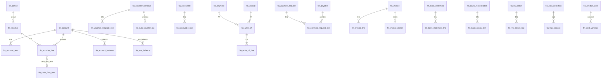

# 财务管理域 DB 设计书（財務管理 物理テーブル設計書）

| 項目 | 内容 |
|---|---|
| 文書名 | 财务管理域 DB 设计书（財務管理 物理テーブル設計書） |
| 文書番号 | DSN-FIN-090 |
| 版数 | v1.0 |
| 作成日 | 2026-10-20 |
| 作成者 | finance-designer |
| 承認者 | 未承認（レビュー待ち） |
| 状態 | ドラフト（レビュー中） |
| 関連文書 | [業務域概要](00-overview.md) / [DB 共通規格](../00-common/04-common-db-spec.md) / [共通項目定義](../00-common/01-common-item-definitions.md) / [跨域流程](../00-common/09-cross-domain-flow.md) |

---

## 1. 設計方針

| # | 方針 | 内容 |
|---|---|---|
| 1 | DBMS | PostgreSQL 18.6、UTF-8、UTC 保存（表示 Asia/Shanghai）。[DB 共通規格](../00-common/04-common-db-spec.md) に従う |
| 2 | プレフィックス | 全テーブル `fin_`。主キー `id BIGINT`（雪花 ID、アプリ採番） |
| 3 | 共通監査列 | 全テーブルに `id, tenant_id, company_id, created_at, created_by, updated_at, updated_by, version, remark, ext_data` を付与。**取引系テーブルは `deleted` を付けない**（取消は `status=90`）。マスタ（`fin_account` 等）のみ `deleted` を付与 |
| 4 | 金額・数量精度 | 金額 `NUMERIC(18,2)`、単価・原価 `NUMERIC(18,6)`、数量 `NUMERIC(18,4)`、税率 `NUMERIC(7,4)`、率 `NUMERIC(9,6)`（[01 共通項目定義](../00-common/01-common-item-definitions.md) 第 6 章） |
| 5 | 状態・区分 | `SMALLINT` + `COMMENT`。名称は DB に持たない（共有コードで解決） |
| 6 | スナップショット | 取引先名・科目名・税率・通貨は伝票にコピー保存（マスタ変更の影響を排除） |
| 7 | 外部キー | マスタ・親子関係は FK（`ON DELETE RESTRICT`）。取引先など論理削除対象は FK を張らずアプリ検証 |
| 8 | 一意制約 | 業務キーは部分一意インデックス（`WHERE deleted = FALSE` または状態条件付き） |
| 9 | 金額の符号 | `debit_amount` / `credit_amount` は赤伝のみ負数を許可（`is_red=true`）。CHECK で `is_red OR amount >= 0` |
| 10 | 履歴・ログ | 監査は `sys_audit_log`、自動凭证は `fin_auto_voucher_log`、月結は `fin_close_checklist`。追記専用 |
| 11 | パーティション | Phase 1 は単一テーブル。`fin_voucher_line` は Phase 2 で `period_code` レンジパーティションを検討（年 80 万行） |
| 12 | 保存期間 | 凭证・帳簿 30 年、月次报表 10 年、年度报表 永久（[08 章 12 章](../00-common/08-common-business-rules.md)） |

### 1.1 共通監査列 DDL 雛形

```sql
-- 全テーブルに展開（取引系は deleted なし）
id          BIGINT       NOT NULL,
tenant_id   BIGINT       NOT NULL DEFAULT current_setting('app.tenant_id')::bigint,
company_id  BIGINT       NOT NULL DEFAULT 1,
created_at  TIMESTAMPTZ  NOT NULL DEFAULT now(),
created_by  BIGINT       NOT NULL DEFAULT 0,
updated_at  TIMESTAMPTZ  NOT NULL DEFAULT now(),
updated_by  BIGINT       NOT NULL DEFAULT 0,
version     INT          NOT NULL DEFAULT 0,
remark      VARCHAR(500),
ext_data    JSONB
```

> 以下、各テーブル DDL では共通列を省略表記せず、必要に応じて「+ 共通列」と注記する（実装時は上記を展開）。**項目定義**には業務項目のみを記載する。

### 1.2 業務ステータスコード（本域）

| テーブル | コード体系 |
|---|---|
| `fin_voucher.status` | 10 草稿 / 20 已审核 / 40 已记账 / 90 已作废 |
| `fin_receivable.status` / `fin_payable.status` | 10 草稿 / 40 已确认 / 35 部分核销 / 50 已结清 / 90 作废 |
| `fin_receipt.status` / `fin_payment.status` | 10 草稿 / 40 已确认（已收付） / 90 作废 |
| `fin_payment_request.status` | 10 草稿 / 20 审批中 / 25 已审批 / 40 已付款 / 95 已驳回 / 90 取消 |
| `fin_invoice.status` | 10 已登记 / 40 已确认 / 50 已认证 / 90 作废 |
| `fin_write_off.status` | 10 有效 / 90 已反核销 |
| `fin_bank_statement.status` | 10 已导入 / 20 匹配中 / 40 已对账 / 90 作废 |
| `fin_bank_reconciliation.status` | 10 制表中 / 20 待复核 / 40 已复核 / 90 作废 |
| `fin_vat_return.status` | 10 生成中 / 40 已生成 / 50 已确认 / 90 作废 |
| `fin_period.status` | FUTURE / OPEN / CLOSED / YEAR_CLOSED（VARCHAR(16)） |
| `fin_auto_voucher_log.status` | 0 待处理 / 1 处理中 / 2 成功 / 3 失败 / 9 死信 |
| `fin_cost_collection.status` | 10 已归集 / 40 已计算 / 90 已作废 |

---

## 2. ER 図（主要テーブル）



---

## 3. テーブル一覧（52 表）

| # | 物理名 | 論理名 | 種別 | 主な用途 | 更新元 | 見積（初期/年増/5年） |
|---|---|---|---|---|---|---|
| 1 | `fin_account` | 会计科目 | マスタ | CAS 科目层级・残高方向・補助核算 | F-FIN-001 | 800/50/1,050 |
| 2 | `fin_account_aux` | 科目辅助核算设置 | マスタ | 科目×维度の必須/主维度 | F-FIN-002 | 300/20/400 |
| 3 | `fin_period` | 会计期间 | マスタ | 期間状態・結帳日 | F-FIN-035 | 12/12/72 |
| 4 | `fin_account_balance` | 科目余额（期間） | 残高 | 期初/発生/期末（末级科目） | F-FIN-006/011 | —/36 万/180 万 |
| 5 | `fin_aux_balance` | 辅助核算余额 | 残高 | 客户/供应商/部門等の残高 | F-FIN-006/024 | —/60 万/300 万 |
| 6 | `fin_voucher` | 记账凭证（头） | 伝票 | 凭证字号・状態・合計・来源 | F-FIN-003/030 | —/8 万/40 万 |
| 7 | `fin_voucher_line` | 记账凭证（行） | 伝票明細 | 借贷・科目・補助核算・CF 項目 | F-FIN-003 | —/80 万/400 万 |
| 8 | `fin_voucher_template` | 凭证模板（头） | マスタ | 手動/自動テンプレート | F-FIN-004/029 | 100/10/150 |
| 9 | `fin_voucher_template_line` | 凭证模板（行） | マスタ | 方向・科目選択・金額式・摘要 | F-FIN-004/029 | 600/60/900 |
| 10 | `fin_auto_voucher_log` | 自动凭证生成日志 | ログ | イベント消費・幂等・失敗 | F-FIN-030 | —/80 万/400 万 |
| 11 | `fin_cash_flow_item` | 现金流量项目 | マスタ | CAS CF 項目マスタ | F-FIN-038 | 60/0/60 |
| 12 | `fin_aging_config` | 账龄区间配置 | 設定 | 区間・基準種別・坏账率 | F-FIN-018/022 | 10/0/10 |
| 13 | `fin_close_checklist` | 月结检查清单 | ログ | 月結チェック結果 | F-FIN-035 | —/180/1,080 |
| 14 | `fin_statement_template` | 报表项目模板 | マスタ | 法定报表行次・項目 | F-FIN-038 | 200/0/200 |
| 15 | `fin_statement_formula` | 报表取数公式 | マスタ | 行→科目算式 | F-FIN-038 | 500/20/600 |
| 16 | `fin_statement_snapshot` | 财务报表快照 | 履歴 | 报表行値・版数 | F-FIN-038 | —/4 万/20 万 |
| 17 | `fin_bank_account` | 银行账户（自有） | マスタ | 口座・科目・対账設定 | F-FIN-024 | 10/2/20 |
| 18 | `fin_receivable` | 应收单 | 伝票 | 出荷/請求由来 AR・残高・開票状態 | F-FIN-019 | —/12 万/60 万 |
| 19 | `fin_receivable_line` | 应收单明细 | 伝票明細 | 物料/数量/金額/税額 | F-FIN-019 | —/60 万/300 万 |
| 20 | `fin_payable` | 应付单 | 伝票 | 暫估/請求由来 AP・残高 | F-FIN-012 | —/8 万/40 万 |
| 21 | `fin_invoice` | 发票（进项/销项） | 伝票 | 发票台账・税額・匹配状態 | F-FIN-013/026 | —/10 万/50 万 |
| 22 | `fin_invoice_line` | 发票明细 | 伝票明細 | 物料/数量/税率/税額 | F-FIN-013/026 | —/40 万/200 万 |
| 23 | `fin_invoice_match` | 三单匹配记录 | 履歴 | PO/GR/发票差異・処理結果 | F-FIN-013 | —/10 万/50 万 |
| 24 | `fin_payment_request` | 付款申请（头） | 伝票 | 申請・审批状態 | F-FIN-015 | —/2 万/10 万 |
| 25 | `fin_payment_request_line` | 付款申请明细 | 伝票明細 | AP/预付・金額 | F-FIN-015 | —/6 万/30 万 |
| 26 | `fin_payment` | 付款单 | 伝票 | 付款执行・口座・方式 | F-FIN-016 | —/2 万/10 万 |
| 27 | `fin_receipt` | 收款单 | 伝票 | 收款・到账・預収 | F-FIN-020 | —/3 万/15 万 |
| 28 | `fin_write_off` | 核销单（头） | 伝票 | AR/AP 核销批次 | F-FIN-017/021 | —/4 万/20 万 |
| 29 | `fin_write_off_line` | 核销明细 | 伝票明細 | 源/目標/核销額 | F-FIN-017/021 | —/10 万/50 万 |
| 30 | `fin_cash_journal` | 现金日记账 | 取引 | 現金収支・日結・盤点 | F-FIN-023 | —/1 万/5 万 |
| 31 | `fin_bank_journal` | 银行日记账 | 取引 | 銀行収支・対账状態 | F-FIN-016/024 | —/6 万/30 万 |
| 32 | `fin_bank_statement` | 银行对账单（批次） | 取引 | 取込批次・残高 | F-FIN-024 | —/120/720 |
| 33 | `fin_bank_statement_line` | 银行对账单明细 | 取引 | 対账单行・匹配状態 | F-FIN-024 | —/6 万/30 万 |
| 34 | `fin_bank_reconciliation` | 银行余额调节表 | 履歴 | 残高・調節後・复核 | F-FIN-024 | —/120/720 |
| 35 | `fin_bank_recon_item` | 银行对账未达账项 | 履歴 | 企業未達/銀行未達 | F-FIN-024 | —/2,000/1.2 万 |
| 36 | `fin_vat_return` | 增值税申报辅助（头） | 集計 | 销項/進項/留抵/応納 | F-FIN-027 | —/12/72 |
| 37 | `fin_vat_return_line` | 增值税申报辅助（行） | 集計 | 申報項目行値 | F-FIN-027 | —/600/3,600 |
| 38 | `fin_tax_accrual` | 税金计提 | 伝票 | 附加税/所得税計提 | F-FIN-028 | —/300/1,800 |
| 39 | `fin_cost_collection` | 成本归集 | 集計 | 成本対象×要素の帰集額 | F-FIN-031 | —/3 万/15 万 |
| 40 | `fin_cost_allocation` | 制造费用分配 | 集計 | 費用中心・基準・配賦額 | F-FIN-032 | —/6,000/3.6 万 |
| 41 | `fin_wip_balance` | 在制品余额 | 残高 | 工単 WIP | F-FIN-033 | —/3 万/15 万 |
| 42 | `fin_product_cost` | 完工产品成本 | 集計 | 完工数量・単位成本 | F-FIN-033 | —/2 万/10 万 |
| 43 | `fin_cost_variance` | 成本差异 | 集計 | 標準/実際差異 | F-FIN-034 | —/6 万/30 万 |
| 44 | `fin_expense_claim`（P2） | 费用报销（头） | 伝票 | 経費精算 | F-FIN-040 | —/2 万/10 万 |
| 45 | `fin_expense_claim_line`（P2） | 费用报销明细 | 伝票明細 | 費目・金額 | F-FIN-040 | —/8 万/40 万 |
| 46 | `fin_asset`（P2） | 固定资产卡片 | マスタ | 資産情報・折旧 | F-FIN-041 | 2,000/200/3,000 |
| 47 | `fin_asset_depreciation`（P2） | 固定资产折旧 | 履歴 | 月次折旧明細 | F-FIN-041 | —/2.4 万/12 万 |
| 48 | `fin_budget`（P2） | 预算（头） | マスタ | 予算版本 | F-FIN-043 | 500/100/1,000 |
| 49 | `fin_budget_line`（P2） | 预算明细 | マスタ | 科目/項目予算額 | F-FIN-043 | —/2 万/10 万 |
| 50 | `fin_exchange_reval`（P2） | 汇兑损益调整 | 履歴 | 外貨期末調整 | F-FIN-044 | —/1,200/6,000 |
| 51 | `fin_cash_plan`（P2） | 资金计划（头） | 伝票 | 資金収支計画 | F-FIN-045 | —/1,000/5,000 |
| 52 | `fin_cash_plan_line`（P2） | 资金计划明细 | 伝票明細 | 計画明細 | F-FIN-045 | —/1.2 万/6 万 |

---

## 4. テーブル定義（A：科目・期間・凭证・残高）

### 4.1 `fin_account` 会计科目

| 項目 | 内容 |
|---|---|
| 種別 | マスタ |
| 更新元 | F-FIN-001/002 |
| 保存期間 | 無期限（使用停止のみ） |

```sql
CREATE TABLE fin_account (
    id                  BIGINT        NOT NULL,
    tenant_id           BIGINT        NOT NULL DEFAULT current_setting('app.tenant_id')::bigint,
    company_id          BIGINT        NOT NULL DEFAULT 1,
    account_code        VARCHAR(32)   NOT NULL,              -- 科目コード（4 桁 + 2 桁補助、最大 2 階層）
    account_name        VARCHAR(200)  NOT NULL,              -- 科目名称
    parent_id           BIGINT,                              -- 親科目 ID
    account_level       SMALLINT      NOT NULL DEFAULT 1,    -- 1～4
    account_category    SMALLINT      NOT NULL,              -- 1 資産/2 負債/3 共同/4 権益/5 成本/6 損益
    balance_direction   CHAR(1)       NOT NULL,              -- D 借/C 貸
    aux_types           VARCHAR(200),                        -- コンマ区切り（CUSTOMER,SUPPLIER,...）
    is_qty_managed      BOOLEAN       NOT NULL DEFAULT FALSE,-- 数量核算
    is_fc_managed       BOOLEAN       NOT NULL DEFAULT FALSE,-- 外貨核算（P2）
    currency_code       VARCHAR(3)    NOT NULL DEFAULT 'CNY',-- 幣種
    report_item_code    VARCHAR(32),                         -- 报表項目コード
    status              SMALLINT      NOT NULL DEFAULT 1,     -- 1 有効/0 無効
    valid_from          DATE,
    valid_to            DATE,
    version             INT           NOT NULL DEFAULT 0,
    deleted             BOOLEAN       NOT NULL DEFAULT FALSE,
    remark              VARCHAR(500),
    ext_data            JSONB,
    created_at          TIMESTAMPTZ   NOT NULL DEFAULT now(),
    created_by          BIGINT        NOT NULL DEFAULT 0,
    updated_at          TIMESTAMPTZ   NOT NULL DEFAULT now(),
    updated_by          BIGINT        NOT NULL DEFAULT 0,
    CONSTRAINT pk_fin_account PRIMARY KEY (id),
    CONSTRAINT ck_fin_account_category CHECK (account_category BETWEEN 1 AND 6),
    CONSTRAINT ck_fin_account_direction CHECK (balance_direction IN ('D','C'))
);
CREATE UNIQUE INDEX uk_fin_account_company_code ON fin_account (company_id, account_code) WHERE deleted = FALSE;
CREATE INDEX idx_fin_account_parent ON fin_account (parent_id);
CREATE INDEX idx_fin_account_status ON fin_account (status, account_category);
COMMENT ON TABLE fin_account IS '会计科目（CAS）';
COMMENT ON COLUMN fin_account.account_code IS '科目代码：一级4位数字，明细用点分2位序号';
COMMENT ON COLUMN fin_account.balance_direction IS '余额方向：D 借 / C 贷';
COMMENT ON COLUMN fin_account.aux_types IS '辅助核算维度：CUSTOMER/SUPPLIER/DEPARTMENT/EMPLOYEE/PROJECT/MATERIAL';
```

| # | 業務項目 | 論理名 | 型/桁 | NULL | 既定値 | 備考 |
|---|---|---|---|---|---|---|
| 1 | `account_code` | 科目コード | VARCHAR(32) | NOT NULL | — | 一意（company_id 内） |
| 2 | `account_name` | 科目名称 | VARCHAR(200) | NOT NULL | — | 同一親下で一意推奨 |
| 3 | `parent_id` | 親科目 | BIGINT | NULL | — | 自己参照 FK は付けない（アプリ検証） |
| 4 | `account_level` | 級数 | SMALLINT | NOT NULL | 1 | 1～4、末级のみ記帳可 |
| 5 | `account_category` | 類別 | SMALLINT | NOT NULL | — | 1～6 |
| 6 | `balance_direction` | 残高方向 | CHAR(1) | NOT NULL | — | D/C |
| 7 | `aux_types` | 補助核算 | VARCHAR(200) | NULL | — | 最大 6 维度 |
| 8 | `report_item_code` | 报表項目 | VARCHAR(32) | NULL | — | 末级は必須 |
| 9 | `status` | 状態 | SMALLINT | NOT NULL | 1 | 有効/無効 |

### 4.2 `fin_account_aux` 科目辅助核算设置

```sql
CREATE TABLE fin_account_aux (
    id            BIGINT       NOT NULL,
    tenant_id     BIGINT       NOT NULL DEFAULT current_setting('app.tenant_id')::bigint,
    company_id    BIGINT       NOT NULL DEFAULT 1,
    account_id    BIGINT       NOT NULL,                  -- fin_account.id
    aux_type      VARCHAR(20)  NOT NULL,                  -- CUSTOMER/SUPPLIER/DEPARTMENT/EMPLOYEE/PROJECT/MATERIAL
    is_required   BOOLEAN      NOT NULL DEFAULT TRUE,     -- 必須か
    is_primary    BOOLEAN      NOT NULL DEFAULT FALSE,    -- 主维度（明細帳の既定）
    sort_no       SMALLINT     NOT NULL DEFAULT 0,
    version       INT          NOT NULL DEFAULT 0,
    deleted       BOOLEAN      NOT NULL DEFAULT FALSE,
    created_at    TIMESTAMPTZ  NOT NULL DEFAULT now(),
    created_by    BIGINT       NOT NULL DEFAULT 0,
    updated_at    TIMESTAMPTZ  NOT NULL DEFAULT now(),
    updated_by    BIGINT       NOT NULL DEFAULT 0,
    CONSTRAINT pk_fin_account_aux PRIMARY KEY (id),
    CONSTRAINT fk_fin_account_aux_account FOREIGN KEY (account_id) REFERENCES fin_account (id)
);
CREATE UNIQUE INDEX uk_fin_account_aux ON fin_account_aux (account_id, aux_type) WHERE deleted = FALSE;
COMMENT ON TABLE fin_account_aux IS '会计科目辅助核算设置';
```

### 4.3 `fin_period` 会计期间

```sql
CREATE TABLE fin_period (
    id             BIGINT       NOT NULL,
    tenant_id      BIGINT       NOT NULL DEFAULT current_setting('app.tenant_id')::bigint,
    company_id     BIGINT       NOT NULL DEFAULT 1,
    fiscal_year    SMALLINT     NOT NULL,                 -- 2026
    period_code    VARCHAR(7)   NOT NULL,                 -- 2026-10
    period_no      SMALLINT     NOT NULL,                 -- 1～12
    start_date     DATE         NOT NULL,
    end_date       DATE         NOT NULL,
    status         VARCHAR(16)  NOT NULL DEFAULT 'FUTURE',-- FUTURE/OPEN/CLOSED/YEAR_CLOSED
    close_date     DATE,                                  -- 予定/実績結帳日
    closed_at      TIMESTAMPTZ,
    closed_by      BIGINT,
    reopen_reason  VARCHAR(500),
    version        INT          NOT NULL DEFAULT 0,
    created_at     TIMESTAMPTZ  NOT NULL DEFAULT now(),
    created_by     BIGINT       NOT NULL DEFAULT 0,
    updated_at     TIMESTAMPTZ  NOT NULL DEFAULT now(),
    updated_by     BIGINT       NOT NULL DEFAULT 0,
    CONSTRAINT pk_fin_period PRIMARY KEY (id),
    CONSTRAINT uk_fin_period_code UNIQUE (company_id, period_code),
    CONSTRAINT ck_fin_period_status CHECK (status IN ('FUTURE','OPEN','CLOSED','YEAR_CLOSED'))
);
CREATE INDEX idx_fin_period_status ON fin_period (fiscal_year, status);
COMMENT ON TABLE fin_period IS '会计期间（期间状态机）';
```

### 4.4 `fin_account_balance` 科目余额（期間）

```sql
CREATE TABLE fin_account_balance (
    id               BIGINT        NOT NULL,
    tenant_id        BIGINT        NOT NULL DEFAULT current_setting('app.tenant_id')::bigint,
    company_id       BIGINT        NOT NULL DEFAULT 1,
    period_code      VARCHAR(7)    NOT NULL,
    account_id       BIGINT        NOT NULL,
    account_code     VARCHAR(32)   NOT NULL,               -- スナップショット
    balance_type     VARCHAR(10)   NOT NULL DEFAULT 'PERIOD', -- INIT/PERIOD
    opening_debit    NUMERIC(18,2) NOT NULL DEFAULT 0,     -- 期首借方残
    opening_credit   NUMERIC(18,2) NOT NULL DEFAULT 0,     -- 期首貸方残
    debit_amount     NUMERIC(18,2) NOT NULL DEFAULT 0,     -- 当期借方発生
    credit_amount    NUMERIC(18,2) NOT NULL DEFAULT 0,     -- 当期貸方発生
    closing_debit    NUMERIC(18,2) NOT NULL DEFAULT 0,
    closing_credit   NUMERIC(18,2) NOT NULL DEFAULT 0,
    quantity         NUMERIC(18,4) NOT NULL DEFAULT 0,     -- 数量核算の期末数量
    is_locked        BOOLEAN       NOT NULL DEFAULT FALSE, -- 期初/期末ロック
    version          INT           NOT NULL DEFAULT 0,
    created_at       TIMESTAMPTZ   NOT NULL DEFAULT now(),
    created_by       BIGINT        NOT NULL DEFAULT 0,
    updated_at       TIMESTAMPTZ   NOT NULL DEFAULT now(),
    updated_by       BIGINT        NOT NULL DEFAULT 0,
    CONSTRAINT pk_fin_account_balance PRIMARY KEY (id),
    CONSTRAINT fk_fin_account_balance_account FOREIGN KEY (account_id) REFERENCES fin_account (id)
);
CREATE UNIQUE INDEX uk_fin_account_balance ON fin_account_balance (company_id, period_code, account_id, balance_type);
CREATE INDEX idx_fin_account_balance_period ON fin_account_balance (period_code, account_code);
COMMENT ON TABLE fin_account_balance IS '科目余额（期间×末级科目）';
COMMENT ON COLUMN fin_account_balance.closing_debit IS '期末借方余额（借方科目=借-贷，贷方科目为0时由closing_credit保持）';
```

### 4.5 `fin_aux_balance` 辅助核算余额

```sql
CREATE TABLE fin_aux_balance (
    id               BIGINT        NOT NULL,
    tenant_id        BIGINT        NOT NULL DEFAULT current_setting('app.tenant_id')::bigint,
    company_id       BIGINT        NOT NULL DEFAULT 1,
    period_code      VARCHAR(7)    NOT NULL,
    account_id       BIGINT        NOT NULL,
    aux_type         VARCHAR(20)   NOT NULL,
    aux_object_id    BIGINT        NOT NULL,
    aux_object_code  VARCHAR(64),
    aux_object_name  VARCHAR(200),                          -- スナップショット
    opening_debit    NUMERIC(18,2) NOT NULL DEFAULT 0,
    opening_credit   NUMERIC(18,2) NOT NULL DEFAULT 0,
    debit_amount     NUMERIC(18,2) NOT NULL DEFAULT 0,
    credit_amount    NUMERIC(18,2) NOT NULL DEFAULT 0,
    closing_debit    NUMERIC(18,2) NOT NULL DEFAULT 0,
    closing_credit   NUMERIC(18,2) NOT NULL DEFAULT 0,
    version          INT           NOT NULL DEFAULT 0,
    created_at       TIMESTAMPTZ   NOT NULL DEFAULT now(),
    created_by       BIGINT        NOT NULL DEFAULT 0,
    updated_at       TIMESTAMPTZ   NOT NULL DEFAULT now(),
    updated_by       BIGINT        NOT NULL DEFAULT 0,
    CONSTRAINT pk_fin_aux_balance PRIMARY KEY (id)
);
CREATE UNIQUE INDEX uk_fin_aux_balance ON fin_aux_balance (company_id, period_code, account_id, aux_type, aux_object_id);
CREATE INDEX idx_fin_aux_balance_object ON fin_aux_balance (aux_type, aux_object_id, period_code);
COMMENT ON TABLE fin_aux_balance IS '辅助核算余额（客户/供应商/部门/员工/项目/物料）';
```

### 4.6 `fin_voucher` 记账凭证（头）

```sql
CREATE TABLE fin_voucher (
    id               BIGINT        NOT NULL,
    tenant_id        BIGINT        NOT NULL DEFAULT current_setting('app.tenant_id')::bigint,
    company_id       BIGINT        NOT NULL DEFAULT 1,
    period_code      VARCHAR(7)    NOT NULL,
    voucher_type     SMALLINT      NOT NULL,                -- 1 记/2 收/3 付/4 转
    voucher_no       VARCHAR(8)    NOT NULL,                -- 记-0042
    voucher_date     DATE          NOT NULL,
    total_debit      NUMERIC(18,2) NOT NULL DEFAULT 0,
    total_credit     NUMERIC(18,2) NOT NULL DEFAULT 0,
    attachment_count INT           NOT NULL DEFAULT 0,
    status           SMALLINT      NOT NULL DEFAULT 10,     -- 10/20/40/90
    is_auto          BOOLEAN       NOT NULL DEFAULT FALSE,
    is_red           BOOLEAN       NOT NULL DEFAULT FALSE,  -- 赤伝
    is_closing       BOOLEAN       NOT NULL DEFAULT FALSE,  -- 損益転記/年結
    source_type      VARCHAR(32),                           -- AP/AR/INV/PRD/FIN...
    source_id        BIGINT,
    source_no        VARCHAR(64),
    reversal_of_voucher_id BIGINT,                          -- 冲销元凭证
    reversal_reason  VARCHAR(500),
    reversed_flag    BOOLEAN       NOT NULL DEFAULT FALSE,  -- 被冲销済
    reviewed_by      BIGINT,
    reviewed_at      TIMESTAMPTZ,
    posted_by        BIGINT,
    posted_at        TIMESTAMPTZ,
    version          INT           NOT NULL DEFAULT 0,
    remark           VARCHAR(500),
    ext_data         JSONB,
    created_at       TIMESTAMPTZ   NOT NULL DEFAULT now(),
    created_by       BIGINT        NOT NULL DEFAULT 0,
    updated_at       TIMESTAMPTZ   NOT NULL DEFAULT now(),
    updated_by       BIGINT        NOT NULL DEFAULT 0,
    CONSTRAINT pk_fin_voucher PRIMARY KEY (id),
    CONSTRAINT ck_fin_voucher_status CHECK (status IN (10,20,40,90)),
    CONSTRAINT ck_fin_voucher_type CHECK (voucher_type BETWEEN 1 AND 4)
);
CREATE UNIQUE INDEX uk_fin_voucher_no ON fin_voucher (company_id, period_code, voucher_no);
CREATE UNIQUE INDEX uk_fin_voucher_source ON fin_voucher (company_id, source_type, source_id)
    WHERE source_type IS NOT NULL AND status <> 90;
CREATE UNIQUE INDEX uk_fin_voucher_reversal ON fin_voucher (reversal_of_voucher_id) WHERE reversal_of_voucher_id IS NOT NULL;
CREATE INDEX idx_fin_voucher_period_status ON fin_voucher (period_code, status);
CREATE INDEX idx_fin_voucher_date ON fin_voucher (voucher_date DESC);
CREATE INDEX idx_fin_voucher_creator ON fin_voucher (created_by, period_code);
COMMENT ON TABLE fin_voucher IS '记账凭证头';
COMMENT ON COLUMN fin_voucher.voucher_no IS '凭证字号：凭证字+4位序号（会計期間×凭证字で連番）';
COMMENT ON COLUMN fin_voucher.source_type IS '自動凭证の来源種別。uk_fin_voucher_source で二重計上防止';
```

### 4.7 `fin_voucher_line` 记账凭证（行）

```sql
CREATE TABLE fin_voucher_line (
    id                  BIGINT        NOT NULL,
    tenant_id           BIGINT        NOT NULL DEFAULT current_setting('app.tenant_id')::bigint,
    company_id          BIGINT        NOT NULL DEFAULT 1,
    voucher_id          BIGINT        NOT NULL,
    line_no             INT           NOT NULL,
    summary             VARCHAR(200)  NOT NULL,
    account_id          BIGINT        NOT NULL,
    account_code        VARCHAR(32)   NOT NULL,             -- スナップショット
    account_name        VARCHAR(200)  NOT NULL,             -- スナップショット
    debit_amount        NUMERIC(18,2) NOT NULL DEFAULT 0,
    credit_amount       NUMERIC(18,2) NOT NULL DEFAULT 0,
    customer_id         BIGINT,
    customer_code       VARCHAR(64),
    customer_name       VARCHAR(200),
    supplier_id         BIGINT,
    supplier_code       VARCHAR(64),
    supplier_name       VARCHAR(200),
    department_id       BIGINT,
    department_code     VARCHAR(64),
    department_name     VARCHAR(200),
    employee_id         BIGINT,
    employee_name       VARCHAR(200),
    project_id          BIGINT,
    project_code        VARCHAR(64),
    project_name        VARCHAR(200),
    material_id         BIGINT,
    material_code       VARCHAR(64),
    material_name       VARCHAR(200),
    quantity            NUMERIC(18,4),                      -- 数量核算
    unit_price          NUMERIC(18,6),
    currency_code       VARCHAR(3)    NOT NULL DEFAULT 'CNY',
    original_amount     NUMERIC(18,2),                      -- 外貨原幣（P2）
    exchange_rate       NUMERIC(18,8),
    cash_flow_item_code VARCHAR(32),                        -- 現金流量項目
    tax_code            VARCHAR(20),                        -- 業務税码（mdm_tax_code）
    version             INT           NOT NULL DEFAULT 0,
    remark              VARCHAR(200),
    created_at          TIMESTAMPTZ   NOT NULL DEFAULT now(),
    created_by          BIGINT        NOT NULL DEFAULT 0,
    updated_at          TIMESTAMPTZ   NOT NULL DEFAULT now(),
    updated_by          BIGINT        NOT NULL DEFAULT 0,
    CONSTRAINT pk_fin_voucher_line PRIMARY KEY (id),
    CONSTRAINT fk_fin_voucher_line_voucher FOREIGN KEY (voucher_id) REFERENCES fin_voucher (id),
    CONSTRAINT fk_fin_voucher_line_account FOREIGN KEY (account_id) REFERENCES fin_account (id),
    CONSTRAINT ck_fin_voucher_line_amount CHECK (
        (debit_amount = 0 OR credit_amount = 0) AND (debit_amount <> 0 OR credit_amount <> 0)
    )
);
CREATE UNIQUE INDEX uk_fin_voucher_line ON fin_voucher_line (voucher_id, line_no);
CREATE INDEX idx_fin_voucher_line_account ON fin_voucher_line (account_id, voucher_id);
CREATE INDEX idx_fin_voucher_line_customer ON fin_voucher_line (customer_id) WHERE customer_id IS NOT NULL;
CREATE INDEX idx_fin_voucher_line_supplier ON fin_voucher_line (supplier_id) WHERE supplier_id IS NOT NULL;
CREATE INDEX idx_fin_voucher_line_cf ON fin_voucher_line (cash_flow_item_code) WHERE cash_flow_item_code IS NOT NULL;
COMMENT ON TABLE fin_voucher_line IS '记账凭证分录';
COMMENT ON COLUMN fin_voucher_line.debit_amount IS '借方金额（赤伝は負数。ck_fin_voucher_line_amount は is_red を考慮しアプリ検証）';
COMMENT ON COLUMN fin_voucher_line.cash_flow_item_code IS '现金流量项目（現金/銀行科目は必須）';
```

> 注：赤伝の負数は CHECK 制約では `is_red` を参照できないため、アプリ層で「`is_red=false` なら金額 ≥0」を検証する（DB は 0 禁止のみ）。

### 4.8 `fin_voucher_template` / 4.9 `fin_voucher_template_line` 凭证模板

```sql
CREATE TABLE fin_voucher_template (
    id              BIGINT        NOT NULL,
    tenant_id       BIGINT        NOT NULL DEFAULT current_setting('app.tenant_id')::bigint,
    company_id      BIGINT        NOT NULL DEFAULT 1,
    template_code   VARCHAR(32)   NOT NULL,                -- TPL-FIN-J07
    template_name   VARCHAR(200)  NOT NULL,
    template_type   SMALLINT      NOT NULL DEFAULT 1,      -- 1 自動/2 手動
    event_type      VARCHAR(100),                          -- sales.delivery.confirmed
    source_domain   VARCHAR(10),                           -- SAL/PUR/INV/PRD/FIN
    condition_expr  VARCHAR(500),                          -- DSL 条件
    auto_post       BOOLEAN       NOT NULL DEFAULT FALSE,
    priority        INT           NOT NULL DEFAULT 100,
    allow_zero_amount BOOLEAN     NOT NULL DEFAULT FALSE,
    status          SMALLINT      NOT NULL DEFAULT 1,
    valid_from      DATE          NOT NULL DEFAULT '2026-01-01',
    valid_to        DATE,
    version         INT           NOT NULL DEFAULT 0,
    deleted         BOOLEAN       NOT NULL DEFAULT FALSE,
    remark          VARCHAR(500),
    created_at      TIMESTAMPTZ   NOT NULL DEFAULT now(),
    created_by      BIGINT        NOT NULL DEFAULT 0,
    updated_at      TIMESTAMPTZ   NOT NULL DEFAULT now(),
    updated_by      BIGINT        NOT NULL DEFAULT 0,
    CONSTRAINT pk_fin_voucher_template PRIMARY KEY (id),
    CONSTRAINT ck_fin_voucher_template_type CHECK (template_type IN (1,2))
);
CREATE UNIQUE INDEX uk_fin_voucher_template_code ON fin_voucher_template (company_id, template_code) WHERE deleted = FALSE;
CREATE INDEX idx_fin_voucher_template_event ON fin_voucher_template (event_type, source_domain, status);

CREATE TABLE fin_voucher_template_line (
    id                   BIGINT        NOT NULL,
    tenant_id            BIGINT        NOT NULL DEFAULT current_setting('app.tenant_id')::bigint,
    company_id           BIGINT        NOT NULL DEFAULT 1,
    template_id          BIGINT        NOT NULL,
    line_no              INT           NOT NULL,
    direction            CHAR(1)       NOT NULL,            -- D/C
    account_selector_type SMALLINT     NOT NULL DEFAULT 1,  -- 1 FIXED/2 TAX_TYPE_MAP/3 MATERIAL_CATEGORY/4 AUX_MASTER
    account_code         VARCHAR(32),                       -- FIXED
    tax_type             SMALLINT,                          -- TAX_TYPE_MAP: 10 销项/11 进项/12 转出
    amount_source_type   SMALLINT      NOT NULL DEFAULT 1,  -- 1 EVENT_FIELD/2 SUM_LINE_FIELD/3 CALC/4 SOURCE_FIELD/5 FIXED
    amount_source_expr   VARCHAR(500)  NOT NULL,
    summary_template     VARCHAR(200)  NOT NULL,
    aux_source           JSONB,
    sort_no              SMALLINT      NOT NULL DEFAULT 0,
    version              INT           NOT NULL DEFAULT 0,
    created_at           TIMESTAMPTZ   NOT NULL DEFAULT now(),
    created_by           BIGINT        NOT NULL DEFAULT 0,
    updated_at           TIMESTAMPTZ   NOT NULL DEFAULT now(),
    updated_by           BIGINT        NOT NULL DEFAULT 0,
    CONSTRAINT pk_fin_voucher_template_line PRIMARY KEY (id),
    CONSTRAINT fk_fin_voucher_template_line_template FOREIGN KEY (template_id) REFERENCES fin_voucher_template (id),
    CONSTRAINT ck_fin_voucher_template_line_direction CHECK (direction IN ('D','C'))
);
CREATE UNIQUE INDEX uk_fin_voucher_template_line ON fin_voucher_template_line (template_id, line_no);
COMMENT ON TABLE fin_voucher_template IS '凭证模板头（手動/自動）';
COMMENT ON TABLE fin_voucher_template_line IS '凭证模板行（借貸方向・科目選択・金額式・摘要）';
```

### 4.10 `fin_auto_voucher_log` 自动凭证生成日志

```sql
CREATE TABLE fin_auto_voucher_log (
    id             BIGINT        NOT NULL,
    tenant_id      BIGINT        NOT NULL DEFAULT current_setting('app.tenant_id')::bigint,
    company_id     BIGINT        NOT NULL DEFAULT 1,
    event_id       UUID          NOT NULL,                 -- sys_outbox_event.event_id
    event_type     VARCHAR(100)  NOT NULL,
    aggregate_type VARCHAR(64),
    aggregate_id   VARCHAR(64),
    aggregate_no   VARCHAR(64),
    template_id    BIGINT,
    voucher_id     BIGINT,
    status         SMALLINT      NOT NULL DEFAULT 0,       -- 0/1/2/3/9
    retry_count    INT           NOT NULL DEFAULT 0,
    next_retry_at  TIMESTAMPTZ,
    error_message  VARCHAR(1000),
    payload_hash   VARCHAR(64),                            -- 重複検知用
    occurred_at    TIMESTAMPTZ,
    processed_at   TIMESTAMPTZ,
    created_at     TIMESTAMPTZ   NOT NULL DEFAULT now(),
    created_by     BIGINT        NOT NULL DEFAULT 0,
    updated_at     TIMESTAMPTZ   NOT NULL DEFAULT now(),
    updated_by     BIGINT        NOT NULL DEFAULT 0,
    CONSTRAINT pk_fin_auto_voucher_log PRIMARY KEY (id)
);
CREATE UNIQUE INDEX uk_fin_auto_voucher_log_event ON fin_auto_voucher_log (event_id);
CREATE INDEX idx_fin_auto_voucher_log_status ON fin_auto_voucher_log (status, next_retry_at);
CREATE INDEX idx_fin_auto_voucher_log_type ON fin_auto_voucher_log (event_type, occurred_at DESC);
COMMENT ON TABLE fin_auto_voucher_log IS '自动凭证生成日志（幂等・重试・死信）';
```

### 4.11 `fin_cash_flow_item` 现金流量项目

```sql
CREATE TABLE fin_cash_flow_item (
    id            BIGINT       NOT NULL,
    tenant_id     BIGINT       NOT NULL DEFAULT current_setting('app.tenant_id')::bigint,
    company_id    BIGINT       NOT NULL DEFAULT 1,
    item_code     VARCHAR(32)  NOT NULL,                   -- CF01
    item_name     VARCHAR(200) NOT NULL,
    direction     SMALLINT     NOT NULL,                   -- 1 流入/2 流出/3 調整
    section_type  SMALLINT     NOT NULL,                   -- 1 経営/2 投資/3 財務
    line_no       INT          NOT NULL,                    -- 报表行次
    status        SMALLINT     NOT NULL DEFAULT 1,
    version       INT          NOT NULL DEFAULT 0,
    created_at    TIMESTAMPTZ  NOT NULL DEFAULT now(),
    created_by    BIGINT       NOT NULL DEFAULT 0,
    updated_at    TIMESTAMPTZ  NOT NULL DEFAULT now(),
    updated_by    BIGINT       NOT NULL DEFAULT 0,
    CONSTRAINT pk_fin_cash_flow_item PRIMARY KEY (id)
);
CREATE UNIQUE INDEX uk_fin_cash_flow_item_code ON fin_cash_flow_item (company_id, item_code);
COMMENT ON TABLE fin_cash_flow_item IS '现金流量项目（CAS 现金流量表）';
```

### 4.12 `fin_aging_config` 账龄区间配置

```sql
CREATE TABLE fin_aging_config (
    id            BIGINT       NOT NULL,
    tenant_id     BIGINT       NOT NULL DEFAULT current_setting('app.tenant_id')::bigint,
    company_id    BIGINT       NOT NULL DEFAULT 1,
    config_type   SMALLINT     NOT NULL,                   -- 1 AR/2 AP
    basis_type    SMALLINT     NOT NULL DEFAULT 2,         -- 1 業務日付/2 到期日
    bucket_no     SMALLINT     NOT NULL,
    bucket_name   VARCHAR(50)  NOT NULL,                   -- 未到期/1-30/...
    from_days     INT,                                     -- NULL=未満
    to_days       INT,                                     -- NULL=以上
    bad_debt_rate NUMERIC(7,4) NOT NULL DEFAULT 0,         -- 坏账计提率（P2）
    status        SMALLINT     NOT NULL DEFAULT 1,
    version       INT          NOT NULL DEFAULT 0,
    created_at    TIMESTAMPTZ  NOT NULL DEFAULT now(),
    created_by    BIGINT       NOT NULL DEFAULT 0,
    updated_at    TIMESTAMPTZ  NOT NULL DEFAULT now(),
    updated_by    BIGINT       NOT NULL DEFAULT 0,
    CONSTRAINT pk_fin_aging_config PRIMARY KEY (id)
);
CREATE UNIQUE INDEX uk_fin_aging_config ON fin_aging_config (company_id, config_type, bucket_no);
COMMENT ON TABLE fin_aging_config IS '账龄区间配置（未到期/1-30/31-60/61-90/91-180/181-360/>360）';
```

### 4.13 `fin_close_checklist` 月结检查清单

```sql
CREATE TABLE fin_close_checklist (
    id            BIGINT        NOT NULL,
    tenant_id     BIGINT        NOT NULL DEFAULT current_setting('app.tenant_id')::bigint,
    company_id    BIGINT        NOT NULL DEFAULT 1,
    period_code   VARCHAR(7)    NOT NULL,
    check_code    VARCHAR(32)   NOT NULL,                  -- CLOSE_01..CLOSE_15
    check_name    VARCHAR(200)  NOT NULL,
    check_order   SMALLINT      NOT NULL,
    result        SMALLINT      NOT NULL DEFAULT 0,        -- 0 未実行/1 OK/2 NG/3 WAIVED
    ng_count      INT           NOT NULL DEFAULT 0,
    ng_amount     NUMERIC(18,2),
    evidence      JSONB,                                    -- 明細・件数・根拠
    waive_reason  VARCHAR(500),
    executed_at   TIMESTAMPTZ,
    executed_by   BIGINT,
    created_at    TIMESTAMPTZ   NOT NULL DEFAULT now(),
    created_by    BIGINT        NOT NULL DEFAULT 0,
    updated_at    TIMESTAMPTZ   NOT NULL DEFAULT now(),
    updated_by    BIGINT        NOT NULL DEFAULT 0,
    CONSTRAINT pk_fin_close_checklist PRIMARY KEY (id),
    CONSTRAINT ck_fin_close_checklist_result CHECK (result BETWEEN 0 AND 3)
);
CREATE UNIQUE INDEX uk_fin_close_checklist ON fin_close_checklist (company_id, period_code, check_code);
COMMENT ON TABLE fin_close_checklist IS '月结检查清单结果（09 章 10.3 の 10 項目 + 追加 5 項目）';
```

<!-- APPEND-PART2 -->
## 5. テーブル定義（B：报表・AR/AP・发票・收付款・核销）

### 5.1 `fin_statement_template` 报表项目模板

```sql
CREATE TABLE fin_statement_template (
    id             BIGINT       NOT NULL,
    tenant_id      BIGINT       NOT NULL DEFAULT current_setting('app.tenant_id')::bigint,
    company_id     BIGINT       NOT NULL DEFAULT 1,
    statement_type VARCHAR(8)   NOT NULL,                 -- BS/IS/CF/SCE（SCE=所有者权益变动表）
    line_no        INT          NOT NULL,                 -- 行次
    item_name      VARCHAR(200) NOT NULL,                 -- 报表項目名
    item_level     SMALLINT     NOT NULL DEFAULT 1,       -- 1 合計/2 主要/3 明細
    parent_line_no INT,
    side_type      SMALLINT,                              -- BS: 1 資産/2 負債/3 権益
    is_total       BOOLEAN      NOT NULL DEFAULT FALSE,   -- 合計行（加算式）
    total_formula  VARCHAR(1000),                         -- 合計行の算式（行番号）
    print_order    INT          NOT NULL,
    status         SMALLINT     NOT NULL DEFAULT 1,
    version        INT          NOT NULL DEFAULT 0,
    created_at     TIMESTAMPTZ  NOT NULL DEFAULT now(),
    created_by     BIGINT       NOT NULL DEFAULT 0,
    updated_at     TIMESTAMPTZ  NOT NULL DEFAULT now(),
    updated_by     BIGINT       NOT NULL DEFAULT 0,
    CONSTRAINT pk_fin_statement_template PRIMARY KEY (id)
);
CREATE UNIQUE INDEX uk_fin_statement_template ON fin_statement_template (company_id, statement_type, line_no);
COMMENT ON TABLE fin_statement_template IS '报表项目模板（財会〔2019〕6 号の法定様式）';
```

### 5.2 `fin_statement_formula` 报表取数公式

```sql
CREATE TABLE fin_statement_formula (
    id             BIGINT        NOT NULL,
    tenant_id      BIGINT        NOT NULL DEFAULT current_setting('app.tenant_id')::bigint,
    company_id     BIGINT        NOT NULL DEFAULT 1,
    statement_type VARCHAR(8)    NOT NULL,
    line_no        INT           NOT NULL,
    item_name      VARCHAR(200)  NOT NULL,
    formula_type   SMALLINT      NOT NULL DEFAULT 1,      -- 1 残高/2 発生額/3 合計行/4 定数
    formula_expr   VARCHAR(1000) NOT NULL,                -- 例: 残(借)1122 + 2203.借 - 残(貸)1231
    account_scope  VARCHAR(500),                          -- 対象科目範囲（保存用）
    round_scale    SMALLINT      NOT NULL DEFAULT 2,
    valid_from     DATE          NOT NULL DEFAULT '2026-01-01',
    valid_to       DATE,
    status         SMALLINT      NOT NULL DEFAULT 1,
    version        INT           NOT NULL DEFAULT 0,
    created_at     TIMESTAMPTZ   NOT NULL DEFAULT now(),
    created_by     BIGINT        NOT NULL DEFAULT 0,
    updated_at     TIMESTAMPTZ   NOT NULL DEFAULT now(),
    updated_by     BIGINT        NOT NULL DEFAULT 0,
    CONSTRAINT pk_fin_statement_formula PRIMARY KEY (id)
);
CREATE UNIQUE INDEX uk_fin_statement_formula ON fin_statement_formula (company_id, statement_type, line_no, valid_from);
COMMENT ON TABLE fin_statement_formula IS '报表取数公式（残高/発生額/合計行）';
COMMENT ON COLUMN fin_statement_formula.formula_expr IS '限定記法：残(借)/残(貸)/発(借)/発(貸)+科目コード。合計行は行番号の加減算';
```

### 5.3 `fin_statement_snapshot` 财务报表快照

```sql
CREATE TABLE fin_statement_snapshot (
    id             BIGINT        NOT NULL,
    tenant_id      BIGINT        NOT NULL DEFAULT current_setting('app.tenant_id')::bigint,
    company_id     BIGINT        NOT NULL DEFAULT 1,
    statement_type VARCHAR(8)    NOT NULL,                -- BS/IS/CF/SCE（SCE=所有者权益变动表）
    period_code    VARCHAR(7)    NOT NULL,
    compare_type   SMALLINT      NOT NULL DEFAULT 1,      -- 1 単期/2 前月比/3 前年同期
    snapshot_version INT         NOT NULL DEFAULT 1,
    rows_data      JSONB         NOT NULL,                -- [{lineNo,itemName,closingAmount,openingAmount}]
    balanced       BOOLEAN,                               -- BS の貸借一致
    difference     NUMERIC(18,2) NOT NULL DEFAULT 0,
    generated_at   TIMESTAMPTZ   NOT NULL DEFAULT now(),
    generated_by   BIGINT        NOT NULL DEFAULT 0,
    created_at     TIMESTAMPTZ   NOT NULL DEFAULT now(),
    created_by     BIGINT        NOT NULL DEFAULT 0,
    updated_at     TIMESTAMPTZ   NOT NULL DEFAULT now(),
    updated_by     BIGINT        NOT NULL DEFAULT 0,
    CONSTRAINT pk_fin_statement_snapshot PRIMARY KEY (id)
);
CREATE UNIQUE INDEX uk_fin_statement_snapshot ON fin_statement_snapshot (company_id, statement_type, period_code, compare_type, snapshot_version);
CREATE INDEX idx_fin_statement_snapshot_period ON fin_statement_snapshot (period_code, statement_type);
COMMENT ON TABLE fin_statement_snapshot IS '财务报表快照（監査用・版数保持）';
COMMENT ON COLUMN fin_statement_snapshot.rows_data IS '报表行値の JSON 配列（行次・項目・金額）';
```

### 5.4 `fin_bank_account` 银行账户（自有）

```sql
CREATE TABLE fin_bank_account (
    id                  BIGINT        NOT NULL,
    tenant_id           BIGINT        NOT NULL DEFAULT current_setting('app.tenant_id')::bigint,
    company_id          BIGINT        NOT NULL DEFAULT 1,
    account_name        VARCHAR(200)  NOT NULL,           -- 口座名義・用途名
    bank_name           VARCHAR(200)  NOT NULL,           -- 开户银行
    bank_branch_name    VARCHAR(200),
    bank_account_no_enc VARCHAR(500)  NOT NULL,           -- 銀行口座番号（暗号化）
    bank_account_no_mask VARCHAR(64)  NOT NULL,           -- 下4桁マスク表示
    cnaps_code          VARCHAR(20),                      -- 銀行聯行号
    currency_code       VARCHAR(3)    NOT NULL DEFAULT 'CNY',
    account_subject_code VARCHAR(32)  NOT NULL,           -- 対応科目 1002.xx
    is_default          BOOLEAN       NOT NULL DEFAULT FALSE,
    is_recon_enabled    BOOLEAN       NOT NULL DEFAULT TRUE, -- 対账対象
    statement_day       SMALLINT,                         -- 対账单締め日
    status              SMALLINT      NOT NULL DEFAULT 1,
    version             INT           NOT NULL DEFAULT 0,
    deleted             BOOLEAN       NOT NULL DEFAULT FALSE,
    remark              VARCHAR(500),
    created_at          TIMESTAMPTZ   NOT NULL DEFAULT now(),
    created_by          BIGINT        NOT NULL DEFAULT 0,
    updated_at          TIMESTAMPTZ   NOT NULL DEFAULT now(),
    updated_by          BIGINT        NOT NULL DEFAULT 0,
    CONSTRAINT pk_fin_bank_account PRIMARY KEY (id)
);
CREATE UNIQUE INDEX uk_fin_bank_account_no ON fin_bank_account (company_id, bank_account_no_enc) WHERE deleted = FALSE;
CREATE INDEX idx_fin_bank_account_status ON fin_bank_account (status);
COMMENT ON TABLE fin_bank_account IS '银行账户（自有口座。仕入先銀行口座 mdm_partner_bank_account とは別）';
```

### 5.5 `fin_receivable` 应收单

```sql
CREATE TABLE fin_receivable (
    id                BIGINT        NOT NULL,
    tenant_id         BIGINT        NOT NULL DEFAULT current_setting('app.tenant_id')::bigint,
    company_id        BIGINT        NOT NULL DEFAULT 1,
    receivable_no     VARCHAR(12)   NOT NULL,              -- AR2610200001
    source_type       VARCHAR(20)   NOT NULL,              -- DELIVERY/INVOICE/RETURN/ADJUST
    source_id         BIGINT        NOT NULL,
    source_no         VARCHAR(64),
    customer_id       BIGINT        NOT NULL,
    customer_code     VARCHAR(64)   NOT NULL,
    customer_name     VARCHAR(200)  NOT NULL,              -- スナップショット
    receivable_date   DATE          NOT NULL,
    due_date          DATE          NOT NULL,
    currency_code     VARCHAR(3)    NOT NULL DEFAULT 'CNY',
    amount            NUMERIC(18,2) NOT NULL,              -- 税抜
    tax_amount        NUMERIC(18,2) NOT NULL DEFAULT 0,
    total_amount      NUMERIC(18,2) NOT NULL,              -- 价税合计
    received_amount   NUMERIC(18,2) NOT NULL DEFAULT 0,
    invoiced_amount   NUMERIC(18,2) NOT NULL DEFAULT 0,
    balance_amount    NUMERIC(18,2) NOT NULL,
    invoice_status    SMALLINT      NOT NULL DEFAULT 0,    -- 0 未開票/1 部分/2 全部
    payment_term_code VARCHAR(20),
    status            SMALLINT      NOT NULL DEFAULT 40,   -- 10/40/35/50/90
    voucher_id        BIGINT,
    cancelled_at      TIMESTAMPTZ,
    cancelled_by      BIGINT,
    cancel_reason     VARCHAR(500),
    version           INT           NOT NULL DEFAULT 0,
    remark            VARCHAR(500),
    ext_data          JSONB,
    created_at        TIMESTAMPTZ   NOT NULL DEFAULT now(),
    created_by        BIGINT        NOT NULL DEFAULT 0,
    updated_at        TIMESTAMPTZ   NOT NULL DEFAULT now(),
    updated_by        BIGINT        NOT NULL DEFAULT 0,
    CONSTRAINT pk_fin_receivable PRIMARY KEY (id),
    CONSTRAINT ck_fin_receivable_status CHECK (status IN (10,35,40,50,90)),
    CONSTRAINT ck_fin_receivable_balance CHECK (balance_amount >= 0)
);
CREATE UNIQUE INDEX uk_fin_receivable_no ON fin_receivable (company_id, receivable_no);
CREATE UNIQUE INDEX uk_fin_receivable_source ON fin_receivable (company_id, source_type, source_id) WHERE status <> 90;
CREATE INDEX idx_fin_receivable_customer ON fin_receivable (customer_id, status, due_date);
CREATE INDEX idx_fin_receivable_due ON fin_receivable (due_date) WHERE status IN (35,40);
COMMENT ON TABLE fin_receivable IS '应收单（出荷基準。E10/E12 由来、FIN が唯一更新）';
COMMENT ON COLUMN fin_receivable.balance_amount IS '未収残高＝total_amount−received_amount（预收核销含む）';
COMMENT ON COLUMN fin_receivable.invoice_status IS '开票状态：0 未开票/1 部分开票/2 已开票（E12 で紐付け、金額不変）';
```

| # | 業務項目 | 論理名 | 型/桁 | NULL | 備考 |
|---|---|---|---|---|---|
| 1 | `receivable_no` | 应收单号 | VARCHAR(12) | NOT NULL | `AR{YYMMDD}{4}` 日次採番 |
| 2 | `source_type` / `source_id` | 来源 | VARCHAR(20)/BIGINT | NOT NULL | DELIVERY/INVOICE/RETURN/ADJUST |
| 3 | `customer_id/code/name` | 客户 | BIGINT/VARCHAR | NOT NULL | 名称はスナップショット |
| 4 | `amount/tax_amount/total_amount` | 税抜/税額/价税合计 | NUMERIC(18,2) | NOT NULL | 明細合計と一致必須 |
| 5 | `received_amount` | 已收 | NUMERIC(18,2) | NOT NULL | 核销で加算 |
| 6 | `invoiced_amount` | 已开票 | NUMERIC(18,2) | NOT NULL | ≤ amount |
| 7 | `due_date` | 到期日 | DATE | NOT NULL | 付款条件から算出 |
| 8 | `status` | 状態 | SMALLINT | NOT NULL | 10/40/35/50/90 |
| 9 | `version` | 楽観排他 | INT | NOT NULL | 更新毎に+1 |

### 5.6 `fin_receivable_line` 应收单明细

```sql
CREATE TABLE fin_receivable_line (
    id               BIGINT        NOT NULL,
    tenant_id        BIGINT        NOT NULL DEFAULT current_setting('app.tenant_id')::bigint,
    company_id       BIGINT        NOT NULL DEFAULT 1,
    receivable_id    BIGINT        NOT NULL,
    line_no          INT           NOT NULL,
    material_id      BIGINT,
    material_code    VARCHAR(64),
    material_name    VARCHAR(200),
    quantity         NUMERIC(18,4) NOT NULL DEFAULT 0,
    uom_code         VARCHAR(10),
    unit_price       NUMERIC(18,6) NOT NULL DEFAULT 0,
    amount           NUMERIC(18,2) NOT NULL DEFAULT 0,
    tax_rate         NUMERIC(7,4)  NOT NULL DEFAULT 13.0000,
    tax_amount       NUMERIC(18,2) NOT NULL DEFAULT 0,
    total_amount     NUMERIC(18,2) NOT NULL DEFAULT 0,
    source_line_id   BIGINT,                              -- E10 明細行 ID
    created_at       TIMESTAMPTZ   NOT NULL DEFAULT now(),
    created_by       BIGINT        NOT NULL DEFAULT 0,
    updated_at       TIMESTAMPTZ   NOT NULL DEFAULT now(),
    updated_by       BIGINT        NOT NULL DEFAULT 0,
    CONSTRAINT pk_fin_receivable_line PRIMARY KEY (id),
    CONSTRAINT fk_fin_receivable_line_head FOREIGN KEY (receivable_id) REFERENCES fin_receivable (id)
);
CREATE UNIQUE INDEX uk_fin_receivable_line ON fin_receivable_line (receivable_id, line_no);
COMMENT ON TABLE fin_receivable_line IS '应收单明细（E10 明細行のスナップショット）';
```

### 5.7 `fin_payable` 应付单

```sql
CREATE TABLE fin_payable (
    id                BIGINT        NOT NULL,
    tenant_id         BIGINT        NOT NULL DEFAULT current_setting('app.tenant_id')::bigint,
    company_id        BIGINT        NOT NULL DEFAULT 1,
    payable_no        VARCHAR(12)   NOT NULL,              -- AP2610200001
    source_type       VARCHAR(20)   NOT NULL,              -- RECEIPT/INVOICE/PREPAY/EXPENSE/ADJUST
    source_id         BIGINT        NOT NULL,
    source_no         VARCHAR(64),
    supplier_id       BIGINT        NOT NULL,
    supplier_code     VARCHAR(64)   NOT NULL,
    supplier_name     VARCHAR(200)  NOT NULL,
    payable_date      DATE          NOT NULL,
    due_date          DATE          NOT NULL,
    currency_code     VARCHAR(3)    NOT NULL DEFAULT 'CNY',
    amount            NUMERIC(18,2) NOT NULL,              -- 税抜
    tax_amount        NUMERIC(18,2) NOT NULL DEFAULT 0,
    total_amount      NUMERIC(18,2) NOT NULL,
    paid_amount       NUMERIC(18,2) NOT NULL DEFAULT 0,
    balance_amount    NUMERIC(18,2) NOT NULL,
    invoice_id        BIGINT,
    tax_code          VARCHAR(20),                         -- mdm_tax_code（進項/暫估は空）
    accrual_flag      BOOLEAN       NOT NULL DEFAULT FALSE,-- 暫估か
    accrual_period    VARCHAR(7),                          -- 暫估計上期間
    reversed_flag     BOOLEAN       NOT NULL DEFAULT FALSE,-- 暫估冲回済
    payment_term_code VARCHAR(20),
    status            SMALLINT      NOT NULL DEFAULT 40,
    voucher_id        BIGINT,
    cancelled_at      TIMESTAMPTZ,
    cancelled_by      BIGINT,
    cancel_reason     VARCHAR(500),
    version           INT           NOT NULL DEFAULT 0,
    remark            VARCHAR(500),
    ext_data          JSONB,
    created_at        TIMESTAMPTZ   NOT NULL DEFAULT now(),
    created_by        BIGINT        NOT NULL DEFAULT 0,
    updated_at        TIMESTAMPTZ   NOT NULL DEFAULT now(),
    updated_by        BIGINT        NOT NULL DEFAULT 0,
    CONSTRAINT pk_fin_payable PRIMARY KEY (id),
    CONSTRAINT ck_fin_payable_status CHECK (status IN (10,35,40,50,90))
);
CREATE UNIQUE INDEX uk_fin_payable_no ON fin_payable (company_id, payable_no);
CREATE UNIQUE INDEX uk_fin_payable_source ON fin_payable (company_id, source_type, source_id) WHERE status <> 90;
CREATE INDEX idx_fin_payable_supplier ON fin_payable (supplier_id, status, due_date);
CREATE INDEX idx_fin_payable_accrual ON fin_payable (accrual_flag, accrual_period) WHERE accrual_flag = TRUE;
COMMENT ON TABLE fin_payable IS '应付单（暫估/請求/預払由来）';
COMMENT ON COLUMN fin_payable.accrual_flag IS '暫估应付：E14 由来で請求未着。J01/J02 の対象';
COMMENT ON COLUMN fin_payable.reversed_flag IS '暫估冲回済フラグ（二重冲回防止）';
```

### 5.8 `fin_invoice` 发票（进项/销项）

```sql
CREATE TABLE fin_invoice (
    id                BIGINT        NOT NULL,
    tenant_id         BIGINT        NOT NULL DEFAULT current_setting('app.tenant_id')::bigint,
    company_id        BIGINT        NOT NULL DEFAULT 1,
    invoice_type      VARCHAR(10)   NOT NULL,              -- INPUT 進項/OUTPUT 销项
    invoice_code      VARCHAR(16),                         -- 发票代码（数电票は空可）
    invoice_no        VARCHAR(32),                         -- 发票号码（数电票20位）
    invoice_kind      SMALLINT      NOT NULL DEFAULT 1,    -- 1 专票/2 普票/3 数电票
    invoice_date      DATE          NOT NULL,
    seller_id         BIGINT,                              -- 仕入先/販売先
    seller_name       VARCHAR(200),
    seller_tax_no     VARCHAR(32),
    buyer_id          BIGINT,
    buyer_name        VARCHAR(200),
    buyer_tax_no      VARCHAR(32),
    tax_code          VARCHAR(20),                         -- mdm_tax_code（VAT13-IN/OUT）
    tax_rate          NUMERIC(7,4)  NOT NULL DEFAULT 13.0000,
    amount            NUMERIC(18,2) NOT NULL,              -- 税抜
    tax_amount        NUMERIC(18,2) NOT NULL,
    total_amount      NUMERIC(18,2) NOT NULL,
    currency_code     VARCHAR(3)    NOT NULL DEFAULT 'CNY',
    verify_status     SMALLINT      NOT NULL DEFAULT 0,    -- 0 未認証/1 已勾选/2 查验一致/3 异常
    verify_date       DATE,
    match_status      SMALLINT      NOT NULL DEFAULT 0,    -- 0 未匹配/1 一致/2 容差内/3 差異/4 拒否
    match_type        SMALLINT,                            -- 1 三单/2 费用/3 无匹配
    source_type       VARCHAR(20),                         -- E17/SAL/EXPENSE
    source_id         BIGINT,
    source_no         VARCHAR(64),
    payable_id        BIGINT,                              -- 進項→AP
    receivable_id     BIGINT,                              -- 销项→AR
    red_flag          BOOLEAN       NOT NULL DEFAULT FALSE,-- 紅衝/作废
    original_invoice_id BIGINT,
    status            SMALLINT      NOT NULL DEFAULT 10,   -- 10/40/50/90
    voucher_id        BIGINT,
    version           INT           NOT NULL DEFAULT 0,
    remark            VARCHAR(500),
    ext_data          JSONB,
    created_at        TIMESTAMPTZ   NOT NULL DEFAULT now(),
    created_by        BIGINT        NOT NULL DEFAULT 0,
    updated_at        TIMESTAMPTZ   NOT NULL DEFAULT now(),
    updated_by        BIGINT        NOT NULL DEFAULT 0,
    CONSTRAINT pk_fin_invoice PRIMARY KEY (id),
    CONSTRAINT ck_fin_invoice_type CHECK (invoice_type IN ('INPUT','OUTPUT')),
    CONSTRAINT ck_fin_invoice_status CHECK (status IN (10,40,50,90))
);
CREATE UNIQUE INDEX uk_fin_invoice_no ON fin_invoice (company_id, invoice_type, invoice_no);
CREATE INDEX idx_fin_invoice_date ON fin_invoice (invoice_type, invoice_date, status);
CREATE INDEX idx_fin_invoice_supplier ON fin_invoice (seller_id, invoice_date) WHERE invoice_type = 'INPUT';
CREATE INDEX idx_fin_invoice_customer ON fin_invoice (buyer_id, invoice_date) WHERE invoice_type = 'OUTPUT';
COMMENT ON TABLE fin_invoice IS '发票台账（進項/销项。税码は mdm_tax_code 参照、税額は票面スナップショット）';
COMMENT ON COLUMN fin_invoice.invoice_no IS '发票号码。数电票は20位、invoice_code は空可';
```

### 5.9 `fin_invoice_line` 发票明细

```sql
CREATE TABLE fin_invoice_line (
    id             BIGINT        NOT NULL,
    tenant_id      BIGINT        NOT NULL DEFAULT current_setting('app.tenant_id')::bigint,
    company_id     BIGINT        NOT NULL DEFAULT 1,
    invoice_id     BIGINT        NOT NULL,
    line_no        INT           NOT NULL,
    material_id    BIGINT,
    material_code  VARCHAR(64),
    material_name  VARCHAR(200),
    quantity       NUMERIC(18,4),
    uom_code       VARCHAR(10),
    unit_price     NUMERIC(18,6),
    amount         NUMERIC(18,2) NOT NULL DEFAULT 0,
    tax_rate       NUMERIC(7,4)  NOT NULL DEFAULT 13.0000,
    tax_amount     NUMERIC(18,2) NOT NULL DEFAULT 0,
    total_amount   NUMERIC(18,2) NOT NULL DEFAULT 0,
    po_line_id     BIGINT,
    gr_line_id     BIGINT,
    created_at     TIMESTAMPTZ   NOT NULL DEFAULT now(),
    created_by     BIGINT        NOT NULL DEFAULT 0,
    updated_at     TIMESTAMPTZ   NOT NULL DEFAULT now(),
    updated_by     BIGINT        NOT NULL DEFAULT 0,
    CONSTRAINT pk_fin_invoice_line PRIMARY KEY (id),
    CONSTRAINT fk_fin_invoice_line_head FOREIGN KEY (invoice_id) REFERENCES fin_invoice (id)
);
CREATE UNIQUE INDEX uk_fin_invoice_line ON fin_invoice_line (invoice_id, line_no);
COMMENT ON TABLE fin_invoice_line IS '发票明细（三单匹配の対象行）';
```

### 5.10 `fin_invoice_match` 三单匹配记录

```sql
CREATE TABLE fin_invoice_match (
    id               BIGINT        NOT NULL,
    tenant_id        BIGINT        NOT NULL DEFAULT current_setting('app.tenant_id')::bigint,
    company_id       BIGINT        NOT NULL DEFAULT 1,
    invoice_id       BIGINT        NOT NULL,
    invoice_line_id  BIGINT,
    po_id            BIGINT,
    po_no            VARCHAR(32),
    po_line_id       BIGINT,
    receipt_id       BIGINT,
    gr_no            VARCHAR(32),
    gr_line_id       BIGINT,
    material_id      BIGINT,
    material_code    VARCHAR(64),
    po_qty           NUMERIC(18,4),
    gr_qty           NUMERIC(18,4),
    invoice_qty      NUMERIC(18,4),
    po_unit_price    NUMERIC(18,6),
    invoice_unit_price NUMERIC(18,6),
    amount           NUMERIC(18,2),
    tax_rate         NUMERIC(7,4),
    tax_amount       NUMERIC(18,2),
    diff_qty         NUMERIC(18,4) NOT NULL DEFAULT 0,
    diff_amount      NUMERIC(18,2) NOT NULL DEFAULT 0,
    tolerance_amount NUMERIC(18,2) NOT NULL DEFAULT 0,
    match_status     SMALLINT      NOT NULL DEFAULT 0,     -- 0/1/2/3/4
    diff_handle_type SMALLINT,                             -- 1 在庫調整/2 成本差異/3 期間費用
    diff_reason      VARCHAR(500),
    approved_by      BIGINT,
    approved_at      TIMESTAMPTZ,
    created_at       TIMESTAMPTZ   NOT NULL DEFAULT now(),
    created_by       BIGINT        NOT NULL DEFAULT 0,
    updated_at       TIMESTAMPTZ   NOT NULL DEFAULT now(),
    updated_by       BIGINT        NOT NULL DEFAULT 0,
    CONSTRAINT pk_fin_invoice_match PRIMARY KEY (id),
    CONSTRAINT ck_fin_invoice_match_status CHECK (match_status BETWEEN 0 AND 4)
);
CREATE INDEX idx_fin_invoice_match_invoice ON fin_invoice_match (invoice_id);
CREATE INDEX idx_fin_invoice_match_status ON fin_invoice_match (match_status);
COMMENT ON TABLE fin_invoice_match IS '三单匹配记录（PO/GR/发票の数量・単価・税額差異）';
```

### 5.11 `fin_payment_request` / 5.12 `fin_payment_request_line` 付款申请

```sql
CREATE TABLE fin_payment_request (
    id              BIGINT        NOT NULL,
    tenant_id       BIGINT        NOT NULL DEFAULT current_setting('app.tenant_id')::bigint,
    company_id      BIGINT        NOT NULL DEFAULT 1,
    request_no      VARCHAR(12)   NOT NULL,               -- PA2610200001
    supplier_id     BIGINT        NOT NULL,
    supplier_code   VARCHAR(64)   NOT NULL,
    supplier_name   VARCHAR(200)  NOT NULL,
    request_date    DATE          NOT NULL,
    planned_pay_date DATE         NOT NULL,
    total_amount    NUMERIC(18,2) NOT NULL,
    reason          VARCHAR(500)  NOT NULL,
    attachment_count INT          NOT NULL DEFAULT 0,
    status          SMALLINT      NOT NULL DEFAULT 10,    -- 10/20/25/40/95/90
    wf_process_id   VARCHAR(64),
    approved_by     BIGINT,
    approved_at     TIMESTAMPTZ,
    paid_amount     NUMERIC(18,2) NOT NULL DEFAULT 0,
    version         INT           NOT NULL DEFAULT 0,
    remark          VARCHAR(500),
    created_at      TIMESTAMPTZ   NOT NULL DEFAULT now(),
    created_by      BIGINT        NOT NULL DEFAULT 0,
    updated_at      TIMESTAMPTZ   NOT NULL DEFAULT now(),
    updated_by      BIGINT        NOT NULL DEFAULT 0,
    CONSTRAINT pk_fin_payment_request PRIMARY KEY (id),
    CONSTRAINT ck_fin_payment_request_status CHECK (status IN (10,20,25,40,90,95))
);
CREATE UNIQUE INDEX uk_fin_payment_request_no ON fin_payment_request (company_id, request_no);
CREATE INDEX idx_fin_payment_request_supplier ON fin_payment_request (supplier_id, status);

CREATE TABLE fin_payment_request_line (
    id            BIGINT        NOT NULL,
    tenant_id     BIGINT        NOT NULL DEFAULT current_setting('app.tenant_id')::bigint,
    company_id    BIGINT        NOT NULL DEFAULT 1,
    request_id    BIGINT        NOT NULL,
    line_no       INT           NOT NULL,
    payable_id    BIGINT,                                  -- fin_payable（AP の場合）
    prepay_flag   BOOLEAN       NOT NULL DEFAULT FALSE,    -- 预付か
    source_no     VARCHAR(64),
    due_date      DATE,
    requested_amount NUMERIC(18,2) NOT NULL,
    paid_amount   NUMERIC(18,2) NOT NULL DEFAULT 0,
    created_at    TIMESTAMPTZ   NOT NULL DEFAULT now(),
    created_by    BIGINT        NOT NULL DEFAULT 0,
    updated_at    TIMESTAMPTZ   NOT NULL DEFAULT now(),
    updated_by    BIGINT        NOT NULL DEFAULT 0,
    CONSTRAINT pk_fin_payment_request_line PRIMARY KEY (id),
    CONSTRAINT fk_fin_payment_request_line_head FOREIGN KEY (request_id) REFERENCES fin_payment_request (id)
);
CREATE UNIQUE INDEX uk_fin_payment_request_line ON fin_payment_request_line (request_id, line_no);
COMMENT ON TABLE fin_payment_request IS '付款申请（PA）。承認後 25、付款実行で 40';
COMMENT ON TABLE fin_payment_request_line IS '付款申请明细（AP/预付の選択・金額）';
```

### 5.13 `fin_payment` 付款单

```sql
CREATE TABLE fin_payment (
    id               BIGINT        NOT NULL,
    tenant_id        BIGINT        NOT NULL DEFAULT current_setting('app.tenant_id')::bigint,
    company_id       BIGINT        NOT NULL DEFAULT 1,
    payment_no       VARCHAR(13)   NOT NULL,              -- PMT2610200001
    request_id       BIGINT,                              -- PA
    supplier_id      BIGINT        NOT NULL,
    supplier_code    VARCHAR(64)   NOT NULL,
    supplier_name    VARCHAR(200)  NOT NULL,
    payment_date     DATE          NOT NULL,
    method           VARCHAR(20)   NOT NULL,              -- BANK_TRANSFER/ACCEPTANCE/CASH/OFFSET
    bank_account_id  BIGINT,                              -- fin_bank_account
    amount           NUMERIC(18,2) NOT NULL,
    currency_code    VARCHAR(3)    NOT NULL DEFAULT 'CNY',
    bank_ref_no      VARCHAR(64),
    bank_remark      VARCHAR(200),
    status           SMALLINT      NOT NULL DEFAULT 40,    -- 10/40/90
    voucher_id       BIGINT,
    bank_journal_id  BIGINT,
    idempotency_key  VARCHAR(64),
    cancelled_at     TIMESTAMPTZ,
    cancelled_by     BIGINT,
    cancel_reason    VARCHAR(500),
    version          INT           NOT NULL DEFAULT 0,
    remark           VARCHAR(500),
    created_at       TIMESTAMPTZ   NOT NULL DEFAULT now(),
    created_by       BIGINT        NOT NULL DEFAULT 0,
    updated_at       TIMESTAMPTZ   NOT NULL DEFAULT now(),
    updated_by       BIGINT        NOT NULL DEFAULT 0,
    CONSTRAINT pk_fin_payment PRIMARY KEY (id),
    CONSTRAINT ck_fin_payment_status CHECK (status IN (10,40,90))
);
CREATE UNIQUE INDEX uk_fin_payment_no ON fin_payment (company_id, payment_no);
CREATE INDEX idx_fin_payment_supplier ON fin_payment (supplier_id, payment_date);
CREATE INDEX idx_fin_payment_bank ON fin_payment (bank_account_id, payment_date);
COMMENT ON TABLE fin_payment IS '付款单（出纳が実行。J10 を生成）';
```

### 5.14 `fin_receipt` 收款单

```sql
CREATE TABLE fin_receipt (
    id               BIGINT        NOT NULL,
    tenant_id        BIGINT        NOT NULL DEFAULT current_setting('app.tenant_id')::bigint,
    company_id       BIGINT        NOT NULL DEFAULT 1,
    receipt_no       VARCHAR(13)   NOT NULL,              -- RCP2610280001
    customer_id      BIGINT        NOT NULL,
    customer_code    VARCHAR(64)   NOT NULL,
    customer_name    VARCHAR(200)  NOT NULL,
    receipt_date     DATE          NOT NULL,
    method           VARCHAR(20)   NOT NULL,              -- BANK_TRANSFER/ACCEPTANCE/CASH
    bank_account_id  BIGINT,
    amount           NUMERIC(18,2) NOT NULL,
    currency_code    VARCHAR(3)    NOT NULL DEFAULT 'CNY',
    payer_name       VARCHAR(200)  NOT NULL,              -- 付款方户名
    bank_ref_no      VARCHAR(64),                          -- 銀行流水号（一意推奨）
    unapplied_amount NUMERIC(18,2) NOT NULL DEFAULT 0,     -- 未核销→預収
    status           SMALLINT      NOT NULL DEFAULT 40,    -- 10/40/90
    voucher_id       BIGINT,
    bank_journal_id  BIGINT,
    idempotency_key  VARCHAR(64),
    cancelled_at     TIMESTAMPTZ,
    cancelled_by     BIGINT,
    cancel_reason    VARCHAR(500),
    version          INT           NOT NULL DEFAULT 0,
    remark           VARCHAR(500),
    created_at       TIMESTAMPTZ   NOT NULL DEFAULT now(),
    created_by       BIGINT        NOT NULL DEFAULT 0,
    updated_at       TIMESTAMPTZ   NOT NULL DEFAULT now(),
    updated_by       BIGINT        NOT NULL DEFAULT 0,
    CONSTRAINT pk_fin_receipt PRIMARY KEY (id),
    CONSTRAINT ck_fin_receipt_status CHECK (status IN (10,40,90))
);
CREATE UNIQUE INDEX uk_fin_receipt_no ON fin_receipt (company_id, receipt_no);
CREATE INDEX idx_fin_receipt_customer ON fin_receipt (customer_id, receipt_date);
COMMENT ON TABLE fin_receipt IS '收款单（到账確認で J08/J09、E29 発行）';
COMMENT ON COLUMN fin_receipt.unapplied_amount IS '未核销金額（预收账款 2203 へ繰越）';
```

### 5.15 `fin_write_off` / 5.16 `fin_write_off_line` 核销

```sql
CREATE TABLE fin_write_off (
    id             BIGINT        NOT NULL,
    tenant_id      BIGINT        NOT NULL DEFAULT current_setting('app.tenant_id')::bigint,
    company_id     BIGINT        NOT NULL DEFAULT 1,
    write_off_no   VARCHAR(16)   NOT NULL,                -- WOFF2610280001
    write_off_type SMALLINT      NOT NULL,                -- 10 AR/11 AP/12 預収→AR/13 預払→AP
    source_type    VARCHAR(20)   NOT NULL,                -- RECEIPT/PAYMENT/ADVANCE
    source_id      BIGINT        NOT NULL,
    source_no      VARCHAR(32),
    write_off_date DATE          NOT NULL,
    total_amount   NUMERIC(18,2) NOT NULL,
    status         SMALLINT      NOT NULL DEFAULT 10,     -- 10 有効/90 反核销
    reversed_at    TIMESTAMPTZ,
    reversed_by    BIGINT,
    reverse_reason VARCHAR(500),
    version        INT           NOT NULL DEFAULT 0,
    remark         VARCHAR(500),
    created_at     TIMESTAMPTZ   NOT NULL DEFAULT now(),
    created_by     BIGINT        NOT NULL DEFAULT 0,
    updated_at     TIMESTAMPTZ   NOT NULL DEFAULT now(),
    updated_by     BIGINT        NOT NULL DEFAULT 0,
    CONSTRAINT pk_fin_write_off PRIMARY KEY (id),
    CONSTRAINT ck_fin_write_off_status CHECK (status IN (10,90))
);
CREATE UNIQUE INDEX uk_fin_write_off_no ON fin_write_off (company_id, write_off_no);
CREATE INDEX idx_fin_write_off_source ON fin_write_off (source_type, source_id);

CREATE TABLE fin_write_off_line (
    id             BIGINT        NOT NULL,
    tenant_id      BIGINT        NOT NULL DEFAULT current_setting('app.tenant_id')::bigint,
    company_id     BIGINT        NOT NULL DEFAULT 1,
    write_off_id   BIGINT        NOT NULL,
    line_no        INT           NOT NULL,
    target_type    VARCHAR(20)   NOT NULL,                -- RECEIVABLE/PAYABLE/ADVANCE_RECEIPT/ADVANCE_PAYMENT
    target_id      BIGINT        NOT NULL,
    target_no      VARCHAR(32),
    invoice_id     BIGINT,
    matched_amount NUMERIC(18,2) NOT NULL,
    balance_before NUMERIC(18,2) NOT NULL,
    balance_after  NUMERIC(18,2) NOT NULL,
    created_at     TIMESTAMPTZ   NOT NULL DEFAULT now(),
    created_by     BIGINT        NOT NULL DEFAULT 0,
    updated_at     TIMESTAMPTZ   NOT NULL DEFAULT now(),
    updated_by     BIGINT        NOT NULL DEFAULT 0,
    CONSTRAINT pk_fin_write_off_line PRIMARY KEY (id),
    CONSTRAINT fk_fin_write_off_line_head FOREIGN KEY (write_off_id) REFERENCES fin_write_off (id)
);
CREATE UNIQUE INDEX uk_fin_write_off_line ON fin_write_off_line (write_off_id, line_no);
CREATE INDEX idx_fin_write_off_line_target ON fin_write_off_line (target_type, target_id);
COMMENT ON TABLE fin_write_off IS '核销单（AR/AP/預収/預払の消込。部分核销・反核销対応）';
COMMENT ON TABLE fin_write_off_line IS '核销明细（源単→目標単、核销額、前後残高）';
```

<!-- APPEND-PART3 -->
## 6. テーブル定義（C：出纳・税務・成本・P2）

### 6.1 `fin_cash_journal` 现金日记账

```sql
CREATE TABLE fin_cash_journal (
    id              BIGINT        NOT NULL,
    tenant_id       BIGINT        NOT NULL DEFAULT current_setting('app.tenant_id')::bigint,
    company_id      BIGINT        NOT NULL DEFAULT 1,
    journal_date    DATE          NOT NULL,
    direction       SMALLINT      NOT NULL,               -- 1 収入/2 支出
    amount          NUMERIC(18,2) NOT NULL,
    balance         NUMERIC(18,2) NOT NULL,               -- 日終残高
    biz_type        VARCHAR(20)   NOT NULL,               -- RECEIPT/PAYMENT/ADJUST/INVENTORY
    source_type     VARCHAR(20),
    source_id       BIGINT,
    source_no       VARCHAR(32),
    summary         VARCHAR(200)  NOT NULL,
    voucher_id      BIGINT,
    cashier_id      BIGINT,
    cash_count_actual NUMERIC(18,2),                      -- 実盤金額（日結時）
    cash_count_diff NUMERIC(18,2),                        -- 盤点差異
    diff_reason     VARCHAR(500),
    created_at      TIMESTAMPTZ   NOT NULL DEFAULT now(),
    created_by      BIGINT        NOT NULL DEFAULT 0,
    updated_at      TIMESTAMPTZ   NOT NULL DEFAULT now(),
    updated_by      BIGINT        NOT NULL DEFAULT 0,
    CONSTRAINT pk_fin_cash_journal PRIMARY KEY (id),
    CONSTRAINT ck_fin_cash_journal_dir CHECK (direction IN (1,2))
);
CREATE INDEX idx_fin_cash_journal_date ON fin_cash_journal (journal_date DESC, direction);
COMMENT ON TABLE fin_cash_journal IS '现金日记账（1001 統制。日次残高・盤点）';
```

### 6.2 `fin_bank_journal` 银行日记账

```sql
CREATE TABLE fin_bank_journal (
    id                 BIGINT        NOT NULL,
    tenant_id          BIGINT        NOT NULL DEFAULT current_setting('app.tenant_id')::bigint,
    company_id         BIGINT        NOT NULL DEFAULT 1,
    bank_account_id    BIGINT        NOT NULL,
    journal_date       DATE          NOT NULL,
    direction          SMALLINT      NOT NULL,            -- 1 入金/2 出金
    amount             NUMERIC(18,2) NOT NULL,
    balance            NUMERIC(18,2) NOT NULL,
    counterparty_name  VARCHAR(200),                      -- 相手先
    bank_ref_no        VARCHAR(64),                       -- 銀行流水号
    biz_type           VARCHAR(20)   NOT NULL,            -- RECEIPT/PAYMENT/ADJUST/INTEREST/FEE
    source_type        VARCHAR(20),
    source_id          BIGINT,
    source_no          VARCHAR(32),
    summary            VARCHAR(200)  NOT NULL,
    voucher_id         BIGINT,
    reconcile_status   SMALLINT      NOT NULL DEFAULT 0,  -- 0 未対账/1 自動マッチ/2 手動マッチ/9 未達
    statement_line_id  BIGINT,                            -- fin_bank_statement_line
    created_at         TIMESTAMPTZ   NOT NULL DEFAULT now(),
    created_by         BIGINT        NOT NULL DEFAULT 0,
    updated_at         TIMESTAMPTZ   NOT NULL DEFAULT now(),
    updated_by         BIGINT        NOT NULL DEFAULT 0,
    CONSTRAINT pk_fin_bank_journal PRIMARY KEY (id),
    CONSTRAINT fk_fin_bank_journal_account FOREIGN KEY (bank_account_id) REFERENCES fin_bank_account (id)
);
CREATE UNIQUE INDEX uk_fin_bank_journal_ref ON fin_bank_journal (company_id, bank_account_id, bank_ref_no) WHERE bank_ref_no IS NOT NULL;
CREATE INDEX idx_fin_bank_journal_date ON fin_bank_journal (bank_account_id, journal_date DESC);
CREATE INDEX idx_fin_bank_journal_recon ON fin_bank_journal (bank_account_id, reconcile_status);
COMMENT ON TABLE fin_bank_journal IS '银行存款日记账（1002 統制。対账状態保持）';
```

### 6.3 `fin_bank_statement` / 6.4 `fin_bank_statement_line` 银行对账单

```sql
CREATE TABLE fin_bank_statement (
    id                BIGINT        NOT NULL,
    tenant_id         BIGINT        NOT NULL DEFAULT current_setting('app.tenant_id')::bigint,
    company_id        BIGINT        NOT NULL DEFAULT 1,
    statement_no      VARCHAR(13)   NOT NULL,             -- BST2610200001
    bank_account_id   BIGINT        NOT NULL,
    period_code       VARCHAR(7)    NOT NULL,
    file_name         VARCHAR(200),
    file_sha256       VARCHAR(64)   NOT NULL,             -- 重複取込判定
    statement_start_balance NUMERIC(18,2) NOT NULL DEFAULT 0,
    statement_balance NUMERIC(18,2) NOT NULL DEFAULT 0,   -- 期末残高
    line_count        INT           NOT NULL DEFAULT 0,
    matched_count     INT           NOT NULL DEFAULT 0,
    status            SMALLINT      NOT NULL DEFAULT 10,  -- 10/20/40/90
    imported_at       TIMESTAMPTZ   NOT NULL DEFAULT now(),
    imported_by       BIGINT        NOT NULL DEFAULT 0,
    created_at        TIMESTAMPTZ   NOT NULL DEFAULT now(),
    created_by        BIGINT        NOT NULL DEFAULT 0,
    updated_at        TIMESTAMPTZ   NOT NULL DEFAULT now(),
    updated_by        BIGINT        NOT NULL DEFAULT 0,
    CONSTRAINT pk_fin_bank_statement PRIMARY KEY (id)
);
CREATE UNIQUE INDEX uk_fin_bank_statement_account_period ON fin_bank_statement (company_id, bank_account_id, period_code);
CREATE UNIQUE INDEX uk_fin_bank_statement_hash ON fin_bank_statement (company_id, file_sha256);

CREATE TABLE fin_bank_statement_line (
    id                  BIGINT        NOT NULL,
    tenant_id           BIGINT        NOT NULL DEFAULT current_setting('app.tenant_id')::bigint,
    company_id          BIGINT        NOT NULL DEFAULT 1,
    statement_id        BIGINT        NOT NULL,
    line_no             INT           NOT NULL,
    txn_date            DATE          NOT NULL,
    direction           SMALLINT      NOT NULL,           -- 1 入金/2 出金
    amount              NUMERIC(18,2) NOT NULL,
    balance             NUMERIC(18,2),
    counterparty_name   VARCHAR(200),
    counterparty_account VARCHAR(64),
    bank_ref_no         VARCHAR(64),
    summary             VARCHAR(500),
    match_status        SMALLINT      NOT NULL DEFAULT 0, -- 0 未マッチ/1 自動/2 手動/9 未達
    matched_journal_id  BIGINT,
    matched_at          TIMESTAMPTZ,
    matched_by          BIGINT,
    created_at          TIMESTAMPTZ   NOT NULL DEFAULT now(),
    created_by          BIGINT        NOT NULL DEFAULT 0,
    updated_at          TIMESTAMPTZ   NOT NULL DEFAULT now(),
    updated_by          BIGINT        NOT NULL DEFAULT 0,
    CONSTRAINT pk_fin_bank_statement_line PRIMARY KEY (id),
    CONSTRAINT fk_fin_bank_statement_line_head FOREIGN KEY (statement_id) REFERENCES fin_bank_statement (id)
);
CREATE UNIQUE INDEX uk_fin_bank_statement_line ON fin_bank_statement_line (statement_id, line_no);
CREATE INDEX idx_fin_bank_statement_line_match ON fin_bank_statement_line (statement_id, match_status);
COMMENT ON TABLE fin_bank_statement IS '银行对账单批次（取込単位・SHA256 で重複防止）';
COMMENT ON TABLE fin_bank_statement_line IS '银行对账单明细（マッチ状態・候補は都度計算）';
```

### 6.5 `fin_bank_reconciliation` / 6.6 `fin_bank_recon_item` 余额调节表

```sql
CREATE TABLE fin_bank_reconciliation (
    id                 BIGINT        NOT NULL,
    tenant_id          BIGINT        NOT NULL DEFAULT current_setting('app.tenant_id')::bigint,
    company_id         BIGINT        NOT NULL DEFAULT 1,
    bank_account_id    BIGINT        NOT NULL,
    period_code        VARCHAR(7)    NOT NULL,
    statement_id       BIGINT,
    book_balance       NUMERIC(18,2) NOT NULL,            -- 企業帳簿残高
    statement_balance  NUMERIC(18,2) NOT NULL,            -- 対账单残高
    adjusted_book      NUMERIC(18,2) NOT NULL,            -- 調節後企業
    adjusted_bank      NUMERIC(18,2) NOT NULL,            -- 調節後銀行
    difference         NUMERIC(18,2) NOT NULL DEFAULT 0,
    status             SMALLINT      NOT NULL DEFAULT 10, -- 10/20/40/90
    submitted_at       TIMESTAMPTZ,
    submitted_by       BIGINT,
    reviewed_at        TIMESTAMPTZ,
    reviewed_by        BIGINT,                            -- 制表人以外
    review_comment     VARCHAR(500),
    version            INT           NOT NULL DEFAULT 0,
    created_at         TIMESTAMPTZ   NOT NULL DEFAULT now(),
    created_by         BIGINT        NOT NULL DEFAULT 0,
    updated_at         TIMESTAMPTZ   NOT NULL DEFAULT now(),
    updated_by         BIGINT        NOT NULL DEFAULT 0,
    CONSTRAINT pk_fin_bank_reconciliation PRIMARY KEY (id),
    CONSTRAINT ck_fin_bank_reconciliation_status CHECK (status IN (10,20,40,90))
);
CREATE UNIQUE INDEX uk_fin_bank_reconciliation ON fin_bank_reconciliation (company_id, bank_account_id, period_code);

CREATE TABLE fin_bank_recon_item (
    id            BIGINT        NOT NULL,
    tenant_id     BIGINT        NOT NULL DEFAULT current_setting('app.tenant_id')::bigint,
    company_id    BIGINT        NOT NULL DEFAULT 1,
    recon_id      BIGINT        NOT NULL,
    item_type     SMALLINT      NOT NULL,                 -- 1 企業未達(収)/2 企業未達(支)/3 銀行未達(収)/4 銀行未達(支)
    source_type   VARCHAR(20),                            -- JOURNAL/STATEMENT/MANUAL
    source_id     BIGINT,
    txn_date      DATE,
    amount        NUMERIC(18,2) NOT NULL,
    description   VARCHAR(500)  NOT NULL,
    created_at    TIMESTAMPTZ   NOT NULL DEFAULT now(),
    created_by    BIGINT        NOT NULL DEFAULT 0,
    updated_at    TIMESTAMPTZ   NOT NULL DEFAULT now(),
    updated_by    BIGINT        NOT NULL DEFAULT 0,
    CONSTRAINT pk_fin_bank_recon_item PRIMARY KEY (id),
    CONSTRAINT fk_fin_bank_recon_item_head FOREIGN KEY (recon_id) REFERENCES fin_bank_reconciliation (id)
);
CREATE INDEX idx_fin_bank_recon_item_recon ON fin_bank_recon_item (recon_id, item_type);
COMMENT ON TABLE fin_bank_reconciliation IS '银行余额调节表（企業帳簿＋未達＝対账单＋未達）';
COMMENT ON TABLE fin_bank_recon_item IS '未达账项（企業未達/銀行未達の明細）';
```

### 6.7 `fin_vat_return` / 6.8 `fin_vat_return_line` 增值税申报辅助

```sql
CREATE TABLE fin_vat_return (
    id                 BIGINT        NOT NULL,
    tenant_id          BIGINT        NOT NULL DEFAULT current_setting('app.tenant_id')::bigint,
    company_id         BIGINT        NOT NULL DEFAULT 1,
    period_code        VARCHAR(7)    NOT NULL,
    output_tax         NUMERIC(18,2) NOT NULL DEFAULT 0,
    input_tax          NUMERIC(18,2) NOT NULL DEFAULT 0,
    input_tax_transfer NUMERIC(18,2) NOT NULL DEFAULT 0,
    prior_credit       NUMERIC(18,2) NOT NULL DEFAULT 0,
    deductible_total   NUMERIC(18,2) NOT NULL DEFAULT 0,
    actual_deduction   NUMERIC(18,2) NOT NULL DEFAULT 0,
    payable_tax        NUMERIC(18,2) NOT NULL DEFAULT 0,
    closing_credit     NUMERIC(18,2) NOT NULL DEFAULT 0,
    surcharge_total    NUMERIC(18,2) NOT NULL DEFAULT 0,
    diff_reason        VARCHAR(500),
    status             SMALLINT      NOT NULL DEFAULT 40, -- 10/40/50/90
    confirmed_at       TIMESTAMPTZ,
    confirmed_by       BIGINT,
    version            INT           NOT NULL DEFAULT 0,
    created_at         TIMESTAMPTZ   NOT NULL DEFAULT now(),
    created_by         BIGINT        NOT NULL DEFAULT 0,
    updated_at         TIMESTAMPTZ   NOT NULL DEFAULT now(),
    updated_by         BIGINT        NOT NULL DEFAULT 0,
    CONSTRAINT pk_fin_vat_return PRIMARY KEY (id),
    CONSTRAINT ck_fin_vat_return_status CHECK (status IN (10,40,50,90))
);
CREATE UNIQUE INDEX uk_fin_vat_return ON fin_vat_return (company_id, period_code);
COMMENT ON TABLE fin_vat_return IS '增值税申报辅助（销项-进项+转出-留抵=应纳税额）';

CREATE TABLE fin_vat_return_line (
    id            BIGINT        NOT NULL,
    tenant_id     BIGINT        NOT NULL DEFAULT current_setting('app.tenant_id')::bigint,
    company_id    BIGINT        NOT NULL DEFAULT 1,
    return_id     BIGINT        NOT NULL,
    line_code     VARCHAR(20)   NOT NULL,                 -- 01 销项/02 进项/03 转出/04 留抵...
    line_name     VARCHAR(200)  NOT NULL,
    line_no       INT           NOT NULL,
    amount        NUMERIC(18,2) NOT NULL DEFAULT 0,
    source_count  INT           NOT NULL DEFAULT 0,       -- 根拠件数
    created_at    TIMESTAMPTZ   NOT NULL DEFAULT now(),
    created_by    BIGINT        NOT NULL DEFAULT 0,
    updated_at    TIMESTAMPTZ   NOT NULL DEFAULT now(),
    updated_by    BIGINT        NOT NULL DEFAULT 0,
    CONSTRAINT pk_fin_vat_return_line PRIMARY KEY (id),
    CONSTRAINT fk_fin_vat_return_line_head FOREIGN KEY (return_id) REFERENCES fin_vat_return (id)
);
CREATE UNIQUE INDEX uk_fin_vat_return_line ON fin_vat_return_line (return_id, line_code);
COMMENT ON TABLE fin_vat_return_line IS '增值税申报辅助行（主表口径）';
```

### 6.9 `fin_tax_accrual` 税金计提

```sql
CREATE TABLE fin_tax_accrual (
    id              BIGINT        NOT NULL,
    tenant_id       BIGINT        NOT NULL DEFAULT current_setting('app.tenant_id')::bigint,
    company_id      BIGINT        NOT NULL DEFAULT 1,
    period_code     VARCHAR(7)    NOT NULL,
    tax_type        SMALLINT      NOT NULL,               -- 1 城建/2 教育/3 地方教育/4 所得税/5 其他
    tax_code        VARCHAR(20)   NOT NULL,               -- SUR7/EDU3/EDU2/CIT25（mdm_tax_code）
    tax_base        NUMERIC(18,2) NOT NULL,
    tax_rate        NUMERIC(7,4)  NOT NULL,
    tax_amount      NUMERIC(18,2) NOT NULL,
    voucher_id      BIGINT,
    status          SMALLINT      NOT NULL DEFAULT 40,    -- 10/40/90
    created_at      TIMESTAMPTZ   NOT NULL DEFAULT now(),
    created_by      BIGINT        NOT NULL DEFAULT 0,
    updated_at      TIMESTAMPTZ   NOT NULL DEFAULT now(),
    updated_by      BIGINT        NOT NULL DEFAULT 0,
    CONSTRAINT pk_fin_tax_accrual PRIMARY KEY (id)
);
CREATE UNIQUE INDEX uk_fin_tax_accrual ON fin_tax_accrual (company_id, period_code, tax_code);
COMMENT ON TABLE fin_tax_accrual IS '税金计提（附加税/所得税。J26/J27 生成）';
```

### 6.10 成本核算テーブル

```sql
CREATE TABLE fin_cost_collection (
    id              BIGINT        NOT NULL,
    tenant_id       BIGINT        NOT NULL DEFAULT current_setting('app.tenant_id')::bigint,
    company_id      BIGINT        NOT NULL DEFAULT 1,
    period_code     VARCHAR(7)    NOT NULL,
    cost_method     SMALLINT      NOT NULL,               -- 1 品種法/2 分批法
    cost_object_type SMALLINT     NOT NULL,               -- 1 製品/2 工单/3 批次
    cost_object_id  BIGINT        NOT NULL,               -- material_id or work_order_id
    cost_object_no  VARCHAR(32),
    material_cost   NUMERIC(18,2) NOT NULL DEFAULT 0,
    labor_cost      NUMERIC(18,2) NOT NULL DEFAULT 0,
    overhead_cost   NUMERIC(18,2) NOT NULL DEFAULT 0,
    other_cost      NUMERIC(18,2) NOT NULL DEFAULT 0,
    total_cost      NUMERIC(18,2) NOT NULL DEFAULT 0,
    status          SMALLINT      NOT NULL DEFAULT 10,    -- 10/40/90
    source_event_ids JSONB,                               -- E22/E23/E24 の eventId
    version         INT           NOT NULL DEFAULT 0,
    created_at      TIMESTAMPTZ   NOT NULL DEFAULT now(),
    created_by      BIGINT        NOT NULL DEFAULT 0,
    updated_at      TIMESTAMPTZ   NOT NULL DEFAULT now(),
    updated_by      BIGINT        NOT NULL DEFAULT 0,
    CONSTRAINT pk_fin_cost_collection PRIMARY KEY (id)
);
CREATE UNIQUE INDEX uk_fin_cost_collection ON fin_cost_collection (company_id, period_code, cost_object_type, cost_object_id);

CREATE TABLE fin_cost_allocation (
    id              BIGINT        NOT NULL,
    tenant_id       BIGINT        NOT NULL DEFAULT current_setting('app.tenant_id')::bigint,
    company_id      BIGINT        NOT NULL DEFAULT 1,
    period_code     VARCHAR(7)    NOT NULL,
    cost_center_id  BIGINT,                               -- 部門/費用中心
    cost_center_name VARCHAR(200),
    expense_total   NUMERIC(18,2) NOT NULL,               -- 待分配 5101 金額
    basis_type      SMALLINT      NOT NULL,               -- 1 人工工時/2 機械工時/3 産量/4 材料費
    basis_total     NUMERIC(18,4) NOT NULL,
    allocation_rate NUMERIC(18,6) NOT NULL,
    target_type     SMALLINT      NOT NULL,               -- 1 工单/2 製品
    target_id       BIGINT        NOT NULL,
    target_no       VARCHAR(32),
    basis_qty       NUMERIC(18,4) NOT NULL,
    allocated_amount NUMERIC(18,2) NOT NULL,
    rounding_adjust NUMERIC(18,2) NOT NULL DEFAULT 0,     -- 端数寄せ
    voucher_id      BIGINT,
    created_at      TIMESTAMPTZ   NOT NULL DEFAULT now(),
    created_by      BIGINT        NOT NULL DEFAULT 0,
    updated_at      TIMESTAMPTZ   NOT NULL DEFAULT now(),
    updated_by      BIGINT        NOT NULL DEFAULT 0,
    CONSTRAINT pk_fin_cost_allocation PRIMARY KEY (id)
);
CREATE INDEX idx_fin_cost_allocation_period ON fin_cost_allocation (period_code, cost_center_id);

CREATE TABLE fin_wip_balance (
    id              BIGINT        NOT NULL,
    tenant_id       BIGINT        NOT NULL DEFAULT current_setting('app.tenant_id')::bigint,
    company_id      BIGINT        NOT NULL DEFAULT 1,
    period_code     VARCHAR(7)    NOT NULL,
    work_order_id   BIGINT        NOT NULL,
    work_order_no   VARCHAR(12)   NOT NULL,
    product_id      BIGINT,
    product_code    VARCHAR(64),
    opening_cost    NUMERIC(18,2) NOT NULL DEFAULT 0,
    input_cost      NUMERIC(18,2) NOT NULL DEFAULT 0,
    completed_cost  NUMERIC(18,2) NOT NULL DEFAULT 0,
    closing_cost    NUMERIC(18,2) NOT NULL DEFAULT 0,
    wip_qty         NUMERIC(18,4) NOT NULL DEFAULT 0,
    completion_rate NUMERIC(7,4)  NOT NULL DEFAULT 0,     -- 完工率（約当産量用）
    status          SMALLINT      NOT NULL DEFAULT 40,
    created_at      TIMESTAMPTZ   NOT NULL DEFAULT now(),
    created_by      BIGINT        NOT NULL DEFAULT 0,
    updated_at      TIMESTAMPTZ   NOT NULL DEFAULT now(),
    updated_by      BIGINT        NOT NULL DEFAULT 0,
    CONSTRAINT pk_fin_wip_balance PRIMARY KEY (id)
);
CREATE UNIQUE INDEX uk_fin_wip_balance ON fin_wip_balance (company_id, period_code, work_order_id);

CREATE TABLE fin_product_cost (
    id              BIGINT        NOT NULL,
    tenant_id       BIGINT        NOT NULL DEFAULT current_setting('app.tenant_id')::bigint,
    company_id      BIGINT        NOT NULL DEFAULT 1,
    period_code     VARCHAR(7)    NOT NULL,
    work_order_id   BIGINT,
    work_order_no   VARCHAR(12),
    product_id      BIGINT        NOT NULL,
    product_code    VARCHAR(64)   NOT NULL,
    product_name    VARCHAR(200),
    cost_method     SMALLINT      NOT NULL,
    completed_qty   NUMERIC(18,4) NOT NULL,
    material_cost   NUMERIC(18,2) NOT NULL,
    labor_cost      NUMERIC(18,2) NOT NULL,
    overhead_cost   NUMERIC(18,2) NOT NULL,
    total_cost      NUMERIC(18,2) NOT NULL,
    unit_cost       NUMERIC(18,6) NOT NULL,
    voucher_id      BIGINT,
    status          SMALLINT      NOT NULL DEFAULT 40,
    created_at      TIMESTAMPTZ   NOT NULL DEFAULT now(),
    created_by      BIGINT        NOT NULL DEFAULT 0,
    updated_at      TIMESTAMPTZ   NOT NULL DEFAULT now(),
    updated_by      BIGINT        NOT NULL DEFAULT 0,
    CONSTRAINT pk_fin_product_cost PRIMARY KEY (id)
);
CREATE INDEX idx_fin_product_cost_period ON fin_product_cost (period_code, product_id);

CREATE TABLE fin_cost_variance (
    id              BIGINT        NOT NULL,
    tenant_id       BIGINT        NOT NULL DEFAULT current_setting('app.tenant_id')::bigint,
    company_id      BIGINT        NOT NULL DEFAULT 1,
    period_code     VARCHAR(7)    NOT NULL,
    product_id      BIGINT,
    work_order_id   BIGINT,
    variance_type   SMALLINT      NOT NULL,               -- 1 材料価格/2 材料数量/3 人工賃率/4 人工効率/5 製造費用
    standard_amount NUMERIC(18,2) NOT NULL,
    actual_amount   NUMERIC(18,2) NOT NULL,
    variance_amount NUMERIC(18,2) NOT NULL,
    favorable_flag  BOOLEAN       NOT NULL DEFAULT FALSE, -- 有利差異か
    analysis        VARCHAR(500),
    created_at      TIMESTAMPTZ   NOT NULL DEFAULT now(),
    created_by      BIGINT        NOT NULL DEFAULT 0,
    updated_at      TIMESTAMPTZ   NOT NULL DEFAULT now(),
    updated_by      BIGINT        NOT NULL DEFAULT 0,
    CONSTRAINT pk_fin_cost_variance PRIMARY KEY (id)
);
CREATE INDEX idx_fin_cost_variance_period ON fin_cost_variance (period_code, product_id);
COMMENT ON TABLE fin_cost_collection IS '成本归集（工单/製品×材料・人工・製造費用）';
COMMENT ON TABLE fin_cost_allocation IS '制造费用分配（分配基準・配賦率・端数寄せ）';
COMMENT ON TABLE fin_wip_balance IS '在制品余额（期首+投入-完工=期末）';
COMMENT ON TABLE fin_product_cost IS '完工产品成本（数量・総成本・単位成本）';
COMMENT ON TABLE fin_cost_variance IS '成本差异分析（標準 vs 実際）';
```

### 6.11 Phase 2 テーブル（概要 DDL）

```sql
-- 费用报销（P2）
CREATE TABLE fin_expense_claim (
    id BIGINT NOT NULL, tenant_id BIGINT NOT NULL DEFAULT current_setting('app.tenant_id')::bigint, company_id BIGINT NOT NULL DEFAULT 1,
    claim_no VARCHAR(12) NOT NULL, claim_type SMALLINT NOT NULL,          -- 1 経費/2 借款/3 返済
    employee_id BIGINT NOT NULL, department_id BIGINT NOT NULL,
    claim_date DATE NOT NULL, total_amount NUMERIC(18,2) NOT NULL,
    tax_amount NUMERIC(18,2) NOT NULL DEFAULT 0, status SMALLINT NOT NULL DEFAULT 10,
    wf_process_id VARCHAR(64), voucher_id BIGINT, version INT NOT NULL DEFAULT 0,
    remark VARCHAR(500), created_at TIMESTAMPTZ NOT NULL DEFAULT now(), created_by BIGINT NOT NULL DEFAULT 0,
    updated_at TIMESTAMPTZ NOT NULL DEFAULT now(), updated_by BIGINT NOT NULL DEFAULT 0,
    CONSTRAINT pk_fin_expense_claim PRIMARY KEY (id)
);
CREATE TABLE fin_expense_claim_line (
    id BIGINT NOT NULL, tenant_id BIGINT NOT NULL DEFAULT current_setting('app.tenant_id')::bigint, company_id BIGINT NOT NULL DEFAULT 1,
    claim_id BIGINT NOT NULL, line_no INT NOT NULL, expense_item_code VARCHAR(32) NOT NULL,
    expense_date DATE NOT NULL, amount NUMERIC(18,2) NOT NULL, tax_rate NUMERIC(7,4),
    tax_amount NUMERIC(18,2), invoice_id BIGINT, remark VARCHAR(200), created_at TIMESTAMPTZ NOT NULL DEFAULT now(),
    created_by BIGINT NOT NULL DEFAULT 0, updated_at TIMESTAMPTZ NOT NULL DEFAULT now(), updated_by BIGINT NOT NULL DEFAULT 0,
    CONSTRAINT pk_fin_expense_claim_line PRIMARY KEY (id)
);
-- 固定资产（P2）
CREATE TABLE fin_asset (
    id BIGINT NOT NULL, tenant_id BIGINT NOT NULL DEFAULT current_setting('app.tenant_id')::bigint, company_id BIGINT NOT NULL DEFAULT 1,
    asset_no VARCHAR(20) NOT NULL, asset_name VARCHAR(200) NOT NULL, asset_category_code VARCHAR(20) NOT NULL,
    department_id BIGINT, location VARCHAR(200), acquisition_date DATE NOT NULL, original_cost NUMERIC(18,2) NOT NULL,
    residual_rate NUMERIC(7,4) NOT NULL DEFAULT 5.0000, useful_life_months INT NOT NULL,
    accumulated_depreciation NUMERIC(18,2) NOT NULL DEFAULT 0, net_book_value NUMERIC(18,2) NOT NULL,
    depreciation_method SMALLINT NOT NULL DEFAULT 1,     -- 1 年限平均
    asset_status SMALLINT NOT NULL DEFAULT 1,            -- 1 使用中/2 未使用/3 処分済
    disposal_date DATE, disposal_amount NUMERIC(18,2), version INT NOT NULL DEFAULT 0,
    remark VARCHAR(500), created_at TIMESTAMPTZ NOT NULL DEFAULT now(), created_by BIGINT NOT NULL DEFAULT 0,
    updated_at TIMESTAMPTZ NOT NULL DEFAULT now(), updated_by BIGINT NOT NULL DEFAULT 0,
    CONSTRAINT pk_fin_asset PRIMARY KEY (id)
);
CREATE UNIQUE INDEX uk_fin_asset_no ON fin_asset (company_id, asset_no);
CREATE TABLE fin_asset_depreciation (
    id BIGINT NOT NULL, tenant_id BIGINT NOT NULL DEFAULT current_setting('app.tenant_id')::bigint, company_id BIGINT NOT NULL DEFAULT 1,
    asset_id BIGINT NOT NULL, period_code VARCHAR(7) NOT NULL, depreciation_amount NUMERIC(18,2) NOT NULL,
    accumulated_after NUMERIC(18,2) NOT NULL, voucher_id BIGINT, created_at TIMESTAMPTZ NOT NULL DEFAULT now(),
    created_by BIGINT NOT NULL DEFAULT 0, updated_at TIMESTAMPTZ NOT NULL DEFAULT now(), updated_by BIGINT NOT NULL DEFAULT 0,
    CONSTRAINT pk_fin_asset_depreciation PRIMARY KEY (id)
);
CREATE UNIQUE INDEX uk_fin_asset_depreciation ON fin_asset_depreciation (company_id, asset_id, period_code);
-- 预算（P2）
CREATE TABLE fin_budget (
    id BIGINT NOT NULL, tenant_id BIGINT NOT NULL DEFAULT current_setting('app.tenant_id')::bigint, company_id BIGINT NOT NULL DEFAULT 1,
    budget_no VARCHAR(16) NOT NULL, fiscal_year SMALLINT NOT NULL, budget_name VARCHAR(200) NOT NULL,
    department_id BIGINT, status SMALLINT NOT NULL DEFAULT 10, version INT NOT NULL DEFAULT 0,
    created_at TIMESTAMPTZ NOT NULL DEFAULT now(), created_by BIGINT NOT NULL DEFAULT 0,
    updated_at TIMESTAMPTZ NOT NULL DEFAULT now(), updated_by BIGINT NOT NULL DEFAULT 0,
    CONSTRAINT pk_fin_budget PRIMARY KEY (id)
);
CREATE TABLE fin_budget_line (
    id BIGINT NOT NULL, tenant_id BIGINT NOT NULL DEFAULT current_setting('app.tenant_id')::bigint, company_id BIGINT NOT NULL DEFAULT 1,
    budget_id BIGINT NOT NULL, period_code VARCHAR(7) NOT NULL, account_code VARCHAR(32) NOT NULL,
    department_id BIGINT, budget_amount NUMERIC(18,2) NOT NULL, used_amount NUMERIC(18,2) NOT NULL DEFAULT 0,
    created_at TIMESTAMPTZ NOT NULL DEFAULT now(), created_by BIGINT NOT NULL DEFAULT 0,
    updated_at TIMESTAMPTZ NOT NULL DEFAULT now(), updated_by BIGINT NOT NULL DEFAULT 0,
    CONSTRAINT pk_fin_budget_line PRIMARY KEY (id)
);
-- 汇兑损益・资金计划（P2）
CREATE TABLE fin_exchange_reval (
    id BIGINT NOT NULL, tenant_id BIGINT NOT NULL DEFAULT current_setting('app.tenant_id')::bigint, company_id BIGINT NOT NULL DEFAULT 1,
    period_code VARCHAR(7) NOT NULL, account_id BIGINT NOT NULL, currency_code VARCHAR(3) NOT NULL,
    original_balance NUMERIC(18,2) NOT NULL, book_balance NUMERIC(18,2) NOT NULL,
    revalued_balance NUMERIC(18,2) NOT NULL, adjustment_amount NUMERIC(18,2) NOT NULL,
    exchange_rate NUMERIC(18,8) NOT NULL, voucher_id BIGINT, created_at TIMESTAMPTZ NOT NULL DEFAULT now(),
    created_by BIGINT NOT NULL DEFAULT 0, updated_at TIMESTAMPTZ NOT NULL DEFAULT now(), updated_by BIGINT NOT NULL DEFAULT 0,
    CONSTRAINT pk_fin_exchange_reval PRIMARY KEY (id)
);
CREATE TABLE fin_cash_plan (
    id BIGINT NOT NULL, tenant_id BIGINT NOT NULL DEFAULT current_setting('app.tenant_id')::bigint, company_id BIGINT NOT NULL DEFAULT 1,
    plan_no VARCHAR(16) NOT NULL, plan_type SMALLINT NOT NULL, plan_date_from DATE NOT NULL, plan_date_to DATE NOT NULL,
    status SMALLINT NOT NULL DEFAULT 10, version INT NOT NULL DEFAULT 0,
    created_at TIMESTAMPTZ NOT NULL DEFAULT now(), created_by BIGINT NOT NULL DEFAULT 0,
    updated_at TIMESTAMPTZ NOT NULL DEFAULT now(), updated_by BIGINT NOT NULL DEFAULT 0,
    CONSTRAINT pk_fin_cash_plan PRIMARY KEY (id)
);
CREATE TABLE fin_cash_plan_line (
    id BIGINT NOT NULL, tenant_id BIGINT NOT NULL DEFAULT current_setting('app.tenant_id')::bigint, company_id BIGINT NOT NULL DEFAULT 1,
    plan_id BIGINT NOT NULL, line_no INT NOT NULL, plan_date DATE NOT NULL, direction SMALLINT NOT NULL,
    planned_amount NUMERIC(18,2) NOT NULL, source_type VARCHAR(20), source_id BIGINT, remark VARCHAR(200),
    created_at TIMESTAMPTZ NOT NULL DEFAULT now(), created_by BIGINT NOT NULL DEFAULT 0,
    updated_at TIMESTAMPTZ NOT NULL DEFAULT now(), updated_by BIGINT NOT NULL DEFAULT 0,
    CONSTRAINT pk_fin_cash_plan_line PRIMARY KEY (id)
);
COMMENT ON TABLE fin_asset IS '固定资产卡片（P2）';
COMMENT ON TABLE fin_asset_depreciation IS '固定资产折旧明细（P2、J25）';
COMMENT ON TABLE fin_budget IS '预算（P2）';
COMMENT ON TABLE fin_exchange_reval IS '汇兑损益调整（P2）';
COMMENT ON TABLE fin_cash_plan IS '资金计划（P2）';
```

---

## 7. インデックス一覧（主要）

| # | 索引名 | テーブル | 種別 | 対象列 | 目的 |
|---|---|---|---|---|---|
| 1 | `uk_fin_account_company_code` | fin_account | UNIQUE 部分 | (company_id, account_code) WHERE deleted=false | 科目コード一意 |
| 2 | `uk_fin_account_balance` | fin_account_balance | UNIQUE | (company_id, period_code, account_id, balance_type) | 残高 UPSERT |
| 3 | `uk_fin_voucher_no` | fin_voucher | UNIQUE | (company_id, period_code, voucher_no) | 凭证号一意 |
| 4 | `uk_fin_voucher_source` | fin_voucher | UNIQUE 部分 | (company_id, source_type, source_id) | 自動凭证の二重計上防止 |
| 5 | `idx_fin_voucher_period_status` | fin_voucher | B-Tree | (period_code, status) | 一覧・月結チェック |
| 6 | `uk_fin_voucher_line` | fin_voucher_line | UNIQUE | (voucher_id, line_no) | 行一意 |
| 7 | `idx_fin_voucher_line_account` | fin_voucher_line | B-Tree | (account_id, voucher_id) | 明細帳 |
| 8 | `uk_fin_receivable_source` | fin_receivable | UNIQUE 部分 | (company_id, source_type, source_id) WHERE status<>90 | E10 幂等 |
| 9 | `idx_fin_receivable_customer` | fin_receivable | B-Tree | (customer_id, status, due_date) | 账龄・一覧 |
| 10 | `uk_fin_payable_source` | fin_payable | UNIQUE 部分 | (company_id, source_type, source_id) WHERE status<>90 | E14/E17 幂等 |
| 11 | `idx_fin_payable_accrual` | fin_payable | B-Tree 部分 | (accrual_flag, accrual_period) | 暂估一覧 |
| 12 | `uk_fin_invoice_no` | fin_invoice | UNIQUE | (company_id, invoice_type, invoice_no) | 发票重複防止 |
| 13 | `idx_fin_invoice_date` | fin_invoice | B-Tree | (invoice_type, invoice_date, status) | 台账・申报 |
| 14 | `uk_fin_write_off_no` | fin_write_off | UNIQUE | (company_id, write_off_no) | 核销番号 |
| 15 | `idx_fin_write_off_line_target` | fin_write_off_line | B-Tree | (target_type, target_id) | 反核销・残高 |
| 16 | `uk_fin_bank_journal_ref` | fin_bank_journal | UNIQUE 部分 | (company_id, bank_account_id, bank_ref_no) | 流水一意 |
| 17 | `uk_fin_bank_statement_hash` | fin_bank_statement | UNIQUE | (company_id, file_sha256) | 重複取込防止 |
| 18 | `uk_fin_tax_accrual` | fin_tax_accrual | UNIQUE | (company_id, period_code, tax_code) | 计提二重防止 |
| 19 | `uk_fin_cost_collection` | fin_cost_collection | UNIQUE | (company_id, period_code, cost_object_type, cost_object_id) | 成本帰集一意 |
| 20 | `uk_fin_wip_balance` | fin_wip_balance | UNIQUE | (company_id, period_code, work_order_id) | WIP 一意 |

> 追記専用ログ（`fin_auto_voucher_log`、`fin_close_checklist`）は更新系索引を最小限にし、`(status, next_retry_at)` 等の処理用索引のみ付与する。

---

## 8. データ量見積・保存期間

| テーブル | 初期 | 年間増加 | 5 年後 | 保存期間 | 備考 |
|---|---|---|---|---|---|
| `fin_voucher` | — | 80,000 | 400,000 | 30 年 | 年 60 万行（明細） |
| `fin_voucher_line` | — | 800,000 | 4,000,000 | 30 年 | Phase 2 パーティション検討 |
| `fin_account_balance` | — | 360,000 | 1,800,000 | 30 年 | 800 科目 × 12 月 |
| `fin_aux_balance` | — | 600,000 | 3,000,000 | 30 年 | 補助核算対象 |
| `fin_receivable` / `_line` | — | 120,000 / 600,000 | 60 万 / 300 万 | 10 年 | 会計関連は 30 年 |
| `fin_payable` | — | 80,000 | 400,000 | 10 年 | — |
| `fin_invoice` / `_line` | — | 100,000 / 400,000 | 50 万 / 200 万 | 10 年 | 发票 10 年（現行実務） |
| `fin_bank_journal` / `_line` | — | 60,000 | 300,000 | 10 年 | 対账单 10 年 |
| `fin_auto_voucher_log` | — | 800,000 | 4,000,000 | 3 年（アーカイブ可） | 監査ログ扱い |
| `fin_statement_snapshot` | — | 40,000 | 200,000 | 10 年（年度は永久） | 版数含む |
| `fin_cost_collection` | — | 30,000 | 150,000 | 10 年 | — |

---

## 9. 更新タイミング一覧

| テーブル | INSERT 契機 | UPDATE 契機 | 削除/取消 |
|---|---|---|---|
| `fin_account` | 科目登録 | 科目更新/停用 | 論理削除（未使用のみ） |
| `fin_voucher` / `_line` | 手動/自動凭证生成 | 审核/記帳/反記帳/赤伝フラグ | 取消は status=90（物理削除なし） |
| `fin_account_balance` / `fin_aux_balance` | 記帳/期初確定 | 記帳/反記帳/期末確定 | なし |
| `fin_receivable` / `fin_payable` | E10/E14/E17/手動 | 確認/核销/反核销/作废 | status=90 |
| `fin_invoice` / `_match` | 登録/E12/E17 | 照合/承認/認証 | status=90 |
| `fin_receipt` / `fin_payment` | 収付款登録 | 確認/作废 | status=90 |
| `fin_write_off` / `_line` | 核销登録 | 反核销 | status=90 |
| `fin_bank_statement` / `_line` | 取込 | マッチ | status=90 |
| `fin_vat_return` / `_line` | 生成 | 確認 | status=90 |
| `fin_period` | 年度初期化 | 開帳/月結/再開/年結 | なし |
| `fin_cost_*` | 成本計算 | 確定 | status=90 |

---

## 10. 改訂履歴

| 版数 | 日付 | 変更内容 | 変更者 |
|---|---|---|---|
| v1.0 | 2026-10-20 | 初版：52 表（科目/期間/凭证/残高/AR/AP/发票/核销/出纳/税務/成本/报表/P2）、インデックス 20、容量見積、更新タイミング | finance-designer |
| v1.1 | 2026-10-20 | 红队修复：科目コードを 4 桁+2 桁補助（2 階層）に統一、`fin_statement_*` の `statement_type` に SCE（所有者权益变动表）を追加 | finance-designer |
