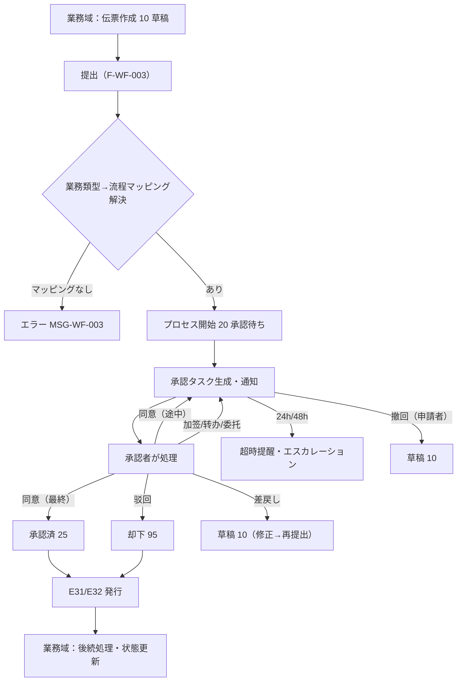
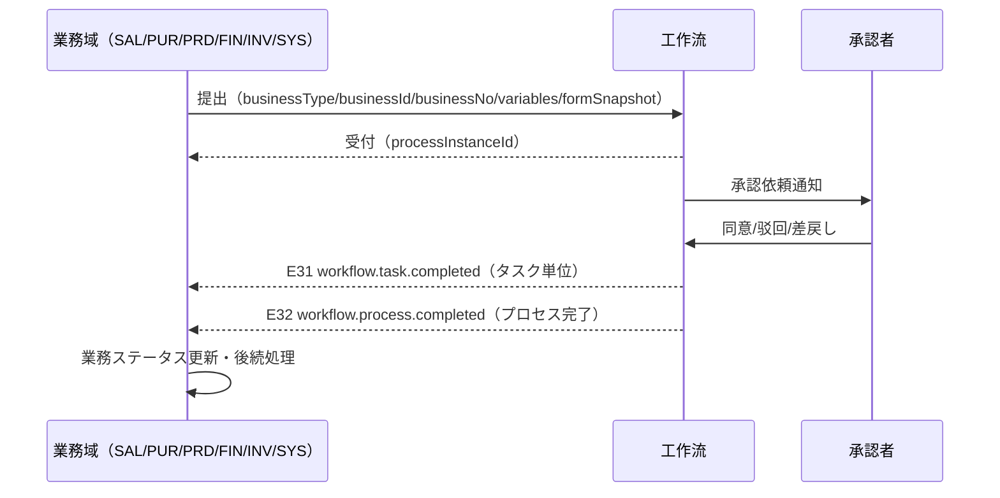

# 工作流 业务域概要书（工作流 業務概要書）

| 項目 | 内容 |
|---|---|
| 文書名 | 工作流 业务域概要书（工作流 業務概要書） |
| 文書番号 | DSN-WF-000 |
| 版数 | v1.0 |
| 作成日 | 2026-10-20 |
| 作成者 | system-workflow（域設計担当） |
| 承認者 | 未承認（レビュー待ち） |
| 状態 | ドラフト（レビュー中） |
| 関連文書 | [体系总览](../README.md) / [共通业务规则](../00-common/08-common-business-rules.md) / [跨域流程](../00-common/09-cross-domain-flow.md) / [系统管理概要](../01-system/00-overview.md) / [Flowable 8.0.0 技術前提](../../tech-selection.md) |

---

## 1. 業務概要

### 1.1 目的

工作流域（WF）は、全業務域の「承認」を統一的に実行する**承認エンジン**である。Flowable 8.0.0 の BPMN エンジンを基盤に、次を提供する。

1. **流程定義**：BPMN モデルの登録・デプロイ・版管理・有効化/停止、業務類型とのマッピング。
2. **承認実行**：提出・待办/已办/我发起的/抄送、同意/驳回/差戻し/加签/转办/撤回/催办/委托。
3. **統制**：職務分掌（自己承認禁止）、承認マトリクス（金額・条件別経路）、代理委任、超時提醒・自動承認、プロセス強制管理。
4. **統合**：業務伝票のステータス連動（`10/20/25/90/95`）と、[跨域流程](../00-common/09-cross-domain-flow.md) 第 9 章のコールバック契約（E31/E32）。

### 1.2 適用範囲

| 項目 | 内容 |
|---|---|
| 対象会社・拠点 | 华东精密电机股份有限公司 / 常州总装厂、无锡零部件厂（示例企業、[demo-company.md](../90-data/demo-company.md)） |
| 対象機能範囲 | F-WF-001〜F-WF-012（流程モデル、マッピング、申請・承認実行、履歴、代理、タイムアウト、執行管理、フィールド権限、状態連動、通知） |
| 対象外 | ①帳票・伝票そのものの登録（各業務域）；②承認の会計判断（FIN）；③外部 BPM（別製品）連携；④メール/短信の送信実装（SYS の通知基盤・INT のゲートウェイ） |
| 前提 | Flowable 8.0.0（Spring Boot 4.1.1 統合）、PostgreSQL 18.6、SYS 域のユーザ/ロール/組織/通知基盤、Redis（キャッシュ） |

### 1.3 業務上の狙い（KPI）

| KPI | 定義・算式 | 目標値 | 実現する機能 ID |
|---|---|---|---|
| 承認リードタイム | 提出→最終承認の平均所要時間（営業時間内） | ≤ 8 時間（金額 50 万円未満）、≤ 24 時間（以上） | F-WF-003〜006 |
| 待办滞留件数 | 承認待ち 48 時間超のタスク数 | 月次 ≤ 20 件 | F-WF-004、008 |
| 自己承認件数 | 申請者＝承認者の承認件数 | 0 件 | F-WF-005 |
| 承認経路精度 | 金額・条件に応じた正しい経路で開始されたプロセス比率 | 100% | F-WF-002 |
| 通知到達率 | 承認依頼通知の配信成功率 | ≥ 99% | F-WF-012 |
| プロセス異常率 | 強制終了・デッドロック等の異常件数 | 月次 ≤ 1 件 | F-WF-009 |

## 2. 組織とロール

### 2.1 承認者ロール（示例企業）

| ロール | 承認範囲 | 関連機能 ID | 権限コード |
|---|---|---|---|
| 部门经理 | 部門内の申請（金額閾値内） | F-WF-004〜006 | `workflow:task:approve` |
| 采购经理 | 購買依頼・発注の承認 | 同上 | 同上 |
| 销售经理 / 销售总监 | 受注・価格・与信超過の承認 | 同上 | 同上 |
| 财务经理 / 财务总监 | 支払・会計・与信の承認 | 同上 | 同上 |
| 生产经理 | 工単・生産計画の承認 | 同上 | 同上 |
| 总经理 | 高額・重要案件の最終承認 | 同上 | 同上 |
| 系统管理员 | 流程定義・マッピング・インスタンス管理 | F-WF-001/002/009 | `workflow:process:*`、`workflow:instance:*` |
| 全ユーザ | 申請・待办参照・委任設定 | F-WF-003/004/007 | `workflow:task:view` |

> 承認マトリクスは [共通业务规则](../00-common/08-common-business-rules.md) 第 8 章と [approval-matrix.md](../90-data/approval-matrix.md) を正とし、WF はそれを `wf_approval_matrix` に設定して実行する（数値の二重定義禁止）。

### 2.2 承認経路（概要）

| 対象 | 条件（税込金額） | 承認経路 | 方式 |
|---|---|---|---|
| 采购申请 PR | < 5,000 元 | 部门经理 | 或签 |
| 采购申请 PR | 5,000〜50,000 元 | 部门经理 → 采购经理 | 順送 |
| 采购申请 PR | 50,000〜500,000 元 | 部门经理 → 采购经理 → 分管副总 | 順送 |
| 采购申请 PR | ≥ 500,000 元 | 上記 + 总经理 | 順送 |
| 销售订单 SO | 標準価格 ±5% 以内 | 销售经理 | 或签 |
| 销售订单 SO | 折扣 5〜10% | 销售总监 | 或签 |
| 销售订单 SO | 折扣 >10% / 与信超過 | 销售总监 → 财务总监 → 总经理 | 順送 |
| 付款申请 PA | < 50,000 元 | 财务经理 | 或签 |
| 付款申请 PA | 50,000〜500,000 元 | 财务经理 → 财务总监 | 順送 |
| 付款申请 PA | ≥ 500,000 元 | 财务总监 → 总经理 | 順送 |
| 主数据变更（价格・信用・口座） | 全件 | 主管部门長 → 职能責任者 | 順送 |
| 盘盈盘亏 | < 10,000 元 | 倉庫主管 → 财务经理 | 順送 |
| 盘盈盘亏 | ≥ 10,000 元 | 上記 + 总经理 | 順送 |

> 金額閾値・経路は `wf_approval_matrix` / `wf_process_mapping` で管理し、ハードコードしない（[共通业务规则](../00-common/08-common-business-rules.md) 8.1）。企業ごとの規程変更は設定変更のみで対応する。
>
> **90-data との整合**：[approval-matrix.md](../90-data/approval-matrix.md) が定める承認対象コード（`APR-*`）・シナリオコード（A01〜A20）・流程キー（`process_key`）・ロールコード（`ROLE-*`）を本域の初期設定の正とする。`wf_process_mapping.proc_def_key` には同文件の `process_key`（例 `APR-SO-L3`）を設定し、`wf_approval_matrix.matrix_code` にはシナリオコード（例 `A08`）を使用する。**テーブル名は Lead 裁决（2026-10-20）により `wf_approval_matrix`（WF 所有）で統一済み**（00-common/08・09、90-data、全 docs を更新済み）。

## 3. 業務フロー

### 3.1 全体フロー

### 3.2 処理手順（提出→承認→結果連動）

| # | 手順 | 実施者 | システム処理 | 入力 | 出力 | 異常時 |
|---|---|---|---|---|---|---|
| 1 | 提出 | 業務担当 | 業務類型・金額・部門等の変数を収集し WF へ提出。プロセス開始・タスク生成 | businessType/businessId/variables | processInstanceId、20 | MSG-WF-003/073 |
| 2 | 経路解決 | WF | `wf_process_mapping` → BPMN 定義 → `wf_approval_matrix` 条件評価 | 金額・部門・フラグ | 承認ノード・承認者 | MSG-WF-004 |
| 3 | 承認依頼 | WF | 承認者へ站内 + メール通知（F-WF-012） | タスク | 通知 | MSG-SYS-075 |
| 4 | 同意 | 承認者 | タスク完了→次ノードへ。最終ならプロセス完了 | taskId, comment | E31/E32 | MSG-WF-010 |
| 5 | 驳回 | 承認者 | プロセス終了。業務ステータス 95 | taskId, reason（必須） | E31/E32 | MSG-WF-011 |
| 6 | 差戻し | 承認者 | 申請者へ戻す。業務ステータス 10 | taskId, backTo, reason | E31 | MSG-WF-012 |
| 7 | 状態連動 | 業務域 | E31/E32 購読→業務伝票ステータス更新（冪等） | event | 10/20/25/90/95 | 重複排除 |
| 8 | 撤回 | 申請者 | 未処理タスクが残る場合のみ。プロセス削除 | processInstanceId | E32（撤回） | MSG-WF-020 |
| 9 | 超時 | バッチ | 24h リマインダ、48h エスカレーション/自動承認（設定） | タスク | 通知・エスカレーション | MSG-WF-030 |

### 3.3 関連業務域との連携

| 相手域 | 連携内容 | 方式（同期/イベント） | 契約 |
|---|---|---|---|
| SAL/PUR/PRD/FIN/INV/SYS | 提出受付、承認実行、結果通知 | 同期コマンド（提出）+ 非同期イベント（E31/E32） | [跨域流程](../00-common/09-cross-domain-flow.md) 第 9 章 |
| 全業務域 | 承認状態の参照（`GET /api/workflow/business-processes/{bizType}/{bizId}`） | 同期参照 | 同 第 9 章 |
| SYS | ユーザ・ロール・組織・職位・データ範囲の参照、通知送信、監査ログ | 同期参照 + 非同期通知 | [SYS 概要](../01-system/00-overview.md) |
| SYS（イベント） | 組織変更イベント **E38 `system.department.changed`** を購読し、承認者解決・データ範囲キャッシュを更新 | 非同期イベント | [09 §3 E38](../00-common/09-cross-domain-flow.md) |
| SYS | Outbox イベント配信基盤 | 非同期（BAT-SYS-001） | 09 第 10 章 |
| INT | メール送信（WF は直接送らず SYS 通知基盤経由） | 同期 | IF-SYS-001 |

## 4. 機能一覧

| 機能 ID | 機能名 | 概要 | 画面 ID | 種別 | 優先度 | 状態 | 詳細設計書 |
|---|---|---|---|---|---|---|---|
| F-WF-001 | 流程模型管理 | BPMN モデルの登録・デプロイ・版管理・有効化/停止・プレビュー | SCR-WF-001、002 | 登録/一覧 | P0 | 設計済 | [01-process-model.md](01-process-model.md) |
| F-WF-002 | 业务类型与流程映射 | 業務類型マスタ、流程マッピング、条件ルール、承認マトリクス | SCR-WF-003、004 | 登録/一覧 | P0 | 設計済 | [01-process-model.md](01-process-model.md) |
| F-WF-003 | 发起审批 | 業務单据の提出・変数収集・プロセス開始・申請取消 | SCR-WF-005 | 登録 | P0 | 設計済 | [02-approval-runtime.md](02-approval-runtime.md) |
| F-WF-004 | 待办/已办/发起/抄送 | 4 種のタスク一覧、絞込・ソート・一括処理 | SCR-WF-006、008、009、010 | 一覧 | P0 | 設計済 | [02-approval-runtime.md](02-approval-runtime.md) |
| F-WF-005 | 审批操作 | 同意/驳回/差戻し/加签/转办/撤回/催办/委托代理 | SCR-WF-007 | ワークフロー | P0 | 設計済 | [02-approval-runtime.md](02-approval-runtime.md) |
| F-WF-006 | 审批历史与流程追踪 | 承認経路タイムライン、各タスクの処理者・日時・コメント、経路図 | SCR-WF-011 | 参照詳細 | P0 | 設計済 | [02-approval-runtime.md](02-approval-runtime.md) |
| F-WF-007 | 代理委托设置 | 期間指定の代理承認者設定、委任の取消・履歴 | SCR-WF-012 | 設定 | P1 | 設計済 | [03-approval-admin.md](03-approval-admin.md) |
| F-WF-008 | 超时提醒与自动审批 | 24h リマインダ、48h エスカレーション、条件付自動承認、設定管理 | SCR-WF-014 | 設定/バッチ | P1 | 設計済 | [03-approval-admin.md](03-approval-admin.md) |
| F-WF-009 | 流程实例管理 | インスタンス検索、掛起/再開、強制終了、承認者跳转（ジャンプ）、変数参照 | SCR-WF-013 | 一覧/監視 | P1 | 設計済 | [03-approval-admin.md](03-approval-admin.md) |
| F-WF-010 | 表单字段级权限 | ノード別フィールド権限（編集可/参照のみ/非表示）の定義と適用 | SCR-WF-015 | 設定 | P1 | 設計済 | [01-process-model.md](01-process-model.md)、[02-approval-runtime.md](02-approval-runtime.md) |
| F-WF-011 | 审批与业务单据状态联动 | E31/E32 契約、業務ステータス遷移、冪等コールバック、補償 | （画面なし・API/イベント） | 連携 | P0 | 設計済 | [02-approval-runtime.md](02-approval-runtime.md) |
| F-WF-012 | 审批消息通知 | 承認依頼・結果・超時・催办の通知（站内/メール）、通知設定 | （SYS SCR-SYS-021 と共用） | 連携 | P0 | 設計済 | [02-approval-runtime.md](02-approval-runtime.md) |

## 5. 画面一覧

| 画面 ID | 画面名 | 類型 | 機能 ID | 権限コード | 遷移元 | 遷移先 |
|---|---|---|---|---|---|---|
| SCR-WF-001 | 流程模型一覧 | LIST | F-WF-001 | `workflow:process:view` | メニュー > 工作流 > 流程模型 | SCR-WF-002 |
| SCR-WF-002 | 流程模型登録編集/デプロイ | EDIT | F-WF-001 | `workflow:process:update` | SCR-WF-001 | SCR-WF-001 |
| SCR-WF-003 | 业务类型映射設定 | LIST | F-WF-002 | `workflow:mapping:view` | メニュー > 工作流 > 业务类型映射 | SCR-WF-004 |
| SCR-WF-004 | 承認マトリクス設定 | EDIT | F-WF-002 | `workflow:mapping:update` | SCR-WF-003 | SCR-WF-003 |
| SCR-WF-005 | 审批发起（提出ダイアログ） | WF | F-WF-003 | `workflow:instance:submit` | 各業務伝票画面 | SCR-WF-009 |
| SCR-WF-006 | 待办一覧 | WF | F-WF-004 | `workflow:task:view` | メニュー > 工作流 > 我的待办、SYS 待办中心 | SCR-WF-007 |
| SCR-WF-007 | 承認画面 | WF | F-WF-005 | `workflow:task:approve` | SCR-WF-006 | SCR-WF-006 |
| SCR-WF-008 | 已办一覧 | WF | F-WF-004 | `workflow:task:view` | メニュー > 工作流 > 我的已办 | 業務詳細 |
| SCR-WF-009 | 我发起的 | WF | F-WF-004 | `workflow:task:view` | メニュー > 工作流 > 我发起的 | SCR-WF-011 |
| SCR-WF-010 | 抄送我的 | WF | F-WF-004 | `workflow:task:view` | メニュー > 工作流 > 抄送我的 | 業務詳細 |
| SCR-WF-011 | 审批历史/流程追踪 | VIEW | F-WF-006 | `workflow:task:view` | 各一覧・業務詳細 | — |
| SCR-WF-012 | 代理委托设置 | EDIT | F-WF-007 | `workflow:delegation:update` | メニュー > 工作流 > 代理设置 | — |
| SCR-WF-013 | 流程实例管理 | LIST | F-WF-009 | `workflow:instance:view` | メニュー > 工作流 > 实例管理 | SCR-WF-011 |
| SCR-WF-014 | 超时规则与自动审批设置 | EDIT | F-WF-008 | `workflow:timeout:update` | メニュー > 工作流 > 超时设置 | — |
| SCR-WF-015 | 表单字段权限设置 | EDIT | F-WF-010 | `workflow:field-permission:update` | SCR-WF-001/002 から | SCR-WF-001 |
| SCR-WF-016 | 流程监控看板 | DASH | F-WF-006/009 | `workflow:monitor:view` | メニュー > 工作流 > 监控 | 各一覧（条件引継ぎ） |

## 6. 帳票一覧

| 帳票 ID | 帳票名 | 出力タイミング | 帳票種別 | 機能 ID | 詳細 |
|---|---|---|---|---|---|
| PRT-WF-001 | 审批流程单（承認経路・履歴付き） | 承認完了時 / 手動 | 伝票 | F-WF-006 | [92](92-report-batch-design.md) |
| PRT-WF-002 | 审批效率统计表 | 月次 / 手動 | 集計表 | F-WF-006/009 | [92](92-report-batch-design.md) |
| PRT-WF-003 | 待办超时一覧表 | 日次 / 手動 | 一覧表 | F-WF-008 | [92](92-report-batch-design.md) |
| PRT-WF-004 | 代理委托履歴表 | 手動 | 一覧表 | F-WF-007 | [92](92-report-batch-design.md) |

## 7. バッチ一覧

| バッチ ID | バッチ名 | 起動方式 | 実行時間帯 | 処理概要 | 冪等性 |
|---|---|---|---|---|---|
| BAT-WF-001 | 超時タスク検出・リマインダ | 自動（5 分間隔） | 常時 | 24h 超のタスクへリマインダ通知 | 条件付き（通知ログで判定） |
| BAT-WF-002 | エスカレーション・自動承認 | 自動（5 分間隔） | 常時 | 48h 超を上位者へエスカレーション、設定時は自動承認 | 条件付き（タスク状態で判定） |
| BAT-WF-003 | 代理期限切れ処理 | 日次 | 00:30 | 期限切れ代理の無効化と通知 | 再実行可 |
| BAT-WF-004 | 流程インスタンス整合検査 | 日次 | 03:30 | Flowable と `wf_business_process` の不整合検出 | 再実行可（読み取り） |
| BAT-WF-005 | 承認効率集計 | 日次/月次 | 02:00 | KPI スナップショット生成（PRT-WF-002） | 再実行可（日付単位上書き） |
| BAT-WF-006 | 完了プロセスアーカイブ | 月次 | 1 日 04:00 | 完了 1 年超の履歴をアーカイブ（Phase 2） | 条件付き |

## 8. テーブル一覧

| 物理名 | 論理名 | 種別 | 主な用途 | 更新元機能 ID | データ量見積 |
|---|---|---|---|---|---|
| wf_process_definition_ext | 流程定义扩展 | マスタ | BPMN 定義の業務属性（分類・有効） | F-WF-001 | 50 件 |
| wf_business_type | 业务类型 | マスタ | 承認対象の業務種別 | F-WF-002 | 40 件 |
| wf_process_mapping | 流程映射 | 設定 | 業務類型→流程定義+条件 | F-WF-002 | 60 件 |
| wf_approval_matrix | 承認マトリクス | 設定 | 金額・条件別の経路 | F-WF-002 | 100 件 |
| wf_approval_matrix_line | 承認マトリクス明細 | 設定 | 経路の各承認ノード | F-WF-002 | 400 件 |
| wf_business_process | 業務流程関連 | 取引 | 業務伝票とプロセスの紐付け | F-WF-003/011 | 30 万/年 |
| wf_task | 承認タスク拡張 | 取引 | Flowable タスクの業務属性 | F-WF-004/005 | 60 万/年 |
| wf_task_operation | 承認操作履歴 | 履歴 | 同意/驳回等の履歴 | F-WF-005/006 | 60 万/年 |
| wf_cc | 抄送 | 取引 | 抄送記録・既読 | F-WF-004 | 20 万/年 |
| wf_delegation | 代理委托 | 設定 | 代理承認設定 | F-WF-007 | 500 件 |
| wf_timeout_rule | 超时规则 | 設定 | リマインダ・自動承認規則 | F-WF-008 | 20 件 |
| wf_timeout_record | 超时记录 | 履歴 | リマインダ・エスカレーション履歴 | F-WF-008 | 10 万/年 |
| wf_form_field_permission | 表单字段权限 | 設定 | ノード別フィールド権限 | F-WF-010 | 1,000 件 |
| wf_process_stat | 流程统计 | 集計 | KPI スナップショット | F-WF-006/009 | 1 万/年 |
| wf_variable | 流程变量 | 取引 | 業務変数のスナップショット | F-WF-003 | 30 万/年 |

> Flowable 標準テーブル（`ACT_*`）は Flowable が自動生成し、本設計では変更しない（[DB 共通規格](../00-common/04-common-db-spec.md) 2.1）。`ACT_*` のデータは WF の業務 API 経由でのみ参照する。

## 9. 外部 IF 一覧

| IF ID | 名称 | 相手先 | 方向 | 方式 | 頻度 | 契機 |
|---|---|---|---|---|---|---|
| IF-WF-001 | BPMN モデルインポート | 設計ツール（bpmn-js / Camunda Modeler エクスポート） | 受信 | ファイル（.bpmn20.xml） | 手動 | 流程デプロイ |
| IF-WF-002 | 承認結果通知 | 各業務域 | 送信 | イベント（E31/E32） | リアルタイム | タスク完了・プロセス完了 |
| IF-WF-003 | 通知送信 | SYS 通知基盤（→メール IF-SYS-001） | 送信 | 同期（公開 Service） | リアルタイム | 承認依頼・結果・超時 |

## 10. 権限一覧

| 権限コード | 対象機能 | 対象データ範囲 | 付与ロール |
|---|---|---|---|
| `workflow:process:view` | F-WF-001/002 | 全社 | 系统管理员、运维担当（参照） |
| `workflow:process:update` | F-WF-001 | 全社 | 系统管理员 |
| `workflow:process:deploy` | F-WF-001 | 全社 | 系统管理员 |
| `workflow:mapping:view` / `update` | F-WF-002 | 全社 | 系统管理员、财务总监（参照） |
| `workflow:instance:view` | F-WF-009 | 全社/部門 | 系统管理员、部门经理（部門） |
| `workflow:instance:manage` | F-WF-009 | 全社 | 系统管理员 |
| `workflow:instance:submit` | F-WF-003 | 本人 | 全ロール |
| `workflow:task:view` | F-WF-004/006 | 本人/部門 | 全ロール |
| `workflow:task:approve` | F-WF-005 | 本人に割当てられたタスク | 承認者ロール |
| `workflow:task:reject` / `withdraw` / `transfer` / `add-sign` | F-WF-005 | 同上 | 承認者・申請者 |
| `workflow:task:urge` | F-WF-005 | 本人が申請したプロセス | 申請者 |
| `workflow:delegation:update` | F-WF-007 | 本人 | 全ロール |
| `workflow:delegation:admin` | F-WF-007 | 全社 | 系统管理员 |
| `workflow:timeout:update` | F-WF-008 | 全社 | 系统管理员 |
| `workflow:field-permission:update` | F-WF-010 | 全社 | 系统管理员 |
| `workflow:monitor:view` | F-WF-006/009 | 全社/部門 | 系统管理员、总经理、内审员 |

## 11. 用語（本域固有）

| 用語 | 説明 | 対応英語/日文 |
|---|---|---|
| 流程定义 | BPMN モデルをデプロイした承認プロセスの定義（版管理） | Process Definition / プロセス定義 |
| 流程实例 | 業務伝票 1 件に対応する承認プロセスの実行インスタンス | Process Instance / プロセスインスタンス |
| 任务 | Flowable が生成する承認作業単位（UserTask） | Task / タスク |
| 或签 | 複数承認者のうち 1 名が承認すれば通過 | Any approval / 或签 |
| 会签 | 複数承認者全員の承認で通過 | All approval / 会签 |
| 顺送 | 承認者を順番に処理（直列） | Serial approval / 順送 |
| 加签 | 承認者が前后任意に承認者を追加 | Add approver / 加算承認 |
| 转办 | 承認者が自分のタスクを他者へ移管（戻らない） | Transfer / 転送 |
| 委托 | 代理人が本人のタスクを処理（期間指定） | Delegation / 代理承認 |
| 撤回 | 申請者が未処理プロセスを取り下げる | Withdraw / 撤回 |
| 差戻し | 承認者が申請者へ修正のため戻す | Return to applicant / 差戻し |
| 驳回 | 承認者が申請を否認し終了（後続は新規申請） | Reject / 却下 |
| 挂起 | プロセスを一時停止（新規タスク生成を止める） | Suspend / 一時停止 |
| 抄送 | 承認完了後に参照通知を送る | CC / 抄送 |
| 表单快照 | 提出時点の業務項目を JSON で保存したもの | Form Snapshot / フォームスナップショット |
| 字段级权限 | 承認画面での項目ごとの編集・参照・非表示制御 | Field Permission / 項目権限 |

## 12. 未決事項

| # | 事項 | 理由 | 暫定仕様 | 担当 | 期限 |
|---|---|---|---|---|---|
| 1 | 承認マトリクステーブル名（**已裁决**） | 各域・00-common・90-data で `sys_approval_matrix` / `wf_approval_matrix` の記載が混在していた | **已裁决：`wf_approval_matrix`（WF 所有）に統一**。Lead が 00-common/08・09・90-data・全 docs を置換済み。他域は同表を参照のみ | Lead | 完了（2026-10-20） |
| 1-b | 流程キー・シナリオコードの命名（**已裁决**） | [approval-matrix.md](../90-data/approval-matrix.md) は流程キー `APR-*`・シナリオ A01〜A20・ロール `ROLE-*`。本設計の業務類型（`*_ORDER`）との対応が必要 | **已裁决：`APR-*` を `proc_def_key`、A01〜A20 を `matrix_code`、`ROLE-*` を `approver_ref` の正とする**（[94](94-sample-data.md) 2 章で対応付け済み） | Lead / system-workflow | 完了（2026-10-20） |
| 2 | Flowable のイベントコールバック方式 | Flowable の `ExecutionListener` でイベント発行するか、`wf_task` 更新後に独自に発行するか | Flowable リスナーから SYS `AuditService` / Outbox 発行サービスを呼ぶ。トランザクション同一 | Lead | 2026-11-10 |
| 3 | BPMN モデル編集 UI の範囲 | bpmn-js を画面に組込むか、外部ツールで作成したモデルをアップロードするか | Phase 1 はアップロード + プレビュー（bpmn-js viewer）。編集は Phase 2 | Lead | 2026-11-17 |
| 4 | 承认マトリクスの条件評価方式 | DMN エンジン（Flowable DMN）か、独自ルール（JSON 条件）か | Phase 1 は `wf_process_mapping.condition_json` の JSON 条件評価（金額・部門・フラグ）。DMN は Phase 2 | Lead | 2026-11-10 |
| 5 | 自動承認の許容範囲 | 金額閾値内の全自動承認を許すか、特定項目のみか | 既定 OFF（`workflow.auto-approve-enabled=false`）。設定時も金額上限とログ必須 | 系统管理员 | 2026-11-17 |
| 6 | 業務ステータス連動の責任分界 | E31 で WF が業務ステータスを更新するか、業務域が更新するか | [跨域流程](../00-common/09-cross-domain-flow.md) 9.1 の通り**業務域が更新**（WF はイベント発行のみ） | Lead | 2026-10-27 |
| 7 | 委任・代理時の通知先 | 委任者・代理人の両方に通知するか | 両方に通知（代理人に主送、委任者に抄送） | system-workflow | 2026-11-10 |
| 8 | 承認経路変更時の進行中プロセス扱い | 組織改編・金額改定時に旧経路を継続するか新経路に切替えるか | 旧経路で継続（[跨域流程](../00-common/09-cross-domain-flow.md) 9.1） | Lead | 2026-11-17 |
| 9 | 監査ログの閲覧範囲 | 承認者が全承認履歴を参照できるか | 自分の処理分 + 自分が申請したプロセスのみ。管理者は全社 | 内审员 | 2026-12-01 |
| 10 | マルチテナント時の流程分離 | テナント別に流程定義を分けるか | Phase 3 で `tenant_id` 別に分離。Phase 1 は単一 | Lead | 2027-06-30 |

## 13. 改訂履歴

| 版数 | 日付 | 変更内容 | 変更者 |
|---|---|---|---|
| v1.0 | 2026-10-20 | 初版：業務概要、承認ロール/マトリクス、業務フロー、F-WF-001〜012、画面 16、帳票 4、バッチ 6、テーブル 15、IF 3、権限一覧、用語、未決 10 | system-workflow |
| v1.1 | 2026-10-20 | 90-data/approval-matrix.md と整合：`APR-*` 流程キー・A01〜A20 シナリオ・`ROLE-*` ロールの対応を明記。未決 #1 に他域参照の事実と選択肢を追記、#1-b を追加 | system-workflow |
| v1.2 | 2026-10-20 | Lead 裁决反映：承認マトリクス表名 `wf_approval_matrix`（WF 所有）・流程キー `APR-*`・シナリオコードの扱いを已裁决に更新 | system-workflow |