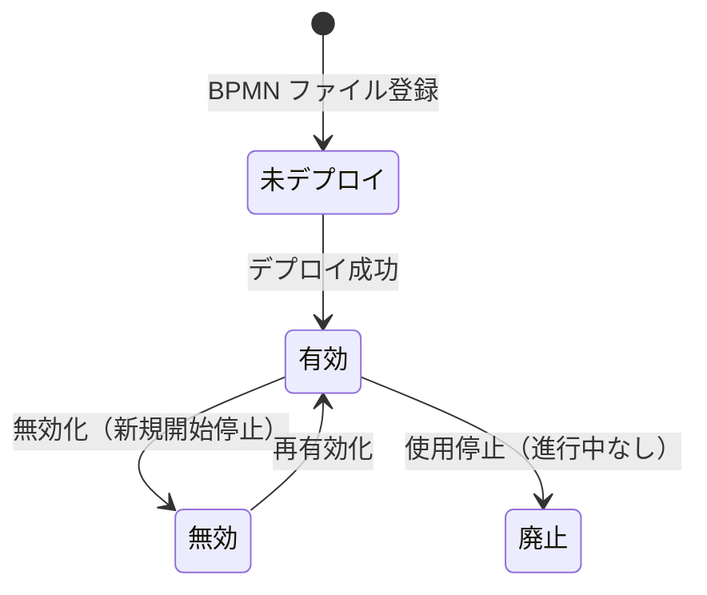

# 流程模型与映射 详细设计书（プロセスモデル・マッピング 詳細設計書）

| 項目 | 内容 |
|---|---|
| 文書名 | 流程模型与映射 详细设计书（プロセスモデル・マッピング 詳細設計書） |
| 文書番号 | DSN-WF-001 |
| 版数 | v1.0 |
| 作成日 | 2026-10-20 |
| 作成者 | system-workflow（域設計担当） |
| 承認者 | 未承認（レビュー待ち） |
| 状態 | ドラフト（レビュー中） |
| 関連文書 | [業務域概要](00-overview.md) / [DB 設計](90-db-design.md) / [API 設計](91-api-design.md) / [承認実行設計](02-approval-runtime.md) / [共通業務規則](../00-common/08-common-business-rules.md) / [跨域流程](../00-common/09-cross-domain-flow.md) |

---

## 1. 機能概要

| 項目 | 内容 |
|---|---|
| 機能 ID | F-WF-001（流程模型管理）、F-WF-002（业务类型与流程映射）、F-WF-010（表单字段级权限） |
| 機能名 | BPMN モデルのデプロイ・版管理・有効化、業務類型マッピング、承認マトリクス、フィールド権限定義 |
| 目的 | 「どの業務が、どの条件で、どの承認経路を通るか」をデータで定義し、組織・金額規程の変更に再デプロイなしで追従できるようにする |
| 利用者・ロール | 系统管理员（全般）、财务总监（マトリクス参照・承認）、内审员（参照） |
| 利用シーン | 新業務の承認フロー導入、金額閾値の改定、組織改編に伴う承認者の変更、項目権限の統制 |
| 優先度 | F-WF-001/002 P0、F-WF-010 P1 |
| 画面 ID | SCR-WF-001（流程模型一覧）、SCR-WF-002（流程模型登録編集/デプロイ）、SCR-WF-003（业务类型映射設定）、SCR-WF-004（承認マトリクス設定）、SCR-WF-015（表单字段权限设置） |
| 関連 IF | IF-WF-001（BPMN ファイルインポート） |

## 2. 業務要件・業務ルール

### 2.1 前提条件

| # | 前提条件 | 成立しない場合の挙動 |
|---|---|---|
| 1 | BPMN ファイルが Flowable 8.0.0 でパース可能（`bpmn20.xml`） | デプロイ失敗（MSG-WF-001） |
| 2 | 業務類型が SYS の権限コード体系・業務域モジュールと整合している | マッピング保存不可（MSG-WF-051） |
| 3 | 承認マトリクスの承認者が解決可能（ロール・職位・上長が存在） | 保存時に警告（START 時は MSG-WF-004） |
| 4 | 既定（フォールバック）マッピングが 1 件存在する | プロセス開始不可（MSG-WF-003） |

### 2.2 業務ルール

| # | ルール | 根拠（法令・社内規程・業務慣行） | 関連項目 |
|---|---|---|---|
| BR-01 | BPMN モデルはファイルアップロードでデプロイし、Flowable が版数（1,2,3…）を自動採番する。版の上書きは禁止（新規デプロイで新版本） | 承認経路の証跡 | `proc_def_version` |
| BR-02 | 版ごとに有効/無効を設定できる。`is_default=true` の版が新規プロセス開始に使用される | 運用切替 | `is_default` |
| BR-03 | 業務類型ごとにマッピングを定義し、`priority` 昇順で `condition_json` を評価して最初に成立した行を使う。条件なし行（フォールバック）が必須 | 経路決定の一意性 | `wf_process_mapping` |
| BR-04 | 金額条件は税込金額で評価する（[共通業務规则](../00-common/08-common-business-rules.md) 8.1）。境界は下限含む・上限含まず | 金額閾値の統一 | `amount_min`/`amount_max` |
| BR-05 | 承認者解決方式：ロール / ユーザ / 職位 / 申請者直属上長 / 部門長 / 変数。職位・上長で複数該当する場合は上位職位者を優先し、同一職位が複数の場合は会签または或签の設定に従う | 承認者の一意性 | `approver_type` |
| BR-06 | 自己承認禁止：解決された承認者に申請者が含まれる場合、その承認者を除外する。除外の結果 0 名になる場合は「上長へエスカレーション」または開始エラー（`MSG-WF-005`） | 内部統制 | 承認者解決 |
| BR-07 | 進行中プロセスは開始時点の版・マッピングで継続する（組織改編・金額改定後も旧経路） | [跨域流程](../00-common/09-cross-domain-flow.md) 9.1 | — |
| BR-08 | 承認マトリクスの金額範囲が同一業務類型内で重複する場合は保存時に警告し、理由を要求する（意図的な優先度設定を許す） | 経路の一意性 | `priority` |
| BR-09 | フィールド権限はノード×項目×ロールで定義し、承認画面の表示・編集を制御する。非表示項目は API レスポンスから除外する | 情報統制 | `wf_form_field_permission` |
| BR-10 | 財務関連の金額項目は「参照のみ」以上を既定とし、非表示にはできない（監査要件） | 監査 | `totalAmount` 等 |
| BR-11 | 定義・マッピング・マトリクス・フィールド権限の変更は監査ログに before/after を記録する | 内部統制 | `sys_audit_log` |

> **90-data との整合**：`proc_def_key` は [approval-matrix.md](../90-data/approval-matrix.md) の `process_key`（例 `APR-SO-L3`）、承認マトリクスの `matrix_code` はシナリオコード（例 `A08`）、`approver_ref` のロールは `ROLE-*`（例 `ROLE-FIN-DIR`）を正として設定する。業務類型（`SALES_ORDER` 等）と承認対象コード（`APR-SO`）の対応は [94-sample-data.md](94-sample-data.md) 2 章のとおり。テーブル名 `wf_approval_matrix`（approval-matrix.md §6）と `wf_approval_matrix`（本設計）の相違は [00-overview.md](00-overview.md) 未決 #1 で Lead 判断を仰ぐ。

### 2.3 状態遷移（プロセス定義の有効性）



| 遷移 | トリガ | 権限 | 更新項目 | メッセージ |
|---|---|---|---|---|
| 未→有効 | デプロイ | `workflow:process:deploy` | `proc_def_id`、`deploy_time`、`is_active=true` | MSG-WF-001 |
| 有効→無効 | 無効化 | `workflow:process:update` | `is_active=false` | MSG-COM-001 |
| 無効→有効 | 有効化 | 同上 | `is_active=true` | MSG-COM-001 |
| 有効→廃止 | 削除 | `workflow:process:update` | `status=0`（進行中 0 件条件） | MSG-WF-006 |

## 3. 関連機能

| 関係 | 機能 ID | 機能名 | 関係内容 |
|---|---|---|---|
| 上流 | F-SYS-003 | 角色与权限 | 承認者解決のロール・職位を参照 |
| 上流 | F-SYS-005/006 | 组织・岗位 | 部門長・職位・上長の解決 |
| 下流 | F-WF-003 | 发起审批 | マッピングからプロセス定義・経路を決定 |
| 下流 | F-WF-005 | 审批操作 | フィールド権限を承認画面に適用 |
| 参照 | F-WF-006 | 流程追踪 | 定義の版・経路図表示 |

## 4. 画面設計

### 4.1 画面一覧

| 画面 ID | 画面名 | 類型 | 概要 |
|---|---|---|---|
| SCR-WF-001 | 流程模型一覧 | LIST | 定義一覧（キー・版・分類・有効・既定）、デプロイ・有効化 |
| SCR-WF-002 | 流程模型登録編集/デプロイ | EDIT | BPMN ファイルアップロード、プレビュー、定義属性編集 |
| SCR-WF-003 | 业务类型映射設定 | LIST | 業務類型一覧、マッピング行の管理 |
| SCR-WF-004 | 承認マトリクス設定 | EDIT | 金額条件・承認ノード（ロール/職位/上長/或签/会签）の編集 |
| SCR-WF-015 | 表单字段权限设置 | EDIT | ノード×項目×ロールの権限マトリクス編集 |

### 4.2 画面レイアウト（SCR-WF-004 承認マトリクス設定）

```
┌──────────────────────────────────────────────────────────────────────────────┐
│ ホーム > 工作流 > 业务类型映射 > 承認マトリクス                              │
├──────────────────────────────────────────────────────────────────────────────┤
│ 业务类型 [PURCHASE_REQUISITION 采购申请 ▼]   [+ 新增规则]                     │
├──────────────────────────────────────────────────────────────────────────────┤
│ 代码          | 名称                    | 金額範囲(CNY)         | 優先 | 操作 │
│ PR_LT_5K     | 采购申请 5,000 未満     | - ～ 5,000            | 10   | [编辑]│
│ PR_5K_50K    | 采购申请 5,000～50,000  | 5,000 ～ 50,000       | 20   | [编辑]│
│ PR_50K_500K  | 采购申请 50,000～500,000| 50,000 ～ 500,000     | 30   | [编辑]│
│ PR_GTE_500K  | 采购申请 500,000 以上   | 500,000 ～ 无上限      | 40   | [编辑]│
├──────────────────────────────────────────────────────────────────────────────┤
│〔PR_5K_50K の明細〕                                                          │
│ 行 | ノード名   | 承認者方式 | 参照           | 方式 | 個別期限 | 操作         │
│ 10 | 部门经理   | 部門長     | -              | 或签 | 24h     | [↑][↓][削除] │
│ 20 | 采购经理   | ロール     | PURCHASE_MANAGER | 或签 | 24h   | [↑][↓][削除] │
│ 30 | 分管副总   | ロール     | DEPUTY_GM      | 顺送 | 48h     | [↑][↓][削除] │
│    |            |            |                |      |         | [+ 追加]     │
│ [保存]                                                                       │
└──────────────────────────────────────────────────────────────────────────────┘
```

### 4.3 画面項目定義（SCR-WF-002 流程模型登録/デプロイ）

| No | 項目 ID | 項目名 | 種別 | 型/桁 | 必須 | 初期値 | 入力チェック | データソース | DB 項目 | 権限 | 備考 |
|---|---|---|---|---|---|---|---|---|---|---|---|
| 1 | `processKey` | 流程キー | テキスト | VARCHAR(100) | ○ | 空 | `^[A-Za-z][A-Za-z0-9_]{2,99}$`、既存キーは新版のみ | 入力 | `wf_process_definition_ext.proc_def_key` | `workflow:process:update` | BPMN の process id と一致 |
| 2 | `processName` | 流程名称 | テキスト | VARCHAR(200) | ○ | 空 | ≤200 字 | 入力 | `process_name` | 同上 | — |
| 3 | `processCategory` | 分类 | 選択 | VARCHAR(64) | ○ | 空 | purchase/sales/production/finance/master/system | 固定値 | `process_category` | 同上 | — |
| 4 | `processType` | 種別 | ラジオ | SMALLINT | ○ | 1 承認 | 1/2/3 | 固定値 | `process_type` | 同上 | — |
| 5 | `bpmnFile` | BPMN 文件 | アップロード | — | ○ | 空 | .bpmn20.xml/.bpmn、5MB、パース成功、ユーザータスク存在 | 入力 | `bpmn_resource_name` | `workflow:process:deploy` | — |
| 6 | `icon` | 图标 | 選択 | VARCHAR(64) | △ | 空 | Element Plus アイコン | 固定値 | `icon` | 同上 | — |
| 7 | `description` | 说明 | テキストエリア | VARCHAR(500) | △ | 空 | ≤500 字 | 入力 | `description` | 同上 | — |
| 8 | `isActive` | 有効 | スイッチ | BOOLEAN | ○ | false | — | 入力 | `is_active` | 同上 | デプロイ後に有効化 |
| 9 | `previewDiagram` | 経路プレビュー | 画像 | — | — | 空 | — | bpmn-js viewer | — | 参照 | — |

### 4.4 画面項目定義（SCR-WF-004 承認マトリクス）

| No | 項目 ID | 項目名 | 種別 | 型/桁 | 必須 | 初期値 | 入力チェック | DB 項目 | 権限 |
|---|---|---|---|---|---|---|---|---|---|
| 1 | `matrixCode` | 代码 | テキスト | VARCHAR(64) | ○ | 空 | 一意 | `wf_approval_matrix.matrix_code` | `workflow:mapping:update` |
| 2 | `matrixName` | 名称 | テキスト | VARCHAR(200) | ○ | 空 | ≤200 字 | `matrix_name` | 同上 |
| 3 | `businessType` | 业务类型 | 選択 | VARCHAR(64) | ○ | 選択中 | `wf_business_type` に存在 | `business_type` | 同上 |
| 4 | `amountMin` | 金額下限 | 数値 | NUMERIC(18,2) | △ | 空 | ≥0、`amountMin ≤ amountMax` | `amount_min` | 同上 |
| 5 | `amountMax` | 金額上限 | 数値 | NUMERIC(18,2) | △ | 空 | >下限（空=無上限） | `amount_max` | 同上 |
| 6 | `conditionJson` | 追加条件 | JSON エディタ | JSON | △ | 空 | 演算子限定（eq/ne/gt/gte/lt/lte/in/between/exists） | `condition_json` | 同上 |
| 7 | `priority` | 優先度 | 数値 | INT | ○ | 100 | 0〜9999 | `priority` | 同上 |
| 8 | `lines` | 承認ノード明細 | テーブル編集 | — | ○ | 空 | 1 行以上 | `wf_approval_matrix_line` | 同上 |
| 9 | `nodeName` | ノード名 | テキスト | VARCHAR(100) | ○ | 空 | ≤100 字 | `node_name` | 同上 |
| 10 | `approverType` | 承認者方式 | 選択 | SMALLINT | ○ | 空 | 1〜6 | `approver_type` | 同上 |
| 11 | `approverRef` | 参照値 | 選択/テキスト | VARCHAR(200) | △ | 空 | 方式に応じ必須・存在 | `approver_ref` | 同上 |
| 12 | `signType` | 署名方式 | 選択 | SMALLINT | ○ | 1 或签 | 1〜3 | `sign_type` | 同上 |
| 13 | `minApproverCount` | 最低承認数 | 数値 | SMALLINT | △ | 1 | 0〜99（会签時） | `min_approver_count` | 同上 |
| 14 | `timeoutHours` | 個別期限 | 数値 | INT | △ | 空 | 1〜720 | `timeout_hours` | 同上 |

### 4.5 画面項目定義（SCR-WF-015 表单字段权限）

| No | 項目 ID | 項目名 | 種別 | 型/桁 | 必須 | 初期値 | 入力チェック | DB 項目 | 権限 |
|---|---|---|---|---|---|---|---|---|---|
| 1 | `procDefKey` | 流程 | 選択 | VARCHAR(100) | ○ | 空 | 有効定義 | `wf_form_field_permission.proc_def_key` | `workflow:field-permission:update` |
| 2 | `nodeDefKey` | ノード | 選択 | VARCHAR(100) | △ | 全ノード | BPMN の userTask から取得 | `node_def_key` | 同上 |
| 3 | `fieldKey` | 項目キー | 選択 | VARCHAR(100) | ○ | 空 | 業務類型の snapshot_fields に存在 | `field_key` | 同上 |
| 4 | `permissionType` | 権限 | ラジオ | SMALLINT | ○ | 2 参照のみ | 1 編集可/2 参照のみ/3 非表示 | `permission_type` | 同上 |
| 5 | `applyRoleCode` | 適用ロール | 選択 | VARCHAR(64) | △ | 空（全ロール） | 有効ロール | `apply_role_code` | 同上 |
| 6 | `requiredFlag` | 编辑时必需 | スイッチ | BOOLEAN | ○ | false | 編集可時のみ有効 | `required_flag` | 同上 |

### 4.6 イベント処理

| No | イベント | トリガ | 処理内容 | 呼出 API | 画面遷移 | 備考 |
|---|---|---|---|---|---|---|
| 1 | BPMN アップロード | ファイル選択 | ローカル検証（拡張子・サイズ） | — | — | サーバでも再検証 |
| 2 | デプロイ | デプロイボタン | サーバへアップロード→Flowable デプロイ→拡張登録 | POST /api/workflow/process-definitions/deploy | 一覧へ | 版数自動採番 |
| 3 | 有効化/無効化 | スイッチ | 定義の有効性更新 | PUT /api/workflow/process-definitions/{id}/active | 同一画面 | 進行中は旧版継続 |
| 4 | 既定版設定 | ボタン | 同一キーの既定版を切替 | PUT /api/workflow/process-definitions/{id}/default | 同一画面 | 新規開始から適用 |
| 5 | 経路プレビュー | 行選択 | BPMN XML を取得し SVG 表示 | GET /api/workflow/process-definitions/{id}/diagram | ダイアログ | bpmn-js viewer |
| 6 | マッピング保存 | 保存ボタン | 条件・優先度検証→保存 | POST/PUT /api/workflow/process-mappings | 同一画面 | フォールバック必須 |
| 7 | マトリクス保存 | 保存ボタン | 金額範囲・明細検証→保存 | POST/PUT /api/workflow/approval-matrices | 同一画面 | 重複警告 |
| 8 | 承認者存在チェック | 保存ボタン | ロール・職位・ユーザの存在確認 | POST /api/workflow/approval-matrices/validate | — | 警告表示 |
| 9 | フィールド権限保存 | 保存ボタン | マスキング禁止項目の検査→保存 | PUT /api/workflow/field-permissions | 同一画面 | 監査ログ |

### 4.7 表示制御

| 条件 | 対象項目/ボタン | 制御 |
|---|---|---|
| 進行中プロセスあり | 定義の削除 | 非表示（無効化のみ） |
| 定義が無効 | 既定設定ボタン | 非表示 |
| 権限なし | デプロイ・保存・削除 | 非表示 |
| 業務類型が使用中 | 削除ボタン | 非表示 |
| 財務必須項目 | 非表示ラジオ | 選択不可（参照のみ以上に強制） |
| マッピング条件なし行が既存 | 追加の条件なし行 | 保存時エラー |

## 5. 入力チェック仕様

| No | チェック ID | 対象項目 | 種別 | 条件 | タイミング | メッセージ ID |
|---|---|---|---|---|---|---|
| 1 | CHK-WF-001-01 | `bpmnFile` | 形式・サイズ | `.bpmn20.xml`/`.bpmn`、≤5MB | デプロイ | MSG-WF-001 |
| 2 | CHK-WF-001-02 | `bpmnFile` | 構造 | パース成功、`userTask` 1 つ以上、`process id` あり | デプロイ | MSG-WF-002 |
| 3 | CHK-WF-001-03 | `processKey` | 一意 | 既存キーは同一 `proc_def_key` の新版のみ可 | デプロイ | MSG-WF-007 |
| 4 | CHK-WF-001-04 | `isDefault` | 一意 | 同一キー内 1 件 | 設定 | MSG-WF-008 |
| 5 | CHK-WF-002-01 | `businessType` | 存在・一意 | 有効業務類型、マッピング条件なし行 1 件 | 保存 | MSG-WF-051 |
| 6 | CHK-WF-002-02 | `conditionJson` | 演算子 | 許可演算子のみ、ネスト 3 段以内 | 保存 | MSG-WF-052 |
| 7 | CHK-WF-002-03 | `procDefKey` | 存在 | 有効プロセス定義が存在 | 保存 | MSG-WF-003 |
| 8 | CHK-WF-002-04 | `amountMin/Max` | 相関 | 下限 ≤ 上限 | 保存 | MSG-COM-045 |
| 9 | CHK-WF-002-05 | 金額範囲重複 | 一意性 | 同一業務類型で重複しない（警告） | 保存 | MSG-WF-053（W） |
| 10 | CHK-WF-002-06 | `lines` | 必須 | 1 行以上 | 保存 | MSG-WF-010 |
| 11 | CHK-WF-002-07 | `approverRef` | 存在 | ロール・職位・ユーザが存在 | 保存/開始 | MSG-WF-004 |
| 12 | CHK-WF-002-08 | `signType` | 整合 | 会签時 `minApproverCount` 妥当 | 保存 | MSG-COM-044 |
| 13 | CHK-WF-010-01 | `fieldKey` | 存在 | 業務類型の snapshot_fields に存在 | 保存 | MSG-WF-061 |
| 14 | CHK-WF-010-02 | 財務必須項目 | 制約 | `totalAmount` 等は非表示不可 | 保存 | MSG-WF-062 |

## 6. 処理詳細

### 6.1 処理一覧

| 処理 ID | 処理名 | 契機 | トランザクション | 排他 |
|---|---|---|---|---|
| PRC-WF-001-01 | BPMN デプロイ | デプロイ | 要（拡張登録） | 定義キー単位のロック |
| PRC-WF-001-02 | 定義有効化/既定切替 | スイッチ | 要 | 同一キー行ロック |
| PRC-WF-001-03 | 経路プレビュー | 行選択 | 不要 | — |
| PRC-WF-002-01 | マッピング解決（開始時） | 提出 | 呼出元と同一 TX | なし（読取） |
| PRC-WF-002-02 | マッピング保存 | 保存 | 要 | 業務類型単位ロック |
| PRC-WF-002-03 | 承認マトリクス解決 | 開始時 | 呼出元と同一 TX | なし |
| PRC-WF-010-01 | フィールド権限解決 | 承認画面表示 | 不要 | — |

### 6.2 処理手順（正常系）

**PRC-WF-001-01 BPMN デプロイ**

1. 権限チェック（`workflow:process:deploy`）。
2. アップロードファイルの拡張子・サイズ・XML 構文を検証する。`process` 要素の `id` を `proc_def_key` として取得する。
3. Flowable の `RepositoryService.createDeployment().addInputStream(...).deploy()` でデプロイする。Flowable が版数を採番する。
4. `ACT_RE_PROCDEF` から `proc_def_id`・版数を取得し、`wf_process_definition_ext` に業務属性を INSERT する（`is_active=false`、`is_default=false` で登録）。
5. BPMN に `userTask` が存在しない場合・承認者解決に必要な拡張属性が不正な場合はデプロイをロールバックする（`MSG-WF-002`）。
6. `wf_form_field_permission` の既定（全ノード＝参照のみ）を必要に応じて自動作成する（フィールド定義がある場合）。
7. 監査ログ（`CREATE`, resource=process_definition）を記録し、プレビュー用 SVG を生成して返す。
8. デプロイ後は運用者が内容を確認して「有効化」する（2 段階）。

**PRC-WF-002-01 マッピング解決（提出時）**

1. 業務類型で有効な `wf_process_mapping` を `priority` 昇順で取得する。
2. 各行の `condition_json` を変数（`amount`、`departmentId`、`creditExceeded` 等）で評価し、最初に成立した行を採用する。
3. 採用行の `proc_def_key` から既定版の `proc_def_id` を取得する（`is_default=true`）。既定版が無効なら最新有効版を使用する。
4. `approval_matrix_id` がある場合、マトリクス条件を評価して該当行を取得する。該当なしは開始エラー（`MSG-WF-004`）。
5. マトリクス明細から承認ノード・承認者解決方式を取得し、変数とともにプロセス開始処理（[02-approval-runtime.md](02-approval-runtime.md) PRC-WF-003-01）へ渡す。
6. 条件なし行（フォールバック）がない場合は開始エラー（`MSG-WF-003`）。

**PRC-WF-002-02 マッピング保存**

1. 権限チェック（`workflow:mapping:update`）。マッピングは業務類型単位で編集する。
2. 入力チェック（CHK-WF-002-01〜03）を実行する。
3. `condition_json` の演算子・ネスト・参照変数が許可されたものかを検証する。`amount`/`departmentId`/`factoryId`/`creditExceeded`/`urgent` を許可変数とする。
4. 業務類型単位で行ロックし、マッピングを保存する（条件なし行が 1 件だけであることを検査）。
5. 保存後、マッピングキャッシュ（Redis `wf:mapping:{businessType}`）を無効化する。
6. 監査ログ（before/after）を記録する。

**PRC-WF-002-03 承認マトリクス解決**

1. 業務類型・金額・条件（部門等）で有効なマトリクス行を取得する。
2. `condition_type` に応じて評価する：金額は `amount_min <= amount < amount_max`（上限なしは無制限）、条件 JSON は変数評価。
3. 複数該当時は `priority` 最小を採用する。該当なしは `MSG-WF-004`。
4. マトリクス明細を `line_no` 昇順で取得し、承認ノードリストを返す。
5. 各ノードの承認者を解決する（ロールメンバー、職位、上長、部門長、変数）。自己承認者は除外し、0 名なら `MSG-WF-005`。
6. 解決結果（ノード名・承認者 ID リスト・署名方式・個別期限）を返す。

**PRC-WF-010-01 フィールド権限解決（承認画面）**

1. プロセス定義キー・現在のタスクのノードキー・ログインユーザのロールで `wf_form_field_permission` を検索する。
2. 解決順序：ノード＋ロール → ノード（`apply_role_code IS NULL`）→ 全ノード＋ロール → 全ノード → 既定（参照のみ）。
3. 各項目の権限（編集可/参照のみ/非表示）と必須フラグを返す。
4. 非表示項目は `formSnapshot` から該当キーを削除して返す（API レスポンスに含めない）。
5. 承認画面（SCR-WF-007）はこの結果に従って入力可否を制御し、保存時にもサーバ側で再検証する（二重防御）。

### 6.3 例外処理

| No | 異常条件 | 検知箇所 | 処理 | ロールバック | メッセージ ID |
|---|---|---|---|---|---|
| 1 | BPMN パース失敗 | デプロイ | 拒否 | 全体 | MSG-WF-001 |
| 2 | userTask なし | デプロイ | 拒否 | 全体 | MSG-WF-002 |
| 3 | 同一キー・同一内容の再デプロイ | デプロイ | 拒否（版の無駄な増加防止） | 全体 | MSG-WF-007 |
| 4 | 既定版が無効 | 開始 | 最新有効版へフォールバック、警告ログ | — | — |
| 5 | マッピングなし | 開始 | 開始失敗、業務ステータスは 10 のまま | 全体 | MSG-WF-003 |
| 6 | マトリクス該当なし | 開始 | 開始失敗 | 全体 | MSG-WF-004 |
| 7 | 承認者 0 名 | 開始 | 開始失敗（上長エスカレーション設定時は続行） | 全体 | MSG-WF-005 |
| 8 | 進行中プロセスの定義削除 | 削除 | 拒否（無効化を案内） | — | MSG-WF-006 |
| 9 | フィールド権限の矛盾（必須＋非表示） | 保存 | 拒否 | 全体 | MSG-WF-063 |
| 10 | 財務必須項目の非表示設定 | 保存 | 拒否 | 全体 | MSG-WF-062 |

### 6.4 冪等性・排他

- デプロイは `Idempotency-Key` + ファイルハッシュ一致で二重デプロイを防止する（同一ハッシュは `MSG-WF-007`）。
- 有効化・既定切替は `proc_def_key` 単位でロックする。
- マッピング・マトリクスは `version` 楽観排他。
- 開始時のマッピング解決は読み取りのみで、キャッシュ（60 秒）を使用する。設定変更後の開始は最大 60 秒で新設定に追従する。

## 7. API 設計

| No | メソッド | パス | 権限 | 概要 |
|---|---|---|---|---|
| 1 | GET | /api/workflow/process-definitions | `workflow:process:view` | 定義一覧 |
| 2 | GET | /api/workflow/process-definitions/{id} | `workflow:process:view` | 定義詳細 |
| 3 | POST | /api/workflow/process-definitions/deploy | `workflow:process:deploy` | BPMN デプロイ |
| 4 | PUT | /api/workflow/process-definitions/{id} | `workflow:process:update` | 定義属性更新 |
| 5 | PUT | /api/workflow/process-definitions/{id}/active | `workflow:process:update` | 有効/無効 |
| 6 | PUT | /api/workflow/process-definitions/{id}/default | `workflow:process:update` | 既定版切替 |
| 7 | GET | /api/workflow/process-definitions/{id}/diagram | `workflow:process:view` | 経路 SVG |
| 8 | DELETE | /api/workflow/process-definitions/{id} | `workflow:process:update` | 定義廃止 |
| 9 | GET | /api/workflow/business-types | `workflow:mapping:view` | 業務類型一覧 |
| 10 | POST | /api/workflow/business-types | `workflow:mapping:update` | 業務類型登録 |
| 11 | PUT | /api/workflow/business-types/{code} | `workflow:mapping:update` | 業務類型更新 |
| 12 | GET | /api/workflow/process-mappings | `workflow:mapping:view` | マッピング一覧 |
| 13 | POST | /api/workflow/process-mappings | `workflow:mapping:update` | マッピング登録 |
| 14 | PUT | /api/workflow/process-mappings/{id} | `workflow:mapping:update` | マッピング更新 |
| 15 | DELETE | /api/workflow/process-mappings/{id} | `workflow:mapping:update` | マッピング削除 |
| 16 | GET | /api/workflow/approval-matrices | `workflow:mapping:view` | マトリクス一覧 |
| 17 | GET | /api/workflow/approval-matrices/{id} | `workflow:mapping:view` | マトリクス詳細（明細含む） |
| 18 | POST | /api/workflow/approval-matrices | `workflow:mapping:update` | マトリクス登録 |
| 19 | PUT | /api/workflow/approval-matrices/{id} | `workflow:mapping:update` | マトリクス更新 |
| 20 | DELETE | /api/workflow/approval-matrices/{id} | `workflow:mapping:update` | マトリクス削除 |
| 21 | POST | /api/workflow/approval-matrices/validate | `workflow:mapping:update` | 承認者解決チェック |
| 22 | GET | /api/workflow/field-permissions | `workflow:field-permission:update` | フィールド権限一覧 |
| 23 | PUT | /api/workflow/field-permissions | `workflow:field-permission:update` | フィールド権限保存 |

### 7.1 リクエスト/レスポンス詳細

**POST /api/workflow/process-definitions/deploy**（multipart/form-data）

```
processKey=SALES_ORDER_APPROVAL&processName=销售订单审批&processCategory=sales&processType=1&bpmnFile=@sales-order.bpmn20.xml
// 成功
{ "code": 0, "message": "保存しました。", "data": {
  "procDefId": "SALES_ORDER_APPROVAL:1:8f3c...", "procDefVersion": 1, "deployedAt": "2026-10-20T14:30:00+08:00" } }
// エラー（userTask なし）
{ "code": 80001, "message": "BPMN 文件中未找到用户任务节点，无法作为审批流程使用。", "data": null }
```

**POST /api/workflow/process-mappings**

```json
{ "mappingCode": "SO_STANDARD", "businessType": "SALES_ORDER", "procDefKey": "SALES_ORDER_APPROVAL",
  "approvalMatrixId": "1845000000000006101", "conditionJson": null, "priority": 100,
  "effectiveFrom": "2026-10-20", "isActive": true }
// 条件あり例
{ "mappingCode": "SO_DISCOUNT_OVER_10", "businessType": "SALES_ORDER", "procDefKey": "SALES_ORDER_APPROVAL",
  "approvalMatrixId": "1845000000000006103", "conditionJson": { "gt": [ {"var":"discountRate"}, 0.10 ] },
  "priority": 10, "isActive": true }
```

**POST /api/workflow/approval-matrices/validate**

```json
{ "businessType": "PURCHASE_REQUISITION", "amount": "58000.00", "departmentId": "1845000000000000020" }
// → { "code": 0, "data": { "matchedMatrix": "PR_50K_500K", "lines": [
//   {"lineNo":10,"nodeName":"部门经理","approverType":5,"signType":1,"approvers":[{"userId":"...","userName":"王强"}]},
//   {"lineNo":20,"nodeName":"采购经理","approverType":1,"approverRef":"PURCHASE_MANAGER","signType":1,"approvers":[...]},
//   {"lineNo":30,"nodeName":"分管副总","approverType":2,"approverRef":"E000010","signType":3,"approvers":[...]} ] } }
```

## 8. データ更新仕様

| テーブル | 操作 | 更新項目 | 条件 | トリガ（処理 ID） |
|---|---|---|---|---|
| wf_process_definition_ext | INSERT/UPDATE | 全項目 | デプロイ/有効化 | PRC-WF-001-01/02 |
| wf_business_type | INSERT/UPDATE | 全項目 | 業務類型保存 | F-WF-002 API |
| wf_process_mapping | INSERT/UPDATE/DELETE | 全項目 | マッピング保存 | PRC-WF-002-02 |
| wf_approval_matrix | INSERT/UPDATE/DELETE | 全項目 | マトリクス保存 | PRC-WF-002-03 |
| wf_approval_matrix_line | DELETE→INSERT | 全項目 | マトリクス保存 | PRC-WF-002-03 |
| wf_form_field_permission | DELETE→INSERT | 全項目 | フィールド権限保存 | PRC-WF-010-01 |
| sys_audit_log | INSERT | 全項目 | 全保存操作 | 全処理 |

## 9. エラー処理・メッセージ

| メッセージ ID | 種別 | 本文 | 発生条件 | 利用者への対処 | ログ |
|---|---|---|---|---|---|
| MSG-WF-001 | E | BPMN 文件格式错误，请检查文件后重试。 | パース失敗 | ファイル修正 | ERROR |
| MSG-WF-002 | E | BPMN 文件中未找到用户任务节点，无法作为审批流程使用。 | userTask なし | モデル修正 | INFO |
| MSG-WF-003 | E | 未找到该业务类型的审批流程配置，请联系管理员。 | マッピングなし | 管理者へ連絡 | WARN |
| MSG-WF-004 | E | 未找到匹配的审批规则（业务类型：{0}，金额：{1}）。 | マトリクス該当なし | 管理者へ連絡 | WARN |
| MSG-WF-005 | E | 无法确定审批人（{0}），请检查角色/岗位/上级设置。 | 承認者 0 名 | 組織設定修正 | WARN |
| MSG-WF-006 | E | 该流程定义存在进行中的审批，不能删除。可改为“无效”。 | 進行中削除 | 無効化 | INFO |
| MSG-WF-007 | E | 相同流程键与相同内容的 BPMN 已存在，请勿重复部署。 | 重複デプロイ | 確認 | INFO |
| MSG-WF-008 | E | 同一流程键只能设置一个默认版本。 | 既定重複 | 解除 | INFO |
| MSG-WF-010 | E | 请至少配置一个审批节点。 | 明細 0 行 | 追加 | INFO |
| MSG-WF-051 | E | 业务类型与映射不匹配或缺少默认映射。 | マッピング設定不備 | 設定修正 | INFO |
| MSG-WF-052 | E | 审批条件表达式格式错误（{0}）。 | 条件 JSON 不正 | 修正 | INFO |
| MSG-WF-053 | W | 金额范围与既有规则（{0}）存在重叠，将按优先级执行。 | 金額重複 | 優先度確認 | WARN |
| MSG-WF-061 | E | 字段「{0}」不存在于该业务类型的快照字段中。 | 項目不存在 | 修正 | INFO |
| MSG-WF-062 | E | 财务金额等关键字段不能设置为“非隐藏”。 | 監査要件違反 | 参照のみに変更 | WARN |
| MSG-WF-063 | E | 字段权限设置矛盾：必填字段不能设置为非隐藏。 | 矛盾設定 | 修正 | INFO |

## 10. 権限・セキュリティ

| 種別 | 内容 |
|---|---|
| 画面権限 | `workflow:process:view`、`workflow:mapping:view`、`workflow:field-permission:update` |
| 操作権限 | デプロイ `workflow:process:deploy`、設定変更 `workflow:mapping:update` |
| 項目権限 | 金額・与信条件は财务总监が参照可能。マトリクス変更は系统管理员のみ |
| データ範囲 | 定義・マッピングは全社設定のため全社参照。部門別制限は行わない |
| 監査ログ | デプロイ・有効化・マッピング・マトリクス・フィールド権限の変更を before/after 付きで記録 |
| 入力検証 | BPMN XML は XXE 対策（外部エンティティ無効）を有効にして解析。アップロードサイズ 5MB |

## 11. 性能・非機能

| 項目 | 目標値 | 前提 |
|---|---|---|
| マッピング解決 | 5 ms 以内 | Redis キャッシュ 60 秒 |
| マトリクス解決 | 10 ms 以内 | 索引 `idx_wf_approval_matrix_bt` |
| デプロイ | 3 秒以内 | Flowable 標準処理 |
| 定義一覧 | 1 秒以内 | 50 件 |
| 経路プレビュー | 2 秒以内 | SVG キャッシュ |

## 12. テスト観点

| No | 観点 ID | 分類 | 観点 | 期待結果 |
|---|---|---|---|---|
| 1 | TST-F-WF-001-01 | 正常系 | 有効な BPMN デプロイ | 版数 1 で登録され一覧に表示 |
| 2 | TST-F-WF-001-02 | 正常系 | 同一キー再デプロイ | 版数 2 で登録、旧版は無効化可能 |
| 3 | TST-F-WF-001-03 | 異常系 | userTask を含まない BPMN | MSG-WF-002 |
| 4 | TST-F-WF-001-04 | 異常系 | 不正 XML | MSG-WF-001 |
| 5 | TST-F-WF-001-05 | 制約 | 進行中プロセスありの定義削除 | MSG-WF-006 |
| 6 | TST-F-WF-001-06 | 正常系 | 既定版切替 | 新規開始が新版で実行、進行中は旧版 |
| 7 | TST-F-WF-002-01 | 正常系 | マッピング保存（条件なし行） | 開始時に既定経路が適用 |
| 8 | TST-F-WF-002-02 | 正常系 | 金額条件による分岐 | 5 万未満/以上で異なるマトリクスが適用 |
| 9 | TST-F-WF-002-03 | 異常系 | 条件なし行の重複 | 保存エラー |
| 10 | TST-F-WF-002-04 | 境界値 | 金額 5,000 円ちょうど | 「以上」側の経路が適用 |
| 11 | TST-F-WF-002-05 | 業務 | 承認者 0 名（該当ロールなし） | MSG-WF-005 |
| 12 | TST-F-WF-002-06 | 業務 | 申請者が承認者に含まれる | 申請者が除外される |
| 13 | TST-F-WF-002-07 | 異常系 | 不正な条件 JSON | MSG-WF-052 |
| 14 | TST-F-WF-010-01 | 正常系 | フィールド権限（非表示設定） | 承認画面/API から項目が消える |
| 15 | TST-F-WF-010-02 | 異常系 | 財務必須項目の非表示設定 | MSG-WF-062 |
| 16 | TST-F-WF-010-03 | 正常系 | ノード別権限（編集可/参照） | ノードにより編集可否が変化 |

## 13. 未決事項

| # | 事項 | 理由 | 暫定仕様 | 担当 | 期限 |
|---|---|---|---|---|---|
| 1 | BPMN 編集 UI の範囲 | bpmn-js 編集を画面に組込むか外部ツールか | Phase 1 はアップロード + viewer。編集は Phase 2 | Lead | 2026-11-17 |
| 2 | DMN エンジンの採用 | 複雑な条件（与信・顧客ランク等）の評価 | Phase 1 は JSON 条件。Phase 2 で DMN 検討 | Lead | 2027-03-31 |
| 3 | フィールド権限の保存場所 | `wf_form_field_permission` か BPMN 拡張属性か | 専用テーブルを正とし、BPMN からは参照のみ | system-workflow | 2026-11-10 |
| 4 | BPMN の多言語ラベル | 中国語以外の表示 | Phase 1 は中国語のみ | Lead | 2027-06-30 |

## 14. 改訂履歴

| 版数 | 日付 | 変更内容 | 変更者 |
|---|---|---|---|
| v1.0 | 2026-10-20 | 初版：F-WF-001/002/010 の業務ルール 11、画面 5、画面項目定義、処理 8 件、API 23 件、メッセージ 15 件、テスト観点 16 件 | system-workflow |
| v1.1 | 2026-10-20 | 90-data/approval-matrix.md との整合注記（`APR-*` 流程キー・`ROLE-*` ロール・テーブル名の相違）を追加 | system-workflow |