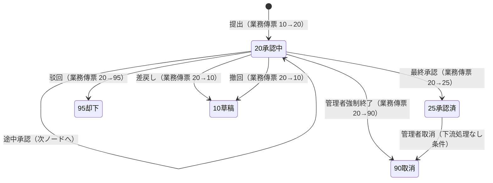
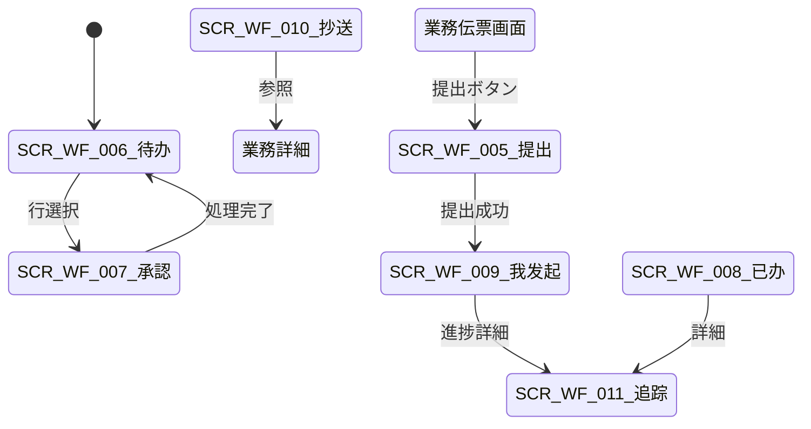

# 审批运行时 详细设计书（承認ランタイム 詳細設計書）

| 項目 | 内容 |
|---|---|
| 文書名 | 审批运行时 详细设计书（承認ランタイム 詳細設計書） |
| 文書番号 | DSN-WF-002 |
| 版数 | v1.0 |
| 作成日 | 2026-10-20 |
| 作成者 | system-workflow（域設計担当） |
| 承認者 | 未承認（レビュー待ち） |
| 状態 | ドラフト（レビュー中） |
| 関連文書 | [業務域概要](00-overview.md) / [DB 設計](90-db-design.md) / [API 設計](91-api-design.md) / [流程模型](01-process-model.md) / [業務单据状態連動](../00-common/09-cross-domain-flow.md) / [画面共通規格](../00-common/02-common-screen-spec.md) |

---

## 1. 機能概要

| 項目 | 内容 |
|---|---|
| 機能 ID | F-WF-003（发起审批）、F-WF-004（待办/已办/发起/抄送）、F-WF-005（审批操作）、F-WF-006（审批历史与流程追踪）、F-WF-011（审批与业务单据状态联动）、F-WF-012（审批消息通知） |
| 機能名 | 提出・タスク一覧・承認操作・履歴・状態連動・通知 |
| 目的 | 業務伝票の承認を実行し、その結果を業務域へ確実に通知して伝票ステータスを整合させる。承認者・申請者が迷わず操作できる画面と履歴を提供する |
| 利用者・ロール | 全ロール（申請・参照）、承認者ロール（部門经理・采购经理・销售经理・财务经理等）、系统管理员（参照） |
| 利用シーン | 伝票提出、日々の承認処理、差戻し後の再提出、承認状況の確認、監査対応 |
| 優先度 | P0 |
| 画面 ID | SCR-WF-005（审批发起）、SCR-WF-006（待办一覧）、SCR-WF-007（承認画面）、SCR-WF-008（已办一覧）、SCR-WF-009（我发起的）、SCR-WF-010（抄送我的）、SCR-WF-011（审批历史/流程追踪） |
| 関連 IF | IF-WF-002（承認結果通知 E31/E32）、IF-WF-003（通知送信） |

## 2. 業務要件・業務ルール

### 2.1 前提条件

| # | 前提条件 | 成立しない場合の挙動 |
|---|---|---|
| 1 | 業務伝票が提出可能な状態（`10 草稿`、または差戻し後の `10`） | MSG-COM-034 |
| 2 | 提出者が伝票の申請権限・データ範囲を持つ | 403 + MSG-COM-030 |
| 3 | マッピング・マトリクスが解決できる（[01-process-model.md](01-process-model.md)） | MSG-WF-003/004 |
| 4 | 承認者が解決できる（自己承認除外後 1 名以上） | MSG-WF-005 |
| 5 | Oubox イベント配信基盤（SYS）が稼働している | イベントは Outbox に残留し、復旧後に配信 |

### 2.2 業務ルール

| # | ルール | 根拠（法令・社内規程・業務慣行） | 関連項目 |
|---|---|---|---|
| BR-01 | 提出は「保存済みの伝票」に対してのみ実行できる。提出 API は業務域から WF の公開 Service（または REST）を呼ぶ。成功時、業務域はステータスを `20 承認待ち` に更新する | [00-common 09](../00-common/09-cross-domain-flow.md) 9.1 | `process_status` |
| BR-02 | 承認者の処理順は「順送（直列）」「或签（1 名で可）」「会签（全員または最低数）」の 3 方式。マトリクス明細の `sign_type` に従う | 共通業務規則 8.2 | `sign_type` |
| BR-03 | 自己承認禁止：申請者と同一ユーザは承認者にできない。解決時に除外し、0 名ならエラー | 共通業務規則 8.2 | 承認者解決 |
| BR-04 | 承認コメントは任意、**驳回・差戻しは理由必須**（[画面共通規格](../00-common/02-common-screen-spec.md) 5.3） | 共通業務規則 8.2 | `comment` |
| BR-05 | 撤回は申請者のみ、かつ**未処理タスクが存在する間**のみ可能。既に承認された後の撤回不可 | 共通業務規則 8.2 | `withdraw` |
| BR-06 | 却下（驳回）は終端。再申請は新規伝票（同一伝票の再提出不可） | 共通業務規則 8.2 | `process_status=95` |
| BR-07 | 差戻しは申請者へ戻し、業務ステータスを `10 草稿` にする。申請者は修正して再提出できる（同一伝票、新プロセス） | 共通業務規則 8.2 | `process_status=10` |
| BR-08 | 加签は承認者が前後任意に承認者を追加。追加分の承認完了後に続行する。加签先の承認者も自己承認禁止の対象 | 共通業務規則 8.2 | `add-sign` |
| BR-09 | 转办は自分のタスクを他者へ移管（戻らない）。转办後のタスクは転送先の待办に表示。実行者は転送先として記録 | 共通業務規則 8.2 | `transfer` |
| BR-10 | 催办は申請者が現在の承認者へリマインダを送る。同一タスクへの催办は 1 時間に 1 回まで | 運用ルール | `urge` |
| BR-11 | 代理承認は `wf_delegation` の有効期間内のみ。代理人の操作は代理人名義 + 委任元を記録 | 共通業務規則 8.2 | `wf_delegation` |
| BR-12 | 承認画面ではフィールド権限（[01-process-model.md](01-process-model.md) F-WF-010）に従い、編集可項目のみ更新できる。編集内容は業務伝票に反映される（業務域の更新 API 経由） | 情報統制 | `wf_form_field_permission` |
| BR-13 | タスク完了（承認/却下/差戻し）は WF 内で原子的に処理し、Outbox に E31（タスク完了）を記録する。プロセス完了時は E32 を追加で記録する | [00-common 09](../00-common/09-cross-domain-flow.md) 10 章 | `sys_outbox_event` |
| BR-14 | 業務ステータスの更新責任は業務域（E31/E32 の購読側）。WF はイベント発行のみで、業務伝票のテーブルを直接更新しない | [00-common 09](../00-common/09-cross-domain-flow.md) 9.1 | — |
| BR-15 | コールバック冪等性：業務域は `taskId + result` / `processInstanceId + finalResult` で重複処理を排除する。WF は同一タスク完了を再実行しない（タスク状態で判定） | 09 9.1 | `wf_task_operation` |
| BR-16 | 処理済みタスクは操作できない。他ユーザのタスクを代理・委任なしに処理できない | セキュリティ | `assignee_id` |
| BR-17 | 承認待ち 24h でリマインダ、48h でエスカレーション（[03-approval-admin.md](03-approval-admin.md) F-WF-008） | 共通業務規則 8.2 | `wf_timeout_rule` |
| BR-18 | 承認通知は提出・タスク生成・承認結果・差戻し・却下・超時の各タイミングで送信する（站内 + 設定でメール） | [00-common 09](../00-common/09-cross-domain-flow.md) 13.3 | `sys_notification` |

### 2.3 状態遷移



| 遷移 | トリガ | 権限 | 更新項目 | メッセージ |
|---|---|---|---|---|
| 10→20 | 提出 | `workflow:instance:submit` | `process_status=20`、`submit_at` | MSG-COM-005 |
| 20→20 | 途中承認 | `workflow:task:approve` | タスク完了、次タスク生成 | MSG-WF-010 |
| 20→25 | 最終承認 | 同上 | `process_status=25`、`completed_at`、`final_result=1` | MSG-WF-010、MSG-WF-011 |
| 20→95 | 驳回 | `workflow:task:reject` | `process_status=95`、`final_result=2` | MSG-WF-012 |
| 20→10 | 差戻し | `workflow:task:reject` | `process_status=10` | MSG-WF-013 |
| 20→10 | 撤回 | `workflow:task:withdraw` | `process_status=10` | MSG-WF-020 |
| 20→90 | 強制終了 | `workflow:instance:manage` | `process_status=90`、`final_result=5` | MSG-WF-030 |
| 25→90 | 取消 | 業務域の取消 API（WF は連動） | `process_status=90` | MSG-SYS-072 |

### 2.4 通知タイミング

| 契機 | 通知先 | 手段 | テンプレート | メッセージ |
|---|---|---|---|---|
| 提出・タスク生成 | 現在の承認者 | 站内 + メール | `WF_TASK_CREATED` | MSG-COM-005 |
| 途中承認 | 次ノードの承認者 | 站内 + メール | `WF_TASK_CREATED` | — |
| 最終承認 | 申請者、承認者全員（抄送可） | 站内 | `WF_TASK_APPROVED` | MSG-WF-011 |
| 驳回 | 申請者 | 站内 + メール | `WF_TASK_REJECTED` | MSG-WF-012 |
| 差戻し | 申請者 | 站内 | `WF_TASK_RETURNED` | MSG-WF-013 |
| 撤回 | 承認者 | 站内 | `WF_TASK_WITHDRAWN` | MSG-WF-020 |
| 催办 | 現在の承認者 | 站内 + メール | `WF_TASK_URGED` | MSG-WF-014 |
| 超時 | 承認者・上位者 | 站内 + メール | `WF_TASK_TIMEOUT` | MSG-WF-030 |

## 3. 関連機能

| 関係 | 機能 ID | 機能名 | 関係内容 |
|---|---|---|---|
| 上流 | 全業務域 | 伝票登録 | 提出対象の業務伝票（ビジネスキー・変数・スナップショット） |
| 上流 | F-WF-001/002 | 流程模型・マッピング | プロセス定義・経路・承認者解決 |
| 下流 | 全業務域 | 状態連動 | E31/E32 購読による業務ステータス更新 |
| 参照 | F-SYS-011/019 | 通知基盤 | 通知送信・テンプレート |
| 参照 | F-WF-007/008/009 | 代理・超時・管理 | 承認者の補完・タイムアウト・強制終了 |

## 4. 画面設計

### 4.1 画面一覧

| 画面 ID | 画面名 | 類型 | 概要 |
|---|---|---|---|
| SCR-WF-005 | 审批发起（提出ダイアログ） | WF | 提出前の確認（フロー・承認者・金額）とコメント入力 |
| SCR-WF-006 | 待办一覧 | WF | 自分の承認待ち。申請者・金額・期限・緊急度でソート、一括承認 |
| SCR-WF-007 | 承認画面 | WF | 申請内容（スナップショット）+ 経路図 + 承認/驳回/差戻し/加签/转办 + コメント |
| SCR-WF-008 | 已办一覧 | WF | 自分が処理したタスク（結果・日時・コメント） |
| SCR-WF-009 | 我发起的 | WF | 自分の申請（進捗・現在承認者・撤回可否） |
| SCR-WF-010 | 抄送我的 | WF | 抄送通知・既読管理 |
| SCR-WF-011 | 审批历史/流程追踪 | VIEW | 承認経路タイムライン、版・変数、各タスクの処理者/日時/コメント |

### 4.2 画面遷移



### 4.3 画面レイアウト（SCR-WF-007 承認画面）

```
┌───────────────────────────────────────────────────────────────────────────────┐
│ ホーム > 工作流 > 待办 > 承認                                                │
├───────────────────────────────────────────────────────────────────────────────┤
│ 業務：采购申请  PR2610200001    申請者：王强（采购部）  金額：CNY 12,000.00   │
│ 提出日時：2026-10-20 14:30    期限：2026-10-21 14:30（残 23h）               │
├───────────────────────────────┬───────────────────────────────────────────────┤
│〔申請内容（スナップショット）〕 │〔承認経路〕                                  │
│ 申請部門：采购部              │ ① 部门经理 王芳   ● 済 2026-10-20 15:00      │
│ 希望納期：2026-11-05          │ ② 采购经理 李明   ◐ 処理中（あなた）          │
│ 明細：                        │ ③ 分管副总 張伟   ○ 未処理                    │
│  1 硅钢片 50W470  2.5 KGM ... │                                               │
│  2 漆包线 QZY-2/180 ...       │〔履歴〕                                       │
│ 添付：見積書.pdf              │ 2026-10-20 15:00 王芳 承認「問題なし」        │
├───────────────────────────────┴───────────────────────────────────────────────┤
│〔承認コメント〕[____________________________________________________]         │
│〔操作〕[同意] [驳回] [差戻し] [加签▼] [转办▼] [催办] [経路を表示]            │
└───────────────────────────────────────────────────────────────────────────────┘
```

### 4.4 画面項目定義（SCR-WF-006 待办一覧）

| No | 項目 ID | 項目名 | 種別 | 型/桁 | 必須 | 初期値 | 入力チェック | データソース | DB 項目 | 権限 | 備考 |
|---|---|---|---|---|---|---|---|---|---|---|---|
| 1 | `keyword` | キーワード | テキスト | VARCHAR(100) | △ | 空 | ≤100 字 | 入力 | `business_no`/`summary` | `workflow:task:view` | 部分一致 |
| 2 | `businessType` | 業務類型 | 複数選択 | VARCHAR(64)[] | △ | 空 | 有効業務類型 | `wf_business_type` | `business_type` | 同上 | — |
| 3 | `amountFrom`/`amountTo` | 金額範囲 | 数値 | NUMERIC(18,2) | △ | 空 | 下限≤上限 | 入力 | `amount` | 同上 | — |
| 4 | `applicantId` | 申請者 | ユーザ選択 | BIGINT | △ | 空 | — | `sys_user` | `owner_applicant_id` | 同上 | — |
| 5 | `dueStatus` | 期限 | 選択 | SMALLINT | △ | 空 | 0 正常/1 まもなく/2 超過 | 計算 | `due_at` | 同上 | バッジ表示 |
| 6 | `urgency` | 緊急度 | 選択 | SMALLINT | △ | 空 | 0/1/2 | 固定値 | `urgency` | 同上 | — |
| 7 | `sort` | ソート | 選択 | — | — | 期限昇順 | 期限/金額/提出日 | — | `due_at`/`amount` | 同上 | — |
| 8 | `businessNo` | 業務番号 | リンク | VARCHAR(64) | — | — | — | DB | `business_no` | 同上 | 業務詳細へ |
| 9 | `summary` | 概要 | 表示 | VARCHAR(500) | — | — | — | DB | `summary` | 同上 | — |
| 10 | `selectAll` | 全選択 | チェック | — | — | false | — | — | — | 同上 | 一括承認用 |

### 4.5 画面項目定義（SCR-WF-007 承認画面）

| No | 項目 ID | 項目名 | 種別 | 型/桁 | 必須 | 初期値 | 入力チェック | データソース | DB 項目 | 権限 | 備考 |
|---|---|---|---|---|---|---|---|---|---|---|---|
| 1 | `businessNo` | 業務番号 | 表示 | VARCHAR(64) | — | — | — | `wf_business_process` | `business_no` | `workflow:task:approve` | リンク |
| 2 | `applicantName` | 申請者 | 表示 | VARCHAR(50) | — | — | — | SYS 参照 | `applicant_id` | 同上 | — |
| 3 | `amount` | 金額 | 表示 | NUMERIC(18,2) | — | — | — | `wf_business_process.amount` | `amount` | 同上 | 項目権限に従う |
| 4 | `dueAt` | 期限 | 表示 | TIMESTAMPTZ | — | — | — | `wf_task.due_at` | `due_at` | 同上 | 残時間表示 |
| 5 | `formSnapshot` | 申請内容 | 動的項目 | JSON | — | — | フィールド権限（編集可項目のみ編集可） | `wf_variable.form_snapshot` + フィールド権限 | `form_snapshot` | 同上 | 業務項目を動的描画 |
| 6 | `approvalDiagram` | 承認経路 | 図 | — | — | — | — | Flowable 履歴 + `wf_task` | — | 同上 | 処理済/処理中/未処理 |
| 7 | `history` | 履歴 | タイムライン | — | — | — | — | `wf_task_operation` | — | 同上 | — |
| 8 | `comment` | 承認コメント | テキストエリア | VARCHAR(2000) | 条件付△ | 空 | ≤2000 字。驳回/差戻しは必須 | 入力 | `wf_task_operation.comment` | 同上 | — |
| 9 | `approveBtn` | 同意 | ボタン | — | — | — | — | — | — | 同上 | — |
| 10 | `rejectBtn` | 驳回 | ボタン | — | — | — | 理由必須 | — | — | 同上 | — |
| 11 | `returnBtn` | 差戻し | ボタン | — | — | — | 戻し先・理由必須 | — | — | 同上 | — |
| 12 | `addSignBtn` | 加签 | ボタン | — | — | — | 加签先選択（前/後） | `sys_user` | — | 同上 | — |
| 13 | `transferBtn` | 转办 | ボタン | — | — | — | 転送先選択・理由 | `sys_user` | — | 同上 | — |
| 14 | `urgeBtn` | 催办 | ボタン | — | — | — | 申請者のみ・1 時間 1 回 | — | — | `workflow:task:urge` | 申請者表示 |
| 15 | `attachmentList` | 添付 | 一覧 | — | — | — | 参照権限 | SYS 添付 | `sys_attachment_biz` | 同上 | ダウンロード可 |

### 4.6 画面項目定義（SCR-WF-009 我发起的 / SCR-WF-011 流程追踪）

| No | 項目 ID | 項目名 | 種別 | 型/桁 | 必須 | 初期値 | 入力チェック | データソース | DB 項目 | 権限 |
|---|---|---|---|---|---|---|---|---|---|---|
| 1 | `businessNo` | 業務番号 | リンク | VARCHAR(64) | — | — | — | `wf_business_process` | `business_no` | 本人 |
| 2 | `processStatus` | 状態 | バッジ | SMALLINT | — | — | — | 計算 | `process_status` | 本人 |
| 3 | `currentApprovers` | 現在承認者 | 表示 | VARCHAR(500) | — | — | — | `wf_task` | `current_approvers` | 本人 |
| 4 | `withdrawBtn` | 撤回 | ボタン | — | — | — | 未処理タスクあり・承認済なし | — | — | 本人 |
| 5 | `urgeBtn` | 催办 | ボタン | — | — | — | 現在承認者へ | — | — | 本人 |
| 6 | `timeline` | 承認履歴 | タイムライン | — | — | — | — | `wf_task_operation` | — | 本人/管理者 |
| 7 | `formSnapshot` | 提出時内容 | 表示 | JSON | — | — | — | `wf_variable` | `form_snapshot` | 同上 |
| 8 | `diagram` | 経路図 | 図 | — | — | — | — | Flowable | — | 同上 |
| 9 | `variables` | 変数 | 表示 | JSON | — | — | — | `wf_variable.variables` | `variables` | 管理者 |

### 4.7 イベント処理

| No | イベント | トリガ | 処理内容 | 呼出 API | 画面遷移 | 備考 |
|---|---|---|---|---|---|---|
| 1 | 提出確認 | 業務画面の提出ボタン | マッピング・経路プレビュー・承認者表示 | POST /api/workflow/business-processes/preview | SCR-WF-005 | 提出前確認 |
| 2 | 提出 | 提出ボタン | プロセス開始・タスク生成・通知 | POST /api/workflow/business-processes | SCR-WF-009 | Idempotency-Key 必須 |
| 3 | 待办検索 | 検索ボタン | 条件検証→一覧取得 | GET /api/workflow/tasks/todo | — | 期限昇順既定 |
| 4 | 承認画面表示 | 行選択 | スナップショット・経路・履歴・フィールド権限取得 | GET /api/workflow/tasks/{taskId} | SCR-WF-007 | — |
| 5 | 同意 | 同意ボタン | コメント検証→同意 API | POST /api/workflow/tasks/{taskId}/approve | 待办へ | 二重送信防止 |
| 6 | 驳回 | 驳回ボタン | 理由必須→確認→驳回 API | POST /api/workflow/tasks/{taskId}/reject | 待办へ | 終端 |
| 7 | 差戻し | 差戻しボタン | 戻し先・理由→API | POST /api/workflow/tasks/{taskId}/return | 待办へ | 申請者へ |
| 8 | 加签 | 加签ボタン | 加签先・前後→API | POST /api/workflow/tasks/{taskId}/add-sign | 承認画面 | 追加分完了後に続行 |
| 9 | 转办 | 转办ボタン | 転送先・理由→API | POST /api/workflow/tasks/{taskId}/transfer | 待办へ | 戻らない |
| 10 | 催办 | 催办ボタン | 認可（申請者のみ）→通知 | POST /api/workflow/tasks/{taskId}/urge | — | 1 時間 1 回 |
| 11 | 撤回 | 撤回ボタン | 未処理確認→プロセス取消→通知 | POST /api/workflow/business-processes/{id}/withdraw | 我发起 | — |
| 12 | 一括承認 | 一括承認ボタン | 選択タスクの順次承認（失敗行を返す） | POST /api/workflow/tasks/batch-approve | 待办へ | 最大 100 件 |
| 13 | 履歴更新 | 画面/定期更新 | 承認タイムライン取得 | GET /api/workflow/business-processes/{id}/history | — | 5 秒ポーリング（任意） |
| 14 | 抄送既読 | 行選択 | 既読化 | PUT /api/workflow/ccs/{id}/read | — | — |

### 4.8 表示制御

| 条件 | 対象項目/ボタン | 制御 |
|---|---|---|
| タスク処理済み | 同意/驳回/差戻し | 非表示（参照のみ） |
| 他ユーザのタスク（代理なし） | 承認操作 | 非表示・API 403 |
| 申請者本人 | 承認操作 | 非表示（自己承認禁止） |
| 最終承認完了 | 撤回ボタン | 非表示 |
| 未処理タスクなし（全承認済） | 撤回ボタン | 非表示 |
| フィールド権限「非表示」 | 該当項目 | 非表示（API でも返さない） |
| フィールド権限「参照のみ」 | 該当項目 | 読み取り専用 |
| 管理者以外 | 他人の経路詳細・変数 | 非表示（本人/処理者のみ） |
| 振込先・銀行口座 | 承認画面 | マスキング（下 4 桁） |
| 期限超過 | 期限表示 | 赤色 + 「超過」バッジ |

## 5. 入力チェック仕様

| No | チェック ID | 対象項目 | 種別 | 条件 | タイミング | メッセージ ID |
|---|---|---|---|---|---|---|
| 1 | CHK-WF-003-01 | `businessType`/`businessId` | 存在 | 業務伝票が存在し参照権限あり | 提出 | MSG-COM-032 |
| 2 | CHK-WF-003-02 | 業務状態 | 状態 | `status=10`（草稿）または差戻し後 | 提出 | MSG-COM-034 |
| 3 | CHK-WF-003-03 | 二重提出 | 状態 | 承認中プロセスなし | 提出 | MSG-COM-075 |
| 4 | CHK-WF-003-04 | マッピング | 存在 | フォールバックを含む有効マッピングあり | 提出 | MSG-WF-003 |
| 5 | CHK-WF-003-05 | 承認者 | 存在 | 自己承認除外後 1 名以上 | 提出 | MSG-WF-005 |
| 6 | CHK-WF-005-01 | `comment` | 必須（条件付） | 驳回/差戻し時は空でない | 操作 | MSG-WF-016 |
| 7 | CHK-WF-005-02 | `comment` | 桁数 | ≤2000 字 | 操作 | MSG-COM-041 |
| 8 | CHK-WF-005-03 | タスク所有者 | 権限 | `assignee_id` = 本人 or 有効代理 | 操作 | MSG-WF-015 |
| 9 | CHK-WF-005-04 | タスク状態 | 状態 | `task_status=20`（未処理） | 操作 | MSG-COM-034 |
| 10 | CHK-WF-005-05 | `addSignUserId` | 存在・重複 | 有効ユーザ、既存承認者と重複なし、申請者でない | 加签 | MSG-WF-017 |
| 11 | CHK-WF-005-06 | `transferUserId` | 存在 | 有効ユーザ、自分以外、申請者でない | 转办 | MSG-WF-018 |
| 12 | CHK-WF-005-07 | 催办間隔 | 制約 | 同一タスクへ 1 時間に 1 回 | 催办 | MSG-WF-019 |
| 13 | CHK-WF-005-08 | 撤回可否 | 状態 | 未処理タスクあり・承認済ノードなし | 撤回 | MSG-WF-021 |
| 14 | CHK-WF-005-09 | 一括承認 | 上限 | ≤100 件 | 一括 | MSG-COM-052 |
| 15 | CHK-WF-011-01 | 業務ステータス更新 | 冪等 | `taskId+result` 未処理 | コールバック | （重複はスキップ） |

## 6. 処理詳細

### 6.1 処理一覧

| 処理 ID | 処理名 | 契機 | トランザクション | 排他 |
|---|---|---|---|---|
| PRC-WF-003-01 | プロセス開始（提出） | 提出 API | 要（`wf_business_process` + Flowable 開始 + Outbox） | 業務伝票単位のロック（業務域側） |
| PRC-WF-003-02 | 提出プレビュー | 提出画面 | 不要（読取） | — |
| PRC-WF-003-03 | 撤回 | 撤回 API | 要（プロセス取消 + Outbox） | プロセス単位ロック |
| PRC-WF-004-01 | 待办一覧取得 | 検索 | 不要 | — |
| PRC-WF-005-01 | 同意 | 承認 API | 要（タスク完了 + 次タスク + Outbox） | タスク行ロック（`FOR UPDATE`） |
| PRC-WF-005-02 | 驳回 | 承認 API | 要（プロセス終了 + Outbox） | 同上 |
| PRC-WF-005-03 | 差戻し | 承認 API | 要（プロセス終了 + Outbox） | 同上 |
| PRC-WF-005-04 | 加签 | 承認 API | 要（タスク追加 + 履歴） | 同上 |
| PRC-WF-005-05 | 转办 | 承認 API | 要（担当者変更 + 履歴） | 同上 |
| PRC-WF-005-06 | 催办 | 催办 API | 不要（通知のみ） | レート制限（1 時間 1 回） |
| PRC-WF-005-07 | 一括承認 | 一括 API | タスク単位 | 各タスク行ロック |
| PRC-WF-006-01 | 承認履歴取得 | 画面表示 | 不要 | — |
| PRC-WF-011-01 | イベント発行（E31/E32） | タスク完了/プロセス完了 | 業務 TX 内（Outbox INSERT） | — |
| PRC-WF-012-01 | 承認通知送信 | 各契機 | 通知基盤に委譲（非同期） | — |

### 6.2 処理手順（正常系）

**PRC-WF-003-01 プロセス開始（提出）**

1. 権限チェック（`workflow:instance:submit`）とデータ範囲チェック。
2. リクエストから `businessType`・`businessId`・`businessNo`・`applicantId`・`amount`・`variables`・`formSnapshot` を取得する。業務域から渡される `variables` は [跨域流程](../00-common/09-cross-domain-flow.md) 9.1 の契約に従う。
3. 業務域の公開 API で伝票の現在ステータス・提出可能性を検証する（`10` のみ可）。承認中プロセスが既にある場合は `MSG-COM-075`。
4. マッピング解決（[01-process-model.md](01-process-model.md) PRC-WF-002-01）でプロセス定義キー・承認マトリクス・承認ノードリストを取得する。
5. Flowable の `RuntimeService.startProcessInstanceByKey(procDefKey, businessKey, variables)` でプロセスを開始する（`businessKey = businessType + ':' + businessId`）。変数は `amount`・`departmentId`・`applicantId`・`businessType` 等の基本項目のみ設定し、詳細は `wf_variable` に保存する。
6. Flowable のタスクリスナー（UserTask create イベント）で次を実行する：
   - 承認者を解決し `identityService` で `assignee` を設定する（或签の場合も 1 名ずつタスクを生成する方式を採用。複数候補は候補グループとせず個別タスクを生成し、1 名の同意で残りを取消す）。
   - `wf_task` に業務属性を INSERT する（`due_at` はノードの `timeout_hours` またはタイムアウト規則から計算）。
   - `wf_task_operation` に「生成」は記録せず、通知のみ行う（履歴は操作ベース）。
7. `wf_business_process` を INSERT する（`process_status=20`、`process_instance_id`、`current_task_ids`、`current_approvers`、`form_snapshot`）。
8. `wf_variable` に変数・スナップショットを INSERT する。
9. Outbox に `workflow.process.started`（WF 独自イベント、任意）を記録する（業務ステータスは業務域が `20` に更新する。09 の契約では提出自体は同期コマンドで、業務域が WF の応答後に `20` に更新する）。
10. 通知送信（PRC-WF-012-01）を呼び、承認者へ `WF_TASK_CREATED` を送る。
11. 応答に `processInstanceId`・最初のタスク ID・承認者リストを返す。業務域はこれを保存してステータス `20` に更新する。
12. すべて同一トランザクション。通知は Outbox/非同期で送るため、通知失敗でも提出はロールバックしない。

**PRC-WF-005-01 同意**

1. `taskId` で Flowable タスクを取得し、`wf_task` を `SELECT ... FOR UPDATE` でロックする（同時承認の防止）。
2. 権限チェック：`assignee_id = ログインユーザ` または有効な代理（`wf_delegation`）であること。`task_status=20` であること。
3. フィールド権限で「編集可」となっている項目に変更がある場合、業務域の更新 API（`PUT /api/{module}/...`）を呼んで反映する。失敗時はタスクを完了しない。
4. `taskService.complete(taskId, variables)` でタスクを完了する。`variables` に `approved=true`・`operatorId` を設定する。
5. `wf_task` を `task_status=25`・`complete_at=now()` に更新する。`wf_task_operation` に `operation_type=1`（同意）・コメント・前後状態を INSERT する。
6. 次ノードが存在する場合、タスクリスナーが次タスクを生成し `wf_task` に INSERT する。`wf_business_process.current_task_ids/current_approvers` を更新する。
7. プロセスが完了した場合（最終承認）：
   - `wf_business_process` を `process_status=25`・`completed_at`・`final_result=1` に更新する。
   - Outbox に E31（`workflow.task.completed`）と E32（`workflow.process.completed`）を記録する。
   - 申請者・関係者へ `WF_TASK_APPROVED` を通知する。
8. 途中承認の場合、Outbox に E31 のみ記録する（業務域は「途中承認」を把握できるが、ステータス更新は最終承認時のみ行う）。
9. 通知を送信し、応答に次タスク・承認者・プロセス状態を返す。

**PRC-WF-005-02 驳回**

1. タスク取得・ロック・権限チェック（PRC-WF-005-01 の 1〜2 と同一）。
2. `comment`（理由）必須チェック（`MSG-WF-016`）。
3. Flowable の `taskService.complete` ではなく、プロセスを終了させる（`runtimeService.deleteProcessInstance(processInstanceId, reason)` または BPMN の終了イベントへ遷移）。承認記録は `taskService.addComment` ではなく `wf_task_operation` に記録する。
4. `wf_task` を `task_status=95`、`wf_business_process` を `process_status=95`・`final_result=2`・`completed_at` に更新する。
5. Outbox に E31（`result=REJECTED`）と E32（`finalResult=REJECTED`）を記録する。業務域はステータス `95` に更新する。
6. 申請者へ `WF_TASK_REJECTED` を通知する。

**PRC-WF-005-03 差戻し**

1. `comment`（理由）と `returnToNode`（戻し先。既定は申請者）を検証する。
2. Flowable の `changeState` または新規プロセス開始により申請者ノードへ戻す。Phase 1 は「プロセスを終了し、業務域が `10 草稿` に戻して再提出時に新プロセスを開始する」方式を採用する（実装が単純で監査しやすい）。
3. `wf_task` を `task_status=25`（処理済）、`wf_business_process` を `process_status=10`・`final_result` は未確定のまま・`completed_at` に更新する。
4. Outbox に E31（`result=RETURNED`）を記録する。業務域はステータス `10` に戻し、申請者へ通知する。
5. 申請者は修正後、再度提出（新プロセス）できる。`wf_business_process` は同一行を更新し、`process_instance_id` を差替える。

**PRC-WF-005-04 加签**

1. タスク取得・ロック・権限チェック。`addSignUserId`（追加承認者）と `position`（前/後）を検証する。申請者・既存承認者との重複、有効ユーザであることを確認する。
2. Flowable の `taskService.addCandidateUser` ではなく、新規 UserTask を動的生成（`runtimeService` の動的タスク生成機能）または BPMN のマルチインスタンスを利用する。Phase 1 は「現在のタスクを完了せず、`addSign` 用の子タスクを生成し、子タスク完了後に本体を続行する」方式（子タスクは `wf_task.parent_task_id` で本体タスクを参照。[90](90-db-design.md) §3 `wf_task` 参照）とする。Phase 1 実装では加签先を「追加承認者」として `wf_task` に `task_type=ADDSIGN` で登録し、完了後に本体タスクが再活性化される設計とする。
3. `wf_task_operation` に `operation_type=4`・対象者・前後状態を記録する。
4. 加签先へ `WF_TASK_CREATED`（加签）を通知する。加签は最大 5 名・3 段まで（無限ループ防止）。

**PRC-WF-005-05 转办**

1. タスク取得・ロック・権限チェック。`transferUserId`（転送先）・理由を検証する。
2. Flowable の `taskService.setAssignee(taskId, transferUserId)` で担当者を変更する。`wf_task.assignee_id` を更新し、`original_assignee_id` に転送元を保持する。
3. `wf_task_operation` に `operation_type=5`・対象者・理由を記録する。転送先へ通知する。
4. 転送後のタスクは転送元の待办から消え、転送先の待办に表示される。転送元に戻す操作はない（再度転送で対応）。

**PRC-WF-005-06 催办**

1. 対象タスクのプロセスに申請者本人が関与していることを確認する（申請者 or 管理者）。
2. 同一タスクへの最終催办から 1 時間未満の場合は拒否（`MSG-WF-019`）。
3. 現在の承認者（複数なら全員）へ `WF_TASK_URGED` を送信する。`wf_task_operation` に `operation_type=7` を記録する。

**PRC-WF-003-03 撤回**

1. 申請者本人であること、`process_status=20` であることを確認する。
2. 既に承認済みノードがある場合（`wf_task_operation` に `operation_type=1` が存在）は撤回不可（`MSG-WF-021`）。ただし「未処理タスクが存在する」ことは条件としない（全承認者が未処理でも可）。
3. `runtimeService.deleteProcessInstance(processInstanceId, '撤回: ' + reason)` でプロセスを終了する。
4. `wf_task` の未処理タスクを `task_status=90` に更新し、`wf_business_process` を `process_status=10`・`final_result=3` に更新する。
5. Outbox に E31（`result=WITHDRAWN`）を記録する。承認者へ通知する。業務域はステータス `10` に戻す。

**PRC-WF-006-01 承認履歴取得**

1. `business_type + business_id` から `wf_business_process` を取得し、`process_instance_id` を特定する。
2. `wf_task_operation` を時系列で取得し、タイムラインを構築する。
3. Flowable の履歴（`HistoryService`）からノード遷移・タスクの処理者・開始/終了時刻を取得し、`wf_task` の情報とマージする。
4. 承認経路図（現在のノード・処理済み・未処理）を生成する。分岐がある場合は実際に通過した経路を強調する。
5. 参照権限：申請者・処理者・管理者・データ範囲内の部門長に限定する。参照可否は業務域のデータ範囲と同一ルール。

**PRC-WF-011-01 イベント発行（E31/E32）契約**

E31 `workflow.task.completed` のペイロード（[跨域流程](../00-common/09-cross-domain-flow.md) 3 章 E31 の定義に準拠）：

```json
{
  "eventId": "6f1c...",
  "eventType": "workflow.task.completed",
  "eventVersion": 1,
  "occurredAt": "2026-10-20T15:00:00+08:00",
  "source": "erp-workflow",
  "tenantId": 0, "companyId": 1,
  "aggregateType": "sales_order",
  "aggregateId": "1845000000000002001",
  "aggregateNo": "SO2610200001",
  "aggregateVersion": 3,
  "idempotencyKey": "workflow.task.completed:1845000000000009001:1",
  "payload": {
    "processInstanceId": "8f3c...",
    "taskId": "1845000000000009001",
    "taskDefinitionKey": "salesManagerApprove",
    "businessType": "SALES_ORDER",
    "businessId": "1845000000000002001",
    "businessNo": "SO2610200001",
    "result": "APPROVED",
    "approverId": "1845000000000000123",
    "approverName": "张建国",
    "comment": "条件付き承認（与信枠内）",
    "completedAt": "2026-10-20T15:00:00+08:00"
  }
}
```

E32 `workflow.process.completed` のペイロード：

```json
{
  "eventType": "workflow.process.completed",
  "aggregateType": "sales_order",
  "aggregateId": "1845000000000002001",
  "aggregateNo": "SO2610200001",
  "payload": {
    "processInstanceId": "8f3c...",
    "businessType": "SALES_ORDER",
    "businessId": "1845000000000002001",
    "businessNo": "SO2610200001",
    "finalResult": "APPROVED",
    "completedAt": "2026-10-20T15:00:00+08:00"
  }
}
```

| result / finalResult | 意味 | 業務側の更新（業務域の責任） |
|---|---|---|
| `APPROVED`（E31、途中） | 途中承認 | ステータスは 20 のまま。承認者・日時を履歴に追記 |
| `APPROVED`（E32） | 最終承認 | 20 → 25（承認済）。後続処理の起動条件 |
| `REJECTED`（E32） | 却下 | 20 → 95（却下） |
| `RETURNED`（E31） | 差戻し | 20 → 10（草稿） |
| `WITHDRAWN`（E31） | 撤回 | 20 → 10（草稿） |
| `TERMINATED`（E32） | 管理者強制終了 | 20 → 90（取消） |

**コールバック冪等性（受信側の実装契約）**：購読側（業務域）は `sys_event_consume_log` に `(event_id, consumer_name)` を記録し、既存なら処理をスキップする。また業務側で「現在の承認状態」を確認してから更新する（例：既に 25 なら再更新しない）。WF 側は同一タスクの重複完了を `wf_task.task_status` で防止する。

### 6.3 例外処理

| No | 異常条件 | 検知箇所 | 処理 | ロールバック | メッセージ ID |
|---|---|---|---|---|---|
| 1 | 業務伝票が存在しない | 提出 | 処理中断 | 全体 | MSG-COM-032 |
| 2 | 状態不正（既に承認中/承認済） | 提出 | 拒否 | 全体 | MSG-COM-034/075 |
| 3 | マッピング解決失敗 | 提出 | 拒否 | 全体 | MSG-WF-003/004 |
| 4 | 承認者 0 名 | 提出 | 拒否 | 全体 | MSG-WF-005 |
| 5 | タスクが既に処理済み | 操作 | 409 | — | MSG-COM-034 |
| 6 | 他ユーザのタスク | 操作 | 403 | — | MSG-WF-015 |
| 7 | 驳回/差戻し理由なし | 操作 | 400 | — | MSG-WF-016 |
| 8 | フィールド更新失敗（業務域） | 操作 | 処理中断（タスク未完了） | 全体 | 業務域の MSG |
| 9 | 加签先が申請者 | 加签 | 拒否 | — | MSG-WF-017 |
| 10 | 撤回（承認済ノードあり） | 撤回 | 拒否 | — | MSG-WF-021 |
| 11 | イベント発行失敗 | Outbox | 業務 TX ロールバック（Outbox 同一 TX） | 全体 | — |
| 12 | 通知送信失敗 | 通知 | 業務は成功。再送キュー | なし | MSG-SYS-075 |
| 13 | Flowable 例外（デッドロック等） | 操作 | ロールバック、再試行 1 回 | 全体 | MSG-WF-022 |
| 14 | プロセス強制終了時の業務不整合 | 管理操作 | 業務域へ補償イベント（E32 TERMINATED） | — | MSG-WF-030 |

### 6.4 冪等性・排他

- 提出は `Idempotency-Key` 必須。同一業務の二重提出は `wf_business_process` の一意制約 + 状態チェックで防止する。
- 承認操作はタスク行の `FOR UPDATE` で直列化し、同一タスクの二重承認を防止する。`taskId` を冪等キーとして `sys_idempotency` に記録する。
- コールバック（E31/E32）は `eventId` で重複排除し、購読側も `taskId + result` で冪等に処理する。
- プロセス開始・承認操作は Flowable と `wf_*` を同一トランザクションで更新する（`@Transactional`）。Flowable の非同期実行（`async=true`）は使用しない（同期実行で整合性を優先）。
- 通知は非同期（Outbox → BAT-SYS-001 → 通知基盤）。

## 7. API 設計

| No | メソッド | パス | 権限 | 概要 |
|---|---|---|---|---|
| 1 | POST | /api/workflow/business-processes | `workflow:instance:submit` | 提出（プロセス開始） |
| 2 | POST | /api/workflow/business-processes/preview | `workflow:instance:submit` | 提出プレビュー（経路・承認者） |
| 3 | GET | /api/workflow/business-processes/{bizType}/{bizId} | `workflow:task:view` | 業務の承認状態参照 |
| 4 | POST | /api/workflow/business-processes/{id}/withdraw | `workflow:task:withdraw` | 撤回 |
| 5 | GET | /api/workflow/business-processes/{id}/history | `workflow:task:view` | 承認履歴（タイムライン） |
| 6 | GET | /api/workflow/business-processes | `workflow:task:view` | 我发起的（一覧） |
| 7 | GET | /api/workflow/tasks/todo | `workflow:task:view` | 待办一覧 |
| 8 | GET | /api/workflow/tasks/done | `workflow:task:view` | 已办一覧 |
| 9 | GET | /api/workflow/tasks/{taskId} | `workflow:task:view` | 承認画面情報（スナップショット・権限・履歴） |
| 10 | POST | /api/workflow/tasks/{taskId}/approve | `workflow:task:approve` | 同意 |
| 11 | POST | /api/workflow/tasks/{taskId}/reject | `workflow:task:reject` | 驳回 |
| 12 | POST | /api/workflow/tasks/{taskId}/return | `workflow:task:reject` | 差戻し |
| 13 | POST | /api/workflow/tasks/{taskId}/add-sign | `workflow:task:add-sign` | 加签 |
| 14 | POST | /api/workflow/tasks/{taskId}/transfer | `workflow:task:transfer` | 转办 |
| 15 | POST | /api/workflow/tasks/{taskId}/urge | `workflow:task:urge` | 催办 |
| 16 | POST | /api/workflow/tasks/batch-approve | `workflow:task:approve` | 一括承認 |
| 17 | GET | /api/workflow/ccs | `workflow:task:view` | 抄送我的 |
| 18 | PUT | /api/workflow/ccs/{id}/read | 認証済 | 抄送既読 |
| 19 | GET | /api/workflow/tasks/{taskId}/field-permissions | `workflow:task:view` | フィールド権限取得 |
| 20 | GET | /api/workflow/dashboard/pending-count | `workflow:task:view` | 未処理件数（ヘッダバッジ） |

### 7.1 リクエスト/レスポンス詳細

**POST /api/workflow/business-processes**

```json
{
  "businessType": "PURCHASE_REQUISITION", "businessId": "1845000000000003001", "businessNo": "PR2610200001",
  "amount": "12000.00", "currencyCode": "CNY", "applicantId": "1845000000000000130",
  "applicantDeptId": "1845000000000000020", "factoryId": "1845000000000000002",
  "summary": "硅钢片 50W470 采购申请",
  "variables": { "amount": "12000.00", "departmentId": "1845000000000000020", "urgent": false },
  "formSnapshot": {
    "requisitionNo": "PR2610200001", "applicantName": "王强", "departmentName": "采购部",
    "requiredDate": "2026-11-05", "reason": "生产备料",
    "lines": [ { "materialCode": "1001000001", "materialName": "硅钢片 50W470", "quantity": "2.5000", "uomCode": "KGM" } ]
  }
}
// 成功（201）
{ "code": 0, "message": "审批流程已提交。", "data": {
  "processInstanceId": "8f3c...", "businessProcessId": "1845000000000005001",
  "firstTaskId": "1845000000000009001", "currentApprovers": [{"userId":"...","userName":"王芳"}],
  "processStatus": 20, "submitAt": "2026-10-20T14:30:00+08:00" } }
// エラー（承認者なし）
{ "code": 80005, "message": "无法确定审批人（采购经理），请检查角色/岗位/上级设置。", "data": null }
```

**GET /api/workflow/tasks/{taskId}**

```json
{ "code": 0, "message": "ok", "data": {
  "taskId": "1845000000000009001", "taskName": "采购经理审批", "businessType": "PURCHASE_REQUISITION",
  "businessNo": "PR2610200001", "applicantName": "王强", "amount": "12000.00",
  "dueAt": "2026-10-21T14:30:00+08:00", "urgency": 0,
  "formSnapshot": { "...": "..." },
  "fieldPermissions": { "amount": "READONLY", "requiredDate": "EDITABLE", "bankAccount": "HIDDEN" },
  "diagram": { "nodes": [ {"name":"部门经理","status":"DONE"}, {"name":"采购经理","status":"CURRENT"}, {"name":"分管副总","status":"PENDING"} ] },
  "history": [ {"operator":"王芳","operation":"APPROVE","comment":"问题なし","occurredAt":"2026-10-20T15:00:00+08:00"} ] } }
```

**POST /api/workflow/tasks/{taskId}/approve**

```json
{ "comment": "条件付き承認（与信枠内）", "fieldValues": { "requiredDate": "2026-11-10" }, "version": 0 }
// → { "code": 0, "message": "处理已完成。", "data": { "taskStatus": 25, "processStatus": 20,
//     "nextApprovers": [{"userId":"...","userName":"张伟"}] } }
```

**POST /api/workflow/tasks/{taskId}/reject**：`{ "comment": "予算超過のため却下", "version": 0 }`。理由必須。

**POST /api/workflow/tasks/batch-approve**：`{ "taskIds": ["..."], "comment": "一括承認", "maxCount": 100 }` → `{successCount, failureCount, failures:[{taskId, reason}]}`。

## 8. データ更新仕様

| テーブル | 操作 | 更新項目 | 更新条件 | トリガ（処理 ID） |
|---|---|---|---|---|
| wf_business_process | INSERT | 全項目 | 提出 | PRC-WF-003-01 |
| wf_business_process | UPDATE | `process_status`・`current_task_ids`・`current_approvers`・`completed_at`・`final_result` | 承認/却下/差戻し/撤回/強制終了 | PRC-WF-005-01〜03、PRC-WF-003-03 |
| wf_business_process | UPDATE | `process_instance_id` | 再提出 | PRC-WF-003-01 |
| wf_task | INSERT | 全項目 | タスク生成 | PRC-WF-003-01、PRC-WF-005-04 |
| wf_task | UPDATE | `task_status`・`assignee_id`・`complete_at` | 承認/転送/取消 | PRC-WF-005-01/02/05、PRC-WF-003-03 |
| wf_task_operation | INSERT | 全項目 | 全承認操作 | PRC-WF-005-01〜07、PRC-WF-003-03 |
| wf_variable | INSERT | 全項目 | 提出・再提出 | PRC-WF-003-01 |
| wf_cc | INSERT/UPDATE | 全項目・`read_flag` | 完了/既読 | PRC-WF-005-01、F-WF-004 |
| sys_outbox_event | INSERT | E31/E32 | タスク完了/プロセス完了 | PRC-WF-011-01 |
| sys_notification | INSERT | 通知 | 各契機 | PRC-WF-012-01 |
| sys_audit_log | INSERT | 承認操作・提出・撤回 | 全処理 | 全処理 |

## 9. エラー処理・メッセージ

| メッセージ ID | 種別 | 本文 | 発生条件 | 利用者への対処 | ログ |
|---|---|---|---|---|---|
| MSG-WF-010 | I | 审批已通过，流程继续流转。 | 途中承認 | — | INFO |
| MSG-WF-011 | I | 审批已完成，业务单据状态已更新。 | 最終承認 | — | INFO |
| MSG-WF-012 | I | 已驳回该申请，申请人将收到通知。 | 驳回 | — | INFO |
| MSG-WF-013 | I | 已退回申请人修改，修改后可重新提交。 | 差戻し | — | INFO |
| MSG-WF-014 | I | 催办通知已发送给当前审批人。 | 催办 | — | INFO |
| MSG-WF-015 | E | 该任务不属于当前用户，或已被处理。 | 他者タスク/処理済み | 再取得 | WARN |
| MSG-WF-016 | E | 驳回或退回时必须填写理由。 | 理由なし | 入力 | INFO |
| MSG-WF-017 | E | 加签对象无效（申请人、已存在审批人或已离职）。 | 加签不正 | 再選択 | INFO |
| MSG-WF-018 | E | 转办对象无效或不能转办给自己。 | 转办不正 | 再選択 | INFO |
| MSG-WF-019 | E | 催办过于频繁，请 1 小时后再试。 | レート制限 | 待機 | INFO |
| MSG-WF-020 | I | 已撤回该申请，审批流程已终止。 | 撤回 | — | INFO |
| MSG-WF-021 | E | 已有审批通过的节点，不能撤回。 | 承認済ノードあり | 管理者へ相談 | WARN |
| MSG-WF-022 | E | 审批处理失败，请刷新后重试。 | Flowable 例外 | 再試行 | ERROR |
| MSG-WF-030 | I | 该流程已被管理员终止。 | 強制終了 | — | WARN |
| MSG-WF-031 | I | 审批流程已挂起，暂不能处理。 | 掛起中 | 管理者へ連絡 | INFO |
| MSG-WF-073 | E | 该业务单据已提交，请勿重复提交。 | 二重提出 | — | WARN |

## 10. 権限・セキュリティ

| 種別 | 内容 |
|---|---|
| 画面権限 | 待办/已办/我发起/抄送 `workflow:task:view`、承認画面 `workflow:task:approve` |
| 操作権限 | 同意/驳回/差戻し `workflow:task:approve/reject`、加签 `add-sign`、转办 `transfer`、催办 `urge`、撤回 `withdraw` |
| 項目権限 | フィールド権限（`wf_form_field_permission`）に従う。非表示項目は API でも返さない。金額・銀行口座は権限に応じマスキング |
| データ範囲 | 待办は自分のタスク（代理含む）のみ。我发起は自分。履歴は申請者・処理者・管理者・部門長 |
| 監査ログ | 提出・承認・驳回・差戻し・加签・转办・撤回・催办・強制終了を全件記録（`wf_task_operation` + `sys_audit_log`） |
| 自己承認防止 | 承認者解決時に申請者を除外。加签・转办先にも申請者を指定不可 |
| 権限昇格防止 | 承認操作はタスクの `assignee_id` とログインユーザの一致（または有効代理）を必須とする |
| セッション | 承認操作時に現在のユーザのロール・権限を再検証する（画面表示時の権限に依存しない） |

## 11. 性能・非機能

| 項目 | 目標値 | 前提 |
|---|---|---|
| 待办一覧 | 2 秒以内（100 件） | 索引 `idx_wf_task_assignee` |
| 提出（プロセス開始） | 1 秒以内 | Flowable 同期実行、承認者解決キャッシュ |
| 承認操作 | 1 秒以内 | タスク行ロック、Outbox 同一 TX |
| 承認履歴表示 | 2 秒以内 | `idx_wf_task_operation_pi` |
| 未処理件数 | 100 ms 以内 | Redis カウントキャッシュ（60 秒） |
| 一括承認 | 100 件で 30 秒以内 | 非同期ジョブ（100 件超） |

## 12. テスト観点

| No | 観点 ID | 分類 | 観点 | 期待結果 |
|---|---|---|---|---|
| 1 | TST-F-WF-003-01 | 正常系 | 承認経路が解決できる伝票の提出 | プロセス開始、業務 20、承認者へ通知 |
| 2 | TST-F-WF-003-02 | 異常系 | 承認中伝票の再提出 | MSG-COM-075 |
| 3 | TST-F-WF-003-03 | 異常系 | マッピングなし | MSG-WF-003 |
| 4 | TST-F-WF-003-04 | 業務 | 申請者が承認者に含まれる | 申請者が除外され、上長/次の承認者へ |
| 5 | TST-F-WF-004-01 | 正常系 | 待办一覧 | 自分のタスクのみ表示、期限昇順 |
| 6 | TST-F-WF-004-02 | 権限 | 他人のタスクを API で承認 | 403（MSG-WF-015） |
| 7 | TST-F-WF-005-01 | 正常系 | 中間承認 | 次ノードへ、E31 発行、業務 20 のまま |
| 8 | TST-F-WF-005-02 | 正常系 | 最終承認 | E31/E32、業務 25、申請者へ通知 |
| 9 | TST-F-WF-005-03 | 異常系 | 驳回理由なし | MSG-WF-016、処理されない |
| 10 | TST-F-WF-005-04 | 正常系 | 驳回 | プロセス終了、業務 95 |
| 11 | TST-F-WF-005-05 | 正常系 | 差戻し→再提出 | 業務 10 → 修正 → 新プロセス開始 |
| 12 | TST-F-WF-005-06 | 正常系 | 撤回（未承認） | プロセス終了、業務 10、承認者へ通知 |
| 13 | TST-F-WF-005-07 | 異常系 | 承認後の撤回 | MSG-WF-021 |
| 14 | TST-F-WF-005-08 | 正常系 | 加签（前/後） | 追加承認完了後に続行 |
| 15 | TST-F-WF-005-09 | 正常系 | 转办 | 転送先の待办に表示、転送元から消える |
| 16 | TST-F-WF-005-10 | 正常系 | 催办 | 承認者へ通知、1 時間内の再催办拒否 |
| 17 | TST-F-WF-005-11 | 排他 | 同一タスクを同時に 2 ユーザが承認 | 1 件成功、1 件は状態不整合 |
| 18 | TST-F-WF-006-01 | 正常系 | 承認履歴表示 | 全操作が時系列で表示、経路図が正しい |
| 19 | TST-F-WF-011-01 | 契約 | E31/E32 のペイロード | 09 の定義と一致、必須項目欠落なし |
| 20 | TST-F-WF-011-02 | 冪等 | 同一 E31 を 2 回受信 | 業務側で 1 回のみ処理（重複排除） |
| 21 | TST-F-WF-012-01 | 正常系 | 承認依頼通知 | 站内 + メール（設定時）、10 分以内 |
| 22 | TST-F-WF-012-02 | 異常系 | メール送信失敗 | 業務は成功、再送キューに積まれる |

## 13. 未決事項

| # | 事項 | 理由 | 暫定仕様 | 担当 | 期限 |
|---|---|---|---|---|---|
| 1 | 差戻し方式 | Flowable の `changeState` か「終了→新プロセス」か | Phase 1 は「終了→新プロセス（業務 10 に戻す）」方式。履歴は同一 `wf_business_process` に集約 | Lead | 2026-11-10 |
| 2 | 加签の実装方式 | 動的タスク生成の可否 | Phase 1 は追加承認者タスクを `wf_task` に登録し、完了後に本体を再活性化。Phase 2 で BPMN マルチインスタンスへ | Lead | 2026-11-17 |
| 3 | 或签の実装方式 | 個別タスク生成か候補グループか | 個別タスク生成（1 名同意で他を取消）方式。監査しやすい | Lead | 2026-11-10 |
| 4 | 承認中の業務項目編集の範囲 | フィールド権限で編集可とした項目を業務域へ反映する API の責任 | 業務域の標準更新 API を WF が呼ぶ（同一トランザクション）。対応 API がない域は Phase 1 参照のみ | Lead | 2026-11-17 |
| 5 | 通知のメール送信条件 | 全承認依頼をメール送信すると過多 | 既定は站内のみ、緊急・高額のみメール（`sys_param`）。ユーザ設定で全メール可 | 系统管理员 | 2026-11-17 |
| 6 | E31 の途中承認を業務域がどう扱うか | 途中承認での業務側更新は不要（最終のみ）だが、履歴表示のため購読するか | 購読するが状態更新は最終（E32）のみ。承認者履歴の表示に使用 | Lead | 2026-11-10 |
| 7 | 承認経路の可視化範囲 | 申請者に全承認者名を表示するか | 表示する（内部統制上、承認者は可視が望ましい）。人事関連は非表示可 | 内审员 | 2026-12-01 |

## 14. 改訂履歴

| 版数 | 日付 | 変更内容 | 変更者 |
|---|---|---|---|
| v1.0 | 2026-10-20 | 初版：F-WF-003/004/005/006/011/012 の業務ルール 18、画面 7、画面項目定義、処理 13 件、E31/E32 契約、API 20 件、メッセージ 16 件、テスト観点 22 件 | system-workflow |
| v1.1 | 2026-10-20 | サンプルデータを 90-data のコード体系（物料 1001000001 = 硅钢片）に修正 | system-workflow || v1.2 | 2026-10-21 | PRC-WF-005-04 加签：子タスクは `wf_task.parent_task_id` で本体を参照（90 DDL に追加済、Phase 2 拡張の記述を削除） | 业务分析 |
