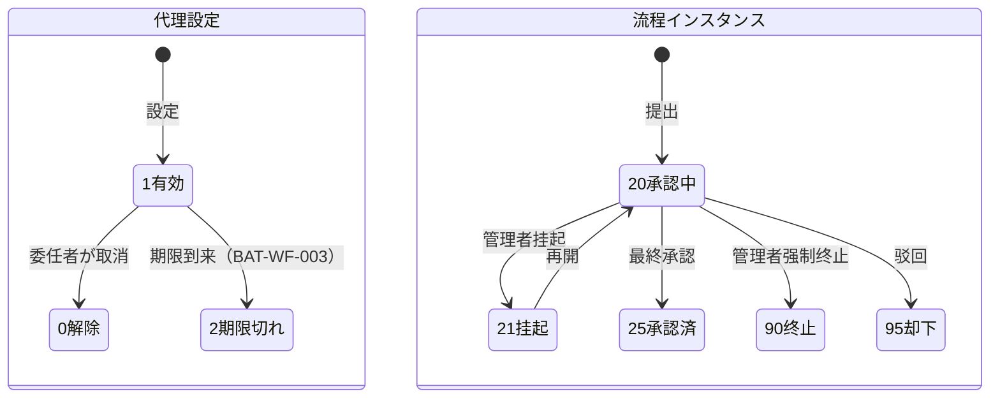

# 审批管理（代理・超时・实例管理） 详细设计书（承認管理 詳細設計書）

| 項目 | 内容 |
|---|---|
| 文書名 | 审批管理（代理・超时・实例管理） 详细设计书（承認管理 詳細設計書） |
| 文書番号 | DSN-WF-003 |
| 版数 | v1.0 |
| 作成日 | 2026-10-20 |
| 作成者 | system-workflow（域設計担当） |
| 承認者 | 未承認（レビュー待ち） |
| 状態 | ドラフト（レビュー中） |
| 関連文書 | [業務域概要](00-overview.md) / [DB 設計](90-db-design.md) / [承認実行](02-approval-runtime.md) / [API 設計](91-api-design.md) / [共通業務規則](../00-common/08-common-business-rules.md) |

---

## 1. 機能概要

| 項目 | 内容 |
|---|---|
| 機能 ID | F-WF-007（代理委托设置）、F-WF-008（超时提醒与自动审批）、F-WF-009（流程实例管理） |
| 機能名 | 代理承認、タイムアウト・エスカレーション・自動承認、インスタンス監視・強制管理 |
| 目的 | 承認者の不在・長期滞留・異常プロセスに対して、業務を止めない統制された代替手段を提供する。すべての例外操作を監査可能にする |
| 利用者・ロール | 全ユーザ（代理設定）、承认者・部門長（エスカレーション先）、系统管理员（超時設定・インスタンス管理）、内审员（監視） |
| 利用シーン | 休暇・出張時の代理承認、長期滞留タスクのエスカレーション、誤操作プロセスの強制終了、障害調査 |
| 優先度 | P1 |
| 画面 ID | SCR-WF-012（代理委托设置）、SCR-WF-014（超时规则与自动审批设置）、SCR-WF-013（流程实例管理）、SCR-WF-016（流程监控看板） |
| 関連 IF | なし（内部バッチ・通知は SYS 基盤） |

## 2. 業務要件・業務ルール

### 2.1 前提条件

| # | 前提条件 | 成立しない場合の挙動 |
|---|---|---|
| 1 | 代理設定の委任者・代理人がともに有効ユーザ（`status=1`、`account_status=1`）である | 保存不可（MSG-WF-041） |
| 2 | タイムアウト規則が有効（`status=1`）かつ適用期間内 | 既定規則（24h/48h、自動承認 OFF）を適用 |
| 3 | インスタンス管理操作（強制終了・掛起）は系统管理员のみ | 403（MSG-COM-030） |
| 4 | 強制終了・跳转は理由必須 | 実行不可（MSG-WF-016） |

### 2.2 業務ルール

| # | ルール | 根拠（法令・社内規程・業務慣行） | 関連項目 |
|---|---|---|---|
| BR-01 | 代理期間は最大 90 日。開始日時 < 終了日時。委任者と代理人は別人（自己委任禁止） | 内部統制 | `wf_delegation` |
| BR-02 | 代理は「全タスク代理」または「業務類型指定」。循環委任（A→B、B→A）は禁止 | 内部統制 | `delegation_type` |
| BR-03 | 高権限（总经理・财务总监）への/からの委任は、委任者本人の申請 + 承認（系统管理员または上位者）を要する | 内部統制 | `approved_by` |
| BR-04 | 委任期間中、委任者の新規タスクは代理人の待办にも表示する（両方に表示）。代理人が処理した場合は代理人名義 + 委任元を記録する | 業務継続性 | `wf_task.original_assignee_id` |
| BR-05 | 委任期限到来時は自動で無効化（`status=2`）し、両者へ通知する。期間中の取消は委任者のみ可能 | 運用 | BAT-WF-003 |
| BR-06 | タイムアウト：24 時間でリマインダ、48 時間で上位者（直属上長またはロール）へエスカレーション（[共通業務規則](../00-common/08-common-business-rules.md) 8.2）。時間は設定可能 | 共通規約 | `wf_timeout_rule` |
| BR-07 | エスカレーションは「タスクの追加」ではなく「通知 + 上位者への代理承認権付与」で行う（元の承認者も処理可能） | 責任分界 | `escalate_to_type` |
| BR-08 | 自動承認は既定 OFF。有効化する場合も「金額上限」「最終承認ノード以外のみ」「監査ログ必須」の 3 条件を守る。金額上限は `sys_param: workflow.auto-approve-max-amount` で制御 | 内部統制 | `auto_approve_*` |
| BR-09 | 自動承認は「タイムアウトしたタスク」のみ対象。承認者不在・長期滞留の救済であり、通常の承認を代替しない | 統制 | `wf_timeout_record` |
| BR-10 | タイムアウト判定は営業時間を考慮する（土日祝・休業時間を除く）。営業カレンダーは `sys_param: workflow.work-calendar` で管理 | 運用 | `due_at` |
| BR-11 | インスタンスの「挂起（一時停止）」中は新規タスク生成・承認操作を禁止する。再開で通常運用に戻る | 運用 | `process_status` |
| BR-12 | インスタンスの「强制终止」は理由必須。業務域へ E32（`TERMINATED`）を発行し、業務ステータスは業務域が `90 取消` に更新する | [00-common 09](../00-common/09-cross-domain-flow.md) 9.1 | `final_result=5` |
| BR-13 | 「跳转（ジャンプ）」は現在のノードを指定ノードへ移動する。実行前に経路図で影響を確認し、理由を記録する。最終ノードへの跳转は「強制承認」とみなし、二重承認を要する | 内部統制 | `wf_task_operation` |
| BR-14 | すべての管理操作（代理・超時設定・挂起・強制終了・跳转）は監査ログに before/after と理由を記録する | 共通項目定義 12 章 | `sys_audit_log` |
| BR-15 | 代理・超時・自動承認・管理操作の実行結果は通知（站内/メール）で関係者へ知らせる | 共通業務規則 13.3 | `sys_notification` |

### 2.3 状態遷移（代理設定・インスタンス）



| 遷移 | トリガ | 権限 | 更新項目 | メッセージ |
|---|---|---|---|---|
| 有効→解除 | 委任者 | `workflow:delegation:update` | `status=0` | MSG-COM-001 |
| 有効→期限切れ | BAT-WF-003 | システム | `status=2` | MSG-WF-044 |
| 20→21 | 挂起 | `workflow:instance:manage` | `process_status=21`、Flowable suspend | MSG-WF-032 |
| 21→20 | 再開 | 同上 | `process_status=20`、Flowable activate | MSG-WF-033 |
| 20→90 | 強制終了 | 同上 | `process_status=90`、`final_result=5` | MSG-WF-030 |

## 3. 関連機能

| 関係 | 機能 ID | 機能名 | 関係内容 |
|---|---|---|---|
| 上流 | F-WF-002 | 承认マトリクス | エスカレーション先のロール・上長を参照 |
| 上流 | F-SYS-002/005/006 | ユーザ・組織・岗位 | 代理人・上長・職位の解決 |
| 下流 | F-WF-005 | 审批操作 | 代理・エスカレーション時の承認可否 |
| 下流 | F-WF-011 | 状態連動 | 強制終了時の E32 発行 |
| 参照 | F-SYS-016 | 定时任务監視 | BAT-WF-001/002/003 の実行履歴 |
| 参照 | F-WF-006 | 流程追踪 | 管理操作の履歴表示 |

## 4. 画面設計

### 4.1 画面一覧

| 画面 ID | 画面名 | 類型 | 概要 |
|---|---|---|---|
| SCR-WF-012 | 代理委托设置 | EDIT | 委任者・代理人・期間・対象業務・理由の登録、一覧・解除 |
| SCR-WF-014 | 超时规则与自动审批设置 | EDIT | 業務類型・ノード別のリマインダ/エスカレーション/自動承認設定 |
| SCR-WF-013 | 流程实例管理 | LIST | 全プロセス検索、状態・滞留時間、挂起/再開/強制終了/跳转 |
| SCR-WF-016 | 流程监控看板 | DASH | 滞留件数、平均承認時間、承認者別負荷、超時件数 |

### 4.2 画面レイアウト（SCR-WF-012 代理委托设置）

```
┌──────────────────────────────────────────────────────────────────────────────┐
│ ホーム > 工作流 > 代理设置                                                   │
├──────────────────────────────────────────────────────────────────────────────┤
│〔我的代理設定〕                                                              │
│ 委任者       | 代理人     | 対象           | 期間                    | 状態 | 操作 │
│ 李明(采购经理) | 王芳(采购员) | 全タスク       | 2026-10-21～2026-10-27 | 有効 | [解除]│
│ 張伟(销售总监) | 劉洋(销售经理) | 销售订单承認 | 2026-11-01～2026-11-05 | 有効 | [解除]│
│ [+ 新增代理設定]                                                              │
├──────────────────────────────────────────────────────────────────────────────┤
│〔代理されている設定（私が代理人）〕                                          │
│ 委任者       | 期間                    | 対象           | 状態               │
│ 李明(采购经理) | 2026-10-21～2026-10-27 | 全タスク       | 有効               │
└──────────────────────────────────────────────────────────────────────────────┘
〔新規ダイアログ〕 代理人[▼] 対象[全/業務類型▼] 期間[開始]～[終了] 理由[______] [保存]
```

### 4.3 画面項目定義（SCR-WF-012 代理委托）

| No | 項目 ID | 項目名 | 種別 | 型/桁 | 必須 | 初期値 | 入力チェック | データソース | DB 項目 | 権限 | 備考 |
|---|---|---|---|---|---|---|---|---|---|---|---|
| 1 | `delegatorId` | 委任者 | 表示 | BIGINT | — | ログインユーザ | 変更不可 | SYS | `wf_delegation.delegator_id` | 本人 | 管理者のみ他人指定可 |
| 2 | `delegateId` | 代理人 | ユーザ選択 | BIGINT | ○ | 空 | 有効ユーザ、自分以外 | `sys_user` | `delegate_id` | 本人 | 検索ダイアログ |
| 3 | `delegationType` | 種別 | ラジオ | SMALLINT | ○ | 1 全タスク | 1/2 | 固定値 | `delegation_type` | 本人 | — |
| 4 | `businessTypes` | 対象業務 | 複数選択 | VARCHAR(64)[] | 条件付△ | 空 | 種別 2 の場合は必須 | `wf_business_type` | `business_types` | 本人 | — |
| 5 | `validFrom` | 開始日時 | 日時 | TIMESTAMPTZ | ○ | 当日 00:00 | 未来日可 | 入力 | `valid_from` | 本人 | — |
| 6 | `validTo` | 終了日時 | 日時 | TIMESTAMPTZ | ○ | 7 日後 | > 開始、期間 ≤90 日 | 入力 | `valid_to` | 本人 | — |
| 7 | `reason` | 理由 | テキストエリア | VARCHAR(500) | ○ | 空 | ≤500 字 | 入力 | `reason` | 本人 | — |
| 8 | `approvedBy` | 承認者 | 表示 | BIGINT | — | 空 | 高権限委任時のみ | — | `approved_by` | 管理者 | 承認後に有効 |

### 4.4 画面項目定義（SCR-WF-014 超时规则）

| No | 項目 ID | 項目名 | 種別 | 型/桁 | 必須 | 初期値 | 入力チェック | DB 項目 | 権限 |
|---|---|---|---|---|---|---|---|---|---|
| 1 | `ruleCode` | 规则代码 | テキスト | VARCHAR(64) | ○ | 空 | 一意 | `wf_timeout_rule.rule_code` | `workflow:timeout:update` |
| 2 | `ruleName` | 规则名称 | テキスト | VARCHAR(200) | ○ | 空 | ≤200 字 | `rule_name` | 同上 |
| 3 | `businessType` | 业务类型 | 選択 | VARCHAR(64) | △ | 全業務 | 有効業務類型 | `business_type` | 同上 |
| 4 | `nodeName` | 节点 | 選択 | VARCHAR(100) | △ | 全ノード | 定義の userTask | `node_name` | 同上 |
| 5 | `reminderHours` | リマインダ時間 | 数値 | INT | ○ | 24 | 1〜720 | `reminder_hours` | 同上 |
| 6 | `escalateHours` | エスカレーション時間 | 数値 | INT | ○ | 48 | >リマインダ | `escalate_hours` | 同上 |
| 7 | `escalateToType` | エスカレーション先 | 選択 | SMALLINT | ○ | 1 直属上長 | 1〜4 | `escalate_to_type` | 同上 |
| 8 | `autoApprove` | 自動承認 | スイッチ | BOOLEAN | ○ | false | true 時は以下必須 | `auto_approve` | 同上 |
| 9 | `autoApproveHours` | 自動承認時間 | 数値 | INT | 条件付△ | 空 | >エスカレーション | `auto_approve_hours` | 同上 |
| 10 | `autoApproveMaxAmount` | 金額上限 | 数値 | NUMERIC(18,2) | 条件付△ | 空 | ≥0 | `auto_approve_max_amount` | 同上 |
| 11 | `noticeChannels` | 通知渠道 | 複数チェック | VARCHAR(32) | ○ | 1,2 | 1/2 | `notice_channels` | 同上 |

### 4.5 画面項目定義（SCR-WF-013 实例管理）

| No | 項目 ID | 項目名 | 種別 | 型/桁 | 必須 | 初期値 | 入力チェック | DB 項目 | 権限 |
|---|---|---|---|---|---|---|---|---|---|
| 1 | `businessType` | 业务类型 | 複数選択 | VARCHAR(64)[] | △ | 空 | — | `wf_business_process.business_type` | `workflow:instance:view` |
| 2 | `businessNo` | 业务单号 | テキスト | VARCHAR(64) | △ | 空 | — | `business_no` | 同上 |
| 3 | `processStatus` | 状态 | 複数選択 | SMALLINT[] | △ | 20,21 | 10/20/21/25/90/95 | `process_status` | 同上 |
| 4 | `applicantId` | 申请者 | ユーザ選択 | BIGINT | △ | 空 | — | `applicant_id` | 同上 |
| 5 | `overdueHours` | 滞留時間 | 数値 | INT | △ | 空 | ≥0 | 計算 | 同上 |
| 6 | `suspendReason` | 挂起理由 | テキスト | VARCHAR(500) | 条件付△ | 空 | 挂起時必須 | `sys_audit_log.remark` | `workflow:instance:manage` |
| 7 | `terminateReason` | 终止理由 | テキスト | VARCHAR(1000) | 条件付△ | 空 | 強制終了時必須 | 同上 | `workflow:instance:manage` |
| 8 | `jumpToNode` | 跳转先 | 選択 | VARCHAR(100) | 条件付△ | 空 | 有効ノード、理由必須 | — | `workflow:instance:manage` |

### 4.6 イベント処理

| No | イベント | トリガ | 処理内容 | 呼出 API | 画面遷移 | 備考 |
|---|---|---|---|---|---|---|
| 1 | 代理設定保存 | 保存ボタン | 期間・ユーザ検証→保存→通知 | POST /api/workflow/delegations | 同一画面 | 高権限は承認フロー |
| 2 | 代理解除 | 解除ボタン | 状態更新→通知 | DELETE /api/workflow/delegations/{id} | 同一画面 | 委任者のみ |
| 3 | 超時規則保存 | 保存ボタン | 時間・自動承認条件検証→保存 | POST/PUT /api/workflow/timeout-rules | 同一画面 | 監査ログ |
| 4 | インスタンス検索 | 検索ボタン | 条件検証→一覧取得 | GET /api/workflow/instances | — | — |
| 5 | 挂起 | 行操作 | 理由入力→Flowable suspend | POST /api/workflow/instances/{id}/suspend | 同一画面 | — |
| 6 | 再開 | 行操作 | Flowable activate | POST /api/workflow/instances/{id}/resume | 同一画面 | — |
| 7 | 強制終了 | 行操作 | 理由入力→確認→終了→E32 発行 | POST /api/workflow/instances/{id}/terminate | 同一画面 | 業務 90 |
| 8 | 跳转 | 行操作 | 跳转先選択→理由→Flowable ノード移動 | POST /api/workflow/instances/{id}/jump | 同一画面 | 最終ノードは二重承認 |
| 9 | 監視ダッシュボード | 画面表示 | KPI・滞留一覧取得 | GET /api/workflow/monitor/summary | — | 2 秒以内 |
| 10 | 代理期限切れ通知 | BAT-WF-003 | 期限切れの無効化・通知 | （バッチ内部） | — | 日次 |

### 4.7 表示制御

| 条件 | 対象項目/ボタン | 制御 |
|---|---|---|
| 自分の代理設定以外 | 解除ボタン | 非表示（管理者は表示） |
| 高権限委任が未承認 | 状態 | 「承認待ち」表示、有効化しない |
| 委任期間外 | 代理処理 | 不可（承認画面で 403） |
| 権限なし（系统管理员以外） | 挂起/再開/強制終了/跳转 | 非表示 |
| プロセス完了 | 管理操作 | 非表示（履歴参照のみ） |
| 自動承認が OFF | 自動承認関連項目 | 非表示 |
| 財務関連フロー | 自動承認スイッチ | 無効（強制 OFF） |

## 5. 入力チェック仕様

| No | チェック ID | 対象項目 | 種別 | 条件 | タイミング | メッセージ ID |
|---|---|---|---|---|---|---|
| 1 | CHK-WF-007-01 | `delegateId` | 存在・別人 | 有効ユーザ、自分以外 | 保存 | MSG-WF-041 |
| 2 | CHK-WF-007-02 | `validFrom`/`validTo` | 相関 | 開始 < 終了、期間 ≤90 日 | 保存 | MSG-WF-042 |
| 3 | CHK-WF-007-03 | 循環委任 | 一意性 | A→B と B→A の同時有効なし | 保存 | MSG-WF-043 |
| 4 | CHK-WF-007-04 | 高権限委任 | 承認 | 总经理・财务总监の委任は承認必須 | 保存 | MSG-WF-045 |
| 5 | CHK-WF-008-01 | `reminderHours`/`escalateHours` | 相関 | リマインダ < エスカレーション | 保存 | MSG-COM-045 |
| 6 | CHK-WF-008-02 | `autoApprove` | 条件 | 自動承認時間 > エスカレーション、金額上限必須 | 保存 | MSG-WF-046 |
| 7 | CHK-WF-008-03 | 財務フロー | 制約 | 自動承認不可（財務関連） | 保存 | MSG-WF-047 |
| 8 | CHK-WF-009-01 | `terminateReason` | 必須 | 空でない | 強制終了 | MSG-WF-016 |
| 9 | CHK-WF-009-02 | `jumpToNode` | 存在 | 定義に存在する有効ノード | 跳转 | MSG-WF-048 |
| 10 | CHK-WF-009-03 | 状態 | 状態 | 承認中のインスタンスのみ | 管理操作 | MSG-COM-034 |

## 6. 処理詳細

### 6.1 処理一覧

| 処理 ID | 処理名 | 契機 | トランザクション | 排他 |
|---|---|---|---|---|
| PRC-WF-007-01 | 代理設定登録・解除 | 保存/解除 | 要 | 委任者行のロック |
| PRC-WF-007-02 | 代理解決（承認時） | 承認操作 | 不要（読取） | — |
| PRC-WF-008-01 | 超時検出・リマインダ | BAT-WF-001 | タスク単位 | `FOR UPDATE` |
| PRC-WF-008-02 | エスカレーション・自動承認 | BAT-WF-002 | タスク単位 | `FOR UPDATE` |
| PRC-WF-009-01 | 挂起・再開 | 管理操作 | 要 | プロセス単位ロック |
| PRC-WF-009-02 | 強制終了 | 管理操作 | 要（プロセス終了 + E32 Outbox） | プロセス単位ロック |
| PRC-WF-009-03 | 跳转 | 管理操作 | 要 | プロセス単位ロック |
| PRC-WF-009-04 | 監視集計 | バッチ/画面 | 不要 | — |

### 6.2 処理手順（正常系）

**PRC-WF-007-01 代理設定**

1. 本人（または管理者）権限を確認する。委任者・代理人の有効性、別人、循環委任を検証する（CHK-WF-007-01〜03）。
2. 高権限ロール（总经理・财务总监）が関与する場合、WF の承認フロー（業務類型 `WF_DELEGATION`）を開始する。承認完了まで `status=0（承認待ち）` とする。
3. `wf_delegation` を INSERT/UPDATE する。期間中の既存有効委任が重複する場合は、期間の重複を警告し、必要なら旧委任を解除する。
4. 委任者・代理人へ通知（站内/メール）を送る。監査ログ（before/after）を記録する。
5. 代理解決（PRC-WF-007-02）：承認操作時に `wf_delegation` を検索し、委任者 = タスク担当、`status=1`、`now() BETWEEN valid_from AND valid_to`、業務類型条件一致のレコードがあれば代理人を有効承認者とみなす。代理人が処理した場合、`wf_task.original_assignee_id` に委任者を記録し、`wf_task_operation.operator_id` は代理人とする。

**PRC-WF-008-01 超時検出・リマインダ（BAT-WF-001）**

1. 5 分間隔で `wf_task WHERE task_status=20 AND due_at <= now()` を抽出する。
2. 適用タイムアウト規則を解決する（業務類型・ノード・優先度）。規則なしは既定（24h/48h、自動承認 OFF）。
3. リマインダ時刻（タスク生成 + `reminder_hours`）を経過し、未通知（`wf_timeout_record` に `record_type=1` なし）の場合、承認者へ `WF_TASK_TIMEOUT` を通知し `wf_timeout_record` に記録する。`wf_task.reminder_count+1`。
4. 営業時間のみで経過時間を計算する（`sys_param: workflow.work-calendar`）。

**PRC-WF-008-02 エスカレーション・自動承認（BAT-WF-002）**

1. エスカレーション時刻（`escalate_hours`）を経過したタスクを抽出する。`wf_timeout_record` に `record_type=2` がなければ：
   - エスカレーション先を解決する（直属上長 / ロール / ユーザ / 部門長）。
   - 上位者へ通知（`WF_TASK_ESCALATED`）し、上位者に代理承認権（動的な `wf_delegation` 相当）を付与する（元の承認者も処理可）。
   - `wf_timeout_record` に記録する。
2. 自動承認が有効（`auto_approve=true`）かつ `auto_approve_hours` 経過、かつ金額 ≤ `auto_approve_max_amount`、かつ「最終承認ノード以外」の場合：
   - `taskService.complete(taskId, {approved:true, autoApproved:true})` を実行する。
   - `wf_task_operation` に `operation_type=9`（自動承認）・`operator_id=0`・理由を記録する。
   - `wf_timeout_record` に `record_type=3` を記録し、申請者・元承認者へ通知する。
   - 自動承認は同一タスクにつき 1 回のみ（再実行しない）。
3. 財務関連フロー（`process_category=finance`）は自動承認対象外とする。

**PRC-WF-009-01 挂起・再開**

1. 権限（`workflow:instance:manage`）、対象プロセスが `process_status=20` であることを確認する。
2. 挂起：`runtimeService.suspendProcessInstanceById(processInstanceId)` を実行し、`wf_business_process.process_status=21` に更新する。理由を `sys_audit_log` に記録する。承認操作 API は挂起中を検出して `MSG-WF-031` を返す。
3. 再開：`activateProcessInstanceById` を実行し、`process_status=20` に戻す。通知・監査ログを記録する。

**PRC-WF-009-02 強制終了**

1. 権限・状態を確認し、理由（必須）と影響範囲（進行中ノード・未処理タスク）を画面に表示する。
2. `runtimeService.deleteProcessInstance(processInstanceId, '管理者強制終了: ' + reason)` を実行する。
3. 未処理タスクを `task_status=90`、`wf_business_process` を `process_status=90`・`final_result=5`・`completed_at` に更新する。
4. Outbox に E32（`finalResult=TERMINATED`）を記録する。業務域は業務ステータスを `90 取消` に更新する（在庫・会計の逆処理が必要な場合は業務域の取消手順に従う）。
5. `wf_task_operation` に `operation_type=10`、`sys_audit_log` に理由付きで記録する。申請者・承認者へ通知する。

**PRC-WF-009-03 跳转**

1. 権限・状態・跳转先ノードの存在を確認する。理由を必須とする。
2. 最終承認ノードへの跳转は「強制承認」とみなし、系统管理员 2 名の承認（または上位者の承認）を要求する。
3. Flowable の `runtimeService.createChangeActivityStateBuilder().moveActivityIdTo(currentActivityId, targetActivityId)` でノード移動する。
4. 現在のタスクを取消（`task_status=90`）、移動先のタスクを新規生成し `wf_task` に INSERT する。`wf_task_operation` に `operation_type=13` を記録する。
5. 移動先の承認者へ通知し、監査ログを記録する。

**PRC-WF-009-04 監視集計（BAT-WF-005 / 画面）**

1. 当日の提出・承認・却下・撤回・超時件数、平均承認時間、承認者別滞留件数を集計する。
2. `wf_process_stat` に UPSERT する（`stat_date` + `stat_type` + `business_type` + `department_id` 一意）。
3. 画面（SCR-WF-016）は最新スナップショット + ライブ集計（滞留上位 10 件）を返す。キャッシュ 5 分。

### 6.3 例外処理

| No | 異常条件 | 検知箇所 | 処理 | ロールバック | メッセージ ID |
|---|---|---|---|---|---|
| 1 | 代理人が無効化済み | 代理解決 | 代理を無効とし、エスカレーションへ | — | MSG-WF-044 |
| 2 | 委任期間重複 | 保存 | 警告（必要なら旧設定解除） | — | MSG-WF-043 |
| 3 | 高権限委任の未承認 | 有効化 | 承認待ちのまま（代理不可） | — | MSG-WF-045 |
| 4 | 自動承認の金額上限超過 | BAT-WF-002 | 自動承認せず通知のみ | — | MSG-WF-049 |
| 5 | 最終ノードの自動承認要求 | BAT-WF-002 | 実行しない（スキップ） | — | — |
| 6 | 挂起中の承認操作 | 承認 API | 拒否 | — | MSG-WF-031 |
| 7 | 強制終了の理由なし | 管理操作 | 拒否 | — | MSG-WF-016 |
| 8 | 跳转先ノード不正 | 管理操作 | 拒否 | — | MSG-WF-048 |
| 9 | 跳转の二重承認未実施 | 管理操作 | 拒否 | — | MSG-WF-050 |
| 10 | Flowable 操作失敗 | 管理操作 | ロールバック・エラー | 全体 | MSG-WF-022 |

### 6.4 冪等性・排他

- 代理設定は `Idempotency-Key` + 期間重複チェック。
- タイムアウト・エスカレーション・自動承認は `wf_timeout_record` の `(task_id, record_type)` 一意制約で二重実行を防止する（バッチ再実行安全）。
- 挂起・強制終了・跳转はプロセスインスタンス単位でロックし、同時管理操作を防止する。
- 監視集計は `stat_date` 単位の UPSERT で冪等。

## 7. API 設計

| No | メソッド | パス | 権限 | 概要 |
|---|---|---|---|---|
| 1 | GET | /api/workflow/delegations | `workflow:delegation:update` | 代理設定一覧（自分/代理人/管理者） |
| 2 | POST | /api/workflow/delegations | `workflow:delegation:update` | 代理設定登録 |
| 3 | DELETE | /api/workflow/delegations/{id} | `workflow:delegation:update` | 代理解除 |
| 4 | GET | /api/workflow/delegations/effective | `workflow:task:view` | 有効な代理（代理人向け） |
| 5 | GET | /api/workflow/timeout-rules | `workflow:timeout:update` | 超時規則一覧 |
| 6 | POST | /api/workflow/timeout-rules | `workflow:timeout:update` | 超時規則登録 |
| 7 | PUT | /api/workflow/timeout-rules/{id} | `workflow:timeout:update` | 超時規則更新 |
| 8 | DELETE | /api/workflow/timeout-rules/{id} | `workflow:timeout:update` | 超時規則削除 |
| 9 | GET | /api/workflow/instances | `workflow:instance:view` | インスタンス一覧 |
| 10 | GET | /api/workflow/instances/{id} | `workflow:instance:view` | インスタンス詳細（変数・履歴） |
| 11 | POST | /api/workflow/instances/{id}/suspend | `workflow:instance:manage` | 挂起 |
| 12 | POST | /api/workflow/instances/{id}/resume | `workflow:instance:manage` | 再開 |
| 13 | POST | /api/workflow/instances/{id}/terminate | `workflow:instance:manage` | 強制終了 |
| 14 | POST | /api/workflow/instances/{id}/jump | `workflow:instance:manage` | 跳转 |
| 15 | GET | /api/workflow/monitor/summary | `workflow:monitor:view` | 監視サマリ |
| 16 | GET | /api/workflow/monitor/pending-top | `workflow:monitor:view` | 滞留上位一覧 |

### 7.1 リクエスト/レスポンス詳細

**POST /api/workflow/delegations**

```json
{ "delegateId": "1845000000000000125", "delegationType": 1, "businessTypes": [],
  "validFrom": "2026-10-21T00:00:00+08:00", "validTo": "2026-10-27T23:59:59+08:00",
  "reason": "出張のため代理承認を依頼" }
// 成功
{ "code": 0, "message": "保存しました。", "data": { "id": "...", "status": 1, "delegatorName": "李明", "delegateName": "王芳" } }
// 高権限委任（承認待ち）
{ "code": 0, "message": "审批流程已提交。", "data": { "processInstanceId": "...", "status": 0 } }
```

**POST /api/workflow/instances/{id}/terminate**

```json
{ "reason": "重複申請のため業務側で取消済み", "version": 3 }
// → { "code": 0, "message": "处理已完成。", "data": { "processStatus": 90, "finalResult": "TERMINATED" } }
```

**GET /api/workflow/monitor/summary**

```json
{ "code": 0, "data": {
  "today": { "submitted": 45, "approved": 38, "rejected": 3, "withdrawn": 2, "overdue": 4 },
  "pendingTotal": 62, "overdueTotal": 7, "avgApprovalHours": "6.4",
  "byBusinessType": [ {"businessType":"PURCHASE_REQUISITION","pending":18,"avgHours":"4.2"} ],
  "topApprovers": [ {"userName":"李明","pending":12,"avgHours":"8.1"} ] } }
```

## 8. データ更新仕様

| テーブル | 操作 | 更新項目 | 条件 | トリガ（処理 ID） |
|---|---|---|---|---|
| wf_delegation | INSERT/UPDATE | 全項目・`status` | 設定/解除/期限切れ | PRC-WF-007-01、BAT-WF-003 |
| wf_timeout_rule | INSERT/UPDATE/DELETE | 全項目 | 設定 | F-WF-008 API |
| wf_timeout_record | INSERT | 全項目 | リマインダ/エスカレーション/自動承認 | PRC-WF-008-01/02 |
| wf_task | UPDATE | `reminder_count`・`task_status`（自動承認） | タイムアウト | PRC-WF-008-01/02 |
| wf_task_operation | INSERT | 全項目 | 自動承認・管理操作 | PRC-WF-008-02、PRC-WF-009-02/03 |
| wf_business_process | UPDATE | `process_status`・`final_result`・`completed_at` | 挂起/再開/強制終了/跳转 | PRC-WF-009-01/02/03 |
| wf_process_stat | UPSERT | 全項目 | 集計 | BAT-WF-005 |
| sys_outbox_event | INSERT | E32（TERMINATED） | 強制終了 | PRC-WF-009-02 |
| sys_audit_log | INSERT | 全項目 | 全管理操作 | 全処理 |

## 9. エラー処理・メッセージ

| メッセージ ID | 種別 | 本文 | 発生条件 | 利用者への対処 | ログ |
|---|---|---|---|---|---|
| MSG-WF-030 | I | 该流程已被管理员终止。 | 強制終了 | — | WARN |
| MSG-WF-031 | E | 审批流程已挂起，暂不能处理。 | 挂起中の操作 | 管理者へ連絡 | INFO |
| MSG-WF-032 | I | 流程已挂起，暂停审批任务生成。 | 挂起 | — | INFO |
| MSG-WF-033 | I | 流程已恢复，可继续审批。 | 再開 | — | INFO |
| MSG-WF-041 | E | 代理人无效（已停用、离职或与委任人相同）。 | 代理設定不正 | 再選択 | INFO |
| MSG-WF-042 | E | 代理期间不正确（开始须早于结束，且不超过 90 天）。 | 期間不正 | 修正 | INFO |
| MSG-WF-043 | E | 存在循环代理或期间重叠的代理设置。 | 循環・重複 | 修正 | INFO |
| MSG-WF-044 | I | 代理设置已到期，已自动失效。 | 期限切れ | 再設定 | INFO |
| MSG-WF-045 | E | 高权限角色的代理需要审批通过后才能生效。 | 未承認 | 承認待ち | WARN |
| MSG-WF-046 | E | 自动审批设置不完整（需指定时间与金额上限）。 | 設定不備 | 修正 | INFO |
| MSG-WF-047 | E | 财务相关流程不允许自动审批。 | 統制違反 | 無効化 | WARN |
| MSG-WF-048 | E | 跳转目标节点不存在或不可用。 | 节点不正 | 修正 | INFO |
| MSG-WF-049 | W | 超过自动审批金额上限，已跳过自动审批。 | 金額超過 | 手動承認 | WARN |
| MSG-WF-050 | E | 跳转至最终审批节点需要第二名管理员确认。 | 二重承認未実施 | 再実行 | WARN |

## 10. 権限・セキュリティ

| 種別 | 内容 |
|---|---|
| 画面権限 | 代理設定 `workflow:delegation:update`（本人）、超時設定 `workflow:timeout:update`、インスタンス管理 `workflow:instance:view/manage`、監視 `workflow:monitor:view` |
| 操作権限 | 挂起/再開/強制終了/跳转は `workflow:instance:manage`（系统管理员のみ）。高権限委任は承認必須 |
| 項目権限 | 他人の代理設定は管理者以外参照不可。インスタンス変数は管理者・申請者・処理者のみ |
| データ範囲 | 代理設定は本人。管理操作は全社（部門長は自部門のインスタンス参照のみ） |
| 監査ログ | 代理設定/解除・超時規則変更・挂起/再開/強制終了/跳转を理由付きで記録 |
| セキュリティ | 管理操作は 2 名承認（強制終了・最終ノード跳转）。操作理由を必須とし、メール通知で関係者に周知 |

## 11. 性能・非機能

| 項目 | 目標値 | 前提 |
|---|---|---|
| 代理設定の反映 | 次回承認操作から | キャッシュ 60 秒 |
| 超時検出バッチ | 5 分間隔・1 回 1,000 件 | 索引 `idx_wf_task_due` |
| 自動承認バッチ | 5 分間隔・1 回 200 件 | タスク単位トランザクション |
| インスタンス一覧 | 2 秒以内 | 索引 + ページング |
| 監視サマリ | 1 秒以内（キャッシュ） | 5 分キャッシュ |

## 12. テスト観点

| No | 観点 ID | 分類 | 観点 | 期待結果 |
|---|---|---|---|---|
| 1 | TST-F-WF-007-01 | 正常系 | 代理設定→代理人の待办に表示 | 代理人が処理可能、履歴に両者記録 |
| 2 | TST-F-WF-007-02 | 異常系 | 自分自身を代理人に設定 | MSG-WF-041 |
| 3 | TST-F-WF-007-03 | 境界値 | 代理期間 91 日 | MSG-WF-042 |
| 4 | TST-F-WF-007-04 | 異常系 | 循環代理（A→B、B→A） | MSG-WF-043 |
| 5 | TST-F-WF-007-05 | 正常系 | 代理期限切れ | バッチで無効化、通知 |
| 6 | TST-F-WF-007-06 | 業務 | 高権限委任の未承認 | 代理が無効のまま |
| 7 | TST-F-WF-008-01 | 正常系 | 24h 経過 | リマインダ通知（1 回のみ） |
| 8 | TST-F-WF-008-02 | 正常系 | 48h 経過 | 上位者へエスカレーション |
| 9 | TST-F-WF-008-03 | 正常系 | 自動承認（条件充足） | タスク完了、理由記録、通知 |
| 10 | TST-F-WF-008-04 | 異常系 | 金額上限超過の自動承認 | 実行されない（MSG-WF-049） |
| 11 | TST-F-WF-008-05 | 異常系 | 財務フローで自動承認 | 設定不可（MSG-WF-047） |
| 12 | TST-F-WF-008-06 | 冪等 | バッチを 2 回実行 | リマインダ/自動承認が重複しない |
| 13 | TST-F-WF-009-01 | 正常系 | 挂起→承認操作 | MSG-WF-031、処理不可 |
| 14 | TST-F-WF-009-02 | 正常系 | 再開→承認 | 通常処理が可能 |
| 15 | TST-F-WF-009-03 | 正常系 | 強制終了 | 業務 90、E32 TERMINATED、通知 |
| 16 | TST-F-WF-009-04 | 異常系 | 強制終了の理由なし | MSG-WF-016 |
| 17 | TST-F-WF-009-05 | 正常系 | 跳转（中間ノード） | 指定ノードへ移動、新タスク生成 |
| 18 | TST-F-WF-009-06 | 異常系 | 最終ノードへの跳转（承認 1 名） | MSG-WF-050 |
| 19 | TST-F-WF-009-07 | 監査 | 管理操作 | before/after と理由が記録 |
| 20 | TST-F-WF-009-08 | 監視 | 監視サマリ | 件数・平均時間が正しい |

## 13. 未決事項

| # | 事項 | 理由 | 暫定仕様 | 担当 | 期限 |
|---|---|---|---|---|---|
| 1 | 営業カレンダーの管理方法 | 土日祝・休業時間の除外をどう定義するか | `sys_param: workflow.work-calendar` に JSON（休日リスト・勤務時間）で保持。Phase 1 は平日 9:00-18:00 | 系统管理员 | 2026-11-17 |
| 2 | エスカレーションの権限付与方法 | 動的代理（`wf_delegation`）かタスク転送か | 動的代理レコードを作成（`delegation_type=3` を追加提案、未決 #3 と関連） | Lead | 2026-11-10 |
| 3 | `wf_delegation.delegation_type` の値追加 | エスカレーション用（3）が必要 | Phase 1 は `delegation_type=1`（全タスク）+ `business_types` で表現。Phase 2 で値追加 | Lead | 2026-11-10 |
| 4 | 自動承認の最終ノード判断 | BPMN から最終ノードを判定する方法 | Flowable の `ExecutionListener` で次ノード有無を判定。最終なら自動承認しない | Lead | 2026-11-17 |
| 5 | 跳转の二重承認の実装 | 管理者 2 名の承認フローをどう実装するか | WF の承認フロー（業務類型 `WF_INSTANCE_JUMP`）を利用。Phase 1 は実装を簡略化し、上長承認 1 名 | Lead | 2026-11-17 |
| 6 | プロセス強制終了時の在庫・会計補償 | 業務域側の逆処理が必要 | WF は E32 TERMINATED を発行するのみ。業務域が取消処理を実行（FAIL 時はアラート） | Lead / 各域 | 2026-12-01 |

## 14. 改訂履歴

| 版数 | 日付 | 変更内容 | 変更者 |
|---|---|---|---|
| v1.0 | 2026-10-20 | 初版：F-WF-007/008/009 の業務ルール 15、画面 4、画面項目定義、処理 10 件、API 16 件、メッセージ 15 件、テスト観点 20 件 | system-workflow |