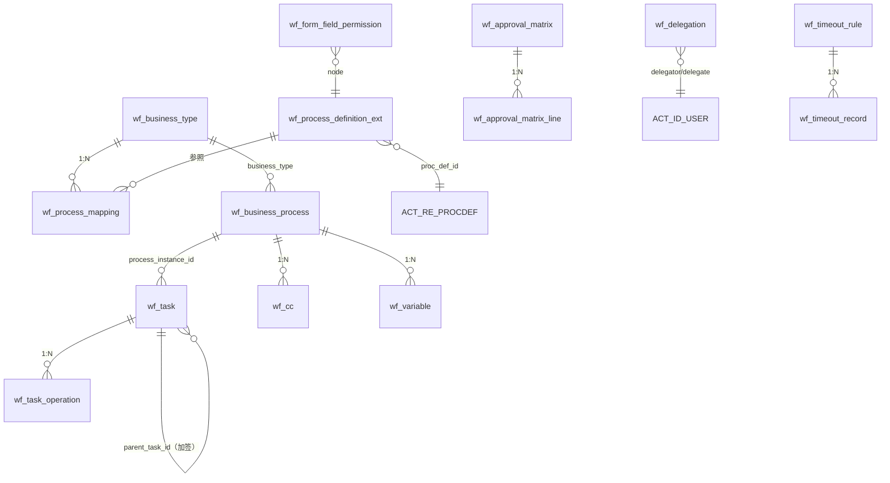

# 工作流 DB 设计书（工作流 DB 設計書）

| 項目 | 内容 |
|---|---|
| 文書名 | 工作流 DB 设计书（工作流 DB 設計書） |
| 文書番号 | DSN-WF-090 |
| 版数 | v1.0 |
| 作成日 | 2026-10-20 |
| 作成者 | system-workflow（域設計担当） |
| 承認者 | 未承認（レビュー待ち） |
| 状態 | ドラフト（レビュー中） |
| 関連文書 | [業務域概要](00-overview.md) / [DB 共通規格](../00-common/04-common-db-spec.md) / [共通項目定義](../00-common/01-common-item-definitions.md) / [跨域流程](../00-common/09-cross-domain-flow.md) / [テーブル定義書テンプレート](../_template/03-table-definition-template.md) |

---

## 1. 設計方針

### 1.1 データモデル概要

WF 域は「**Flowable 標準テーブル（`ACT_*`）+ 業務拡張テーブル（`wf_*`）**」の 2 層構成とする。Flowable が実行状態・履歴・タスクを保持し、`wf_*` は業務属性（業務類型・金額・申請者・表示用項目）と検索性・監査性を補完する。

| グループ | テーブル | 特徴 |
|---|---|---|
| 定義・設定 | `wf_process_definition_ext` / `wf_business_type` / `wf_process_mapping` / `wf_approval_matrix` / `wf_approval_matrix_line` / `wf_timeout_rule` / `wf_form_field_permission` / `wf_delegation` | マスタ・設定。論理削除可。変更は監査ログ |
| 実行・取引 | `wf_business_process` / `wf_task` / `wf_variable` / `wf_cc` | Flowable と 1:1 / 1:N で紐付け。業務検索用インデックスを保持 |
| 履歴・ログ | `wf_task_operation` / `wf_timeout_record` / `wf_process_stat` | 追記専用（統計は上書き） |

**重要原則**：
- Flowable の `ACT_RU_*` / `ACT_HI_*` は直接 UPDATE しない（Flowable API 経由）。`wf_*` は Flowable の状態変更後に同一トランザクション内で更新する。
- 業務伝票そのもの（金額・明細）は業務域が保持する。WF は `form_snapshot`（提出時点の表示項目）と変数のみ保持する（スナップショット原則）。
- 業務ステータス（10/20/25/90/95）の更新責任は**業務域**にある。WF は E31/E32 を発行するのみ（[跨域流程](../00-common/09-cross-domain-flow.md) 第 9 章）。

### 1.2 共通カラム・セット

SYS 域 90 章 1.2 と同一の 3 セット（M/T/L）を適用する（[共通項目定義](../00-common/01-common-item-definitions.md) 第 2 章）。本域では以下のように使い分ける。

| セット | 適用テーブル |
|---|---|
| M（マスタ） | wf_process_definition_ext、wf_business_type、wf_process_mapping、wf_approval_matrix、wf_approval_matrix_line、wf_timeout_rule、wf_form_field_permission、wf_delegation |
| T（取引・設定） | wf_business_process、wf_task、wf_cc、wf_variable |
| L（追記ログ） | wf_task_operation、wf_timeout_record、wf_process_stat（統計は更新ありのため `updated_at` のみ追加） |

**RLS**：全 `wf_*` テーブルは `ENABLE ROW LEVEL SECURITY` + `FORCE ROW LEVEL SECURITY` とし、ポリシーは `tenant_id = current_setting('app.tenant_id')::bigint` のみで判定する（`company_id` は RLS に含めずアプリ層で制御。[00-common 10](../00-common/10-rls-and-db-roles.md)）。Flowable 引擎表（`ACT_*`／`FLW_*`、schema `flowable`）は `tenant_id` を持たず RLS の対象外とする（[04 共通 DB 規約](../00-common/04-common-db-spec.md) 末節「Flowable 引擎表の schema 分離」）。代わりに Flowable 引擎の `tenantId` に `tenant_id` を設定してデプロイ・起動し、業務 API は必ず RLS 対象の `wf_*` テーブル（`wf_business_process`／`wf_task` 等）を経由して `ACT_*` を関連取得する。`taskId`／`processInstanceId` を直接指定して `ACT_*` を参照してはならない。

### 1.3 テーブル関連（ER 図）



### 1.4 設計上の決定事項

| # | 決定 | 理由 |
|---|---|---|
| D-01 | Flowable のプロセス変数には業務変数の全量を入れず、`wf_variable` に重要変数を複製保持 | 業務検索・一覧表示の性能確保。Flowable 変数は型制約があるため JSON は文字列で保持 |
| D-02 | `wf_business_process` は業務伝票 1 件 1 行（再提出時は同一行を更新し、`process_instance_id` を差替え） | 業務側から「現在の承認状態」を 1 クエリで参照するため |
| D-03 | `wf_task` は Flowable タスク 1 件 1 行（`task_id`＝`ACT_RU_TASK.ID_`） | 待办一覧の検索条件（金額・申請者・部門・緊急度）を Flowable テーブルに依存せず高速化 |
| D-04 | 承認操作履歴は `wf_task_operation` に全操作を記録（Flowable コメントは補助） | 承認・驳回・差戻し・加签・转办・撤回・催办・自動承認を一元監査 |
| D-05 | 承認マトリクスは `wf_approval_matrix`（条件）+ `wf_approval_matrix_line`（経路）に正規化 | 金額閾値・部門条件の追加をデータ変更のみで可能にする |
| D-06 | 完了プロセスは 1 年後にアーカイブ（Phase 2）。Phase 1 は保持 | Flowable 履歴テーブルの肥大化対策 |

## 2. テーブル一覧

| # | 物理名 | 論理名 | 種別 | 更新元機能 | データ量見積 | 保存期間 | 節 |
|---|---|---|---|---|---|---|---|
| 1 | wf_process_definition_ext | 流程定义扩展 | マスタ | F-WF-001 | 50 件 | 無期限 | 3.1 |
| 2 | wf_business_type | 业务类型 | マスタ | F-WF-002 | 40 件 | 無期限 | 3.2 |
| 3 | wf_process_mapping | 流程映射 | 設定 | F-WF-002 | 60 件 | 無期限 | 3.3 |
| 4 | wf_approval_matrix | 承認マトリクス | 設定 | F-WF-002 | 100 件 | 無期限 | 3.4 |
| 5 | wf_approval_matrix_line | 承認マトリクス明細 | 設定 | F-WF-002 | 400 件 | 無期限 | 3.5 |
| 6 | wf_business_process | 業務流程関連 | 取引 | F-WF-003/011 | 30 万/年 | 10 年 | 3.6 |
| 7 | wf_task | 承認タスク拡張 | 取引 | F-WF-004/005 | 60 万/年 | 10 年 | 3.7 |
| 8 | wf_task_operation | 承認操作履歴 | 履歴 | F-WF-005/006 | 60 万/年 | 10 年 | 3.8 |
| 9 | wf_cc | 抄送 | 取引 | F-WF-004 | 20 万/年 | 3 年 | 3.9 |
| 10 | wf_delegation | 代理委托 | 設定 | F-WF-007 | 500 件 | 5 年 | 3.10 |
| 11 | wf_timeout_rule | 超时规则 | 設定 | F-WF-008 | 20 件 | 無期限 | 3.11 |
| 12 | wf_timeout_record | 超时记录 | 履歴 | F-WF-008 | 10 万/年 | 3 年 | 3.12 |
| 13 | wf_form_field_permission | 表单字段权限 | 設定 | F-WF-010 | 1,000 件 | 無期限 | 3.13 |
| 14 | wf_process_stat | 流程统计 | 集計 | F-WF-006/009 | 1 万/年 | 5 年 | 3.14 |
| 15 | wf_variable | 流程変数 | 取引 | F-WF-003 | 30 万/年 | 10 年 | 3.15 |

## 3. テーブル定義

### 3.1 wf_process_definition_ext 流程定义扩展

| 項目 | 内容 |
|---|---|
| 種別 | マスタ（M セット） |
| 更新元機能 | F-WF-001 流程模型管理 |
| データ量見積 | 初期 12 件 / 年間 +5 / 5 年後 50 件 |
| 保存期間 | 無期限（使用停止した版も保持） |

**概要**：Flowable のプロセス定義（`ACT_RE_PROCDEF.ID_`）に対する業務属性。BPMN ファイル自体は Flowable の `ACT_GE_BYTEARRAY` に保存され、本テーブルは分類・表示名・有効状態・モデル種別を保持する。

```sql
CREATE TABLE wf_process_definition_ext (
    -- [共通カラム M]
    proc_def_id         VARCHAR(64)   NOT NULL,           -- Flowable プロセス定義 ID（ACT_RE_PROCDEF.ID_）
    proc_def_key        VARCHAR(100)  NOT NULL,           -- プロセス定義キー（BPMN の process id）
    proc_def_version    INT           NOT NULL,           -- 版数（Flowable 採番）
    process_name        VARCHAR(200)  NOT NULL,           -- 流程名称（表示名）
    process_category    VARCHAR(64),                      -- 分類（purchase/sales/production/finance/master/system）
    process_type        SMALLINT      NOT NULL DEFAULT 1, -- 種別：1 承認 / 2 自動 / 3 複合
    icon                VARCHAR(64),                      -- アイコン
    bpmn_resource_name  VARCHAR(200),                     -- BPMN リソース名
    deploy_time         TIMESTAMPTZ,                      -- デプロイ日時
    deploy_user_id      BIGINT,                           -- デプロイ実行者
    is_active           BOOLEAN       NOT NULL DEFAULT TRUE,  -- 有効（新規開始対象）
    is_default          BOOLEAN       NOT NULL DEFAULT FALSE, -- 同キーの既定版
    description         VARCHAR(500),                     -- 说明
    status              SMALLINT      NOT NULL DEFAULT 1, -- 状态：1 有效 / 0 无效
    CONSTRAINT ck_wf_proc_def_ext_type CHECK (process_type IN (1,2,3)),
    CONSTRAINT ck_wf_proc_def_ext_status CHECK (status IN (0,1))
);
COMMENT ON TABLE wf_process_definition_ext IS '流程定义扩展（BPMN 定義の業務属性）';
```

| 索引 | 種別 | 対象列 | 条件 | 目的 |
|---|---|---|---|---|
| uk_wf_proc_def_ext | UNIQUE | (tenant_id, company_id, proc_def_id) | WHERE deleted=FALSE | 定義 ID 一意 |
| idx_wf_proc_def_ext_key | B-Tree | (proc_def_key, proc_def_version DESC) | — | 最新版取得 |
| idx_wf_proc_def_ext_active | B-Tree | (process_category, is_active) | — | 有効定義一覧 |

**制約**：同一 `proc_def_key` で `is_default=true` は 1 件（部分一意）。使用中（進行中プロセスあり）の版は削除・無効化不可（`MSG-WF-006`）。

### 3.2 wf_business_type 业务类型

| 項目 | 内容 |
|---|---|
| 種別 | マスタ（M セット） |
| 更新元機能 | F-WF-002 |
| データ量見積 | 40 件 |
| 保存期間 | 無期限 |

**概要**：承認対象の業務種別（例 `SALES_ORDER`、`PURCHASE_ORDER`）。業務域の提出 API が指定するキーであり、[跨域流程](../00-common/09-cross-domain-flow.md) 9.1 の `businessType` と一致させる。業務域のコード（`business_no`）や表示 URL のテンプレートを保持する。

```sql
CREATE TABLE wf_business_type (
    -- [共通カラム M]
    business_type       VARCHAR(64)   NOT NULL,           -- 業務類型コード（例 SALES_ORDER）
    business_name       VARCHAR(100)  NOT NULL,           -- 業務名稱
    module_code         VARCHAR(32)   NOT NULL,           -- 所辖模块（sales/purchase/…）
    business_no_field   VARCHAR(64),                      -- 業務番号項目名（例 salesOrderNo）
    detail_url_template VARCHAR(300),                     -- 詳細画面 URL（例 /sales/orders/{id}）
    id_field            VARCHAR(64),                      -- 業務 ID 項目名（例 id）
    snapshot_fields     JSONB,                            -- スナップショット取得項目定義
    status              SMALLINT      NOT NULL DEFAULT 1, -- 状态：1 有效 / 0 无效
    sort_no             INT           NOT NULL DEFAULT 0, -- 表示顺
    description         VARCHAR(500),                     -- 说明
    owner_domain        VARCHAR(32)   NOT NULL,           -- 責任域（更新責任）
    CONSTRAINT ck_wf_business_type_status CHECK (status IN (0,1))
);
COMMENT ON TABLE wf_business_type IS '业务类型（承認対象の業務種別）';
```

| 索引 | 種別 | 対象列 | 条件 | 目的 |
|---|---|---|---|---|
| uk_wf_business_type | UNIQUE | (tenant_id, company_id, business_type) | WHERE deleted=FALSE | 業務類型一意 |
| idx_wf_business_type_module | B-Tree | (module_code, status) | — | モジュール別一覧 |

**制約**：使用中（マッピング・進行中プロセスあり）の削除禁止。`business_type` は作成後変更不可（業務域コードとの整合）。

### 3.3 wf_process_mapping 流程映射

| 項目 | 内容 |
|---|---|
| 種別 | 設定（M セット） |
| 更新元機能 | F-WF-002 |
| データ量見積 | 60 件 |
| 保存期間 | 無期限 |

**概要**：業務類型ごとに、条件に応じて開始するプロセス定義と承認マトリクスを決定する。複数行ある場合は `priority` の昇順で `condition_json` を評価し、最初に成立した行を適用する。条件なし（`condition_json IS NULL`）は既定（フォールバック）行として 1 件必須。

```sql
CREATE TABLE wf_process_mapping (
    -- [共通カラム M]
    mapping_code        VARCHAR(64)   NOT NULL,           -- 映射代码（一意）
    business_type       VARCHAR(64)   NOT NULL,           -- 業務類型（wf_business_type.business_type）
    proc_def_key        VARCHAR(100)  NOT NULL,           -- プロセス定義キー（BPMN process id）
    approval_matrix_id  BIGINT,                           -- 承認マトリクス ID（未使用時 NULL）
    condition_json      JSONB,                            -- 条件（例 {"amount":{"gte":50000},"department":["D020"]}）
    priority            INT           NOT NULL DEFAULT 100, -- 優先度（小さいほど優先）
    effective_from      DATE,                             -- 適用開始日
    effective_to        DATE,                             -- 適用終了日
    is_active           BOOLEAN       NOT NULL DEFAULT TRUE, -- 有効
    description         VARCHAR(500),                     -- 说明
    status              SMALLINT      NOT NULL DEFAULT 1, -- 状态：1 有效 / 0 无效
    CONSTRAINT ck_wf_process_mapping_status CHECK (status IN (0,1))
);
COMMENT ON TABLE wf_process_mapping IS '流程映射（業務類型→流程定義+条件）';
```

| 索引 | 種別 | 対象列 | 条件 | 目的 |
|---|---|---|---|---|
| uk_wf_process_mapping_code | UNIQUE | (tenant_id, company_id, mapping_code) | WHERE deleted=FALSE | マッピングコード一意 |
| idx_wf_process_mapping_bt | B-Tree | (business_type, is_active, priority) | — | 開始時のマッピング解決 |
| idx_wf_process_mapping_matrix | B-Tree | (approval_matrix_id) | — | マトリクス逆引き |

**制約**：`condition_json` の演算子は `eq/ne/gt/gte/lt/lte/in/between/exists` に限定（アプリ検証 `MSG-WF-052`）。同一 `business_type` 内で「条件なし」行は 1 件のみ。

### 3.4 wf_approval_matrix 承認マトリクス

| 項目 | 内容 |
|---|---|
| 種別 | 設定（M セット） |
| 更新元機能 | F-WF-002 |
| データ量見積 | 100 件 |
| 保存期間 | 無期限 |

**概要**：金額・条件別の承認経路定義（[共通業務规则](../00-common/08-common-business-rules.md) 8.1 の数値・経路を設定として保持）。マッピングと組み合わせて使用する。条件に一致する行の `wf_approval_matrix_line` の順に承認ノードを生成する。

```sql
CREATE TABLE wf_approval_matrix (
    -- [共通カラム M]
    matrix_code         VARCHAR(64)   NOT NULL,           -- マトリクスコード（一意、例 PR_5K_50K）
    matrix_name         VARCHAR(200)  NOT NULL,           -- 名称（例 采购申请 5,000〜50,000 元）
    business_type       VARCHAR(64)   NOT NULL,           -- 対象業務類型
    condition_type      SMALLINT      NOT NULL DEFAULT 1, -- 条件種別：1 金額 / 2 数量 / 3 条件 JSON / 4 金額+条件
    amount_min          NUMERIC(18,2),                    -- 金額下限（税込、含む）
    amount_max          NUMERIC(18,2),                    -- 金額上限（税込、含まない）
    currency_code       VARCHAR(3)    NOT NULL DEFAULT 'CNY', -- 金額通貨
    condition_json      JSONB,                            -- 追加条件（部門・与信フラグ等）
    priority            INT           NOT NULL DEFAULT 100, -- 優先度
    effective_from      DATE,                             -- 適用開始日
    effective_to        DATE,                             -- 適用終了日
    is_active           BOOLEAN       NOT NULL DEFAULT TRUE, -- 有効
    description         VARCHAR(500),                     -- 说明
    status              SMALLINT      NOT NULL DEFAULT 1, -- 状态：1 有效 / 0 无效
    CONSTRAINT ck_wf_approval_matrix_cond CHECK (condition_type IN (1,2,3,4)),
    CONSTRAINT ck_wf_approval_matrix_status CHECK (status IN (0,1))
);
COMMENT ON TABLE wf_approval_matrix IS '承认マトリクス（金額・条件別の承認経路定義）';
```

| 索引 | 種別 | 対象列 | 条件 | 目的 |
|---|---|---|---|---|
| uk_wf_approval_matrix_code | UNIQUE | (tenant_id, company_id, matrix_code) | WHERE deleted=FALSE | マトリクスコード一意 |
| idx_wf_approval_matrix_bt | B-Tree | (business_type, is_active, priority) | — | 条件評価 |

**制約**：`amount_min <= amount_max`。同一 `business_type` 内で金額範囲が重複する有効行は警告（`MSG-WF-053`）。金額境界は「下限含む・上限含まず」で評価し、最上位は `amount_max=NULL`（無限）。

### 3.5 wf_approval_matrix_line 承認マトリクス明細

| 項目 | 内容 |
|---|---|
| 種別 | 設定（M セット） |
| 更新元機能 | F-WF-002 |
| データ量見積 | 400 件 |
| 保存期間 | 無期限 |

```sql
CREATE TABLE wf_approval_matrix_line (
    -- [共通カラム M]
    matrix_id           BIGINT        NOT NULL,           -- マトリクス ID（wf_approval_matrix.id）
    line_no             INT           NOT NULL,           -- 行番号（10 刻み）
    node_name           VARCHAR(100)  NOT NULL,           -- 承認ノード名（例 采购经理）
    approver_type       SMALLINT      NOT NULL,           -- 承認者解決方式：1 ロール / 2 ユーザ / 3 職位 / 4 申請者直属上長 / 5 部門長 / 6 変数
    approver_ref        VARCHAR(200),                     -- 参照値（role_code / user_code / position_code / variable key）
    sign_type           SMALLINT      NOT NULL DEFAULT 1, -- 署名方式：1 或签 / 2 会签 / 3 顺送
    min_approver_count  SMALLINT      NOT NULL DEFAULT 1, -- 会签時の最低承認者数（0=全員）
    allow_delegate      BOOLEAN       NOT NULL DEFAULT TRUE, -- 代理許可
    timeout_hours       INT,                              -- 個別タイムアウト（NULL=既定）
    description         VARCHAR(500),                     -- 说明
    CONSTRAINT ck_wf_approval_matrix_line_approver CHECK (approver_type IN (1,2,3,4,5,6)),
    CONSTRAINT ck_wf_approval_matrix_line_sign CHECK (sign_type IN (1,2,3))
);
COMMENT ON TABLE wf_approval_matrix_line IS '承认マトリクス明細（経路の各承認ノード）';
```

| 索引 | 種別 | 対象列 | 条件 | 目的 |
|---|---|---|---|---|
| uk_wf_approval_matrix_line | UNIQUE | (tenant_id, company_id, matrix_id, line_no) | WHERE deleted=FALSE | 行番号一意 |
| idx_wf_approval_matrix_line_matrix | B-Tree | (matrix_id) | — | 経路取得 |

**制約**：`approver_type=1/2/3/6` は `approver_ref` 必須。`node_name` は経路図・履歴に表示する。承認者が解決できない場合、プロセス開始は失敗し `MSG-WF-004`（承認者未設定）。

### 3.6 wf_business_process 業務流程関連

| 項目 | 内容 |
|---|---|
| 種別 | 取引（T セット） |
| 更新元機能 | F-WF-003 提出、F-WF-009 管理、F-WF-011 状態連動 |
| データ量見積 | 30 万/年 |
| 保存期間 | 10 年 |

**概要**：業務伝票とプロセスインスタンスの紐付け。業務伝票 1 件につき 1 行（再提出時は同一行を更新）。業務域は `business_type + business_id` で現在の承認状態を参照する。

```sql
CREATE TABLE wf_business_process (
    -- [共通カラム T]
    business_type       VARCHAR(64)   NOT NULL,           -- 業務類型
    business_id         BIGINT        NOT NULL,           -- 業務 ID
    business_no         VARCHAR(64)   NOT NULL,           -- 業務番号（例 SO2610200001）
    process_instance_id VARCHAR(64)   NOT NULL,           -- Flowable プロセスインスタンス ID
    proc_def_id         VARCHAR(64),                      -- プロセス定義 ID
    proc_def_key        VARCHAR(100),                     -- プロセス定義キー
    process_status      SMALLINT      NOT NULL DEFAULT 10, -- 10 草稿 / 20 承認中 / 21 挂起 / 25 承認済 / 95 却下 / 90 取消
    applicant_id        BIGINT        NOT NULL,           -- 申請者
    applicant_dept_id   BIGINT,                           -- 申請部門
    factory_id          BIGINT,                           -- 拠点
    amount              NUMERIC(18,2),                    -- 申請金額（税込）
    currency_code       VARCHAR(3)    NOT NULL DEFAULT 'CNY', -- 通貨
    summary             VARCHAR(500),                     -- 概要（一覧表示用）
    form_snapshot       JSONB,                            -- 提出時点の業務項目スナップショット
    current_task_ids    VARCHAR(500),                     -- 現在のタスク ID（カンマ区切り、一覧高速化）
    current_approvers   VARCHAR(500),                     -- 現在の承認者名（表示用、カンマ区切り）
    submit_at           TIMESTAMPTZ,                      -- 提出日時
    completed_at        TIMESTAMPTZ,                      -- 完了日時
    final_result        SMALLINT,                         -- 最終結果：1 承認 / 2 却下 / 3 撤回 / 4 取消 / 5 強制終了
    urgent_flag         BOOLEAN       NOT NULL DEFAULT FALSE, -- 緊急フラグ
    status              SMALLINT      NOT NULL DEFAULT 20, -- 伝票状態：10 草稿 / 20 承認中 / 30 承認済 / 40 却下 / 90 撤回（再提出で更新）
    CONSTRAINT ck_wf_business_process_status CHECK (process_status IN (10,20,21,25,90,95)),
    CONSTRAINT ck_wf_business_process_doc_status CHECK (status IN (10,20,30,40,90)),
    CONSTRAINT ck_wf_business_process_result CHECK (final_result IS NULL OR final_result IN (1,2,3,4,5))
);
COMMENT ON TABLE wf_business_process IS '業務流程関連（業務伝票とプロセスインスタンスの紐付け）';
```

| 索引 | 種別 | 対象列 | 条件 | 目的 |
|---|---|---|---|---|
| uk_wf_business_process | UNIQUE | (tenant_id, company_id, business_type, business_id) | — | 業務×プロセス一意 |
| idx_wf_business_process_pi | B-Tree | (process_instance_id) | — | プロセス逆引き |
| idx_wf_business_process_status | B-Tree | (process_status, submit_at DESC) | — | 状態別一覧 |
| idx_wf_business_process_applicant | B-Tree | (applicant_id, submit_at DESC) | — | 我发起的 |
| idx_wf_business_process_no | B-Tree | (business_no) | — | 番号検索 |

**制約**：承認中（`process_status=20`）の同一業務の再提出は不可（`MSG-WF-073`）。`process_status` は Flowable の完了イベントで更新するが、業務ステータスの更新責任は業務域にある（本列は WF 側の参照用コピー）。

### 3.7 wf_task 承認タスク拡張

| 項目 | 内容 |
|---|---|
| 種別 | 取引（T セット） |
| 更新元機能 | F-WF-004 待办、F-WF-005 承認操作 |
| データ量見積 | 60 万/年 |
| 保存期間 | 10 年 |

**概要**：Flowable の UserTask（`ACT_RU_TASK`）1 件に対応する業務拡張。待办一覧の検索（申請者・金額・部門・期限・緊急度）を Flowable テーブルに依存せず行うため、一覧表示に必要な項目を複製保持する。

```sql
CREATE TABLE wf_task (
    -- [共通カラム T]
    task_id             VARCHAR(64)   NOT NULL,           -- Flowable タスク ID（ACT_RU_TASK.ID_）
    process_instance_id VARCHAR(64)   NOT NULL,           -- プロセスインスタンス ID
    business_type       VARCHAR(64)   NOT NULL,           -- 業務類型
    business_id         BIGINT        NOT NULL,           -- 業務 ID
    business_no         VARCHAR(64)   NOT NULL,           -- 業務番号
    task_def_key        VARCHAR(100),                     -- ノードキー（BPMN userTask id）
    task_name           VARCHAR(200)  NOT NULL,           -- タスク名（例 采购经理审批）
    node_name           VARCHAR(100),                     -- 表示用ノード名
    assignee_id         BIGINT,                           -- 担当者（未割当は NULL）
    assignee_name       VARCHAR(50),                      -- 担当者名（スナップショット）
    original_assignee_id BIGINT,                          -- 元の担当者（委任時）
    delegation_type     SMALLINT,                         -- 委任種別：1 代理（PENDING）/ 2 委任（RESOLVED）
    owner_applicant_id  BIGINT        NOT NULL,           -- 申請者
    applicant_dept_id   BIGINT,                           -- 申請部門
    amount              NUMERIC(18,2),                    -- 申請金額
    summary             VARCHAR(500),                     -- 概要
    task_status         SMALLINT      NOT NULL DEFAULT 20, -- 20 未処理 / 25 処理済 / 90 取消 / 95 却下
    due_at              TIMESTAMPTZ,                      -- 期限（タイムアウト判定）
    reminder_count      SMALLINT      NOT NULL DEFAULT 0, -- リマインダ回数
    urgency             SMALLINT      NOT NULL DEFAULT 0, -- 緊急度：0 通常 / 1 高 / 2 緊急
    create_at           TIMESTAMPTZ   NOT NULL DEFAULT now(), -- 生成日時
    claim_at            TIMESTAMPTZ,                      -- 引受日時
    complete_at         TIMESTAMPTZ,                      -- 完了日時
    cc_flag             BOOLEAN       NOT NULL DEFAULT FALSE, -- 主管抄送要否
    status              SMALLINT      NOT NULL DEFAULT 1,  -- 状態：1 有効 / 0 無効
    parent_task_id      BIGINT,                           -- 親タスク（wf_task.id、加签の子タスク時。通常 NULL）
    task_type           SMALLINT      NOT NULL DEFAULT 10, -- タスク種別：10 通常 / 20 加签 / 30 转办
    CONSTRAINT uk_wf_task_tenant_id UNIQUE (tenant_id, id),
    CONSTRAINT fk_wf_task_parent FOREIGN KEY (tenant_id, parent_task_id) REFERENCES wf_task (tenant_id, id),
    CONSTRAINT ck_wf_task_status CHECK (task_status IN (20,25,90,95)),
    CONSTRAINT ck_wf_task_delegation CHECK (delegation_type IS NULL OR delegation_type IN (1,2)),
    CONSTRAINT ck_wf_task_urgency CHECK (urgency IN (0,1,2)),
    CONSTRAINT ck_wf_task_row_status CHECK (status IN (0,1)),
    CONSTRAINT ck_wf_task_type CHECK (task_type IN (10,20,30))
);
COMMENT ON TABLE wf_task IS '承认タスク拡張（待办一覧の検索用属性）';
```

| 索引 | 種別 | 対象列 | 条件 | 目的 |
|---|---|---|---|---|
| uk_wf_task | UNIQUE | (tenant_id, company_id, task_id) | — | タスク ID 一意 |
| idx_wf_task_assignee | B-Tree | (assignee_id, task_status, create_at DESC) | WHERE task_status=20 | 待办一覧 |
| idx_wf_task_pi | B-Tree | (process_instance_id) | — | プロセス別タスク |
| idx_wf_task_due | B-Tree | (task_status, due_at) | WHERE task_status=20 | 超時検出 |
| idx_wf_task_business | B-Tree | (business_type, business_id) | — | 業務別タスク |

**制約**：`task_id` は Flowable と 1:1。Flowable 側のタスク削除（プロセス強制終了）時は `task_status=90` に更新する（物理削除しない）。`assignee_id` が NULL のタスク（候補グループ）は、承認者解決時にロールメンバーへ展開して個別タスクを生成する。

### 3.8 wf_task_operation 承認操作履歴

| 項目 | 内容 |
|---|---|
| 種別 | 履歴（L セット + `company_id`） |
| 更新元機能 | F-WF-005、F-WF-006 |
| データ量見積 | 60 万/年 |
| 保存期間 | 10 年 |

**概要**：承認タスクに対する全操作の履歴。承認経路のタイムライン（F-WF-006）と監査の基礎データ。Flowable の `ACT_HI_COMMENT` はコメントのみ保持するため、業務的に意味のある操作（加签・转办・催办・自動承認・システム取消）を本テーブルで一元管理する。

```sql
CREATE TABLE wf_task_operation (
    -- [共通カラム L + company_id]
    process_instance_id VARCHAR(64)   NOT NULL,           -- プロセスインスタンス ID
    task_id             VARCHAR(64),                      -- タスク ID（プロセス操作は NULL）
    business_type       VARCHAR(64)   NOT NULL,           -- 業務類型
    business_id         BIGINT        NOT NULL,           -- 業務 ID
    business_no         VARCHAR(64),                      -- 業務番号
    operation_type      SMALLINT      NOT NULL,           -- 1 同意 / 2 驳回 / 3 差戻し / 4 加签 / 5 转办 / 6 撤回 / 7 催办 / 8 委托 / 9 自动承認 / 10 强制終了 / 11 挂起 / 12 再開 / 13 跳转 / 14 抄送
    operator_id         BIGINT,                           -- 操作者（システム=0）
    operator_name       VARCHAR(50),                      -- 操作者名（スナップショット）
    target_user_id      BIGINT,                           -- 対象者（加签・转办・催办の相手）
    target_task_id      VARCHAR(64),                      -- 対象タスク（加签・转办）
    comment             VARCHAR(2000),                    -- コメント／理由（驳回・差戻しは必須）
    before_status       SMALLINT,                         -- 操作前のタスク状態
    after_status        SMALLINT,                         -- 操作後のタスク状態
    deadline_extended   BOOLEAN       NOT NULL DEFAULT FALSE, -- 期限延長の有無
    occurred_at         TIMESTAMPTZ   NOT NULL DEFAULT now(), -- 操作日時
    ip_address          VARCHAR(45),                      -- 操作 IP
    trace_id            VARCHAR(64),                      -- 追跡 ID
    CONSTRAINT ck_wf_task_operation_type CHECK (operation_type IN (1,2,3,4,5,6,7,8,9))
);
COMMENT ON TABLE wf_task_operation IS '承认操作履歴（タイムライン・監査）';
```

| 索引 | 種別 | 対象列 | 条件 | 目的 |
|---|---|---|---|---|
| idx_wf_task_operation_pi | B-Tree | (process_instance_id, occurred_at) | — | 承認経路タイムライン |
| idx_wf_task_operation_operator | B-Tree | (operator_id, occurred_at DESC) | — | 操作者別履歴 |
| idx_wf_task_operation_type | B-Tree | (operation_type, occurred_at DESC) | — | 自動承認・強制終了の監査 |

**制約**：追記専用（UPDATE/DELETE 不可）。`comment` は 驳回（2）・差戻し（3）・强制終了（10）で必須。個人情報・添付内容はコメントに書かない（運用ルール）。

### 3.9 wf_cc 抄送

| 項目 | 内容 |
|---|---|
| 種別 | 取引（T セット） |
| 更新元機能 | F-WF-004 |
| データ量見積 | 20 万/年 |
| 保存期間 | 3 年 |

**概要**：プロセス完了後またはノード通過時に、参照者（抄送先）へ通知するためのレコード。既読管理付き。

```sql
CREATE TABLE wf_cc (
    -- [共通カラム T]
    process_instance_id VARCHAR(64)   NOT NULL,           -- プロセスインスタンス ID
    task_id             VARCHAR(64),                      -- 契機タスク（ノード通過時）
    business_type       VARCHAR(64)   NOT NULL,           -- 業務類型
    business_id         BIGINT        NOT NULL,           -- 業務 ID
    business_no         VARCHAR(64),                      -- 業務番号
    cc_user_id          BIGINT        NOT NULL,           -- 抄送先ユーザ
    cc_type             SMALLINT      NOT NULL DEFAULT 1, -- 種別：1 自動抄送 / 2 手動抄送
    read_flag           BOOLEAN       NOT NULL DEFAULT FALSE, -- 既読
    read_at             TIMESTAMPTZ,                      -- 既読日時
    status              SMALLINT      NOT NULL DEFAULT 0, -- 状態：0 未読 / 1 既読 / 2 削除
    CONSTRAINT ck_wf_cc_type CHECK (cc_type IN (1,2)),
    CONSTRAINT ck_wf_cc_status CHECK (status IN (0,1,2))
);
COMMENT ON TABLE wf_cc IS '抄送（参照通知・既読管理）';
```

| 索引 | 種別 | 対象列 | 条件 | 目的 |
|---|---|---|---|---|
| uk_wf_cc | UNIQUE | (tenant_id, company_id, process_instance_id, cc_user_id) | — | 抄送重複防止 |
| idx_wf_cc_user | B-Tree | (cc_user_id, status, created_at DESC) | — | 抄送我的一覧 |

### 3.10 wf_delegation 代理委托

| 項目 | 内容 |
|---|---|
| 種別 | 設定（M セット） |
| 更新元機能 | F-WF-007 |
| データ量見積 | 500 件 |
| 保存期間 | 5 年 |

**概要**：期間を指定した代理承認の設定。`delegator_id`（委任者）のタスクを `delegate_id`（代理人）が処理できるようにする。承認操作は代理人名義で記録し、監査ログに「委任元」を残す。

```sql
CREATE TABLE wf_delegation (
    -- [共通カラム M]
    delegator_id        BIGINT        NOT NULL,           -- 委任者（タスクを渡す人）
    delegate_id         BIGINT        NOT NULL,           -- 代理人（タスクを処理する人）
    delegation_type     SMALLINT      NOT NULL DEFAULT 1, -- 種別：1 全タスク代理 / 2 業務類型指定
    business_types      VARCHAR(500),                     -- 対象業務類型（カンマ区切り、種別 2 時）
    valid_from          TIMESTAMPTZ   NOT NULL,           -- 開始日時
    valid_to            TIMESTAMPTZ   NOT NULL,           -- 終了日時
    reason              VARCHAR(500)  NOT NULL,           -- 理由（必須）
    approved_by         BIGINT,                           -- 承認者（高権限委任時）
    approved_at         TIMESTAMPTZ,                      -- 承認日時
    status              SMALLINT      NOT NULL DEFAULT 1, -- 状態：1 有効 / 0 解除 / 2 期限切れ
    CONSTRAINT ck_wf_delegation_type CHECK (delegation_type IN (1,2)),
    CONSTRAINT ck_wf_delegation_status CHECK (status IN (0,1,2))
);
COMMENT ON TABLE wf_delegation IS '代理委托（期間指定の代理承認）';
```

| 索引 | 種別 | 対象列 | 条件 | 目的 |
|---|---|---|---|---|
| idx_wf_delegation_delegator | B-Tree | (delegator_id, status, valid_to DESC) | — | 委任者の有効委任取得 |
| idx_wf_delegation_delegate | B-Tree | (delegate_id, status, valid_to DESC) | — | 代理人の担当範囲 |
| idx_wf_delegation_valid | B-Tree | (status, valid_to) | — | 期限切れバッチ |

**制約**：`valid_from < valid_to`、最大 90 日。`delegator_id ≠ delegate_id`。自己への委任禁止（`MSG-WF-042`）。循環委任（A→B、B→A）禁止。高権限（总经理・财务总监）への委任は承認必須。

### 3.11 wf_timeout_rule 超时规则

| 項目 | 内容 |
|---|---|
| 種別 | 設定（M セット） |
| 更新元機能 | F-WF-008 |
| データ量見積 | 20 件 |
| 保存期間 | 無期限 |

**概要**：承認タスクのタイムアウト規則。業務類型・ノード別に、リマインダ・エスカレーション・自動承認の時刻と動作を定義する。既定は [共通業務规则](../00-common/08-common-business-rules.md) 8.2 の 24h/48h。

```sql
CREATE TABLE wf_timeout_rule (
    -- [共通カラム M]
    rule_code           VARCHAR(64)   NOT NULL,           -- ルールコード（一意）
    rule_name           VARCHAR(200)  NOT NULL,           -- ルール名称
    business_type       VARCHAR(64),                      -- 対象業務類型（NULL=全業務）
    node_name           VARCHAR(100),                     -- 対象ノード名（NULL=全ノード）
    reminder_hours      INT           NOT NULL DEFAULT 24, -- リマインダ時刻（時間）
    escalate_hours      INT           NOT NULL DEFAULT 48, -- エスカレーション時刻（時間）
    escalate_to_type    SMALLINT,                         -- エスカレーション先：1 直属上長 / 2 ロール / 3 ユーザ / 4 部門長
    escalate_to_ref     VARCHAR(200),                     -- 参照値（role_code/user_code）
    auto_approve        BOOLEAN       NOT NULL DEFAULT FALSE, -- 自動承認可否
    auto_approve_hours  INT,                              -- 自動承認時刻（時間）
    auto_approve_max_amount NUMERIC(18,2),                -- 自動承認の金額上限（安全弁）
    notice_channels     VARCHAR(32)   NOT NULL DEFAULT '1,2', -- 通知渠道（站内/メール）
    priority            INT           NOT NULL DEFAULT 100, -- 優先度
    effective_from      DATE,                             -- 適用開始日
    effective_to        DATE,                             -- 適用終了日
    status              SMALLINT      NOT NULL DEFAULT 1, -- 状態：1 有效 / 0 无效
    description         VARCHAR(500),                     -- 说明
    CONSTRAINT ck_wf_timeout_rule_escalate CHECK (escalate_to_type IS NULL OR escalate_to_type IN (1,2,3,4)),
    CONSTRAINT ck_wf_timeout_rule_status CHECK (status IN (0,1))
);
COMMENT ON TABLE wf_timeout_rule IS '超时规则（リマインダ・エスカレーション・自動承認）';
```

| 索引 | 種別 | 対象列 | 条件 | 目的 |
|---|---|---|---|---|
| uk_wf_timeout_rule_code | UNIQUE | (tenant_id, company_id, rule_code) | WHERE deleted=FALSE | ルールコード一意 |
| idx_wf_timeout_rule_bt | B-Tree | (business_type, node_name, priority) | — | 規則解決 |

**制約**：`reminder_hours < escalate_hours`。`auto_approve=true` の場合は `auto_approve_hours` と `auto_approve_max_amount` 必須。自動承認は「最終承認ノード以外」または「金額上限内」の条件を両方満たす場合のみ実行（安全弁）。

### 3.12 wf_timeout_record 超时记录

| 項目 | 内容 |
|---|---|
| 種別 | 履歴（L セット） |
| 更新元機能 | F-WF-008（BAT-WF-001/002） |
| データ量見積 | 10 万/年 |
| 保存期間 | 3 年 |

```sql
CREATE TABLE wf_timeout_record (
    -- [共通カラム L]
    process_instance_id VARCHAR(64)   NOT NULL,           -- プロセスインスタンス ID
    task_id             VARCHAR(64)   NOT NULL,           -- タスク ID
    business_type       VARCHAR(64),                      -- 業務類型
    business_no         VARCHAR(64),                      -- 業務番号
    record_type         SMALLINT      NOT NULL,           -- 1 リマインダ / 2 エスカレーション / 3 自動承認 / 4 期限延長
    assignee_id         BIGINT,                           -- 当時の担当者
    target_user_id      BIGINT,                           -- エスカレーション先
    elapsed_hours       INT,                              -- 経過時間
    rule_id             BIGINT,                           -- 適用ルール ID
    result              SMALLINT      NOT NULL DEFAULT 1, -- 1 成功 / 0 失敗
    error_message       VARCHAR(500),                     -- 失敗理由
    occurred_at         TIMESTAMPTZ   NOT NULL DEFAULT now(),-- 実行日時
    CONSTRAINT ck_wf_timeout_record_type CHECK (record_type IN (1,2,3,4)),
    CONSTRAINT ck_wf_timeout_record_result CHECK (result IN (0,1))
);
COMMENT ON TABLE wf_timeout_record IS '超时记录（リマインダ・エスカレーション・自動承認履歴）';
```

| 索引 | 種別 | 対象列 | 条件 | 目的 |
|---|---|---|---|---|
| idx_wf_timeout_record_task | B-Tree | (task_id, record_type, occurred_at DESC) | — | タスク別履歴 |
| idx_wf_timeout_record_time | B-Tree | (occurred_at DESC) | — | 運用監視 |

### 3.13 wf_form_field_permission 表单字段权限

| 項目 | 内容 |
|---|---|
| 種別 | 設定（M セット） |
| 更新元機能 | F-WF-010 |
| データ量見積 | 1,000 件 |
| 保存期間 | 無期限 |

**概要**：承認画面（SCR-WF-007）において、業務伝票の項目をノード別・ロール別に「編集可/参照のみ/非表示」制御する。BPMN の UserTask 拡張属性（`flowable:formProperty`）または本テーブルで管理し、本テーブルを正とする。

```sql
CREATE TABLE wf_form_field_permission (
    -- [共通カラム M]
    proc_def_key        VARCHAR(100)  NOT NULL,           -- プロセス定義キー
    node_def_key        VARCHAR(100),                     -- ノードキー（NULL=全ノード既定）
    business_type       VARCHAR(64)   NOT NULL,           -- 業務類型
    field_key           VARCHAR(100)  NOT NULL,           -- 項目キー（例 totalAmount、discountRate）
    field_name          VARCHAR(100),                     -- 項目名（表示用）
    permission_type     SMALLINT      NOT NULL,           -- 権限：1 編集可 / 2 参照のみ / 3 非表示
    apply_role_code     VARCHAR(64),                      -- 適用ロール（NULL=全ロール）
    required_flag       BOOLEAN       NOT NULL DEFAULT FALSE, -- 編集时必须
    sort_no             INT           NOT NULL DEFAULT 0, -- 表示顺
    description         VARCHAR(500),                     -- 说明
    CONSTRAINT ck_wf_form_field_perm_type CHECK (permission_type IN (1,2,3))
);
COMMENT ON TABLE wf_form_field_permission IS '表单字段权限（ノード別項目権限）';
```

| 索引 | 種別 | 対象列 | 条件 | 目的 |
|---|---|---|---|---|
| uk_wf_form_field_perm | UNIQUE | (tenant_id, company_id, proc_def_key, node_def_key, field_key, apply_role_code) | WHERE deleted=FALSE | ノード×項目×ロール一意 |
| idx_wf_form_field_perm_node | B-Tree | (proc_def_key, node_def_key) | — | 承認画面の権限解決 |

**制約**：`permission_type=3`（非表示）は API レスポンスからも項目を除外する（フロント制御のみに依存しない）。`field_key` は業務域の DTO 項目名と一致させる（[跨域流程](../00-common/09-cross-domain-flow.md) 9.1 の `formSnapshot` 項目）。

### 3.14 wf_process_stat 流程统计

| 項目 | 内容 |
|---|---|
| 種別 | 集計（L セット + `updated_at`） |
| 更新元機能 | BAT-WF-005、F-WF-006/009 |
| データ量見積 | 1 万/年 |
| 保存期間 | 5 年 |

```sql
CREATE TABLE wf_process_stat (
    -- [共通カラム L + updated_at]
    company_id          BIGINT        NOT NULL,           -- 会社 ID（既定値なし）
    stat_date           DATE          NOT NULL,           -- 統計日（月末は月次）
    stat_type           SMALLINT      NOT NULL DEFAULT 1, -- 1 日次 / 2 月次
    business_type       VARCHAR(64)   NOT NULL DEFAULT '*', -- 業務類型（'*'=全体）
    department_id       BIGINT,                           -- 申請部門（NULL=全体）
    submitted_count     INT           NOT NULL DEFAULT 0, -- 提出件数
    approved_count      INT           NOT NULL DEFAULT 0, -- 承認件数
    rejected_count      INT           NOT NULL DEFAULT 0, -- 却下件数
    withdrawn_count     INT           NOT NULL DEFAULT 0, -- 撤回件数
    avg_approval_hours  NUMERIC(12,2),                    -- 平均承認時間（時間）
    max_approval_hours  NUMERIC(12,2),                    -- 最大承認時間
    overdue_count       INT           NOT NULL DEFAULT 0, -- 超時件数
    pending_count       INT           NOT NULL DEFAULT 0, -- 期末滞留件数
    updated_at          TIMESTAMPTZ   NOT NULL DEFAULT now(),
    CONSTRAINT ck_wf_process_stat_type CHECK (stat_type IN (1,2))
);
COMMENT ON TABLE wf_process_stat IS '流程统计（KPI スナップショット）';
```

| 索引 | 種別 | 対象列 | 条件 | 目的 |
|---|---|---|---|---|
| uk_wf_process_stat | UNIQUE | (tenant_id, company_id, stat_date, stat_type, business_type, department_id) | NULLS NOT DISTINCT（`department_id` NULL=全体の重複防止） | 統計単位一意 |
| idx_wf_process_stat_date | B-Tree | (stat_date DESC, stat_type) | — | 期間別参照 |

### 3.15 wf_variable 流程変数

| 項目 | 内容 |
|---|---|
| 種別 | 取引（T セット） |
| 更新元機能 | F-WF-003 |
| データ量見積 | 30 万/年 |
| 保存期間 | 10 年 |

**概要**：プロセス開始時に受け取った業務変数のスナップショット。Flowable の変数テーブル（`ACT_RU_VARIABLE`/`ACT_HI_VARINST`）は型・検索の制約があるため、金額・部門・フラグ等の主要変数を JSONB で保持する。承認画面の表示・条件評価・監査に使用する。

```sql
CREATE TABLE wf_variable (
    -- [共通カラム T]
    process_instance_id VARCHAR(64)   NOT NULL,           -- プロセスインスタンス ID
    business_type       VARCHAR(64)   NOT NULL,           -- 業務類型
    business_id         BIGINT        NOT NULL,           -- 業務 ID
    variables           JSONB         NOT NULL,           -- 変数（例 {"amount":12000.00,"departmentId":"...","creditExceeded":false}）
    form_snapshot       JSONB,                            -- 提出時点の表示項目（承認画面の初期表示）
    snapshot_version    INT           NOT NULL DEFAULT 1  -- スナップショット版数
);
COMMENT ON TABLE wf_variable IS '流程変数（業務変数スナップショット）';
```

| 索引 | 種別 | 対象列 | 条件 | 目的 |
|---|---|---|---|---|
| uk_wf_variable | UNIQUE | (tenant_id, company_id, process_instance_id) | — | プロセス単位一意 |
| idx_wf_variable_business | B-Tree | (business_type, business_id) | — | 業務から変数参照 |
| gin_wf_variable_ext | GIN | (variables jsonb_path_ops) | — | 変数条件検索（監査・分析） |

**制約**：`variables` は 64KB 以下。金額・日付は文字列（ISO/10 進）で保存し、型は `business_type.snapshot_fields` で定義する。

## 4. データ量見積・保存期間（まとめ）

| グループ | 年間増加 | 保存期間 | 備考 |
|---|---|---|---|
| 定義・設定 | 数十件 | 無期限 | 版管理。使用停止で保持 |
| プロセス・タスク | 30 万 / 60 万 | 10 年 | 会計関連承認は 30 年（[共通業務规则](../00-common/08-common-business-rules.md) 12 章）に準じ、Phase 2 でアーカイブ |
| 操作履歴・抄送 | 80 万 | 3〜10 年 | 監査要件に準拠 |
| 統計 | 1 万 | 5 年 | 日次/月次 |
| Flowable 標準 | 同上 | エンジン設定に従う | 履歴レベル `audit`（全履歴） |

性能目標：待办一覧は 2 秒以内（1 ユーザ 100 件）、プロセス開始は 1 秒以内、承認操作は 1 秒以内、承認経路表示は 2 秒以内。

## 5. 更新タイミング一覧

| テーブル | INSERT | UPDATE | 削除/無効化 | トリガ |
|---|---|---|---|---|
| wf_process_definition_ext | デプロイ時 | 有効化/既定変更 | 論理削除（進行中なし条件） | F-WF-001 |
| wf_business_type / wf_process_mapping / wf_approval_matrix | 設定時 | 設定変更 | 無効化 | F-WF-002 |
| wf_business_process | 提出時 | 状態・現在承認者・完了時 | 再提出で `process_instance_id` 更新 | F-WF-003/011、WF リスナー |
| wf_task | タスク生成時 | 処理・委任・期限 | プロセス終了時 `task_status=90` | WF リスナー、F-WF-005 |
| wf_task_operation | 操作毎 | なし（追記専用） | なし | F-WF-005、BAT-WF-002 |
| wf_cc | 完了・ノード通過時 | 既読 | 3 年後削除 | F-WF-004 |
| wf_delegation | 設定時 | 解除・期限切れ | 5 年後削除 | F-WF-007、BAT-WF-003 |
| wf_timeout_record | 実行時 | なし | 3 年後削除 | BAT-WF-001/002 |
| wf_form_field_permission | 設定時 | 設定変更 | 論理削除 | F-WF-010 |
| wf_process_stat | バッチ | 同日再計算で上書き | 5 年後削除 | BAT-WF-005 |
| wf_variable | 提出時 | 再提出で差替え | 10 年後アーカイブ | F-WF-003 |

## 6. 改訂履歴

| 版数 | 日付 | 変更内容 | 変更者 |
|---|---|---|---|
| v1.0 | 2026-10-20 | 初版：設計方針、ER 図、15 テーブル定義（DDL・索引・制約・更新仕様）、容量、更新タイミング | system-workflow |
| v1.1 | 2026-10-21 | DDL 整備（建迁移前）：唯一索引 12 件を `tenant_id` 先頭（`(tenant_id[, company_id], …)`、`wf_approval_matrix` は `(tenant_id, …)`、L セットの `wf_process_stat` は `(tenant_id, …)`）、T セット（`deleted` なし）の `uk_wf_business_process`/`uk_wf_task`/`uk_wf_cc`/`uk_wf_variable` から `WHERE deleted=FALSE` を削除、`wf_business_process` の重複 `company_id … DEFAULT 1` を削除、RLS 方針を追記（Flowable `ACT_*`/`FLW_*` は対象外）、既存の枚挙注釈どおり CHECK を追加、`wf_task.parent_task_id`（加签の親タスク、域内自己参照 FK）を追加（蓝色大肥鱼 決定） | 业务分析 |
| v1.2 | 2026-10-21 | `wf_business_process.status` の注釈を伝票状態（10 草稿 / 20 承認中 / 30 承認済 / 40 却下 / 90 撤回、DEFAULT 20 維持）に修正し CHECK `ck_wf_business_process_doc_status` を追加、`wf_task.task_type`（10 通常 / 20 加签 / 30 转办、DEFAULT 10）と CHECK `ck_wf_task_type` を追加（蓝色大肥鱼 決定） | 业务分析 |
| v1.3 | 2026-10-21 | 評審指摘対応：`wf_task` に `uk_wf_task_tenant_id UNIQUE (tenant_id, id)` を追加し `fk_wf_task_parent` を `(tenant_id, parent_task_id)` 複合 FK に変更、`process_status` に 21 挂起を追加（03 と整合）、Flowable 租户隔離（引擎 `tenantId`、`wf_*` 経由のみ `ACT_*` 参照）を追記、`uk_wf_approval_matrix_code`／`uk_wf_approval_matrix_line` を `(tenant_id, company_id, …)` に、`wf_process_stat` に `company_id` を追加し唯一键を `(tenant_id, company_id, …)` + NULLS NOT DISTINCT に変更 | 业务分析 |
