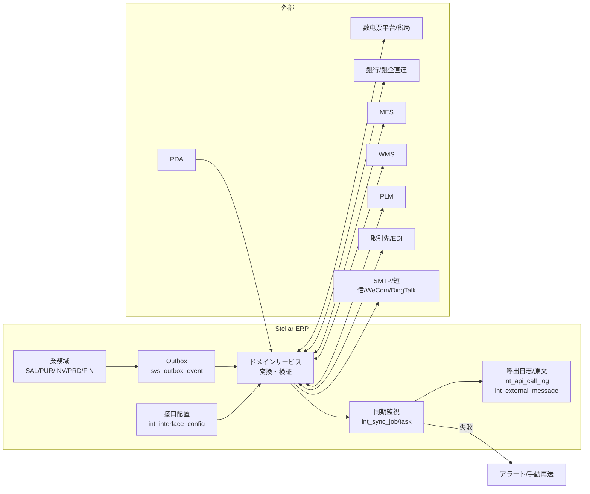

# 集成管理 业务域概要书（集成管理 業務概要書）

| 項目 | 内容 |
|---|---|
| 文書名 | 集成管理 业务域概要书（集成管理 業務概要書） |
| 文書番号 | DSN-INT-000 |
| 版数 | v1.0 |
| 作成日 | 2026-10-20 |
| 作成者 | integration-designer（集成分野担当） |
| 承認者 | 未承認（レビュー待ち） |
| 状態 | ドラフト（レビュー中） |
| 関連文書 | [体系总览](../README.md) / [共通项目定义](../00-common/01-common-item-definitions.md) / [API 共通规格](../00-common/03-common-api-spec.md) / [DB 共通规格](../00-common/04-common-db-spec.md) / [共通业务规则](../00-common/08-common-business-rules.md) / [跨域流程](../00-common/09-cross-domain-flow.md) / [真实资料](../90-data/sources.md) / [报表分析概要](../10-analytics/00-overview.md) / [样例数据](94-sample-data.md) |

> **記述規約**：本文書は日本企业「詳細設計書」の文書構成に従い、**正文は中文**で記述する。中国法定名称（全面数字化电子发票、增值税发票综合服务平台、CNAPS 联行号等）は中文正式名称をそのまま用いる。外部インタフェース（IF）は `IF-INT-xxx`、域内機能は `F-INT-xxx`、領域事件は `{domain}.{entity}.{action}`（[09 第 3 章](../00-common/09-cross-domain-flow.md)）で区別する。

---

## 1. 業務概要

### 1.1 目的

集成管理域（INT）是 Stellar ERP 与**企业外部系统**之间的**唯一出入口**与**通信责任域**。本域不保有业务判断权，负责把外部事实可靠、可审计、可重试地转换为域内可消费的数据，或把域内已确认的事实可靠地送达外部系统。具体职责：

1. **接口基盤**：接口配置、认证凭证、字段映射、超时/重试/熔断、调用日志、监控告警、手工重推。
2. **税务接口**：全面数字化电子发票（以下简称「数电票」）的开具、交付状态取得、红字冲销、进项发票查验与用途确认、电子税务局申报数据送信（Phase 2）。
3. **银行接口**：银企直连（账户余额、付款指令、回单）、银行对账单/回单文件取込，并向 FIN 移交（FIN 负责记账与对账）。
4. **制造/物流接口**：MES（工单下发、报工回传、领料与完工）、WMS（Phase 2）、PLM（物料/BOM/工艺/ECN 同步）、条码/PDA。
5. **开放与文件**：开放 API（`/api/open/v1`，AppKey + HMAC → OAuth2）、外部文件布局与取込校验、消息渠道（邮件/短信/企业微信/钉钉）。
6. **监控与对账**：同步任务监控、死信（Dead Letter）管理、日次接口对账、接口 SLA 统计。

### 1.2 適用範囲

| 項目 | 内容 |
|---|---|
| 対象会社・拠点 | 华东精密电机股份有限公司（虚拟示例主体）/ 常州总装厂（CZ01）、无锡零部件厂（WX01）（[demo-company.md](../90-data/demo-company.md)） |
| 対象機能範囲 | F-INT-001〜F-INT-020（接口配置、数电票、进项发票、银企直连、对账单、MES/WMS/PLM、条码/PDA、开放 API、文件取込、消息渠道、监控重推、对账、凭证管理、电子税务局、物流/EDI/供应商门户/IoT） |
| 対象外 | ① 业务判断（受注可否、付款审批、检验判定、成本计算）由各业务域负责；② 记账凭证与银行对账由 FIN 负责（INT 只交付数据）；③ 主数据内容审批由 MDM/PRD 负责（INT 只取込与转换）；④ 站内通知与通知模板由 SYS 负责（INT 只执行外部渠道送信）；⑤ 用户向 Excel 导入导出中心由 SYS（F-SYS-013）负责，INT 仅处理**外部系统间固定格式文件** |
| 前提 | ① 网络与防火墙策略已开通（出站 443、SFTP 22 等）；② 银行/税局/服务商合同与凭证已交付；③ FIN 会计期间、MDM 主数据、各业务域 API 已就绪；④ 时间同步（NTP）与证书有效期监控已运行 |

### 1.3 業務上の狙い（KPI）

| KPI | 定義・算式 | 目標値 | 実現する機能 ID |
|---|---|---|---|
| 外部 IF 成功率 | 成功タスク数 ÷ 実行タスク数（日次、再送成功を含む） | ≥ 99.5%【示例値】 | F-INT-013、F-INT-014 |
| 平均恢复时间（MTTR） | 失敗発生から再送成功までの平均時間 | ≤ 30 分【示例値】 | F-INT-013 |
| 数电票开具成功率 | 开具成功张数 ÷ 开具请求张数 | ≥ 99.9%【示例値】 | F-INT-002 |
| 银企付款一次成功率 | 一次受理成功的付款指令数 ÷ 提交指令数 | ≥ 99%【示例値】 | F-INT-004 |
| 同步延迟（MES/银企） | 外部事実発生から域内反映完了までの P95 | ≤ 5 分【示例値】 | F-INT-006、F-INT-004 |
| 开放 API 可用率 | 成功応答数 ÷ 総リクエスト数（5xx・タイムアウト除外） | ≥ 99.9%【示例値】 | F-INT-009 |
| 対账差异率 | 日次対账で差異となった件数 ÷ 対象件数 | ≤ 0.1%【示例値】 | F-INT-014 |
| 文件取込一次合格率 | 初回検証で合格したファイル数 ÷ 取込ファイル数 | ≥ 95%【示例値】 | F-INT-011 |

> 目標値は【示例値】（示例企業の運用目標）。実運用では顧客企業の SLA に合わせて設定する。

---

## 2. 組織とロール

| ロール | 所属 | 主な操作 | 関連機能 ID | 権限コード（代表） |
|---|---|---|---|---|
| 接口管理员 | 信息部 | 接口配置、认证凭证、映射、接続テスト、有効化/停止 | F-INT-001、015 | `integration:interface-config:*`、`integration:credential:update` |
| 运维担当 | 信息部 | 同步监控、死信处理、手工重推、对账差异确认、日志导出 | F-INT-013、014 | `integration:sync-task:view/retry`、`integration:call-log:view` |
| 财务经理 | 财务部 | 付款指令承认、数电票红字承认、银行对账差异确认 | F-INT-002、004 | `integration:bank-payment:approve`、`integration:tax-invoice:red` |
| 出纳 | 财务部 | 付款指令作成/送信、余额照会、回单确认、对账单取込 | F-INT-004、005 | `integration:bank-payment:create/submit`、`integration:bank-statement:import` |
| 会计 | 财务部 | 数电票开具申请、进项发票查验/用途确认、申报数据确认 | F-INT-002、003、016 | `integration:tax-invoice:create`、`integration:input-invoice:verify` |
| 销售员 | 销售部 | 数电票开具申请（受注/出荷起点）、交付状态确认 | F-INT-002 | `integration:tax-invoice:request` |
| 采购员 | 采购部 | 采购订单送信（Phase 2）、供应商门户确认 | F-INT-019 | `integration:po-send:submit` |
| 生产计划员 | 生产部 | MES 工单下发确认、报工回传异常确认 | F-INT-006 | `integration:mes:view/retry` |
| 仓管员 | 仓库 | 银行/物流无关；PDA 端末利用、条码异常申报、对账单实物确认（任意） | F-INT-010 | `integration:pda:use` |
| 系统管理员 | 信息部 | 开放 API 客户端、消息渠道设定、权限 | F-INT-009、012 | `integration:api-client:*`、`integration:notification-channel:*` |

### 2.1 承認経路（本域関連）

本域の承認は業務判断ではなく**外部送信の統制**である。金額承認は各業務域（SAL/PUR/FIN）の経路を正とし、INT は「送信可否」のみを検査する。

| 対象 | 条件 | 承認経路 | 方式 | 業務 Type |
|---|---|---|---|---|
| 银企付款指令送信 | 全件（FIN の付款承認済が前提） | 出纳（作成）→ 财务经理（承認）→ 送信 | 順送 | `INT_BANK_PAYMENT` |
| 数电票红字冲销 | 全件 | 会计（申請）→ 财务经理（承認）→ 送信 | 順送 | `INT_TAX_RED` |
| 接口配置の本番有効化 | 全件 | 接口管理员（設定）→ 运维担当（复核）→ 有効化 | 或签+复核 | `INT_IF_CONFIG` |
| 認証凭证更新 | 全件 | 接口管理员（更新）→ 信息部長（承認） | 順送 | `INT_CREDENTIAL` |
| 開放 API クライアント発行 | 全件 | 接口管理员（起案）→ 情報部長（承認） | 順送 | `INT_API_CLIENT` |

> 承認マトリクスは [08 第 8 章](../00-common/08-common-business-rules.md) と [approval-matrix.md](../90-data/approval-matrix.md) に従い、`wf_approval_matrix` で管理する（ハードコード禁止）。外部送信は「承認済の事実」を受けてから実行する。

---

## 3. 業務フロー

### 3.1 連携アーキテクチャ

**基本原則**（[09 第 2 章](../00-common/09-cross-domain-flow.md) を継承）：

1. **同期呼出は読取のみ**（残高照会・可用量照会等）。書込は「外部事実の受信 → ドメインイベント発行」で行う。
2. 外部 IF 呼出は**業務トランザクション外**（Outbox/ジョブ）。業務データと送信の不整合を防ぐ。
3. 全ての送受信は `int_external_message` に**原文**（マスキング後）を保存し、再送・照合・監査の根拠とする。
4. 冪等キーを必須とし、外部システムの採番（発票番号、銀行流水番号、MES 報工番号）を `external_no` に保存する。
5. 認証情報（AppSecret、銀行秘密鍵、証明書）は**DB 平文保存禁止**。環境変数/Secrets Manager 参照とし、DB には参照キーのみ保存する。

### 3.2 処理手順（代表シナリオ）

| # | 手順 | 実施者 | システム処理 | 入力 | 出力 | 異常時 |
|---|---|---|---|---|---|---|
| 1 | 接口登録 | 接口管理员 | 相手先・エンドポイント・認証・タイムアウト・リトライ・マッピングを登録。接続テスト | 設定値 | `int_interface_config` | 接続失敗 `MSG-INT-003` |
| 2 | 有効化 | 运维担当 | 本番有効化、監視対象登録、SLA 設定 | 承認済設定 | 有効状態 | 重複有効化 `MSG-INT-005` |
| 3 | 数电票开具 | 会计/销售员 | 請求流水号採番→票面項目検証→送信→受付番号/発票番号保存→交付状態同期 | 請求書/出荷 | `int_tax_invoice` | 税局拒否 `MSG-INT-020`、通信失敗 `MSG-INT-021` |
| 4 | 銀企付款 | 出纳/财务经理 | 承認済付款申請→付款指令生成→署名/暗号化→送信→受付/完了/失敗取得→回单保存 | 付款申請 | `int_bank_payment` | 口座相違 `MSG-INT-040`、残高不足 `MSG-INT-041` |
| 5 | 対账单取込 | 出纳 | ファイル受信→レイアウト検証→全件ロールバック方式で取込→FIN へ引渡 | 対账单ファイル | `int_file_transfer`、FIN `fin_bank_statement` | 形式エラー `MSG-INT-050` |
| 6 | MES 工单下发 | 計画員 | E21 購読→工单・BOM・工艺を MES 形式へ変換→送信→MES 工单 ID 保存 | WO | `int_sync_task` | 未応答 `MSG-INT-060`、再送 |
| 7 | MES 報工回伝 | MES | 受信→検証→`prd_work_report` 登録/`production.report.confirmed`（E23）発行→ACK 返信 | 報工 JSON | 受信記録 | 重複 `MSG-INT-062`（冪等スキップ） |
| 8 | 進項査験 | 会计 | 発票コード/番号/日付/金額で照会→結果保存→用途確認 | 発票 | `int_input_invoice` | 不一致 `MSG-INT-030` |
| 9 | 監視・再送 | 运维担当 | 失敗/滞留抽出→原因別に再送→成功/死信確定→通知 | 失敗一覧 | `int_retry_log` | 最大回数超過 `MSG-INT-070` |
| 10 | 日次対账 | システム | 外部明細 vs 域内反映件数・金額を突合→差異を `int_sync_reconcile` に記録 | 当日分 | 対账結果 | 差異 `MSG-INT-088` |

### 3.3 外部 IF 一覧（連携マトリクス）

| IF ID | 名称 | 相手先 | 方向 | 方式 | 頻度 | データ実体 | 責任方（接続/業務） | 失敗時処理 |
|---|---|---|---|---|---|---|---|---|
| IF-INT-001 | 银企直连（残高・明細・付款指令・回单） | 开户银行（企业网银/银企直连网关） | 双方向 | REST/JSON（银行提供 SDK・署名） | リアルタイム＋日次 | 账户余额、交易明细、付款指令、电子回单 | INT / FIN | 3 回再送→失敗一覧→手動再送。`paymentNo` を冪等キー |
| IF-INT-002 | 数电票开具・交付 | 电子发票服务平台（税局开放接口，経由：税務サービス事業者） | 送信/受信 | REST/JSON | リアルタイム | 数电票票面、交付状态、红字确认单 | INT / SAL・FIN | 同一請求流水号で再送。拒否は再開票せず原因修正 |
| IF-INT-003 | MES 工单・报工 | MES | 双方向 | REST/JSON | リアルタイム/イベント | 工单、工序、报工、投入产出、设备 | INT / PRD・INV | 未受信再送、外部 ID 冪等、恒久失敗はデッドレター |
| IF-INT-004 | PLM 物料/BOM/工艺 | PLM | 受信 | REST/JSON またはファイル（XML/CSV） | 日次＋手動 | 品目、BOM、工艺路线、ECN | INT / MDM・PRD | 差分取込、エラー行返信、版数競合は承認待ち |
| IF-INT-005 | WMS（Phase 2） | 外部 WMS | 双方向 | REST/JSON | リアルタイム | 入出庫指示、実績、在庫 | INT / INV | 指示未応答は再送、在庫差異は日次照合 |
| IF-INT-006 | 銀行対账单/回单取込 | 銀行（CSV/Excel/MT940） | 受信 | ファイル（SFTP/手動） | 日次 | 対账单明细、口座残高 | INT / FIN | 形式エラーはエラーファイル、取込は全件ロールバック |
| IF-INT-007 | 電子税務局 申報データ（Phase 2） | 電子税務局 | 送信 | ファイル（XML/Excel） | 月次 | 增值税/附加税/所得税申報 | INT / FIN | 送信失敗再送、受付番号保存 |
| IF-INT-008 | 進項発票 査験・用途確認 | 增值税发票综合服务平台 | 双方向 | REST/ファイル | 日次 | 进项发票、查验结果、用途确认 | INT / FIN | 査験再試行、不一致は FIN へ警告 |
| IF-INT-009 | 開放 API | 取引先・代理店・3PL | 受信 | REST/JSON（`/api/open/v1`） | リアルタイム | 注文、在庫照会、出荷実績、マスタ参照 | INT / 各業務域 | 401/403/429、冪等キー必須、全件監査 |
| IF-INT-010 | 条码/PDA | PDA・ハンディ端末 | 受信 | REST/JSON＋オフライン補伝 | リアルタイム | スキャン（物料/批次/庫位/序列号）、作業実績 | INT / INV・PRD | 補伝の重複排除、端末失効、錯倉/錯批次は業務エラー |
| IF-INT-011 | 消息送信 | SMTP・短信GW・企业微信・钉钉 | 送信 | SMTP / REST(Webhook) | リアルタイム | 通知本文、宛先、テンプレート変数 | INT / SYS | 5 回再送、失敗ログ、到達率監視 |
| IF-INT-012 | 数据同步监控 | INT 内部（外部相手なし） | — | 内部処理 | 常時 | 同期ジョブ/タスク、死信、対账結果 | INT | 監視アラート、手動再送 |
| IF-INT-013 | 物流・送り状（Phase 2） | 物流会社 | 送信/受信 | REST | 出荷時 | 送り状番号、追跡 | INT / SAL | 再取得、手動入力 |
| IF-INT-014 | 顧客 EDI 注文（Phase 2） | 顧客 EDI/メール | 受信 | ファイル（CSV/XML） | 随時 | 顧客注文 | INT / SAL | 形式エラー返信、重複注文排除 |
| IF-INT-015 | 供給者ポータル/PO 送信（Phase 2） | 供給者ポータル/メール | 送信 | REST/ファイル | イベント | 発注書、納期回答 | INT / PUR | 再送、未確認アラート |
| IF-INT-016 | 設備 IoT データ（Phase 2） | IoT ゲートウェイ | 受信 | MQTT/REST | 分次 | 設備状態、生産数 | INT / PRD | 欠測補完、閾値アラート |

> **内部イベントとの区別**：E01〜E43 は**域内イベント**であり IF ID を付与しない（[00 设计方针 6.4](../00-common/00-design-principles.md)）。本域は E33 `integration.sync.failed` を発行し、**E10/E12/E13/E14/E18/E21/E22/E23/E24/E28** を購読して外部送信のトリガとする（購読一覧は §3.4 の表を正とする。E13 の購読者は INT のみで WF は含まない）。購読契約は [09 第 3 章](../00-common/09-cross-domain-flow.md) を正とする。

### 3.4 内部イベントの購読・発行（本域分）

| イベント | 方向 | 本域の処理 | 冪等キー |
|---|---|---|---|
| `purchase.order.approved`（E13） | 購読 | 供給者ポータル/メールへ PO 送信（Phase 2） | `E13:orderId:aggregateVersion` |
| `sales.delivery.confirmed`（E10） | 購読 | 数电票开具の対象抽出（自動開票設定時） | `E10:deliveryId` |
| `sales.invoice.issued`（E12） | 購読 | 数电票交付状態・発票番号の突合 | `E12:invoiceId` |
| `purchase.receipt.posted`（E14） | 購読 | MES/検査への受入通知（任意） | `E14:receiptId` |
| `production.workorder.released`（E21） | 購読 | MES へ工单下发 | `E21:workOrderId:aggregateVersion` |
| `production.material.issued`（E22） | 購読 | MES/PLM への実績連携（任意） | `E22:issueId` |
| `production.report.confirmed`（E23） | 購読 | 設備 IoT/原価への連携（任意） | `E23:reportId` |
| `production.workorder.completed`（E24） | 購読 | MES 完了通知、WMS 入庫指示（P2） | `E24:workOrderId` |
| `inventory.txn.posted`（E18） | 購読 | WMS 在庫同期（P2） | `E18:txnId` |
| `finance.payment.completed`（E28） | 購読 | 銀企送信結果の突合・回单紐付け | `E28:paymentId` |
| `integration.sync.failed`（E33） | **発行** | 恒久失敗時に発行（SYS 通知・RPT 警告へ） | `E33:ifId:syncTaskId` |

### 3.5 ステータスコード対応表（INT 域）

本域の実行系テーブルは処理状態を**テーブル固有のコード体系**で保持する。申し送り事項として、**同一コードでも表ごとに意味が異なる**（特に `40`）ため、表間で値を流用しないこと。01 §7.1 の共通ステータス（10 草稿 / 20 承認待ち / 25 承認済 / 30 発行済・未実行 / 35 一部実行 / 40 完了 / 90 取消 / 95 却下）との対応を下表に示す（「共通外」は業務文書の状態ではなく処理状態であることを表す）。

| テーブル | 列 | コード体系 | `40` の意味 | 01 §7.1 との対応 |
|---|---|---|---|---|
| int_interface_config | health_status | 0 未確認 / 10 正常 / 20 劣化 / 30 停止 | —（該当なし） | 共通外（接続ヘルス） |
| int_api_client | status | 10 有効 / 20 停止 / 90 失効 | — | 10=有効（共通 10 相当）、20=停止（共通外）、90=失効（共通 90 相当） |
| int_external_message | status | 10 受信 / 20 処理済 / 30 失敗 / 40 重複 / 90 無視 | **重複** | 10=受信（共通 10 相当）、40=重複（共通外） |
| int_sync_job | status | 10 実行中 / 40 完了 / 45 一部失敗 / 90 失敗 | **完了** | 40=完了（共通 40）、45=一部失敗（共通 35 相当）、90=失敗（共通外） |
| int_sync_task | status | 10 待機 / 20 送信中 / 30 成功 / 40 再送待ち / 50 失敗 / 60 死信 / 90 スキップ | **再送待ち** | 10=待機（共通 10 相当）、30=成功（共通 40 相当）、40=再送待ち（共通 20 相当の処理中）、90=スキップ（共通外） |
| int_tax_invoice | status | 10 草稿 / 20 送信中 / 30 発行済 / 35 交付済 / 40 失敗 / 50 赤字申請 / 60 赤字発行 / 90 取消 | **失敗（税局拒否）** | 10=草稿（共通 10）、30=発行済（共通 30）、35=交付済（共通 35）、40=失敗（共通外。共通 95 却下とは異なる）、90=取消（共通 90） |
| int_input_invoice | verify_status / usage_status | verify: 10 未査験 / 20 一致 / 30 不一致 / 40 無効 / 50 査験失敗；usage: 10 未確認 / 20 申告済 / 30 控除済 / 40 不控除 | 無効（verify）／不控除（usage） | 共通外（査験・用途確認の処理状態） |
| int_bank_payment | status | 10 草稿 / 20 送信待ち / 30 受付 / 35 処理中 / 40 成功 / 50 失敗 / 90 取消 | **成功** | 30=受付（共通 30）、35=処理中（共通 35）、40=成功（共通 40 相当）、90=取消（共通 90） |
| int_bank_statement_file | status | 10 受信 / 20 検証中 / 30 取込済 / 40 失敗 / 50 FIN 引渡済 | **失敗** | 30=取込済（共通 30 相当）、40=失敗（共通外）、50=FIN 引渡済（共通 40 相当） |
| int_file_transfer | status | 10 受信 / 20 検証 / 30 処理 / 40 完了 / 45 一部 / 50 失敗 / 60 引渡済 | **完了** | 40=完了（共通 40）、45=一部（共通 35 相当）、50=失敗（共通外）、60=引渡済（共通 40 相当） |
| int_pda_offline_batch | status | 10 受信 / 20 処理中 / 40 完了 / 45 一部 / 50 失敗 | **完了** | 40=完了（共通 40）、45=一部（共通 35 相当）、50=失敗（共通外） |
| int_sync_reconcile | status | 10 一致 / 20 差異 / 30 対象外 | — | 共通外（対账結果） |
| int_file_layout / int_interface_mapping 等 | status | 10 有効 / 20 廃止 | — | 10=有効、20=廃止（共通外） |
| int_pda_device | status | 10 有効 / 20 停止 / 30 紛失 | — | 10=有効、20=停止、30=紛失（共通外） |

> **運用ルール**：`40` は int_sync_job=完了、int_sync_task=再送待ち、int_tax_invoice=失敗、int_bank_payment=成功、int_bank_statement_file=失敗、int_file_transfer=完了、int_pda_offline_batch=完了 と意味が異なる。他域・他表へ `status` をそのまま渡さず、イベント payload では処理結果（成功/失敗/完了）を明示的に変換する。共通ステータス値の意味を変更する拡張は行わない（[01 §7.1](../00-common/01-common-item-definitions.md)）。各テーブルの DDL コメントも本表と一致させる。

---

## 4. 機能一覧

| 機能 ID | 機能名 | 概要 | 画面 ID | 種別 | 優先度 | 状態 | 詳細設計書 |
|---|---|---|---|---|---|---|---|
| F-INT-001 | 接口配置管理 | 相手先・エンドポイント・認証・マッピング・タイムアウト・リトライの登録と有効化 | SCR-INT-001〜003 | 登録/一覧 | P0 | 設計済 | [01-integration-config.md](01-integration-config.md) |
| F-INT-002 | 数电票开具与交付 | 蓝票/红票开具、交付状态取得、票面查询、赤伝 | SCR-INT-008、009 | 連携 | P1（Phase 2 本格） | 設計済 | [02-tax-bank-interface.md](02-tax-bank-interface.md) |
| F-INT-003 | 进项发票查验 | 发票查验、用途确认、异常发票提醒 | SCR-INT-010 | 連携 | P1 | 設計済 | [02-tax-bank-interface.md](02-tax-bank-interface.md) |
| F-INT-004 | 银企直连 | 余额/明细照会、付款指令送信、回单取得 | SCR-INT-011〜013 | 連携 | P1 | 設計済 | [02-tax-bank-interface.md](02-tax-bank-interface.md) |
| F-INT-005 | 银行对账单取込 | 文件取込、形式検証、FIN への引渡、差異通知 | SCR-INT-014、015 | 連携/取込 | P1 | 設計済 | [02-tax-bank-interface.md](02-tax-bank-interface.md) |
| F-INT-006 | MES 集成 | 工单下发、報工回伝、領料・完工連携、状態同期 | SCR-INT-016 | 連携 | P1 | 設計済 | [03-mes-wms-plm.md](03-mes-wms-plm.md) |
| F-INT-007 | WMS 集成 | 入出庫指示・実績・在庫同期（Phase 2） | SCR-INT-016 | 連携 | P2 | 設計済（概要） | [03-mes-wms-plm.md](03-mes-wms-plm.md) |
| F-INT-008 | PLM 同步 | 物料・BOM・工艺・ECN の差分取込 | SCR-INT-017 | 連携/取込 | P1 | 設計済 | [03-mes-wms-plm.md](03-mes-wms-plm.md) |
| F-INT-009 | 开放 API 平台 | クライアント登録、スコープ、レート制限、署名検証、監査 | SCR-INT-018、019 | API | P1 | 設計済 | [04-openapi-file-notify.md](04-openapi-file-notify.md) |
| F-INT-010 | 条码/PDA 接口 | 端末認証、扫码検証、オフライン補伝 | SCR-INT-023 | 連携 | P1 | 設計済 | [03-mes-wms-plm.md](03-mes-wms-plm.md) |
| F-INT-011 | 外部文件取込 | ファイルレイアウト定義、ドライラン、エラー報告、全件/部分成功制御 | SCR-INT-020 | 取込 | P0 | 設計済 | [04-openapi-file-notify.md](04-openapi-file-notify.md) |
| F-INT-012 | 消息渠道 | メール/短信/企业微信/钉钉の送信、テンプレート変数、再送 | SCR-INT-021、022 | 連携 | P0（SMTP）/P2（他） | 設計済 | [04-openapi-file-notify.md](04-openapi-file-notify.md) |
| F-INT-013 | 同步监控与重推 | 失敗/滞留監視、手動再送、死信管理、アラート | SCR-INT-004〜006 | 監視 | P0 | 設計済 | [05-sync-monitor.md](05-sync-monitor.md) |
| F-INT-014 | 接口日志与对账 | 呼出日志、原文保存、日次対账、SLA 統計 | SCR-INT-007、024 | 監視 | P0 | 設計済 | [05-sync-monitor.md](05-sync-monitor.md) |
| F-INT-015 | 接口凭证与安全 | 凭证ローテーション、IP 許可、mTLS、署名、マスキング | SCR-INT-002 | 設定 | P0 | 設計済 | [01-integration-config.md](01-integration-config.md) |
| F-INT-016 | 电子税务局申报送信 | 申报数据の送信・受付番号保存（Phase 2） | SCR-INT-020 | 連携 | P2 | 設計済（概要） | [02-tax-bank-interface.md](02-tax-bank-interface.md) |
| F-INT-017 | 物流面单连携 | 送り状番号取得・追跡（Phase 2） | SCR-INT-016 | 連携 | P2 | 設計済（概要） | [03-mes-wms-plm.md](03-mes-wms-plm.md) |
| F-INT-018 | 客户 EDI 订单取込 | 顧客注文ファイルの取込・重複排除 | SCR-INT-020 | 取込 | P2 | 設計済（概要） | [04-openapi-file-notify.md](04-openapi-file-notify.md) |
| F-INT-019 | 供应商门户送信 | PO 送信・納期回答取得（Phase 2） | SCR-INT-020 | 連携 | P2 | 設計済（概要） | [04-openapi-file-notify.md](04-openapi-file-notify.md) |
| F-INT-020 | 设备 IoT 取込 | 設備状態・生産数の収集（Phase 2） | SCR-INT-016 | 連携 | P2 | 設計済（概要） | [03-mes-wms-plm.md](03-mes-wms-plm.md) |

> 優先度：P0（Phase 1 MVP）/ P1（Phase 1.5）/ P2（Phase 2）。状態：設計済＝本文書体系に詳細設計あり。

---

## 5. 画面一覧

| 画面 ID | 画面名 | 類型 | 機能 ID | 権限コード | 遷移元 | 遷移先 |
|---|---|---|---|---|---|---|
| SCR-INT-001 | 接口配置一覧 | LIST | F-INT-001 | `integration:interface-config:view` | メニュー > 集成管理 > 接口配置 | SCR-INT-002/003 |
| SCR-INT-002 | 接口配置登録編集 | EDIT | F-INT-001 | `integration:interface-config:create` | SCR-INT-001 | SCR-INT-001 |
| SCR-INT-003 | 接続テスト/実行結果 | VIEW | F-INT-001 | `integration:interface-config:test` | SCR-INT-001/002 | SCR-INT-007 |
| SCR-INT-004 | 同步監視ダッシュボード | DASH | F-INT-013 | `integration:sync-task:view` | メニュー > 集成管理 > 同步监控 | SCR-INT-005/007/024 |
| SCR-INT-005 | 同期タスク一覧（失敗・滞留） | LIST | F-INT-013 | `integration:sync-task:view` | SCR-INT-004 | SCR-INT-006 |
| SCR-INT-006 | 手動再送/再処理 | EDIT | F-INT-013 | `integration:sync-task:retry` | SCR-INT-005 | SCR-INT-005 |
| SCR-INT-007 | 接口呼出日志 | LIST | F-INT-014 | `integration:call-log:view` | SCR-INT-004/003 | 原文詳細ドロワー |
| SCR-INT-008 | 数电票発行一覧 | LIST | F-INT-002 | `integration:tax-invoice:view` | メニュー > 集成管理 > 数电票 | SCR-INT-009 |
| SCR-INT-009 | 数电票詳細・赤伝 | EDIT | F-INT-002 | `integration:tax-invoice:create` | SCR-INT-008 | SCR-INT-008 |
| SCR-INT-010 | 進項発票査験一覧 | LIST | F-INT-003 | `integration:input-invoice:view` | メニュー > 集成管理 > 进项发票 | 詳細ドロワー |
| SCR-INT-011 | 銀企口座残高一覧 | DASH | F-INT-004 | `integration:bank-account:view` | メニュー > 集成管理 > 银企直连 | SCR-INT-012 |
| SCR-INT-012 | 付款指令一覧 | LIST | F-INT-004 | `integration:bank-payment:view` | SCR-INT-011 | SCR-INT-013 |
| SCR-INT-013 | 付款指令詳細・回单 | EDIT | F-INT-004 | `integration:bank-payment:create` | SCR-INT-012 | SCR-INT-012 |
| SCR-INT-014 | 銀行対账单取込 | WIZ | F-INT-005 | `integration:bank-statement:import` | メニュー > 集成管理 > 对账单 | SCR-INT-015 |
| SCR-INT-015 | 対账单取込結果・FIN 引渡 | VIEW | F-INT-005 | `integration:bank-statement:view` | SCR-INT-014 | FIN 対账画面 |
| SCR-INT-016 | MES/WMS 連携状況 | DASH | F-INT-006/007 | `integration:mes:view` | メニュー > 集成管理 > 制造连携 | SCR-INT-005 |
| SCR-INT-017 | PLM 同期状況 | LIST | F-INT-008 | `integration:plm:view` | メニュー > 集成管理 > PLM 同步 | SCR-INT-020 |
| SCR-INT-018 | 開放 API クライアント管理 | LIST | F-INT-009 | `integration:api-client:view` | メニュー > 集成管理 > 开放 API | SCR-INT-019 |
| SCR-INT-019 | API 利用状況・レート制限 | DASH | F-INT-009 | `integration:api-client:view` | SCR-INT-018 | SCR-INT-007 |
| SCR-INT-020 | 外部ファイル取込ジョブ | LIST | F-INT-011 | `integration:file-transfer:view` | メニュー > 集成管理 > 文件取込 | エラー詳細 |
| SCR-INT-021 | 通知チャネル設定 | EDIT | F-INT-012 | `integration:notification-channel:update` | メニュー > 集成管理 > 通知渠道 | SCR-INT-022 |
| SCR-INT-022 | 通知送信履歴 | LIST | F-INT-012 | `integration:notification-log:view` | SCR-INT-021 | 詳細ドロワー |
| SCR-INT-023 | PDA 端末管理 | LIST | F-INT-010 | `integration:pda-device:view` | メニュー > 集成管理 > PDA 端末 | 端末詳細 |
| SCR-INT-024 | 日次対账結果 | LIST | F-INT-014 | `integration:reconcile:view` | SCR-INT-004 | SCR-INT-007 |

> 画面類型は [02 画面共通规格](../00-common/02-common-screen-spec.md) 第 2 章に従う。一覧画面の既定ソートは更新日時降順、ページサイズ 20、最大 200。

---

## 6. 帳票一覧

| 帳票 ID | 帳票名 | 出力タイミング | 帳票種別 | 機能 ID | 詳細 |
|---|---|---|---|---|---|
| PRT-INT-001 | 接口呼出日志导出 | 手動/障害調査 | 一覧表 | F-INT-014 | [92](92-report-batch-design.md) |
| PRT-INT-002 | 同步监控日报 | 日次 08:00 | 集計表 | F-INT-013 | [92](92-report-batch-design.md) |
| PRT-INT-003 | 接口対账差异表 | 日次/手動 | 一覧表 | F-INT-014 | [92](92-report-batch-design.md) |
| PRT-INT-004 | 数电票开具台账 | 月次/手動 | 帳簿 | F-INT-002 | [92](92-report-batch-design.md) |
| PRT-INT-005 | 銀企付款指令执行台账 | 月次/手動 | 一覧表 | F-INT-004 | [92](92-report-batch-design.md) |
| PRT-INT-006 | 外部文件取込错误报告 | 取込完了時 | 一覧表 | F-INT-011 | [92](92-report-batch-design.md) |
| PRT-INT-007 | 開放 API 利用統計 | 月次 | 集計表 | F-INT-009 | [92](92-report-batch-design.md) |

## 7. バッチ一覧

| バッチ ID | バッチ名 | 起動方式 | 実行時間帯 | 処理概要 | 冪等性 |
|---|---|---|---|---|---|
| BAT-INT-001 | 接口失敗自動再送 | 自動（1 分間隔） | 常時 | `int_sync_task` の RETRY 対象を指数バックオフで再送 | 条件付き（task_id） |
| BAT-INT-002 | 数电票交付状態同期 | 日次/イベント | 毎日 09:00 | 未交付・交付失敗の発票状態取得、赤字確認 | 再実行可（発票番号単位） |
| BAT-INT-003 | 銀企残高・回单取得 | 日次 | 毎日 06:30 | 全口座の残高・前日明細・回单を取得 | 再実行可（口座×日付） |
| BAT-INT-004 | 進項発票査験 | 日次 | 毎日 07:00 | 未査験の進項発票を査験、結果保存 | 再実行可（発票コード+番号） |
| BAT-INT-005 | MES 未回伝検出 | 自動（10 分間隔） | 常時 | 下发済・報工未回伝の工单を検出し再送/警告 | 再実行可 |
| BAT-INT-006 | PLM 差分取込 | 日次/手動 | 毎日 05:30 | PLM 変更一覧取得→差分取込→承認待ち登録 | 再実行可（版数単位） |
| BAT-INT-007 | 接口日次対账 | 日次 | 毎日 07:30 | 外部明細 vs 域内反映の件数・金額突合 | 再実行可（日付単位） |
| BAT-INT-008 | 呼出日志清理 | 日次 | 毎日 03:30 | 6 か月超過の `int_api_call_log` をアーカイブ/削除 | 再実行可 |
| BAT-INT-009 | 凭证・証明書有効期限警告 | 日次 | 毎日 08:00 | 30 日前・7 日前・期限切れの通知 | 再実行可（当日 1 回） |
| BAT-INT-010 | 通知送信再送 | 自動（1 分間隔） | 常時 | 失敗したメール/短信/Webhook を最大 5 回再送 | 条件付き（送信ログ） |

## 8. テーブル一覧

| 物理名 | 論理名 | 種別 | 主な用途 | 更新元機能 ID | データ量見積 |
|---|---|---|---|---|---|
| `int_interface_config` | 接口配置 | 設定 | 相手先・認証・タイムアウト・リトライ | F-INT-001 | 100 件 |
| `int_interface_mapping` | 字段映射 | 設定 | 外部項目↔域内項目、コード変換 | F-INT-001 | 5,000 行 |
| `int_api_client` | 開放 API クライアント | マスタ | AppKey、scope、許可 IP | F-INT-009 | 100 件 |
| `int_api_call_log` | API 呼出日志 | ログ | 呼出/応答、処理時間、結果 | F-INT-014 | 300 万/年（6 か月保存） |
| `int_external_message` | 外部原文メッセージ | ログ | 送受信原文（マスキング）、ハッシュ | F-INT-001〜011 | 500 万/年 |
| `int_sync_job` | 同期ジョブ | ログ | ジョブ単位の実行結果・件数 | F-INT-013 | 30 万/年 |
| `int_sync_task` | 同期タスク | ログ | 業務単位の同期状態・再送回数 | F-INT-013 | 500 万/年 |
| `int_retry_log` | 再送履歴 | ログ | 再送理由・結果・実行者 | F-INT-013 | 100 万/年 |
| `int_tax_invoice` | 数电票 | 伝票 | 票面ヘッダ、交付状態、赤字 | F-INT-002 | 30 万/年 |
| `int_tax_invoice_line` | 数电票明细 | 伝票明細 | 品目・金額・税率 | F-INT-002 | 120 万/年 |
| `int_input_invoice` | 進項発票査験 | 伝票 | 査験結果、用途確認状態 | F-INT-003 | 10 万/年 |
| `int_bank_account` | 銀企口座 | マスタ | 口座、CNAPS、残高、接続状態 | F-INT-004 | 20 件 |
| `int_bank_payment` | 銀企付款指令 | 伝票 | 指令、受付番号、状態、回单 | F-INT-004 | 3 万/年 |
| `int_bank_statement_file` | 対账单ファイル | ログ | 取込批次、形式、件数、結果 | F-INT-005 | 500/年 |
| `int_file_layout` | 外部ファイルレイアウト | 設定 | 項目位置・型・必須・コード変換 | F-INT-011 | 200 件 |
| `int_file_transfer` | ファイル取込ジョブ | ログ | 取込結果、成功/失敗件数 | F-INT-011 | 10 万/年 |
| `int_file_transfer_error` | ファイル取込エラー行 | ログ | 行番号・項目・理由 | F-INT-011 | 200 万/年 |
| `int_notification_channel` | 通知チャネル | 設定 | SMTP/SMS/WeCom/DingTalk 設定 | F-INT-012 | 20 件 |
| `int_pda_device` | PDA 端末 | マスタ | 端末 ID、倉庫、有効期限、状態 | F-INT-010 | 200 件 |
| `int_pda_offline_batch` | PDA 補伝批次 | ログ | オフライン補伝、重複排除 | F-INT-010 | 50 万/年 |
| `int_sync_reconcile` | 同期対账結果 | ログ | 日次対账の件数・金額・差異 | F-INT-014 | 5,000/年 |

> 全テーブルに[共通项目定义 第 2 章](../00-common/01-common-item-definitions.md)の共通カラムを付与する（ログ系は `updated_*`/`version` を省略可）。物理設計は [90-db-design.md](90-db-design.md) を正とする。

## 9. 権限一覧

| 権限コード | 対象機能 | 対象データ範囲 | 付与ロール |
|---|---|---|---|
| `integration:interface-config:view/create/update/delete` | F-INT-001 | 全社 | 接口管理员 |
| `integration:interface-config:test/enable/disable` | F-INT-001 | 全社 | 接口管理员、运维担当（test） |
| `integration:credential:update` | F-INT-015 | 全社 | 接口管理员（情報部長承認） |
| `integration:tax-invoice:view` | F-INT-002 | 全社（財務）・担当顧客（営業） | 会计、财务经理、销售员 |
| `integration:tax-invoice:create/request` | F-INT-002 | 担当伝票 | 会计、销售员 |
| `integration:tax-invoice:red/approve` | F-INT-002 | 全社 | 财务经理 |
| `integration:input-invoice:view/verify` | F-INT-003 | 全社 | 会计、财务经理 |
| `integration:bank-account:view` | F-INT-004 | 全社 | 出纳、财务经理、财务总监 |
| `integration:bank-payment:view` | F-INT-004 | 全社 | 出纳、财务经理、财务总监 |
| `integration:bank-payment:create/submit` | F-INT-004 | 全社 | 出纳 |
| `integration:bank-payment:approve` | F-INT-004 | 承認経路該当者 | 财务经理、财务总监 |
| `integration:bank-statement:view/import` | F-INT-005 | 全社 | 出纳、会计 |
| `integration:mes:view/retry` | F-INT-006 | 全社 | 生产计划员、运维担当（retry） |
| `integration:mes:receive` | F-INT-006 | システム | MES 受信用（システムトークン、ユーザ付与なし） |
| `integration:plm:view/import` | F-INT-008 | 全社 | 技术部、MDM 管理者 |
| `integration:plm:approve` | F-INT-008 | 全社 | 技術部長（BOM/工艺の承認） |
| `integration:api-client:view/create/update` | F-INT-009 | 全社 | 接口管理员（情報部長承認） |
| `integration:file-transfer:view/import` | F-INT-011 | 全社 | 接口管理员、出纳（対账单）、会计 |
| `integration:notification-channel:view/update` | F-INT-012 | 全社 | 系統管理员、接口管理员 |
| `integration:notification-log:view` | F-INT-012 | 全社 | 系統管理员、运维担当 |
| `integration:sync-task:view/retry` | F-INT-013 | 全社 | 运维担当、接口管理员 |
| `integration:call-log:view/export` | F-INT-014 | 全社 | 运维担当、内审员（view） |
| `integration:reconcile:view` | F-INT-014 | 全社 | 运维担当、财务经理 |
| `integration:pda-device:view/update` | F-INT-010 | 全社 | 接口管理员、仓管主管 |
| `integration:pda:use` | F-INT-010 | 端末・倉庫 | 仓管员、作業者（PDA ログイン） |

> データ範囲は SYS の行レベル権限で強制注入する。金額・口座・発票情報は項目権限で非表示にできる（[01 第 15 章](../00-common/01-common-item-definitions.md)）。

## 10. 本域用語

| 用語 | 説明 | 対応英語/日文 |
|---|---|---|
| 外部 IF | 外部システムとの接続単位。`IF-INT-xxx` | External Interface / 外部インタフェース |
| 領域事件 | 域内の確定事実の通知。`E01〜E43`。IF ID を付与しない | Domain Event / ドメインイベント |
| 接口配置 | エンドポイント・認証・リトライ等の接続定義 | Interface Configuration |
| 幂等键 | 同一処理の二重実行を防ぐキー | Idempotency Key / 冪等キー |
| 死信（Dead Letter） | 最大再送回数を超え自動処理を停止したタスク | Dead Letter / デッドレター |
| 数电票 | 全面数字化电子发票（国家税务总局公告 2024 年第 11 号） | Fully Digitalized E-invoice |
| 红字确认单 | 数电票の赤字（取消・訂正）に用いる確認情報 | Red-letter Confirmation |
| 銀企直连 | 企業系統と銀行系統の直接接続 | Bank-Enterprise Direct Connection |
| CNAPS 联行号 | 中国人民銀行の支払系統行番号（12 桁） | CNAPS Bank Code |
| 回单 | 銀行取引の電子確認票 | Bank Receipt / 電子回単 |
| 対账单 | 銀行口座の入出金明細 | Bank Statement / 銀行対账单 |
| レイアウト定義 | 外部ファイルの項目位置・型・必須の定義 | File Layout / ファイルレイアウト |
| 開放 API | 外部パートナー向け API（`/api/open/v1`） | Open API |
| 补伝 | PDA オフライン時の後追い送信 | Offline Replay / 補伝 |

## 11. 未決事項

| # | 事項 | 理由 | 暫定仕様 | 担当 | 期限 |
|---|---|---|---|---|---|
| 1 | 数电票接続事業者（税局直結/サービス事業者）の選定 | 顧客の税務サービス契約が未確定 | アダプタ方式とし、`int_interface_config` で切替。認証・エンドポイントは導入時に設定 | Lead / 財務 | 2026-11-30 |
| 2 | 銀企直連の対象銀行と接続方式 | 取引銀行が未確定（複数行の可能性） | 銀行別アダプタ（`bank_adapter`）。共通 IF は本設計、銀行固有差は設定・プラグインで吸収 | Lead / 財務 | 2026-11-30 |
| 3 | MT940 の採用可否 | 国内銀行の対账单は CSV/Excel が主流。MT940 は SWIFT 標準だが採用銀行が未確定 | レイアウト定義で CSV/Excel/MT940 を選択可能とする。MT940 は Phase 2 | integration-designer | 2027-01-31 |
| 4 | MES のペイロード仕様（項目名・コード体系） | MES ベンダー未選定 | 本設計の JSON 項目を契約案とし、ベンダー仕様に合わせ `int_interface_mapping` で変換 | Lead / 生産 | 2026-12-15 |
| 5 | 開放 API の認証を Phase 1 で HMAC 必須とするか | 取引先の実装負荷とのトレードオフ | Phase 1 は AppKey + HMAC-SHA256。OAuth2 Client Credentials は Phase 2 | Lead / 情報部 | 2026-11-30 |
| 6 | SYS の Excel インポートと INT の外部ファイル取込の境界（**已裁决** 2026-10-20） | SYS F-SYS-013 と機能が近い | **ユーザ向け Excel 导入导出＝SYS（F-SYS-013）、外部システム間固定格式文件/接口＝INT（F-INT-009/011）**。ジョブ基盤は SYS を再利用 | Lead | 完了（2026-10-20） |
| 7 | 短信・企业微信・钉钉の契約/テナント | 顧客の契約状況が未確定 | Phase 1 は SMTP のみ。他は Phase 2 で `int_notification_channel` に設定 | Lead / 情報部 | 2026-12-15 |
| 8 | 数电票の自動開票トリガ（E10 か E12 か） | 出荷基準と発票基準の運用差 | 既定は手動（会計の開票申請）。自動開票は `sys_param` で E10 連動を選択可 | 財務 / SAL 担当 | 2026-11-30 |
| 9 | 進項発票の用途確認をどこまで自動化するか | 用途確認は税務リスクを伴う | 査験は自動、用途確認は会計の承認操作を必須とする | 財務 | 2026-12-15 |
| 10 | 跨境・外貨送金の銀企対応 | Phase 2（多通貨） | Phase 1 は CNY 国内送金のみ | Lead | Phase 2 |

## 12. 改訂履歴

| 版数 | 日付 | 変更内容 | 変更者 |
|---|---|---|---|
| v1.0 | 2026-10-20 | 初版：業務概要、ロール、連携アーキテクチャ、外部 IF 16 件、機能 20 件、画面 24 件、帳票 7 件、バッチ 10 件、テーブル 21 件、権限、未決事項 | integration-designer |
| v1.1 | 2026-10-20 | 红队 REV-SW-002/007 対応：§3.5「ステータスコード対応表（INT 域）」を追加（表ごとの 40 の意味差と 01 §7.1 対応）。イベント表記を E01〜E43 に更新し、購読一覧を §3.4 と一致（E13 の WF 購読なし）。 | system-workflow |
