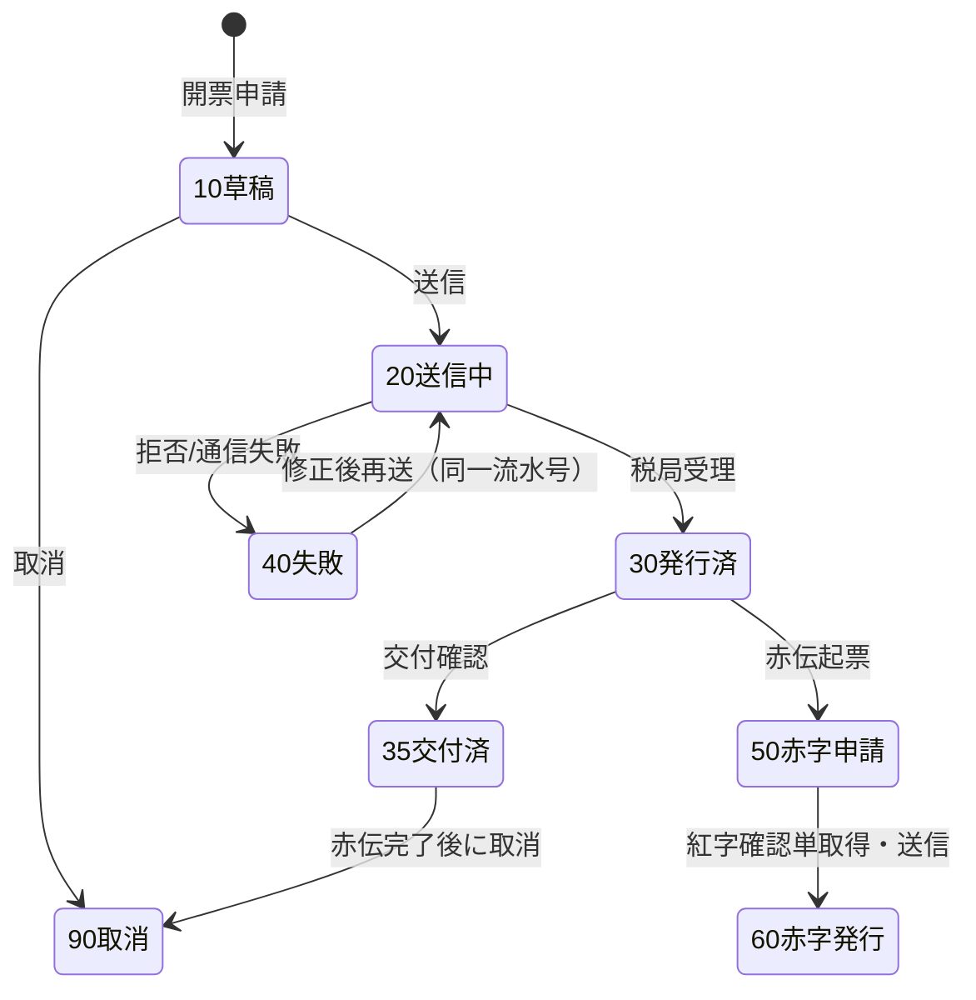
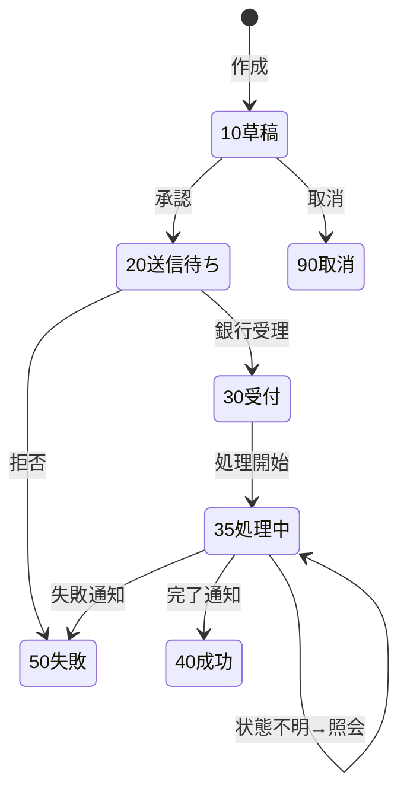

# 税务・银行接口 详细设计书（税務・銀行インタフェース 詳細設計書）

| 項目 | 内容 |
|---|---|
| 文書名 | 税务・银行接口 详细设计书（税務・銀行インタフェース 詳細設計書） |
| 文書番号 | DSN-INT-002 |
| 版数 | v1.0 |
| 作成日 | 2026-10-20 |
| 作成者 | integration-designer（集成分野担当） |
| 承認者 | 未承認（レビュー待ち） |
| 状態 | ドラフト（レビュー中） |
| 関連文書 | [業務域概要](00-overview.md) / [接口配置](01-integration-config.md) / [DB 設計](90-db-design.md) / [API 設計](91-api-design.md) / [跨域流程](../00-common/09-cross-domain-flow.md) / [真实资料](../90-data/sources.md) / [财务概要](../07-finance/00-overview.md) |

---

## 1. 機能概要

| 項目 | 内容 |
|---|---|
| 機能 ID | F-INT-002（数电票）、F-INT-003（進項査験）、F-INT-004（銀企直連）、F-INT-005（対账单取込）、F-INT-016（電子税務局、P2） |
| 機能名 | 税务・银行接口 |
| 目的 | ① 数电票を法令に沿って开具・交付・赤伝し、売上・应收と紐付ける；② 進項発票を査験し用途確認する；③ 銀企直連で残高・付款・回单を安全に送受信する；④ 銀行対账单を取り込み FIN に引き渡す |
| 利用者・ロール | 会计、财务经理、出纳、财务总监、销售员（开票申请）、接口管理员、运维担当 |
| 利用シーン | 出荷確定後の請求書発行、月次申告前の進項確認、支払実行、日次銀行照合 |
| 優先度 | F-INT-002/003/004/005＝P1、F-INT-016＝P2 |
| 画面 ID | SCR-INT-008〜015 |
| 関連 IF | IF-INT-001、002、006、007、008 |

### 1.1 制度・標準の前提（実データ）

| 項目 | 内容 | 区分・出典 |
|---|---|---|
| 数电票の根拠 | 《国家税务总局关于推广应用全面数字化电子发票的公告》（国家税务总局公告 2024 年第 11 号、2024-11-12 公布、2024-12-01 施行）。数电票の法律効力・基本用途は現行の紙発票と同一 | 【実データ】S-050 |
| 数电票の票面要素 | 発票番号、開票日、購買方/販売方情報、項目名称、規格型番、単位、数量、単価、金額、税率/徴収率、税額、合計、価税合計（大字・小字）、備考、開票人。**項目の桁数・必須区分は電子発票服务平台の最新仕様に従う**（本設計では固定しない） | 【実データ】S-050（票面項目）／【要確認】桁数（出典確認待ち） |
| 増値税税率 | 货物販売 13%、運輸・建築等 9%、現代服務 6%、輸出 0%（条件付き） | 【実データ】S-051、[tax.csv](../90-data/code-lists/tax.csv) |
| 紅字発票 | 数电票の取消・訂正は《紅字発票情報確認単》に基づく紅字発票による。元発票との紐付けを保持する | 【実データ】S-050／【要確認】確認単の取得手順 |
| CNAPS 聯行号 | 中国人民銀行支付系統の行番号。**3 桁（銀行コード）+ 4 桁（都市コード）+ 4 桁（支店コード）+ 1 桁（検証桁）= 12 桁** | 【実データ】S-067、[bank.csv](../90-data/code-lists/bank.csv) |

> **未確定事項の扱い**：数电票の項目桁数・必須区分は **【要確認】（出典確認待ち）のまま据え置く**。電子発票服务平台の仕様書を入手できるまでは、受入テストを「モック仕様 v0」で実施し、確定後に `int_interface_field_spec`（項目定義）へ反映する。創作した桁数を設計値として固定しない。
| 銀行口座 | 例：中国工商銀行常州分行営業部、口座番号は脱敏示例（`1105 **** **** 5678`）、聯行号 `102304000001` は**虚构示例**（12 桁構造の説明用） | 【示例値】[demo-company.md](../90-data/demo-company.md) §6 |
| MT940 | SWIFT の対账单メッセージ形式（`:20:` 取引参照、`:25:` 口座、`:28C:` 明細番号、`:60F:` 期首残高、`:61:` 明細行、`:86:` 付加情報、`:62F:` 期末残高）。**国内銀行での採用は未確定**であり、採用時は銀行仕様書を正とする | 【公開情報】SWIFT MT940 仕様（採用未定） |

> **禁止事項**：税局・銀行の実エンドポイント URL、証明書、API バージョン、返却コード体系を本設計で創作しない。これらは導入時に `int_interface_config`（`endpoint_url`、`credential_ref`）へ設定し、接続仕様書を添付する。本文の URL はすべて `{...}` のプレースホルダである。

---

## 2. 業務要件・業務ルール

### 2.1 前提条件

| # | 前提条件 | 成立しない場合 |
|---|---|---|
| 1 | 会社の納税人識別号・開票資格・数电票の可用性が有効 | 開票不可（`MSG-INT-020`）、手動対応 |
| 2 | 売上/出荷データが承認済で、金額・税率・購買方情報が確定している | 開票申請を拒否（`MSG-INT-021`） |
| 3 | 銀行との接続契約・証明書・IP 許可が有効 | 送信不可（`MSG-INT-040`）、手動送金へ切替 |
| 4 | FIN の支払承認が完了している（付款申請 status=25 承認済） | 付款指令を作成できない |
| 5 | 会計期間が OPEN（数电票は会計期間と独立だが、売上計上は期間に従う） | 期間エラー（`MSG-COM-071`） |

### 2.2 業務ルール

| # | ルール | 根拠 | 関連項目 |
|---|---|---|---|
| BR-TAX-01 | 数电票の开具は**請求流水号（`invoice_req_no`）単位**で冪等とする。同一流水号の再送は再開票せず、既存結果を返す | 本設計 | `invoice_req_no` |
| BR-TAX-02 | 開票金額は出荷確定額（E10）または既存 AR を正とし、**手入力で上書きしない**。差異は開票申請の段階で修正する | [09 §5.2](../00-common/09-cross-domain-flow.md) | `amount`、`tax_amount` |
| BR-TAX-03 | 税率は明細単位で保持し、伝票合計は明細合計（再丸めしない） | [08 §4](../00-common/08-common-business-rules.md) | `tax_rate` |
| BR-TAX-04 | 赤字発票は元発票（`red_of_invoice_id`）と紅字確認単（`red_confirm_no`）を必須とし、元発票の金額を超えてはならない | 本設計 | `red_*` |
| BR-TAX-05 | 開票失败時は**再開票しない**。原因（購買方情報・税目・金額）を修正し、同一流水号で再送する。連続失敗は手動対応 | 本設計 | `status=40` |
| BR-TAX-06 | 交付状態は「発行済（税局受理）」「交付済（購買方到達）」を区別する。交付済になるまで請求書発行完了としない | 本設計 | `issued_at`、`delivered_at` |
| BR-TAX-07 | 進項発票の査験は「一致性（金額・税額・日付）」を確認し、不一致は自動で用途確認しない | 本設計 | `verify_status` |
| BR-TAX-08 | 用途確認（控除/不控除）は会計の明示操作を必須とし、自動確定しない（税務リスク） | 本設計 | `usage_status` |
| BR-BANK-01 | 付款指令は `payment_no` を冪等キーとし、**同一指令の二重送信を禁止**する。タイムアウト時は送信前に状態照会を行う | 本設計 | `payment_no` |
| BR-BANK-02 | 振込先口座は登録済みの仕入先/従業員口座に限る。口座変更は MDM の承認フローを経たもののみ有効 | [08 §9](../00-common/08-common-business-rules.md) | `payee_account_enc` |
| BR-BANK-03 | 付款指令の金額は承認済付款申請の金額と一致すること。差異は送信不可 | 本設計 | `amount` |
| BR-BANK-04 | 銀行からの応答が不明（タイムアウト・通信断）の場合、**成功/失敗を推測しない**。「状態不明」として照会し、結果確定まで再送しない | 本設計 | `status=35` |
| BR-BANK-05 | 回单は銀行が返却した電文をそのまま保存し、改変しない（PDF/JSON のハッシュを保存） | 本設計 | `receipt_message_id` |
| BR-BANK-06 | 対账单取込は「検証 → 全件取込 → FIN 引渡」の 3 段階。1 行でも形式エラーがあれば取込全体をロールバックする（部分取込禁止） | 本設計 | `int_bank_statement_file.status` |
| BR-BANK-07 | 対账单の同一ファイル（`file_hash`）は再取込しない。再取込が必要な場合は元批次を取消し、新規批次とする | 本設計 | `uk_int_bank_statement_file_hash` |
| BR-BANK-08 | 対账单の金額・件数は FIN の `fin_bank_statement` と一致すること。差異は日次対账で検出する | [09 §10.3](../00-common/09-cross-domain-flow.md) | `int_sync_reconcile` |

### 2.3 計算式・判定式

| # | 対象 | 算式 | 丸め | 例 |
|---|---|---|---|---|
| CALC-TAX-01 | 明細金額（税抜） | 数量 × 税抜単価 | 四捨五入 2 桁 | 120 × 856.50 = 102,780.00 |
| CALC-TAX-02 | 明細税額 | 明細金額 × 税率 | 四捨五入 2 桁 | 102,780.00 × 13% = 13,361.40 |
| CALC-TAX-03 | 票面合計 | Σ明細金額、Σ明細税額、税抜+税額 | 再丸めなし | 102,780.00 + 13,361.40 = 116,141.40 |
| CALC-TAX-04 | 紅字金額 | 元発票金額 − 戻入額（部分赤伝） | 2 桁 | 全額赤伝は元発票と同額 |
| CALC-BANK-01 | 口座残高照合差 | 銀行残高 − 帳簿残高 | 2 桁 | 未達調整は FIN が実施 |
| CALC-BANK-02 | 対账单件数差 | 取込件数 − FIN 登録件数 | — | 0 件が正常 |

> 金額例は【示例値】（[08 §4.3](../00-common/08-common-business-rules.md) と同一）。税率 13% は【実データ】S-051。

### 2.4 状態遷移

**数电票（`int_tax_invoice.status`）**



| 遷移 | トリガ | 権限 | 更新項目 | メッセージ |
|---|---|---|---|---|
| 10→20 | 送信 | `integration:tax-invoice:create` | `status`、`request_id` | — |
| 20→30 | 税局受理 | システム | `status`、`invoice_no`、`issued_at` | `MSG-INT-024` |
| 20→40 | 拒否/通信失敗 | システム | `status`、`reject_code`、`reject_message` | `MSG-INT-020` |
| 30→35 | 交付確認 | システム | `status`、`delivered_at`、`delivery_channel` | `MSG-INT-025` |
| 30→50 | 赤伝起票 | `integration:tax-invoice:red` | `status`、`red_reason`、`red_of_invoice_id` | `MSG-INT-026` |
| 50→60 | 紅字発行 | `integration:tax-invoice:approve` | `status`、`red_confirm_no`、`invoice_no` | `MSG-INT-027` |

**付款指令（`int_bank_payment.status`）**



---

## 3. 関連機能

| 関係 | 機能 ID | 機能名 | 関係内容 |
|---|---|---|---|
| 上流 | F-SAL-007 | 销售发票与开票申请 | 開票申請・発票登録の依頼 |
| 上流 | F-FIN-016 | 付款执行 | 承認済付款申請の受渡し |
| 上流 | F-FIN-019/020 | 应收/收款 | AR 紐付け・入金消込 |
| 下流 | F-FIN-024 | 银行对账 | 対账单・回单の引渡し |
| 下流 | F-FIN-026/027 | 发票台账・增值税申报 | 進項/銷項データの提供 |
| 参照 | F-INT-001 | 接口配置 | エンドポイント・認証・リトライ |
| 参照 | F-INT-013/014 | 監視・対账 | 失敗監視・日次対账 |

---

## 4. 画面設計

### 4.1 画面一覧

| 画面 ID | 画面名 | 類型 | 概要 |
|---|---|---|---|
| SCR-INT-008 | 数电票発行一覧 | 一覧検索 | 期間・購買方・状態・発票種別で検索、交付状態表示 |
| SCR-INT-009 | 数电票詳細・赤伝 | 登録編集 | 票面プレビュー、再送、交付、赤伝起票 |
| SCR-INT-010 | 進項発票査験一覧 | 一覧検索 | 査験結果・用途確認・リスク表示 |
| SCR-INT-011 | 銀企口座残高一覧 | ダッシュボード | 口座別残高、最終同期、接続状態 |
| SCR-INT-012 | 付款指令一覧 | 一覧検索 | 状態・金額・受付番号、承認/送信 |
| SCR-INT-013 | 付款指令詳細・回单 | 登録編集 | 振込先、金額、承認、送信、回单表示 |
| SCR-INT-014 | 銀行対账单取込 | ウィザード | ファイル選択→検証→取込→FIN 引渡 |
| SCR-INT-015 | 対账单取込結果・FIN 引渡 | 参照詳細 | 件数・金額・エラー行・引渡結果 |

### 4.2 画面項目定義（SCR-INT-009 数电票詳細・赤伝）

| No | 項目 ID | 項目名 | 種別 | 型/桁 | 必須 | 初期値 | 入力チェック | データソース | DB 項目 | 備考 |
|---|---|---|---|---|---|---|---|---|---|---|
| 1 | invoice_req_no | 請求流水号 | テキスト | VARCHAR(48) | ○ | 自動採番 | 形式・一意 | 採番 | `invoice_req_no` | 参照のみ |
| 2 | invoice_type | 発票種別 | 選択 | SMALLINT | ○ | 20 | 値域 | 固定値 | `invoice_type` | 10 藍専/20 藍普/30 紅専/40 紅普 |
| 3 | buyer_name | 購買方名 | テキスト | VARCHAR(200) | ○ | 顧客名 | 桁数 | 顧客マスタ | `buyer_name` | スナップショット |
| 4 | buyer_tax_no | 購買方税号 | テキスト | VARCHAR(30) | ○ | 顧客税号 | 18 桁形式（統一社会信用コード） | 顧客マスタ | `buyer_tax_no` | 空は不可（数电票） |
| 5 | amount | 金額（税抜） | 数値 | NUMERIC(18,2) | ○ | 出荷額 | ≥ 0 | E10/AR | `amount` | 参照のみ |
| 6 | tax_rate | 税率 | 数値 | NUMERIC(7,4) | ○ | 13.0000 | 0〜100 | 税コード | `tax_rate` | % 表示 |
| 7 | tax_amount | 税額 | 数値 | NUMERIC(18,2) | ○ | 自動計算 | 計算値と一致 | CALC-TAX-02 | `tax_amount` | 参照のみ |
| 8 | total_amount | 価税合計 | 数値 | NUMERIC(18,2) | ○ | 自動計算 | 計算値と一致 | CALC-TAX-03 | `total_amount` | 参照のみ |
| 9 | remark | 備考 | テキスト | VARCHAR(500) | △ | 空 | 桁数 | 入力 | `remark` | 票面に印字 |
| 10 | red_of_invoice_no | 元発票番号 | テキスト | VARCHAR(32) | △ | 空 | 発行済発票のみ | 発票検索 | `red_of_invoice_id` | 赤伝時必須 |
| 11 | red_reason | 赤字理由 | テキスト | VARCHAR(500) | △ | 空 | 赤伝時必須 | 入力 | `red_reason` | — |
| 12 | red_confirm_no | 紅字確認単番号 | テキスト | VARCHAR(64) | △ | 空 | 赤伝時必須 | 税局 | `red_confirm_no` | — |

### 4.3 画面項目定義（SCR-INT-013 付款指令詳細）

| No | 項目 ID | 項目名 | 種別 | 型/桁 | 必須 | 初期値 | 入力チェック | データソース | DB 項目 |
|---|---|---|---|---|---|---|---|---|---|
| 1 | payment_no | 指令番号 | テキスト | VARCHAR(48) | ○ | 自動採番 | 一意 | 採番 | `payment_no` |
| 2 | bank_account_id | 支払口座 | 選択 | BIGINT | ○ | 既定口座 | 有効口座 | `int_bank_account` | `bank_account_id` |
| 3 | payee_name | 受取人名 | テキスト | VARCHAR(200) | ○ | 仕入先名 | 桁数 | 仕入先マスタ | `payee_name` |
| 4 | payee_account_no | 受取人口座 | テキスト | VARCHAR(64) | ○ | マスタ値 | 数字 8〜32 桁 | 仕入先マスタ | `payee_account_enc` |
| 5 | payee_bank_code | 受取行聯行号 | テキスト | VARCHAR(16) | ○ | マスタ値 | 12 桁数字 | 銀行マスタ | `payee_bank_code` |
| 6 | amount | 金額 | 数値 | NUMERIC(18,2) | ○ | 申請額 | > 0、申請額と一致 | 付款申請 | `amount` |
| 7 | purpose | 用途 | テキスト | VARCHAR(200) | ○ | 空 | 桁数 | 入力 | `purpose` |
| 8 | payment_mode | 支払方式 | 選択 | SMALLINT | ○ | 10 | 値域 | 固定値 | `payment_mode` |
| 9 | status | 状態 | 表示 | SMALLINT | — | — | — | 自動 | `status` |
| 10 | bank_serial_no | 銀行受付番号 | テキスト | VARCHAR(64) | — | 空 | — | 銀行応答 | `bank_serial_no` |
| 11 | receipt_no | 回单番号 | テキスト | VARCHAR(64) | — | 空 | — | 銀行応答 | `receipt_no` |

### 4.4 イベント処理

| No | イベント | トリガ | 処理内容 | 呼出 API | 画面遷移 |
|---|---|---|---|---|---|
| 1 | 開票送信 | 送信ボタン | 項目検証→請求流水号確認→送信→結果反映 | `POST /api/integration/tax-invoices` | 同一画面 |
| 2 | 再送 | 再送ボタン | 同一流水号で再送（二重開票しない） | `POST /api/integration/tax-invoices/{id}/retry` | 同一画面 |
| 3 | 赤伝起票 | 赤伝ボタン | 元発票検証→紅字理由必須→承認へ | `POST /api/integration/tax-invoices/{id}/red` | 同一画面 |
| 4 | 交付確認 | 交付ボタン | 交付チャネル選択→交付状態取得 | `POST /api/integration/tax-invoices/{id}/deliver` | 同一画面 |
| 5 | 付款承認 | 承認ボタン | SoD チェック（作成者≠承認者）→status 20 | `POST /api/integration/bank-payments/{id}/approve` | 一覧へ |
| 6 | 付款送信 | 送信ボタン | 残高・口座・金額チェック→送信→状態反映 | `POST /api/integration/bank-payments/{id}/submit` | 同一画面 |
| 7 | 状態照会 | 照会ボタン | 銀行へ状態照会（不明時） | `POST /api/integration/bank-payments/{id}/query` | 同一画面 |
| 8 | 対账单取込 | 取込ボタン | ファイル検証→取込→FIN 引渡 | `POST /api/integration/bank-statement-files` | SCR-INT-015 |

### 4.5 表示制御

| 条件 | 対象 | 制御 |
|---|---|---|
| 権限 `integration:tax-invoice:create` なし | 送信・赤伝ボタン | 非表示（API でも 403） |
| 状態 ≠ 10 草稿 | 赤伝理由の編集 | 参照のみ |
| 金額項目の項目権限なし | 金額・税額 | 非表示（API で返さない） |
| 口座番号 | 全画面 | 下 4 桁のみ表示（`**** **** 5678`） |
| 状態 = 35 処理中 | 再送ボタン | 非表示（状態照会のみ） |

---

## 5. 入力チェック仕様

| No | チェック ID | 対象 | 種別 | 条件 | タイミング | メッセージ |
|---|---|---|---|---|---|---|
| 1 | CHK-INT-002-01 | 購買方税号 | 必須 | 18 桁の統一社会信用コード | 送信時 | `MSG-INT-021` |
| 2 | CHK-INT-002-02 | 金額 | 相関 | 税抜 + 税額 = 価税合計 | 送信時 | `MSG-INT-022` |
| 3 | CHK-INT-002-03 | 税率 | 値域 | 0〜100、税コードに存在 | 送信時 | `MSG-INT-023` |
| 4 | CHK-INT-002-04 | 元発票 | 業務 | 赤伝時、元発票が発行済・未赤伝 | 赤伝時 | `MSG-INT-026` |
| 5 | CHK-INT-004-01 | 受取人口座 | 形式 | 数字 8〜32 桁 | 送信時 | `MSG-INT-043` |
| 6 | CHK-INT-004-02 | 聯行号 | 形式 | 12 桁数字（CNAPS） | 送信時 | `MSG-INT-044` |
| 7 | CHK-INT-004-03 | 金額 | 相関 | 承認済付款申請額と一致 | 送信時 | `MSG-INT-045` |
| 8 | CHK-INT-004-04 | 口座残高 | 業務 | 残高 ≥ 金額（残高既知の場合） | 送信時 | `MSG-INT-041` |
| 9 | CHK-INT-005-01 | 対账单ファイル | 形式 | レイアウト定義に一致、文字コード正 | 取込時 | `MSG-INT-050` |
| 10 | CHK-INT-005-02 | 対账单件数 | 業務 | 明細行数 = ヘッダ件数 | 取込時 | `MSG-INT-051` |

---

## 6. 処理詳細

### 6.1 処理一覧

| 処理 ID | 処理名 | 契機 | トランザクション | 排他 |
|---|---|---|---|---|
| PRC-INT-002-01 | 数电票开具 | 送信 | 要（DB）／外部呼出は外 | 楽観排他＋冪等キー |
| PRC-INT-002-02 | 赤伝発行 | 赤伝承認後 | 要 | 元発票の行ロック |
| PRC-INT-003-01 | 進項発票査験 | 手動/バッチ | 要 | 発票番号一意 |
| PRC-INT-004-01 | 付款指令送信 | 承認後 | 要（状態）／外部は外 | `payment_no` 冪等 |
| PRC-INT-004-02 | 付款状態照会 | 不明時/日次 | 不要 | — |
| PRC-INT-005-01 | 対账单取込 | ファイル受信 | 要（全件） | ファイルハッシュ一意 |

### 6.2 処理手順（正常系）

**PRC-INT-002-01 数电票开具**

1. 入力チェック（第 5 章）と権限チェックを行う。
2. 出荷確定額（E10）または AR と突合し、金額・税額・税率を確定する（上書き禁止）。
3. 請求流水号 `invoice_req_no` を採番する（同一業務キーで既存があれば再送として扱う）。
4. `int_tax_invoice` に `status=10` で登録し、明細を `int_tax_invoice_line` に登録する。
5. Outbox に送信タスクを登録（`int_sync_task`、`idempotency_key=invoice_req_no`）。
6. ジョブが税局/サービス事業者へ送信（`IF-INT-002`）。タイムアウトは 30 秒、リトライは**照会先行**で最大 3 回。
7. 受理応答を受信し、`invoice_no`・`external_ref_no`・`status=30`・`issued_at` を更新する。
8. 交付要求を送信し、交付状態を取得して `status=35`・`delivered_at` を更新する。
9. 監査ログ・原文（`int_external_message`）を保存し、E12 相当の紐付けを SAL/FIN に通知する。

**PRC-INT-004-01 付款指令送信**

1. 承認済付款申請（FIN）の金額・受取人・口座を取得し、指令を生成する。
2. SoD チェック（作成者 ≠ 承認者）、口座有効性、残高（既知の場合）、日次上限を検証する。
3. 銀行へ送信（`IF-INT-001`）。`payment_no` を冪等キーとして送信する。
4. 受付応答（`bank_serial_no`）を保存し `status=30`。以降は状態照会で `35→40/50` に更新する。
5. タイムアウト/通信断は `status=35`（処理中）とし、**再送しない**。照会で結果を確定する。
6. 完了時は回单を取得し `receipt_no`・`receipt_message_id` を保存。FIN に E28 相当を通知する。

**PRC-INT-005-01 対账单取込**

1. ファイルを受信し、SHA-256 を計算して重複を檢查する（同一 `bank_account_id` + `file_hash`）。
2. レイアウト定義（`int_file_layout`）に従い、文字コード・ヘッダ・件数・型を検証する。
3. 全行をメモリまたは一時テーブルに読み込み、**1 行でもエラーがあれば全件ロールバック**する。
4. 成功時は `int_bank_statement_file.status=30`、`int_file_transfer` に結果を記録する。
5. FIN の対账单取込 API を呼び出し（または E14 相当のファイル受渡しイベント）、`fin_statement_id` を保存して `status=50` とする。
6. 件数・金額を `int_sync_reconcile` に記録し、差異があればアラートする。

### 6.3 例外処理

| No | 異常条件 | 検知箇所 | 処理 | ロールバック | メッセージ |
|---|---|---|---|---|---|
| 1 | 税局が開票を拒否 | 応答 | `status=40`、理由保存、再送しない | 状態のみ | `MSG-INT-020` |
| 2 | 購買方情報不備 | 送信前 | 送信せず項目エラー | なし | `MSG-INT-021` |
| 3 | 通信タイムアウト（開票） | 送信 | 状態照会→未処理なら同一流水号で再送 | なし | `MSG-INT-021` |
| 4 | 赤伝の元発票が既に赤伝済 | 赤伝起票 | 拒否 | なし | `MSG-INT-026` |
| 5 | 銀行が口座相違を返却 | 応答 | `status=50`、口座マスタ修正を促す | 状態のみ | `MSG-INT-040` |
| 6 | 銀行残高不足 | 応答 | `status=50`、FIN へ通知 | 状態のみ | `MSG-INT-041` |
| 7 | 付款状態不明 | 照会 | `status=35` のまま、確定まで再送禁止 | なし | `MSG-INT-046` |
| 8 | 対账单形式エラー | 検証 | 全件ロールバック、エラー行保存 | 全体 | `MSG-INT-050` |
| 9 | 対账单重複 | 取込 | 既存批次を返却、再取込しない | なし | `MSG-INT-052` |

### 6.4 冪等性・再実行

- 開票：`invoice_req_no`。タイムアウト時は**照会→未処理の場合のみ**同一流水号で再送。二重開票は税局側でも拒否されるが、ERP 側でも防止する。
- 付款：`payment_no`。再送は「状態不明」の確定後、失敗と判明した場合のみ。成功後の再送は禁止。
- 対账单：`file_hash`。再取込は元批次の取消＋新規ファイル。
- 査験：`invoice_code + invoice_no`。同日の再査験は結果を上書き（冪等）。

---

## 7. API 設計

| No | メソッド | パス | 権限 | 概要 | リクエスト | レスポンス |
|---|---|---|---|---|---|---|
| 1 | POST | `/api/integration/tax-invoices` | `integration:tax-invoice:create` | 数电票开具 | `TaxInvoiceCreateRequest` | `TaxInvoiceDto` |
| 2 | GET | `/api/integration/tax-invoices` | `integration:tax-invoice:view` | 一覧 | 検索条件 | `PageResult<TaxInvoiceListDto>` |
| 3 | GET | `/api/integration/tax-invoices/{id}` | `integration:tax-invoice:view` | 詳細 | — | `TaxInvoiceDto` |
| 4 | POST | `/api/integration/tax-invoices/{id}/retry` | `integration:tax-invoice:create` | 再送 | — | `TaxInvoiceDto` |
| 5 | POST | `/api/integration/tax-invoices/{id}/deliver` | `integration:tax-invoice:create` | 交付 | `{channel}` | `TaxInvoiceDto` |
| 6 | POST | `/api/integration/tax-invoices/{id}/red` | `integration:tax-invoice:red` | 赤伝起票 | `{reason, redConfirmNo}` | `TaxInvoiceDto` |
| 7 | GET | `/api/integration/input-invoices` | `integration:input-invoice:view` | 進項一覧 | 検索条件 | `PageResult<InputInvoiceDto>` |
| 8 | POST | `/api/integration/input-invoices/verify` | `integration:input-invoice:verify` | 査験 | `{invoiceCode, invoiceNo, invoiceDate}` | `InputInvoiceDto` |
| 9 | POST | `/api/integration/input-invoices/{id}/usage` | `integration:input-invoice:verify` | 用途確認 | `{usageStatus, comment}` | `InputInvoiceDto` |
| 10 | GET | `/api/integration/bank-accounts` | `integration:bank-account:view` | 口座残高 | — | `BankAccountDto[]` |
| 11 | POST | `/api/integration/bank-payments` | `integration:bank-payment:create` | 指令作成 | `BankPaymentCreateRequest` | `BankPaymentDto` |
| 12 | POST | `/api/integration/bank-payments/{id}/approve` | `integration:bank-payment:approve` | 承認 | `{version, comment}` | `BankPaymentDto` |
| 13 | POST | `/api/integration/bank-payments/{id}/submit` | `integration:bank-payment:submit` | 送信 | `{version}` | `BankPaymentDto` |
| 14 | POST | `/api/integration/bank-payments/{id}/query` | `integration:bank-payment:view` | 状態照会 | — | `BankPaymentDto` |
| 15 | POST | `/api/integration/bank-statement-files` | `integration:bank-statement:import` | 対账单取込 | multipart | `BankStatementFileDto` |
| 16 | GET | `/api/integration/bank-statement-files/{id}` | `integration:bank-statement:view` | 取込結果 | — | `BankStatementFileDto` |

### 7.1 リクエスト/レスポンス例（数电票・【示例値】）

```json
POST /api/integration/tax-invoices
{
  "invoiceType": 20,
  "buyerId": "1845000000000000001",
  "buyerName": "常州泵业有限公司",
  "buyerTaxNo": "91320400XXXXXXXXXX",
  "sourceType": "SALES_DELIVERY",
  "sourceId": "1845678901234567891",
  "sourceNo": "DN2610200001",
  "currencyCode": "CNY",
  "amount": "102780.00",
  "taxRate": "13.0000",
  "taxAmount": "13361.40",
  "totalAmount": "116141.40",
  "remark": "YE3-100L1-4 120PCE",
  "lines": [
    {
      "lineNo": 10,
      "materialCode": "3001000001",
      "itemName": "YE3-100L1-4 三相异步电动机",
      "spec": "2.2kW 380V 50Hz IP55 B3",
      "uomCode": "PCE",
      "quantity": "120.0000",
      "unitPrice": "856.500000",
      "amount": "102780.00",
      "taxRate": "13.0000",
      "taxAmount": "13361.40"
    }
  ]
}
```

> 購買方税号は【示例値】（マスキング）。金額・単価は [08 §4.3](../00-common/08-common-business-rules.md) と同一の【示例値】。

```json
{
  "code": 0,
  "message": "ok",
  "data": {
    "id": "1845678901234567999",
    "invoiceReqNo": "INVREQ2610200001",
    "invoiceNo": "26322000000012345678",
    "status": 30,
    "statusName": "発行済",
    "issuedAt": "2026-10-20T15:10:00+08:00",
    "totalAmount": "116141.40"
  }
}
```

### 7.2 エラー例

```json
{
  "code": 90020,
  "message": "税局拒绝了开票请求：购买方税号与登记信息不一致。",
  "data": { "rejectCode": "TAX_BUYER_INVALID", "invoiceReqNo": "INVREQ2610200001" }
}
```

---

## 8. データ更新仕様

| テーブル | 操作 | 更新項目 | 条件 | トリガ |
|---|---|---|---|---|
| `int_tax_invoice` | INSERT/UPDATE | 全項目／状態・発票番号 | 開票・交付・赤伝 | PRC-INT-002-01/02 |
| `int_tax_invoice_line` | INSERT | 明細 | 開票時 | PRC-INT-002-01 |
| `int_input_invoice` | INSERT/UPDATE | 査験結果・用途 | 査験・用途確認 | PRC-INT-003-01 |
| `int_bank_payment` | INSERT/UPDATE | 状態・受付番号・回单 | 送信・照会 | PRC-INT-004-01/02 |
| `int_bank_statement_file` | INSERT/UPDATE | 件数・状態・FIN ID | 取込・引渡 | PRC-INT-005-01 |
| `int_sync_task` / `int_retry_log` | INSERT/UPDATE | 状態・再送 | 送受信 | F-INT-013 |
| `int_external_message` | INSERT | 原文 | 送受信 | 全 IF |

---

## 9. エラー処理・メッセージ

| メッセージ ID | 種別 | 本文 | 発生条件 | 対処 |
|---|---|---|---|---|
| `MSG-INT-020` | E | 税局拒绝了开票请求（原因：{0}），请修正后重新发送。 | 税局拒否 | 内容修正→同一流水号で再送 |
| `MSG-INT-021` | E | 开票信息不完整或通信失败，请检查购买方信息与网络后重试。 | 項目不備/通信失敗 | 項目確認・再送 |
| `MSG-INT-022` | E | 金额与税额之和不等于价税合计。 | 金額不整合 | 金額修正 |
| `MSG-INT-023` | E | 税率无效或税码不存在。 | 税率不正 | 税コード確認 |
| `MSG-INT-024` | I | 数电票已开具，发票号码：{0}。 | 受理成功 | 交付確認へ |
| `MSG-INT-025` | I | 发票已交付给购买方。 | 交付成功 | — |
| `MSG-INT-026` | E | 该发票不能开具红字发票（未发行或已红冲）。 | 赤伝不可 | 元発票確認 |
| `MSG-INT-027` | I | 红字发票已开具。 | 赤伝成功 | AR 調整へ |
| `MSG-INT-030` | E | 发票查验不一致：发票号码 {0}，请核对金额、日期与销售方。 | 査験不一致 | 発票再確認 |
| `MSG-INT-031` | W | 该发票风险等级为高，请谨慎确认用途。 | リスク高 | 財務責任者確認 |
| `MSG-INT-040` | E | 银行返回账户信息不符（{0}），请核对收款账户与联行号。 | 口座相違 | 口座マスタ修正（承認要） |
| `MSG-INT-041` | E | 银行账户余额不足，无法完成付款。 | 残高不足 | 入金/口座変更 |
| `MSG-INT-042` | E | 付款金额必须大于 0。 | 金額不正 | 修正 |
| `MSG-INT-043` | E | 收款账号格式不正确（应为 8〜32 位数字）。 | 形式エラー | 修正 |
| `MSG-INT-044` | E | 联行号格式不正确（应为 12 位数字）。 | 形式エラー | 修正 |
| `MSG-INT-045` | E | 付款金额与已批准的付款申请金额不一致。 | 金額不一致 | 申請と照合 |
| `MSG-INT-046` | W | 银行返回结果不明，系统将在稍后自动查询，请勿重复发送。 | 状態不明 | 照会待ち |
| `MSG-INT-050` | E | 对账单文件格式不正确（第 {0} 行：{1}），已取消本次导入。 | 形式エラー | テンプレート確認 |
| `MSG-INT-051` | E | 对账单明细行数与文件头件数不一致。 | 件数不一致 | ファイル再取得 |
| `MSG-INT-052` | W | 该对账单文件已导入（批次 {0}），本次不重复导入。 | 重複 | 既存批次参照 |
| `MSG-INT-053` | E | 对账单移交财务失败，请稍后重试。 | FIN 引渡失敗 | 再引渡 |
| `MSG-INT-060` | E | 与外部系统的通信失败（{0}），系统将按计划重试。 | 通信失敗 | 監視・再送 |
| `MSG-INT-062` | I | 检测到重复报文，已忽略（外部单号：{0}）。 | 重複受信 | なし |
| `MSG-INT-070` | E | 已达最大重试次数，任务转为死信，请联系运维处理。 | 死信 | 手動再送/修正 |

---

## 10. 権限・セキュリティ

| 種別 | 内容 |
|---|---|
| 画面権限 | 第 4 章の各画面の権限コード。金額・口座は項目権限で制御 |
| 操作権限 | 開票 `integration:tax-invoice:create`、赤伝 `:red`、付款承認 `integration:bank-payment:approve`、送信 `:submit`、対账单 `integration:bank-statement:import` |
| データ範囲 | 財務データは全社（財務部）。営業は担当顧客のみ |
| 監査ログ | 開票・赤伝・付款承認・送信・対账单取込を `sys_audit_log` に記録（前後値・実行者・IP） |
| 機密 | 口座番号は暗号化＋下 4 桁マスク。税号はマスク表示可。原文はマスキングして保存 |
| 通信 | TLS 1.2 以上必須。銀行接続は mTLS/銀行指定の証明書。証明書は Secrets Manager |
| SoD | 付款指令の作成者と承認者を分離。開票と赤伝承認を分離 |

---

## 11. 性能・非機能

| 項目 | 目標 | 前提 |
|---|---|---|
| 開票応答 | 30 秒以内（外部含む） | 税局/サービス事業者の SLA に依存 |
| 付款送信 | 30 秒以内 | 銀行 SLA に依存 |
| 対账单取込 | 10,000 行で 60 秒以内 | 全件ロールバック方式 |
| 一覧検索 | 2 秒以内 | 索引（第 90 章） |
| 原文保存 | 1 年 | 圧縮・マスキング |
| 同時実行 | 20 ユーザ | — |

---

## 12. テスト観点

| No | 観点 ID | 分類 | 観点 | 期待結果 |
|---|---|---|---|---|
| 1 | TST-F-INT-002-01 | 正常系 | 数电票を正常に开具 | `status=30`、発票番号保存 |
| 2 | TST-F-INT-002-02 | 異常系 | 購買方税号不正 | 送信されず `MSG-INT-021` |
| 3 | TST-F-INT-002-03 | 冪等 | 同一流水号で再送 | 二重開票されず既存結果 |
| 4 | TST-F-INT-002-04 | 異常系 | 税局拒否 | `status=40`、理由保存、再送しない |
| 5 | TST-F-INT-002-05 | 正常系 | 赤伝（全額） | 元発票に紐付く紅字発票 |
| 6 | TST-F-INT-002-06 | 異常系 | 赤伝の元発票が既に赤伝済 | 拒否 `MSG-INT-026` |
| 7 | TST-F-INT-002-07 | 境界 | 金額 0.01 | 正常に开具 |
| 8 | TST-F-INT-003-01 | 正常系 | 進項査験一致 | `verify_status=20` |
| 9 | TST-F-INT-003-02 | 異常系 | 査験不一致 | `verify_status=30`、用途確認不可 |
| 10 | TST-F-INT-004-01 | 正常系 | 付款指令送信→完了 | `status=40`、回单保存 |
| 11 | TST-F-INT-004-02 | 冪等 | 同一 payment_no で再送 | 二重送金されない |
| 12 | TST-F-INT-004-03 | 異常系 | タイムアウト | `status=35`、再送されない、照会で確定 |
| 13 | TST-F-INT-004-04 | 異常系 | 残高不足 | `status=50`、`MSG-INT-041` |
| 14 | TST-F-INT-004-05 | 権限 | 承認者なしで送信 | 403 `MSG-COM-030` |
| 15 | TST-F-INT-005-01 | 正常系 | 対账单取込→FIN 引渡 | 件数一致、`status=50` |
| 16 | TST-F-INT-005-02 | 異常系 | 1 行形式エラー | 全件ロールバック |
| 17 | TST-F-INT-005-03 | 冪等 | 同一ファイル再取込 | 拒否 `MSG-INT-052` |
| 18 | TST-F-INT-005-04 | 境界 | 0 件ファイル | エラー（`MSG-INT-051`） |

---

## 13. 未決事項

| # | 事項 | 理由 | 暫定仕様 | 担当 | 期限 |
|---|---|---|---|---|---|
| 1 | 数电票の接続方式（税局直結/サービス事業者） | 契約未確定 | アダプタ方式。`endpoint_url`・認証は導入時設定 | 財務／情報部 | 2026-11-30 |
| 2 | 数电票の交付チャネル（メール/QR/API） | 顧客の運用未確定 | 3 方式を実装可能とし、既定はメール＋PDF | 財務 | 2026-11-30 |
| 3 | 進項発票の査験要素（数电票の照会キー） | 税局仕様の確認が必要 | 発票番号＋開票日＋金額で照会。不一致時は手動 | 財務 | 2026-11-30 |
| 4 | 銀行接続方式（銀企直連/ファイル/手動） | 取引行が未確定 | 銀行別アダプタ。Phase 1 はファイル＋手動も可 | 財務 | 2026-11-30 |
| 5 | MT940 の採用 | 国内行の対応未確認 | CSV/Excel を既定。MT940 は Phase 2 | integration | 2027-01-31 |
| 6 | 赤伝の部分赤伝可否 | 税務実務の確認が必要 | Phase 1 は全額赤伝のみ。部分赤伝は Phase 2 | 財務 | 2026-12-15 |
| 7 | 電子税務局への申報送信方式 | Phase 2・税局仕様未確定 | ファイル出力＋手動送信を先行。API は Phase 2 | 財務 | Phase 2 |
| 8 | 数电票の保存期間と原文保管 | 会計档案 30 年との関係 | 発票メタは 10 年、原文は別途アーカイブ | 財務／情報部 | 2026-12-31 |

## 14. 改訂履歴

| 版数 | 日付 | 変更内容 | 変更者 |
|---|---|---|---|
| v1.0 | 2026-10-20 | 初版：数电票（公告 2024 年第 11 号準拠）、進項査験、銀企直連（CNAPS 12 桁）、対账单取込、状態遷移、API 16 件、エラー、テスト観点 | integration-designer |
| v1.1 | 2026-10-20 | 红队 REV-SW-013 対応：数电票の票面項目桁数は【要確認】（出典確認待ち）のまま据え置き、モック仕様で受入テストする旨を明記 | system-workflow |
