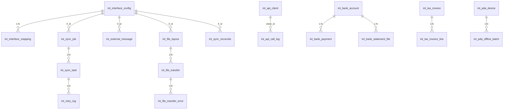

# 集成管理 DB 设计书（集成管理 DB 設計書）

| 項目 | 内容 |
|---|---|
| 文書名 | 集成管理 DB 设计书（集成管理 DB 設計書） |
| 文書番号 | DSN-INT-090 |
| 版数 | v1.0 |
| 作成日 | 2026-10-20 |
| 作成者 | integration-designer（集成分野担当） |
| 承認者 | 未承認（レビュー待ち） |
| 状態 | ドラフト（レビュー中） |
| 関連文書 | [業務域概要](00-overview.md) / [接口配置](01-integration-config.md) / [税銀 IF](02-tax-bank-interface.md) / [DB 共通规格](../00-common/04-common-db-spec.md) / [共通项目定义](../00-common/01-common-item-definitions.md) |

---

## 1. 設計方針

### 1.1 データモデルの概要

本域のデータは次の 4 層で構成する。

1. **設定層**：`int_interface_config`（接続定義）、`int_interface_mapping`（項目変換）、`int_file_layout`（外部ファイルレイアウト）、`int_notification_channel`、`int_api_client`、`int_pda_device`、`int_bank_account`。
2. **原文層**：`int_external_message`（送受信原文・ハッシュ）、`int_api_call_log`（呼出日志）。
3. **実行層**：`int_sync_job`（ジョブ）→ `int_sync_task`（業務単位タスク）→ `int_retry_log`（再送履歴）、`int_file_transfer` → `int_file_transfer_error`、`int_pda_offline_batch`。
4. **業務写像層**：`int_tax_invoice` / `int_tax_invoice_line`（数电票）、`int_input_invoice`（進項査験）、`int_bank_payment`（付款指令）、`int_bank_statement_file`（対账单取込）、`int_sync_reconcile`（日次対账）。

**更新責任**：INT は「外部との通信結果」のみを更新する。業務データ（売上・在庫・工賃・会計）は各業務域が更新し、INT は API 呼出またはイベント発行で依頼する。`int_bank_account.bank_account_id` は FIN の `fin_bank_account.id` を参照するが、FK は張らない（Phase 2 の多会社・別DB 移行を考慮し、アプリ検証）。

### 1.2 設計原則

| # | 原則 |
|---|---|
| 1 | 全テーブル `id BIGINT`（雪花 ID）。外部番号は `external_no`/`xxx_no` に保存し、業務キーに部分一意索引を張る |
| 2 | 金額 `NUMERIC(18,2)`、数量 `NUMERIC(18,4)`、単価 `NUMERIC(18,6)`（[01 第 6 章](../00-common/01-common-item-definitions.md)） |
| 3 | 認証情報（secret、証明書、口座番号）は**平文保存禁止**。`*_ref`（Secrets Manager キー）または AES-256-GCM 暗号文 + `key_version` を保存 |
| 4 | 原文は `int_external_message.payload` に保存するが、パスワード・口座番号・個人情報はマスキングする（[01 第 15 章](../00-common/01-common-item-definitions.md)） |
| 5 | ログ系（`*_log`、`*_message`、`*_task`）は追記専用。状態遷移のみ UPDATE 可（`status`、`retry_count`） |
| 6 | 冪等キーは `(if_id, idempotency_key)` の一意索引で保証する。重複時は既存結果を返す |
| 7 | パーティションは Phase 2（`int_api_call_log`、`int_external_message` は月次レンジ）。Phase 1 は単一テーブル + 6 か月アーカイブ |
| 8 | 状態・区分は `SMALLINT` + `COMMENT`。名称は保存しない |

### 1.3 ER 図



---

## 2. テーブル一覧

| # | 物理名 | 論理名 | 種別 | 主な用途 | 更新元 | 容量見積 |
|---|---|---|---|---|---|---|
| 1 | `int_interface_config` | 接口配置 | 設定 | 接続・認証・リトライ定義 | F-INT-001 | 100 |
| 2 | `int_interface_mapping` | 字段映射 | 設定 | 項目変換・コード変換 | F-INT-001 | 5,000 |
| 3 | `int_api_client` | 開放 API クライアント | マスタ | AppKey・scope・IP | F-INT-009 | 100 |
| 4 | `int_api_call_log` | API 呼出日志 | ログ | 呼出結果・性能 | F-INT-014 | 300 万/年 |
| 5 | `int_external_message` | 外部原文メッセージ | ログ | 原文・ハッシュ・再処理 | F-INT-001〜011 | 500 万/年 |
| 6 | `int_sync_job` | 同期ジョブ | ログ | ジョブ実行結果 | F-INT-013 | 30 万/年 |
| 7 | `int_sync_task` | 同期タスク | ログ | 業務単位の同期状態 | F-INT-013 | 500 万/年 |
| 8 | `int_retry_log` | 再送履歴 | ログ | 再送理由・結果 | F-INT-013 | 100 万/年 |
| 9 | `int_tax_invoice` | 数电票 | 伝票 | 票面・交付・赤字 | F-INT-002 | 30 万/年 |
| 10 | `int_tax_invoice_line` | 数电票明细 | 伝票明細 | 品目・金額・税率 | F-INT-002 | 120 万/年 |
| 11 | `int_input_invoice` | 進項発票査験 | 伝票 | 査験・用途確認 | F-INT-003 | 10 万/年 |
| 12 | `int_bank_account` | 銀企口座 | マスタ | 口座・残高・接続状態 | F-INT-004 | 20 |
| 13 | `int_bank_payment` | 銀企付款指令 | 伝票 | 指令・状態・回单 | F-INT-004 | 3 万/年 |
| 14 | `int_bank_statement_file` | 対账单ファイル | ログ | 取込批次・結果 | F-INT-005 | 500/年 |
| 15 | `int_file_layout` | 外部ファイルレイアウト | 設定 | ファイル項目定義 | F-INT-011 | 200 |
| 16 | `int_file_transfer` | ファイル取込ジョブ | ログ | 取込結果 | F-INT-011 | 10 万/年 |
| 17 | `int_file_transfer_error` | 取込エラー行 | ログ | 行エラー | F-INT-011 | 200 万/年 |
| 18 | `int_notification_channel` | 通知チャネル | 設定 | SMTP/SMS/WeCom/DingTalk | F-INT-012 | 20 |
| 19 | `int_pda_device` | PDA 端末 | マスタ | 端末認証・状態 | F-INT-010 | 200 |
| 20 | `int_pda_offline_batch` | PDA 補伝批次 | ログ | 補伝・重複排除 | F-INT-010 | 50 万/年 |
| 21 | `int_sync_reconcile` | 同期対账結果 | ログ | 日次対账 | F-INT-014 | 5,000/年 |

---

## 3. テーブル定義

### 3.1 `int_interface_config`（接口配置）

| 項目 | 内容 |
|---|---|
| 種別 | 設定 |
| 更新元 | F-INT-001（登録・変更・有効化）、F-INT-015（凭证更新） |
| 保存期間 | 無期限（廃止は `enabled_flag=false`） |
| 備考 | `interface_code` は `IF-INT-xxx`。1 相手先に複数 IF を許可 |

```sql
CREATE TABLE int_interface_config (
    id                  BIGINT        NOT NULL,
    tenant_id           BIGINT        NOT NULL DEFAULT current_setting('app.tenant_id')::bigint,
    company_id          BIGINT        NOT NULL DEFAULT 1,
    interface_code      VARCHAR(32)   NOT NULL,              -- IF-INT-001
    interface_name      VARCHAR(200)  NOT NULL,
    interface_type      SMALLINT      NOT NULL,              -- 10:REST 20:FILE 30:MQ 40:SMTP 50:SFTP 60:LOCAL
    direction           SMALLINT      NOT NULL,              -- 10:送信 20:受信 30:双方向
    partner_code        VARCHAR(32)   NOT NULL,              -- BANK_ICBC/TAX/SMES/...
    partner_name        VARCHAR(200)  NOT NULL,
    endpoint_url        VARCHAR(500),                        -- 設定値。URL を設計書に固定しない
    http_method         VARCHAR(10),                         -- GET/POST/PUT
    content_type        VARCHAR(100),                        -- application/json 等
    auth_type           SMALLINT      NOT NULL DEFAULT 0,    -- 0:なし 10:APIKey 20:HMAC 30:OAuth2 40:mTLS 50:Basic 60:SFTP鍵
    credential_ref      VARCHAR(200),                        -- Secrets Manager キー（値は保存しない）
    client_id           VARCHAR(100),
    timeout_ms          INT           NOT NULL DEFAULT 10000,
    connect_timeout_ms  INT           NOT NULL DEFAULT 3000,
    retry_max           SMALLINT      NOT NULL DEFAULT 3,
    retry_backoff       VARCHAR(100)  NOT NULL DEFAULT '1m,5m,30m',
    rate_limit_per_min  INT           NOT NULL DEFAULT 600,
    idempotency_header  VARCHAR(50),                         -- Idempotency-Key 等
    request_layout_id   BIGINT,                              -- ファイル系のみ
    response_layout_id  BIGINT,
    charset             VARCHAR(20)   NOT NULL DEFAULT 'UTF-8',
    health_status       SMALLINT      NOT NULL DEFAULT 0,    -- 0:未確認 10:正常 20:劣化 30:停止
    last_success_at     TIMESTAMPTZ,
    last_failure_at     TIMESTAMPTZ,
    last_error          VARCHAR(1000),
    enabled_flag        BOOLEAN       NOT NULL DEFAULT FALSE,
    effective_from      DATE,
    effective_to        DATE,
    owner_user_id       BIGINT,
    version             INT           NOT NULL DEFAULT 0,
    remark              VARCHAR(500),
    ext_data            JSONB,
    created_at          TIMESTAMPTZ   NOT NULL DEFAULT now(),
    created_by          BIGINT        NOT NULL DEFAULT 0,
    updated_at          TIMESTAMPTZ   NOT NULL DEFAULT now(),
    updated_by          BIGINT        NOT NULL DEFAULT 0,
    CONSTRAINT pk_int_interface_config PRIMARY KEY (id),
    CONSTRAINT uk_int_interface_config_code UNIQUE (company_id, interface_code),
    CONSTRAINT ck_int_interface_config_type CHECK (interface_type IN (10,20,30,40,50,60)),
    CONSTRAINT ck_int_interface_config_dir CHECK (direction IN (10,20,30)),
    CONSTRAINT ck_int_interface_config_auth CHECK (auth_type IN (0,10,20,30,40,50,60)),
    CONSTRAINT ck_int_interface_config_retry CHECK (retry_max BETWEEN 0 AND 10)
);
CREATE INDEX idx_int_interface_config_partner ON int_interface_config (partner_code, enabled_flag);
CREATE INDEX idx_int_interface_config_health ON int_interface_config (health_status, last_failure_at);
COMMENT ON TABLE int_interface_config IS '外部インタフェース接続定義';
COMMENT ON COLUMN int_interface_config.credential_ref IS '認証情報の参照キー。実値は環境変数/Secrets Manager に保存';
```

**主要項目定義**

| 物理名 | 論理名 | 型 | NULL | 既定値 | 備考 |
|---|---|---|---|---|---|
| `interface_code` | IF コード | VARCHAR(32) | NOT NULL | — | `IF-INT-xxx`、一意 |
| `interface_type` | 種別 | SMALLINT | NOT NULL | — | 10 REST / 20 FILE / 30 MQ / 40 SMTP / 50 SFTP / 60 LOCAL |
| `direction` | 方向 | SMALLINT | NOT NULL | — | 10 送信 / 20 受信 / 30 双方向 |
| `auth_type` | 認証方式 | SMALLINT | NOT NULL | 0 | 0 なし / 10 APIKey / 20 HMAC / 30 OAuth2 / 40 mTLS / 50 Basic / 60 SFTP 鍵 |
| `credential_ref` | 凭证参照 | VARCHAR(200) | NULL | NULL | 平文 secret は保存禁止 |
| `timeout_ms` | タイムアウト | INT | NOT NULL | 10000 | 1,000〜120,000 |
| `retry_max` | 最大再送回数 | SMALLINT | NOT NULL | 3 | 0〜10 |
| `enabled_flag` | 有効 | BOOLEAN | NOT NULL | FALSE | 本番有効化は承認後 |

**更新仕様**：INSERT/UPDATE は F-INT-001。`last_success_at`/`last_failure_at`/`health_status` は F-INT-013/014 が自動更新。物理削除禁止。

### 3.2 `int_interface_mapping`（字段映射）

```sql
CREATE TABLE int_interface_mapping (
    id              BIGINT       NOT NULL,
    tenant_id       BIGINT       NOT NULL DEFAULT current_setting('app.tenant_id')::bigint,
    company_id      BIGINT       NOT NULL DEFAULT 1,
    interface_id    BIGINT       NOT NULL,
    direction       SMALLINT     NOT NULL,                  -- 10:送信 20:受信
    source_field    VARCHAR(200) NOT NULL,                  -- 外部項目 or 域内項目
    target_field    VARCHAR(200) NOT NULL,
    data_type       VARCHAR(32)  NOT NULL,                  -- STRING/DECIMAL/DATE/CODE/JSON
    code_set_code   VARCHAR(64),                            -- コード変換セット
    transform_expr  VARCHAR(500),                           -- 例: amount/100、yyyyMMdd→yyyy-MM-dd
    required_flag   BOOLEAN      NOT NULL DEFAULT FALSE,
    default_value   VARCHAR(200),
    sort_no         INT          NOT NULL DEFAULT 0,
    enabled_flag    BOOLEAN      NOT NULL DEFAULT TRUE,
    remark          VARCHAR(500),
    created_at      TIMESTAMPTZ  NOT NULL DEFAULT now(),
    created_by      BIGINT       NOT NULL DEFAULT 0,
    updated_at      TIMESTAMPTZ  NOT NULL DEFAULT now(),
    updated_by      BIGINT       NOT NULL DEFAULT 0,
    CONSTRAINT pk_int_interface_mapping PRIMARY KEY (id),
    CONSTRAINT fk_int_interface_mapping_if FOREIGN KEY (interface_id) REFERENCES int_interface_config (id),
    CONSTRAINT uk_int_interface_mapping UNIQUE (interface_id, direction, source_field)
);
CREATE INDEX idx_int_interface_mapping_if ON int_interface_mapping (interface_id, direction, sort_no);
```

> `transform_expr` は許可した関数のみ（四則演算・日付変換・コード変換・文字列切出）。スクリプト実行は禁止（セキュリティ）。

### 3.3 `int_api_client`（開放 API クライアント）

```sql
CREATE TABLE int_api_client (
    id                  BIGINT       NOT NULL,
    tenant_id           BIGINT       NOT NULL DEFAULT current_setting('app.tenant_id')::bigint,
    company_id          BIGINT       NOT NULL DEFAULT 1,
    client_id           VARCHAR(64)  NOT NULL,              -- 公開識別子
    client_name         VARCHAR(200) NOT NULL,
    secret_hash         VARCHAR(200) NOT NULL,              -- HMAC secret のハッシュ（照合用）
    secret_ref          VARCHAR(200),                       -- ローテーション用の旧 secret 参照
    scope_json          JSONB        NOT NULL,              -- ["mdm.read","sales.order.write"]
    allowed_ip          VARCHAR(500),                       -- カンマ区切り CIDR
    rate_limit_per_min  INT          NOT NULL DEFAULT 600,
    rate_limit_burst    INT          NOT NULL DEFAULT 100,
    contact_name        VARCHAR(100),
    contact_email       VARCHAR(200),
    status              SMALLINT     NOT NULL DEFAULT 10,   -- 10:有効 20:停止 90:失効
    effective_from      DATE         NOT NULL,
    effective_to        DATE,
    last_used_at        TIMESTAMPTZ,
    version             INT          NOT NULL DEFAULT 0,
    remark              VARCHAR(500),
    created_at          TIMESTAMPTZ  NOT NULL DEFAULT now(),
    created_by          BIGINT       NOT NULL DEFAULT 0,
    updated_at          TIMESTAMPTZ  NOT NULL DEFAULT now(),
    updated_by          BIGINT       NOT NULL DEFAULT 0,
    CONSTRAINT pk_int_api_client PRIMARY KEY (id),
    CONSTRAINT uk_int_api_client_id UNIQUE (client_id),
    CONSTRAINT ck_int_api_client_status CHECK (status IN (10,20,90))
);
CREATE INDEX idx_int_api_client_status ON int_api_client (status, effective_to);
```

### 3.4 `int_api_call_log`（API 呼出日志）

```sql
CREATE TABLE int_api_call_log (
    id              BIGINT       NOT NULL,
    tenant_id       BIGINT       NOT NULL DEFAULT current_setting('app.tenant_id')::bigint,
    company_id      BIGINT       NOT NULL DEFAULT 1,
    if_id           BIGINT,
    interface_code  VARCHAR(32),
    direction       SMALLINT     NOT NULL,                  -- 10:送信 20:受信
    api_client_id   BIGINT,
    request_id      VARCHAR(64)  NOT NULL,                  -- X-Request-Id
    trace_id        VARCHAR(64),
    http_method     VARCHAR(10),
    request_path    VARCHAR(500),
    request_summary TEXT,                                   -- マスキング済み
    http_status     INT,
    result_code     VARCHAR(32),
    result_flag     SMALLINT     NOT NULL,                  -- 1:成功 0:失敗
    error_code      VARCHAR(32),
    error_message   VARCHAR(1000),
    duration_ms     INT,
    request_size    INT,
    response_size   INT,
    payload_hash    VARCHAR(64),
    client_ip       VARCHAR(45),
    called_at       TIMESTAMPTZ  NOT NULL DEFAULT now(),
    CONSTRAINT pk_int_api_call_log PRIMARY KEY (id)
);
CREATE INDEX idx_int_api_call_log_time ON int_api_call_log (called_at DESC);
CREATE INDEX idx_int_api_call_log_if ON int_api_call_log (if_id, called_at DESC);
CREATE INDEX idx_int_api_call_log_client ON int_api_call_log (api_client_id, called_at DESC);
```

**保存**：6 か月（BAT-INT-008）。個人情報・口座番号・発票詳細は `request_summary` に含めない。

### 3.5 `int_external_message`（外部原文メッセージ）

```sql
CREATE TABLE int_external_message (
    id              BIGINT       NOT NULL,
    tenant_id       BIGINT       NOT NULL DEFAULT current_setting('app.tenant_id')::bigint,
    company_id      BIGINT       NOT NULL DEFAULT 1,
    if_id           BIGINT       NOT NULL,
    direction       SMALLINT     NOT NULL,                  -- 10:送信 20:受信
    biz_type        VARCHAR(64),                            -- TAX_INVOICE/BANK_PAYMENT/MES_REPORT...
    biz_key         VARCHAR(128),                           -- 業務キー（発票番号/工单番号等）
    external_no     VARCHAR(128),
    correlation_id  VARCHAR(64),                            -- 送信時の requestId / 受信時の外部 ID
    payload_format  VARCHAR(16)  NOT NULL,                  -- JSON/XML/CSV/FLAT
    payload         TEXT         NOT NULL,                  -- 原文（マスキング済み・圧縮可）
    payload_hash    VARCHAR(64)  NOT NULL,                  -- SHA-256
    status          SMALLINT     NOT NULL DEFAULT 10,       -- 10:受信 20:処理済 30:失敗 40:重複 90:無視
    error_message   VARCHAR(1000),
    sync_task_id    BIGINT,
    received_at     TIMESTAMPTZ  NOT NULL DEFAULT now(),
    processed_at    TIMESTAMPTZ,
    expires_at      TIMESTAMPTZ,                            -- 原文保存期限（既定 1 年）
    CONSTRAINT pk_int_external_message PRIMARY KEY (id)
);
CREATE UNIQUE INDEX uk_int_external_message_hash ON int_external_message (if_id, payload_hash);
CREATE INDEX idx_int_external_message_biz ON int_external_message (biz_type, biz_key);
CREATE INDEX idx_int_external_message_status ON int_external_message (status, received_at);
```

> 同一 `if_id` + `payload_hash` の再受信は「重複」として `status=40` で記録し、業務処理しない（受信冪等）。

### 3.6 `int_sync_job`（同期ジョブ）

```sql
CREATE TABLE int_sync_job (
    id              BIGINT       NOT NULL,
    tenant_id       BIGINT       NOT NULL DEFAULT current_setting('app.tenant_id')::bigint,
    company_id      BIGINT       NOT NULL DEFAULT 1,
    job_no          VARCHAR(48)  NOT NULL,                  -- JOB-INT-YYYYMMDD-0001
    if_id           BIGINT,
    job_type        SMALLINT     NOT NULL,                  -- 10:送信 20:受信 30:ファイル取込 40:対账
    trigger_type    SMALLINT     NOT NULL,                  -- 10:イベント 20:定期 30:手動 40:再送
    biz_date        DATE         NOT NULL,
    total_count     INT          NOT NULL DEFAULT 0,
    success_count   INT          NOT NULL DEFAULT 0,
    fail_count      INT          NOT NULL DEFAULT 0,
    skip_count      INT          NOT NULL DEFAULT 0,
    status          SMALLINT     NOT NULL DEFAULT 10,       -- 10:実行中 40:完了 45:一部失敗 90:失敗
    started_at      TIMESTAMPTZ  NOT NULL DEFAULT now(),
    finished_at     TIMESTAMPTZ,
    duration_ms     INT,
    error_summary   VARCHAR(1000),
    operator_id     BIGINT,
    trace_id        VARCHAR(64),
    created_at      TIMESTAMPTZ  NOT NULL DEFAULT now(),
    created_by      BIGINT       NOT NULL DEFAULT 0,
    CONSTRAINT pk_int_sync_job PRIMARY KEY (id),
    CONSTRAINT uk_int_sync_job_no UNIQUE (job_no),
    CONSTRAINT ck_int_sync_job_status CHECK (status IN (10,40,45,90))
);
CREATE INDEX idx_int_sync_job_date ON int_sync_job (biz_date DESC, status);
```

### 3.7 `int_sync_task`（同期タスク）

```sql
CREATE TABLE int_sync_task (
    id                  BIGINT       NOT NULL,
    tenant_id           BIGINT       NOT NULL DEFAULT current_setting('app.tenant_id')::bigint,
    company_id          BIGINT       NOT NULL DEFAULT 1,
    job_id              BIGINT,
    if_id               BIGINT       NOT NULL,
    biz_type            VARCHAR(64)  NOT NULL,
    biz_id              BIGINT,
    biz_no              VARCHAR(64),
    external_no         VARCHAR(128),
    direction           SMALLINT     NOT NULL,              -- 10:送信 20:受信
    operation           VARCHAR(32)  NOT NULL,              -- CREATE/UPDATE/CANCEL/RED/QUERY/PUSH/PULL
    idempotency_key     VARCHAR(160) NOT NULL,
    payload_hash        VARCHAR(64),
    status              SMALLINT     NOT NULL DEFAULT 10,   -- 10:待機 20:送信中 30:成功 40:再送待ち 50:失敗 60:死信 90:スキップ
    retry_count         SMALLINT     NOT NULL DEFAULT 0,
    next_retry_at       TIMESTAMPTZ,
    last_error_code     VARCHAR(32),
    last_error_message  VARCHAR(1000),
    http_status         INT,
    external_status     VARCHAR(32),
    request_at          TIMESTAMPTZ,
    response_at         TIMESTAMPTZ,
    duration_ms         INT,
    created_at          TIMESTAMPTZ  NOT NULL DEFAULT now(),
    updated_at          TIMESTAMPTZ  NOT NULL DEFAULT now(),
    CONSTRAINT pk_int_sync_task PRIMARY KEY (id),
    CONSTRAINT fk_int_sync_task_job FOREIGN KEY (job_id) REFERENCES int_sync_job (id),
    CONSTRAINT ck_int_sync_task_status CHECK (status IN (10,20,30,40,50,60,90)),
    CONSTRAINT ck_int_sync_task_retry CHECK (retry_count BETWEEN 0 AND 10)
);
CREATE UNIQUE INDEX uk_int_sync_task_idem ON int_sync_task (if_id, idempotency_key);
CREATE INDEX idx_int_sync_task_status ON int_sync_task (status, next_retry_at);
CREATE INDEX idx_int_sync_task_biz ON int_sync_task (biz_type, biz_id);
CREATE INDEX idx_int_sync_task_job ON int_sync_task (job_id);
```

**状態遷移**：10 待機 →20 送信中 →30 成功／40 再送待ち →20／50 失敗 →40 or 60 死信。90 スキップは冪等重複・対象外。

### 3.8 `int_retry_log`（再送履歴）

```sql
CREATE TABLE int_retry_log (
    id              BIGINT       NOT NULL,
    tenant_id       BIGINT       NOT NULL DEFAULT current_setting('app.tenant_id')::bigint,
    company_id      BIGINT       NOT NULL DEFAULT 1,
    sync_task_id    BIGINT       NOT NULL,
    retry_no        SMALLINT     NOT NULL,
    retry_type      SMALLINT     NOT NULL,                  -- 10:自動 20:手動
    reason          VARCHAR(500),
    operator_id     BIGINT,
    before_status   SMALLINT,
    after_status    SMALLINT,
    result_flag     SMALLINT,                               -- 1:成功 0:失敗
    error_message   VARCHAR(1000),
    retried_at      TIMESTAMPTZ  NOT NULL DEFAULT now(),
    CONSTRAINT pk_int_retry_log PRIMARY KEY (id),
    CONSTRAINT fk_int_retry_log_task FOREIGN KEY (sync_task_id) REFERENCES int_sync_task (id)
);
CREATE INDEX idx_int_retry_log_task ON int_retry_log (sync_task_id, retried_at DESC);
```

### 3.9 `int_tax_invoice`（数电票）

| 項目 | 内容 |
|---|---|
| 種別 | 伝票 |
| 更新元 | F-INT-002（开具・交付・赤伝・状態同期） |
| 保存期間 | 10 年（会計関連は 30 年に準拠。原文は別途保存） |
| 備考 | 数电票は「发票号码」20 位（【要確認】桁数は導入時に税局仕様で確認）。`invoice_req_no` が冪等キー |

```sql
CREATE TABLE int_tax_invoice (
    id                  BIGINT       NOT NULL,
    tenant_id           BIGINT       NOT NULL DEFAULT current_setting('app.tenant_id')::bigint,
    company_id          BIGINT       NOT NULL DEFAULT 1,
    invoice_req_no      VARCHAR(48)  NOT NULL,              -- 請求流水号（冪等キー）
    invoice_type        SMALLINT     NOT NULL,              -- 10:藍専 20:藍普 30:紅専 40:紅普
    invoice_kind        SMALLINT     NOT NULL DEFAULT 30,   -- 10:紙 20:電子 30:数電
    invoice_no          VARCHAR(32),                        -- 数电票号码（外部採番）
    invoice_code        VARCHAR(32),                        -- 互換用（数電票は空）
    seller_tax_no       VARCHAR(30)  NOT NULL,
    seller_name         VARCHAR(200) NOT NULL,
    buyer_id            BIGINT,
    buyer_code          VARCHAR(20),
    buyer_name          VARCHAR(200) NOT NULL,
    buyer_tax_no        VARCHAR(30),
    source_type         VARCHAR(32)  NOT NULL,              -- SALES_DELIVERY/SALES_INVOICE/RETURN/...
    source_id           BIGINT,
    source_no           VARCHAR(64),
    currency_code       VARCHAR(3)   NOT NULL DEFAULT 'CNY',
    amount              NUMERIC(18,2) NOT NULL DEFAULT 0,   -- 税抜
    tax_rate            NUMERIC(7,4) NOT NULL DEFAULT 13,   -- %
    tax_amount          NUMERIC(18,2) NOT NULL DEFAULT 0,
    total_amount        NUMERIC(18,2) NOT NULL DEFAULT 0,   -- 税込
    status              SMALLINT     NOT NULL DEFAULT 10,   -- 10:草稿 20:送信中 30:発行済 35:交付済 40:失敗 50:赤字申請 60:赤字発行 90:取消
    issued_at           TIMESTAMPTZ,
    delivered_at        TIMESTAMPTZ,
    delivery_channel    SMALLINT,                           -- 10:メール 20:QR 30:API 40:ダウンロード
    red_reason          VARCHAR(500),
    red_of_invoice_id   BIGINT,                             -- 元発票（赤伝）
    red_confirm_no      VARCHAR(64),                        -- 紅字確認単番号
    external_ref_no     VARCHAR(64),                        -- 税局受付番号
    reject_code         VARCHAR(32),
    reject_message      VARCHAR(1000),
    request_id          VARCHAR(64),
    created_at          TIMESTAMPTZ  NOT NULL DEFAULT now(),
    created_by          BIGINT       NOT NULL DEFAULT 0,
    updated_at          TIMESTAMPTZ  NOT NULL DEFAULT now(),
    updated_by          BIGINT       NOT NULL DEFAULT 0,
    version             INT          NOT NULL DEFAULT 0,
    remark              VARCHAR(500),
    CONSTRAINT pk_int_tax_invoice PRIMARY KEY (id),
    CONSTRAINT uk_int_tax_invoice_req UNIQUE (invoice_req_no),
    CONSTRAINT ck_int_tax_invoice_status CHECK (status IN (10,20,30,35,40,50,60,90)),
    CONSTRAINT ck_int_tax_invoice_amt CHECK (amount >= 0 AND tax_amount >= 0)
);
CREATE INDEX idx_int_tax_invoice_buyer ON int_tax_invoice (buyer_id, issued_at DESC);
CREATE INDEX idx_int_tax_invoice_status ON int_tax_invoice (status, issued_at);
CREATE INDEX idx_int_tax_invoice_source ON int_tax_invoice (source_type, source_id);
```

### 3.10 `int_tax_invoice_line`（数电票明细）

```sql
CREATE TABLE int_tax_invoice_line (
    id                      BIGINT       NOT NULL,
    tenant_id               BIGINT       NOT NULL DEFAULT current_setting('app.tenant_id')::bigint,
    invoice_id              BIGINT       NOT NULL,
    line_no                 INT          NOT NULL,
    material_id             BIGINT,
    material_code           VARCHAR(64),
    item_name               VARCHAR(200) NOT NULL,
    spec                    VARCHAR(200),
    uom_code                VARCHAR(16),
    quantity                NUMERIC(18,4),
    unit_price              NUMERIC(18,6),
    amount                  NUMERIC(18,2) NOT NULL,
    tax_rate                NUMERIC(7,4) NOT NULL,
    tax_amount              NUMERIC(18,2) NOT NULL,
    tax_classification_code VARCHAR(32),                    -- 税收分类编码（導入時に税局コードを設定）
    hs_code                 VARCHAR(16),
    remark                  VARCHAR(500),
    created_at              TIMESTAMPTZ  NOT NULL DEFAULT now(),
    created_by              BIGINT       NOT NULL DEFAULT 0,
    CONSTRAINT pk_int_tax_invoice_line PRIMARY KEY (id),
    CONSTRAINT fk_int_tax_invoice_line_inv FOREIGN KEY (invoice_id) REFERENCES int_tax_invoice (id),
    CONSTRAINT uk_int_tax_invoice_line UNIQUE (invoice_id, line_no)
);
```

### 3.11 `int_input_invoice`（進項発票査験）

```sql
CREATE TABLE int_input_invoice (
    id                  BIGINT       NOT NULL,
    tenant_id           BIGINT       NOT NULL DEFAULT current_setting('app.tenant_id')::bigint,
    company_id          BIGINT       NOT NULL DEFAULT 1,
    invoice_code        VARCHAR(32),
    invoice_no          VARCHAR(32)  NOT NULL,
    invoice_date        DATE         NOT NULL,
    invoice_type        SMALLINT     NOT NULL,
    seller_name         VARCHAR(200),
    seller_tax_no       VARCHAR(30),
    buyer_tax_no        VARCHAR(30),
    amount              NUMERIC(18,2) NOT NULL DEFAULT 0,
    tax_amount          NUMERIC(18,2) NOT NULL DEFAULT 0,
    total_amount        NUMERIC(18,2) NOT NULL DEFAULT 0,
    verify_status       SMALLINT     NOT NULL DEFAULT 10,   -- 10:未査験 20:一致 30:不一致 40:無効 50:査験失敗
    verify_at           TIMESTAMPTZ,
    verify_result       JSONB,
    usage_status        SMALLINT     NOT NULL DEFAULT 10,   -- 10:未確認 20:申告済 30:控除済 40:不控除
    usage_confirmed_at  TIMESTAMPTZ,
    usage_confirmed_by  BIGINT,
    risk_level          SMALLINT     NOT NULL DEFAULT 0,    -- 0:不明 10:低 20:中 30:高
    source_type         VARCHAR(32),                        -- PUR_INVOICE/EXPENSE
    source_id           BIGINT,
    last_error          VARCHAR(1000),
    created_at          TIMESTAMPTZ  NOT NULL DEFAULT now(),
    created_by          BIGINT       NOT NULL DEFAULT 0,
    updated_at          TIMESTAMPTZ  NOT NULL DEFAULT now(),
    updated_by          BIGINT       NOT NULL DEFAULT 0,
    version             INT          NOT NULL DEFAULT 0,
    CONSTRAINT pk_int_input_invoice PRIMARY KEY (id),
    CONSTRAINT ck_int_input_invoice_status CHECK (verify_status IN (10,20,30,40,50)),
    CONSTRAINT ck_int_input_invoice_usage CHECK (usage_status IN (10,20,30,40))
);
-- 数電票は invoice_code が空になり得るため、invoice_code は空文字 '' を既定とし 3 列で一意とする
CREATE UNIQUE INDEX uk_int_input_invoice ON int_input_invoice (company_id, invoice_code, invoice_no);
CREATE INDEX idx_int_input_invoice_date ON int_input_invoice (invoice_date DESC, verify_status);
```

> `invoice_code` は NULL ではなく空文字 `''` を格納する（PostgreSQL の UNIQUE は NULL を重複とみなすため）。数電票の一意性は `invoice_no`（20 位）で担保する。

### 3.12 `int_bank_account`（銀企口座）

```sql
CREATE TABLE int_bank_account (
    id                  BIGINT       NOT NULL,
    tenant_id           BIGINT       NOT NULL DEFAULT current_setting('app.tenant_id')::bigint,
    company_id          BIGINT       NOT NULL DEFAULT 1,
    fin_bank_account_id BIGINT       NOT NULL,              -- FIN の口座 ID（FK なし）
    bank_code           VARCHAR(16)  NOT NULL,              -- CNAPS 12 桁（S-067）
    bank_name           VARCHAR(200) NOT NULL,
    account_name        VARCHAR(200) NOT NULL,
    account_no_masked   VARCHAR(64)  NOT NULL,              -- 下 4 桁のみ表示用
    account_no_enc      VARCHAR(500) NOT NULL,              -- AES-256-GCM 暗号文
    key_version         VARCHAR(16)  NOT NULL,
    currency_code       VARCHAR(3)   NOT NULL DEFAULT 'CNY',
    account_type        SMALLINT     NOT NULL DEFAULT 10,   -- 10:基本 20:一般 30:専用
    balance_amount      NUMERIC(18,2) NOT NULL DEFAULT 0,
    balance_at          TIMESTAMPTZ,
    connection_status   SMALLINT     NOT NULL DEFAULT 0,    -- 0:未接続 10:接続 20:切断 30:異常
    last_sync_at        TIMESTAMPTZ,
    daily_limit         NUMERIC(18,2),
    enabled_flag        BOOLEAN      NOT NULL DEFAULT TRUE,
    version             INT          NOT NULL DEFAULT 0,
    created_at          TIMESTAMPTZ  NOT NULL DEFAULT now(),
    created_by          BIGINT       NOT NULL DEFAULT 0,
    updated_at          TIMESTAMPTZ  NOT NULL DEFAULT now(),
    updated_by          BIGINT       NOT NULL DEFAULT 0,
    CONSTRAINT pk_int_bank_account PRIMARY KEY (id),
    CONSTRAINT uk_int_bank_account_fin UNIQUE (fin_bank_account_id)
);
CREATE INDEX idx_int_bank_account_status ON int_bank_account (connection_status, enabled_flag);
```

### 3.13 `int_bank_payment`（銀企付款指令）

```sql
CREATE TABLE int_bank_payment (
    id                      BIGINT       NOT NULL,
    tenant_id               BIGINT       NOT NULL DEFAULT current_setting('app.tenant_id')::bigint,
    company_id              BIGINT       NOT NULL DEFAULT 1,
    payment_no              VARCHAR(48)  NOT NULL,          -- 指令番号（冪等キー）
    bank_account_id         BIGINT       NOT NULL,
    fin_payment_request_id  BIGINT,                         -- FIN 付款申請 ID
    payee_name              VARCHAR(200) NOT NULL,
    payee_account_masked    VARCHAR(64)  NOT NULL,
    payee_account_enc       VARCHAR(500) NOT NULL,
    payee_bank_code         VARCHAR(16),                    -- CNAPS
    payee_bank_name         VARCHAR(200),
    amount                  NUMERIC(18,2) NOT NULL,
    currency_code           VARCHAR(3)   NOT NULL DEFAULT 'CNY',
    purpose                 VARCHAR(200),
    payment_mode            SMALLINT     NOT NULL DEFAULT 10, -- 10:電匯 20:票据 30:内部振替
    status                  SMALLINT     NOT NULL DEFAULT 10, -- 10:草稿 20:送信待ち 30:受付 35:処理中 40:成功 50:失敗 90:取消
    submitted_at            TIMESTAMPTZ,
    accepted_at             TIMESTAMPTZ,
    completed_at            TIMESTAMPTZ,
    bank_serial_no          VARCHAR(64),
    reject_code             VARCHAR(32),
    reject_reason           VARCHAR(1000),
    receipt_no              VARCHAR(64),
    receipt_message_id      BIGINT,
    idempotency_key         VARCHAR(120) NOT NULL,
    version                 INT          NOT NULL DEFAULT 0,
    created_at              TIMESTAMPTZ  NOT NULL DEFAULT now(),
    created_by              BIGINT       NOT NULL DEFAULT 0,
    updated_at              TIMESTAMPTZ  NOT NULL DEFAULT now(),
    updated_by              BIGINT       NOT NULL DEFAULT 0,
    CONSTRAINT pk_int_bank_payment PRIMARY KEY (id),
    CONSTRAINT uk_int_bank_payment_no UNIQUE (payment_no),
    CONSTRAINT fk_int_bank_payment_acct FOREIGN KEY (bank_account_id) REFERENCES int_bank_account (id),
    CONSTRAINT ck_int_bank_payment_status CHECK (status IN (10,20,30,35,40,50,90)),
    CONSTRAINT ck_int_bank_payment_amt CHECK (amount > 0)
);
CREATE UNIQUE INDEX uk_int_bank_payment_idem ON int_bank_payment (idempotency_key);
CREATE INDEX idx_int_bank_payment_status ON int_bank_payment (status, submitted_at);
```

### 3.14 `int_bank_statement_file`（対账单ファイル）

```sql
CREATE TABLE int_bank_statement_file (
    id                  BIGINT       NOT NULL,
    tenant_id           BIGINT       NOT NULL DEFAULT current_setting('app.tenant_id')::bigint,
    company_id          BIGINT       NOT NULL DEFAULT 1,
    file_no             VARCHAR(48)  NOT NULL,              -- BST-INT-YYYYMMDD-0001
    bank_account_id     BIGINT       NOT NULL,
    file_type           SMALLINT     NOT NULL DEFAULT 10,   -- 10:対账单 20:回单 30:残高
    file_name           VARCHAR(300) NOT NULL,
    file_format         VARCHAR(16)  NOT NULL,              -- CSV/XLSX/MT940
    file_hash           VARCHAR(64)  NOT NULL,
    file_size           BIGINT,
    period_from         DATE,
    period_to           DATE,
    total_count         INT          NOT NULL DEFAULT 0,
    success_count       INT          NOT NULL DEFAULT 0,
    fail_count          INT          NOT NULL DEFAULT 0,
    status              SMALLINT     NOT NULL DEFAULT 10,   -- 10:受信 20:検証中 30:取込済 40:失敗 50:FIN 引渡済
    fin_statement_id    BIGINT,
    error_summary       VARCHAR(1000),
    imported_at         TIMESTAMPTZ,
    operator_id         BIGINT,
    created_at          TIMESTAMPTZ  NOT NULL DEFAULT now(),
    created_by          BIGINT       NOT NULL DEFAULT 0,
    CONSTRAINT pk_int_bank_statement_file PRIMARY KEY (id),
    CONSTRAINT uk_int_bank_statement_file_no UNIQUE (file_no),
    CONSTRAINT uk_int_bank_statement_file_hash UNIQUE (bank_account_id, file_hash),
    CONSTRAINT ck_int_bank_statement_file_status CHECK (status IN (10,20,30,40,50))
);
```

### 3.15 `int_file_layout`（外部ファイルレイアウト）

```sql
CREATE TABLE int_file_layout (
    id              BIGINT       NOT NULL,
    tenant_id       BIGINT       NOT NULL DEFAULT current_setting('app.tenant_id')::bigint,
    company_id      BIGINT       NOT NULL DEFAULT 1,
    layout_code     VARCHAR(64)  NOT NULL,
    layout_name     VARCHAR(200) NOT NULL,
    if_id           BIGINT,
    partner_code    VARCHAR(32),
    file_format     VARCHAR(16)  NOT NULL,                  -- CSV/FIXED/XLSX/XML
    charset         VARCHAR(20)  NOT NULL DEFAULT 'UTF-8',
    delimiter       VARCHAR(4),
    header_rows     SMALLINT     NOT NULL DEFAULT 1,
    footer_rows     SMALLINT     NOT NULL DEFAULT 0,
    total_length    INT,                                    -- 固定長のみ
    columns_json    JSONB        NOT NULL,                  -- [{no,name,type,length,required,codeSet}]
    version_no      INT          NOT NULL DEFAULT 1,
    status          SMALLINT     NOT NULL DEFAULT 10,       -- 10:有効 20:廃止
    effective_from  DATE         NOT NULL,
    effective_to    DATE,
    sample_file_id  BIGINT,
    created_at      TIMESTAMPTZ  NOT NULL DEFAULT now(),
    created_by      BIGINT       NOT NULL DEFAULT 0,
    updated_at      TIMESTAMPTZ  NOT NULL DEFAULT now(),
    updated_by      BIGINT       NOT NULL DEFAULT 0,
    CONSTRAINT pk_int_file_layout PRIMARY KEY (id),
    CONSTRAINT uk_int_file_layout UNIQUE (layout_code, version_no)
);
```

### 3.16 `int_file_transfer`（ファイル取込ジョブ）

```sql
CREATE TABLE int_file_transfer (
    id              BIGINT       NOT NULL,
    tenant_id       BIGINT       NOT NULL DEFAULT current_setting('app.tenant_id')::bigint,
    company_id      BIGINT       NOT NULL DEFAULT 1,
    transfer_no     VARCHAR(48)  NOT NULL,
    layout_id       BIGINT       NOT NULL,
    if_id           BIGINT,
    direction       SMALLINT     NOT NULL DEFAULT 20,       -- 10:送信 20:受信
    file_name       VARCHAR(300) NOT NULL,
    file_hash       VARCHAR(64)  NOT NULL,
    file_size       BIGINT,
    biz_date        DATE,
    total_rows      INT          NOT NULL DEFAULT 0,
    success_rows    INT          NOT NULL DEFAULT 0,
    fail_rows       INT          NOT NULL DEFAULT 0,
    status          SMALLINT     NOT NULL DEFAULT 10,       -- 10:受信 20:検証 30:処理 40:完了 45:一部 50:失敗 60:引渡済
    sync_job_id     BIGINT,
    started_at      TIMESTAMPTZ,
    finished_at     TIMESTAMPTZ,
    error_summary   VARCHAR(1000),
    operator_id     BIGINT,
    created_at      TIMESTAMPTZ  NOT NULL DEFAULT now(),
    created_by      BIGINT       NOT NULL DEFAULT 0,
    CONSTRAINT pk_int_file_transfer PRIMARY KEY (id),
    CONSTRAINT uk_int_file_transfer_no UNIQUE (transfer_no),
    CONSTRAINT fk_int_file_transfer_layout FOREIGN KEY (layout_id) REFERENCES int_file_layout (id),
    CONSTRAINT ck_int_file_transfer_status CHECK (status IN (10,20,30,40,45,50,60))
);
CREATE INDEX idx_int_file_transfer_layout ON int_file_transfer (layout_id, biz_date DESC);
```

### 3.17 `int_file_transfer_error`（取込エラー行）

```sql
CREATE TABLE int_file_transfer_error (
    id              BIGINT       NOT NULL,
    tenant_id       BIGINT       NOT NULL DEFAULT current_setting('app.tenant_id')::bigint,
    transfer_id     BIGINT       NOT NULL,
    row_no          INT          NOT NULL,
    column_name     VARCHAR(100),
    error_type      SMALLINT     NOT NULL,                  -- 10:必須 20:型 30:コード 40:重複 50:業務
    error_message   VARCHAR(1000) NOT NULL,
    raw_value       VARCHAR(500),
    suggestion      VARCHAR(500),
    created_at      TIMESTAMPTZ  NOT NULL DEFAULT now(),
    CONSTRAINT pk_int_file_transfer_error PRIMARY KEY (id),
    CONSTRAINT fk_int_file_transfer_error FOREIGN KEY (transfer_id) REFERENCES int_file_transfer (id)
);
CREATE INDEX idx_int_file_transfer_error ON int_file_transfer_error (transfer_id, row_no);
```

### 3.18 `int_notification_channel`（通知チャネル）

```sql
CREATE TABLE int_notification_channel (
    id                  BIGINT       NOT NULL,
    tenant_id           BIGINT       NOT NULL DEFAULT current_setting('app.tenant_id')::bigint,
    company_id          BIGINT       NOT NULL DEFAULT 1,
    channel_code        VARCHAR(32)  NOT NULL,              -- SMTP/SMS/WECOM/DINGTALK
    channel_name        VARCHAR(200) NOT NULL,
    channel_type        SMALLINT     NOT NULL,              -- 10:EMAIL 20:SMS 30:WECOM 40:DINGTALK
    provider            VARCHAR(100),
    config_json         JSONB        NOT NULL,              -- host/port/from/webhook（secret は ref）
    credential_ref      VARCHAR(200),
    rate_limit_per_min  INT          NOT NULL DEFAULT 60,
    enabled_flag        BOOLEAN      NOT NULL DEFAULT TRUE,
    last_test_at        TIMESTAMPTZ,
    last_test_result    SMALLINT,
    version             INT          NOT NULL DEFAULT 0,
    created_at          TIMESTAMPTZ  NOT NULL DEFAULT now(),
    created_by          BIGINT       NOT NULL DEFAULT 0,
    updated_at          TIMESTAMPTZ  NOT NULL DEFAULT now(),
    updated_by          BIGINT       NOT NULL DEFAULT 0,
    CONSTRAINT pk_int_notification_channel PRIMARY KEY (id),
    CONSTRAINT uk_int_notification_channel UNIQUE (channel_code)
);
```

### 3.19 `int_pda_device`（PDA 端末）

```sql
CREATE TABLE int_pda_device (
    id              BIGINT       NOT NULL,
    tenant_id       BIGINT       NOT NULL DEFAULT current_setting('app.tenant_id')::bigint,
    company_id      BIGINT       NOT NULL DEFAULT 1,
    device_code     VARCHAR(64)  NOT NULL,
    device_name     VARCHAR(200) NOT NULL,
    factory_id      BIGINT,
    warehouse_id    BIGINT,
    model           VARCHAR(100),
    os_version      VARCHAR(50),
    app_version     VARCHAR(50),
    status          SMALLINT     NOT NULL DEFAULT 10,       -- 10:有効 20:停止 30:紛失
    assigned_user_id BIGINT,
    allowed_ip      VARCHAR(200),
    secret_hash     VARCHAR(200) NOT NULL,
    last_login_at   TIMESTAMPTZ,
    last_sync_at    TIMESTAMPTZ,
    version         INT          NOT NULL DEFAULT 0,
    created_at      TIMESTAMPTZ  NOT NULL DEFAULT now(),
    created_by      BIGINT       NOT NULL DEFAULT 0,
    updated_at      TIMESTAMPTZ  NOT NULL DEFAULT now(),
    updated_by      BIGINT       NOT NULL DEFAULT 0,
    CONSTRAINT pk_int_pda_device PRIMARY KEY (id),
    CONSTRAINT uk_int_pda_device_code UNIQUE (device_code)
);
```

### 3.20 `int_pda_offline_batch`（PDA 補伝批次）

```sql
CREATE TABLE int_pda_offline_batch (
    id              BIGINT       NOT NULL,
    tenant_id       BIGINT       NOT NULL DEFAULT current_setting('app.tenant_id')::bigint,
    company_id      BIGINT       NOT NULL DEFAULT 1,
    batch_no        VARCHAR(64)  NOT NULL,                  -- 端末側採番
    device_code     VARCHAR(64)  NOT NULL,
    operator_id     BIGINT,
    scan_type       SMALLINT     NOT NULL,                  -- 10:入庫 20:出庫 30:移庫 40:報工
    total_count     INT          NOT NULL DEFAULT 0,
    success_count   INT          NOT NULL DEFAULT 0,
    fail_count      INT          NOT NULL DEFAULT 0,
    dup_count       INT          NOT NULL DEFAULT 0,
    status          SMALLINT     NOT NULL DEFAULT 10,       -- 10:受信 20:処理中 40:完了 45:一部 50:失敗
    uploaded_at     TIMESTAMPTZ  NOT NULL DEFAULT now(),
    replayed_at     TIMESTAMPTZ,
    error_summary   VARCHAR(1000),
    created_at      TIMESTAMPTZ  NOT NULL DEFAULT now(),
    created_by      BIGINT       NOT NULL DEFAULT 0,
    CONSTRAINT pk_int_pda_offline_batch PRIMARY KEY (id),
    CONSTRAINT uk_int_pda_offline_batch UNIQUE (device_code, batch_no)
);
```

### 3.21 `int_sync_reconcile`（同期対账結果）

```sql
CREATE TABLE int_sync_reconcile (
    id              BIGINT       NOT NULL,
    tenant_id       BIGINT       NOT NULL DEFAULT current_setting('app.tenant_id')::bigint,
    company_id      BIGINT       NOT NULL DEFAULT 1,
    reconcile_date  DATE         NOT NULL,
    if_id           BIGINT       NOT NULL,
    biz_type        VARCHAR(64)  NOT NULL,
    external_count  INT          NOT NULL DEFAULT 0,
    internal_count  INT          NOT NULL DEFAULT 0,
    diff_count      INT          NOT NULL DEFAULT 0,
    external_amount NUMERIC(18,2) NOT NULL DEFAULT 0,
    internal_amount NUMERIC(18,2) NOT NULL DEFAULT 0,
    diff_amount     NUMERIC(18,2) NOT NULL DEFAULT 0,
    status          SMALLINT     NOT NULL DEFAULT 10,       -- 10:一致 20:差異 30:対象外
    detail_json     JSONB,
    checked_at      TIMESTAMPTZ  NOT NULL DEFAULT now(),
    CONSTRAINT pk_int_sync_reconcile PRIMARY KEY (id),
    CONSTRAINT uk_int_sync_reconcile UNIQUE (reconcile_date, if_id, biz_type)
);
CREATE INDEX idx_int_sync_reconcile_status ON int_sync_reconcile (status, reconcile_date);
```

---

## 4. インデックス一覧（横断）

| # | テーブル | 索引名 | 種別 | 対象列 | 目的 |
|---|---|---|---|---|---|
| 1 | `int_interface_config` | `uk_int_interface_config_code` | UNIQUE | (`company_id`,`interface_code`) | IF 一意 |
| 2 | `int_interface_config` | `idx_int_interface_config_partner` | B-Tree | (`partner_code`,`enabled_flag`) | 相手先別一覧 |
| 3 | `int_api_client` | `uk_int_api_client_id` | UNIQUE | (`client_id`) | 認証 |
| 4 | `int_api_call_log` | `idx_int_api_call_log_time` | B-Tree | (`called_at` DESC) | 期間検索 |
| 5 | `int_external_message` | `uk_int_external_message_hash` | UNIQUE | (`if_id`,`payload_hash`) | 受信冪等 |
| 6 | `int_sync_task` | `uk_int_sync_task_idem` | UNIQUE | (`if_id`,`idempotency_key`) | 送信冪等 |
| 7 | `int_sync_task` | `idx_int_sync_task_status` | B-Tree | (`status`,`next_retry_at`) | 再送抽出 |
| 8 | `int_tax_invoice` | `uk_int_tax_invoice_req` | UNIQUE | (`invoice_req_no`) | 開票冪等 |
| 9 | `int_bank_payment` | `uk_int_bank_payment_idem` | UNIQUE | (`idempotency_key`) | 二重送金防止 |
| 10 | `int_bank_statement_file` | `uk_int_bank_statement_file_hash` | UNIQUE | (`bank_account_id`,`file_hash`) | 同一ファイル再取込防止 |
| 11 | `int_file_transfer` | `uk_int_file_transfer_no` | UNIQUE | (`transfer_no`) | 批次一意 |
| 12 | `int_sync_reconcile` | `uk_int_sync_reconcile` | UNIQUE | (`reconcile_date`,`if_id`,`biz_type`) | 対账一意 |

## 5. 制約・整合性

| 制約 ID | 内容 | 実現方法 | エラー |
|---|---|---|---|
| CK-INT-01 | `retry_max` は 0〜10 | CHECK | `MSG-INT-004` |
| CK-INT-02 | 同期タスク状態は定義値のみ | CHECK | `MSG-INT-005` |
| CK-INT-03 | 付款金額 > 0 | CHECK | `MSG-INT-042` |
| CK-INT-04 | 数电票金額 ≥ 0 | CHECK | `MSG-INT-022` |
| CK-INT-05 | 同一受信原文の二重処理禁止 | UNIQUE (if_id, payload_hash) | `MSG-INT-062` |
| CK-INT-06 | 同一冪等キーの二重送信禁止 | UNIQUE (if_id, idempotency_key) | `MSG-INT-063` |
| FK-01 | mapping → config | FK | `MSG-COM-032` |
| FK-02 | task → job | FK | `MSG-COM-032` |
| FK-03 | payment → bank_account | FK | `MSG-COM-032` |

## 6. データ量・保存期間

| テーブル | 年間増加 | 保存期間 | 備考 |
|---|---|---|---|
| `int_api_call_log` | 300 万 | 6 か月 | Phase 2 月次パーティション |
| `int_external_message` | 500 万 | 1 年（原文） | 個人情報・口座はマスキング |
| `int_sync_task` | 500 万 | 3 年 | 未完了は無期限 |
| `int_retry_log` | 100 万 | 3 年 | — |
| `int_tax_invoice` | 30 万 | 10 年 | 会計関連は 30 年 |
| `int_bank_payment` | 3 万 | 10 年 | — |
| `int_file_transfer_error` | 200 万 | 2 年 | — |
| `int_pda_offline_batch` | 50 万 | 2 年 | — |

## 7. 更新タイミング一覧

| テーブル | INSERT | UPDATE | 更新者 |
|---|---|---|---|
| `int_interface_config` | F-INT-001 | F-INT-001/013（health） | 接口管理员／監視 |
| `int_sync_task` | F-INT-013（実行時） | 状態・再送回数 | BAT-INT-001／手動再送 |
| `int_tax_invoice` | F-INT-002 | 状態・発票番号・交付 | 開票処理／BAT-INT-002 |
| `int_input_invoice` | F-INT-003 | 査験・用途確認 | 査験処理／会計 |
| `int_bank_payment` | F-INT-004 | 状態・受付番号・回单 | 送信処理／BAT-INT-003 |
| `int_bank_statement_file` | F-INT-005 | 検証・取込・引渡 | 取込処理 |
| `int_file_transfer` | F-INT-011 | 件数・状態 | 取込処理 |
| `int_sync_reconcile` | BAT-INT-007 | 差異確定 | 対账バッチ |
| `int_api_call_log` | 全 API | なし（追記専用） | — |

## 8. 未決事項

| # | 事項 | 理由 | 暫定仕様 | 担当 | 期限 |
|---|---|---|---|---|---|
| 1 | 数电票号码の桁数・票面項目の最終確定 | 税局仕様は改版される | `invoice_no VARCHAR(32)` で受容。項目追加は後方互換 | 財務／integration | 2026-11-30 |
| 2 | 口座番号の暗号化方式・鍵管理 | 顧客のセキュリティ規程が未確定 | AES-256-GCM、鍵は環境変数/Secrets Manager、`key_version` 保持 | 情報部 | 2026-11-30 |
| 3 | `int_external_message.payload` の圧縮要否 | 500 万件/年の容量 | Phase 1 は TEXT、Phase 2 で `pg_largeobject`/オブジェクトストレージ | 情報部 | 2027-03-31 |
| 4 | パーティション開始時期 | Phase 1 は単一テーブル | Phase 2 で月次レンジ | 情報部 | 2027-03-31 |
| 5 | 銀行固有アダプタのテーブル化可否 | 銀行ごとに項目が異なる | `ext_data` に銀行固有項目を保持 | integration | 2026-12-31 |
| 6 | `int_input_invoice` の一意索引確定 | 数电票は `invoice_code` が空になり得る | `UNIQUE (company_id, invoice_code, invoice_no)` とし、`invoice_code` は空文字を既定とする。実装時に確定 | integration | 2026-11-15 |

## 9. 改訂履歴

| 版数 | 日付 | 変更内容 | 変更者 |
|---|---|---|---|
| v1.0 | 2026-10-20 | 初版：21 テーブルの DDL・索引・制約・容量・更新タイミング | integration-designer |
