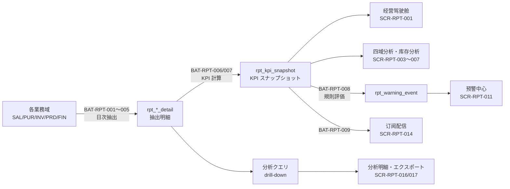

# 报表分析 业务域概要书（报表分析 業務概要書）

| 項目 | 内容 |
|---|---|
| 文書名 | 报表分析 业务域概要书（报表分析 業務概要書） |
| 文書番号 | DSN-RPT-000 |
| 版数 | v1.0 |
| 作成日 | 2026-10-20 |
| 作成者 | analytics-designer（報表分析分野担当） |
| 承認者 | 未承認（レビュー待ち） |
| 状態 | ドラフト（レビュー中） |
| 関連文書 | [体系总览](../README.md) / [共通项目定义](../00-common/01-common-item-definitions.md) / [共通业务规则](../00-common/08-common-business-rules.md) / [跨域流程](../00-common/09-cross-domain-flow.md) / [集成管理概要](../09-integration/00-overview.md) / [真实资料](../90-data/sources.md) / [样例数据](94-sample-data.md) |

> **記述規約**：日本企业「詳細設計書」の文書構成に従い、**正文は中文**で記述する。KPI は `KPI-RPT-xxx`、予警ルールは `WARN-RPT-xxx`、画面は `SCR-RPT-xxx` で識別する。

---

## 1. 業務概要

### 1.1 目的

报表分析域（RPT）是 Stellar ERP 的**经营可视化与预警中枢**。本域不保有业务数据的所有权，也不更新任何业务数据，只做三件事：

1. **统一指标口径**：把销售、采购、库存、生产、财务各域的 KPI 定义、计算公式、维度、数据来源集中到一处（`rpt_kpi_definition`），消除「同一指标多个算法」。
2. **可视化与钻取**：经营驾驶舱、四域分析（销售/采购/生产/财务）、库存分析，支持从汇总到明细的钻取（drill-down），并可导出分析结果。
3. **预警与订阅**：按规则评估 KPI 与业务事实，生成预警事件；按订阅把报表定时配送给指定角色。

**边界原则**：域内操作报表（如销售明细表、库存收发存、凭证账簿）归各业务域（[05-inventory/07-reports.md](../05-inventory/07-reports.md) §2.2 等）。RPT 只做**跨域汇总分析、KPI 趋势、预警、订阅**，且只读。

### 1.2 適用範囲

| 項目 | 内容 |
|---|---|
| 対象会社・拠点 | 华东精密电机股份有限公司（虚拟示例主体）/ CZ01、WX01（[demo-company.md](../90-data/demo-company.md)） |
| 対象機能範囲 | F-RPT-001〜010（驾驶舱、KPI 指标管理、四域分析、库存分析、预警中心、报表订阅、KPI 校验、数据抽取、自助分析、移动端/大屏） |
| 対象外 | ① 業務データの更新（一切行わない）；② 域内操作帳票（各域が保有）；③ 法定帳票（財務諸表・発票等は FIN/SAL が保有）；④ 予算編成（FIN Phase 2）；⑤ 外部 BI ツールの構築（Phase 2 で参照接続のみ） |
| 前提 | ① 各域の `90-db-design` に基づくテーブルが存在；② 日次抽出バッチが稼働；③ SYS の権限・データ範囲が設定済み；④ INT の通知チャネルが利用可能 |

### 1.3 業務上の狙い（KPI）

| KPI | 定義・算式 | 目標値 | 実現する機能 ID |
|---|---|---|---|
| 驾驶舱表示速度 | 初期表示（KPI カード 12 件）の P95 | ≤ 3 秒【示例値】 | F-RPT-001 |
| 日次 KPI 更新完了時刻 | 日次バッチ完了時刻 | 毎日 08:00 まで【示例値】 | F-RPT-008、BAT-RPT-006 |
| KPI 口径一致率 | 抽查 KPI の算式・数値が業務域と一致した件数 ÷ 抽查件数 | 100% | F-RPT-002、F-RPT-007 |
| 分析レポート利用率 | 月間閲覧ユーザ数 ÷ 全社ユーザ数 | ≥ 40%【示例値】 | F-RPT-001、F-RPT-003 |
| 预警响应时间 | 预警発生から担当者既読までの中央値 | ≤ 4 時間【示例値】 | F-RPT-005 |
| 订阅配信成功率 | 配信成功数 ÷ 配信予定数 | ≥ 99%【示例値】 | F-RPT-006 |
| 数据抽取延迟 | 業務日終了から抽出完了までの時間 | ≤ 2 時間【示例値】 | F-RPT-008 |
| 分析数据可用率 | 抽出・KPI が揃っている日数 ÷ 営業日数 | ≥ 99.5%【示例値】 | F-RPT-007、F-RPT-008 |

> 目標値は【示例値】。実運用では顧客企業の経営目標に合わせて設定する。

---

### 1.4 前提・制約

| # | 前提・制約 | 内容 | 成立しない場合 |
|---|---|---|---|
| 1 | 抽出元の存在 | 各業務域のテーブルが設計書どおりに存在する | 抽出ジョブ失敗（`MSG-RPT-030`） |
| 2 | 日次抽出の完了 | 01:00〜02:20 に抽出が完了している | 当日の KPI は前日値のまま（`MSG-RPT-039`） |
| 3 | KPI 定義の承認 | 新規・変更 KPI は財務総監の承認済み | 未承認 KPI は画面に表示しない |
| 4 | 月結との順序 | 在庫月結→原価計算→FIN 月結→RPT 月次確定の順 | 月次 KPI は暫定のまま |
| 5 | 読み取り専用 | RPT は業務テーブルを更新しない（SELECT のみ） | 設計違反（レビューで否認） |
| 6 | 保存期間 | 明細 3 年、KPI 10 年、ログ 1〜3 年 | 容量超過（BAT-RPT-012 で対応） |
| 7 | 権限 | SYS のロール・データ範囲が設定済み | 全件非表示または 403 |
| 8 | 通知基盤 | INT のメール/WeCom が利用可能 | 站内通知のみ |

> 制約のうち 4 は [08 §10](../00-common/08-common-business-rules.md) の月結手順、5 は [09 §12](../00-common/09-cross-domain-flow.md) の RPT の位置づけに基づく。

## 2. 組織とロール

| ロール | 所属 | 主な操作 | 関連機能 ID | 権限コード（代表） |
|---|---|---|---|---|
| 总经理 | 経営層 | 驾驶舱閲覧、KPI コメント、月次分析 | F-RPT-001、003 | `report:dashboard:view`、`report:analysis:view` |
| 财务总监 | 财务部 | 财务分析・KPI 目標設定・予警確認 | F-RPT-002、006、005 | `report:kpi:update`、`report:warning:view` |
| 各部门经理 | 销售/采购/生产/质量/技术 | 自部門分析、予警対応、订阅設定 | F-RPT-003、004、005、006 | `report:analysis:view`（部門範囲） |
| 销售员 | 销售部 | 销售分析（担当顧客）、客户排名 | F-RPT-003 | `report:sales:view` |
| 采购员 | 采购部 | 采购分析、供应商交付 | F-RPT-003 | `report:purchase:view` |
| 计划员 | 生产部 | 生产分析、库存分析、缺货预警 | F-RPT-004、005 | `report:production:view`、`report:inventory:view` |
| 会计 | 财务部 | 财务分析、KPI 校验 | F-RPT-003、007 | `report:finance:view` |
| 内审员 | 综合管理部 | KPI 定义・算式・データ出所の監査 | F-RPT-002、007 | `report:kpi:view`、`report:audit:view` |
| 系统管理员 | 信息部 | 抽取ジョブ、KPI 定義の技術設定、権限 | F-RPT-002、008 | `report:etl:*`、`report:kpi:update` |

### 2.1 データ範囲と閲覧権限

| データ範囲 | 対象 | 制御 |
|---|---|---|
| 全社 | 経営層、財務総監、システム管理者 | 全部門・全顧客 |
| 部門 | 部門経理 | 自部門の売上・購買・生産 |
| 本人 | 営業担当 | 担当顧客の売上・粗利 |
| 指定 | プロジェクト・重点顧客 | カスタム（`sys_role_data_scope`） |

---

## 3. 業務フロー

### 3.1 分析データの流れ

### 3.2 処理手順（日次運用）

| # | 手順 | 実施者 | システム処理 | 出力 |
|---|---|---|---|---|
| 1 | 抽出 | バッチ | 前日分の売上・購買・在庫・生産・財務明細を抽出（全削除→再作成） | `rpt_*_detail` |
| 2 | KPI 計算 | バッチ | 定義に従い KPI を計算し、前期比・目標比を付与 | `rpt_kpi_snapshot` |
| 3 | 整合性検査 | バッチ | 業務域の集計値と KPI を突合、差異を記録 | `rpt_data_quality_check` |
| 4 | 预警評価 | バッチ | ルールに従い警告を生成、重複を排除 | `rpt_warning_event` |
| 5 | 配信 | バッチ | 订阅（日次/週次/月次）を配信 | `rpt_subscription_log` |
| 6 | 閲覧 | 経営・管理職 | 驾驶舱・分析・ドリルダウン | 画面 |
| 7 | コメント | 経営 | KPI の原因・対策を記録 | `rpt_kpi_comment` |
| 8 | 月次締め | 財務 | 月次 KPI 確定、月報出力 | `rpt_kpi_snapshot`（確定） |

### 3.3 他域との責任分界

| 相手域 | RPT が行うこと | RPT が行わないこと |
|---|---|---|
| SAL | 売上・粗利・顧客分析の抽出と集計 | 受注・出荷・請求の更新、域内帳票の出力 |
| PUR | 購買・納期・供應商分析の抽出と集計 | 発注・入荷の更新、三単マッチ |
| INV | 在庫金額・回転・庫齢の分析（`inv_stock_summary`/`inv_age_snapshot` 参照） | 在庫取引・原価の更新、棚卸 |
| PRD | 生産・品質・納期の分析 | 工单・報工の更新 |
| FIN | 財務比率・損益・キャッシュの分析 | 仕訳・月結・財務諸表の確定 |
| INT | 予警通知の配信依頼 | 外部 IF の実行 |
| SYS | 権限・データ範囲・監査ログの参照 | 権限の変更 |

> **重複禁止**：各域の域内帳票と同一の集計値を RPT で二重定義しない。RPT の KPI は「算式・出所・更新頻度」を `rpt_kpi_definition` に一元化し、業務域は同算式を参照する（[05-inventory/07-reports.md](../05-inventory/07-reports.md) §2.5）。

---

## 4. 機能一覧

| 機能 ID | 機能名 | 概要 | 画面 ID | 種別 | 優先度 | 状態 | 詳細設計書 |
|---|---|---|---|---|---|---|---|
| F-RPT-001 | 经营驾驶舱 | 経営 KPI カード、トレンド、構成比、ドリルダウン | SCR-RPT-001、002、016 | ダッシュボード | P0 | 設計済 | [01-dashboard.md](01-dashboard.md) |
| F-RPT-002 | KPI 指标管理 | KPI 定義・算式・次元・目標・出所・権限の管理、版数 | SCR-RPT-008〜010 | マスタ | P0 | 設計済 | [01-dashboard.md](01-dashboard.md) |
| F-RPT-003 | 经营分析报表 | 销售・采购・生产・財務の四域分析（比較・構成・ランキング） | SCR-RPT-003〜006 | 分析 | P0 | 設計済 | [02-domain-analysis.md](02-domain-analysis.md) |
| F-RPT-004 | 库存分析 | 在庫金額・回転・庫齢・呆滞・欠品の分析 | SCR-RPT-007 | 分析 | P0 | 設計済 | [02-domain-analysis.md](02-domain-analysis.md) |
| F-RPT-005 | 预警中心 | 規則・閾値・イベント・既読・担当・エスカレーション | SCR-RPT-011〜013 | 監視 | P1 | 設計済 | [03-warning-subscription.md](03-warning-subscription.md) |
| F-RPT-006 | 报表订阅 | 日次/週次/月次の配信、宛先、形式、停止 | SCR-RPT-014、015 | 設定 | P1 | 設計済 | [03-warning-subscription.md](03-warning-subscription.md) |
| F-RPT-007 | KPI 校验与数据质量 | 業務域との突合、欠損・遅延・異常値の検出 | SCR-RPT-019 | 監視 | P1 | 設計済 | [01-dashboard.md](01-dashboard.md) |
| F-RPT-008 | 分析数据抽取管理 | 抽出ジョブの実行・再実行・監視、抽出範囲設定 | SCR-RPT-018 | バッチ管理 | P0 | 設計済 | [02-domain-analysis.md](02-domain-analysis.md) |
| F-RPT-009 | 自助分析与导出 | 条件指定の集計・ピボット・Excel 出力（P2） | SCR-RPT-016、017 | 分析 | P2 | 設計済（概要） | [02-domain-analysis.md](02-domain-analysis.md) |
| F-RPT-010 | 移动端/大屏展示 | スマホ閲覧・工場大屏（P2） | SCR-RPT-020 | 表示 | P2 | 設計済（概要） | [01-dashboard.md](01-dashboard.md) |

---

## 5. 画面一覧

| 画面 ID | 画面名 | 類型 | 機能 ID | 権限コード | 遷移元 | 遷移先 |
|---|---|---|---|---|---|---|
| SCR-RPT-001 | 经营驾驶舱 | DASH | F-RPT-001 | `report:dashboard:view` | メニュー > 报表分析 | SCR-RPT-003〜007、016 |
| SCR-RPT-002 | 驾驶舱布局设置 | EDIT | F-RPT-001 | `report:dashboard:update` | SCR-RPT-001 | SCR-RPT-001 |
| SCR-RPT-003 | 销售分析 | DASH | F-RPT-003 | `report:sales:view` | SCR-RPT-001 | SCR-RPT-016 |
| SCR-RPT-004 | 采购分析 | DASH | F-RPT-003 | `report:purchase:view` | SCR-RPT-001 | SCR-RPT-016 |
| SCR-RPT-005 | 生产分析 | DASH | F-RPT-003 | `report:production:view` | SCR-RPT-001 | SCR-RPT-016 |
| SCR-RPT-006 | 财务分析 | DASH | F-RPT-003 | `report:finance:view` | SCR-RPT-001 | SCR-RPT-016 |
| SCR-RPT-007 | 库存分析 | DASH | F-RPT-004 | `report:inventory:view` | SCR-RPT-001 | SCR-RPT-016 |
| SCR-RPT-008 | KPI 一覧 | LIST | F-RPT-002 | `report:kpi:view` | メニュー > KPI 指标 | SCR-RPT-009/010 |
| SCR-RPT-009 | KPI 定义编辑 | EDIT | F-RPT-002 | `report:kpi:update` | SCR-RPT-008 | SCR-RPT-008 |
| SCR-RPT-010 | KPI 详情/趋势 | VIEW | F-RPT-002 | `report:kpi:view` | SCR-RPT-008/001 | SCR-RPT-016 |
| SCR-RPT-011 | 预警中心 | LIST | F-RPT-005 | `report:warning:view` | ヘッダ通知/メニュー | SCR-RPT-012/013 |
| SCR-RPT-012 | 预警规则编辑 | EDIT | F-RPT-005 | `report:warning:update` | SCR-RPT-011 | SCR-RPT-011 |
| SCR-RPT-013 | 预警历史 | LIST | F-RPT-005 | `report:warning:view` | SCR-RPT-011 | SCR-RPT-016 |
| SCR-RPT-014 | 报表订阅一覧 | LIST | F-RPT-006 | `report:subscription:view` | メニュー > 报表订阅 | SCR-RPT-015 |
| SCR-RPT-015 | 订阅設定 | EDIT | F-RPT-006 | `report:subscription:update` | SCR-RPT-014/001 | SCR-RPT-014 |
| SCR-RPT-016 | 分析明细/钻取 | LIST | F-RPT-003/004/009 | `report:analysis:view` | 各分析画面 | SCR-RPT-017 |
| SCR-RPT-017 | 分析导出/非同期ジョブ | VIEW | F-RPT-009 | `report:analysis:export` | SCR-RPT-016 | ジョブ一覧 |
| SCR-RPT-018 | 分析数据抽取监视 | LIST | F-RPT-008 | `report:etl:view` | メニュー > 抽取监视 | ジョブ詳細 |
| SCR-RPT-019 | 数据质量检查 | LIST | F-RPT-007 | `report:quality:view` | メニュー > 数据质量 | SCR-RPT-010 |
| SCR-RPT-020 | 移动端/大屏（P2） | DASH | F-RPT-010 | `report:dashboard:view` | 大屏 URL | — |

---

## 6. 帳票一覧

| 帳票 ID | 帳票名 | 出力タイミング | 帳票種別 | 機能 ID | 詳細 |
|---|---|---|---|---|---|
| PRT-RPT-001 | 经营驾驶舱月报 | 月次 | 集計表 | F-RPT-001 | [92](92-report-batch-design.md) |
| PRT-RPT-002 | 经营分析月报 | 月次 | 集計表 | F-RPT-003 | [92](92-report-batch-design.md) |
| PRT-RPT-003 | 销售分析表 | 月次/手動 | 集計表 | F-RPT-003 | [92](92-report-batch-design.md) |
| PRT-RPT-004 | 采购分析表 | 月次/手動 | 集計表 | F-RPT-003 | [92](92-report-batch-design.md) |
| PRT-RPT-005 | 库存分析表 | 月次/手動 | 集計表 | F-RPT-004 | [92](92-report-batch-design.md) |
| PRT-RPT-006 | 生产分析表 | 月次/手動 | 集計表 | F-RPT-003 | [92](92-report-batch-design.md) |
| PRT-RPT-007 | 财务分析表 | 月次/手動 | 集計表 | F-RPT-003 | [92](92-report-batch-design.md) |
| PRT-RPT-008 | KPI 指标字典 | 手動（改訂時） | 一覧表 | F-RPT-002 | [92](92-report-batch-design.md) |
| PRT-RPT-009 | 预警日报 | 日次 | 一覧表 | F-RPT-005 | [92](92-report-batch-design.md) |
| PRT-RPT-010 | KPI 月次快照台账 | 月次 | 帳簿 | F-RPT-002/007 | [92](92-report-batch-design.md) |

## 7. バッチ一覧

| バッチ ID | バッチ名 | 起動方式 | 実行時間帯 | 処理概要 | 冪等性 |
|---|---|---|---|---|---|
| BAT-RPT-001 | 销售明细抽出 | 日次 | 毎日 01:00 | SAL の受注・出荷・請求・粗利を前日分抽出 | 再実行可（日付全削除→再作成） |
| BAT-RPT-002 | 采购明细抽出 | 日次 | 毎日 01:20 | PUR の発注・入荷・請求・供應商評価 | 同上 |
| BAT-RPT-003 | 库存快照抽出 | 日次 | 毎日 01:40 | INV の残高・收发存・庫齢 | 同上 |
| BAT-RPT-004 | 生产明细抽出 | 日次 | 毎日 02:00 | PRD の工单・報工・検査・完工 | 同上 |
| BAT-RPT-005 | 财务明细抽出 | 日次 | 毎日 02:20 | FIN の科目残高・損益・AR/AP | 同上 |
| BAT-RPT-006 | 日次 KPI 計算 | 日次 | 毎日 06:00 | KPI 定義に従い前日分を計算・前期比付与 | 再実行可（日付×KPI） |
| BAT-RPT-007 | 月次 KPI 確定 | 月次 | 月初 06:30 | 前月 KPI を確定し、月報を生成 | 条件付き（確定後は再計算不可） |
| BAT-RPT-008 | 预警規則評価 | 日次/時次 | 毎時 00 分 | ルール評価、イベント生成、重複排除 | 再実行可（ルール×対象×日） |
| BAT-RPT-009 | 报表订阅配信 | 日次/週次/月次 | 07:30 | 订阅に従い PDF/Excel を配信 | 条件付き（配信ログ） |
| BAT-RPT-010 | KPI 整合性校验 | 日次 | 毎日 06:40 | 業務域集計と KPI の突合、差異記録 | 再実行可（日付単位） |
| BAT-RPT-011 | 分析数据再計算 | 手動 | — | 指定期間の抽出・KPI を再計算 | 再実行可（期間指定） |
| BAT-RPT-012 | 抽出・スナップショット清理 | 月次 | 月初 03:00 | 保存期間超過分の削除/アーカイブ | 再実行可 |

## 8. テーブル一覧

| 物理名 | 論理名 | 種別 | 主な用途 | 更新元 | 容量見積 |
|---|---|---|---|---|---|
| `rpt_kpi_definition` | KPI 定义 | マスタ | 算式・次元・出所・頻度・権限 | F-RPT-002 | 200 |
| `rpt_kpi_target` | KPI 目标 | マスタ | 期間・組織別の目標値 | F-RPT-002 | 5,000/年 |
| `rpt_kpi_snapshot` | KPI 快照 | 集計 | KPI×期間×次元の値 | BAT-RPT-006/007 | 800 万/年 |
| `rpt_kpi_lineage` | KPI 血缘 | 設定 | 出所テーブル・項目・算式の根拠 | F-RPT-002 | 2,000 |
| `rpt_kpi_comment` | KPI 评论 | ログ | 経営コメント・原因・対策 | F-RPT-001 | 5 万/年 |
| `rpt_dashboard` | 驾驶舱 | 設定 | レイアウト・対象ロール | F-RPT-001 | 50 |
| `rpt_dashboard_widget` | 驾驶舱组件 | 設定 | KPI・グラフ・配置 | F-RPT-001 | 500 |
| `rpt_analysis_favorite` | 分析お気に入り | 設定 | 保存条件・共有 | F-RPT-009 | 5,000 |
| `rpt_sales_detail` | 销售分析明细 | 抽出 | 受注・出荷・請求・原価 | BAT-RPT-001 | 1,200 万/年 |
| `rpt_purchase_detail` | 采购分析明细 | 抽出 | 発注・入荷・請求・評価 | BAT-RPT-002 | 600 万/年 |
| `rpt_inventory_snapshot` | 库存分析快照 | 抽出 | 残高・收发存・庫齢 | BAT-RPT-003 | 2,000 万/年 |
| `rpt_production_detail` | 生产分析明细 | 抽出 | 工单・報工・検査 | BAT-RPT-004 | 900 万/年 |
| `rpt_finance_detail` | 财务分析明细 | 抽出 | 科目残高・損益・AR/AP | BAT-RPT-005 | 500 万/年 |
| `rpt_warning_rule` | 预警规则 | 設定 | 指標・閾値・対象・通知 | F-RPT-005 | 200 |
| `rpt_warning_event` | 预警事件 | ログ | 発生・既読・対応 | BAT-RPT-008 | 50 万/年 |
| `rpt_warning_subscription` | 预警订阅 | 設定 | 受信者・チャネル | F-RPT-005 | 2,000 |
| `rpt_subscription` | 报表订阅 | 設定 | 帳票・頻度・宛先・形式 | F-RPT-006 | 500 |
| `rpt_subscription_log` | 订阅配信履歴 | ログ | 成功/失敗・再送 | BAT-RPT-009 | 10 万/年 |
| `rpt_etl_job` | 抽取ジョブ | ログ | 実行・件数・状態 | BAT-RPT-001〜005 | 2,000/年 |
| `rpt_etl_error` | 抽取エラー | ログ | 行エラー・理由 | BAT-RPT-001〜005 | 50 万/年 |
| `rpt_data_quality_check` | 数据质量检查 | ログ | 突合結果・差異 | BAT-RPT-010 | 20 万/年 |
| `rpt_query_log` | 分析查询日志 | ログ | 閲覧・出力の監査 | F-RPT-001〜009 | 100 万/年 |

> 物理設計は [90-db-design.md](90-db-design.md) を正とする。RPT は業務域のテーブルを**参照のみ**（SELECT）し、更新しない。

## 9. 外部 IF 一覧

| IF ID | 名称 | 相手先 | 方向 | 方式 | 頻度 | 契機 |
|---|---|---|---|---|---|---|
| IF-RPT-001 | 業務域データ抽出 | SAL/PUR/INV/PRD/FIN（内部） | 受信 | DB 参照（SELECT）/内部 API | 日次 | 抽出バッチ |
| IF-RPT-002 | レポート配信 | INT（メール/WeCom） | 送信 | SMTP/REST | 日次/週次/月次 | 订阅配信 |
| IF-RPT-003 | 外部 BI ツール接続（P2） | BI ツール（Tableau/Power BI 等） | 送信 | JDBC/ODBC（読取専用ビュー） | 随時 | 分析 |
| IF-RPT-004 | 大屏表示（P2） | 工場大屏端末 | 送信 | REST/WebSocket | 常時 | 表示更新 |
| IF-RPT-005 | 監査ログ参照 | SYS | 受信 | 内部 API | 随時 | 分析閲覧監査 |

> 域間のデータ参照は IF ID ではなく「参照（読取）」として扱う（[09 §12](../00-common/09-cross-domain-flow.md)）。IF-RPT-001 は実装上の抽出経路を示す便宜的な ID であり、外部システムとの契約ではない。

## 10. 権限一覧

| 権限コード | 対象機能 | データ範囲 | 付与ロール |
|---|---|---|---|
| `report:dashboard:view` | F-RPT-001 | 全社/部門 | 経営層、部門経理 |
| `report:dashboard:update` | F-RPT-001 | 全社 | システム管理者、経営企画 |
| `report:kpi:view` | F-RPT-002/007 | 全社 | 全管理職、内審員 |
| `report:kpi:update` | F-RPT-002 | 全社 | 財務総監、システム管理者 |
| `report:analysis:view` | F-RPT-003/004 | 全社/部門/本人 | 全ロール（範囲内） |
| `report:sales:view` | F-RPT-003 | 部門/担当顧客 | 営業、部門経理 |
| `report:purchase:view` | F-RPT-003 | 全社/部門 | 購買、部門経理 |
| `report:production:view` | F-RPT-003/004 | 工場/部門 | 生産、計画 |
| `report:finance:view` | F-RPT-003 | 全社 | 財務、経営層 |
| `report:inventory:view` | F-RPT-004 | 倉庫/全社 | 在庫、計画、購買 |
| `report:warning:view` | F-RPT-005 | 全社/部門 | 全管理職 |
| `report:warning:update` | F-RPT-005 | 全社 | システム管理者、部門経理 |
| `report:subscription:view/update` | F-RPT-006 | 本人/全社 | 全ロール（本人）、管理者（全社） |
| `report:analysis:export` | F-RPT-009 | 範囲内 | 全ロール（範囲内） |
| `report:etl:view/run` | F-RPT-008 | 全社 | システム管理者、運用 |
| `report:quality:view` | F-RPT-007 | 全社 | 内審員、財務総監 |
| `report:audit:view` | F-RPT-007 | 全社 | 内審員 |

## 11. 本域用語

| 用語 | 説明 | 対応英語/日文 |
|---|---|---|
| KPI | 経営・業務の測定指標。算式・次元・出所を定義 | Key Performance Indicator |
| 指标口径 | KPI の算式・対象範囲・丸め・更新頻度の定義 | Metric Definition |
| 血缘（Lineage） | KPI の出所テーブル・項目・算式の追跡情報 | Data Lineage |
| 钻取（Drill-down） | 集計値から明細へ掘り下げる操作 | Drill-down |
| 快照（Snapshot） | ある時点の KPI・在庫・財務の確定値 | Snapshot |
| 抽出（ETL） | 業務域から分析用テーブルへ複製する処理 | Extract |
| 预警（Alert） | 閾値・異常を検知して通知する仕組み | Alert / アラート |
| 订阅（Subscription） | レポートを定期的に配信する設定 | Subscription |
| 驾驶舱（Dashboard） | KPI を一画面に集約した表示 | Dashboard / ダッシュボード |
| 同比/环比 | 前年同期比 / 前期比 | YoY / MoM |

## 12. 未決事項

| # | 事項 | 理由 | 暫定仕様 | 担当 | 期限 |
|---|---|---|---|---|---|
| 1 | **库存周转率の口径統一**（**已裁决** 2026-10-20） | [05-inventory/07-reports.md](../05-inventory/07-reports.md) CALC-06 は「期間出庫成本 ÷ 平均在庫金額」（运营口径）、本域 KPI は「**销售成本 ÷ 平均库存金额**」（经营口径） | **两者并用**：RPT 采用销售成本口径（企业级 KPI，KPI-RPT-024）；INV 采用全出库成本口径（明细/运营指标）。画面分别标注口径，禁止互相替代或混用 | Lead | 完了（2026-10-20） |
| 2 | 05-inventory の 90-db-design（**已解消** 2026-10-20） | 執筆時点では未公開だった（現在は刊行済み・22 テーブル） | 本域の参照は実テーブル（inv_stock_balance/inv_stock_txn/inv_stock_txn_line/inv_stock_summary/inv_period）に突合済み | analytics | 完了（2026-10-20） |
| 3 | KPI 目標値の確定 | 経営目標が未確定 | 【示例値】を設定。`rpt_kpi_target` で変更可能 | 経営層／財務 | 2026-11-30 |
| 4 | 粗利の原価口径（移動平均か標準原価か） | FIN の原価確定が月次 | 月次確定前は暫定原価、確定後に再計算（BAT-RPT-011） | 財務／analytics | 2026-12-15 |
| 5 | 分析用データの保存期間 | 容量と監査要件のバランス | 明細 3 年、KPI スナップショット 10 年、月次確定値は無期限 | 情報部 | 2026-12-15 |
| 6 | 外部 BI ツールの要否 | Phase 2 | 読取専用ビューを提供（IF-RPT-003）。Phase 1 は内蔵機能のみ | Lead | Phase 2 |
| 7 | 予警のエスカレーション先 | 運用規程が未確定 | 部門経理→部門長→担当役員（24h/48h） | 経営層 | 2026-12-15 |
| 8 | 多通貨・輸出の分析 | Phase 2 | 首期は CNY のみ。外貨は換算後 CNY で分析 | 財務 | Phase 2 |

## 13. 改訂履歴

| 版数 | 日付 | 変更内容 | 変更者 |
|---|---|---|---|
| v1.0 | 2026-10-20 | 初版：業務概要、ロール、データフロー、機能 10、画面 20、帳票 10、バッチ 12、テーブル 22、IF 5、権限、未決 8 | analytics-designer |
