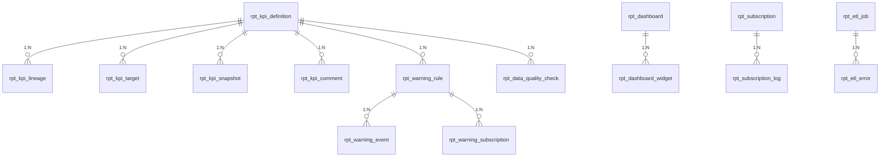

# 报表分析 DB 设计书（报表分析 DB 設計書）

| 項目 | 内容 |
|---|---|
| 文書名 | 报表分析 DB 设计书（报表分析 DB 設計書） |
| 文書番号 | DSN-RPT-090 |
| 版数 | v1.0 |
| 作成日 | 2026-10-20 |
| 作成者 | analytics-designer（報表分析分野担当） |
| 承認者 | 未承認（レビュー待ち） |
| 状態 | ドラフト（レビュー中） |
| 関連文書 | [業務域概要](00-overview.md) / [KPI 設計](01-dashboard.md) / [域分析](02-domain-analysis.md) / [DB 共通规格](../00-common/04-common-db-spec.md) / [共通项目定义](../00-common/01-common-item-definitions.md) |

---

## 1. 設計方針

### 1.1 データモデル概要

RPT 域は 4 層で構成する。

1. **定義層**：`rpt_kpi_definition`（KPI 定義）、`rpt_kpi_lineage`（血缘）、`rpt_kpi_target`（目标）、`rpt_dashboard` / `rpt_dashboard_widget`（表示定義）、`rpt_warning_rule`（予警規則）、`rpt_subscription`（订阅）。
2. **抽出層**：`rpt_sales_detail`、`rpt_purchase_detail`、`rpt_inventory_snapshot`、`rpt_production_detail`、`rpt_finance_detail`（日次/月次で全削除→再作成）。
3. **計算層**：`rpt_kpi_snapshot`（KPI 値・分子分母・目標比・確定状態）、`rpt_data_quality_check`（業務域との突合）。
4. **運用層**：`rpt_warning_event`、`rpt_warning_subscription`、`rpt_subscription_log`、`rpt_etl_job` / `rpt_etl_error`、`rpt_query_log`、`rpt_kpi_comment`、`rpt_analysis_favorite`。

**更新責任**：RPT は**自域テーブルのみ**を更新する。業務域テーブルは `SELECT` のみ（[09 §12](../00-common/09-cross-domain-flow.md)）。抽出テーブルはバッチが削除・再作成し、画面から更新しない。

### 1.2 設計原則

| # | 原則 |
|---|---|
| 1 | 抽出テーブルは `id BIGINT`（雪花 ID）+ `tenant_id`/`company_id` + `created_at` のみ。更新系カラム（`version`/`updated_*`）は持たない（再作成のため） |
| 2 | KPI スナップショットは `(kpi_code, period_type, period_code, dimension_key)` の一意制約。`dimension_key` は次元 JSON の正規化ハッシュ（SHA-256 先頭 32 桁） |
| 3 | 金額 `NUMERIC(18,2)`、数量 `NUMERIC(18,4)`、単価 `NUMERIC(18,6)`、率 `NUMERIC(9,4)`（[01 第 6 章](../00-common/01-common-item-definitions.md)） |
| 4 | KPI 値は `NUMERIC(18,4)`。比率は % 表現（24.3500）で保存し、分子・分母も保持する |
| 5 | 抽出テーブルは日付/期間 + 次元に索引。Phase 2 で月次パーティション |
| 6 | 個人情報は保持しない（担当者は `owner_user_id` のみ、氏名は SYS 参照） |
| 7 | 抽出・KPI・予警は「再実行しても同じ結果」になるよう、日付単位の削除→再作成または UPSERT とする |
| 8 | 保存期間：明細 3 年、KPI スナップショット 10 年、予警 3 年、クエリログ 1 年 |

### 1.3 ER 図



---

## 2. テーブル一覧

| # | 物理名 | 論理名 | 種別 | 主な用途 | 更新元 | 容量見積 |
|---|---|---|---|---|---|---|
| 1 | `rpt_kpi_definition` | KPI 定义 | マスタ | 算式・次元・頻度・権限 | F-RPT-002 | 200 |
| 2 | `rpt_kpi_target` | KPI 目标 | マスタ | 期間・組織別目標 | F-RPT-002 | 5,000/年 |
| 3 | `rpt_kpi_snapshot` | KPI 快照 | 集計 | KPI 値・分子分母・状態 | BAT-RPT-006/007 | 800 万/年 |
| 4 | `rpt_kpi_lineage` | KPI 血缘 | 設定 | 出所テーブル・項目 | F-RPT-002 | 2,000 |
| 5 | `rpt_kpi_comment` | KPI 评论 | ログ | 原因・対策 | F-RPT-001 | 5 万/年 |
| 6 | `rpt_dashboard` | 驾驶舱 | 設定 | レイアウト・ロール | F-RPT-001 | 50 |
| 7 | `rpt_dashboard_widget` | 驾驶舱组件 | 設定 | KPI・グラフ配置 | F-RPT-001 | 500 |
| 8 | `rpt_analysis_favorite` | 分析お気に入り | 設定 | 保存条件・共有 | F-RPT-009 | 5,000 |
| 9 | `rpt_sales_detail` | 销售分析明细 | 抽出 | 受注・出荷・原価 | BAT-RPT-001 | 1,200 万/年 |
| 10 | `rpt_purchase_detail` | 采购分析明细 | 抽出 | 入荷・請求・評価 | BAT-RPT-002 | 600 万/年 |
| 11 | `rpt_inventory_snapshot` | 库存分析快照 | 抽出 | 残高・庫齢・安全在庫 | BAT-RPT-003 | 2,000 万/年 |
| 12 | `rpt_production_detail` | 生产分析明细 | 抽出 | 工单・報工・検査 | BAT-RPT-004 | 900 万/年 |
| 13 | `rpt_finance_detail` | 财务分析明细 | 抽出 | 仕訳・残高 | BAT-RPT-005 | 500 万/年 |
| 14 | `rpt_warning_rule` | 预警规则 | 設定 | 指標・閾値・通知 | F-RPT-005 | 200 |
| 15 | `rpt_warning_event` | 预警事件 | ログ | 発生・既読・対応 | BAT-RPT-008 | 50 万/年 |
| 16 | `rpt_warning_subscription` | 预警订阅 | 設定 | 受信者・チャネル | F-RPT-005 | 2,000 |
| 17 | `rpt_subscription` | 报表订阅 | 設定 | 帳票・頻度・宛先 | F-RPT-006 | 500 |
| 18 | `rpt_subscription_log` | 订阅配信履歴 | ログ | 成功/失敗・再送 | BAT-RPT-009 | 10 万/年 |
| 19 | `rpt_etl_job` | 抽取ジョブ | ログ | 実行・件数・状態 | BAT-RPT-001〜005 | 2,000/年 |
| 20 | `rpt_etl_error` | 抽取エラー | ログ | 行エラー | 同上 | 50 万/年 |
| 21 | `rpt_data_quality_check` | 数据质量检查 | ログ | 突合・差異 | BAT-RPT-010 | 20 万/年 |
| 22 | `rpt_query_log` | 分析查询日志 | ログ | 閲覧・出力の監査 | 全画面 | 100 万/年 |

---

## 3. テーブル定義

### 3.1 `rpt_kpi_definition`（KPI 定義）

```sql
CREATE TABLE rpt_kpi_definition (
    id              BIGINT       NOT NULL,
    tenant_id       BIGINT       NOT NULL DEFAULT current_setting('app.tenant_id')::bigint,
    company_id      BIGINT       NOT NULL DEFAULT 1,
    kpi_code        VARCHAR(32)  NOT NULL,              -- KPI-RPT-001
    kpi_name        VARCHAR(200) NOT NULL,
    category        VARCHAR(32)  NOT NULL,              -- FINANCE/SALES/INVENTORY/PURCHASE/PRODUCTION
    formula         TEXT         NOT NULL,              -- 算式（表示用・監査用）
    formula_sql     TEXT,                               -- 計算用 SQL 断片（許可関数のみ）
    unit            VARCHAR(16)  NOT NULL,              -- CNY/%/日/次/PCE
    dimensions_json JSONB        NOT NULL,              -- ["period","customer","product_series"]
    frequency       CHAR(1)      NOT NULL DEFAULT 'M',  -- D/M/Q/Y
    direction       SMALLINT     NOT NULL DEFAULT 10,   -- 10:高いほど良い 20:低いほど良い
    source_domain   VARCHAR(16),                        -- SAL/PUR/INV/PRD/FIN
    permission_code VARCHAR(64)  NOT NULL,
    description     VARCHAR(1000),
    version_no      INT          NOT NULL DEFAULT 1,
    status          SMALLINT     NOT NULL DEFAULT 10,   -- 10:草稿 20:承認済 90:廃止
    effective_from  DATE         NOT NULL,
    effective_to    DATE,
    approved_by     BIGINT,
    approved_at     TIMESTAMPTZ,
    version         INT          NOT NULL DEFAULT 0,
    created_at      TIMESTAMPTZ  NOT NULL DEFAULT now(),
    created_by      BIGINT       NOT NULL DEFAULT 0,
    updated_at      TIMESTAMPTZ  NOT NULL DEFAULT now(),
    updated_by      BIGINT       NOT NULL DEFAULT 0,
    CONSTRAINT pk_rpt_kpi_definition PRIMARY KEY (id),
    CONSTRAINT uk_rpt_kpi_definition UNIQUE (tenant_id, company_id, kpi_code, version_no),
    CONSTRAINT ck_rpt_kpi_definition_cat CHECK (category IN ('FINANCE','SALES','INVENTORY','PURCHASE','PRODUCTION')),
    CONSTRAINT ck_rpt_kpi_definition_freq CHECK (frequency IN ('D','M','Q','Y')),
    CONSTRAINT ck_rpt_kpi_definition_dir CHECK (direction IN (10,20)),
    CONSTRAINT ck_rpt_kpi_definition_status CHECK (status IN (10,20,90))
);
CREATE UNIQUE INDEX uk_rpt_kpi_definition_current ON rpt_kpi_definition (tenant_id, company_id, kpi_code) WHERE status <> 90;
```

**主要項目定義**

| 物理名 | 論理名 | 型 | NULL | 備考 |
|---|---|---|---|---|
| `kpi_code` | KPI コード | VARCHAR(32) | NOT NULL | `KPI-RPT-xxx` |
| `formula` | 算式 | TEXT | NOT NULL | 例「销售成本 ÷ 平均库存金额」 |
| `formula_sql` | 計算 SQL | TEXT | NULL | 許可関数のみ。監査対象 |
| `dimensions_json` | 次元 | JSONB | NOT NULL | [KPI 設計 §2.2](01-dashboard.md) |
| `frequency` | 頻度 | CHAR(1) | NOT NULL | D/M/Q/Y |
| `direction` | 方向 | SMALLINT | NOT NULL | 10 高いほど良い / 20 低いほど良い |
| `status` | 状態 | SMALLINT | NOT NULL | 10 草稿 / 20 承認済 / 90 廃止 |

### 3.2 `rpt_kpi_target`（KPI 目標）

```sql
CREATE TABLE rpt_kpi_target (
    id              BIGINT       NOT NULL,
    tenant_id       BIGINT       NOT NULL DEFAULT current_setting('app.tenant_id')::bigint,
    company_id      BIGINT       NOT NULL DEFAULT 1,
    kpi_code        VARCHAR(32)  NOT NULL,
    period_code     VARCHAR(7)   NOT NULL,              -- 2026-10 / 2026
    dimension_key   VARCHAR(64)  NOT NULL DEFAULT 'ALL',
    dimension_json  JSONB,
    target_type     SMALLINT     NOT NULL DEFAULT 10,   -- 10:目標 20:予算 30:チャレンジ
    target_value    NUMERIC(18,4) NOT NULL,
    version_no      INT          NOT NULL DEFAULT 1,
    approved_by     BIGINT,
    approved_at     TIMESTAMPTZ,
    created_at      TIMESTAMPTZ  NOT NULL DEFAULT now(),
    created_by      BIGINT       NOT NULL DEFAULT 0,
    updated_at      TIMESTAMPTZ  NOT NULL DEFAULT now(),
    updated_by      BIGINT       NOT NULL DEFAULT 0,
    CONSTRAINT pk_rpt_kpi_target PRIMARY KEY (id),
    CONSTRAINT uk_rpt_kpi_target UNIQUE (tenant_id, company_id, kpi_code, period_code, dimension_key, target_type)
);
-- kpi_code は rpt_kpi_definition を論理参照する（定義は版数を持つため FK を張らない）
```

### 3.3 `rpt_kpi_snapshot`（KPI 快照）

```sql
CREATE TABLE rpt_kpi_snapshot (
    id                  BIGINT       NOT NULL,
    tenant_id           BIGINT       NOT NULL DEFAULT current_setting('app.tenant_id')::bigint,
    company_id          BIGINT       NOT NULL DEFAULT 1,
    kpi_code            VARCHAR(32)  NOT NULL,
    period_type         CHAR(1)      NOT NULL,          -- D/M/Q/Y
    period_code         VARCHAR(10)  NOT NULL,          -- 2026-10-20 / 2026-10 / 2026
    dimension_key       VARCHAR(64)  NOT NULL DEFAULT 'ALL',
    dimension_json      JSONB,
    value               NUMERIC(18,4),
    numerator_value     NUMERIC(18,4),
    denominator_value   NUMERIC(18,4),
    target_value        NUMERIC(18,4),
    achievement_rate    NUMERIC(9,4),                   -- %
    snapshot_status     SMALLINT     NOT NULL DEFAULT 10, -- 10:暫定 40:確定 90:無効
    calc_at             TIMESTAMPTZ  NOT NULL DEFAULT now(),
    calc_version        INT          NOT NULL DEFAULT 1,
    created_at          TIMESTAMPTZ  NOT NULL DEFAULT now(),
    created_by          BIGINT       NOT NULL DEFAULT 0,
    CONSTRAINT pk_rpt_kpi_snapshot PRIMARY KEY (id),
    CONSTRAINT uk_rpt_kpi_snapshot UNIQUE (tenant_id, company_id, kpi_code, period_type, period_code, dimension_key),
    CONSTRAINT ck_rpt_kpi_snapshot_status CHECK (snapshot_status IN (10,40,90))
);
CREATE INDEX idx_rpt_kpi_snapshot_period ON rpt_kpi_snapshot (tenant_id, company_id, period_type, period_code, kpi_code);
CREATE INDEX idx_rpt_kpi_snapshot_kpi ON rpt_kpi_snapshot (tenant_id, company_id, kpi_code, period_type, period_code DESC);
```

> 比率 KPI は `numerator_value`・`denominator_value` を必ず保持する（監査・再計算用）。分母 0 は `value=NULL`。

### 3.4 `rpt_kpi_lineage`（KPI 血縁）

```sql
CREATE TABLE rpt_kpi_lineage (
    id              BIGINT       NOT NULL,
    tenant_id       BIGINT       NOT NULL DEFAULT current_setting('app.tenant_id')::bigint,
    company_id      BIGINT       NOT NULL DEFAULT 1,
    kpi_code        VARCHAR(32)  NOT NULL,
    seq_no          INT          NOT NULL,
    source_domain   VARCHAR(16)  NOT NULL,              -- SAL/PUR/INV/PRD/FIN
    source_table    VARCHAR(64)  NOT NULL,
    source_column   VARCHAR(64),
    join_path       VARCHAR(500),                       -- 関連条件
    formula_part    VARCHAR(500),                       -- 算式内の役割
    note            VARCHAR(500),
    version_no      INT          NOT NULL DEFAULT 1,
    created_at      TIMESTAMPTZ  NOT NULL DEFAULT now(),
    created_by      BIGINT       NOT NULL DEFAULT 0,
    CONSTRAINT pk_rpt_kpi_lineage PRIMARY KEY (id),
    CONSTRAINT uk_rpt_kpi_lineage UNIQUE (tenant_id, company_id, kpi_code, seq_no, version_no)
);
```

### 3.5 `rpt_kpi_comment`（KPI 評論）

```sql
CREATE TABLE rpt_kpi_comment (
    id              BIGINT       NOT NULL,
    tenant_id       BIGINT       NOT NULL DEFAULT current_setting('app.tenant_id')::bigint,
    company_id      BIGINT       NOT NULL DEFAULT 1,
    kpi_code        VARCHAR(32)  NOT NULL,
    period_code     VARCHAR(10)  NOT NULL,
    dimension_key   VARCHAR(64)  NOT NULL DEFAULT 'ALL',
    comment         VARCHAR(1000) NOT NULL,
    root_cause      VARCHAR(1000),
    action_plan     VARCHAR(1000),
    author_id       BIGINT       NOT NULL,
    created_at      TIMESTAMPTZ  NOT NULL DEFAULT now(),
    CONSTRAINT pk_rpt_kpi_comment PRIMARY KEY (id)
);
CREATE INDEX idx_rpt_kpi_comment_kpi ON rpt_kpi_comment (tenant_id, company_id, kpi_code, period_code DESC);
```

### 3.6 `rpt_dashboard` / 3.7 `rpt_dashboard_widget`

```sql
CREATE TABLE rpt_dashboard (
    id              BIGINT       NOT NULL,
    tenant_id       BIGINT       NOT NULL DEFAULT current_setting('app.tenant_id')::bigint,
    company_id      BIGINT       NOT NULL DEFAULT 1,
    dashboard_code  VARCHAR(32)  NOT NULL,
    dashboard_name  VARCHAR(200) NOT NULL,
    role_code       VARCHAR(64),                        -- 対象ロール（NULL=全員）
    layout_json     JSONB        NOT NULL,
    is_default      BOOLEAN      NOT NULL DEFAULT FALSE,
    status          SMALLINT     NOT NULL DEFAULT 10,
    created_at      TIMESTAMPTZ  NOT NULL DEFAULT now(),
    created_by      BIGINT       NOT NULL DEFAULT 0,
    updated_at      TIMESTAMPTZ  NOT NULL DEFAULT now(),
    updated_by      BIGINT       NOT NULL DEFAULT 0,
    CONSTRAINT pk_rpt_dashboard PRIMARY KEY (id),
    CONSTRAINT uk_rpt_dashboard UNIQUE (tenant_id, company_id, dashboard_code)
);

CREATE TABLE rpt_dashboard_widget (
    id              BIGINT       NOT NULL,
    tenant_id       BIGINT       NOT NULL DEFAULT current_setting('app.tenant_id')::bigint,
    company_id      BIGINT       NOT NULL DEFAULT 1,
    dashboard_id    BIGINT       NOT NULL,
    widget_code     VARCHAR(64)  NOT NULL,
    widget_type     SMALLINT     NOT NULL,              -- 10:KPIカード 20:折線 30:棒 40:円 50:表 60:テキスト
    kpi_code        VARCHAR(32),
    title           VARCHAR(200),
    position_x      SMALLINT     NOT NULL DEFAULT 0,
    position_y      SMALLINT     NOT NULL DEFAULT 0,
    width           SMALLINT     NOT NULL DEFAULT 4,
    height          SMALLINT     NOT NULL DEFAULT 2,
    config_json     JSONB,
    sort_no         INT          NOT NULL DEFAULT 0,
    created_at      TIMESTAMPTZ  NOT NULL DEFAULT now(),
    created_by      BIGINT       NOT NULL DEFAULT 0,
    updated_at      TIMESTAMPTZ  NOT NULL DEFAULT now(),
    updated_by      BIGINT       NOT NULL DEFAULT 0,
    CONSTRAINT pk_rpt_dashboard_widget PRIMARY KEY (id),
    CONSTRAINT fk_rpt_dashboard_widget_dash FOREIGN KEY (dashboard_id) REFERENCES rpt_dashboard (id),
    CONSTRAINT uk_rpt_dashboard_widget UNIQUE (tenant_id, company_id, dashboard_id, widget_code)
);
```

### 3.8 `rpt_analysis_favorite`（分析お気に入り）

```sql
CREATE TABLE rpt_analysis_favorite (
    id              BIGINT       NOT NULL,
    tenant_id       BIGINT       NOT NULL DEFAULT current_setting('app.tenant_id')::bigint,
    company_id      BIGINT       NOT NULL DEFAULT 1,
    owner_user_id   BIGINT       NOT NULL,
    favorite_name   VARCHAR(200) NOT NULL,
    analysis_type   VARCHAR(32)  NOT NULL,              -- SALES/PURCHASE/INVENTORY/PRODUCTION/FINANCE/CUSTOM
    query_json      JSONB        NOT NULL,
    is_shared       BOOLEAN      NOT NULL DEFAULT FALSE,
    created_at      TIMESTAMPTZ  NOT NULL DEFAULT now(),
    CONSTRAINT pk_rpt_analysis_favorite PRIMARY KEY (id),
    CONSTRAINT uk_rpt_analysis_favorite UNIQUE (tenant_id, company_id, owner_user_id, favorite_name)
);
```

### 3.9 `rpt_sales_detail`（销售分析明細）

| 項目 | 内容 |
|---|---|
| 種別 | 抽出 |
| 更新元 | BAT-RPT-001（日次、日付単位で削除→再作成） |
| 容量 | 1,200 万/年 |
| 保存 | 3 年（月次は 10 年） |

```sql
CREATE TABLE rpt_sales_detail (
    id                  BIGINT       NOT NULL,
    tenant_id           BIGINT       NOT NULL DEFAULT current_setting('app.tenant_id')::bigint,
    company_id          BIGINT       NOT NULL DEFAULT 1,
    line_id             BIGINT       NOT NULL,          -- sal_delivery_note_line.id
    order_no            VARCHAR(32)  NOT NULL,
    order_date          DATE         NOT NULL,
    due_date            DATE,
    ship_date           DATE         NOT NULL,
    delivery_no         VARCHAR(32),
    customer_id         BIGINT       NOT NULL,
    customer_code       VARCHAR(20),
    customer_name       VARCHAR(200),
    customer_class      VARCHAR(16),
    sales_dept_id       BIGINT,
    owner_user_id       BIGINT,
    material_id         BIGINT       NOT NULL,
    material_code       VARCHAR(64),
    material_name       VARCHAR(200),
    category_code       VARCHAR(16),
    product_series      VARCHAR(32),
    uom_code            VARCHAR(16),
    ordered_qty         NUMERIC(18,4) NOT NULL DEFAULT 0,
    shipped_qty         NUMERIC(18,4) NOT NULL DEFAULT 0,
    return_qty          NUMERIC(18,4) NOT NULL DEFAULT 0,
    unit_price          NUMERIC(18,6),
    amount              NUMERIC(18,2) NOT NULL DEFAULT 0,
    tax_amount          NUMERIC(18,2) NOT NULL DEFAULT 0,
    cost_amount         NUMERIC(18,2),
    credit_check_result SMALLINT,
    line_status         SMALLINT,
    created_at          TIMESTAMPTZ  NOT NULL DEFAULT now(),
    CONSTRAINT pk_rpt_sales_detail PRIMARY KEY (id)
);
CREATE INDEX idx_rpt_sales_detail_ship ON rpt_sales_detail (tenant_id, company_id, ship_date, line_status);
CREATE INDEX idx_rpt_sales_detail_cust ON rpt_sales_detail (tenant_id, company_id, customer_id, ship_date);
CREATE INDEX idx_rpt_sales_detail_mat ON rpt_sales_detail (tenant_id, company_id, material_id, ship_date);
CREATE INDEX idx_rpt_sales_detail_dept ON rpt_sales_detail (tenant_id, company_id, sales_dept_id, ship_date);
```

### 3.10 `rpt_purchase_detail`（采购分析明細）

```sql
CREATE TABLE rpt_purchase_detail (
    id                  BIGINT       NOT NULL,
    tenant_id           BIGINT       NOT NULL DEFAULT current_setting('app.tenant_id')::bigint,
    company_id          BIGINT       NOT NULL DEFAULT 1,
    line_id             BIGINT       NOT NULL,          -- pur_receipt_line.id
    po_no               VARCHAR(32),
    po_date             DATE,
    due_date            DATE,
    receipt_date        DATE         NOT NULL,
    supplier_id         BIGINT       NOT NULL,
    supplier_code       VARCHAR(20),
    supplier_name       VARCHAR(200),
    supplier_level      VARCHAR(16),
    material_id         BIGINT       NOT NULL,
    material_code       VARCHAR(64),
    material_name       VARCHAR(200),
    category_code       VARCHAR(16),
    received_qty        NUMERIC(18,4) NOT NULL DEFAULT 0,
    accepted_qty        NUMERIC(18,4) NOT NULL DEFAULT 0,
    rejected_qty        NUMERIC(18,4) NOT NULL DEFAULT 0,
    unit_price          NUMERIC(18,6),
    amount              NUMERIC(18,2) NOT NULL DEFAULT 0,
    tax_amount          NUMERIC(18,2) NOT NULL DEFAULT 0,
    inspection_status   SMALLINT,
    late_days           INT          NOT NULL DEFAULT 0,
    warehouse_id        BIGINT,
    created_at          TIMESTAMPTZ  NOT NULL DEFAULT now(),
    CONSTRAINT pk_rpt_purchase_detail PRIMARY KEY (id)
);
CREATE INDEX idx_rpt_purchase_detail_date ON rpt_purchase_detail (tenant_id, company_id, receipt_date, inspection_status);
CREATE INDEX idx_rpt_purchase_detail_sup ON rpt_purchase_detail (tenant_id, company_id, supplier_id, receipt_date);
CREATE INDEX idx_rpt_purchase_detail_mat ON rpt_purchase_detail (tenant_id, company_id, material_id, receipt_date);
```

### 3.11 `rpt_inventory_snapshot`（库存分析快照）

```sql
CREATE TABLE rpt_inventory_snapshot (
    id                  BIGINT       NOT NULL,
    tenant_id           BIGINT       NOT NULL DEFAULT current_setting('app.tenant_id')::bigint,
    company_id          BIGINT       NOT NULL DEFAULT 1,
    snapshot_date       DATE         NOT NULL,
    warehouse_id        BIGINT       NOT NULL,
    material_id         BIGINT       NOT NULL,
    material_code       VARCHAR(64),
    material_name       VARCHAR(200),
    category_code       VARCHAR(16),
    batch_no            VARCHAR(50)  NOT NULL DEFAULT '',   -- 非批次は空文字
    stock_status        SMALLINT     NOT NULL,
    qty_on_hand         NUMERIC(18,4) NOT NULL DEFAULT 0,
    qty_reserved        NUMERIC(18,4) NOT NULL DEFAULT 0,
    amount_on_hand      NUMERIC(18,2) NOT NULL DEFAULT 0,
    avg_unit_cost       NUMERIC(18,6),
    age_bucket          VARCHAR(8),
    age_amount          NUMERIC(18,2),
    safety_stock        NUMERIC(18,4),
    created_at          TIMESTAMPTZ  NOT NULL DEFAULT now(),
    CONSTRAINT pk_rpt_inventory_snapshot PRIMARY KEY (id)
);
CREATE UNIQUE INDEX uk_rpt_inventory_snapshot ON rpt_inventory_snapshot (tenant_id, company_id, snapshot_date, warehouse_id, material_id, batch_no, stock_status);
CREATE INDEX idx_rpt_inventory_snapshot_date ON rpt_inventory_snapshot (tenant_id, company_id, snapshot_date, warehouse_id);
CREATE INDEX idx_rpt_inventory_snapshot_mat ON rpt_inventory_snapshot (tenant_id, company_id, material_id, snapshot_date);
```

### 3.12 `rpt_production_detail`（生产分析明細）

```sql
CREATE TABLE rpt_production_detail (
    id                  BIGINT       NOT NULL,
    tenant_id           BIGINT       NOT NULL DEFAULT current_setting('app.tenant_id')::bigint,
    company_id          BIGINT       NOT NULL DEFAULT 1,
    work_order_no       VARCHAR(32)  NOT NULL,
    material_id         BIGINT       NOT NULL,
    material_code       VARCHAR(64),
    material_name       VARCHAR(200),
    category_code       VARCHAR(16),
    factory_id          BIGINT       NOT NULL,
    planned_start_date  DATE,
    planned_end_date    DATE,
    actual_start_date   DATE,
    actual_end_date     DATE,
    released_at         TIMESTAMPTZ,
    order_qty           NUMERIC(18,4) NOT NULL DEFAULT 0,
    completed_qty       NUMERIC(18,4) NOT NULL DEFAULT 0,
    reported_good_qty   NUMERIC(18,4) NOT NULL DEFAULT 0,
    reported_defect_qty NUMERIC(18,4) NOT NULL DEFAULT 0,
    scrapped_qty        NUMERIC(18,4) NOT NULL DEFAULT 0,
    work_hours          NUMERIC(12,2) NOT NULL DEFAULT 0,
    first_pass_flag     BOOLEAN,
    inspection_result   SMALLINT,
    standard_cost       NUMERIC(18,6),
    actual_total_cost   NUMERIC(18,2),
    cost_variance       NUMERIC(18,2),
    created_at          TIMESTAMPTZ  NOT NULL DEFAULT now(),
    CONSTRAINT pk_rpt_production_detail PRIMARY KEY (id)
);
CREATE INDEX idx_rpt_production_detail_end ON rpt_production_detail (tenant_id, company_id, actual_end_date, factory_id);
CREATE INDEX idx_rpt_production_detail_plan ON rpt_production_detail (tenant_id, company_id, planned_end_date, factory_id);
CREATE INDEX idx_rpt_production_detail_mat ON rpt_production_detail (tenant_id, company_id, material_id, actual_end_date);
```

### 3.13 `rpt_finance_detail`（财务分析明細）

```sql
CREATE TABLE rpt_finance_detail (
    id                  BIGINT       NOT NULL,
    tenant_id           BIGINT       NOT NULL DEFAULT current_setting('app.tenant_id')::bigint,
    company_id          BIGINT       NOT NULL DEFAULT 1,
    period_code         VARCHAR(7)   NOT NULL,
    voucher_no          VARCHAR(32),
    voucher_date        DATE,
    account_code        VARCHAR(32)  NOT NULL,
    account_name        VARCHAR(200),
    debit_amount        NUMERIC(18,2) NOT NULL DEFAULT 0,
    credit_amount       NUMERIC(18,2) NOT NULL DEFAULT 0,
    customer_id         BIGINT,
    supplier_id         BIGINT,
    department_id       BIGINT,
    cash_flow_item_code VARCHAR(32),
    created_at          TIMESTAMPTZ  NOT NULL DEFAULT now(),
    CONSTRAINT pk_rpt_finance_detail PRIMARY KEY (id)
);
CREATE INDEX idx_rpt_finance_detail_period ON rpt_finance_detail (tenant_id, company_id, period_code, account_code);
CREATE INDEX idx_rpt_finance_detail_cust ON rpt_finance_detail (tenant_id, company_id, customer_id) WHERE customer_id IS NOT NULL;
```

### 3.14 `rpt_warning_rule`（予警規則）

```sql
CREATE TABLE rpt_warning_rule (
    id                  BIGINT       NOT NULL,
    tenant_id           BIGINT       NOT NULL DEFAULT current_setting('app.tenant_id')::bigint,
    company_id          BIGINT       NOT NULL DEFAULT 1,
    rule_code           VARCHAR(32)  NOT NULL,          -- WARN-RPT-001
    rule_name           VARCHAR(200) NOT NULL,
    rule_type           SMALLINT     NOT NULL,          -- 10:閾値 20:前年同期比 30:連続 40:目標比
    kpi_code            VARCHAR(32),
    operator_code       VARCHAR(8),                     -- GT/LT/GE/LE/EQ/NE
    threshold_value     NUMERIC(18,4),
    threshold_text      VARCHAR(200),
    dimension_json      JSONB,
    scope_json          JSONB,                          -- 対象部門・倉庫・顧客
    severity            SMALLINT     NOT NULL DEFAULT 20, -- 10:情報 20:警告 30:重大
    check_frequency     CHAR(1)      NOT NULL DEFAULT 'D',
    consecutive_count   SMALLINT     NOT NULL DEFAULT 1,
    notify_channels     JSONB,                          -- ["INAPP","EMAIL"]
    owner_role_code     VARCHAR(64),
    status              SMALLINT     NOT NULL DEFAULT 10,
    effective_from      DATE         NOT NULL,
    effective_to        DATE,
    created_at          TIMESTAMPTZ  NOT NULL DEFAULT now(),
    created_by          BIGINT       NOT NULL DEFAULT 0,
    updated_at          TIMESTAMPTZ  NOT NULL DEFAULT now(),
    updated_by          BIGINT       NOT NULL DEFAULT 0,
    CONSTRAINT pk_rpt_warning_rule PRIMARY KEY (id),
    CONSTRAINT uk_rpt_warning_rule UNIQUE (tenant_id, company_id, rule_code),
    CONSTRAINT ck_rpt_warning_rule_type CHECK (rule_type IN (10,20,30,40)),
    CONSTRAINT ck_rpt_warning_rule_sev CHECK (severity IN (10,20,30))
);
```

### 3.15 `rpt_warning_event`（予警事件）

```sql
CREATE TABLE rpt_warning_event (
    id                  BIGINT       NOT NULL,
    tenant_id           BIGINT       NOT NULL DEFAULT current_setting('app.tenant_id')::bigint,
    company_id          BIGINT       NOT NULL DEFAULT 1,
    event_no            VARCHAR(64)  NOT NULL,
    rule_code           VARCHAR(32)  NOT NULL,
    kpi_code            VARCHAR(32),
    event_date          DATE         NOT NULL,
    dimension_json      JSONB,
    actual_value        NUMERIC(18,4),
    threshold_value     NUMERIC(18,4),
    severity            SMALLINT     NOT NULL,
    message             VARCHAR(1000) NOT NULL,
    status              SMALLINT     NOT NULL DEFAULT 10, -- 10:未読 20:既読 30:対応中 40:解決 90:無視
    assignee_id         BIGINT,
    first_seen_at       TIMESTAMPTZ  NOT NULL DEFAULT now(),
    read_at             TIMESTAMPTZ,
    resolved_at         TIMESTAMPTZ,
    resolution          VARCHAR(1000),
    dedup_key           VARCHAR(120) NOT NULL,
    created_at          TIMESTAMPTZ  NOT NULL DEFAULT now(),
    CONSTRAINT pk_rpt_warning_event PRIMARY KEY (id),
    CONSTRAINT uk_rpt_warning_event_no UNIQUE (tenant_id, company_id, event_no),
    CONSTRAINT uk_rpt_warning_event_dedup UNIQUE (tenant_id, company_id, dedup_key),
    CONSTRAINT ck_rpt_warning_event_status CHECK (status IN (10,20,30,40,90))
);
CREATE INDEX idx_rpt_warning_event_date ON rpt_warning_event (tenant_id, company_id, event_date DESC, severity);
CREATE INDEX idx_rpt_warning_event_status ON rpt_warning_event (tenant_id, company_id, status, event_date DESC);
```

> `dedup_key` = `rule_code + event_date + dimension_key`。同一ルール・同一日・同一次元の重複発生を防ぐ。

### 3.16 `rpt_warning_subscription`（予警订阅）

```sql
CREATE TABLE rpt_warning_subscription (
    id              BIGINT       NOT NULL,
    tenant_id       BIGINT       NOT NULL DEFAULT current_setting('app.tenant_id')::bigint,
    company_id      BIGINT       NOT NULL DEFAULT 1,
    rule_code       VARCHAR(32)  NOT NULL,
    subscriber_type SMALLINT     NOT NULL DEFAULT 10,   -- 10:ユーザ 20:ロール
    subscriber_id   BIGINT       NOT NULL,
    channels        JSONB        NOT NULL,              -- ["INAPP","EMAIL","WECOM"]
    enabled_flag    BOOLEAN      NOT NULL DEFAULT TRUE,
    created_at      TIMESTAMPTZ  NOT NULL DEFAULT now(),
    created_by      BIGINT       NOT NULL DEFAULT 0,
    CONSTRAINT pk_rpt_warning_subscription PRIMARY KEY (id),
    CONSTRAINT uk_rpt_warning_subscription UNIQUE (tenant_id, company_id, rule_code, subscriber_type, subscriber_id)
);
```

### 3.17 `rpt_subscription`（报表订阅）

```sql
CREATE TABLE rpt_subscription (
    id                  BIGINT       NOT NULL,
    tenant_id           BIGINT       NOT NULL DEFAULT current_setting('app.tenant_id')::bigint,
    company_id          BIGINT       NOT NULL DEFAULT 1,
    subscription_no     VARCHAR(48)  NOT NULL,
    subscription_name   VARCHAR(200) NOT NULL,
    report_id           VARCHAR(32)  NOT NULL,          -- PRT-RPT-xxx
    report_params       JSONB        NOT NULL,
    frequency           SMALLINT     NOT NULL,          -- 10:日次 20:週次 30:月次
    schedule_day        VARCHAR(16),                    -- 1-7 / 1-28 / LAST
    schedule_time       TIME         NOT NULL DEFAULT '07:30',
    output_format       SMALLINT     NOT NULL DEFAULT 10, -- 10:PDF 20:Excel
    recipients          JSONB        NOT NULL,          -- [{type:USER/ROLE/EMAIL, id/address}]
    status              SMALLINT     NOT NULL DEFAULT 10, -- 10:有効 20:停止
    last_sent_at        TIMESTAMPTZ,
    next_send_at        TIMESTAMPTZ,
    created_at          TIMESTAMPTZ  NOT NULL DEFAULT now(),
    created_by          BIGINT       NOT NULL DEFAULT 0,
    updated_at          TIMESTAMPTZ  NOT NULL DEFAULT now(),
    updated_by          BIGINT       NOT NULL DEFAULT 0,
    CONSTRAINT pk_rpt_subscription PRIMARY KEY (id),
    CONSTRAINT uk_rpt_subscription_no UNIQUE (tenant_id, company_id, subscription_no),
    CONSTRAINT ck_rpt_subscription_freq CHECK (frequency IN (10,20,30))
);
CREATE INDEX idx_rpt_subscription_next ON rpt_subscription (tenant_id, company_id, status, next_send_at);
```

### 3.18 `rpt_subscription_log`（订阅配信履歴）

```sql
CREATE TABLE rpt_subscription_log (
    id                  BIGINT       NOT NULL,
    tenant_id           BIGINT       NOT NULL DEFAULT current_setting('app.tenant_id')::bigint,
    company_id          BIGINT       NOT NULL DEFAULT 1,
    subscription_id     BIGINT       NOT NULL,
    period_code         VARCHAR(10)  NOT NULL,
    status              SMALLINT     NOT NULL DEFAULT 10, -- 10:待機 20:配信中 40:成功 50:失敗
    file_ref            VARCHAR(200),
    error_message       VARCHAR(1000),
    retry_count         SMALLINT     NOT NULL DEFAULT 0,
    sent_at             TIMESTAMPTZ,
    created_at          TIMESTAMPTZ  NOT NULL DEFAULT now(),
    CONSTRAINT pk_rpt_subscription_log PRIMARY KEY (id),
    CONSTRAINT fk_rpt_subscription_log_sub FOREIGN KEY (subscription_id) REFERENCES rpt_subscription (id),
    CONSTRAINT uk_rpt_subscription_log UNIQUE (tenant_id, company_id, subscription_id, period_code)
);
```

### 3.19 `rpt_etl_job` / 3.20 `rpt_etl_error`

```sql
CREATE TABLE rpt_etl_job (
    id              BIGINT       NOT NULL,
    tenant_id       BIGINT       NOT NULL DEFAULT current_setting('app.tenant_id')::bigint,
    company_id      BIGINT       NOT NULL DEFAULT 1,
    job_no          VARCHAR(48)  NOT NULL,
    job_type        SMALLINT     NOT NULL,              -- 10:销售 20:采购 30:库存 40:生产 50:财务 60:KPI 70:再計算
    target_table    VARCHAR(64),
    biz_date        DATE,
    period_code     VARCHAR(7),
    status          SMALLINT     NOT NULL DEFAULT 10,   -- 10:実行中 40:完了 45:一部 90:失敗
    total_rows      BIGINT       NOT NULL DEFAULT 0,
    error_rows      BIGINT       NOT NULL DEFAULT 0,
    started_at      TIMESTAMPTZ  NOT NULL DEFAULT now(),
    finished_at     TIMESTAMPTZ,
    duration_ms     INT,
    operator_id     BIGINT,
    error_summary   VARCHAR(1000),
    created_at      TIMESTAMPTZ  NOT NULL DEFAULT now(),
    CONSTRAINT pk_rpt_etl_job PRIMARY KEY (id),
    CONSTRAINT uk_rpt_etl_job_no UNIQUE (tenant_id, company_id, job_no),
    CONSTRAINT ck_rpt_etl_job_status CHECK (status IN (10,40,45,90))
);
CREATE INDEX idx_rpt_etl_job_date ON rpt_etl_job (tenant_id, company_id, biz_date DESC, job_type);

CREATE TABLE rpt_etl_error (
    id              BIGINT       NOT NULL,
    tenant_id       BIGINT       NOT NULL DEFAULT current_setting('app.tenant_id')::bigint,
    job_id          BIGINT       NOT NULL,
    row_no          BIGINT,
    column_name     VARCHAR(100),
    error_type      SMALLINT     NOT NULL,              -- 10:必須 20:型 30:参照 40:業務 50:システム
    error_message   VARCHAR(1000) NOT NULL,
    raw_value       VARCHAR(500),
    created_at      TIMESTAMPTZ  NOT NULL DEFAULT now(),
    CONSTRAINT pk_rpt_etl_error PRIMARY KEY (id),
    CONSTRAINT fk_rpt_etl_error_job FOREIGN KEY (job_id) REFERENCES rpt_etl_job (id)
);
CREATE INDEX idx_rpt_etl_error_job ON rpt_etl_error (tenant_id, job_id, row_no);
```

### 3.21 `rpt_data_quality_check`（数据质量検査）

```sql
CREATE TABLE rpt_data_quality_check (
    id              BIGINT       NOT NULL,
    tenant_id       BIGINT       NOT NULL DEFAULT current_setting('app.tenant_id')::bigint,
    company_id      BIGINT       NOT NULL DEFAULT 1,
    check_date      DATE         NOT NULL,
    check_type      SMALLINT     NOT NULL,              -- 10:KPI vs 業務域 20:欠測 30:異常値 40:遅延
    kpi_code        VARCHAR(32),
    period_code     VARCHAR(10),
    expected_value  NUMERIC(18,4),
    actual_value    NUMERIC(18,4),
    diff_value      NUMERIC(18,4),
    diff_rate       NUMERIC(9,4),
    status          SMALLINT     NOT NULL DEFAULT 10,   -- 10:一致 20:差異 30:対象外
    detail          VARCHAR(1000),
    checked_at      TIMESTAMPTZ  NOT NULL DEFAULT now(),
    CONSTRAINT pk_rpt_data_quality_check PRIMARY KEY (id),
    CONSTRAINT uk_rpt_data_quality_check UNIQUE (tenant_id, company_id, check_date, check_type, kpi_code, period_code)
);
CREATE INDEX idx_rpt_data_quality_check_status ON rpt_data_quality_check (tenant_id, company_id, status, check_date DESC);
```

### 3.22 `rpt_query_log`（分析クエリ日志）

```sql
CREATE TABLE rpt_query_log (
    id              BIGINT       NOT NULL,
    tenant_id       BIGINT       NOT NULL DEFAULT current_setting('app.tenant_id')::bigint,
    company_id      BIGINT       NOT NULL DEFAULT 1,
    user_id         BIGINT       NOT NULL,
    query_type      SMALLINT     NOT NULL,              -- 10:閲覧 20:ドリルダウン 30:出力 40:订阅
    screen_code     VARCHAR(32),
    kpi_code        VARCHAR(32),
    params_json     JSONB,
    row_count       INT,
    duration_ms     INT,
    exported_flag   BOOLEAN      NOT NULL DEFAULT FALSE,
    created_at      TIMESTAMPTZ  NOT NULL DEFAULT now(),
    CONSTRAINT pk_rpt_query_log PRIMARY KEY (id)
);
CREATE INDEX idx_rpt_query_log_user ON rpt_query_log (tenant_id, company_id, user_id, created_at DESC);
CREATE INDEX idx_rpt_query_log_screen ON rpt_query_log (tenant_id, company_id, screen_code, created_at DESC);
```

---

## 4. インデックス一覧（横断）

| # | テーブル | 索引名 | 種別 | 対象列 | 目的 |
|---|---|---|---|---|---|
| 1 | `rpt_kpi_definition` | `uk_rpt_kpi_definition_current` | UNIQUE（部分） | (`tenant_id`, `company_id`, `kpi_code`) WHERE `status <> 90` | 有効版一意 |
| 2 | `rpt_kpi_target` | `uk_rpt_kpi_target` | UNIQUE | (`tenant_id`,`company_id`,`kpi_code`,`period_code`,`dimension_key`,`target_type`) | 目標一意 |
| 3 | `rpt_kpi_snapshot` | `uk_rpt_kpi_snapshot` | UNIQUE | (`tenant_id`,`company_id`,`kpi_code`,`period_type`,`period_code`,`dimension_key`) | 快照一意 |
| 4 | `rpt_kpi_snapshot` | `idx_rpt_kpi_snapshot_period` | B-Tree | (`tenant_id`,`company_id`,`period_type`,`period_code`,`kpi_code`) | 期間検索 |
| 5 | `rpt_sales_detail` | `idx_rpt_sales_detail_ship` | B-Tree | (`tenant_id`,`company_id`,`ship_date`,`line_status`) | 期間集計 |
| 6 | `rpt_purchase_detail` | `idx_rpt_purchase_detail_date` | B-Tree | (`tenant_id`,`company_id`,`receipt_date`,`inspection_status`) | 期間集計 |
| 7 | `rpt_inventory_snapshot` | `uk_rpt_inventory_snapshot` | UNIQUE | (`tenant_id`,`company_id`,`snapshot_date`,`warehouse_id`,`material_id`,batch,status) | 日次一意 |
| 8 | `rpt_production_detail` | `idx_rpt_production_detail_end` | B-Tree | (`tenant_id`,`company_id`,`actual_end_date`,`factory_id`) | 産量集計 |
| 9 | `rpt_finance_detail` | `idx_rpt_finance_detail_period` | B-Tree | (`tenant_id`,`company_id`,`period_code`,`account_code`) | 科目集計 |
| 10 | `rpt_warning_event` | `uk_rpt_warning_event_dedup` | UNIQUE | (`tenant_id`, `company_id`, `dedup_key`) | 重複防止 |
| 11 | `rpt_subscription` | `idx_rpt_subscription_next` | B-Tree | (`tenant_id`,`company_id`,`status`,`next_send_at`) | 配信対象 |
| 12 | `rpt_data_quality_check` | `uk_rpt_data_quality_check` | UNIQUE | (`tenant_id`,`company_id`,`check_date`,`check_type`,`kpi_code`,`period_code`) | 検査一意 |

## 5. 制約・整合性

| 制約 ID | 内容 | 実現方法 | エラー |
|---|---|---|---|
| CK-RPT-01 | KPI 区分は 5 分類のみ | CHECK | `MSG-RPT-012` |
| CK-RPT-02 | 頻度は D/M/Q/Y | CHECK | `MSG-RPT-012` |
| CK-RPT-03 | 快照状態は 10/40/90 | CHECK | `MSG-RPT-021` |
| CK-RPT-04 | 予警重要度は 10/20/30 | CHECK | `MSG-RPT-040` |
| CK-RPT-05 | 订阅頻度は 10/20/30 | CHECK | `MSG-RPT-050` |
| FK-01 | target/snapshot/comment/lineage → definition | FK | `MSG-COM-032` |
| FK-02 | widget → dashboard | FK | `MSG-COM-032` |
| FK-03 | subscription_log → subscription | FK | `MSG-COM-032` |
| UK-01 | 同一日の抽出行の重複 | 抽出前に DELETE | — |
| UK-02 | 予警の重複発生 | `dedup_key` | `MSG-RPT-041`（スキップ） |

## 6. データ量・保存期間

| テーブル | 年間増加 | 保存期間 | 備考 |
|---|---|---|---|
| `rpt_sales_detail` | 1,200 万 | 3 年 | 月次は 10 年 |
| `rpt_purchase_detail` | 600 万 | 3 年 | — |
| `rpt_inventory_snapshot` | 2,000 万 | 2 年 | Phase 2 月次パーティション |
| `rpt_production_detail` | 900 万 | 3 年 | — |
| `rpt_finance_detail` | 500 万 | 10 年 | 会計関連 |
| `rpt_kpi_snapshot` | 800 万 | 10 年 | 確定値は無期限 |
| `rpt_warning_event` | 50 万 | 3 年 | — |
| `rpt_query_log` | 100 万 | 1 年 | 監査用 |

## 7. 更新タイミング一覧

| テーブル | INSERT | UPDATE | 更新者 |
|---|---|---|---|
| `rpt_kpi_definition` | F-RPT-002 | 版数・状態 | 財務総監（承認） |
| `rpt_kpi_snapshot` | BAT-RPT-006/007 | 確定状態 | バッチ |
| `rpt_sales_detail` 等 | BAT-RPT-001〜005 | なし（再作成） | バッチ |
| `rpt_warning_event` | BAT-RPT-008 | 既読・対応 | 利用者 |
| `rpt_subscription_log` | BAT-RPT-009 | 成功/失敗 | バッチ |
| `rpt_data_quality_check` | BAT-RPT-010 | なし | バッチ |
| `rpt_query_log` | 全画面 | なし | アプリ |

## 8. 未決事項

| # | 事項 | 理由 | 暫定仕様 | 担当 | 期限 |
|---|---|---|---|---|---|
| 1 | 抽出テーブルのパーティション開始時期 | Phase 1 は単一 | Phase 2 で月次レンジ | 情報部 | 2027-03-31 |
| 2 | `dimension_key` の正規化方法 | 次元順序・表記揺れ | JSON をキー昇順で正規化し SHA-256 先頭 32 桁 | analytics | 2026-11-30 |
| 3 | 05-inventory の物理項目名（**已解消** 2026-10-20） | 90-db-design は刊行済み | 実 DDL と突合済み | analytics | 完了（2026-10-20） |
| 4 | KPI スナップショットの保持年数 | 監査要件 | 確定値 10 年、暫定 3 年 | 財務／情報部 | 2026-12-31 |
| 5 | 予警イベントの保存・既読の扱い | 運用未確定 | 3 年保存、既読は論理フラグのみ | 情報部 | 2026-12-31 |
| 6 | 分析お気に入りの共有範囲 | セキュリティ | 既定は本人のみ、共有は Phase 2 | 情報部 | Phase 2 |

## 9. 改訂履歴

| 版数 | 日付 | 変更内容 | 変更者 |
|---|---|---|---|
| v1.0 | 2026-10-20 | 初版：22 テーブルの DDL・索引・制約・容量・更新タイミング | analytics-designer |
| v1.1 | 2026-10-21 | rpt 一意制約・索引 23 件を `(tenant_id, company_id, …)` 先頭に統一（蓝色大肥鱼 2026-10-21 決定） | 业务分析 |
| v1.2 | 2026-10-21 | 非一意 btree 索引（`idx_`）31 箇所を `tenant_id` 先頭（`company_id` がある表は次に `company_id`）に変更（DDL・索引一覧。既存迁移の索引は sys/V202610210707 と同一列。GIN は対象外。蓝色大肥鱼 2026-10-21 決定） | 业务分析 |
