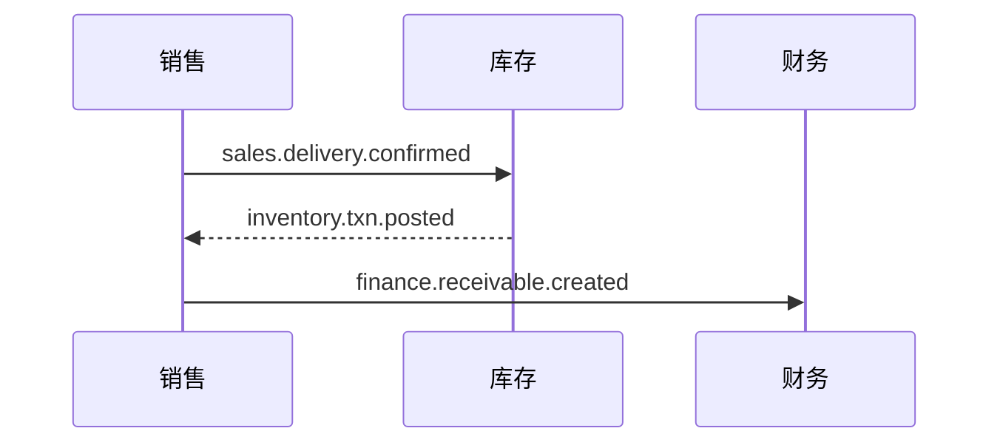

# {業務域名} 业务域概要书（{業務域名} 業務概要書）

| 項目 | 内容 |
|---|---|
| 文書名 | {業務域名} 业务域概要书（{業務域名} 業務概要書） |
| 文書番号 | DSN-{DOM}-000 |
| 版数 | v1.0 |
| 作成日 | YYYY-MM-DD |
| 作成者 | {担当名} |
| 承認者 | 未承認（レビュー待ち） |
| 状態 | ドラフト（レビュー中） |
| 関連文書 | [体系总览](../README.md) / [共通项目定义](../00-common/01-common-item-definitions.md) / [跨域流程](../00-common/09-cross-domain-flow.md) / {他域文書} |

---

## 1. 業務概要

### 1.1 目的

{本業務域が果たす役割を 2〜4 文で。何のために存在する業務か。}

### 1.2 適用範囲

| 項目 | 内容 |
|---|---|
| 対象会社・拠点 | 华东精密电机股份有限公司 / 常州总装厂・无锡零部件厂 |
| 対象機能範囲 | {例：販売引合から売掛計上まで} |
| 対象外 | {明示的に対象外とする業務。他域/他システムで扱うもの} |
| 前提 | {先行して整備が必要なマスタ・設定} |

### 1.3 業務上の狙い（KPI）

| KPI | 定義・算式 | 目標値 | 実現する機能 ID |
|---|---|---|---|
| {例：受注〜出荷リードタイム} | {出荷日 - 受注日 の平均} | {例：3 営業日} | F-XXX-xxx |

## 2. 組織とロール

| ロール | 所属 | 主な操作 | 関連機能 ID | 権限 |
|---|---|---|---|---|
| {営業担当} | {営業部} | {見積作成・受注登録} | {F-SAL-001} | {sales:quotation:create} |

### 2.1 承認経路

{金額・条件別の承認経路を表で。詳細は [08 共通业务规则](../00-common/08-common-business-rules.md) 第 8 章と 90-data/approval-matrix.md を参照}

## 3. 業務フロー

### 3.1 全体フロー

### 3.2 処理手順

| # | 手順 | 実施者 | システム処理 | 入力 | 出力 | 異常時 |
|---|---|---|---|---|---|---|
| 1 | {引合登録} | {営業} | {引合番号採番・顧客チェック} | {顧客、品目} | {引合番号} | {顧客無効時エラー} |

### 3.3 関連業務域との連携

| 相手域 | 連携内容 | 方式（同期/イベント） | 契約 |
|---|---|---|---|
| {INV} | {出庫確定} | {イベント} | [09 跨域流程](../00-common/09-cross-domain-flow.md) 第 x 章 |

## 4. 機能一覧

| 機能 ID | 機能名 | 概要 | 画面 ID | 種別 | 優先度 | 状態 | 詳細設計書 |
|---|---|---|---|---|---|---|---|
| F-{DOM}-001 | {機能名} | {1 行概要} | SCR-{DOM}-001 | 登録/一覧/照会/バッチ/連携 | P0 | 設計済 | [01-xxx.md](01-xxx.md) |

> 優先度：P0（Phase 1 MVP）/ P1（Phase 1.5）/ P2（Phase 2）。状態：未設計/設計中/設計済/レビュー済/承認済。

## 5. 画面一覧

| 画面 ID | 画面名 | 類型 | 機能 ID | 権限コード | 遷移元 | 遷移先 |
|---|---|---|---|---|---|---|
| SCR-{DOM}-001 | {機能名}一覧 | 一覧検索 | F-{DOM}-001 | {module:resource:view} | {メニュー} | SCR-...-002 |

## 6. 帳票一覧

| 帳票 ID | 帳票名 | 出力タイミング | 帳票種別 | 機能 ID | 詳細 |
|---|---|---|---|---|---|
| PRT-{DOM}-001 | {帳票名} | {手動/承認時/出荷時} | {伝票/一覧表/集計表} | {F-...} | [92](92-report-batch-design.md) |

## 7. バッチ一覧

| バッチ ID | バッチ名 | 起動方式 | 実行時間帯 | 処理概要 | 冪等性 |
|---|---|---|---|---|---|
| BAT-{DOM}-001 | {バッチ名} | {日次/手動} | {02:00} | {概要} | {再実行可} |

## 8. テーブル一覧

| 物理名 | 論理名 | 種別 | 主な用途 | 更新元機能 ID | データ量見積 |
|---|---|---|---|---|---|
| {sal_sales_order} | 销售订单 | 伝票 | {受注ヘッダ} | {F-SAL-003} | {3 万/年} |

## 9. 外部 IF 一覧

| IF ID | 名称 | 相手先 | 方向 | 方式 | 頻度 | 契機 |
|---|---|---|---|---|---|---|
| IF-{DOM}-001 | {名称} | {MES/银行/...} | {送信/受信/双方向} | {REST/ファイル} | {リアルタイム} | {工单下达時} |

## 10. 権限一覧

| 権限コード | 対象機能 | 対象データ範囲 | 付与ロール |
|---|---|---|---|
| {module:resource:action} | {F-...} | {全社/部門/本人} | {ロール名} |

## 11. 用語（本域固有）

| 用語 | 説明 | 対応英語/日文 |
|---|---|---|
| {用語} | {説明} | {term} |

## 12. 未決事項

| # | 事項 | 理由 | 暫定仕様 | 担当 | 期限 |
|---|---|---|---|---|---|
| 1 | {事項} | {理由} | {暫定} | {担当} | {YYYY-MM-DD} |

## 13. 改訂履歴

| 版数 | 日付 | 変更内容 | 変更者 |
|---|---|---|---|
| v1.0 | YYYY-MM-DD | 初版作成 | {担当名} |
