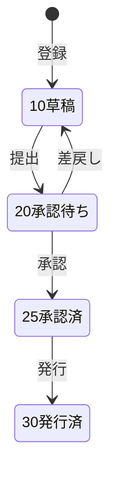
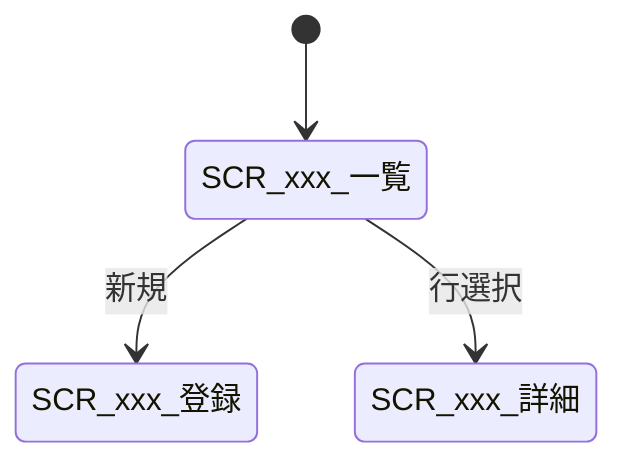

# {機能名} 详细设计书（{機能名} 詳細設計書）

| 項目 | 内容 |
|---|---|
| 文書名 | {機能名} 详细设计书（{機能名} 詳細設計書） |
| 文書番号 | DSN-{DOM}-{NNN} |
| 版数 | v1.0 |
| 作成日 | YYYY-MM-DD |
| 作成者 | {担当名} |
| 承認者 | 未承認（レビュー待ち） |
| 状態 | ドラフト（レビュー中） |
| 関連文書 | [業務域概要](00-overview.md) / [共通項目定義](../00-common/01-common-item-definitions.md) / [画面共通規格](../00-common/02-common-screen-spec.md) / [API 共通規格](../00-common/03-common-api-spec.md) / [跨域流程](../00-common/09-cross-domain-flow.md) |

---

## 1. 機能概要

| 項目 | 内容 |
|---|---|
| 機能 ID | F-{DOM}-{NNN} |
| 機能名 | {機能名} |
| 目的 | {この機能が業務上何を達成するか} |
| 利用者・ロール | {ロール名} |
| 利用シーン | {いつ・どのような場面で使うか} |
| 優先度 | P0 / P1 / P2 |
| 画面 ID | SCR-{DOM}-{NNN}（複数可） |
| 関連 IF | {IF-... または「なし」} |

## 2. 業務要件・業務ルール

### 2.1 前提条件

| # | 前提条件 | 成立しない場合の挙動 |
|---|---|---|
| 1 | {前提} | {エラー/非表示/警告} |

### 2.2 業務ルール

| # | ルール | 根拠（法令・社内規程・業務慣行） | 関連項目 |
|---|---|---|---|
| BR-01 | {例：与信限度を超える受注は登録不可（ただし承認により例外可）} | {社内与信規程} | {credit_limit, order_amount} |

### 2.3 計算式・判定式

| # | 対象 | 算式 | 丸め | 例 |
|---|---|---|---|---|
| CALC-01 | {例：税抜金額} | {数量 × 単価} | {四捨五入 2 桁} | {2 × 1,000.005 = 2,000.01} |

### 2.4 状態遷移

| 遷移 | トリガ | 権限 | 更新項目 | メッセージ |
|---|---|---|---|---|
| 10→20 | 提出ボタン | {module:resource:submit} | {status=20, submitted_at} | {MSG-...} |

## 3. 関連機能

| 関係 | 機能 ID | 機能名 | 関係内容 |
|---|---|---|---|
| 上流 | {F-...} | {機能名} | {データ受領} |
| 下流 | {F-...} | {機能名} | {データ引渡し} |
| 参照 | {F-...} | {マスタ} | {マスタ参照} |

## 4. 画面設計

### 4.1 画面一覧

| 画面 ID | 画面名 | 類型 | 概要 |
|---|---|---|---|
| SCR-{DOM}-{NNN} | {画面名} | 登録編集/一覧検索/参照詳細 | {概要} |

### 4.2 画面遷移

### 4.3 画面レイアウト

{画面ごとに ASCII レイアウトまたは項目配置表を記載。最低限、ヘッダ・検索条件・一覧・明細・フッタの区分を示す。}

### 4.4 画面項目定義

| No | 項目 ID | 項目名 | 種別 | 型/桁 | 必須 | 初期値 | 入力チェック | データソース | DB 項目 | 備考 |
|---|---|---|---|---|---|---|---|---|---|---|
| 1 | {item_order_no} | 伝票番号 | テキスト | VARCHAR(32) | ○ | 自動採番 | 桁数・形式 | 採番 | {sales_order_no} | 参照のみ |

### 4.5 イベント処理

| No | イベント | トリガ | 処理内容 | 呼出 API | 画面遷移 | 備考 |
|---|---|---|---|---|---|---|
| 1 | 保存ボタン | クリック | {処理概要} | POST /api/... | {一覧へ戻る} | {二重送信防止} |

### 4.6 一覧画面仕様（該当時）

| 項目 | 内容 |
|---|---|
| 検索条件 | {項目名（型）…} |
| 既定検索条件 | {当日/当月/全件} |
| ソート | {既定: 登録日時降順} |
| ページング | {20 件/ページ} |
| 一括操作 | {承認/取消/エクスポート} |
| エクスポート | {Excel、最大 10,000 件、非同期} |

### 4.7 表示制御

| 条件 | 対象項目/ボタン | 制御 |
|---|---|---|
| {ステータス=25 承認済} | {編集ボタン} | {非表示} |
| {権限なし} | {金額項目} | {非表示・API でも返さない} |

## 5. 入力チェック仕様

| No | チェック ID | 対象項目 | 種別 | 条件 | タイミング | メッセージ ID |
|---|---|---|---|---|---|---|
| 1 | CHK-{DOM}-{NNN}-01 | {項目} | 必須 | {空でない} | {保存時} | {MSG-...} |

## 6. 処理詳細

### 6.1 処理一覧

| 処理 ID | 処理名 | 契機 | トランザクション | 排他 |
|---|---|---|---|---|
| PRC-{DOM}-{NNN}-01 | {登録処理} | {保存} | {要} | {楽観排他} |

### 6.2 処理手順（正常系）

**PRC-...-01 {処理名}**

1. {入力チェック（第 5 章）を実行する}
2. {権限・データ範囲チェック}
3. {業務チェック（在庫・与信・期間等）}
4. {採番・ID 生成}
5. {テーブル登録/更新（対象項目を明記）}
6. {関連データ更新・ステータス遷移}
7. {イベント発行 / 後続処理}
8. {結果返却・監査ログ}

### 6.3 例外処理

| No | 異常条件 | 検知箇所 | 処理 | ロールバック | メッセージ ID |
|---|---|---|---|---|---|
| 1 | {在庫不足} | {引当処理} | {エラー終了} | {全体} | {MSG-...} |

### 6.4 冪等性・再実行

{同一リクエストの二重実行時の挙動。Idempotency-Key の扱い。バッチの場合の再実行条件}

## 7. API 設計

| No | メソッド | パス | 権限 | 概要 | リクエスト | レスポンス |
|---|---|---|---|---|---|---|
| 1 | POST | /api/{module}/{resource} | {module:resource:create} | {登録} | {DTO} | {DTO} |

### 7.1 リクエスト/レスポンス詳細

{JSON サンプル（実データまたは示例値を用いる）。エラー時の JSON 例も記載}

## 8. データ更新仕様

| テーブル | 操作 | 更新項目 | 更新条件 | トリガ |
|---|---|---|---|---|
| {table} | INSERT/UPDATE | {項目} | {条件} | {処理 ID} |

## 9. エラー処理・メッセージ

| メッセージ ID | 種別 | 本文 | 発生条件 | 利用者への対処 | ログ |
|---|---|---|---|---|---|
| {MSG-...} | E/W/I | {本文} | {条件} | {対処} | {WARN/ERROR} |

## 10. 権限・セキュリティ

| 種別 | 内容 |
|---|---|
| 画面権限 | {権限コード} |
| 操作権限 | {提出/承認/取消…} |
| 項目権限 | {金額は営業担当のみ閲覧可 等} |
| データ範囲 | {自部門の伝票のみ} |
| 監査ログ | {登録/更新/承認/出力を記録} |

## 11. 性能・非機能

| 項目 | 目標値 | 前提 |
|---|---|---|
| 応答時間 | {一覧 2 秒以内、登録 3 秒以内} | {データ量} |
| 同時実行 | {20 ユーザ} | — |
| 最大件数 | {一覧 1 万件/月} | {インデックス} |

## 12. テスト観点

| No | 観点 ID | 分類 | 観点 | 期待結果 |
|---|---|---|---|---|
| 1 | TST-F-{DOM}-{NNN}-01 | 正常系 | {正常登録} | {登録され採番される} |
| 2 | TST-F-{DOM}-{NNN}-02 | 異常系 | {必須漏れ} | {項目エラー表示、登録されない} |
| 3 | TST-F-{DOM}-{NNN}-03 | 境界値 | {数量 0} | {エラー} |
| 4 | TST-F-{DOM}-{NNN}-04 | 排他 | {同時更新} | {後勝ちせずエラー} |
| 5 | TST-F-{DOM}-{NNN}-05 | 権限 | {権限なしユーザ} | {非表示・API 403} |

## 13. 未決事項

| # | 事項 | 理由 | 暫定仕様 | 担当 | 期限 |
|---|---|---|---|---|---|
| 1 | {事項} | {理由} | {暫定} | {担当} | {YYYY-MM-DD} |

## 14. 改訂履歴

| 版数 | 日付 | 変更内容 | 変更者 |
|---|---|---|---|
| v1.0 | YYYY-MM-DD | 初版作成 | {担当名} |
